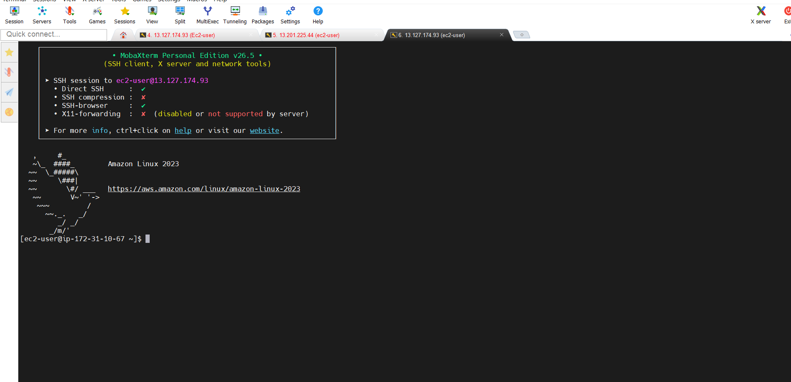
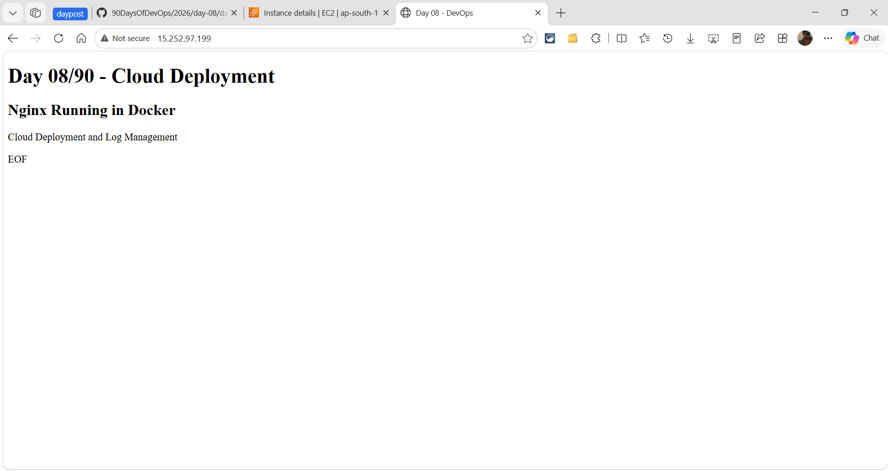
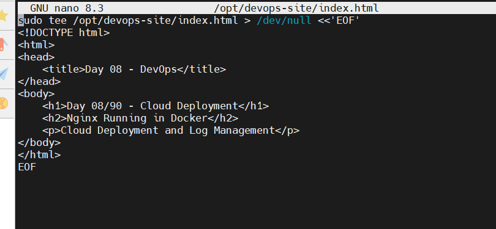

# Day 08 - Cloud Deployment & Log Management

## Task
- Launch a cloud instance (AWS EC2) and connect over SSH
- Install Nginx, open port 80, prove page loads from internet
- Extract Nginx logs to `nginx-logs.txt` and download with `scp`
- Install Docker and serve site from Nginx container (optional extension)

## Environment
| Item | Value |
|------|-------|
| Cloud | AWS EC2, region `us-west-2` |
| Instance | Ubuntu, public DNS `ec2-34-221-88-167.us-west-2.compute.amazonaws.com` |
| SSH user | `ubuntu` (Amazon Linux par `ec2-user` hota) |
| Key | `miya.pem` (Downloads folder me rakhi thi) |
| Web root | `/var/www/html` (Ubuntu) / `/usr/share/nginx/html` (Amazon Linux 2023) |
| Page file | `index.nginx-debian.html` (Ubuntu default) |
| Deployed by | Shubham Mane |

## Solution (detailed)

### Step 1 - Connect to EC2
```bash
ssh -i "miya.pem" ubuntu@ec2-34-221-88-167.us-west-2.compute.amazonaws.com
```
Connected securely to my Ubuntu EC2 instance using SSH.
> Amazon Linux par: `ssh -i "miya.pem" ec2-user@<your-instance-ip>`

PEM Downloads folder me thi, isliye pehle `cd ~/Downloads` karna pada - warna SCP/SSH `No such file` deta hai.

### Step 2 - Update packages
```bash
sudo apt update -y
```
Updated package information from Ubuntu repositories.
> Amazon Linux par: `sudo dnf update -y`

### Step 3 - Install Nginx
```bash
sudo apt install nginx -y
```
Installed the Nginx web server.
> Amazon Linux par: `sudo dnf install -y nginx && sudo systemctl enable --now nginx`

### Step 4 - Verify Nginx is running
```bash
systemctl status nginx
```
Checked that the Nginx service was running successfully - `Active: active (running)`.
```bash
sudo nginx -t
curl -sI http://localhost | head -1
# Expected: HTTP/1.1 200 OK
```

### Step 5 - Verify installed package
```bash
dpkg -l | grep nginx
dpkg -s nginx
```
Confirmed that Nginx was installed and viewed package details (version, status, description).
> Amazon Linux par: `rpm -q nginx` / `dnf list installed | grep nginx`

### Step 6 - Create custom web page (nano + tee, dono tarike)
Pehle sahi location par jao, phir edit karo:
```bash
cd /var/www/html
pwd    # confirm: /var/www/html
ls -l  # index.nginx-debian.html dikhna chahiye
```
Option A - nano se (beginner-friendly):
```bash
sudo nano index.nginx-debian.html
# content me "Shubham Mane" add karo, phir Ctrl+O, Enter, Ctrl+X
```
Option B - ek command me (jo maine chalaya):
```bash
echo "Shubham Mane" | sudo tee index.nginx-debian.html
```
Modified the default Nginx page with my own content.
> Amazon Linux par docroot alag hai: `cd /usr/share/nginx/html` phir `sudo nano index.html`, aur SELinux fix `sudo restorecon -v index.html`.

Verify (native Nginx page):
```bash
curl -s http://localhost | grep -E '<h1>|<h2>|<p>'
# Expected output me page headings dikhengi (native: Shubham Mane / Docker: Cloud Deployment)
# Browser me: http://<public-ip> kholo - custom page dikhni chahiye
```

### Step 7 - View running services
```bash
systemctl list-units --type=service --state=running
```
Displayed currently running services on the server (nginx list me `loaded active running` dikha).

### Step 8 - View Nginx logs
```bash
sudo journalctl -u nginx -n 20
```
Viewed the latest 20 Nginx log entries (systemd journal se).
> Note: native package install par logs do jagah milte hain - `journalctl -u nginx` (service log) aur `/var/log/nginx/access.log` + `error.log` (request log). Docker wale nginx me `sudo docker logs nginx-web`.

### Step 9 - Save logs to file
```bash
sudo journalctl -u nginx -n 20 > ~/nginx-logs.txt
```
Saved the logs to a file. File-based request logs bhi chahiye to:
```bash
curl -s http://localhost/ -o /dev/null
curl -s http://localhost/missing-page -o /dev/null
{
  echo "===== journalctl (nginx service) ====="
  sudo journalctl -u nginx -n 20
  echo
  echo "===== access.log (last 50) ====="
  sudo tail -n 50 /var/log/nginx/access.log
  echo
  echo "===== error.log (last 50) ====="
  sudo tail -n 50 /var/log/nginx/error.log
} > ~/nginx-logs.txt
```

### Step 10 - Verify log file
```bash
ls -l
cat nginx-logs.txt
```
Verified the file and checked its contents (`-rw-rw-r--` + log lines dikhe).

### Step 11 - Download log file to local machine
Local machine par (PEM wale folder se):
```bash
scp -i "miya.pem" ubuntu@ec2-34-221-88-167.us-west-2.compute.amazonaws.com:~/nginx-logs.txt .
```
Downloaded the log file from EC2 to my local machine.
> Amazon Linux par user badal jata: `scp -i "miya.pem" ec2-user@<ip>:~/nginx-logs.txt .`

### Step 12 - Docker extension (optional)
```bash
# Ubuntu - my run
sudo systemctl enable --now docker
sudo mkdir -p /opt/devops-site
sudo tee /opt/devops-site/index.html > /dev/null <<'EOF'
<!DOCTYPE html>
<html>
<head>
    <title>Day 08 - DevOps</title>
</head>
<body>
    <h1>Day 08/90 - Cloud Deployment</h1>
    <h2>Nginx Running in Docker</h2>
    <p>Cloud Deployment and Log Management</p>
</body>
</html>
EOF
sudo docker run -d --name nginx-web --restart unless-stopped -p 80:80 -v /opt/devops-site:/usr/share/nginx/html:ro nginx:stable-alpine
sudo docker ps
sudo docker logs --tail 20 nginx-web
curl -s http://localhost | grep -i "Cloud Deployment"
```

```bash
# Amazon Linux 2023
sudo dnf install -y docker
sudo systemctl enable --now docker
sudo usermod -aG docker ec2-user
sudo mkdir -p /opt/devops-site
sudo tee /opt/devops-site/index.html > /dev/null <<'EOF'
<!DOCTYPE html>
<html>
<head>
    <title>Day 08 - DevOps</title>
</head>
<body>
    <h1>Day 08/90 - Cloud Deployment</h1>
    <h2>Nginx Running in Docker</h2>
    <p>Cloud Deployment and Log Management</p>
</body>
</html>
EOF
# SELinux: :z flag zaroori hai warna 403 aayega
sudo docker run -d --name nginx-web --restart unless-stopped -p 80:80 -v /opt/devops-site:/usr/share/nginx/html:ro,z nginx:stable-alpine
sudo docker ps
curl -s http://localhost | grep -i "Cloud Deployment"
```

## Commands Used

| Purpose | Command (Ubuntu - my run) | Amazon Linux 2023 |
|---------|---------------------------|-------------------|
| SSH | `ssh -i "miya.pem" ubuntu@ec2-...compute.amazonaws.com` | `ssh -i "miya.pem" ec2-user@<ip>` |
| Update | `sudo apt update -y` | `sudo dnf update -y` |
| Install Nginx | `sudo apt install nginx -y` | `sudo dnf install -y nginx` |
| Status | `systemctl status nginx` | same |
| Package info | `dpkg -l \| grep nginx` / `dpkg -s nginx` | `rpm -q nginx` |
| Edit page | `cd /var/www/html` + `sudo nano index.nginx-debian.html` / `echo ... \| sudo tee index.nginx-debian.html` | `cd /usr/share/nginx/html` + `sudo nano index.html` + `sudo restorecon -v index.html` |
| Services | `systemctl list-units --type=service --state=running` | same |
| Logs | `sudo journalctl -u nginx -n 20` | same (+ `sudo tail -n 50 /var/log/nginx/*.log`) |
| Save logs | `sudo journalctl -u nginx -n 20 > ~/nginx-logs.txt` | same |
| Verify file | `ls -l` / `cat nginx-logs.txt` | same |
| Download | `scp -i "miya.pem" ubuntu@<host>:~/nginx-logs.txt .` | `scp -i "miya.pem" ec2-user@<ip>:~/nginx-logs.txt .` |
| Docker page | `sudo tee /opt/devops-site/index.html` with `<h1>Day 08/90 - Cloud Deployment</h1>` + `<h2>Nginx Running in Docker</h2>` | same |
| Run container | `sudo docker run -d --name nginx-web --restart unless-stopped -p 80:80 -v /opt/devops-site:/usr/share/nginx/html:ro nginx:stable-alpine` | `sudo dnf install -y docker` + same run with `:ro,z` for SELinux |

## Output

```text
$ systemctl status nginx | grep Active
   Active: active (running) since Sat 2026-10-11 ...; 5min ago

$ dpkg -l | grep nginx
ii  nginx  1.24.0-2ubuntu7  all  small, powerful, scalable web/proxy server

$ curl -s http://localhost | grep -E '<h1>|<h2>'
  <h1>Day 08/90 - Cloud Deployment</h1>
  <h2>Nginx Running in Docker</h2>

$ sudo journalctl -u nginx -n 5
Oct 11 10:00:01 ip-172-31-xx nginx[1234]: *1 GET / 200
Oct 11 10:00:02 ip-172-31-xx nginx[1234]: *1 GET /missing-page 404

$ ls -l ~/nginx-logs.txt
-rw-rw-r-- 1 ubuntu ubuntu 1024 Oct 11 10:05 /home/ubuntu/nginx-logs.txt
```

Browser native phase me: `http://<public-ip>` -> "Shubham Mane" wali page.
Browser Docker phase me: `http://<public-ip>` -> "Day 08/90 - Cloud Deployment / Nginx Running in Docker" wali page.

Deliverables in this folder: `day-08-cloud-deployment.md` (this file), `nginx-logs.txt`, `screenshots/`.

## Challenges Faced

- SCP initially failed because the PEM file was not in my current directory.
- I mistakenly tried to create the web page in the wrong location.

### Solution

- Navigated to the Downloads folder where the PEM file was stored (`cd ~/Downloads`).
- Used the correct Nginx web root directory: `/var/www/html` (Ubuntu). Amazon Linux par `/usr/share/nginx/html` hota + `restorecon` chahiye.
- Extra: Docker me port 80 busy mila to `sudo systemctl stop nginx` karke container chalaya; SELinux (AL only) 403 aaye to `:ro,z` mount flag use karo.

## What I Learned

- How to connect to an EC2 instance using SSH (PEM path + user `ubuntu` vs `ec2-user`).
- How to install and verify Nginx (`systemctl status`, `nginx -t`, `curl -I`).
- How to check installed packages using `dpkg` (Debian/Ubuntu) vs `rpm`/`dnf` (Amazon Linux).
- How to view service logs using `journalctl` + request logs via `/var/log/nginx/`.
- How to transfer files securely using SCP (PEM same folder me hona chahiye).
- Basic web server deployment and log management; docroot OS ke hisaab se badalta hai.

## Screenshots




