# Day 09 - Linux User & Group Management Challenge

## Task
- Create users (`tokyo`, `berlin`, `professor`, later `nairobi`) with home directories and passwords
- Create groups (`developers`, `admins`, `project-team`)
- Assign users to one or more groups with `usermod -aG`
- Build shared directories owned by a group with `775` permissions and prove access works by writing files as those users

## Environment
| Item | Value |
|------|-------|
| OS | Ubuntu 22.04 / 24.04 (or Debian) - any systemd Linux |
| Privilege model | You have `sudo` (run the lab as a non-root user and use `sudo`) |
| Tools used | `useradd`, `passwd`, `chpasswd`, `usermod`, `userdel`, `groupadd`, `groupdel`, `groups`, `id`, `getent`, `chgrp`, `chmod`, `stat`, `ls -ld`, `sudo -u` |
| Config files | `/etc/passwd`, `/etc/shadow`, `/etc/group`, `/etc/gshadow` |
| WSL2 note | Run this **inside the Linux filesystem (`~`), never under `/mnt/c`** - see Gotchas |

## Solution

### Task 0 - Set up a clean workspace
**Why:** These commands are not repeatable (a user already exists -> `useradd` fails), so keep the whole lab idempotent-ish and easy to inspect from one directory.

```bash
mkdir -p ~/day09-lab && cd ~/day09-lab
sudo -v    # refresh sudo timestamp once instead of typing sudo all day
```

### Task 1 - Create three users with home directories and passwords
**Why:** `-m` creates `/home/<user>` and copies the skeleton from `/etc/skel` - without it the user exists but has no home. `-s /bin/bash` avoids the Debian/Ubuntu default of `/bin/sh` (dash).

```bash
sudo useradd -m -s /bin/bash tokyo
sudo passwd tokyo

sudo useradd -m -s /bin/bash berlin
sudo passwd berlin

sudo useradd -m -s /bin/bash professor
sudo passwd professor
```

Batch alternative if you want to script it (no interactive prompts):
```bash
printf 'tokyo:DevOps@2026\nberlin:DevOps@2026\nprofessor:DevOps@2026\n' | sudo chpasswd
```

**Verify:**
```bash
grep -E '^(tokyo|berlin|professor):' /etc/passwd
ls -l /home/
id tokyo
```
Expected `/etc/passwd` fields: `tokyo:x:UID:GID::/home/tokyo:/bin/bash` (e.g. `tokyo:x:1002:1003::/home/tokyo:/bin/bash` in this run - your UID/GID will differ)
- field 1 = name, 2 = `x` (password lives in `/etc/shadow`), 3 = UID, 4 = primary GID, 7 = home, 8 = shell

```bash
sudo ls -l /home/tokyo        # drwx----- 1 tokyo tokyo 4096 ... /home/tokyo
```

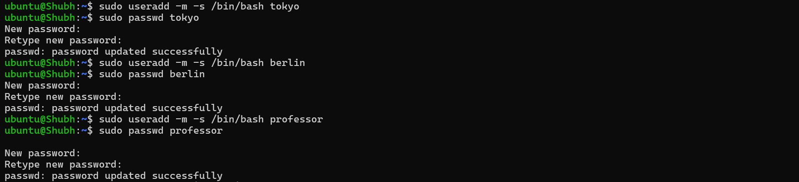
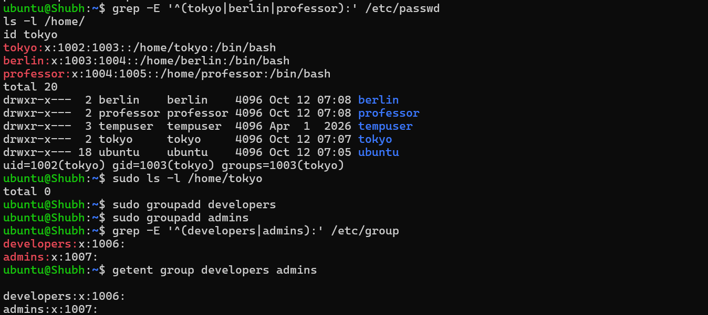

### Task 2 - Create two groups
**Why:** Groups are how several humans share a directory or a resource without granting world access. `/etc/group` holds the membership list.

```bash
sudo groupadd developers
sudo groupadd admins

grep -E '^(developers|admins):' /etc/group
getent group developers admins
```
Expected: `developers:x:1006:` and `admins:x:1007:` in this run (your GIDs will differ, empty member list at this point)

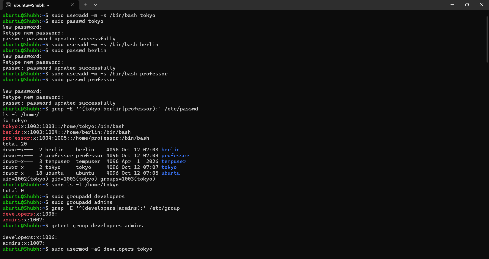

### Task 3 - Assign users to groups
**Why:** `-aG` **appends** to the supplementary group list. Dropping `-a` (`usermod -G`) *replaces* the entire list and will silently wipe existing memberships - the single most common footgun here.

```bash
sudo usermod -aG developers tokyo
sudo usermod -aG developers,admins berlin
sudo usermod -aG admins professor
```

**Verify:**
```bash
groups berlin
id berlin
id -nG berlin                 # just the names, one per line-ish
getent group developers
getent group admins
```
Expected:
- `tokyo` -> `tokyo developers`
- `berlin` -> `berlin developers admins`
- `professor` -> `professor admins`

`getent group developers` should now list `berlin,tokyo` in the 4th field; `getent group admins` -> `berlin,professor`.

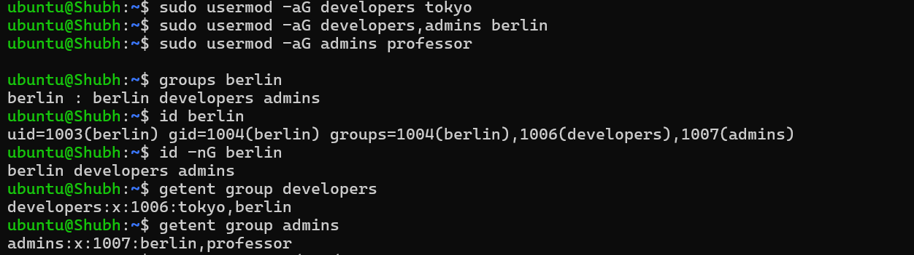

### Task 4 - Shared directory `/opt/dev-project` (group `developers`, mode 775)
**Why:** This is the canonical Linux collaboration pattern: the directory is owned by the *group*, not by a person, so everyone in the group can create files and outsiders cannot.

```bash
sudo mkdir -p /opt/dev-project
sudo chgrp developers /opt/dev-project
sudo chmod 775 /opt/dev-project

ls -ld /opt/dev-project
stat -c 'owner=%U group=%G mode=%a' /opt/dev-project
```
Expected: `drwxrwxr-x developers developers /opt/dev-project`

**Test as the group members** (`sudo -u` runs a single command as another user without switching sessions):
```bash
sudo -u tokyo  touch /opt/dev-project/tokyo-report.txt
sudo -u berlin touch /opt/dev-project/berlin-report.txt
sudo -u tokyo  sh -c 'echo "built by tokyo"  > /opt/dev-project/build.log'

ls -l /opt/dev-project
cat /opt/dev-project/build.log
```

> **Note from this run:** `build.log` ends up owned by `tokyo:tokyo` with mode `644`, so a second writer (`berlin >> build.log`) gets `Permission denied` even though both are in `developers`. That is expected **without setgid** - each new file inherits the creator's primary group, not the directory's group. Task 5 fixes this with `chmod 2775`. Do not append to another user's file here; give each user their own file instead.

**Negative test** - `professor` is not in `developers`:
```bash
sudo -u professor touch /opt/dev-project/professor-report.txt
# touch: cannot touch '/opt/dev-project/professor-report.txt': Permission denied
```
That failure is the proof the permissions are actually doing something.

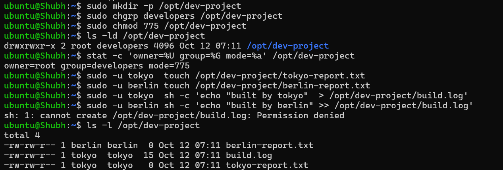

### Task 5 - Team workspace with `nairobi` and `project-team`
**Why:** Same pattern, second time, with a group that has members from different teams (`nairobi` + `tokyo`) - closest real-world analogue to a project repo shared by a squad.

```bash
sudo useradd -m -s /bin/bash nairobi
sudo passwd nairobi
sudo groupadd project-team

sudo usermod -aG project-team nairobi
sudo usermod -aG project-team tokyo

sudo mkdir -p /opt/team-workspace
sudo chgrp project-team /opt/team-workspace
sudo chmod 775 /opt/team-workspace

ls -ld /opt/team-workspace
id -nG nairobi        # expect: nairobi project-team

sudo -u nairobi touch /opt/team-workspace/nairobi-hello.txt
sudo -u tokyo   touch /opt/team-workspace/tokyo-hello.txt
ls -l /opt/team-workspace
```

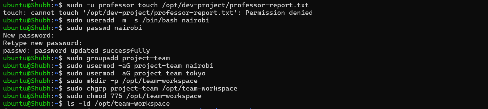

Now the DevOps-grade version - setgid so files created by anyone inherit the group:
```bash
sudo chmod 2775 /opt/team-workspace      # the leading 2 is setgid
ls -ld /opt/team-workspace                # drwxrwsr-x project-team ...
sudo -u nairobi touch /opt/team-workspace/setgid-test.txt
ls -l /opt/team-workspace/setgid-test.txt   # group is project-team, not nairobi
```
Without setgid, a file created by `nairobi` is group-owned by `nairobi`'s primary group and `tokyo` could not edit it - the classic "shared folder" bug.

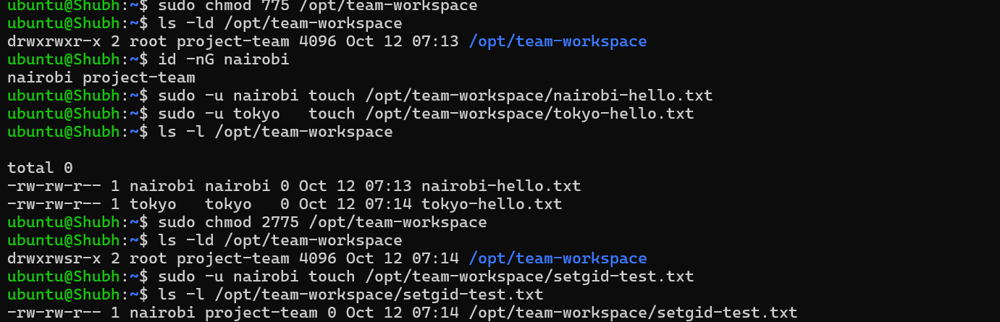

### Task 6 - Full verification sweep
**Why:** One pass that prints the whole picture, useful as evidence in the write-up.

```bash
echo "--- users in /etc/passwd ---"
grep -E '^(tokyo|berlin|professor|nairobi):' /etc/passwd

echo "--- groups in /etc/group ---"
grep -E '^(developers|admins|project-team):' /etc/group

echo "--- supplementary groups per user ---"
for u in tokyo berlin professor nairobi; do printf '%-10s -> ' "$u"; id -nG "$u"; done

echo "--- shared directories ---"
ls -ld /opt/dev-project /opt/team-workspace

echo "--- files created inside them ---"
ls -l /opt/dev-project /opt/team-workspace
```

Expected summary table (yours should match):

| Item | Value |
|------|-------|
| Users | `tokyo`, `berlin`, `professor`, `nairobi` |
| Groups | `developers`, `admins`, `project-team` |
| `tokyo` groups | `tokyo developers project-team` |
| `berlin` groups | `berlin developers admins` |
| `professor` groups | `professor admins` |
| `nairobi` groups | `nairobi project-team` |
| `/opt/dev-project` | `drwxrwxr-x` - group `developers`, mode `775` |
| `/opt/team-workspace` | `drwxrwsr-x` group `project-team`, mode `2775` (setgid) |

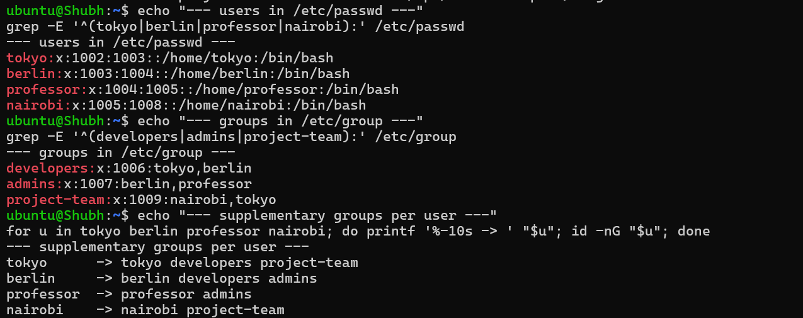
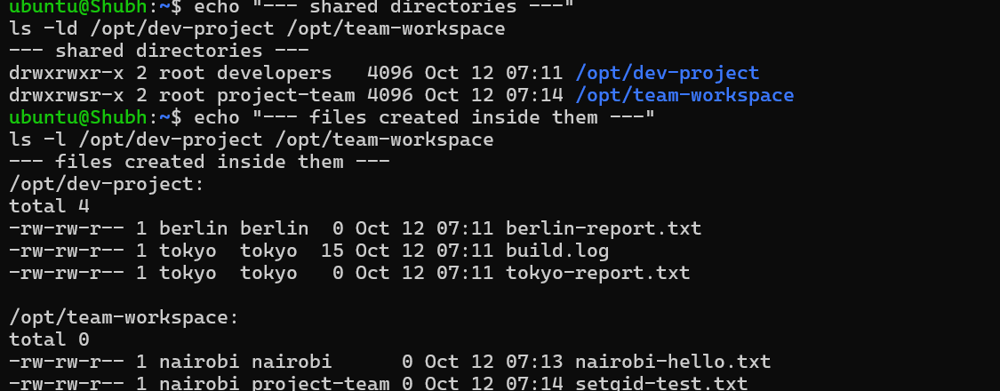

### Task 7 - Login-shell test (what `sudo -u` does not show)
**Why:** `sudo -u` inherits your current working directory and environment. A real login proves PAM sets up the supplementary groups and the home directory.

```bash
sudo -iu tokyo
whoami; id; pwd; ls -la
exit
```
Expect `uid=1002(tokyo)` (your UID may differ), the group list, and `/home/tokyo` as the cwd.

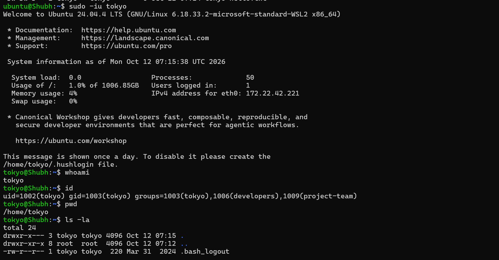

### Task 8 - Cleanup / reset script
**Why:** You will re-run this lab. `userdel -r` removes the user *and* the home directory; `groupdel` removes the group (fails if the group is somebody's primary group, which is why users go first).

```bash
sudo rm -rf /opt/dev-project /opt/team-workspace
sudo userdel -r tokyo
sudo userdel -r berlin
sudo userdel -r professor
sudo userdel -r nairobi
sudo groupdel developers
sudo groupdel admins
sudo groupdel project-team
```

> Run each `userdel`/`groupdel` once. Re-running prints harmless `does not exist` / `mail spool not found` warnings (visible in the screenshot) - that just means the object is already gone.

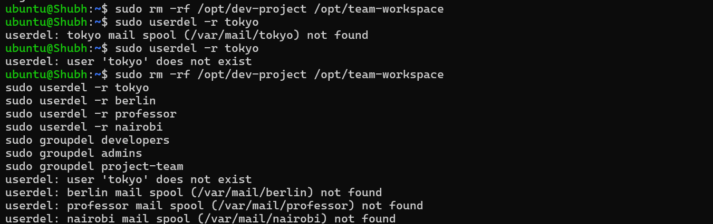

## Users & Groups Created
- Users: `tokyo`, `berlin`, `professor`, `nairobi` (each with `/home/<user>` and a password in `/etc/shadow`)
- Groups: `developers`, `admins`, `project-team`

## Group Assignments
| User | Primary group | Supplementary groups |
|------|---------------|----------------------|
| `tokyo` | `tokyo` | `developers`, `project-team` |
| `berlin` | `berlin` | `developers`, `admins` |
| `professor` | `professor` | `admins` |
| `nairobi` | `nairobi` | `project-team` |

## Directories Created
| Path | Owner | Group | Mode | Who can write |
|------|-------|-------|------|---------------|
| `/home/<user>` | `tokyo` etc. | `tokyo` etc. | `750` (`drwxr-x---`) | owner only |
| `/opt/dev-project` | root | `developers` | `775` (`drwxrwxr-x`) | owner + `developers` |
| `/opt/team-workspace` | root | `project-team` | `2775` (`drwxrwsr-x`) | owner + `project-team`, new files inherit the group |

## Commands Used
```bash
# users
sudo useradd -m -s /bin/bash <user>       # create user + home + bash shell
sudo passwd <user>                        # set password interactively
printf 'u:p\n' | sudo chpasswd            # set passwords non-interactively
sudo userdel -r <user>                    # delete user + home

# groups
sudo groupadd <group>
sudo groupdel <group>

# membership
sudo usermod -aG grp1,grp2 <user>         # ADD to groups (-a is mandatory)
id <user> ; groups <user> ; id -nG <user>
getent group <group>

# shared directories
sudo mkdir -p /opt/dev-project
sudo chgrp developers /opt/dev-project
sudo chmod 775 /opt/dev-project
sudo chmod 2775 /opt/team-workspace       # 2 = setgid, inherit group on new files

# testing
sudo -u <user> touch /opt/dev-project/file.txt
sudo -u <user> sh -c 'echo hi > /opt/dev-project/file.txt'
sudo -iu <user>                            # full login shell for that user
ls -ld /opt/dev-project
stat -c 'owner=%U group=%G mode=%a' /opt/dev-project
```

## Verification
- `grep -E '^(tokyo|berlin|professor|nairobi):' /etc/passwd` shows 4 users with `/home/<user>` and `/bin/bash`
- `ls /home/` lists `tokyo berlin professor nairobi`
- `getent group developers admins project-team` shows the 3 groups
- `id -nG berlin` prints `berlin developers admins` (both groups, not just one)
- `ls -ld /opt/dev-project` prints `drwxrwxr-x ... developers developers`
- `sudo -u tokyo` and `sudo -u berlin` both successfully create files in `/opt/dev-project`
- `sudo -u professor touch /opt/dev-project/x` fails with `Permission denied`
- `sudo -u nairobi touch /opt/team-workspace/x` succeeds and the file's group is `project-team`

## Key Learnings
- `/etc/passwd` is world-readable; the password hash is in `/etc/shadow` (root-only, mode `640`) - use `passwd`, never edit those files by hand
- `useradd -m` vs `useradd` without `-m`: the user account exists but has no home; `-m` also seeds dotfiles from `/etc/skel`
- **`usermod -aG` is mandatory.** `usermod -G grp` replaces all supplementary groups and will silently drop previous ones
- Each user gets a same-named primary group automatically on Ubuntu; `usermod -g` changes it, `-aG` only adds extras
- Group ownership on a shared directory (`chgrp` + `chmod 775`) is the standard way to give a team write access without world access
- Setgid (`chmod 2775`) is what makes shared directories actually work long term - without it every new file gets the creator's primary group
- `sudo -u user cmd` is the fast way to *test* a permission; `sudo -iu user` is the way to *simulate* a real session

## Troubleshooting / Gotchas
- **`groups user` does not show a group you just added.** The current login session caches the group list - log out and back in, or use `newgrp developers` to pick it up in the current shell.
- **`useradd: the user 'tokyo' already exists`.** Not an error to debug - either skip it or clean up first with Task 8.
- **`Permission denied` even though you are the owner.** Check every parent directory too: `/opt` must be searchable (`x`) by your user. `namei -l /opt/dev-project/file.txt` prints the whole path's permissions.
- **`sudo -u tokyo touch relative-file` fails or lands in your directory.** `sudo -u` does not change the working directory. Use absolute paths, or `sudo -iu tokyo` / `cd /home/tokyo`.
- **`groupdel: cannot remove the primary group of user tokyo`.** A group that is still somebody's primary group cannot be deleted. Fix: delete the users first (`userdel -r`), or `sudo usermod -g <other-group> <user>` to move them off it. To drop a single supplementary membership: `sudo gpasswd -d <user> <group>`.
- **WSL2:** users created with `useradd` behave oddly under `/mnt/c` (Windows drives ignore Linux ownership and modes). Keep everything under `~` (ext4) - `sudo chmod 775 /mnt/c/...` will not stick.
- **Docker containers:** you need `root` (or membership in the container's user) to write inside a running container, because the container's `root` is not your host `root`. That is a real-world bridge from this lab to Day 08.

## Screenshots

All proofs live inline in Tasks 1-8 above. Index of files in `screenshots/`:

| File | Proves |
|------|--------|
| `create-users.png` | `useradd -m` + `passwd` for `tokyo`, `berlin`, `professor` |
| `verify-users-create-groups.png` | `/etc/passwd`, `/home/`, `id tokyo`, `groupadd`, `/etc/group` |
| `create-users-groups-overview.png` | Full scroll from user creation through group creation |
| `assign-groups-verify.png` | `usermod -aG` + `groups` / `id` / `getent` membership |
| `shared-dir-dev-project.png` | `/opt/dev-project` `775`, `chgrp developers`, file creation as `tokyo`/`berlin` |
| `negative-test-create-nairobi-team.png` | `professor` denied on `dev-project`, `nairobi` + `project-team` setup |
| `team-workspace-setgid.png` | `/opt/team-workspace` `775` -> `2775` setgid inheritance test |
| `verification-sweep-users-groups.png` | Final sweep: users in `passwd`, groups in `group`, per-user groups |
| `verification-sweep-dirs-files.png` | Final sweep: `ls -ld` on shared dirs, `ls -l` on files |
| `login-shell-test-tokyo.png` | `sudo -iu tokyo` login shell: `whoami`, `id`, `pwd`, `ls -la` |
| `cleanup-reset.png` | Idempotent `rm -rf` + `userdel -r` + `groupdel` reset |
