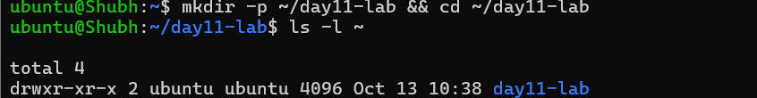

# Day 11 - File Ownership Challenge (chown & chgrp)

## Task
- Read the owner/group columns of `ls -l` and explain what owner vs group actually control
- Change the **owner** of a file with `chown` (owner only, and owner+group in one command)
- Change the **group** of a file with `chgrp` and with `chown :group`
- Apply ownership changes **recursively** with `-R` across a directory tree
- Recreate the heist scenario end-to-end: users `tokyo`/`berlin`/`nairobi`, groups `heist-team`/`planners`/`vault-team`/`tech-team`, and the `bank-heist/` files

## Environment
| Item | Value |
|------|-------|
| OS | Ubuntu 22.04 / 24.04 |
| Shell | `bash` |
| Working directory | `~/day11-lab` |
| Tools | `ls`, `stat`, `id`, `chown`, `chgrp`, `useradd`, `usermod`, `groupadd`, `getent`, `namei` |
| Users used | `tokyo`, `berlin`, `nairobi`, `professor` (created in Day 09; created again here if missing) |
| Groups used | `heist-team`, `planners`, `vault-team`, `tech-team` |
| Privilege | `sudo` for every ownership change (chown to another user requires root) |

## Solution

### Prerequisite - Users and groups must exist before you can chown to them
**Why:** `chown` resolves a **name** to a UID/GID by looking it up. If the name is unknown it fails with `invalid user` and changes nothing.

```bash
# create the four users only if they are missing (idempotent)
for u in tokyo berlin nairobi professor; do
  id "$u" >/dev/null 2>&1 || sudo useradd -m -s /bin/bash "$u"
done

# create the four groups only if they are missing
for g in heist-team planners vault-team tech-team; do
  getent group "$g" >/dev/null || sudo groupadd "$g"
done

# prove they exist before touching ownership
id tokyo ; id berlin ; id nairobi ; id professor
getent group heist-team ; getent group planners
getent group vault-team ; getent group tech-team
```


### Task 1: Understanding Ownership (10 minutes)
**Why:** Column 3 and 4 of the long listing are the owner and the group. Everything else is mode, link count, size, mtime.

```bash
mkdir -p ~/day11-lab && cd ~/day11-lab
ls -l ~
```

Anatomy of one line:

```
-rw-r--r-- 1 youruser yourgroup 312 Oct  3 10:20 devops-file.txt
      |        |        |
      |        |        +-- group owner  (a primary or supplementary group)
      |        +----------- user owner   (a UID)
      +-------------------- permission bits: owner / group / others
```

The owner is the single account that owns the file. The group is a *shared* identity: anyone whose
effective groups include that group gets the group's permission bits. A user can be in many groups but
owns a file with exactly one UID - and the kernel checks **all** of your groups against the file's group.

```bash
# precise, machine-readable view
stat -c '%n  owner=%U(%u)  group=%G(%g)  mode=%A (%a)' ~/notes.txt 2>/dev/null || stat -c '%n  %U(%u)  %G(%g)  %A (%a)' .
ls -n                      # numeric UID:GID instead of names (what scripts should parse)

# who am I, and which groups do I belong to
id                         # uid=1000(youruser) gid=1000(youruser) groups=1000(...),27(sudo)
id -un ; id -u ; id -gn ; id -g
id -nG youruser
```


### Task 2: Basic chown Operations (20 minutes)
**Why:** `chown NEWOWNER file` changes the user and **leaves the group untouched** - the most common source of surprise.

```bash
cd ~/day11-lab

touch devops-file.txt
ls -l devops-file.txt                 # youruser yourgroup

sudo chown tokyo devops-file.txt      # owner only; group is unchanged
ls -l devops-file.txt                 # tokyo yourgroup   <- group did NOT change

sudo chown berlin devops-file.txt     # move the owner again
ls -l devops-file.txt                 # berlin yourgroup

# what if you are not root? chown to another user is refused.
chown tokyo devops-file.txt           # chown: changing ownership of 'devops-file.txt': Operation not permitted
```


`Operation not permitted` (EPERM), not `Permission denied` (EACCES), is the signature of "you are not
root". Only root can give a file away; a normal user may only `chgrp` into a group they are a member of.

### Task 3: Basic chgrp Operations (15 minutes)
**Why:** `chgrp` never touches the owner - that is its whole difference from `chown owner:group`.

```bash
cd ~/day11-lab

printf '%s\n' '# Day 11 - heist team notes' 'Owner: unassigned' 'Group: unassigned' > team-notes.txt
ls -l team-notes.txt

sudo groupadd heist-team 2>/dev/null || echo "group heist-team already exists"
sudo chgrp heist-team team-notes.txt
ls -l team-notes.txt                  # group is now heist-team, owner unchanged

# identical effect, different spelling:
sudo chown :heist-team team-notes.txt
ls -l team-notes.txt
```


The `2>/dev/null ||` guard is deliberate: `groupadd` exits non-zero with `group 'heist-team' already exists`
on a re-run, and in a `set -e` script that aborts everything.

### Task 4: Combined Owner & Group Change (15 minutes)
**Why:** `owner:group` is the production form - one syscall, one audit-log line, no window where owner and group disagree.

```bash
cd ~/day11-lab

cat > project-config.yaml <<'EOF'
# Day 11 - ownership lab
app:
  name: heist-planner
  environment: lab
  log_dir: ./app-logs
  workers: 2
EOF

sudo chown professor:heist-team project-config.yaml
ls -l project-config.yaml             # professor heist-team

mkdir -p app-logs
sudo chown berlin:heist-team app-logs
ls -ld app-logs                       # drwxr-xr-x 1 berlin heist-team ... .   (the '1' before berlin is the link count, not an error)
```

Gotcha: `ls -l dir` lists the **contents**; `ls -ld dir` lists the **directory itself**. Use `-d` when you
want the ownership of the directory.


### Task 5: Recursive Ownership (20 minutes)
**Why:** `-R` walks the whole tree. Permissions are checked per path component, so a directory tree only
works if the directories themselves are owned correctly too.

```bash
cd ~/day11-lab

mkdir -p heist-project/vault heist-project/plans
printf '%s\n' 'LAB PLACEHOLDER - no real value here. 1 vault token, unused.' > heist-project/vault/gold.txt
cat > heist-project/plans/strategy.conf <<'EOF'
# Day 11 - heist-project/plans/strategy.conf
entry_point = vault
exit_route  = north-alley
backup_plan = river-tunnel
alarm_delay_seconds = 45
EOF

sudo groupadd planners 2>/dev/null || echo "group planners already exists"

# record the BEFORE state
ls -lR heist-project/

# one command for the whole tree
sudo chown -R professor:planners heist-project/

# record the AFTER state
ls -lR heist-project/
```


Before / after:

| Path | Before | Command | After |
|------|--------|---------|-------|
| `heist-project/` | `youruser:yourgroup` | `chown -R professor:planners heist-project/` | `professor:planners` |
| `heist-project/vault/` | `youruser:yourgroup` | (same command) | `professor:planners` |
| `heist-project/vault/gold.txt` | `youruser:yourgroup` | (same command) | `professor:planners` |
| `heist-project/plans/` | `youruser:yourgroup` | (same command) | `professor:planners` |
| `heist-project/plans/strategy.conf` | `youruser:yourgroup` | (same command) | `professor:planners` |

Verify every entry in one shot:

```bash
find heist-project/ -printf '%u:%g  %p\n' | sort
# every line must start with professor:planners
```

Safety rails worth knowing before any recursive chown:

```bash
# 1. preview exactly which files WOULD change, before changing them
sudo chown -R -c professor:planners heist-project/    # -c reports only actual changes

# 2. fail loudly if the root of the tree is /
sudo chown -R --preserve-root professor:planners heist-project/

# 3. match an expected current owner so a race cannot surprise you
sudo chown -R --from=youruser:yourgroup professor:planners heist-project/

# 4. copy ownership from an existing reference file instead of typing names
sudo chown -R --reference=project-config.yaml heist-project/
```

### Task 6: Practice Challenge (20 minutes)
**Why:** Three files, three different owner/group pairs - this is exactly the shape of a shared
deployment directory where the app user writes, the ops group reads, and nobody else touches it.

```bash
cd ~/day11-lab

mkdir -p bank-heist
printf '%s\n' 'LAB PLACEHOLDER - fake codes for the exercise.' 'gate-1: 0000' 'vault: 1111' > bank-heist/access-codes.txt
printf '%s\n' 'Placeholder for the lab artefact. Replace with a real PDF of your diagrams.' > bank-heist/blueprints.pdf
cat > bank-heist/escape-plan.txt <<'EOF'
LAB PLACEHOLDER - roleplay notes only.
1. Disable the alarm loop.
2. Take the north alley.
3. Split at the river tunnel.
EOF

sudo chown tokyo:vault-team bank-heist/access-codes.txt
sudo chown berlin:tech-team bank-heist/blueprints.pdf
sudo chown nairobi:vault-team bank-heist/escape-plan.txt

ls -l bank-heist/
```


| File | Owner | Group | Command |
|------|-------|-------|---------|
| `access-codes.txt` | `tokyo` | `vault-team` | `chown tokyo:vault-team` |
| `blueprints.pdf` | `berlin` | `tech-team` | `chown berlin:tech-team` |
| `escape-plan.txt` | `nairobi` | `vault-team` | `chown nairobi:vault-team` |

Prove the ownership is real, not cosmetic - act as each user:

```bash
sudo -u tokyo   sh -c 'echo x >> bank-heist/access-codes.txt' && echo 'tokyo can write access-codes.txt'
sudo -u berlin  sh -c 'echo x >> bank-heist/blueprints.pdf'    && echo 'berlin can write blueprints.pdf'
sudo -u nairobi sh -c 'echo x >> bank-heist/escape-plan.txt'   && echo 'nairobi can write escape-plan.txt'

# negative test: tokyo is not in tech-team, so he cannot write berlin's file
sudo -u tokyo sh -c 'echo x >> bank-heist/blueprints.pdf'
# bash: bank-heist/blueprints.pdf: Permission denied
```


### Bonus (Extra): Ownership is only half the question
**Why:** Changing the owner does not grant or revoke access. The mode bits (Day 10) decide what the new
owner can actually do - so ownership and permissions must be designed together.

```bash
cd ~/day11-lab

# professor owns gold.txt but 644 means "nobody but professor can write"
ls -l heist-project/vault/gold.txt
sudo chmod 640 heist-project/vault/gold.txt    # professor rw, planners r, others none
ls -l heist-project/vault/gold.txt

# group ownership without setgid does NOT apply to newly created files
# in a shared dir - fix the directory, not each file
sudo mkdir -p /opt/devops-shared
sudo chown professor:planners /opt/devops-shared
sudo chmod 2775 /opt/devops-shared            # 2 = setgid: new files inherit 'planners'
ls -ld /opt/devops-shared                     # drwxrwsr-x
sudo -u tokyo sh -c 'touch /opt/devops-shared/t.txt'
ls -l /opt/devops-shared/t.txt                # group is planners, not tokyo  <- setgid working

# the whole path must be traversable
namei -l /opt/devops-shared/t.txt

# cleanup
sudo rm -rf /opt/devops-shared
```


## Files & Directories Created
| Path | Created with | Final owner:group |
|------|--------------|-------------------|
| `devops-file.txt` | `touch` | `berlin:` (original group) |
| `team-notes.txt` | `printf ... > team-notes.txt` | `<you>:heist-team` |
| `project-config.yaml` | heredoc | `professor:heist-team` |
| `app-logs/` | `mkdir -p` | `berlin:heist-team` |
| `heist-project/vault/gold.txt` | heredoc | `professor:planners` |
| `heist-project/plans/strategy.conf` | heredoc | `professor:planners` |
| `bank-heist/access-codes.txt` | heredoc | `tokyo:vault-team` |
| `bank-heist/blueprints.pdf` | placeholder text | `berlin:tech-team` |
| `bank-heist/escape-plan.txt` | heredoc | `nairobi:vault-team` |

## Ownership Changes
| File | Before | Command | After |
|------|--------|---------|-------|
| `devops-file.txt` | `<you>:<yourgroup>` | `sudo chown tokyo devops-file.txt` | `tokyo:<yourgroup>` |
| `devops-file.txt` | `tokyo:<yourgroup>` | `sudo chown berlin devops-file.txt` | `berlin:<yourgroup>` |
| `team-notes.txt` | `<you>:<yourgroup>` | `sudo chgrp heist-team team-notes.txt` | `<you>:heist-team` |
| `project-config.yaml` | `<you>:<yourgroup>` | `sudo chown professor:heist-team project-config.yaml` | `professor:heist-team` |
| `app-logs/` | `<you>:<yourgroup>` | `sudo chown berlin:heist-team app-logs` | `berlin:heist-team` |
| `heist-project/**` | `<you>:<yourgroup>` | `sudo chown -R professor:planners heist-project/` | `professor:planners` |
| `bank-heist/access-codes.txt` | `<you>:<yourgroup>` | `sudo chown tokyo:vault-team ...` | `tokyo:vault-team` |
| `bank-heist/blueprints.pdf` | `<you>:<yourgroup>` | `sudo chown berlin:tech-team ...` | `berlin:tech-team` |
| `bank-heist/escape-plan.txt` | `<you>:<yourgroup>` | `sudo chown nairobi:vault-team ...` | `nairobi:vault-team` |

## Commands Used
```bash
# Placeholders used below, matching the lab: USERNAME=tokyo, GROUPNAME=heist-team, OLDUSER=old-owner

# prerequisite objects
id USERNAME ; getent group GROUPNAME
sudo useradd -m -s /bin/bash USERNAME
sudo groupadd GROUPNAME

# inspect
ls -l ; ls -ld DIR ; ls -lR DIR ; ls -n
stat -c '%n %U(%u) %G(%g) %A(%a)' FILE
id ; id -nG USERNAME ; groups USERNAME

# change owner
sudo chown USERNAME FILE
sudo chown USERNAME:GROUPNAME FILE
sudo chown :GROUPNAME FILE                # group only (same as chgrp)
sudo chown -R USERNAME:GROUPNAME DIR/
sudo chown -R -c USERNAME:GROUPNAME DIR/  # report changes only
sudo chown -R --preserve-root USERNAME:GROUPNAME DIR/
sudo chown -R --from=OLDUSER:old-group USERNAME:GROUPNAME DIR/
sudo chown -R --reference=REFERENCE_FILE DIR/
sudo chown -h USERNAME SYMLINK            # change the link, not its target

# change group
sudo chgrp GROUPNAME FILE
sudo chgrp -R GROUPNAME DIR/

# permission/ownership together
sudo chown USERNAME:GROUPNAME FILE && sudo chmod 640 FILE
sudo chmod 2775 DIR                       # setgid so new files inherit the group

# test as another user
sudo -u USERNAME sh -c 'echo x >> FILE'
namei -l /full/path/to/file
find DIR/ -printf '%u:%g  %p\n' | sort
```

## Verification
- `ls -l ~` shows two name columns after the link count - owner and group - and you can name both
- `sudo chown tokyo devops-file.txt` changed column 3 only; `ls -l` confirms the group did not move
- `sudo chgrp heist-team team-notes.txt` changed column 4 only; owner stayed the same
- `sudo chown professor:heist-team project-config.yaml` changed both columns in one command
- `ls -ld app-logs` shows `berlin heist-team` (the `-d` flag matters - `ls -l app-logs` shows contents)
- `find heist-project/ -printf '%u:%g %p\n' | sort` prints `professor:planners` on every line
- `ls -l bank-heist/` shows `tokyo/vault-team`, `berlin/tech-team`, `nairobi/vault-team`
- `sudo -u tokyo sh -c 'echo x >> bank-heist/blueprints.pdf'` fails with `Permission denied`
- `sudo -u tokyo touch /opt/devops-shared/t.txt` produced a file with group `planners` (setgid proof)

## Key Learnings
- Every inode stores exactly one **UID** and one **GID**; a user has many groups, and the kernel grants group rights if *any* of your groups matches the file's GID
- `chown user file` changes only the owner; `chown :group file` changes only the group; `chown user:group file` changes both; `chown user: file` also sets the group to the user's **login group** - write it explicitly instead of relying on that
- `chown` to another user needs root and fails with `Operation not permitted` (EPERM), not `Permission denied`; a normal user may only `chgrp` into a group they belong to
- `-R` changes directories **and** their contents; `ls -lR dir` and `find dir -printf '%u:%g %p\n'` are the two ways to prove it
- Ownership and mode are independent: `chown` can give you a file you still cannot write (`640` blocks the group, `600` blocks everyone else)
- `setgid` on a directory (`chmod 2775`) is what makes new files inherit the directory's group - without it, group ownership for team directories silently drifts back to each creator's own group
- A shared directory is useless if its parents are not traversable - `namei -l <path>` walks the whole chain and finds the component that blocks you

## Troubleshooting / Gotchas
- **`chown: invalid user: 'tokyo'`** - the user does not exist. Create it first: `sudo useradd -m tokyo`. Same for groups: `getent group <name>` to check, `sudo groupadd <name>` to create.
- **`Operation not permitted` (EPERM)** - you are not root. Prefix with `sudo`. Only root can hand a file to another user.
- **`chown: changing ownership of 'x': Operation not permitted` from inside `sudo -u user`** - you combined `sudo -u` (drop to user) with `sudo` again in a confusing order. Root must be the *outer* identity: `sudo chown u:g file`.
- **`sudo groupadd planners` fails with `group 'planners' already exists`** - it is not an error, it means the lab is idempotent. Use `getent group planners >/dev/null || sudo groupadd planners`.
- **`ls -l app-logs` shows nothing useful** - it lists the directory's *contents*. Use `ls -ld app-logs` for the directory's own owner/group/mode.
- **`chown -R` followed the wrong symlink out of the tree** - `-R` follows symlinks to directories by default. Use `chown -R -h` to change links themselves, or `chown -R -P` to never traverse them. `-L` is the dangerous one.
- **`chown -R` on `/` or on `$HOME` silently rewrites your whole system** - dry-run first with `chown -R -c`, and keep `--preserve-root`.
- **WSL2 / NTFS mounts ignore Linux ownership** - `chmod` reports success but the mode never changes. Copy the file into the Linux filesystem (`~`, ext4) and it behaves normally.
- **A deleted user's files now show a raw UID instead of a name** - e.g. `-rw-r--r-- 1 1001 1001 ...`. That is `ls` telling you no name maps to UID 1001. Check `getent passwd 1001`.

## Screenshots

All proofs live inline in the sections above. Index of files in `screenshots/`:

| File | Task | Proves |
|------|------|--------|
| `00-users-groups-prerequisite.png` | Prerequisite | the four users and four groups exist before any `chown` |
| `01-ls-l-home-annotated.png` | Task 1 | `ls -l ~` with the owner and group columns identified |
| `02-chown-tokyo-proof.png` | Task 2 | `sudo chown tokyo`/`berlin` before/after; non-root `chown` -> `Operation not permitted` |
| `03-chgrp-heist-team.png` | Task 3 | `sudo chgrp heist-team team-notes.txt` (and `chown :heist-team`) before/after |
| `04-chown-owner-group.png` | Task 4 | `sudo chown professor:heist-team project-config.yaml` - both columns in one command |
| `05-app-logs-ownership.png` | Task 4 | `ls -ld app-logs` shows `berlin heist-team` (directory itself, not contents) |
| `06-recursive-heist-project.png` | Task 5 | `ls -lR heist-project/` after `chown -R professor:planners` |
| `07-bank-heist-ls-l.png` | Task 6 | `ls -l bank-heist/` with three different owner:group pairs |
| `08-negative-permission-denied.png` | Task 6 | positive writes as each user + `Permission denied` for tokyo -> `blueprints.pdf` |
| `09-setgid-bonus.png` | Bonus | `chmod 640 gold.txt` and a new file in a `2775` dir inheriting group `planners` |

> **Lab note:** the PNGs were captured by the trainee and renamed from their
> `Screenshot 2026-10-13 HHMMSS.png` originals into the task order above. If a
> filename/description ever looks mismatched, open the image and re-check the
> command it shows.
