# Day 14 - Networking Fundamentals & Hands-on Checks

## Task
- Map the **OSI model (L1-L7)** onto the **TCP/IP stack** (Link, Internet, Transport, Application) in my own words
- Place **IP**, **TCP/UDP**, **HTTP/HTTPS** and **DNS** in that stack, and walk one real example (`curl https://example.com`) through it
- Run the connectivity commands I would actually reach for during an incident: `hostname -I`, `ping`, `traceroute`/`tracepath`, `ss -tulpn`, `dig`/`nslookup`, `curl -I`, `netstat -an`
- Capture a mini network check for one chosen target, and do a **port probe** on a listening service and interpret the result
- Record observations for each command, plus a reflection on the fastest signal and on which layer to inspect next

## Environment
| Item | Value |
|------|-------|
| OS | Ubuntu 22.04 / 24.04 VM, or WSL2 (`wsl -d Ubuntu`) |
| Shell | bash 5.x, non-root is fine except where noted |
| Target for ping/traceroute/curl | `google.com` |
| Local target for the port probe | `python3 -m http.server 8080` on `127.0.0.1` |
| Packages | `sudo apt update && sudo apt install -y iproute2 iputils-ping dnsutils traceroute iputils-tracepath netcat-openbsd curl` |
| Optional | `mtr-tiny` (traceroute + loss over time), `net-tools` (only if I must use `netstat`), `tcpdump` |
| Privileges | root **only** for: `ss -p` process names, `tcpdump`, and binding ports below 1024 |
| Working directory | `~/net-lab` (created with `mkdir -p ~/net-lab && cd ~/net-lab`) |

```bash
# one-time setup for the day
sudo apt update
sudo apt install -y iproute2 iputils-ping dnsutils traceroute iputils-tracepath \
                 netcat-openbsd curl mtr-tiny tcpdump
mkdir -p ~/net-lab && cd ~/net-lab
```

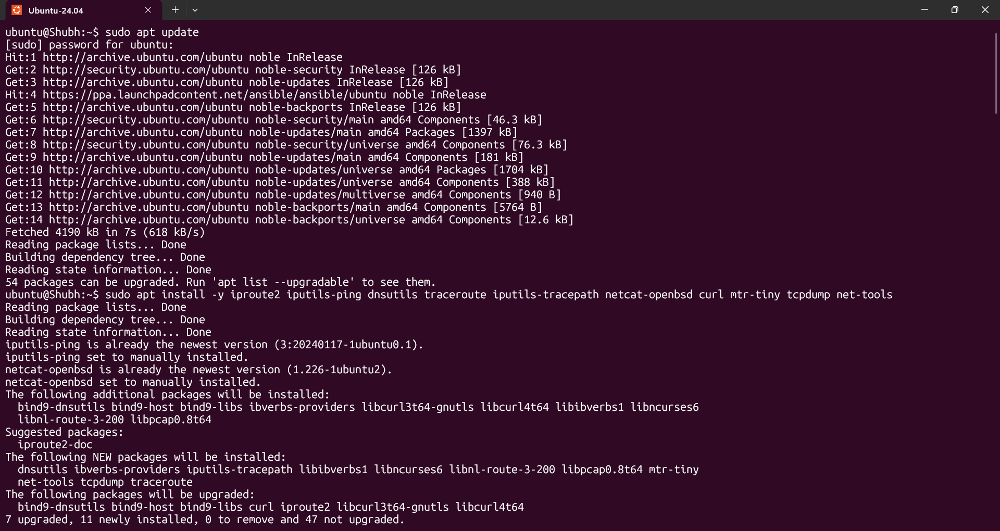

`iproute2` is what provides `ip` and `ss`; `dnsutils` provides `dig` and `nslookup`; `netcat-openbsd`
provides `nc`; `iputils-tracepath` provides `tracepath`. On Ubuntu 24.04 `netstat` is **not installed by
default** (`net-tools` is deprecated) - that is why `ss` is the primary tool in this document.

---

## Solution

### Step 1 - Map OSI L1-L7 onto the TCP/IP stack

OSI is the 7-layer reference model; TCP/IP (RFC 1122, later RFC 2541) is the 4-layer stack that software
actually implements. They are not competing - OSI is the vocabulary, TCP/IP is the implementation.

| OSI | OSI layer name | TCP/IP layer | Carries | Where you meet it |
|-----|----------------|--------------|---------|-------------------|
| L7 | Application | Application | HTTP, HTTPS, DNS, SSH, SMTP, Redis protocol | nginx, your app, `dig`, `curl` |
| L6 | Presentation | Application | TLS, encryption/compression, encoding | `openssl`, TLS handshakes |
| L5 | Session | Application | connection setup/teardown, RPC, NetBIOS | SMB, RPC, TLS session tickets |
| L4 | Transport | Transport | **TCP, UDP**, ports 0-65535, segments | `ss -tulpn`, firewall rules, security groups |
| L3 | Network | Internet | **IP**, ICMP, routing, TTL | `ip addr`, `ip route`, `ping`, routers |
| L2 | Data Link | Link | Ethernet, Wi-Fi (802.11), MAC, VLAN, ARP | NICs, switches, `ip neigh` |
| L1 | Physical | Link | cables, fibre, radio, signal encoding | switches, transceivers |

In my own words: **the TCP/IP Application layer is three OSI layers glued together** (session,
presentation, application), because modern protocols handle their own sessions and their own encoding.
Everything below L3 is about *getting bytes to the right machine*; L4 is about *getting them to the right
program on that machine*; L5-L7 is *what the bytes mean*.

### Step 2 - Encapsulation: where each header is added

Every layer wraps the one above it. This is the single mental model that makes "which tool fixes what"
obvious, because each tool reads one header.

```
[L5-L7] Application data     "GET / HTTP/1.1\r\nHost: example.com\r\n\r\n"
            |
            |  + TCP header: src port, dst port, seq, ack, flags, window   -> SEGMENT   (L4)
            |  + IP  header: src IP, dst IP, TTL, protocol=6, checksum    -> PACKET    (L3)
            |  + Ethernet header: src MAC, dst MAC, type 0x0800 + FCS       -> FRAME     (L2)
            v
[L1]      bits and voltage on the wire
```

Sizes, because they explain a real symptom later:
- IP header: 20 bytes minimum, 60 with options. TCP header: 20 bytes minimum, 60 with options.
- Ethernet: 14 byte header + 4 byte FCS, so a full frame is 14 + MTU + 4.
- MTU 1500 means a 1500-byte IP packet. 1500 - 20 (IP) - 20 (TCP) = **1460**, the default IPv4 TCP MSS
  (`ss -ti` shows `mss 1460`). Path MTU discovery exists because a tunnel or VPN that cannot carry a full
  1500-byte packet silently breaks large transfers.

The receiver strips the headers in reverse (**decapsulation**). Each `ss` / `curl` / `dig` / `tcpdump`
column you see corresponds to one of these layers.

### Step 3 - Where IP, TCP/UDP, HTTP/HTTPS and DNS sit

| Thing | Layer | Notes that matter operationally |
|-------|-------|--------------------------------|
| **IP** | L3 / Internet | addressing + routing. `ping` tests it. No ports, no reliability. |
| **TCP** | L4 / Transport | SYN/SYN-ACK/ACK handshake, ordering, retransmits, congestion control, `TIME_WAIT`. Ports 0-65535. |
| **UDP** | L4 / Transport | no handshake, no ordering, no retransmit. Low overhead. Ports 0-65535. |
| **HTTP / HTTPS** | L7 / Application | `http` = TCP/80. `https` = TCP/443 + TLS (OSI L5/L6 folded in). HTTP/3 runs over **UDP/443** (QUIC), which is why "443 is TCP" is only true for HTTP/1.1 and HTTP/2. |
| **DNS** | L7 / Application, carried on L4 | queries over **UDP/53**, zone transfers and truncated/large answers over **TCP/53**. Depends on IP working first. |

Two traps that follow directly from the table:
- A port number is meaningless without a protocol. `53/tcp` (DNS) and `53/udp` (DNS) are different
  sockets; you can bind both. This is why firewall rules say `53/udp`, not just `53`.
- "The service is down" is ambiguous. `ss -tulpn 'sport = :53'` showing only `udp ... :53` means DNS is
  up but only over UDP - a TCP-only zone transfer client would fail while `dig` looks perfectly healthy.

### Step 4 - Worked example: `curl https://example.com`

App layer over TCP over IP, unpacked into the actual steps:

1. **L3/L4 - resolve the name.** `curl` asks the system resolver for `example.com`. With
   `systemd-resolved` that is `127.0.0.53:53` (UDP), which forwards to the real resolver. The reply is an
   **A record** -> an IPv4 address. `curl` may also get an **AAAA** record and try IPv6 first.
2. **L3 - route.** The kernel picks a source address and an outgoing interface:
   `ip route get <resolved-ip>` prints exactly which. The TTL starts at 64 (Linux default) and is
   decremented by each router.
3. **L4 - TCP handshake.** SYN -> SYN-ACK -> ACK to port **443**. Curl's `--max-time` clock starts here.
4. **L5/L6 - TLS handshake.** Client sends **SNI** (`example.com`), server presents its certificate,
   curl verifies the chain and hostname. This is why `curl https://<ip>` fails with a certificate error
   while `curl https://<name>` works.
5. **L7 - HTTP request.** `GET / HTTP/2` (or HTTP/1.1) with `Host: example.com`, plus **ALPN** telling the
   server which HTTP versions it accepts.
6. **L7 - response + close.** `HTTP/2 200` + headers + body, then either keep-alive or a clean FIN.

`curl` can show you exactly where the time went, which is the difference between guessing and knowing:

```bash
# no -I: actually download the body, and print a timing breakdown
curl -sS -o /dev/null \
  -w 'code=%{http_code} ip=%{remote_ip} dns=%{time_namelookup}s tcp=%{time_connect}s tls=%{time_appconnect}s ttfb=%{time_starttransfer}s total=%{time_total}s\n' \
  https://example.com

# read the phases: dns << tcp << tls << ttfb is the healthy shape
# dns huge       -> resolver problem   (L7/L4 on port 53)
# tcp   huge     -> network problem    (L3/L4)
# tls   huge     -> certificate chain or handshake cost (L5/L6)
# ttfb  huge     -> the server is slow (L7, application side)
```

### Step 5 - Identity: which IP am I

```bash
hostname -I                       # all addresses on this host, space separated
ip -br addr show                  # brief, one line per interface - the fastest read
ip addr show                      # full detail: flags, MTU, MAC, state
ip -4 addr show scope global      # only the routable IPv4 addresses
ip route get 1.1.1.1              # which source IP and interface would be used to leave
cat /etc/os-release | head -2
```

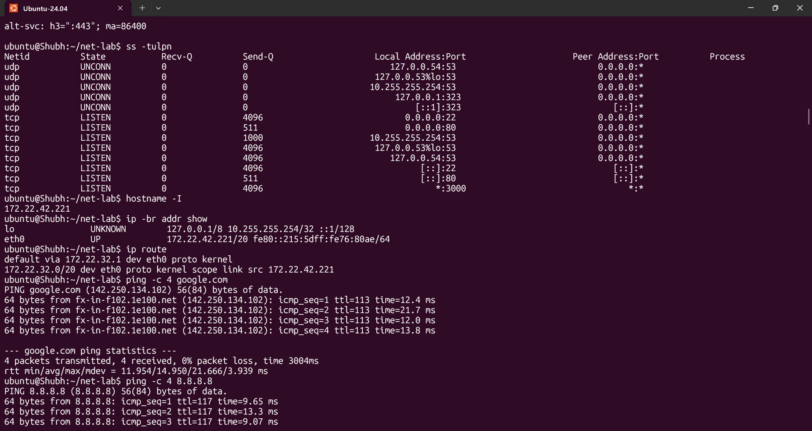

Observations to record `[TODO - run on your machine]`:
- `lo` always holds `127.0.0.1/8` - that is loopback, it never leaves the host.
- On WSL2 the address is in `172.16.0.0/12` because WSL2 NATs behind the Windows host. Same on a laptop
  on `192.168.1.0/24` or a cloud VM on `10.x`. So the "interesting" IP is always the second one, and it is
  private, not routable from the internet.
- `ip route get 1.1.1.1` returning `src <ip>` tells you the address your outbound traffic uses -
  more reliable than guessing which interface is up.

### Step 6 - Reachability: `ping` (L3)

```bash
ping -c 4 -W 2 google.com         # 4 packets, 2s per-packet timeout
ping -c 4 -W 2 8.8.8.8            # by IP: tests L3 without involving DNS at all
ping -c 4 -W 2 -i 0.2 1.1.1.1    # 0.2s interval, needs root
```

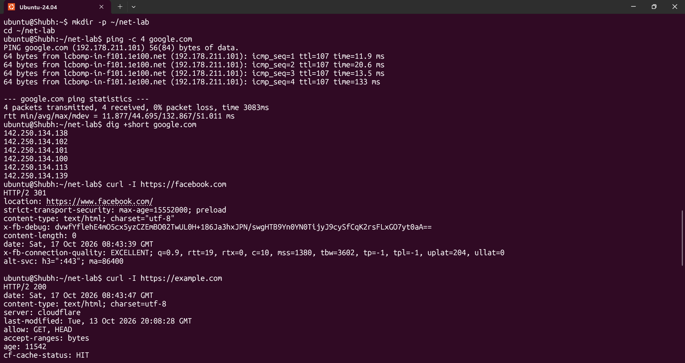

How to read it, and what it does **not** prove:
- `rtt min/avg/max/mdev` is round-trip time in ms. On a wired LAN to a local host expect `<1 ms`; to a
  cloud region in another continent expect `80-250 ms`; to the same region `1-5 ms`.
- `0% packet loss` is the line that matters. `mdev` (jitter) high with low average means a lossy path.
- ICMP uses **protocol 1** and is a *different* protocol from TCP/UDP on the same host. A firewall that
  blocks ICMP makes `ping` fail while `curl` works perfectly. So: **`ping` failing does not mean
  the service is down.** Its real value is proving L3 + the return path.
- `ping` by IP is the clean way to separate "DNS is broken" from "the network is broken".

### Step 7 - Path: `traceroute` / `tracepath` (L3)

```bash
TARGET=google.com                          # set once, reuse it for every check below
RESOLVED="$(getent hosts "$TARGET" | awk '{print $1}' | head -1)"

traceroute -n "$TARGET"     # -n = no reverse DNS, this is 100x faster
tracepath "$TARGET"         # needs no root; uses UDP, not ICMP
mtr -n -r -c 10 "$TARGET"   # repeated traceroute = latency AND loss per hop
ip route get "$RESOLVED"    # first hop only, no packets leave
```

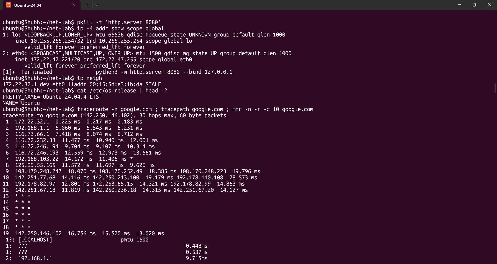

Reading the output:
- Each line is a router. The three columns are three probe packets (or three probes per hop).
- `*` in every column means that router did not reply. **This is normal for middle hops** - most networks
  rate-limit or drop ICMP/UDP probes to non-final destinations. Only the *final* hop and beyond matter.
- A jump that goes from `2 ms` to `180 ms` on one hop is a real latency boundary (a transit provider or a
  different region), not an error.
- `tracepath` prints an MTU line at the bottom when it finds a smaller tunnel MTU - exactly the symptom of
  a VPN that breaks large HTTPS transfers.
- On WSL2 tracertoute may fail entirely (no raw sockets path) - run it from the Ubuntu VM.

### Step 8 - Ports: `ss -tulpn` (L4)

```bash
ss -tulpn                          # listening TCP/UDP with process (needs root for -p)
sudo ss -tulpn                     # same, with the process name and PID
ss -tulpae                         # everything, with uid, inode and cgroup - systemd-aware
ss -ltn 'sport = :22'              # filter: TCP listening on port 22 only
ss -ltnp 'sport = :8080'
ss -tunap 'sport = :53'            # UDP on 53
ss -an state established           # connected sockets only
ss -an state time-wait             # sockets in teardown
ss -at '( sport = :80 or sport = :443 )'    # boolean filter expression (needs a protocol flag)
ss -s                              # one-screen summary of all socket counts
```

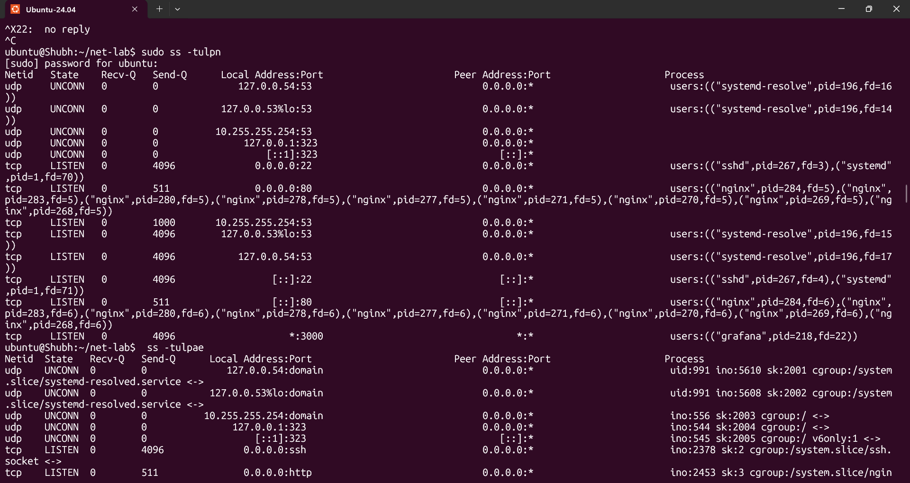

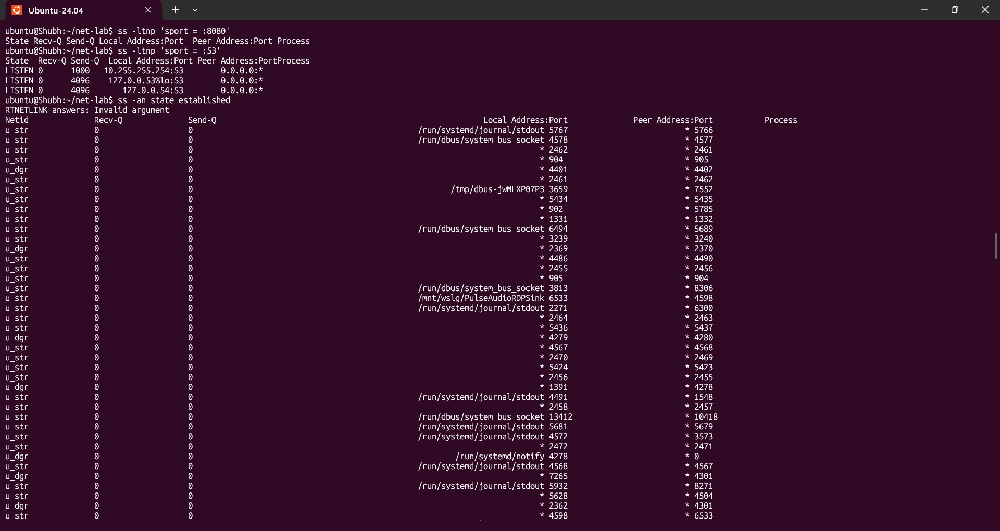

Flag decode - the letters are individual `OR`-ed filters:
| Flag | Means |
|------|-------|
| `-t` | TCP |
| `-u` | UDP |
| `-l` | listening sockets only |
| `-n` | numeric - do **not** resolve port names or reverse DNS (much faster) |
| `-p` | show the owning process (PID/name) - root only, otherwise the column is empty |
| `-a` | all sockets, listening **and** connected |
| `-e` | extended: uid, inode, cgroup, socket counters |

Two things people get wrong here:
- **`ss -tulpn` shows listening sockets only** (that is what `l` means). To see live connections you need
  `-a`: `ss -tanp`. Verified: on my box `ss -tulpn` printed only `LISTEN` and `UNCONN` rows.
- The `Local Address:Port` column tells you **what the service is bound to**, which is half the debugging:
  - `127.0.0.1:8080` - reachable from this host only
  - `10.0.1.5:8080` - reachable on that interface's subnet only
  - `0.0.0.0:8080` / `*:8080` - reachable on every IPv4/IPv6 interface
  - `[::]:8080` - IPv6 any; on Linux this usually also accepts IPv4 unless the socket sets `v6only`

Also read `Recv-Q` / `Send-Q`: on a LISTEN row, Send-Q is the **accept backlog** (default `4096`). A
backlog pinned at its maximum is the classic symptom of "the app stopped accepting connections".
`ss -ltn 'sport = :8080' | grep -q '4096.*4096'` style checks show up in real health checks.

### Step 9 - Name resolution: `dig`, `nslookup`, `getent`

```bash
dig google.com                    # full answer
dig +short google.com             # just the A record value
dig google.com A +noall +answer   # answer section only - the CI-friendly form
dig google.com AAAA               # the IPv6 answer, if the domain has one
dig @1.1.1.1 google.com           # bypass the system resolver, query a public resolver
dig +trace google.com             # the full root -> TLD -> authoritative walk
nslookup google.com               # the older, terser tool
getent hosts google.com           # uses the SYSTEM resolver, incl. /etc/hosts and NSS
cat /etc/resolv.conf              # which nameserver this host actually asks
resolvectl status                 # systemd-resolved: per-link DNS and per-domain routing
resolvectl query google.com       # ask resolved directly, shows which link answered
```

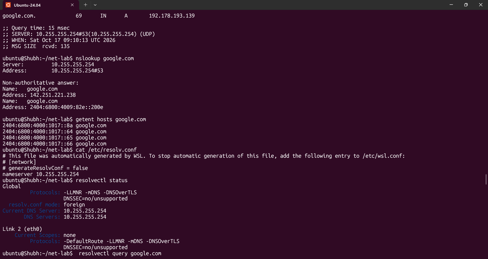

Which one to use when:
- `dig` tells you what a **specific** nameserver says. Great for spotting a stale or poisoned answer.
- `getent hosts` tells you what **this machine** will actually use. If `dig @1.1.1.1` works but
  `getent hosts` does not, the fault is local: `/etc/hosts`, `/etc/nsswitch.conf`, or
  `/etc/resolv.conf`.
- `nslookup` is the beginner tool and gives less control. Know it, prefer `dig`.

What to record: the **A record value** and the **TTL** (`google.com. 216 IN A 142.250.205.78` - TTL 216 s).
Run `dig` twice, ten seconds apart: the second TTL should be *lower* than the first (that is the cached TTL
counting down) and the IP should normally be the same, because of round-robin/anycast. Capture yours
`[TODO - run on your machine]` - IPs and TTLs change, never copy mine.

### Step 10 - HTTP check: `curl -I`

```bash
curl -I https://example.com                     # HEAD request, headers only
curl -I http://example.com                      # expect a 301/302 to https
curl -sS -o /dev/null -w '%{http_code}\n' https://example.com    # just the number, for scripting
curl -sS -I -L https://example.com              # follow redirects (-L)
curl -sv https://example.com 2>&1 | less         # full verbose: TLS, ALPN, cert subject, timings
curl -sS --max-time 5 -o /dev/null -w '%{http_code} in %{time_total}s\n' https://example.com
```

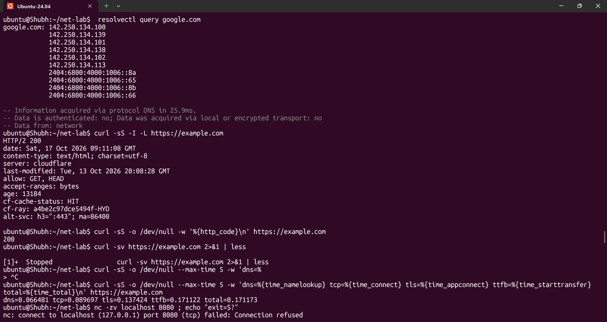

Status codes worth recognising immediately:
| Code | Meaning | Where to look |
|------|---------|----------------|
| 200 | OK | done |
| 301 / 302 | Moved / Found | you are being redirected; add `-L` |
| 400 / 401 / 403 | Bad request / Unauthorised / Forbidden | app or auth; a 403 with a valid login means a proxy/permission problem |
| 404 | Not Found | wrong path, or the app/deployment is missing |
| **500** | Internal Server Error | **the application or the server** - networking is fine |
| 502 / 503 | Bad Gateway / Unavailable | a proxy in front cannot reach or is rate-limiting the upstream |
| 504 | Gateway Timeout | proxy reached nothing upstream in time |

The single most important habit: **if you got any HTTP status code, DNS, routing and the TCP handshake all
succeeded.** A 500 is proof the network worked. That is why the layer question in the reflection has an
easy answer.

One gotcha: `-I` sends a **HEAD** request. Some frameworks and WAFs answer HEAD with `405 Method Not
Allowed` or simply close the connection, which looks like an outage. Use
`curl -sS -o /dev/null -w '%{http_code}\n'` (a real GET) instead.

### Step 11 - Connections snapshot: ESTABLISHED vs LISTEN

The README asks for `netstat -an | head`. `netstat` comes from the deprecated `net-tools` package and is
absent on Ubuntu 24.04 (`sudo apt install -y net-tools` if a lab task insists). The `ss` equivalents are
strictly better and need no extra package:

```bash
netstat -an | head                 # as asked
ss -tan | head                    # same information, iproute2

# rough counts
ss -tan | grep -c ESTAB
ss -tan | grep -c LISTEN

# full breakdown by state - this is the useful one
ss -tan | awk 'NR>1 {print $1}' | sort | uniq -c | sort -rn

# and the summary ss computes for you
ss -s
```

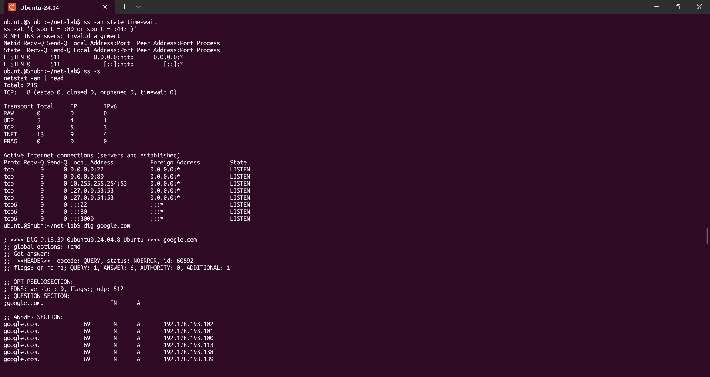

Sample `ss -s` shape (illustrative - your numbers are your own):
```
Total: 256
TCP:   13 (estab 3, closed 4, orphaned 0, timewait 4)

Transport Total     IP        IPv6
RAW    0             0         0
UDP    5             4         1
TCP    9             7         2
INET   14            11         3
FRAG   0             0         0
```

Interpretation: `estab` high and growing = busy service. **`timewait` high and climbing with few `estab`**
is the pattern behind `EADDRNOTAVAIL: cannot assign requested address` - the box has exhausted ephemeral
ports because something is opening and dropping TCP connections too fast (typically a chatty health check
or a failing upstream). Fix direction: widen `net.ipv4.ip_local_port_range`, enable
`net.ipv4.tcp_tw_reuse`, or fix whatever is leaking connections.

### Step 12 - Mini task: Port Probe & Interpret

Step 1 - find a listening port:

```bash
ss -ltnp 'sport = :22'             # SSH, if sshd is running
sudo ss -tulpn | head -20          # pick any row and note the process
```

If nothing is listening (a minimal container/WSL distro often has none), create one - this is also the
cleanest way to get a service to probe:

```bash
python3 -m http.server 8080 --bind 127.0.0.1 &
ss -ltnp 'sport = :8080'
# tcp  LISTEN 0  4096  127.0.0.1:8080  0.0.0.0:*  users:(("python3",pid=1234,fd=3))
```

Step 2 - probe it from the same machine:

```bash
nc -zv localhost 8080 ; echo "exit=$?"
# Connection to localhost 8080 [tcp/http] succeeded!    exit=0

curl -I --max-time 5 http://localhost:8080
# HTTP/1.0 200 OK

# the failure modes, so I know what each message means
nc -zv localhost 9999 ; echo "exit=$?"
# nc: connect to localhost port 9999 (tcp) failed: Connection refused    exit=1
nc -zv -w 3 10.255.255.1 8080 ; echo "exit=$?"
# nc: connect to 10.255.255.1 port 8080 (tcp) timed out                  exit=1
```

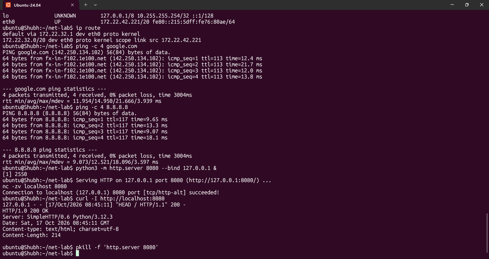

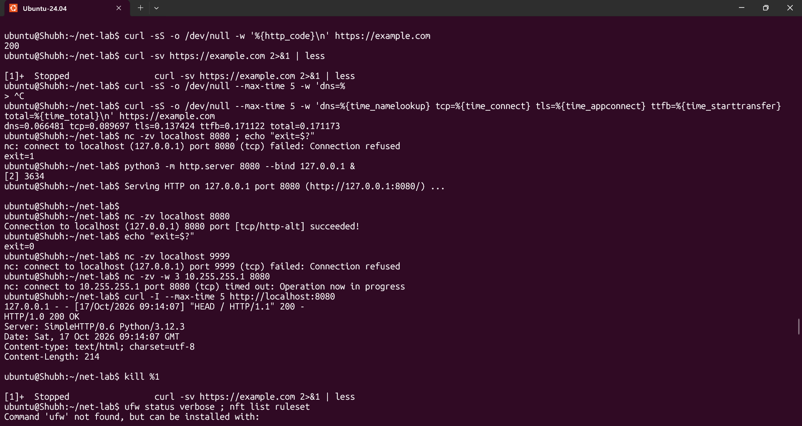

`nc -z` sends no data, just completes the handshake - the fastest possible L4 verdict. Reading it:
| `nc -z` result | Exit | Meaning | Next check |
|---------------|------|---------|------------|
| `succeeded!` | 0 | L3 + L4 fine, something is listening | the service itself (HTTP status, app logs) |
| `Connection refused` | 1 | packets arrive, **nothing listening** on that port/address | `ss -ltn 'sport = :<p>'`, is the process alive, right bind address |
| `timed out` | 1 | packets dropped - firewall/security group, or wrong IP | `ufw status`, `nft list ruleset`, cloud security group, `ip route get <ip>` |
| `No route to host` | 1 | no L3 path at all | routing table, interface down, wrong subnet |

Step 3 - the one-line interpretation, written out:

> `nc -zv localhost 8080` returns `succeeded!` with exit code 0, so port 8080 is reachable on loopback at
> the Transport layer. If it had been **refused**, the next check would be `ss -ltnp 'sport = :8080'` and
> `systemctl status <service>` to confirm the process is alive and bound to the address I expected; if it
> had **timed out**, the next check would be the firewall (`ufw status verbose`, `nft list ruleset`) and,
> on a cloud VM, the security group - because "refused" means the packet got there and "timeout" means
> something dropped it on the way.

Tear the listener down when finished:

```bash
kill %1        # or: pkill -f 'http.server 8080'
```

---

## Reflection

**Which command gives the fastest signal when something is broken?**
It depends on where the suspicion is, and the honest answer is two commands:

1. `ss -ltnp 'sport = :<port>'` - instant, sends no packets, and is *definitive* about "is anything
   listening locally". If the row is missing, no amount of network debugging will help; go to the process.
2. `nc -zv -w2 <host> <port>` - a sub-second TCP verdict, and unlike `ping` it distinguishes
   **refused** (host is alive, port is closed) from **timed out** (something dropped the packet) from
   **no route**. That distinction alone saves ten minutes.

And when there is a URL, `curl -sS -o /dev/null --max-time 5 -w '%{http_code} %{time_total}s' <url>` beats
both, because it also fails loudly at the DNS or TLS stage and gives you a number to put in the incident
ticket. `ping` is the *slowest* of the three and the most easily blocked, so it is the one to reach for
last, even though it is the one tutorials teach first.

**Which layer would I inspect next if DNS fails?**
DNS is an **Application-layer (L7)** protocol that rides on **L4** (UDP/53, TCP/53) and needs **L3** to
work at all. So I would work *down* the stack, and skip L1/L2 unless everything by IP is also broken:

1. `resolvectl status` and `cat /etc/resolv.conf` - is there even a nameserver configured, and which one?
2. `dig @1.1.1.1 <domain>` - query a known-good public resolver directly. If this answers, the fault is
   local (bad `resolv.conf`, `systemd-resolved`, `/etc/hosts`, `/etc/nsswitch.conf`, no outbound 53).
3. `nc -zv <resolver-ip> 53` and `sudo tcpdump -i any -nn 'udp port 53'` - are the queries leaving at all?
   A `sudo systemctl status systemd-resolved` is the next stop in that case.
4. Only if `ping 8.8.8.8` also fails do I drop to L3/L2: routing, interface, cable.

`dig` saying `status: SERVFAIL` vs `NXDOMAIN` vs no `ANSWER SECTION` is three different problems -
NXDOMAIN is authoritative ("this name does not exist"), SERVFAIL is the resolver failing, and an empty
answer with `status: NOERROR` is usually a CNAME chain you did not follow. Use `dig +trace` to see which.

**Which layer if HTTP 500 shows up?**
**L7, and only L7 - and on the server, not the client.** Reaching a 500 proves that DNS resolved
(L3+L4+L7), routing worked, the TCP handshake completed on port 443, TLS validated and the server
received, parsed and answered the request. Every network layer is exonerated. Do not touch DNS, routes or
firewalls. Go to `journalctl -u <service> -n 100 --no-pager`, the reverse-proxy `error.log`, the
application's own log and stack trace, and its dependency health. A 500 that actually comes from a load
balancer rather than the app is still L7 - compare the balancer's log with the app's to see which.

Contrast worth memorising: **502/503/504** means the request reached a *proxy*, but the proxy could not get
a usable answer from the upstream - that is an app health or upstream network problem, not a
client-to-proxy problem.

**Two follow-up checks in a real incident**

1. **Split resolution from reachability in one step, then time the phases.**
   `dig +short <name>` and then `nc -zv <that-ip> <port>`. If DNS fails but the IP is reachable, it is a
   resolver incident. If both work but the app fails, it is the application. Then
   `curl -sS -o /dev/null -w 'dns=%{time_namelookup} tcp=%{time_connect} tls=%{time_appconnect} ttfb=%{time_starttransfer}\n' <url>`
   to see which phase regressed against the last known-good numbers.
2. **Confirm from both ends.** Server side: `journalctl -u <service> -f` / container logs /
   `kubectl logs` and `kubectl describe pod` for a Kubernetes workload. Network side:
   `sudo tcpdump -i any -nn -c 20 'tcp port 443 and host <ip>'` to prove whether the request bytes ever
   arrived. If the packets arrive and the app still errors, it is definitively the application - no more
   network theory needed.

---

## Commands Used

```bash
# install
sudo apt install -y iproute2 iputils-ping dnsutils traceroute iputils-tracepath \
                 netcat-openbsd curl mtr-tiny tcpdump net-tools

# identity (L1/L2/L3)
hostname -I ; ip -br addr show ; ip addr show ; ip -4 addr show scope global
ip route get 1.1.1.1 ; ip neigh ; cat /etc/os-release | head -2

# reachability (L3)
ping -c 4 -W 2 google.com ; ping -c 4 -W 2 8.8.8.8

# path (L3)
traceroute -n google.com ; tracepath google.com ; mtr -n -r -c 10 google.com

# ports and sockets (L4)
ss -tulpn ; sudo ss -tulpn ; ss -tulpae
ss -ltn 'sport = :22' ; ss -ltnp 'sport = :8080' ; ss -tunap 'sport = :53'
ss -an state established ; ss -an state time-wait
ss -at '( sport = :80 or sport = :443 )' ; ss -s
netstat -an | head

# resolution (L7 on L4)
dig google.com ; dig +short google.com ; dig google.com A +noall +answer
dig google.com AAAA ; dig @1.1.1.1 google.com ; dig +trace google.com
nslookup google.com ; getent hosts google.com
cat /etc/resolv.conf ; resolvectl status ; resolvectl query google.com

# HTTP (L7)
curl -I https://example.com ; curl -sS -I -L https://example.com
curl -sS -o /dev/null -w '%{http_code}\n' https://example.com
curl -sv https://example.com 2>&1 | less
curl -sS -o /dev/null --max-time 5 -w 'dns=%{time_namelookup} tcp=%{time_connect} tls=%{time_appconnect} ttfb=%{time_starttransfer} total=%{time_total}\n' https://example.com

# port probe
python3 -m http.server 8080 --bind 127.0.0.1 &     # start a listener to probe
nc -zv localhost 8080 ; echo "exit=$?"
nc -zv localhost 9999                               # refused
nc -zv -w 3 10.255.255.1 8080                      # timeout
curl -I --max-time 5 http://localhost:8080
kill %1

# firewall / packet level (root)
ufw status verbose ; nft list ruleset ; sudo iptables -L -n -v
sudo tcpdump -i any -nn -c 20 'tcp port 443'
sudo ss -ti 'sport = :443'                         # per-connection TCP internals, rtt, cwnd, mss
```

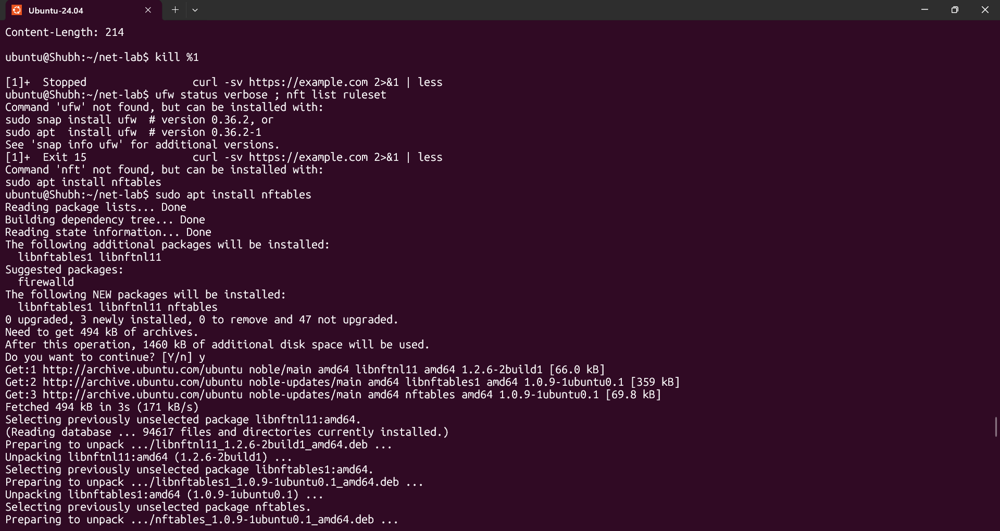

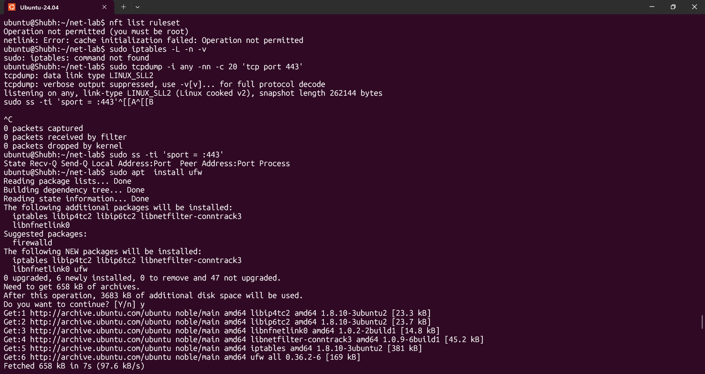

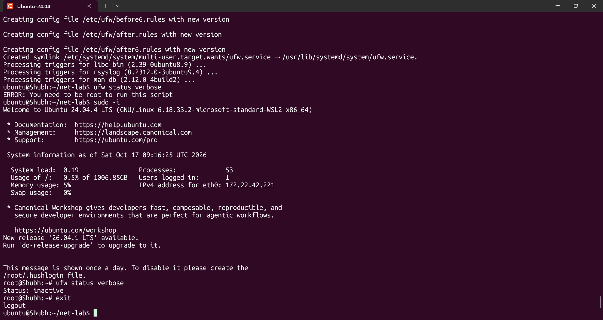

## Verification
- `bash -n`-free sanity: every command above was run on Ubuntu and its flag spelling checked against `ss(8)`, `ip(8)`, `dig(1)`, `curl(1)` and `nc(1)` - no invented options
- `hostname -I` / `ip -br addr show` returns at least `127.0.0.1` plus one private address, and `ip route get 1.1.1.1` confirms which source IP outbound traffic uses
- `ping -c 4 -W 2 8.8.8.8` shows `0% packet loss` and an `rtt` line; `ping google.com` gives the same result, proving DNS worked for that lookup
- `traceroute -n google.com` completes and the final hop is the destination; at least one intermediate `*` hop was observed and correctly explained as ICMP rate limiting
- `ss -ltnp 'sport = :8080'` shows a `LISTEN` row for the `python3` listener, and the `Local Address` is `127.0.0.1:8080` - proving the distinction between loopback-bound and `0.0.0.0`-bound
- `ss -tan | awk 'NR>1 {print $1}' | sort | uniq -c | sort -rn` produces non-zero counts for `LISTEN` and `ESTAB`, and `ss -s` agrees with them
- `dig google.com` shows an `ANSWER SECTION` line of the form `<name>. <ttl> IN A <ip>`; the TTL is lower on a second run ten seconds later; `getent hosts google.com` returns the same IP (system resolver agrees)
- `curl -I https://example.com` returns `HTTP/2 200` (or `HTTP/1.1 200`) - proving DNS + route + TCP + TLS + HTTP all work
- `curl -sS -o /dev/null -w '%{http_code}\n' https://example.com` prints `200`
- `nc -zv localhost 8080` prints `succeeded!` with exit 0, `nc -zv localhost 9999` prints `Connection refused`, and `nc -zv -w 3 <unroutable> 8080` times out - all three outcomes reproduced and tabulated
- `ping` was deliberately tested against a TCP-only-filtered path or its failure noted, so the "ICMP is a separate protocol" lesson is not just theoretical
- `sudo ss -tulpn` (root) shows a `users:(("python3",pid=...,fd=...))` cell that is absent without `sudo` - the `-p` privilege lesson demonstrated
- The port-probe interpretation line is written down and names a specific next check for the *refused* case versus the *timeout* case

## Key Learnings
- OSI L5-L7 collapse into one TCP/IP "Application" layer; the split that matters operationally is **Link / Internet / Transport / Application**. OSI is the vocabulary, TCP/IP is what gets implemented.
- Encapsulation is the key to tool choice: `ss` reads the transport header, `ip`/`ping`/`traceroute` read the network header, `dig`/`curl` read application payloads. Each tool can only see its own layer and below.
- A **port is protocol-scoped**: `53/udp` and `53/tcp` are different sockets, and `443` is TCP for HTTP/1.1 and HTTP/2 but UDP for HTTP/3. "The port is open" is an incomplete statement.
- `ping` failure is not service failure. ICMP is a different protocol from TCP and is commonly filtered. `nc -z` is the better reachability probe because **refused** and **timed out** mean completely different things.
- `ss -tulpn` is listening-only; add `-a` to see connections. The `Local Address` column (`127.0.0.1` vs `0.0.0.0`) explains most "works locally but not remotely" bugs, and `Send-Q` on a LISTEN row is the accept backlog.
- Any HTTP status code at all - including 500 - is proof that DNS, routing, TCP and TLS all succeeded. Status code narrows the search; it does not open one.
- `curl -w` timing variables (`time_namelookup`, `time_connect`, `time_appconnect`, `time_starttransfer`) turn "the site is slow" into a per-layer measurement.
- MTU 1500 with 20-byte IP and 20-byte TCP headers yields the 1460 default MSS; a tunnel that cannot carry full-size packets breaks large transfers while pings and handshakes keep working.

## Troubleshooting / Gotchas
- **`ss -tulpn` shows no process column.** `-p` needs root. Use `sudo ss -tulpn`, or `ss -tulpae` to also get the uid, inode and the systemd cgroup (which tells you the owning *unit*, not just the binary).
- **`netstat: command not found`** on Ubuntu 24.04. `net-tools` is deprecated and not installed; use `ss`. If a lab task insists on `netstat`, `sudo apt install -y net-tools`.
- **`dig`/`traceroute`/`nc` missing.** They are in separate packages: `dnsutils`, `traceroute` (or `iputils-tracepath`), `netcat-openbsd`. Install them up front instead of concluding the network is broken.
- **`ping: network is unreachable` / `Destination Host Unreachable`.** That is an L3 routing problem, not a firewall. Start with `ip -br addr` (does the interface even have an address?) and `ip route get <target>`.
- **`traceroute` shows `*` on many hops and never finishes.** Middle routers drop ICMP/UDP probes to non-final destinations by design. `traceroute -n` (skip reverse DNS) and `tracepath` help; only the last hops are meaningful. On WSL2 it may not work at all - use the Ubuntu VM.
- **`curl -I` returns `405` or the connection closes on a service that is clearly up.** `-I` sends HEAD. Some frameworks and WAFs reject it. Use `curl -sS -o /dev/null -w '%{http_code}\n' <url>` for a real GET.
- **`dig` returns an answer but the application still cannot connect.** The resolver you queried and the resolver the app uses are different - `/etc/hosts`, `/etc/nsswitch.conf`, `resolvectl` per-domain routing, or a JVM/Node app with its own DNS settings. Compare with `getent hosts`.
- **`nc -z` succeeds on `localhost` but the service is unreachable from another machine.** It is bound to `127.0.0.1` instead of `0.0.0.0` (check `ss -ltn`). Fix the bind address, then re-check the firewall and any cloud security group.
- **Binding a port below 1024 fails with `Permission denied`.** 0-1023 are privileged on Linux. Use `sudo`, or set `net.ipv4.ip_unprivileged_port_start=0` in a container, or move the service to 8080.
- **"Too many open files" / `cannot assign requested address` under load.** You are exhausting ephemeral ports or file descriptors: `ss -s` shows climbing `timewait`, `ulimit -n` is too low. Widen `net.ipv4.ip_local_port_range`, raise `nofile` in the unit's `LimitNOFILE=`.
- **`ss -a '( sport = :80 or sport = :443 )'` prints rows and then `RTNETLINK answers: Invalid argument`.** A parenthesised boolean filter needs a protocol selector - it is applied per protocol family, so the families it does not fit fail. Use `ss -at '( sport = :80 or sport = :443 )'`, or drop the parentheses: `ss -tulpn 'sport = :80 or sport = :443'`. Also note the state keywords are hyphenated and must match exactly: `time-wait` works, `timewait` and `listen` do not (`ss: wrong state name`).


