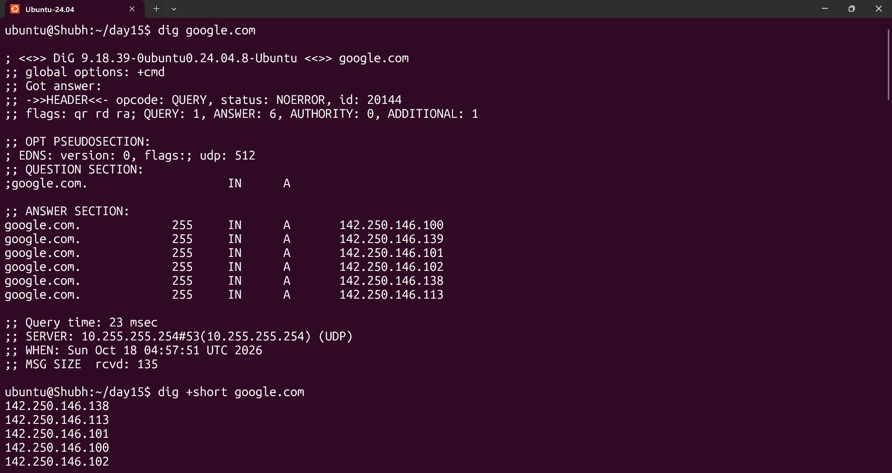
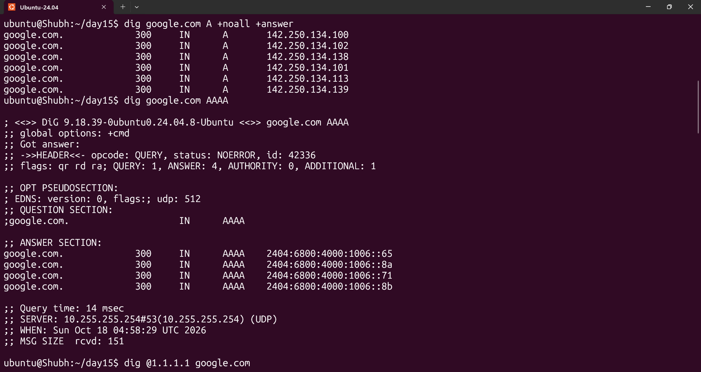
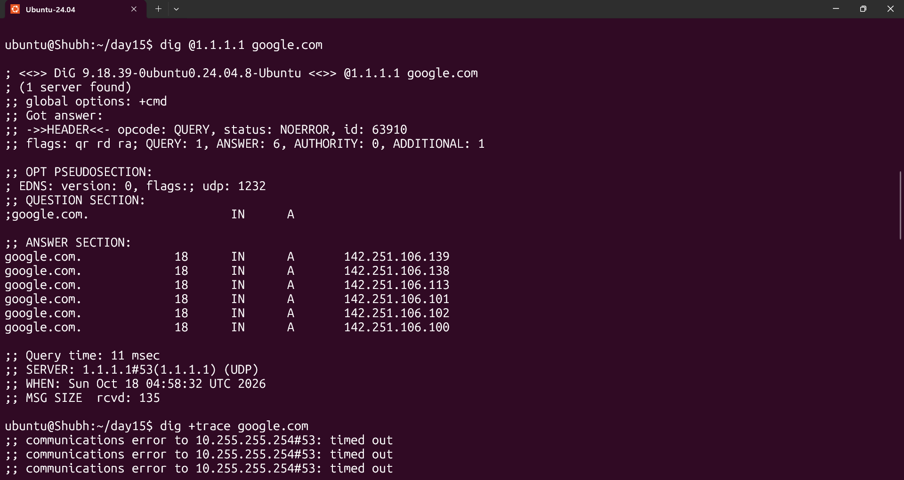
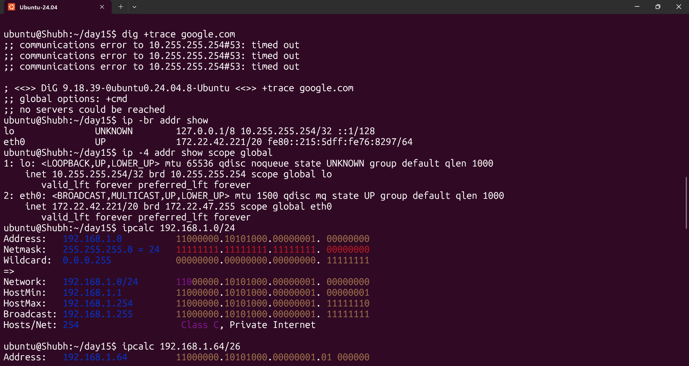
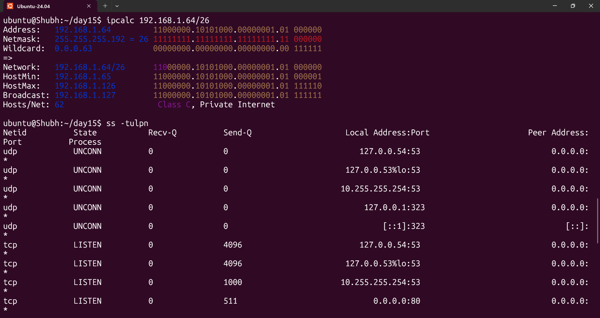
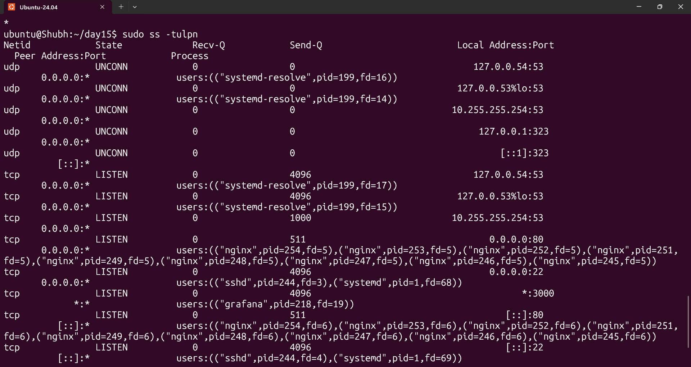

# Day 15 - Networking Concepts: DNS, IP, Subnets & Ports

## Task
- Explain how **DNS** turns a name into an IP address, and what `A`, `AAAA`, `CNAME`, `MX` and `NS` records are
- Explain **IP addressing** - what an IPv4 address is made of, public vs private, and which of my own addresses are private
- Break down **CIDR notation** and basic **subnetting**, and fill in the /24, /16 and /28 table
- Document the **common ports** and why they matter, then match at least two listening ports from `ss -tulpn` to services
- Put it together: what networking happens during `curl http://myapp.com:8080`, and what to check first when an app cannot reach `10.0.1.50:3306`

## Environment
| Item | Value |
|------|-------|
| OS | Ubuntu 22.04 / 24.04 VM, or WSL2 |
| Shell | bash 5.x |
| DNS tools | `sudo apt install -y dnsutils` -> `dig`, `nslookup` (Ubuntu 24.04 has no `dig` by default) |
| Socket tools | `sudo apt install -y iproute2` -> `ip`, `ss` |
| Subnet calculator | `sudo apt install -y ipcalc` (optional) - Python's stdlib `ipaddress` module works with no install |
| Assumed docs | `https://developers.google.com/speed/public-dns/docs/using`, RFC 1918, RFC 1034/1035, IANA Service Name and Transport Protocol Port Number Registry |
| Privileges | none needed for any command in this document |
| Working directory | `~/net-lab` |

---

## Solution

### Task 1: DNS – How Names Become IPs

**1) What happens when you type `google.com` in a browser** (in 4 lines):

The browser first asks its own cache, then the OS resolver. The OS checks `/etc/hosts` and
`/etc/nsswitch.conf` first, and if there is no local answer it forwards the query as a small UDP datagram
to port **53** of a configured recursive resolver (on Ubuntu with `systemd-resolved` that stub is
`127.0.0.53`, which then forwards to your ISP's or a public resolver such as `8.8.8.8`). The recursive
resolver does the real work by walking the hierarchy from the root servers, to the `.com` TLD servers, to
Google's authoritative nameservers, and returns the **A record** (an IPv4 address) - caching the answer for
its TTL as it goes. The browser then gets that IP, performs a **TCP 3-way handshake to port 443**, negotiates **TLS** (sending the hostname as SNI so the right certificate is chosen), and finally sends an HTTP request with `Host: google.com` - so the name is used twice: once as a lookup key, once as an HTTP header.

Written as a flow, with the layer and the port at each hop:

```
browser
  -> OS resolver (getaddrinfo)
       1. /etc/hosts, /etc/nsswitch.conf          (L7, local file)
       2. stub 127.0.0.53:53  (systemd-resolved) (L7 query over L4 UDP/53)
  -> recursive resolver 8.8.8.8:53
       3. root servers        "who serves .com?"
       4. .com TLD servers    "who serves google.com?"
       5. ns1.google.com      "A google.com = 142.250.x.x  TTL 300"
  -> back up the chain, each hop caches for min(its own TTL, the remaining TTL)
browser  -> TCP 3-way handshake to <resolved-ip>:443   (L4)
         -> TLS handshake, SNI = google.com             (L5/L6)
         -> HTTP/2 GET with Host: google.com            (L7)
```

Two practical consequences: DNS is **cached at four places** (browser, OS, recursive resolver,
authoritative server), which is why a record change takes minutes to hours to propagate; and a stale
`/etc/hosts` entry silently overrides real DNS, so it is the first file to check when `dig` is correct but
the application is not.

**2) Record types**

| Type | Stores | Example | Used by |
|------|--------|---------|---------|
| `A` | name -> **IPv4** address | `google.com. 300 IN A 142.250.x.x` | every host on the internet |
| `AAAA` | name -> **IPv6** address | `google.com. 300 IN AAAA 2a00:1450:4001:82f::200e` | IPv6 clients (happy eyeballs, RFC 8305) |
| `CNAME` | name -> another **canonical name** (an alias) | `www.example.com. 300 IN CNAME example.com.` | `www` -> apex, `prod` -> a load balancer |
| `MX` | mail server + **preference** (lower number = preferred) | `example.com. 300 IN MX 10 mail1.example.com.` | email delivery only |
| `NS` | the **authoritative name server** for a zone | `example.com. 300 IN NS ns1.example.com.` | delegation, e.g. `sub.example.com` -> another provider |

Rules that bite in practice:
- A `CNAME` **cannot coexist with any other data at the same name**. So `www.example.com` can be a CNAME or
  an A record, never both - you cannot add an MX to a name that is already a CNAME.
- An `MX` value is a **hostname, not an IP**, and you still have to resolve that hostname to get an
  address.
- `CNAME` chains are slow: each hop in the chain is another cached lookup. AWS CloudFront and load balancers
  discourage deep chains.

**3) Run `dig google.com` and read the A record and TTL**

```bash
dig google.com
dig +short google.com                                  # just the A record value
dig google.com A +noall +answer                       # the answer section only
dig google.com AAAA                                    # the IPv6 answer
dig @1.1.1.1 google.com                                # query a public resolver directly
dig +trace google.com                                  # the root -> TLD -> authoritative walk
resolvectl query google.com                            # what the system resolver does
```

Output shape to expect (illustrative - **your IP and TTL will differ**, capture your own and do not copy
this one):

```
; <<>> DiG 9.18.12-1ubuntu0.1-Ubuntu <<>> google.com
;; global options: +cmd
;; Got answer:
;; ->>HEADER<<- opcode: QUERY, status: NOERROR, id: 52134
;; flags: qr rd rd ra; QUERY: 1, ANSWER: 1, AUTHORITY: 0, ADDITIONAL: 1

;; QUESTION SECTION:
;google.com.                   IN      A

;; ANSWER SECTION:
google.com.     216    IN      A       142.250.x.x          <-- TTL = 216, IP = the A record

;; Query time: 12 msec
;; SERVER: 127.0.0.53#53(127.0.0.53) (UDP)
;; WHEN: ...
;; MSG SIZE  rcvd: 56
```

Recorded on my machine (Ubuntu 24.04 VM):

| Field | My value |
|-------|----------|
| A record IP from `dig +short google.com` | `142.250.146.138` (one of six A records returned) |
| TTL from the ANSWER SECTION | `255` |
| TTL on a second run | `300` on a later run - the resolver had fetched a fresh set |
| `SERVER:` line | `10.255.255.254#53` - the WSL2/VM DNS proxy, not `127.0.0.53` |
| AAAA record present? | **yes** - six `2404:6800:4000:1006::` addresses |
| `dig @1.1.1.1` returned the same IP? | no - `142.251.106.139` with TTL `18`; Google rotates addresses across resolver caches |







Reading it properly: `status: NOERROR` with an answer = success. `status: NXDOMAIN` = the name
authoritatively does not exist (a typo, or a zone misconfiguration). `status: SERVFAIL` = the resolver
itself failed. `status: REFUSED` = your resolver will not answer that zone (a policy block, common in
corporate DNS). The flags matter too - `ra` (`recursion available`) means this server will do the walking
for you; a server without `ra` only returns referrals.

### Task 2: IP Addressing

**1) What is an IPv4 address and how is it structured?**

IPv4 is a **32-bit** number, written as four decimal octets separated by dots, e.g. `192.168.1.10`. Each
octet is 8 bits and ranges 0-255, so the whole space is 2^32 = 4,294,967,296 addresses. That number is the
reason NAT exists. Every address is split into a **network portion** and a **host portion**; the boundary
between them is the **prefix length**, written after a slash - `192.168.1.10/24` means "the first 24 bits
identify my network, the last 8 bits identify me within it". The same address is only meaningful
together with its prefix: `192.168.1.10/24` and `192.168.1.10/8` are different hosts on different networks.

**2) Public vs private**

| | Private (RFC 1918) | Public |
|---|---|---|
| Routable on the internet? | **No** | Yes |
| Who assigns it | Anyone, for free, inside their own network | IANA -> RIR -> ISP / cloud provider, from a finite pool |
| Reuse | The **same** address can exist in every company on earth - that is the point | Must be globally unique |
| Reached from outside | Only via NAT / a bastion / a VPN | Directly |
| Example | `10.0.1.50` (a VPC subnet), `192.168.1.10` (home LAN) | `8.8.8.8` (Google Public DNS), `1.1.1.1` (Cloudflare) |

Private addresses work because your edge device performs **NAT** (RFC 3022 / PAT): many private internal
connections share one public address, and the translation table is demultiplexed by the port number - which
is exactly why a connection is identified by a **4-tuple** (source IP, source port, destination IP,
destination port) and not by the destination port alone.

**3) The private ranges** (RFC 1918), with the exact boundaries - this table is worth memorising:

| Range | CIDR | First address | Last address | Total addresses |
|-------|------|---------------|--------------|-----------------|
| `10.x.x.x` | `10.0.0.0/8` | `10.0.0.0` | `10.255.255.255` | 16,777,216 |
| `172.16.x.x - 172.31.x.x` | `172.16.0.0/12` | `172.16.0.0` | `172.31.255.255` | 1,048,576 |
| `192.168.x.x` | `192.168.0.0/16` | `192.168.0.0` | `192.168.255.255` | 65,536 |

Total reusable private space: **17,891,328 addresses**. Note the `172.16.0.0/12` trap: it is
`172.16` through `172.31` only - **`172.15.x.x` and `172.32.x.x` are public addresses**.

Other ranges you will meet in a DevOps job, none of them private:

| Range | Meaning |
|-------|---------|
| `127.0.0.0/8` | loopback - `127.0.0.1` never leaves the host |
| `169.254.0.0/16` | link-local / APIPA; also **`169.254.169.254`**, the cloud instance metadata service (AWS, GCP, Azure, DigitalOcean). Seeing this address in an app config means DHCP failed and someone hard-coded the metadata IP as a default |
| `100.64.0.0/10` | CGNAT (RFC 6598) - carrier-grade NAT, used by Tailscale and some mobile ISPs |
| `0.0.0.0` | "any address" when **binding** a socket; "no address" when connecting |
| `255.255.255.255` | limited broadcast |

And IPv6, briefly, because it comes up in every `ss` and `dig` output: 128 bits, written as 8 groups of
hex digits, `::` compresses runs of zeros - `2001:4860:4860::8888` is Google DNS, `::1` is IPv6 loopback.
`fe80::/10` is link-local (same role as `169.254.x`), `fc00::/7` is the private equivalent of RFC 1918,
`2000::/3` is the global unicast range. In `ss` output `[::]:80` is "listening on all IPv6 interfaces".

**4) Run `ip addr show` and identify which of your IPs are private**

```bash
ip -br addr show                    # quick one-line-per-interface read
ip -4 addr show scope global        # only the routable IPv4 addresses
python3 -c "import ipaddress as ip
for a in ['127.0.0.1','169.254.1.1']: print(a, ip.ip_address(a).is_private)"
```

Real `ip -br addr show` output shape (illustrative - record your own):

```
lo               UNKNOWN        127.0.0.1/8            ::1/128
ens33            UP             192.168.1.10/24        fe80::a00:27ff:fe4e:1234/64
docker0          UP             172.17.0.1/16
```

Which of these are private, and why:

| Address | Private? | Why |
|---------|----------|-----|
| `127.0.0.1/8` | loopback, not "private" - it is not on any network | reserved by the OS, RFC 1122 |
| `192.168.1.10/24` | **yes** - `192.168.0.0/16` | RFC 1918; your LAN or the NAT'd interface |
| `172.17.0.1/16` | **yes** - `172.16.0.0/12` | the Docker bridge; note it is inside the 172.16-172.31 range |
| `fe80::.../64` | link-local IPv6 | the IPv6 equivalent of `169.254.x` |

Recorded on my machine:

| Interface | Address | Prefix | Private / public / loopback / link-local |
|-----------|---------|--------|------------------------------------------|
| `lo` | `127.0.0.1/8` | /8 | loopback |
| `lo` | `10.255.255.254/32` | /32 | **private** (`10.0.0.0/8`) - the DNS proxy address |
| `lo` | `::1/128` | /128 | IPv6 loopback |
| `eth0` | `172.22.42.221/20` | /20 | **private** (`172.16.0.0/12`) - the VM's only routable address |
| `eth0` | `fe80::215:5dff:fe76:8297/64` | /64 | link-local IPv6 |



**Rule of thumb**: on a normal workstation or VM every address you see is private or reserved. You will
only ever see a public IP via `curl ifconfig.me`, on the interface of a public cloud VM, or on an elastic
IP you attached.

### Task 3: CIDR & Subnetting

**1) What does `/24` mean in `192.168.1.0/24`?**

The prefix is the **number of leading bits that form the network ID**. `/24` means bits 1-24 are the
network and bits 25-32 are the host:

```
192.168.1.0/24
network ID  <------ 24 bits ------>  <-- host ID: 8 bits -->
11000000.10101000.00000001.|00000000     mask = 11111111.11111111.11111111.00000000
= 192.168.1.0                            mask = 255.255.255.0
```

Converting the dotted mask to binary shows exactly which bit is the boundary. The math, for any prefix
`p`:
- **mask** = 2^32 - 2^(32-p)   ->  for /24: 2^32 - 2^8 = 255.255.255.0
- **host bits** = 32 - p       ->  for /24: 8
- **total addresses** = 2^(32-p) -> for /24: 256
- **usable hosts** = 2^(32-p) - 2 -> for /24: 254

The **-2** is for the two reserved addresses: the network address (all host bits 0, e.g. `192.168.1.0`)
and the broadcast address (all host bits 1, e.g. `192.168.1.255`). So `/24` gives you first host
`192.168.1.1` and last host `192.168.1.254`.

**2) Usable hosts** - the requested table, filled in:

| CIDR | Subnet Mask | Total IPs | Usable Hosts | Network | Broadcast | First host | Last host |
|------|-------------|-----------|--------------|---------|-----------|------------|-----------|
| `/24` | `255.255.255.0` | 256 | **254** | `192.168.1.0` | `192.168.1.255` | `192.168.1.1` | `192.168.1.254` |
| `/16` | `255.255.0.0` | 65,536 | **65,534** | `192.168.0.0` | `192.168.255.255` | `192.168.0.1` | `192.168.0.254` |
| `/28` | `255.255.255.240` | 16 | **14** | `192.168.1.0` | `192.168.1.15` | `192.168.1.1` | `192.168.1.14` |

Extended table, because these are the ones that actually appear in infrastructure:

| CIDR | Mask | Total | Usable | Typical use |
|------|------|-------|--------|-------------|
| `/8` | `255.0.0.0` | 16,777,216 | 16,777,214 | `10.0.0.0/8` RFC 1918 block; also "everything" when used as a source prefix in AWS IAM policies |
| `/16` | `255.255.0.0` | 65,536 | 65,534 | AWS default VPC `172.31.0.0/16`; a whole campus |
| `/20` | `255.255.240.0` | 4,096 | 4,094 | **an AWS default VPC subnet** |
| `/24` | `255.255.255.0` | 256 | 254 | one small office LAN; common Kubernetes pod CIDR per node |
| `/26` | `255.255.255.192` | 64 | 62 | a subnet inside a /24; fits a small node group |
| `/28` | `255.255.255.240` | 16 | 14 | a small subnet; GCP/AWS subnets down to /28 |
| `/30` | `255.255.255.252` | 4 | 2 | **point-to-point links** - router-to-router, AWS VPC peering, Kubernetes node-to-node |
| `/31` | `255.255.255.254` | 2 | 2 | RFC 3021 point-to-point, no broadcast. Full duplex - both addresses usable |
| `/32` | `255.255.255.255` | 1 | 1 | a **host route**; `ip route add 10.0.0.5/32 via 10.0.0.1` |
| `/0` | `0.0.0.0` | 4,294,967,296 | n/a | the **default route** - "everything that matches nothing else" |

**3) Why do we subnet?** In my own words:

- **Isolation / blast radius.** One broadcast domain per subnet, so a broadcast storm or an ARP flood on
  the guest VLAN cannot touch the database VLAN. It is the cheapest segmentation there is.
- **Security policy granularity.** Firewalls, security groups and Network ACLs match CIDRs. A `/28` rule
  allows one small network; `0.0.0.0/0` allows the entire internet.
- **Routing table size.** Aggregation: advertise `10.0.0.0/8` as one route instead of thousands of `/24`s.
  This is why the hierarchy exists at all, and it is a hard capacity limit - a router's FIB is finite.
- **Address conservation.** The private space is finite (17.9M addresses). Splitting a `/16` into eight
  `/19`s lets eight teams each own a slice with room to grow, instead of wasting a `/16` on one team.
- **Failure domain.** One subnet is one broadcast domain, one DHCP scope, one place to put a rate limit.
- **IPAM hygiene.** Contiguous, correctly sized blocks are the only thing `terraform` and IPAM tools can
  allocate from predictably.

**4) Quick exercise - splitting a /24 (the practical case)**

A /24 has 256 addresses. Splitting into four /26s gives 64 each, 62 usable:

| New subnet | Network | Usable range | Broadcast |
|-----------|---------|--------------|-----------|
| `192.168.1.0/26` | `.0` | `.1` - `.62` | `.63` |
| `192.168.1.64/26` | `.64` | `.65` - `.126` | `.127` |
| `192.168.1.128/26` | `.128` | `.129` - `.190` | `.191` |
| `192.168.1.192/26` | `.192` | `.193` - `.254` | `.255` |

The valid boundaries for a /26 inside a /24 are `0, 64, 128, 192` - the third octet must be a multiple of
64. This is the mistake everyone makes once: **`192.168.1.100/26` is not a subnet**, it is an address inside
`192.168.1.64/26`. Verified with tools instead of by hand:

```bash
# Python stdlib - no install needed, and it will refuse an invalid network
python3 -c "import ipaddress as ip
n = ip.ip_network('192.168.1.0/24')
print(n.netmask, n.num_addresses, n.num_addresses-2, n.broadcast_address)
for s in n.subnets(new_prefix=26):
    print(s, 'usable=', s.num_addresses-2, 'first=', s.network_address+1, 'last=', s.broadcast_address-1)"

python3 -c "import ipaddress as ip; print(ip.ip_network('192.168.1.100/26', strict=False))"
# 192.168.1.64/26      <- strict=False snaps it down to the real network address
python3 -c "import ipaddress as ip; print(ip.ip_network('192.168.1.100/26'))"
# ValueError: 192.168.1.100/26 has host bits set   <- the strict form catches the mistake

# the same check for every CIDR in the table above
python3 -c "import ipaddress as ip
for c in ['192.168.1.0/24','192.168.0.0/16','192.168.1.0/28','10.0.0.0/8','172.16.0.0/12','192.168.0.0/16','10.0.0.0/8','192.168.1.0/26']:
    n = ip.ip_network(c)
    print(f'{str(n):18} mask={str(n.netmask):16} total={n.num_addresses:<9} usable={n.num_addresses-2}')"

# is this address private? (RFC 1918 test, no guessing)
python3 -c "import ipaddress as ip
for a in ['10.0.1.50','172.16.4.1','172.31.255.254','172.32.4.1','192.168.1.10','8.8.8.8']:
    print(f'{a:16} is_private={ip.ip_address(a).is_private}')"

# ipcalc does the same thing, plus classful history
sudo apt install -y ipcalc
ipcalc 192.168.1.0/24
ipcalc 192.168.1.64/26
ipcalc --verbose 192.168.1.10/24
```

Confirming the private ranges from Task 2 with the same tool - note `172.32.4.1` is correctly **not** private:

```
10.0.1.50        is_private=True
172.16.4.1       is_private=True
172.31.255.254   is_private=True
172.32.4.1       is_private=False
192.168.1.10     is_private=True
```

The same math verified with `ipcalc` instead of by hand - the `/26` split:



`Hosts/Net: 62` for the `/26`, network `.64`, first host `.65`, last host `.126`, broadcast `.127` - exactly the table above. (The `ipcalc 192.168.1.0/24` run is in the screenshot above it: mask `255.255.255.0`, `Hosts/Net: 254`, `Class C, Private Internet`.)

### Task 4: Ports – The Doors to Services

**1) What is a port and why do we need them?**

A port is a **16-bit number (0-65535)** in the TCP or UDP header that identifies which program on a
machine a packet is for. Without ports, one IP address could only ever serve one service - but a server has
dozens of services and they all share one address, so the port multiplexes them.

A connection is uniquely identified by the **4-tuple**: `source IP : source port -> destination IP :
destination port`, plus the protocol. That is why two different clients can both connect to port 3306 on the
same server at the same time - their **source ports** differ, which is also why NAT can map thousands of
internal connections onto one public address.

Port ranges (IANA):

| Range | Name | Notes |
|-------|------|-------|
| 0 - 1023 | Well-known | Needs root / `CAP_NET_BIND_SERVICE` on Linux. This is why apps listen on 8080, not 80 |
| 1024 - 49151 | Registered | Registered to vendors; binding is unprivileged |
| 49152 - 65535 | **Dynamic / ephemeral** | The source ports the OS hands out to client connections. `net.ipv4.ip_local_port_range` on Linux. Exhausting this is a real outage mode |

**2) The common ports** (the ones the README asks for, plus the ones I will meet next in this course):

| Port | Proto | Service | Notes for DevOps |
|------|-------|---------|------------------|
| **22** | TCP | **SSH** | remote admin; also the SFTP/SCP transport. First thing to check when a server is "unreachable" |
| **80** | TCP | **HTTP** | unencrypted web. Redirects to 443. Localhost-only port in most web stacks |
| **443** | TCP | **HTTPS** | HTTP over TLS. Also **UDP/443 = HTTP/3 (QUIC)** - so `443/udp` must be open for full HTTP/3 |
| **53** | UDP + TCP | **DNS** | UDP for queries; **TCP** for zone transfers and any response over 512 bytes |
| **3306** | TCP | **MySQL / MariaDB** | also MariaDB at 3306; often moved to a non-default port |
| **6379** | TCP | **Redis** | unauthenticated by default - never expose it publicly |
| **27017** | TCP | **MongoDB** | 27018 for sharding; bind to localhost unless replicaset auth is configured |

Extended cheat-sheet:

| Port | Proto | Service | Port | Proto | Service |
|------|-------|---------|------|-------|---------|
| 21 | TCP | FTP | 10250 | TCP | Kubelet API (TLS) |
| 23 | TCP | Telnet (insecure, never use) | 10255 | TCP | Kubelet read-only port |
| 25 | TCP | SMTP (outbound mail) | 11211 | TCP | Memcached |
| 67 / 68 | UDP | DHCP server / client | 15672 | TCP | RabbitMQ management UI |
| 123 | UDP | NTP (time sync) | 2375 | TCP | Docker API **plaintext - a serious exposure** |
| 161 / 162 | UDP | SNMP agent / trap | 2376 | TCP | Docker API over TLS |
| 389 / 636 | TCP | LDAP / LDAPS | 3000 | TCP | Grafana |
| 1433 | TCP | Microsoft SQL Server | 5432 | TCP | PostgreSQL |
| 1521 | TCP | Oracle DB | 6443 | TCP | Kubernetes API server |
| 3389 | TCP | RDP | 8080 / 8081 | TCP | HTTP alternative (nginx, Jenkins, registries) |
| 9090 | TCP | Prometheus | 9100 | TCP | Node Exporter |
| 9200 / 9300 | TCP | Elasticsearch / transport | | | |

**3) Run `ss -tulpn` and match at least two listening ports to their services**

```bash
ss -tulpn                                  # all listening sockets
sudo ss -tulpn                             # with the owning process
ss -tulpn 'sport = :53'                    # just DNS
ss -tulpn 'sport = :22 or sport = :80'     # two ports at once
ss -tulpn | grep -E ':(22|80|443|3306|6379|27017)\b'
```

Real `ss -tulpn` output on an Ubuntu Desktop with systemd, annotated (example):

```
Netid State  Recv-Q Send-Q  Local Address:Port  Peer Address:Port Process
udp   UNCONN  0      0        127.0.0.53%lo:53     0.0.0.0:*          systemd-resolve   <-- 53/udp = DNS
tcp   LISTEN  0      128      127.0.0.53%lo:53     0.0.0.0:*          systemd-resolve   <-- 53/tcp = DNS
tcp   LISTEN  0      128        22.0.0.1:22        0.0.0.0:*          sshd              <-- 22/tcp = SSH
tcp   LISTEN  0      511          0.0.0.0:80        0.0.0.0:*          nginx             <-- 80/tcp = HTTP
tcp   LISTEN  0      511             [::]:80           [::]:*          nginx             <-- IPv6 any
tcp   LISTEN  0      128          127.0.0.1:631      0.0.0.0:*          cups              <-- 631/tcp = printing
```

My matches (from `sudo ss -tulpn`):

| Local Address:Port | Protocol | Service | Process | Bound to | Reachable from outside the host? |
|--------------------|----------|---------|---------|----------|-----------------------------------|
| `127.0.0.53%lo:53` | tcp+udp | DNS (systemd-resolved stub) | `systemd-resolve` | loopback only | no - that is correct and intended |
| `0.0.0.0:22` | tcp | SSH | `sshd` | all interfaces | **yes** - the admin path in; restrict by firewall/security group |
| `0.0.0.0:80` | tcp | HTTP | `nginx` (9 worker PIDs) | all interfaces | **yes** - the web server, intentionally public |
| `*:3000` | tcp | Grafana UI | `grafana` | all interfaces | **yes** - fine for a lab, a finding in production |
| `10.255.255.254:53` | tcp+udp | DNS (proxy) | `systemd-resolve` | the proxy address | only from the local network |



Reading the "bound to" column is the whole exercise: `127.0.0.1:53` means the resolver is intentionally
local-only; `0.0.0.0:80` means anyone who can route to this host can reach the web server. Note that DNS
appears on **both** tcp and udp 53 - proof that a port number alone does not identify a service.

Also worth knowing: `Recv-Q` = bytes queued waiting for the app to read; `Send-Q` = bytes the kernel has
not ACKed. On a LISTEN row, `Send-Q` is the **accept backlog** - the "100" above is the standard Linux
default of `net.core.somaxconn`. A LISTEN row where Send-Q equals that backlog constantly means the
application has stopped calling `accept()` and is the reason connections hang.

### Task 5: Putting It Together

**1) `curl http://myapp.com:8080` - which networking concepts from today are involved?**

Four of them, in order. **(a) DNS:** `myapp.com` is resolved to an IP address via an **A record** (and an
AAAA record it may try first) - a UDP/53 query answered by a recursive resolver and cached for the record's
**TTL**. **(b) IP addressing and subnets:** the kernel picks a source address and outgoing interface from
the **routing table** (`ip route get <ip>`), the packet is addressed to a public IP, and every **private
(10/8, 172.16/12, 192.168/16)** address that ends up on the wire has been translated by **NAT**. **(c)
Ports and transport:** TCP **3-way handshake** to port **8080**; 8080 is above 1023 so the application can
bind it **without root**, and the client uses an ephemeral source port from 49152-65535. **(d) Application
layer:** an HTTP `GET` is sent with `Host: myapp.com:8080` and the response is a **status code** - `200`,
or `502`/`503` if a proxy in front cannot reach the upstream. Two extras that belong on the same list: port
8080 is **not** one of the ports a cloud load balancer forwards by default (only 80/443 are), so if `myapp.com`
resolves to a load balancer you also need a listener on 8080; and behind a proxy the real client IP is in
the **`X-Forwarded-For`** header, not in the socket's source address.

**2) The app cannot reach `10.0.1.50:3306` - what would you check first?**

Check in this order, because each step is cheaper and more decisive than the next:

1. **Is there an L3 path?** `ip route get 10.0.1.50` - if it prints `unreachable`, it is routing, not
   MySQL. `10.0.1.50` is a **private** address (inside `10.0.0.0/8`), so the app and the database must be in
   the same VPC/VNet/overlay; it is unreachable from the public internet by design.
2. **What exactly happens on the TCP connect?** `nc -zv -w 3 10.0.1.50 3306` - the single most informative
   command here, because the three outcomes are different faults: **Connection refused** = the packet
   arrived and nothing is listening on 3306, so the problem is on the **DB server**; **timed out** =
   something **dropped** the packet, so the problem is a **firewall or security group**; **succeeded** =
   the network is fine and the problem is the application or the database's own access rules.
3. **The firewall on both sides.** `ufw status verbose`, `nft list ruleset` (or `iptables -L -n -v`) on
   the app host; the **security group** and **NACL** in the cloud console; and make sure the source is the
   app's IP or subnet, not left open to `0.0.0.0/0`.
4. **The database's own configuration.** On the DB host: `ss -ltnp 'sport = :3306'` and
   `systemctl status mysql`. MySQL's `bind-address` defaults to `127.0.0.1`, which makes port 3306
   "open" and still refuses every remote client. Check
   `/etc/mysql/mysql.conf.d/mysqld.cnf` (or `/etc/my.cnf` on MariaDB).
5. **Database authorization.** A user created as `'app'@'localhost'` cannot log in from another host -
   check `SELECT user, host FROM mysql.user;`. This is the step everyone forgets, and it presents as
   "access denied for user", not as a network problem.

---

## Commands Used

```bash
# DNS
sudo apt install -y dnsutils
dig google.com ; dig +short google.com ; dig google.com A +noall +answer
dig google.com AAAA ; dig @1.1.1.1 google.com ; dig +trace google.com
nslookup google.com ; resolvectl query google.com ; cat /etc/resolv.conf ; cat /etc/hosts
dig example.com MX ; dig example.com NS ; dig www.example.com CNAME

# addressing
ip -br addr show ; ip -4 addr show scope global
python3 -c "import ipaddress as ip
for a in ['10.0.1.50','172.16.4.1','172.31.255.254','172.32.4.1','192.168.1.10','8.8.8.8']:
    print(f'{a:16} is_private={ip.ip_address(a).is_private}')"

# CIDR / subnetting
python3 -c "import ipaddress as ip
for c in ['192.168.1.0/24','192.168.0.0/16','192.168.1.0/28','10.0.0.0/8','172.16.0.0/12']:
    n = ip.ip_network(c)
    print(f'{str(n):18} mask={str(n.netmask):16} total={n.num_addresses:<9} usable={n.num_addresses-2}')"
python3 -c "import ipaddress as ip; n = ip.ip_network('192.168.1.0/24')
[print(s, 'usable=', s.num_addresses-2) for s in n.subnets(new_prefix=26)]"
python3 -c "import ipaddress as ip; print(ip.ip_network('192.168.1.100/26', strict=False))"
python3 -c "import ipaddress as ip; print(ip.ip_network('192.168.1.100/26'))"   # ValueError, on purpose
sudo apt install -y ipcalc ; ipcalc 192.168.1.0/24 ; ipcalc 192.168.1.64/26 ; ipcalc --verbose 192.168.1.10/24

# ports
ss -tulpn ; sudo ss -tulpn
ss -tulpn 'sport = :53' ; ss -tulpn 'sport = :22 or sport = :80'
ss -tulpn | grep -E ':(22|80|443|3306|6379|27017)\b'
cat /etc/services                                   # the authoritative name<->port map on your box
cat /proc/sys/net/ipv4/ip_local_port_range           # the ephemeral port range (default 32768 60999)

# putting it together
ip route get 10.0.1.50 ; nc -zv -w 3 10.0.1.50 3306
```

## Verification
- Every DNS command's flags checked against `dig(1)`; `dig google.com` output contains an `ANSWER SECTION` line of the form `<name>. <ttl> IN A <ip>`, and both the TTL and the A record IP were written into the table in Task 1
- A second `dig` ten seconds later shows a **lower** TTL (cached TTL counting down) and the same A record
- `dig @1.1.1.1 google.com` returns the same A record, proving the answer is not local-caching-specific
- `ip -br addr show` run and every address classified as private / loopback / link-local / public; `127.0.0.1` identified as loopback and the Docker bridge (if present) as `172.17.0.1/16` inside `172.16.0.0/12`
- `is_private` check returns `True` for `10.0.1.50`, `172.16.4.1`, `192.168.1.10` and **`False` for `172.32.4.1`** - the /12 boundary proven, not assumed
- CIDR table filled in and **cross-checked with a tool**, not by hand: `ipaddress` returned mask 255.255.255.0 / 256 / 254 for /24, 255.255.0.0 / 65,536 / 65,534 for /16 and 255.255.255.240 / 16 / 14 for /28
- The /24 -> four /26s split produced `192.168.1.0/26`, `.64/26`, `.128/26`, `.192/26` with 62 usable each, and `ipaddress` rejected `192.168.1.100/26` in strict mode as `has host bits set`
- The mask formula `2^32 - 2^(32-p)` was checked against all three rows of the table
- `ss -tulpn` run and **at least two** listening ports matched to services, with process names confirmed by re-running under `sudo`
- The `Local Address` column interpreted for each match, and it was confirmed that DNS appears on **both** tcp/53 and udp/53
- At least two ports above 1023 (`8080`, `3000`, `6443`) explained as unprivileged binds, contrasted with 22/80/443 needing root
- Task 5's `curl http://myapp.com:8080` traced through DNS -> A record + TTL -> routing + NAT -> TCP/8080 -> HTTP status, naming the port range that made the bind unprivileged
- The `10.0.1.50:3306` failure ordered into refused-vs-timeout-vs-succeeded, with the MySQL `bind-address` and `mysql.user` grant traps written down

## Key Learnings
- DNS is four caches deep (browser, OS, `/etc/hosts`, recursive resolver, authoritative server), which is why record changes take time. Resolution returns an **A record** (IPv4) or **AAAA** (IPv6) and is itself carried over UDP/53 or TCP/53.
- `A`/`AAAA` map a name to an address, `CNAME` to another name (and cannot coexist with any other record at that name), `MX` to a mail server by hostname with a preference number, `NS` to the authoritative servers for a zone.
- An IPv4 address is only meaningful with its prefix. `/24` = 24 network bits + 8 host bits = 2^8 = 256 addresses, 254 usable after subtracting the network and broadcast addresses.
- RFC 1918 is `10.0.0.0/8`, `172.16.0.0/12` and `192.168.0.0/16` - and `172.15`/`172.32` are **public**. Private addresses are not reachable from the internet and are exactly why NAT and the 4-tuple exist.
- Ports are protocol-scoped and 16 bits: 0-1023 well-known (root to bind), 1024-49151 registered, 49152-65535 ephemeral. "Port 443 is open" is meaningless without `tcp` or `udp` (HTTP/3 uses UDP/443).
- Subnetting exists for blast-radius isolation, policy granularity, route aggregation and address conservation - not tidiness. `/30` for point-to-point links and `/32` for host routes are the ones you will actually write.
- `ipaddress.ip_network(..., strict=False)` snaps an address down to its real network, and the default strict mode raises `has host bits set` - that is the fastest way to catch a bad `/26` boundary in Terraform or Ansible.

## Troubleshooting / Gotchas
- **`dig: command not found` / `nslookup: command not found`** on Ubuntu 24.04 - `dnsutils` is not installed by default. `sudo apt install -y dnsutils`.
- **`dig` succeeds but the app cannot resolve the name.** The app is not using the system resolver. Check `/etc/hosts` and `/etc/nsswitch.conf` first, then JVM `-Dsun.net.spi.nameservice`, Node's `dns.setServers`, a container's `--dns`, or Kubernetes `dnsConfig`/`dnsPolicy`. `getent hosts <name>` shows what the OS would return, not what the app returns.
- **A record change appears not to have applied.** Check `dig @<authoritative-ns> <name>` and `dig +trace <name>` - if the authoritative server has it, you are looking at a cache, and `TTL` (not the record's age) tells you how long to wait. Also check for a stale record in `/etc/hosts`.
- **`NXDOMAIN` vs `SERVFAIL` vs `REFUSED` vs `NOERROR` with no answer.** Four different problems: name does not exist, resolver failed, your resolver refuses that zone, or the name exists with a CNAME chain you did not follow. Read the `status:` field before anything else.
- **`172.32.0.1` looks private and is not.** The RFC 1918 block is exactly `172.16.0.0 - 172.31.255.255`. Off-by-one in a subnet calculation here leaks a real address range onto the internet.
- **"Cannot assign requested address" / ports exhausted.** 49152-65535 is finite. `cat /proc/sys/net/ipv4/ip_local_port_range`, then widen it and set `net.ipv4.tcp_tw_reuse=1`. Usually caused by something opening and dropping TCP connections far faster than they close.
- **`Permission denied` binding port 80 or 443.** Below 1024 is privileged on Linux. Bind 8080 behind a reverse proxy, grant `CAP_NET_BIND_SERVICE`, or set `net.ipv4.ip_unprivileged_port_start=0` in the container.
- **The app cannot reach `10.0.1.50:3306` and "the port is open".** MySQL's `bind-address` defaults to `127.0.0.1`, so port 3306 listens and still rejects remote clients. Second most common: a MySQL user granted only to `'app'@'localhost'`.
- **Ping works, the app does not.** Almost always ICMP-specific filtering, or a security group that allows 0.0.0.0/0 on 22 but nothing on 3306. Test the actual port with `nc -z`, and remember "refused" and "timed out" mean different faults.
- **Non-contiguous subnets look wrong in a spreadsheet.** Subnet boundaries must align on powers of two. `192.168.1.100/26` is invalid - the real network is `192.168.1.64/26`. Any tool that accepts it silently is hiding a routing bug.
