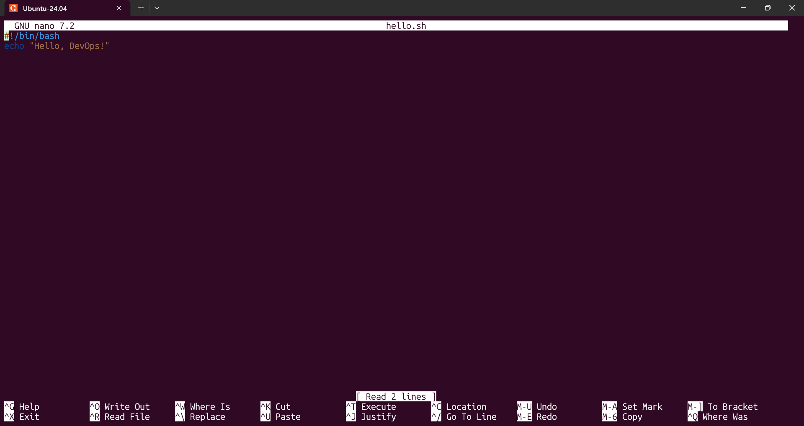
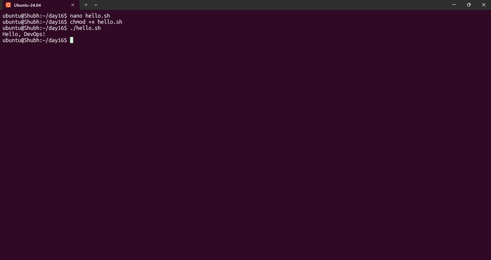
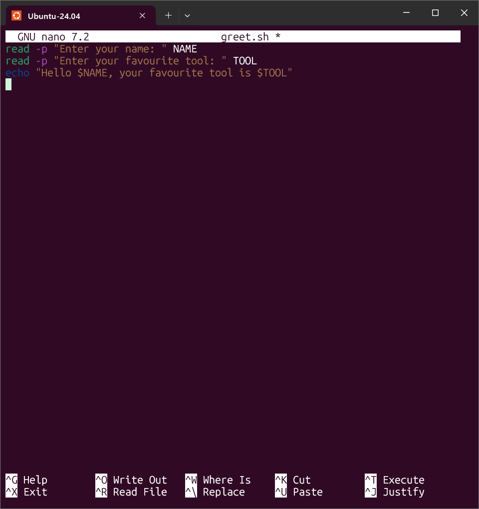
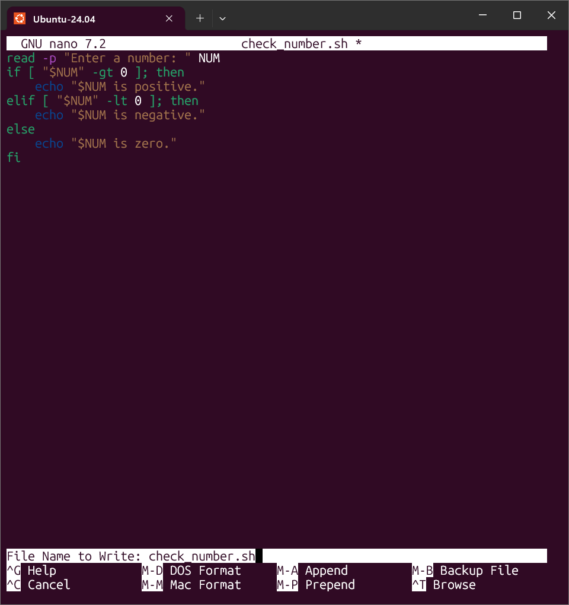
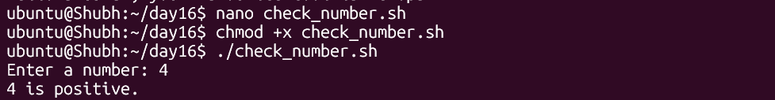
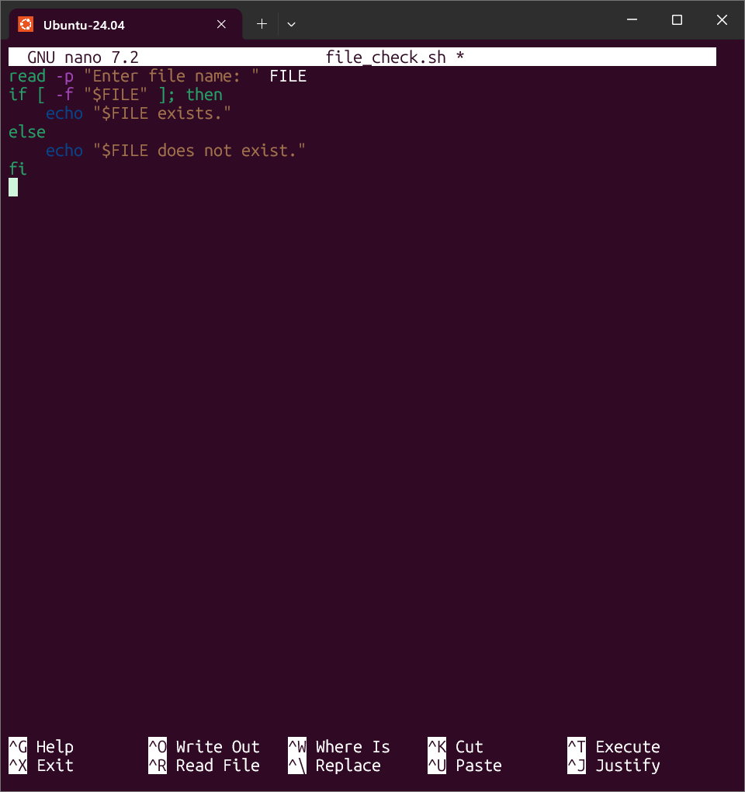
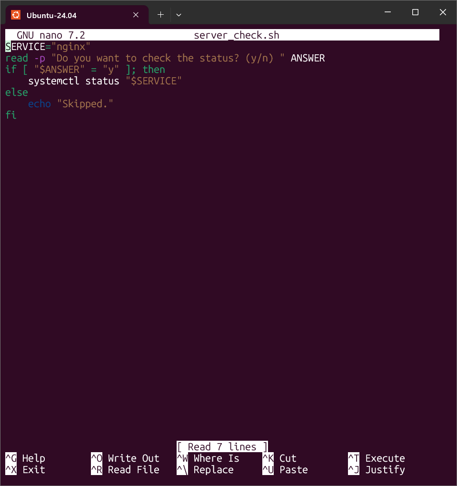
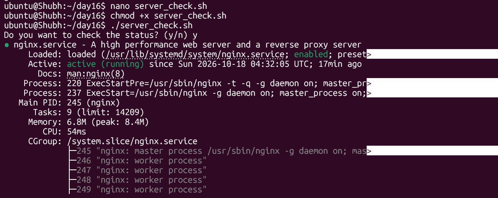
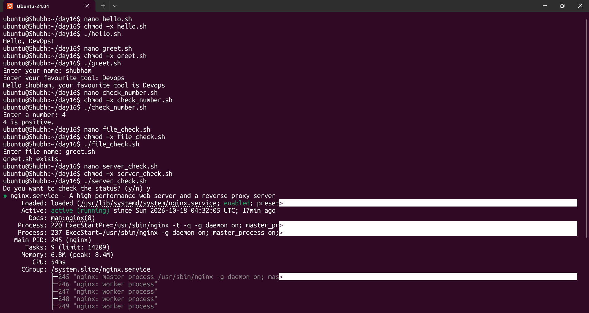

# Day 16 - Shell Scripting Basics

## Task
- Task 1 (First Script): create `hello.sh` with the `#!/bin/bash` shebang, print `Hello, DevOps!` with `echo`, make it executable and run it - and document what happens if the shebang line is removed
- Task 2 (Variables): create `variables.sh` with `NAME` and `ROLE` variables and print `Hello, I am <NAME> and I am a <ROLE>`; explain the difference between single and double quotes
- Task 3 (User Input): create `greet.sh` that asks for a name and a favourite tool with `read` and greets the user
- Task 4 (If-Else): create `check_number.sh` (positive / negative / zero) and `file_check.sh` (does the file exist - `-f`)
- Task 5 (Combine It All): create `server_check.sh` that stores a service name, asks `(y/n)`, runs `systemctl status` on `y` and reports whether the service is active

## Environment
| Item | Value |
|------|-------|
| OS | Ubuntu 24.04 VM (`lsb_release -a` to confirm) |
| Shell | bash 5.x (`echo "$BASH_VERSION"`) |
| Editor | GNU nano 7.2 - visible in every recording below |
| Service under test | `nginx` - installed and `active (running)` during the recording |
| Privileges | none needed - none of today's scripts requires root |
| Working directory | `~/day16` |
| Files in this folder | `hello.sh`, `variables.sh`, `greet.sh`, `check_number.sh`, `file_check.sh`, `server_check.sh` |

```bash
mkdir -p ~/day16 && cd ~/day16
echo "$BASH_VERSION"
systemctl is-active nginx          # active
```

---

## Solution

### Task 1: Your First Script

**WHY it matters for DevOps:** every automation, from a five-line health check to a full deployment pipeline, starts exactly like this - an interpreter, a command, an exit status. The shebang, the executable bit and `./` are the three things that make a file a *runnable* script instead of a text file.

```bash
nano hello.sh        # write the script
chmod +x hello.sh    # grant the execute bit
./hello.sh           # run it
```

Full script (matches `hello.sh` in this folder):

```bash
#!/bin/bash
echo "Hello, DevOps!"
```

Output:

```text
Hello, DevOps!
```





Line by line:

| Line | What it does |
|------|--------------|
| `#!/bin/bash` | **Shebang.** The first two bytes `#!` tell the kernel to run the file with `/bin/bash`; the kernel literally calls `execve("/bin/bash", ["/bin/bash", "hello.sh"])`. It must be line 1 - a blank line or an invisible BOM before it breaks it |
| `echo "Hello, DevOps!"` | builtin that writes its arguments and a newline to stdout |
| `chmod +x` | sets the execute bits on the file; without them `./hello.sh` is `Permission denied` even though the shebang is correct |
| `./` | the current directory is not in `PATH` (and should not be), so you must say `./hello.sh` - bare `hello.sh` gives `command not found` |

**What happens if you remove the shebang line?** (the question the README asks)

```bash
sed '1d' hello.sh > hello-noshebang.sh        # drop line 1
chmod +x hello-noshebang.sh
./hello-noshebang.sh                          # still prints Hello, DevOps!
python3 -c "import os; os.execv('./hello-noshebang.sh', ['./hello-noshebang.sh'])"
# OSError: [Errno 8] Exec format error
```

- When you run `./hello-noshebang.sh` **from an interactive shell**, the kernel refuses to exec it (returns `ENOEXEC` because there is no interpreter), and the shell silently *rescues* it by running the file as a script **with itself**. Bash runs it with bash, so this tiny bash-compatible script still prints the greeting - the shebang was never used, and that is exactly the trap.
- There is **no fallback** for anything that launches the file with `execve()` directly: `cron`, systemd `ExecStart=`, `docker run`/`ENTRYPOINT`, a CI runner, `find -exec ./script`, or Python's `os.execv` above. They fail with **`Exec format error`**.
- The fallback interpreter is not guaranteed to be bash - POSIX shells may use `/bin/sh` (**dash** on Ubuntu). Any bashism then dies with confusing errors: dash has no `read -p` (`read: Illegal option - p`), no `[[ ]]`, no arrays.

Practical rule: `bash hello.sh` works without a shebang *because you named the interpreter on the command line*, and `sh hello.sh` runs it under **sh** no matter what line 1 says. The shebang only matters when the file is executed directly - which is exactly how every scheduler and pipeline will execute it. `file hello.sh` is a quick check: `Bourne-Again shell script ... executable` vs plain `ASCII text`.

Two portable shebangs you will see in the wild:

| Shebang | Notes |
|---------|-------|
| `#!/bin/bash` | standard on nearly every Linux box, including this VM |
| `#!/usr/bin/env bash` | looks up `bash` in `PATH`; needed where bash is not at `/bin/bash` (NixOS, macOS with Homebrew bash, some containers). Slightly less predictable - prefer it only when you need the portability |

### Task 2: Variables

**WHY it matters for DevOps:** configuration is variables - `$DEPLOY_ENV`, `$IMAGE_TAG`, `$REGION`. Passing them wrong (unquoted, spaces around `=`) is the most common script bug in CI pipelines.

Full script (matches `variables.sh` in this folder):

```bash
#!/bin/bash
NAME="Shubham"
ROLE="DevOps Engineer"
echo "Hello, I am $NAME and I am a $ROLE"
```

Output:

```text
Hello, I am Shubham and I am a DevOps Engineer
```

The rules that bite:

| Rule | Example | Effect |
|------|---------|--------|
| **No spaces around `=`** | `NAME="Shubham"` | works. `NAME = "Shubham"` is parsed as running a command called `NAME` -> `NAME: command not found` |
| Expand with `$` | `echo "$NAME"` | substitutes the value; `${NAME}` is the same thing with explicit delimiters, needed when a name character follows: `"${ROLE}s"` |
| Case-sensitive | `name` vs `NAME` | two different variables |
| Quote on expansion | `"$ROLE"` | keeps spaces as one word and prevents glob expansion - see below |
| Only exported variables reach children | `export NAME` | a child process (`bash -c 'echo $NAME'`) sees exported variables only; a variable set by a script never leaks back to the parent unless you `source` the script |
| Read-only | `readonly NAME` | later assignment fails with `NAME: readonly variable` - a cheap guard for constants |

Useful expansions beyond plain `$NAME`:

| Expression | Value |
|------------|-------|
| `${NAME:-guest}` | `guest` if `NAME` is unset or empty - the classic `"${DEPLOY_ENV:-dev}"` default |
| `${#NAME}` | length of the value (`Shubham` -> 7) |
| `$(command)` | command substitution, e.g. `BUILD_TIME="$(date +%H:%M:%S)"` |
| `$((2+2))` | arithmetic, e.g. `COUNT=$((COUNT + 1))` |

**Single quotes vs double quotes** (the README asks for the difference):

```text
$ NAME="Shubham"
$ echo "Hello, $NAME"      ->  Hello, Shubham          # double: $ expands
$ echo 'Hello, $NAME'      ->  Hello, $NAME            # single: 100% literal
$ echo Hello, $NAME        ->  Hello, Shubham          # unquoted: expands, then splits words
```

| Quoting | What bash does | Use it for |
|---------|----------------|------------|
| `"double"` | expands `$VAR`, `$(cmd)`, backticks; `\` and `` ` `` are special (plus `!` history expansion in interactive shells); result stays **one word** even with spaces | almost everything - quoting a variable is the default habit |
| `'single'` | **nothing** is special, not even `$` or `\`; a single quote cannot appear inside (escape trick: `'\''`) | literal text: regexes, `$` signs, jq/sed/awk expressions, JSON |
| unquoted | expands, then **word-splits** on spaces and **globs** (`*`, `?`) | almost never |

The unquoted case is where real damage happens: `FILE="my report.txt"; cat $FILE` tries to open two files (`my` and `report.txt`); `cat "$FILE"` works. With an *empty* variable it is worse - `rm -rf $DIR/` becomes `rm -rf /`. Rule of thumb: **every variable expansion gets double quotes**; single quotes are for things you never want expanded.

### Task 3: User Input with `read`

**WHY it matters for DevOps:** interactive prompts are how runbooks ask "which environment?" before doing something destructive. The same `read` pattern also consumes piped input, which is how scripts are tested non-interactively in CI.

Full script (matches `greet.sh` in this folder):

```bash
#!/bin/bash
read -p "Enter your name: " NAME
read -p "Enter your favourite tool: " TOOL
echo "Hello $NAME, your favourite tool is $TOOL"
```

Output from the recording:

```text
Enter your name: shubham
Enter your favourite tool: Devops
Hello shubham, your favourite tool is Devops
```




`read` options worth knowing:

| Option | Effect |
|--------|--------|
| `-p "text"` | print the prompt (only when stdin is a terminal) |
| `-r` | **raw** - keeps backslashes instead of eating them; best practice is always `read -r` |
| `-s` | silent - nothing echoed; for passwords (with `-p` for the prompt) |
| `-t 5` | timeout after 5 seconds |
| `-n 1` | return after 1 character - "press any key" |
| `read A B` | first word into `A`, rest of the line into `B` (split on `IFS`) |

Notes:

- `read` takes **one line** per call and strips leading/trailing whitespace; pressing Enter on an empty line gives an empty value, not an error.
- Because `read` consumes **stdin**, the script works the same when fed a pipe - this is how you test it without a human:
  ```bash
  printf 'shubham\nDevops\n' | ./greet.sh
  ```
- At EOF (`read` gets no more input) `read` fails with a non-zero status. Under `set -e` that kills the script - guard with `read -r -p "..." X || exit 1` if the script must run unattended.

### Task 4: If-Else Conditions

**WHY it matters for DevOps:** `if` is the decision layer of every script - gate a deploy on a health check, refuse to start if a config file is missing, alert if disk usage is above a threshold.

#### 4a. `check_number.sh`

Full script (matches `check_number.sh` in this folder):

```bash
#!/bin/bash
read -p "Enter a number: " NUM

if [ "$NUM" -gt 0 ]; then
    echo "$NUM is positive."
elif [ "$NUM" -lt 0 ]; then
    echo "$NUM is negative."
else
    echo "$NUM is zero."
fi
```

Output from the recording:

```text
Enter a number: 4
4 is positive.
```





How `if` really works here:

- `if` does not test "truth" - it **runs a command and checks its exit status**. `0` means success/true, anything else is false. `if systemctl is-active nginx; then` is the same mechanism.
- `[` is not syntax, it is a **builtin command** (same as `test`), so the spaces are mandatory: `[ "$NUM" -gt 0 ]`. `if[$NUM -gt 0]` is `command not found`, and `[ "$NUM" -gt 0]` is `missing ']'`.
- Comparison operators:
  - numbers: `-gt` `-lt` `-ge` `-le` `-eq` `-ne`
  - strings: `=` `!=`, plus `-z` (empty) / `-n` (non-empty)
  - bash's `[[ ]]` adds `==` with glob patterns, `<` `>` and `=~` regex; prefer `[[ ]]` inside bash scripts.
- `$?` after the script shows the exit status of the last command; `echo $?` after `./check_number.sh` is the script's own exit status, which defaults to that of its last command.
- **Empty input trap:** with nothing typed, `[ "$NUM" -gt 0 ]` becomes `[ "" -gt 0 ]` -> `integer expression expected`. And a non-number like `abc` makes *both* comparisons fail, so flow falls into the `else` and the script claims **"abc is zero."** - technically consistent, factually wrong. Validation is one line:

  ```bash
  if ! [[ "$NUM" =~ ^-?[0-9]+$ ]]; then
      echo "Not a number: $NUM"
      exit 1
  fi
  ```

#### 4b. `file_check.sh`

Full script (matches `file_check.sh` in this folder):

```bash
#!/bin/bash
read -p "Enter file name: " FILE

if [ -f "$FILE" ]; then
    echo "$FILE exists."
else
    echo "$FILE does not exist."
fi
```

Output from the recording:

```text
Enter file name: greet.sh
greet.sh exists.
```




The file test operators you actually use:

| Test | True when |
|------|-----------|
| `-e` | path exists (any type: file, dir, symlink, device) |
| `-f` | exists **and is a regular file** - used here |
| `-d` | exists and is a directory |
| `-L` | exists and is a symlink |
| `-r` / `-w` / `-x` | readable / writable / executable by you |
| `-s` | exists and size > 0 (the "non-empty config file" check) |
| `-nt` / `-ot` | file1 newer / older than file2 - used in backup scripts |

Two traps worth burning in:

- **Quote `"$FILE"`.** With an unquoted empty variable, `[ -f $FILE ]` collapses to `[ -f ]` - a single non-empty argument, which `test` evaluates as **true**. The script would print `exists.` for an empty filename. Quoting gives `[ -f "" ]` -> correctly false.
- **Relative paths resolve against the current directory, not the script.** `./file_check.sh` run from `~` while the file is in `~/day16` reports "does not exist". In real scripts use absolute paths, or pin the cwd with `cd "$(dirname "$0")"`.

### Task 5: Combine It All - `server_check.sh`

**WHY it matters for DevOps:** this is the shape of a hundred real ops scripts - take input, decide, call a system tool, report a verdict. Swap `nginx` for any service and `systemctl` for `docker ps`/`kubectl get pods` and it is the same pattern.

Full script (matches `server_check.sh` in this folder):

```bash
#!/bin/bash
SERVICE="nginx"
read -p "Do you want to check the status? (y/n) " ANSWER

if [ "$ANSWER" = "y" ]; then
    systemctl status "$SERVICE"
else
    echo "Skipped."
fi
```

Output from the recording (nginx active on this VM):

```text
Do you want to check the status? (y/n) y
● nginx.service - A high performance web server and a reverse proxy server
     Loaded: loaded (/usr/lib/systemd/system/nginx.service; enabled; preset...)
     Active: active (running) since Sun 2026-10-18 04:32:05 UTC; 17min ago
       Docs: man:nginx(8)
    Process: 220 ExecStartPre=/usr/sbin/nginx -t -q -g daemon on; master_pr...
    Process: 237 ExecStart=/usr/sbin/nginx -g daemon on; master_process on;...
   Main PID: 245 (nginx)
      Tasks: 9 (limit: 14209)
     Memory: 6.8M (peak: 8.4M)
        CPU: 54ms
     CGroup: /system.slice/nginx.service
             ├─245 "nginx: master process /usr/sbin/nginx -g daemon on; mas...
             ├─246 "nginx: worker process"
             ├─247 "nginx: worker process"
             ├─248 "nginx: worker process"
             └─249 "nginx: worker process"
```

(`...` marks lines the terminal wrapped/truncated. Answer anything other than a lowercase `y` and the script prints `Skipped.`)





Reading `systemctl status` output:

| Field | In the recording | Meaning |
|-------|------------------|---------|
| `●` | filled circle | unit is **active** (an open `○` means inactive or failed) |
| `Loaded: ...; enabled; preset: enabled` | enabled | starts automatically at boot - that is `systemctl is-enabled`, a different question from running |
| `Active: active (running) since ... ; 17min ago` | up 17 minutes | runtime state plus uptime; `(running)` vs `(exited)` matters for oneshot services |
| `Main PID: 245 (nginx)` | the master | the process systemd tracks and restarts |
| `Tasks: 9`, `Memory`, `CPU` | 4 workers included | cgroup accounting for the whole tree |
| `CGroup:` tree | 245 master, 246-249 workers | nginx's master/worker model - the master manages workers, which is why `systemctl reload nginx` is graceful |

Making the verdict explicit and scriptable (what the task asks for, in the form other scripts can consume):

```bash
#!/bin/bash
SERVICE="nginx"
read -p "Do you want to check the status? (y/n) " ANSWER

if [ "$ANSWER" = "y" ]; then
    systemctl status --no-pager "$SERVICE"
    if systemctl is-active --quiet "$SERVICE"; then
        echo "$SERVICE is active"
    else
        echo "$SERVICE is NOT active"
    fi
else
    echo "Skipped."
fi
```

Expected extra output line: `nginx is active`.

- `systemctl is-active --quiet <svc>` prints nothing and communicates through the **exit status**: `0` only when the unit is active. That is the check to use inside `if`, not parsing the status text.
- `systemctl status` itself follows the same LSB exit-code convention (`0` unit is active, `3` unit is not active, `4` no such unit), but `is-active` states the contract unambiguously - use it inside `if` instead of parsing output text.
- Related one-liners: `systemctl is-enabled nginx` ("starts at boot?"), `systemctl is-failed nginx`, `systemctl list-units 'nginx*'`, `journalctl -u nginx -n 20 --no-pager` (the last log lines - `status` shows *state*, `journalctl` shows *why*).
- The `y` compare is case-sensitive: `Y` falls into `else`. Accept both with `if [ "${ANSWER,,}" = "y" ]` (bash 4+ lowercases) or `[ "$ANSWER" = "y" ] || [ "$ANSWER" = "Y" ]`.

### The full session, end to end

All five scripts were written, made executable and run in one continuous session - `chmod` before each first run, then the output:

```text
ubuntu@Shubh:~/day16$ nano hello.sh
ubuntu@Shubh:~/day16$ chmod +x hello.sh
ubuntu@Shubh:~/day16$ ./hello.sh
Hello, DevOps!
ubuntu@Shubh:~/day16$ nano greet.sh
ubuntu@Shubh:~/day16$ chmod +x greet.sh
ubuntu@Shubh:~/day16$ ./greet.sh
Enter your name: shubham
Enter your favourite tool: Devops
Hello shubham, your favourite tool is Devops
ubuntu@Shubh:~/day16$ nano check_number.sh
ubuntu@Shubh:~/day16$ chmod +x check_number.sh
ubuntu@Shubh:~/day16$ ./check_number.sh
Enter a number: 4
4 is positive.
ubuntu@Shubh:~/day16$ nano file_check.sh
ubuntu@Shubh:~/day16$ chmod +x file_check.sh
ubuntu@Shubh:~/day16$ ./file_check.sh
Enter file name: greet.sh
greet.sh exists.
ubuntu@Shubh:~/day16$ nano server_check.sh
ubuntu@Shubh:~/day16$ chmod +x server_check.sh
ubuntu@Shubh:~/day16$ ./server_check.sh
Do you want to check the status? (y/n) y
● nginx.service - A high performance web server and a reverse proxy server
     Loaded: loaded (/usr/lib/systemd/system/nginx.service; enabled; preset...)
     Active: active (running) since Sun 2026-10-18 04:32:05 UTC; 17min ago
   Main PID: 245 (nginx)
      Tasks: 9 (limit: 14209)
     Memory: 6.8M (peak: 8.4M)
        CPU: 54ms
     CGroup: /system.slice/nginx.service
             ├─245 "nginx: master process /usr/sbin/nginx -g daemon on; mas...
             ├─246 "nginx: worker process"
             ├─247 "nginx: worker process"
             ├─248 "nginx: worker process"
             └─249 "nginx: worker process"
ubuntu@Shubh:~/day16$
```



---

## Commands Used

```bash
# setup
mkdir -p ~/day16 && cd ~/day16
echo "$BASH_VERSION"

# Task 1 - first script
nano hello.sh ; chmod +x hello.sh ; ./hello.sh
head -n 1 hello.sh                       # inspect the shebang
file hello.sh                            # -> Bourne-Again shell script ... executable
sed '1d' hello.sh > hello-noshebang.sh   # shebang-removal experiment
chmod +x hello-noshebang.sh ; ./hello-noshebang.sh
python3 -c "import os; os.execv('./hello-noshebang.sh', ['./hello-noshebang.sh'])"   # Exec format error

# Task 2 - variables
nano variables.sh ; chmod +x variables.sh ; ./variables.sh
NAME="Shubham"; echo "Hello, $NAME"      # double quotes expand
echo 'Hello, $NAME'                      # single quotes print literally

# Task 3 - read
nano greet.sh ; chmod +x greet.sh ; ./greet.sh
printf 'shubham\nDevops\n' | ./greet.sh  # non-interactive test of the same script

# Task 4 - if/else
nano check_number.sh ; chmod +x check_number.sh ; ./check_number.sh
printf '4\n'   | ./check_number.sh
printf '0\n'   | ./check_number.sh
printf '-1\n'  | ./check_number.sh
nano file_check.sh ; chmod +x file_check.sh
printf 'greet.sh\n' | ./file_check.sh
printf 'nope.sh\n'  | ./file_check.sh

# Task 5 - combine it all
nano server_check.sh ; chmod +x server_check.sh ; ./server_check.sh
printf 'y\n' | ./server_check.sh
systemctl is-active nginx
systemctl is-enabled nginx
journalctl -u nginx -n 20 --no-pager

# sanity checks
ls -l *.sh                               # every file carries the x bit
head -n 1 *.sh                           # every file starts with #!/bin/bash
for f in *.sh; do bash -n "$f" && echo "$f: syntax OK"; done
```

## Verification
- All five scripts exist in this folder, each starts with `#!/bin/bash`, and the recorded session shows every one of them run end-to-end with `chmod +x` before its first execution (last screenshot)
- `./hello.sh` printed `Hello, DevOps!` (screenshot 02); `file hello.sh` classifies it as a bash script - the shebang is what makes direct execution work
- The shebang-removal experiment shows both faces of the trap: `./hello-noshebang.sh` still prints the greeting (interactive-shell fallback), while `os.execv` fails with `Exec format error` (no fallback) - proving the shebang is what makes a script runnable outside an interactive shell
- `variables.sh` prints `Hello, I am Shubham and I am a DevOps Engineer`; the quoting demo shows `"$NAME"` expanding and `'$NAME'` printed literally
- `./greet.sh` with input `shubham` / `Devops` printed `Hello shubham, your favourite tool is Devops` (screenshots 03-04); the same script accepts `printf 'shubham\nDevops\n' | ./greet.sh`, which is how it would be driven from CI
- `./check_number.sh` with `4` printed `4 is positive.` (screenshots 05-06); `0` and `-1` exercise the `else`/`elif` branches via the piped form above
- `./file_check.sh` with `greet.sh` printed `greet.sh exists.` (screenshots 07-08) - `-f` was true for a file that really exists in the working directory
- `./server_check.sh` with `y` ran `systemctl status nginx` and showed `Active: active (running)`, Main PID `245` and workers `246-249` (screenshots 09-10); any other answer prints `Skipped.`
- `bash -n` parses every script with no syntax errors (`for f in *.sh; do bash -n "$f"; done` is silent) - the cheapest pre-flight check before committing a script
- Every `.sh` file in the folder is executable (`ls -l *.sh` shows `x` on all of them)

## Key Learnings
- The shebang (`#!/bin/bash`) decides which interpreter runs a script and is honored only when the file is executed directly. It must be the very first line; without it, interactive shells silently fall back to running the file themselves, but cron, systemd, Docker and CI fail with `Exec format error`.
- A "runnable" script is shebang + execute bit + correct invocation (`./script.sh`; `bash script.sh` bypasses the shebang and `sh script.sh` switches to dash where bashisms like `read -p` break).
- Variables: no spaces around `=`, expand with `$NAME`/`${NAME}`, and **always quote expansions** - unquoted empty variables silently change test semantics, unquoted values with spaces split into extra arguments.
- Double quotes expand and protect; single quotes are 100% literal; unquoted expansion word-splits and glob-expands. Quoting policy: `"$VAR"` everywhere, `'literal'` for regex/JSON/`$`-signs.
- `if` evaluates the **exit status** of a command - `[` is that command, which is why spaces inside `[ ... ]` are mandatory; numeric comparisons use `-gt/-lt/-eq`, strings use `=`, files use `-f/-d/-e`.
- `read -p "prompt" VAR` takes one line of input; use `-r` to keep backslashes, and `printf 'input\n' | ./script.sh` to run the interactive script non-interactively (tests, CI, screenshots).
- `systemctl status` is for humans, `systemctl is-active --quiet` is for scripts (`0` = active); `is-enabled` answers "starts at boot?", `journalctl -u <svc>` answers "why".
- Interactive input + `if` + a system command = the minimum viable ops script (`server_check.sh`); that exact skeleton is what Days 17-21 grow into loops, functions, arguments and strict mode.

## Troubleshooting / Gotchas
- **`bash: ./hello.sh: Permission denied`** - the execute bit is missing. Fix: `chmod +x hello.sh` (or run it as `bash hello.sh`, which needs no `x` bit).
- **`bad interpreter: /bin/bash^M: no such file or directory`** - the file was saved with **CRLF** line endings (very common when the repo is edited on Windows and copied to Linux). Fix: `sed -i 's/\r$//' hello.sh` or `dos2unix hello.sh`; prevent it with `.gitattributes` containing `*.sh text eol=lf`.
- **`#!/bin/bash: No such file or directory` even though `/bin/bash` exists** - an invisible **UTF-8 BOM** before the shebang (some Windows editors add one). Fix: `sed -i '1s/^\xEF\xBB\xBF//' hello.sh`; configure the editor to save "UTF-8" without BOM.
- **`NAME: command not found`** - spaces around `=` in an assignment. `NAME = "Shubham"` runs a command; write `NAME="Shubham"`.
- **`if[$NUM -gt 0]: command not found` / `[: missing ']'`** - `[` is a command and its arguments need spaces: `if [ "$NUM" -gt 0 ]; then`. Never glue.
- **`[: -gt: unary operator expected` (or worse, a wrong "exists")** - an unquoted, empty variable vanished from the test. Worse case: `[ -f $FILE ]` with empty `FILE` becomes `[ -f ]`, which is *true*. Fix: quote - `[ -f "$FILE" ]`.
- **`integer expression expected` and then "abc is zero."** - `-gt`/`-lt` only do integer math, and their failure is *just a false result*, so flow falls through to `else`. Validate input first (`[[ "$NUM" =~ ^-?[0-9]+$ ]]`) or default it (`NUM="${NUM:-0}"`).
- **`read: Illegal option - p`** - the script was run with `sh script.sh` (dash) instead of `./script.sh` or `bash script.sh`; the shebang was ignored because the interpreter was named on the command line.
- **`systemctl` fails with "System has not been booted with systemd as init system (PID 1)"** - inside WSL or a container without systemd. Fix: set `systemd=true` under `[boot]` in `/etc/wsl.conf`, run `wsl --shutdown`, and re-open the distro - or run the day's commands on the VM.
- **`systemctl status` hangs / drops into `less`** - on a terminal, long output is paged; from a script use `--no-pager` (or `| cat`) so it never waits for a keypress.
- **Backslashes disappear in input** - `read PATH` turns `C:\tools` into `C:tools`. Use `read -r` unless you specifically want backslash processing.
- **A script works by hand but fails from cron/CI** - different working directory and no `PATH`/environment. Use absolute paths (or `cd "$(dirname "$0")"`) and export needed variables; the failing shebang-free script lands here too.
- **Variables set in a script "disappear"** - a child process cannot set the parent's variables. If you want the variables in your own shell, `source ./variables.sh` (runs in the current shell) instead of `./variables.sh` (child process).

## Screenshots

| # | File | Shows |
|---|------|-------|
| 01 | `screenshots/01-hello-script-nano.png` | `hello.sh` being written in nano - shebang + echo |
| 02 | `screenshots/02-hello-script-run.png` | `chmod +x hello.sh` then `./hello.sh` -> `Hello, DevOps!` |
| 03 | `screenshots/03-greet-script-nano.png` | `greet.sh` being written - two `read` prompts |
| 04 | `screenshots/04-greet-script-run.png` | `./greet.sh` run with name and favourite tool |
| 05 | `screenshots/05-check-number-script-nano.png` | `check_number.sh` being written - if/elif/else |
| 06 | `screenshots/06-check-number-script-run.png` | `./check_number.sh` with `4` -> `4 is positive.` |
| 07 | `screenshots/07-file-check-script-nano.png` | `file_check.sh` being written - the `-f` test |
| 08 | `screenshots/08-file-check-script-run.png` | `./file_check.sh` with `greet.sh` -> exists |
| 09 | `screenshots/09-server-check-script-nano.png` | `server_check.sh` being written - SERVICE, read, if-else |
| 10 | `screenshots/10-server-check-nginx-active.png` | `systemctl status nginx` showing `Active: active (running)` |
| 11 | `screenshots/11-all-scripts-full-session.png` | The complete session: all five scripts written and run in order |
