# Day 17 - Shell Scripting: Loops, Arguments & Error Handling

## Task
- Task 1 (For Loop): create `for_loop.sh` that loops through 5 fruits and prints each one; create `count.sh` that prints numbers 1 to 10 using a for loop
- Task 2 (While Loop): create `countdown.sh` that takes a number from the user, counts down to 0 using a while loop, prints `Done!` at the end
- Task 3 (Command-Line Arguments): create `greet.sh` that accepts a name as `$1`, prints `Hello, <name>!`, prints `Usage: ./greet.sh <name>` if no argument is passed; create `args_demo.sh` that prints `$#`, `$@`, `$0`
- Task 4 (Install Packages via Script): create `install_packages.sh` that defines `nginx`, `curl`, `wget`, loops through the list, checks with `dpkg -s` (or `rpm -q`), installs if missing, skips if present, prints status per package (run as root)
- Task 5 (Error Handling): create `safe_script.sh` that uses `set -e`, creates `/tmp/devops-test`, navigates into it, creates a file inside, uses `||` to print an error if any step fails; add a root check to `install_packages.sh` that exits with a message if not root

## Environment
| Item | Value |
|------|-------|
| OS | Ubuntu 22.04 / 24.04 (`lsb_release -a` to confirm) `[TODO - run on your machine]` |
| Shell | `bash` 5.x (`echo "$BASH_VERSION"`) |
| Package manager | `apt` / `dpkg` on Ubuntu (`rpm -q` on RHEL family) |
| Tools | `bash`, `chmod`, `dpkg`, `apt-get`, `shellcheck` (optional) |
| Privileges | normal user for Tasks 1-3 and 5; **root** (`sudo`) for Task 4 |
| Working directory | `~/shell-lab-day17` (`mkdir -p ~/shell-lab-day17 && cd ~/shell-lab-day17`) |
| Files in this folder | `for_loop.sh`, `count.sh`, `countdown.sh`, `greet.sh`, `args_demo.sh`, `install_packages.sh`, `safe_script.sh` |

```bash
sudo apt update && sudo apt install -y bash shellcheck
mkdir -p ~/shell-lab-day17 && cd ~/shell-lab-day17
echo "$BASH_VERSION"
bash --version | head -1
```

## Solution

### Task 1: For Loop
**WHY it matters for DevOps:** loops turn one-off commands into fleet operations — rolling through server lists, image tags, regions, or package names. Every deploy/rotate/backup script in this course is a loop over a list.

```bash
cat for_loop.sh
chmod +x for_loop.sh
./for_loop.sh
```

Full script (matches `for_loop.sh` in this folder — do not edit it):

```bash
#!/bin/bash
fruits=("apple" "banana" "mango" "orange" "grapes")
for fruit in "${fruits[@]}"; do echo "Fruit: $fruit"; done
```

Expected output (example — your values will differ):

```text
Fruit: apple
Fruit: banana
Fruit: mango
Fruit: orange
Fruit: grapes
```

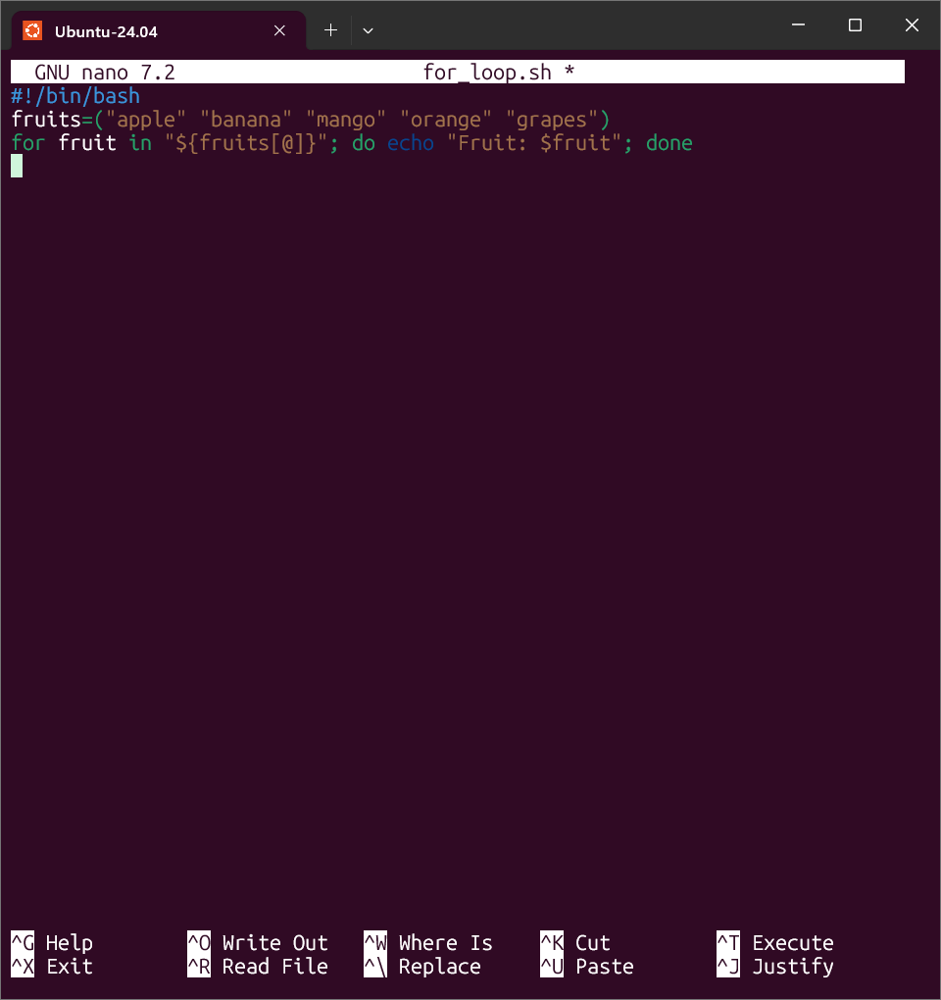

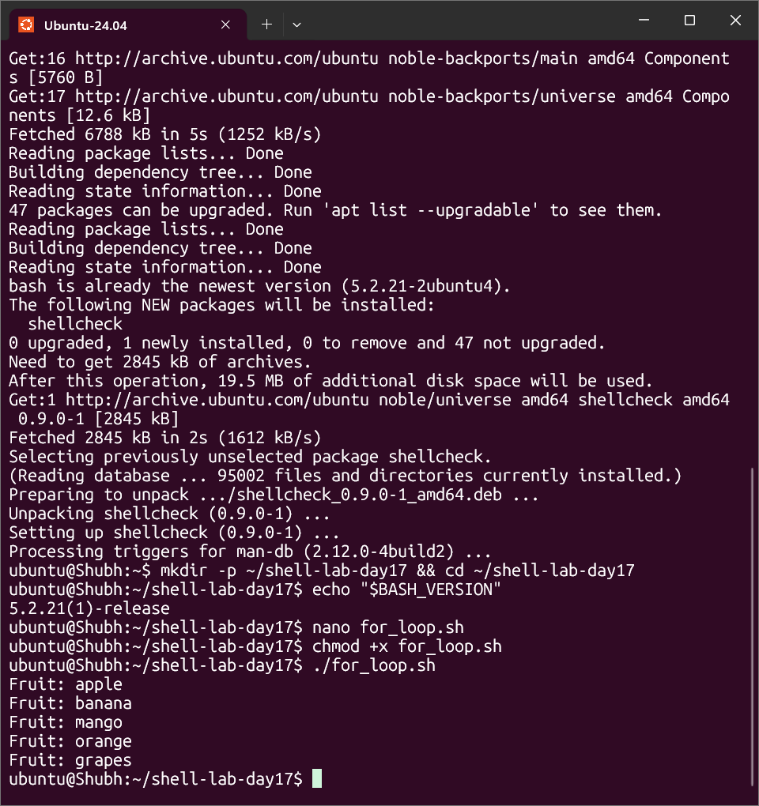

```bash
cat count.sh
chmod +x count.sh
./count.sh
```

Full script (matches `count.sh` in this folder):

```bash
#!/bin/bash
for i in {1..10}; do
  echo "$i"
done
```

Expected output (example — your values will differ): numbers `1` through `10`, one per line.

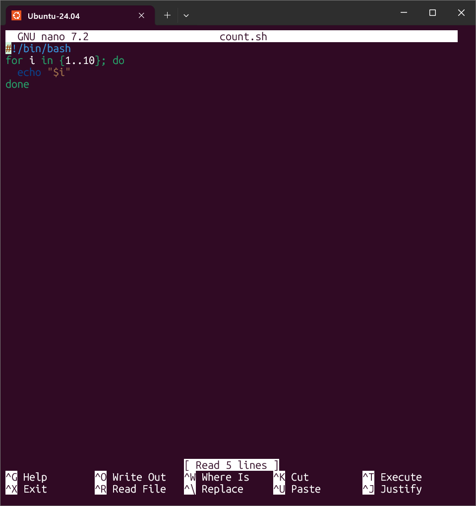

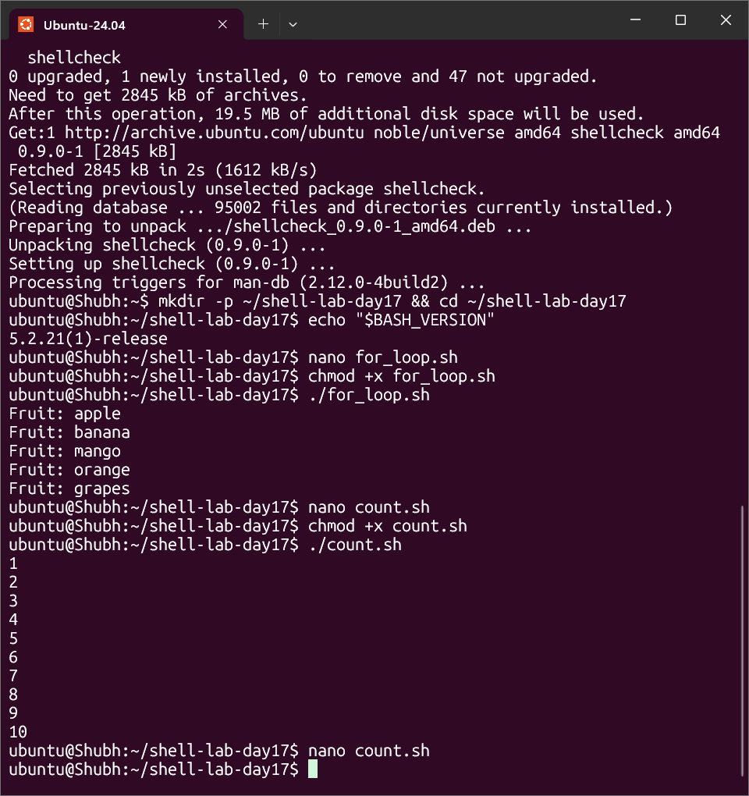

Concept table — the three for-loop forms you will actually use:

| Form | Example | When to use |
|------|---------|-------------|
| List loop | `for f in apple banana mango; do ...; done` | fixed word list (fruits, packages, regions) |
| Array loop | `for f in "${fruits[@]}"; do ...; done` | variable list; **always quote `"${arr[@]}"`** so entries with spaces stay intact |
| C-style loop | `for ((i=1; i<=10; i++)); do ...; done` | numeric ranges with step/control |
| Brace expansion | `for i in {1..10}; do ...; done` | short numeric ranges; expands **before** the loop runs |

> Gotcha: `{1..$N}` does **not** expand a variable — brace expansion happens before parameter expansion. For a variable bound use `seq` or a C-style loop: `for ((i=1; i<=N; i++))`.

### Task 2: While Loop
**WHY it matters for DevOps:** while loops express "keep trying until a condition holds" — wait-for-service, retry-with-backoff, drain-a-queue. The `while [ ... ]` + decrement pattern here is the skeleton of every readiness probe.

```bash
cat countdown.sh
chmod +x countdown.sh
./countdown.sh
```

Full script (matches `countdown.sh` in this folder):

```bash
#!/bin/bash
read -p "Enter a number to count down from: " num
while [ "$num" -gt 0 ]; do
  echo "$num"
  num=$((num - 1))
done
echo "Done!"
```

Sample run (example):

```text
Enter a number to count down from: 3
3
2
1
Done!
```

Non-interactive test (for CI / screenshots):

```bash
printf '3\n' | ./countdown.sh
```

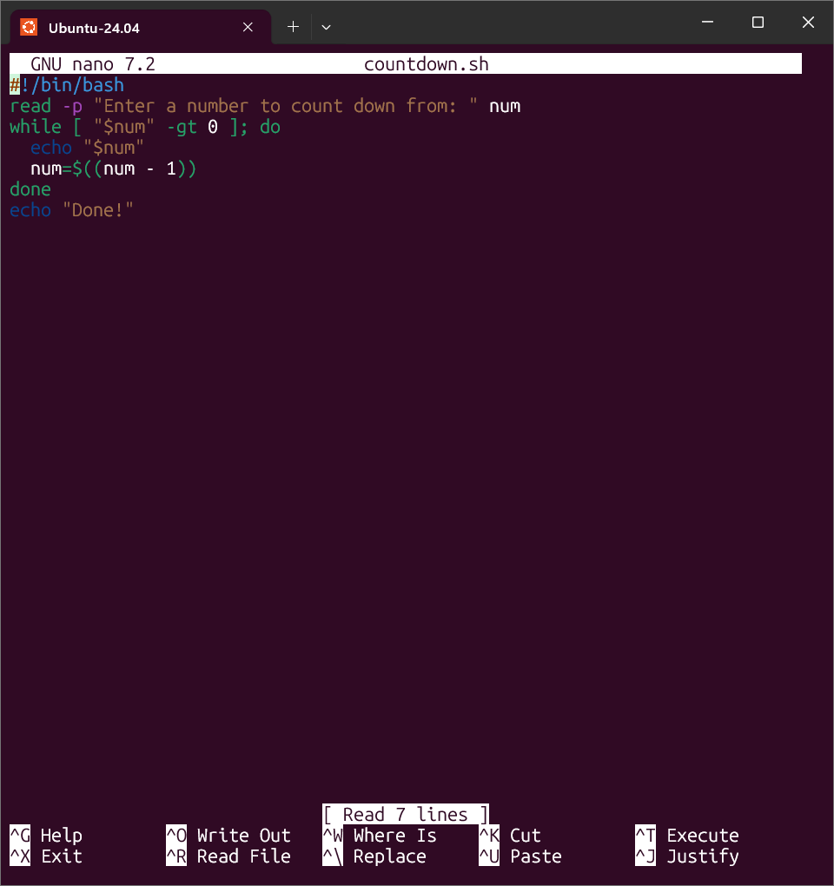

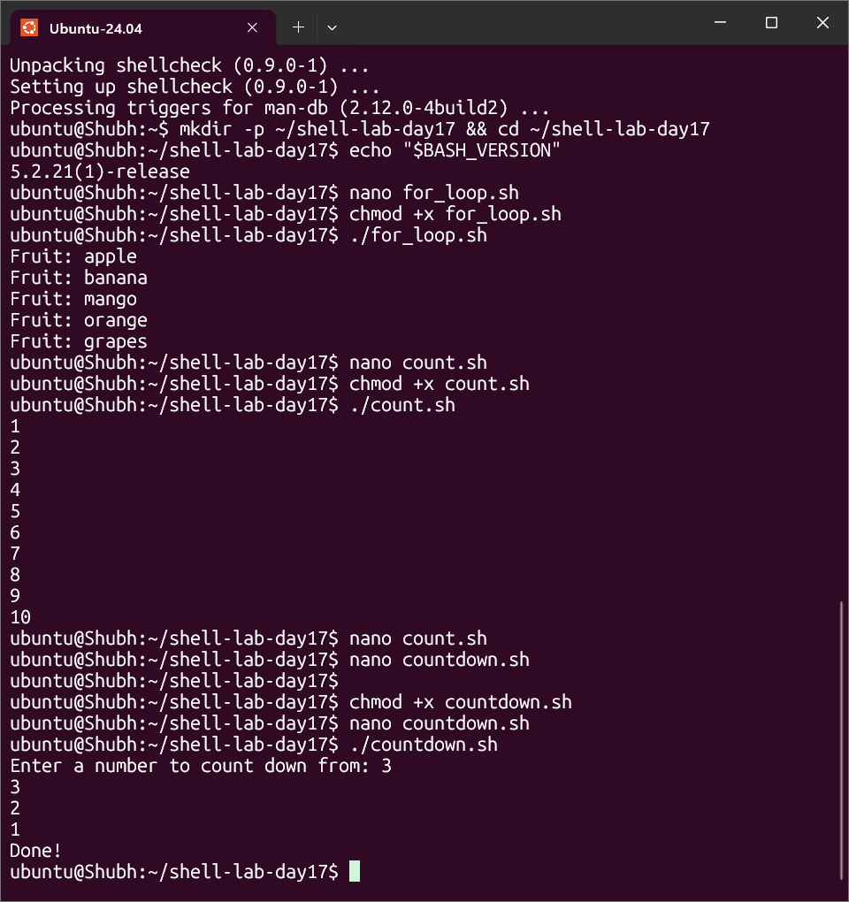

Concept table — loop control:

| Construct | Meaning |
|-----------|---------|
| `while [ "$num" -gt 0 ]; do ... done` | run while the test succeeds |
| `until [ "$num" -eq 0 ]; do ... done` | run until the test succeeds (inverted while) |
| `break` | exit the loop immediately |
| `continue` | skip to the next iteration |
| `sleep 2` inside loop | polling interval — without it a wait loop burns CPU |

### Task 3: Command-Line Arguments
**WHY it matters for DevOps:** arguments make scripts reusable across environments (`./deploy.sh staging` vs `./deploy.sh prod`) instead of hardcoding values. `$#` validation is the cheapest input check there is.

```bash
cat greet.sh
chmod +x greet.sh
./greet.sh Asha
./greet.sh
echo "exit=$?"
```

Full script (matches `greet.sh` in this folder):

```bash
#!/bin/bash
if [ $# -eq 0 ]; then
  echo "Usage: ./greet.sh <name>"
  exit 1
else
  echo "Hello, $1!"
fi
```

Expected output (example — your values will differ):

```text
$ ./greet.sh Asha
Hello, Asha!
$ ./greet.sh
Usage: ./greet.sh <name>     # exit status 1
```

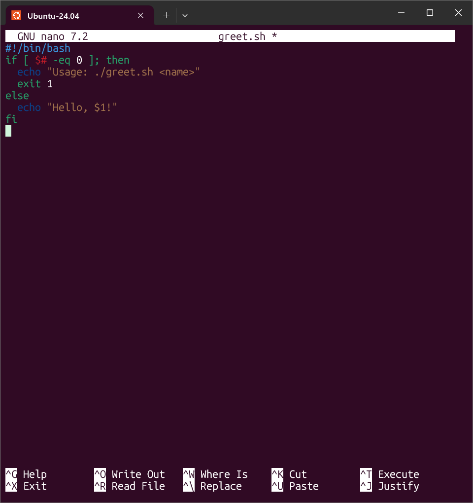

```bash
cat args_demo.sh
chmod +x args_demo.sh
./args_demo.sh one two three
```

Full script (matches `args_demo.sh` in this folder):

```bash
#!/bin/bash
echo "Script name: $0"
echo "Total arguments: $#"
echo "All arguments: $@"
```

Expected output (example — your values will differ):

```text
Script name: ./args_demo.sh
Total arguments: 3
All arguments: one two three
```

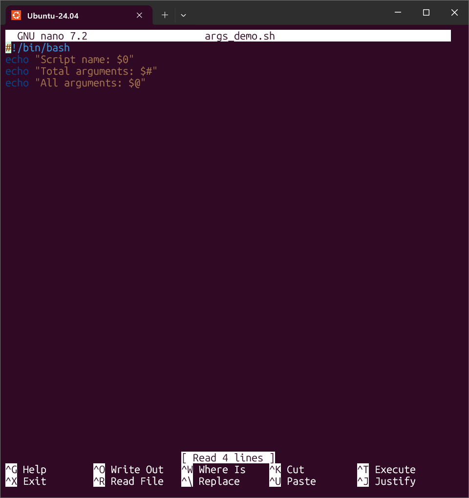

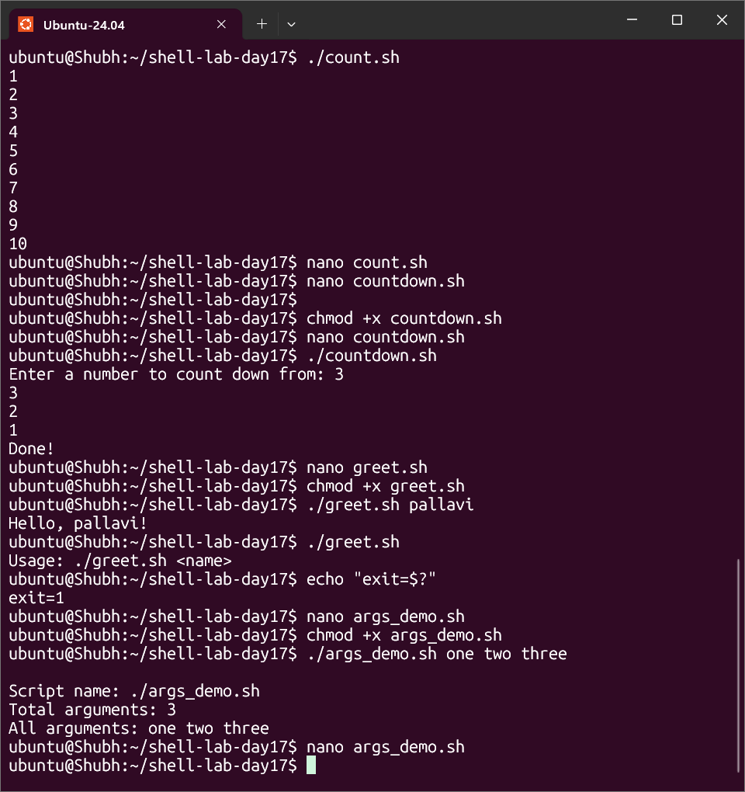

Concept table — positional parameters:

| Variable | Meaning | Example with `./args_demo.sh one "two three"` |
|----------|---------|-----------------------------------------------|
| `$0` | script name as invoked | `./args_demo.sh` |
| `$1`, `$2`, ... | 1st, 2nd argument | `$1`=one, `$2`=two three |
| `$#` | total argument count | `2` |
| `$@` | all arguments (each separate when quoted) | `one` `two three` |
| `$*` | all arguments as one string | `one two three` |
| `$?` | exit status of last command | `0` = success |
| `"$@"` vs `$@` | quoted preserves spaces; unquoted re-splits | always use `"$@"` in loops |

> Rule: `"Hello, $1!"` must be double-quoted. `'$1'` prints the literal `$1`.

### Task 4: Install Packages via Script
**WHY it matters for DevOps:** idempotent install loops are the heart of provisioning (user-data scripts, Ansible raw tasks, Dockerfiles). "Check first, install only if missing" makes re-runs safe.

```bash
cat install_packages.sh
chmod +x install_packages.sh
sudo ./install_packages.sh
```

Full script (matches `install_packages.sh` in this folder):

```bash
#!/bin/bash
if [ "$EUID" -ne 0 ]; then
  echo "Error: run this script as root (sudo)."
  exit 1
fi

packages=("nginx" "curl" "wget")

for pkg in "${packages[@]}"; do
  if dpkg -s "$pkg" &> /dev/null; then
    echo "$pkg: already installed, skipping."
  else
    echo "$pkg: not found, installing..."
    apt-get install -y "$pkg"
    echo "$pkg: installed."
  fi
done
```

Expected output (illustrative — your mix of installed/missing will differ `[TODO - run on your machine]`):

```text
nginx: not found, installing...
...
nginx: installed.
curl: already installed, skipping.
wget: already installed, skipping.
```

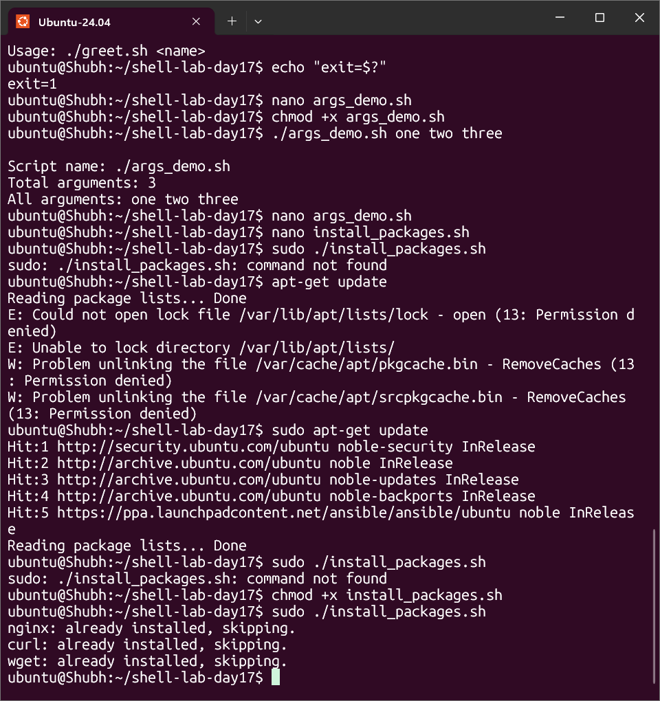

Concept table — package checks:

| Distro | Check installed | Install | Notes |
|--------|----------------|---------|-------|
| Ubuntu/Debian | `dpkg -s <pkg> &>/dev/null` | `apt-get install -y <pkg>` | `dpkg -s` exit 0 = installed |
| RHEL/Rocky | `rpm -q <pkg> &>/dev/null` | `dnf install -y <pkg>` | same loop shape, different tool |
| Either | `command -v nginx` | — | checks the binary on `PATH`, not the package DB |

> `apt-get update` before `apt-get install` on a fresh VM, otherwise the install step fails with `Unable to locate package`. In a loop script, run one `apt-get update` **before** the loop, not inside it.

### Task 5: Error Handling
**WHY it matters for DevOps:** a deploy script that keeps going after `cd` fails will write files into the wrong directory. `set -e` + explicit `||` fallbacks is the minimum viable safety net.

```bash
cat safe_script.sh
chmod +x safe_script.sh
./safe_script.sh
cat /tmp/devops-test/file.txt
```

Full script (matches `safe_script.sh` in this folder):

```bash
#!/bin/bash
set -e

mkdir /tmp/devops-test || echo "Directory already exists"
cd /tmp/devops-test || echo "Failed to cd into /tmp/devops-test"
echo "Hello from safe_script" > file.txt || echo "Failed to create file"
echo "Done. Contents:"
cat file.txt
```

Expected output (example — your values will differ):

```text
Done. Contents:
Hello from safe_script
```

Second run (directory already exists — the `||` branch):

```text
mkdir: cannot create directory '/tmp/devops-test': File exists
Directory already exists
Done. Contents:
Hello from safe_script
```

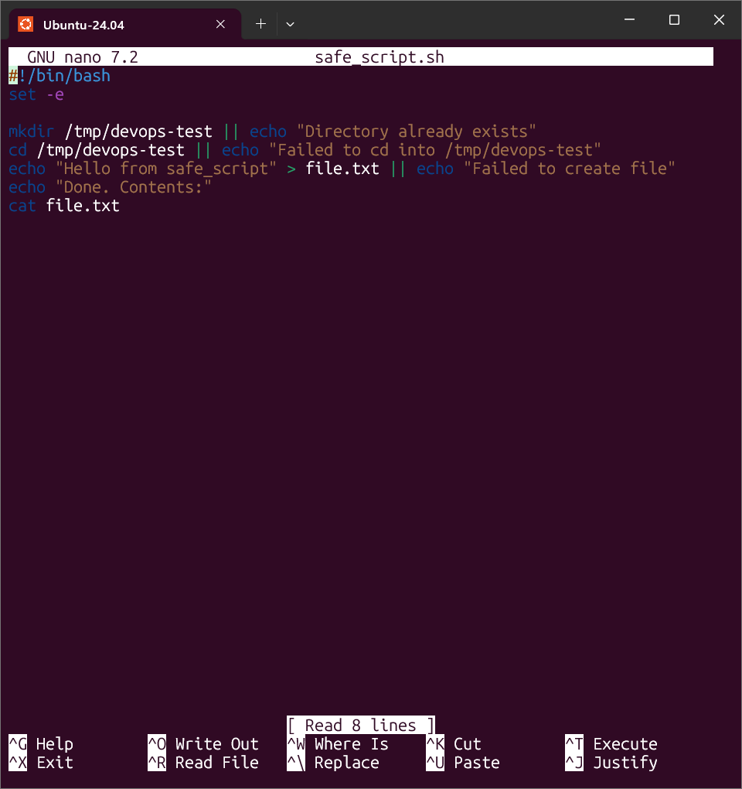

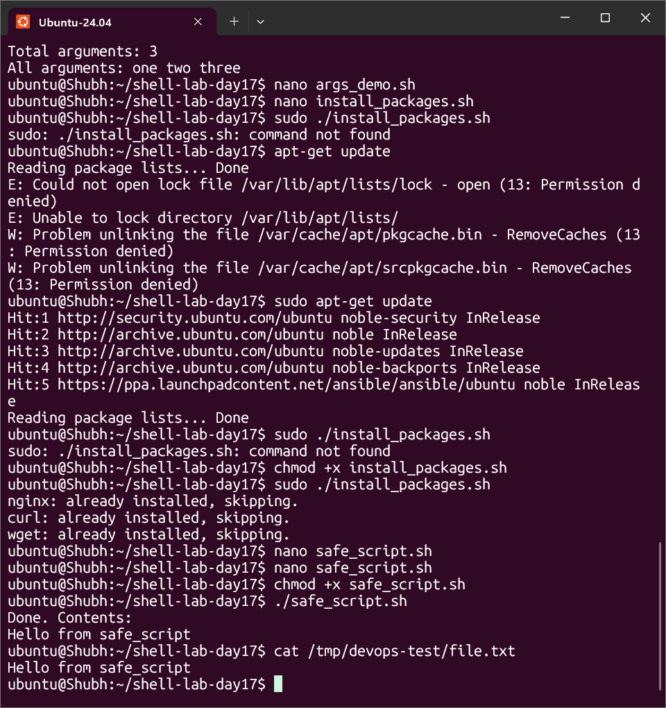

Concept table — error handling primitives:

| Construct | Meaning |
|-----------|---------|
| `set -e` | exit immediately if any command exits non-zero |
| `set -u` | treat unset variables as an error |
| `set -o pipefail` | a pipeline fails if **any** stage fails, not just the last |
| `cmd \|\| fallback` | run `fallback` only if `cmd` fails; also **exempt** from `set -e` |
| `cmd && next` | run `next` only if `cmd` succeeds |
| `if [ "$EUID" -ne 0 ]; then echo "Run as root"; exit 1; fi` | root guard — first lines of any script that writes outside `$HOME` |

> `set -e` is **ignored** on the left side of `||`/`&&` and inside `if` conditions — by design. That is why `mkdir ... || echo "exists"` does not abort the script even under `set -e`.

## Commands Used
```bash
# setup
mkdir -p ~/shell-lab-day17 && cd ~/shell-lab-day17
echo "$BASH_VERSION"

# Task 1 - for loops
chmod +x for_loop.sh count.sh
./for_loop.sh
./count.sh

# Task 2 - while loop
chmod +x countdown.sh
./countdown.sh
printf '3\n' | ./countdown.sh

# Task 3 - arguments
chmod +x greet.sh args_demo.sh
./greet.sh Asha
./greet.sh; echo "exit=$?"
./args_demo.sh one two three
./args_demo.sh a b; echo "exit=$?"

# Task 4 - package install loop (root)
chmod +x install_packages.sh
sudo ./install_packages.sh
dpkg -s nginx &>/dev/null && echo "nginx installed" || echo "nginx missing"

# Task 5 - error handling
chmod +x safe_script.sh
./safe_script.sh
cat /tmp/devops-test/file.txt
ls -ld /tmp/devops-test

# syntax check everything
for f in for_loop.sh count.sh countdown.sh greet.sh args_demo.sh install_packages.sh safe_script.sh; do bash -n "$f" && echo "$f: syntax OK"; done
```

## Verification
- `bash -n` passes for all 7 scripts (`for f in *.sh; do bash -n "$f"; done` prints no errors)
- `./for_loop.sh` prints exactly 5 `Fruit: ...` lines (apple, banana, mango, orange, grapes)
- `./count.sh` prints `1` through `10`, one per line, nothing else
- `printf '3\n' | ./countdown.sh` prints `3`, `2`, `1`, then `Done!`
- `./greet.sh Asha` prints `Hello, Asha!` with exit 0
- `./greet.sh` with no args prints `Usage: ./greet.sh <name>` with exit 1
- `./args_demo.sh one two three` prints script name, `Total arguments: 3`, `All arguments: one two three`
- `./install_packages.sh` without `sudo` prints the root error and exits 1 (does not reach `apt-get`)
- `sudo ./install_packages.sh` prints one status line per package (`already installed, skipping.` or `installed.`)
- `./safe_script.sh` creates `/tmp/devops-test/file.txt` containing `Hello from safe_script`; a second run prints `Directory already exists` and still exits 0
- All scripts are executable (`ls -l *.sh` shows `x`) and start with `#!/bin/bash`

## Key Learnings
- `for x in "${arr[@]}"` is the safe array loop — quoting preserves entries with spaces; unquoted `$@`/`${arr[@]}` re-splits them
- `{1..10}` is brace expansion (no variable allowed); for a variable bound use `for ((i=1; i<=N; i++))` or `seq`
- `$0` = script name, `$1` = first arg, `$#` = count, `"$@"` = all args quoted — validate with `if [ $# -eq 0 ]` before using `$1`
- `while [ cond ]` expresses retry/wait semantics; always include a `sleep` in polling loops so they do not spin
- `dpkg -s <pkg> &>/dev/null` is the idempotency check that makes install loops re-runnable
- `set -e` aborts on first failure, but commands guarded by `||`/`&&` or inside `if` are exempt — use `|| fallback` for expected failures like "directory already exists"
- Guard privileged scripts first: `if [ "$EUID" -ne 0 ]; then echo "Run as root"; exit 1; fi` before any `apt-get`
- `EUID` is a bash builtin (no subshell); `$UID` is equivalent — prefer `[ "$EUID" -ne 0 ]` over parsing `whoami`

## Troubleshooting / Gotchas
- **`./script.sh: Permission denied`** — cause: missing executable bit. Fix: `chmod +x script.sh`, then `./script.sh`.
- **`install_packages.sh` fails with `Unable to locate package nginx`** — cause: stale APT index on a fresh VM. Fix: run `sudo apt-get update` once before the script (or add it before the loop, not inside it).
- **`E: Could not open lock file /var/lib/dpkg/lock`** — cause: script run without root, or another `apt` process holds the lock. Fix: re-run with `sudo`; if another install is running, wait for it (`ps aux | grep -i apt`).
- **`set -e` killed the script on `dpkg -s <missing-pkg>`** — cause: `dpkg -s` exits non-zero for a missing package and nothing guards it. Fix: the check must be inside `if` (as here) or suffixed with `|| true`; `if dpkg -s ...` is exempt from `set -e` by design.
- **`[: -gt: unary operator expected` in `countdown.sh`** — cause: user pressed Enter with no input, so `[ "" -gt 0 ]` has an empty operand. Fix: validate first (`if [[ -z $num ]]`) or default (`num="${num:-3}"`).
- **`for i in {1..$N}` prints the literal `{1..5}`** — cause: brace expansion runs before variable expansion, so `$N` never expands inside braces. Fix: `for ((i=1; i<=N; i++)); do ...; done` or `for i in $(seq 1 "$N")`.
- **`$1: unbound variable` when `greet.sh` is run with `set -u`** — cause: referencing `$1` with zero arguments under `set -u`. Fix: check `$#` first (as here), or use `"${1:-}"` for an optional argument.
- **Second run of `safe_script.sh` looks like an error (`mkdir: File exists`)** — cause: none, that stderr line is expected; the `|| echo "Directory already exists"` handler converts it into a benign notice. Fix: none needed — or silence with `mkdir -p /tmp/devops-test` for a fully idempotent form.

## Screenshots

| # | File | Shows |
|---|------|-------|
| 01 | `screenshots/01-for-loop-nano.png` | `for_loop.sh` being written in nano - fruits array + for loop |
| 02 | `screenshots/02-for-loop-run.png` | setup, `chmod +x for_loop.sh` then `./for_loop.sh` -> all 5 fruits |
| 03 | `screenshots/03-count-nano.png` | `count.sh` being written - brace expansion `{1..10}` |
| 04 | `screenshots/04-count-run.png` | `./count.sh` printing `1` through `10` |
| 05 | `screenshots/05-countdown-nano.png` | `countdown.sh` being written - read, while test, decrement |
| 06 | `screenshots/06-countdown-run.png` | `./countdown.sh` with input `3` -> `3 2 1 Done!` |
| 07 | `screenshots/07-greet-nano.png` | `greet.sh` being written - the `$#` check and usage line |
| 08 | `screenshots/08-args-demo-nano.png` | `args_demo.sh` being written - `$0`, `$#`, `$@` |
| 09 | `screenshots/09-greet-args-run.png` | `./greet.sh` with and without an argument, then `./args_demo.sh one two three` |
| 10 | `screenshots/10-install-packages-run.png` | `sudo ./install_packages.sh` -> one status line per package |
| 11 | `screenshots/11-safe-script-nano.png` | `safe_script.sh` being written - `set -e` and `\|\|` fallbacks |
| 12 | `screenshots/12-safe-script-run.png` | `./safe_script.sh` run, then `cat /tmp/devops-test/file.txt` |
