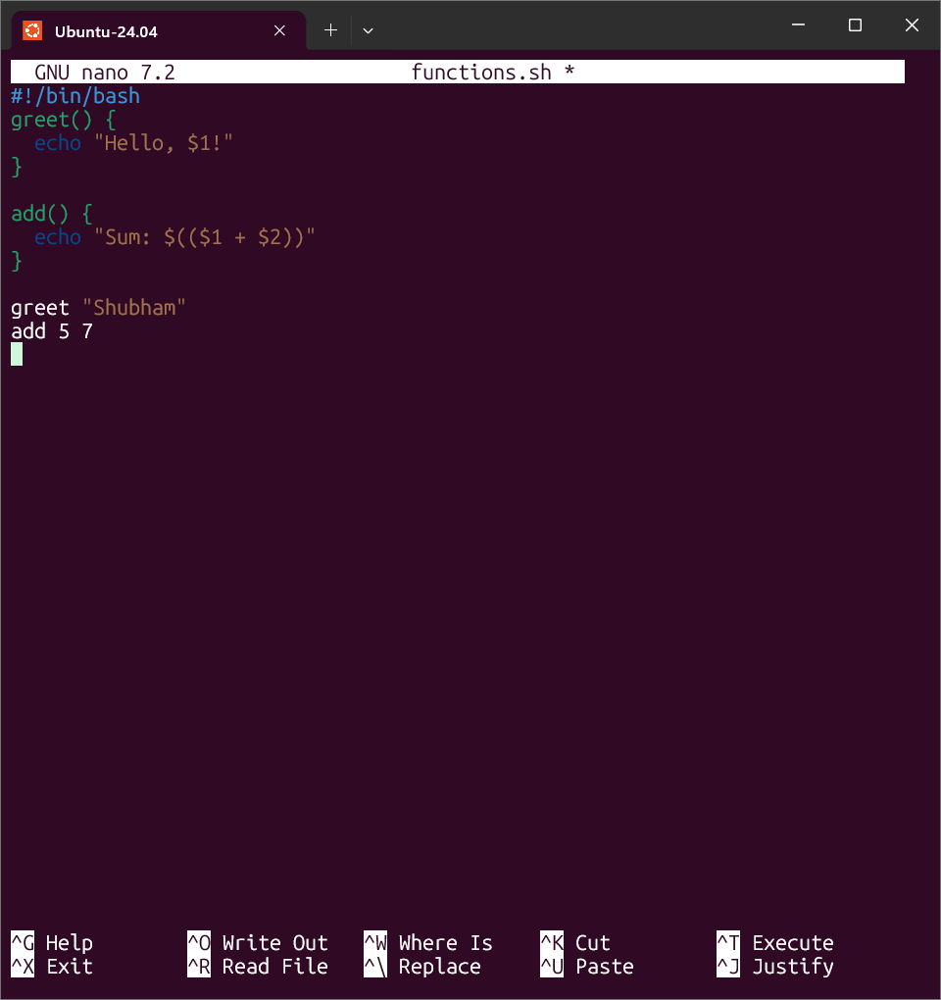
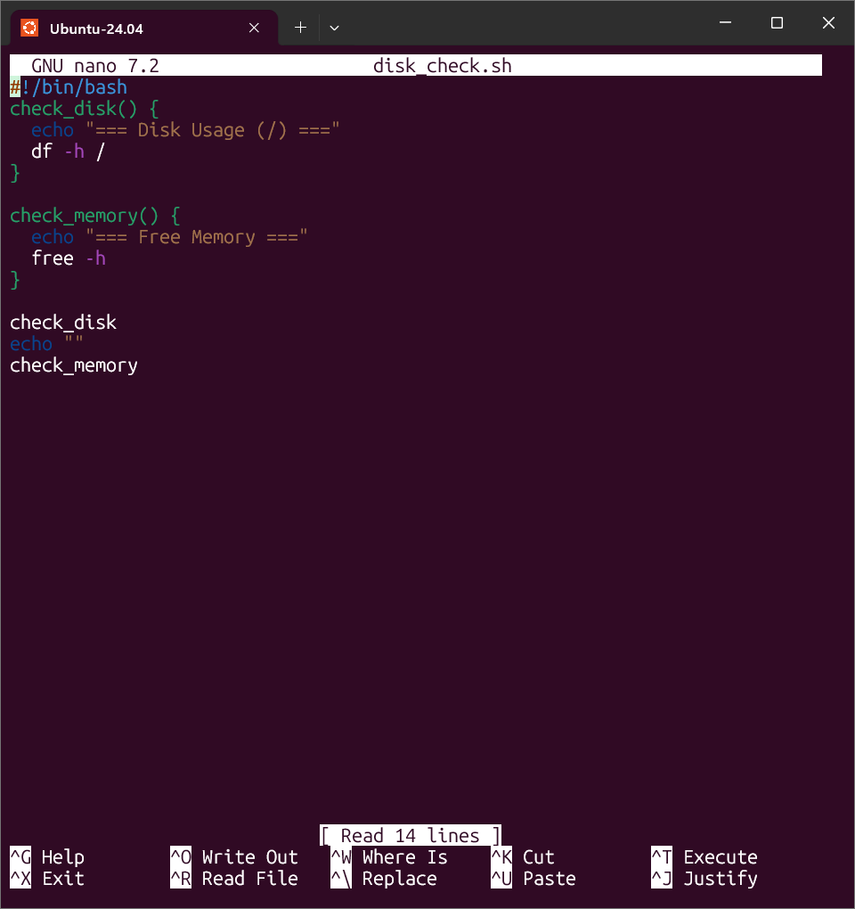
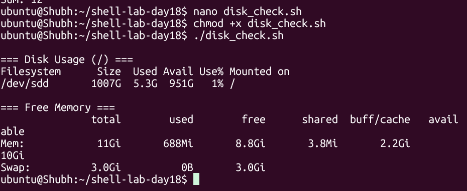
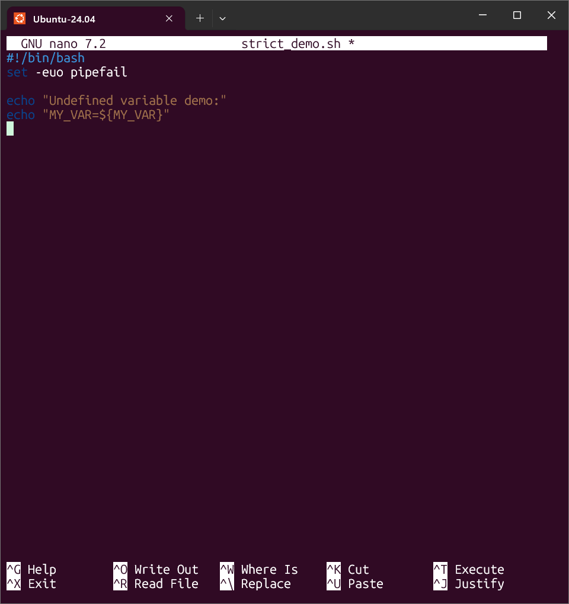
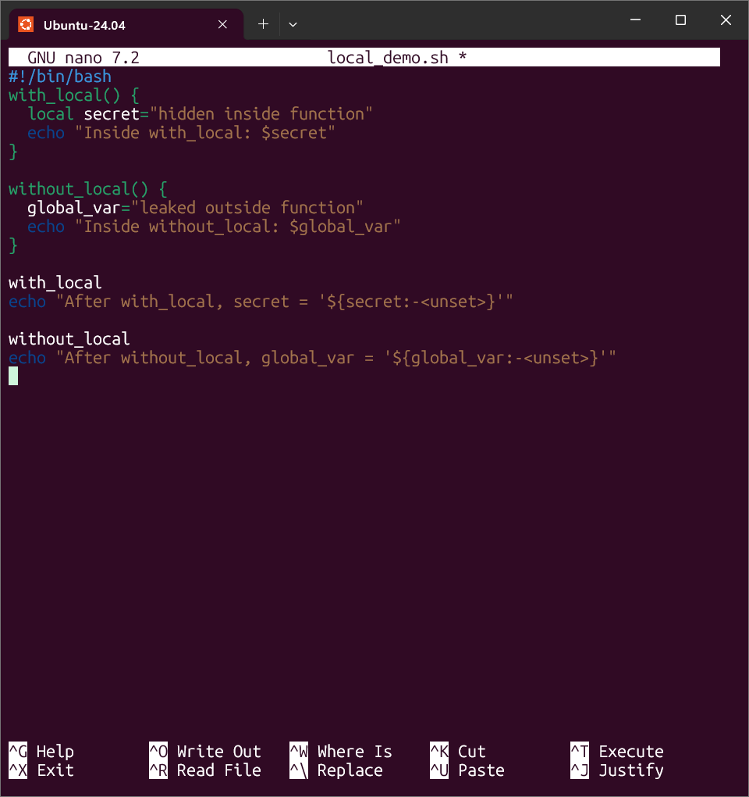
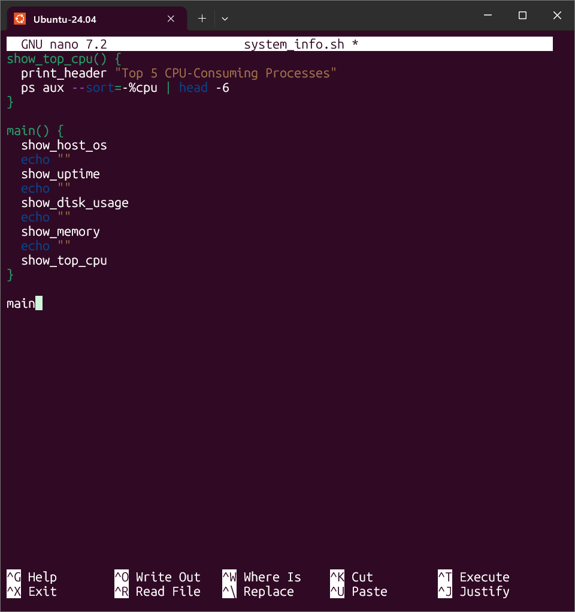
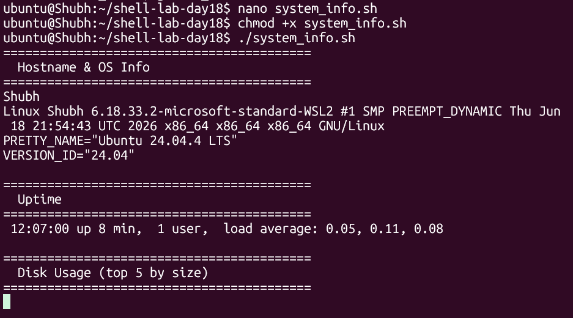

# Day 18 - Shell Scripting: Functions & Intermediate Concepts

## Task
- Task 1 (Basic Functions): create `functions.sh` with a `greet` function (takes a name, prints `Hello, <name>!`) and an `add` function (takes two numbers, prints their sum); call both from the script
- Task 2 (Functions with Return Values): create `disk_check.sh` with `check_disk` (disk usage of `/` via `df -h`) and `check_memory` (free memory via `free -h`); main section calls both and prints results
- Task 3 (Strict Mode): create `strict_demo.sh` with `set -euo pipefail`; show what undefined variable (`set -u`), a failing command (`set -e`), and a failing pipeline stage (`set -o pipefail`) do; document what each flag does
- Task 4 (Local Variables): create `local_demo.sh` showing `local` variables do not leak outside the function vs regular variables that do
- Task 5 (System Info Reporter): create `system_info.sh` using functions for everything — hostname+OS, uptime, top-5 disk usage, memory, top-5 CPU processes — plus a `main` function with section headers; use `set -euo pipefail`

## Environment
| Item | Value |
|------|-------|
| OS | Ubuntu 22.04 / 24.04 (`lsb_release -a` to confirm) `[TODO - run on your machine]` |
| Shell | `bash` 5.x (`echo "$BASH_VERSION"`) — `local`, `pipefail`, `[[ ]]` are bash-only |
| Tools | `bash`, `chmod`, `df`, `free`, `uptime`, `ps`, `du`, `sort`, `head`, `shellcheck` (optional) |
| Privileges | normal user is enough; no `sudo` needed for any script in this day |
| Working directory | `~/shell-lab-day18` (`mkdir -p ~/shell-lab-day18 && cd ~/shell-lab-day18`) |
| Files in this folder | `functions.sh`, `disk_check.sh`, `strict_demo.sh`, `local_demo.sh`, `system_info.sh` |

```bash
sudo apt update && sudo apt install -y bash procps coreutils shellcheck
mkdir -p ~/shell-lab-day18 && cd ~/shell-lab-day18
echo "$BASH_VERSION"
```

## Solution

### Task 1: Basic Functions
**WHY it matters for DevOps:** functions turn copy-pasted blocks into named, testable units (`log`, `retry`, `deploy_service`). The `system_info.sh` in Task 5 is just five small functions plus `main`.

```bash
cat functions.sh
chmod +x functions.sh
./functions.sh
```

Full script (matches `functions.sh` in this folder — do not edit it):

```bash
#!/bin/bash
greet() {
  echo "Hello, $1!"
}

add() {
  echo "Sum: $(($1 + $2))"
}

greet "Shubham"
add 5 7
```

Expected output (example — your values will differ):

```text
Hello, Shubham!
Sum: 12
```




Concept table — function syntax:

| Form | Example | Notes |
|------|---------|-------|
| `name() { ...; }` | `greet() { echo "Hello, $1!"; }` | POSIX-compatible, preferred in this course |
| `function name { ...; }` | `function greet { echo "Hello, $1!"; }` | bash-only keyword form, same effect |
| Call | `greet "Shubham"` | no parentheses at the call site — `greet("x")` is wrong |
| Args inside | `$1`, `$2`, `$#`, `$@` | function args **shadow** script args while inside |
| Return | `return 0` | exit status only (0-255); for text output use `echo` + command substitution |

> `$?` after `add 5 7` is `0` (the `echo` succeeded), not `12`. Functions return **statuses**; they print **values**.

### Task 2: Functions with Return Values
**WHY it matters for DevOps:** `df`/`free` wrappers are the smallest useful monitoring checks — the same two functions reappear inside cron jobs, health endpoints, and alerting scripts.

```bash
cat disk_check.sh
chmod +x disk_check.sh
./disk_check.sh
```

Full script (matches `disk_check.sh` in this folder):

```bash
#!/bin/bash
check_disk() {
  echo "=== Disk Usage (/) ==="
  df -h /
}

check_memory() {
  echo "=== Free Memory ==="
  free -h
}

check_disk
echo ""
check_memory
```

Expected output (illustrative — your sizes will differ `[TODO - run on your machine]`):

```text
=== Disk Usage (/) ===
Filesystem      Size  Used Avail Use% Mounted on
/dev/sda1        29G  9.1G   19G  33% /

=== Free Memory ===
               total        used        free      shared  buff/cache   available
Mem:           3.8Gi       1.1Gi       1.9Gi        12Mi       880Mi       2.5Gi
Swap:             0B          0B          0B
```





Concept table — what each command actually reports:

| Command | Reports | Key column |
|---------|---------|------------|
| `df -h /` | filesystem size/used/avail for `/` | `Use%` — alert at 80%, page at 90% |
| `free -h` | RAM + swap | `available` (not `free`) — memory the kernel can actually hand out |
| `df -i /` | inode usage | `IUse%` — a full inode table fails writes at 60% disk `Use%` |

### Task 3: Strict Mode — `set -euo pipefail`
**WHY it matters for DevOps:** without strict mode a failed `aws s3 sync` or `kubectl apply` mid-script is silently ignored and the pipeline reports green. Strict mode is the one-line baseline for every production script.

```bash
cat strict_demo.sh
chmod +x strict_demo.sh
./strict_demo.sh; echo "exit=$?"
```

Full script (matches `strict_demo.sh` in this folder):

```bash
#!/bin/bash
set -euo pipefail

echo "Undefined variable demo:"
echo "MY_VAR=${MY_VAR}"
```

Expected output (example — your values will differ):

```text
Undefined variable demo:
./strict_demo.sh: line 5: MY_VAR: unbound variable
exit=1
```




What each flag does:

| Flag | Meaning | Demo in this day |
|------|---------|------------------|
| `set -e` | exit immediately if any command exits non-zero | add `false` or `ls /nonexistent` on the next line — the script stops there and never reaches `echo done` |
| `set -u` | treat unset variables as an error and exit | `echo "${MY_VAR}"` above aborts with `MY_VAR: unbound variable` instead of printing an empty string |
| `set -o pipefail` | a pipeline fails if **any** stage fails, not just the last | `false \| echo hello` exits 0 without pipefail (last stage won), non-zero with it |

Try each failure yourself (run in a scratch shell, not by editing the deliverable):

```bash
bash -c 'set -e; false; echo "reached"' ; echo "exit=$?"   # 'reached' never prints, exit=1
bash -c 'set -u; echo "$NOPE"' ; echo "exit=$?"            # 'NOPE: unbound variable', exit=1
bash -c 'false | echo hi; echo "pipe=${PIPESTATUS[0]} last=$?"'
bash -c 'set -o pipefail; false | echo hi; echo "exit=$?"' # exit=1 with pipefail
```

> Two exemptions to memorise: `set -e` is skipped inside `if` conditions and on either side of `&&`/`||`. That is why `grep -q x f || echo "not found"` and `if failing_cmd; then` do not abort strict scripts.

### Task 4: Local Variables
**WHY it matters for DevOps:** library-style scripts source shared function files; a global `tmp` or `count` in one function silently corrupts another. `local` is the namespace hygiene that prevents it.

```bash
cat local_demo.sh
chmod +x local_demo.sh
./local_demo.sh
```

Full script (matches `local_demo.sh` in this folder):

```bash
#!/bin/bash
with_local() {
  local secret="hidden inside function"
  echo "Inside with_local: $secret"
}

without_local() {
  global_var="leaked outside function"
  echo "Inside without_local: $global_var"
}

with_local
echo "After with_local, secret = '${secret:-<unset>}'"

without_local
echo "After without_local, global_var = '${global_var:-<unset>}'"
```

Expected output (example — your values will differ):

```text
Inside with_local: hidden inside function
After with_local, secret = '<unset>'
Inside without_local: leaked outside function
After without_local, global_var = 'leaked outside function'
```




Concept table:

| Declaration | Scope | Use |
|-------------|-------|-----|
| `local x="v"` | current function only (bash-only, must be inside a function) | every temporary inside a function |
| `x="v"` | global (visible after the function returns) | return-by-variable, script-wide config |
| `local -r x="v"` | function-local + read-only | constants local to one function |

> `local` outside a function is itself an error (`local: can only be used in a function`). And `${secret:-<unset>}` — not `$secret` — is what keeps the probe line safe under `set -u`.

### Task 5: Build a Script — System Info Reporter
**WHY it matters for DevOps:** this is the "first 30 seconds of any incident" script — host identity, uptime, disk, memory, hot processes — in one runnable file. The same structure (small functions + `main`) scales to full runbooks.

```bash
cat system_info.sh
chmod +x system_info.sh
./system_info.sh
```

Full script (matches `system_info.sh` in this folder):

```bash
#!/bin/bash
set -euo pipefail

print_header() {
  echo "=========================================="
  echo "  $1"
  echo "=========================================="
}

show_host_os() {
  print_header "Hostname & OS Info"
  hostname
  uname -a
  if [ -f /etc/os-release ]; then
    grep -E '^(PRETTY_NAME|VERSION_ID)=' /etc/os-release
  fi
}

show_uptime() {
  print_header "Uptime"
  uptime
}

show_disk_usage() {
  print_header "Disk Usage (top 5 by size)"
  du -sh /* 2>/dev/null | sort -rh | head -5
}

show_memory() {
  print_header "Memory Usage"
  free -h
}

show_top_cpu() {
  print_header "Top 5 CPU-Consuming Processes"
  ps aux --sort=-%cpu | head -6
}

main() {
  show_host_os
  echo ""
  show_uptime
  echo ""
  show_disk_usage
  echo ""
  show_memory
  echo ""
  show_top_cpu
}

main
```

Expected output (illustrative — every value is machine-specific `[TODO - run on your machine]`):

```text
==========================================
  Hostname & OS Info
==========================================
my-vm
Linux my-vm 6.8.0-52-generic #53-Ubuntu SMP x86_64 GNU/Linux
PRETTY_NAME="Ubuntu 22.04.5 LTS"
VERSION_ID="22.04"

==========================================
  Uptime
==========================================
 10:15:23 up 5 days,  3:12,  1 user,  load average: 0.12, 0.08, 0.05

==========================================
  Disk Usage (top 5 by size)
==========================================
12G     /usr
4.1G    /var
1.2G    /opt
800M    /home
200M    /boot

==========================================
  Memory Usage
==========================================
               total        used        free      shared  buff/cache   available
Mem:           3.8Gi       1.1Gi       1.9Gi        12Mi       880Mi       2.5Gi

==========================================
  Top 5 CPU-Consuming Processes
==========================================
USER  PID %CPU %MEM VSZ ... COMMAND
... (5 hottest processes)
```





## Commands Used
```bash
# setup
mkdir -p ~/shell-lab-day18 && cd ~/shell-lab-day18
echo "$BASH_VERSION"

# Task 1 - basic functions
chmod +x functions.sh
./functions.sh

# Task 2 - disk/memory functions
chmod +x disk_check.sh
./disk_check.sh
df -h /; df -i /
free -h

# Task 3 - strict mode demos
chmod +x strict_demo.sh
./strict_demo.sh; echo "exit=$?"
bash -c 'set -e; false; echo "reached"'; echo "exit=$?"
bash -c 'set -u; echo "$NOPE"'; echo "exit=$?"
bash -c 'set -o pipefail; false | echo hi; echo "exit=$?"'

# Task 4 - locals
chmod +x local_demo.sh
./local_demo.sh

# Task 5 - reporter
chmod +x system_info.sh
./system_info.sh

# syntax check everything
for f in functions.sh disk_check.sh strict_demo.sh local_demo.sh system_info.sh; do bash -n "$f" && echo "$f: syntax OK"; done
command -v shellcheck && shellcheck *.sh || true
```

## Verification
- `bash -n` passes for all 5 scripts
- `./functions.sh` prints `Hello, Shubham!` and `Sum: 12`
- `./disk_check.sh` prints a `=== Disk Usage (/) ===` section with a `df -h /` table and a `=== Free Memory ===` section with a `free -h` table
- `./strict_demo.sh` aborts with `MY_VAR: unbound variable` and exit 1 (the `set -u` proof)
- `bash -c 'set -e; false; echo reached'` never prints `reached` (the `set -e` proof)
- `bash -c 'set -o pipefail; false | echo hi'` exits non-zero (the `pipefail` proof; without it the exit is 0)
- `./local_demo.sh` prints `<unset>` for `secret` after the function but the leaked value for `global_var`
- `./system_info.sh` prints all 5 sections with `==========` headers, `main` is the last line, `set -euo pipefail` is line 2
- All scripts are executable and start with `#!/bin/bash`

## Key Learnings
- Functions take args as `$1`/`$2` (shadowing script args) and return **statuses** via `return`; text results go through `echo` + command substitution
- `name() { ...; }` is the portable definition form; call with `name args` — never `name(args)`
- `set -euo pipefail` is the production baseline: `-e` aborts on failure, `-u` aborts on unset variables, `-o pipefail` fails a pipeline if any stage fails
- `local` scopes temporaries to the function — without it every assignment leaks globally and collides across sourced files
- `${VAR:-default}` is the `set -u`-safe way to read optional variables; `$?` and `PIPESTATUS` are how you inspect what strict mode acted on
- `df -h` watches capacity, `df -i` watches inodes, `free -h`'s `available` column (not `free`) is the real memory signal
- Small functions + one `main` is the incident-script pattern: each section testable alone, the whole report runnable in one command

## Troubleshooting / Gotchas
- **`./strict_demo.sh: MY_VAR: unbound variable`** — cause: `set -u` doing its job on an unset variable (expected, not a bug). Fix: none for the demo; in real scripts use `${MY_VAR:-default}` for optional vars.
- **`local: can only be used in a function`** — cause: `local` at top level or in a subshell pipeline stage. Fix: move the declaration inside the function body.
- **Strict script dies on `grep -q` finding nothing** — cause: `grep` exits 1 on no match and `set -e` aborts. Fix: guard it — `grep -q x f || true`, or test inside `if grep -q ...; then`.
- **`add 5 seven` prints `Sum: 5`** — cause: `$((5 + seven))` treats the non-numeric word as a variable name with value 0 (no error). Fix: validate numeric input with `[[ $2 =~ ^-?[0-9]+$ ]]` before arithmetic.
- **Function sees the script's `$1` instead of its own** — cause: calling `greet` with no args while the script itself had args; `$1` inside falls back to nothing, not the script's `$1`. Fix: always pass explicitly (`greet "$name"`), and inside use `local name="${1:?usage: greet <name>}"`.
- **`du -sh /*` hangs or prints `Permission denied`** — cause: walking `/proc`/`/sys` pseudo-filesystems on a loaded box. Fix: redirect `2>/dev/null` (as here) and cap with `head`; for speed restrict to real mounts (`du -sh /var /usr /opt`).
- **`ps aux --sort=-%cpu` says `ERROR: Unsupported option`** — cause: macOS/BSD `ps`, which has no `aux`+`--sort`. Fix: this day targets Linux; on macOS use `ps -Ao pid,pcpu,comm | sort -rn | head`.
- **Sourced function file pollutes the shell (`global_var` visible after)** — cause: top-level assignments in the sourced file plus non-`local` function vars. Fix: `local` for all temporaries, and wrap executable code in `main` guarded by `if [[ "${BASH_SOURCE[0]}" == "$0" ]]`.

## Screenshots

| # | File | Shows |
|---|------|-------|
| 01 | `screenshots/01-functions-nano.png` | `functions.sh` being written - `greet` and `add` |
| 02 | `screenshots/02-functions-run.png` | `./functions.sh` -> `Hello, Shubham!` and `Sum: 12` |
| 03 | `screenshots/03-disk-check-nano.png` | `disk_check.sh` being written - `check_disk` and `check_memory` |
| 04 | `screenshots/04-disk-check-run.png` | `./disk_check.sh` -> `df -h /` and `free -h` sections |
| 05 | `screenshots/05-strict-demo-nano.png` | `strict_demo.sh` being written - `set -euo pipefail` |
| 06 | `screenshots/06-strict-demo-run.png` | `./strict_demo.sh` -> `MY_VAR: unbound variable`, `exit=1` |
| 07 | `screenshots/07-local-demo-nano.png` | `local_demo.sh` being written - `local` vs global variables |
| 08 | `screenshots/08-local-demo-run.png` | `./local_demo.sh` -> `<unset>` vs leaked `global_var` |
| 09 | `screenshots/09-system-info-nano.png` | `system_info.sh` being written - `main` calling all five sections |
| 10 | `screenshots/10-system-info-run.png` | `./system_info.sh` -> hostname/OS, uptime, disk usage |
