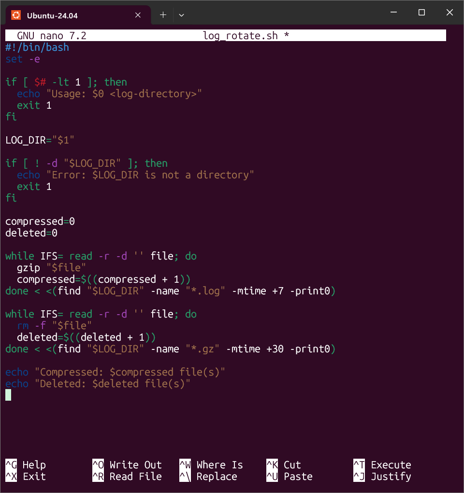
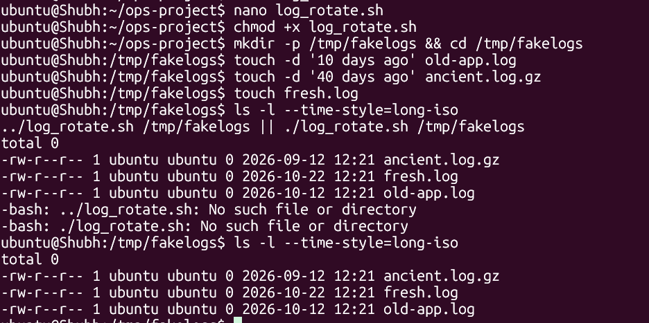
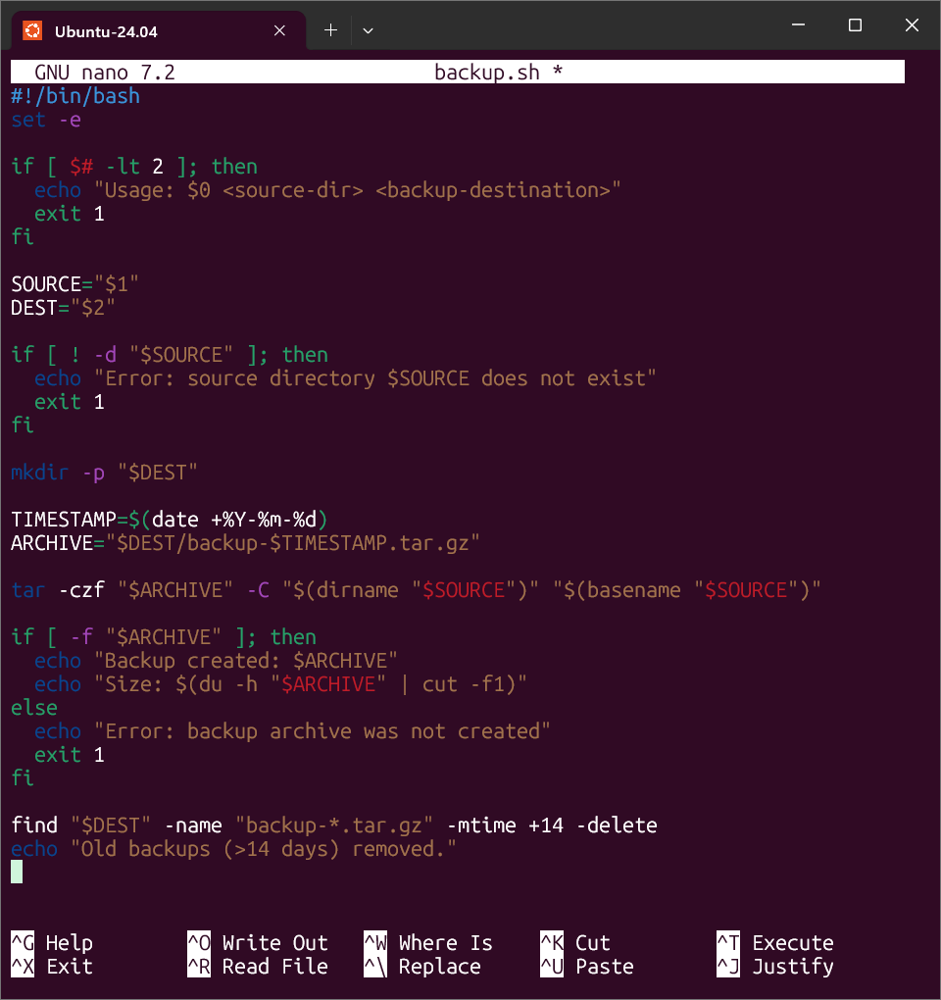
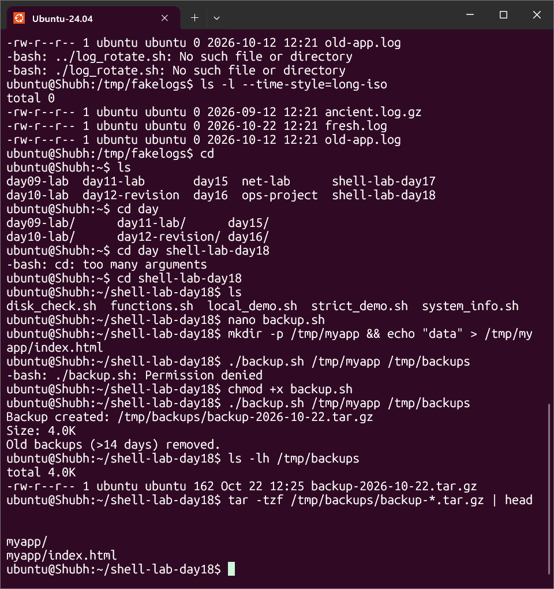
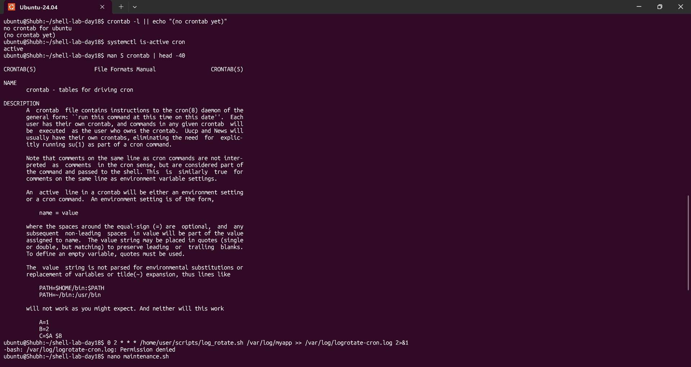
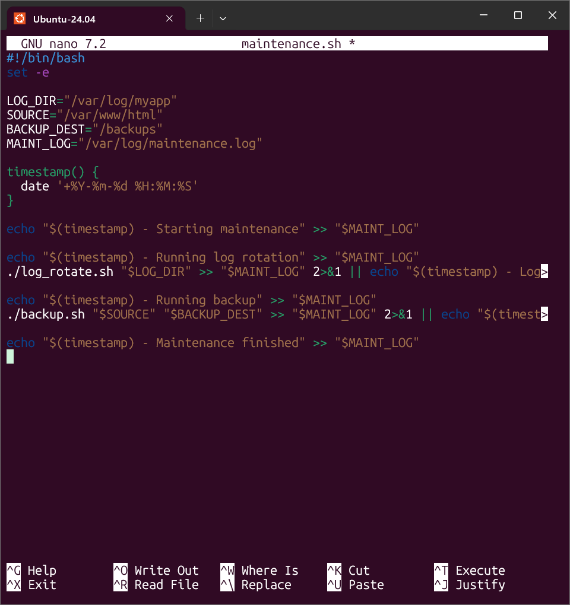
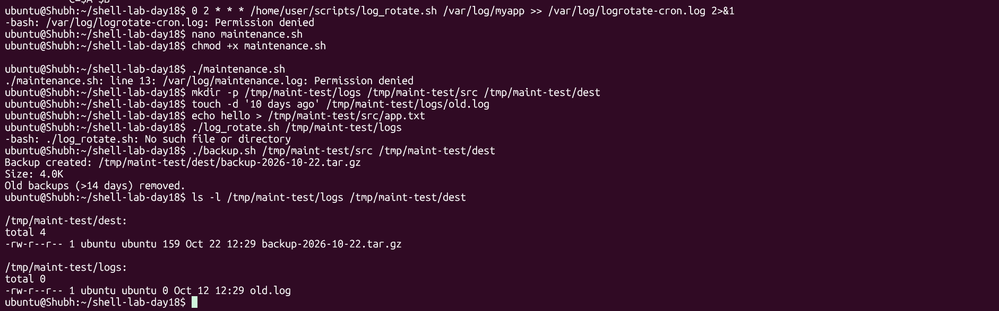

# Day 19 - Shell Scripting Project: Log Rotation, Backup & Crontab

## Task
- Task 1 (Log Rotation): create `log_rotate.sh` that takes a log directory argument, gzips `.log` files older than 7 days, deletes `.gz` files older than 30 days, prints compressed/deleted counts, errors if the directory does not exist
- Task 2 (Server Backup): create `backup.sh` that takes source + destination arguments, creates a timestamped `.tar.gz`, verifies the archive, prints name + size, deletes backups older than 14 days, errors if the source does not exist
- Task 3 (Crontab): read `crontab -l`, understand the 5-field cron syntax, write entries for log rotation daily at 2 AM, backup Sundays at 3 AM, health check every 5 minutes
- Task 4 (Combine): create `maintenance.sh` that calls the rotation + backup functions, logs everything with timestamps to `/var/log/maintenance.log`, with a daily 1 AM cron entry

## Environment
| Item | Value |
|------|-------|
| OS | Ubuntu 22.04 / 24.04 (`lsb_release -a` to confirm) `[TODO - run on your machine]` |
| Shell | `bash` 5.x (`echo "$BASH_VERSION"`) |
| Tools | `bash`, `find`, `gzip`, `tar`, `date`, `du`, `cron` (`crontab`, `systemctl status cron`) |
| Privileges | normal user for testing under `/tmp`; **root** for `/var/log/*` and `/backups` paths |
| Working directory | `~/ops-project` for safe testing (production paths `/var/log/myapp`, `/backups` need root) |
| Files in this folder | `log_rotate.sh`, `backup.sh`, `maintenance.sh` |

```bash
sudo apt update && sudo apt install -y cron tar gzip findutils
systemctl status cron --no-pager || sudo systemctl enable --now cron
mkdir -p ~/ops-project && cd ~/ops-project
```

## Solution

### Task 1: Log Rotation Script
**WHY it matters for DevOps:** unrotated logs fill disks and crash apps at 3 AM — the single most common "disk full" page. A rotation script plus cron is the cheapest monitoring there is.

```bash
nano log_rotate.sh
chmod +x log_rotate.sh
mkdir -p /tmp/fakelogs && cd /tmp/fakelogs
touch -d '10 days ago' old-app.log
touch -d '40 days ago' ancient.log.gz
touch fresh.log
ls -l --time-style=long-iso
../log_rotate.sh /tmp/fakelogs || ./log_rotate.sh /tmp/fakelogs
ls -l --time-style=long-iso
```

Full script (matches `log_rotate.sh` in this folder — do not edit it):

```bash
#!/bin/bash
set -e

if [ $# -lt 1 ]; then
  echo "Usage: $0 <log-directory>"
  exit 1
fi

LOG_DIR="$1"

if [ ! -d "$LOG_DIR" ]; then
  echo "Error: $LOG_DIR is not a directory"
  exit 1
fi

compressed=0
deleted=0

while IFS= read -r -d '' file; do
  gzip "$file"
  compressed=$((compressed + 1))
done < <(find "$LOG_DIR" -name "*.log" -mtime +7 -print0)

while IFS= read -r -d '' file; do
  rm -f "$file"
  deleted=$((deleted + 1))
done < <(find "$LOG_DIR" -name "*.gz" -mtime +30 -print0)

echo "Compressed: $compressed file(s)"
echo "Deleted: $deleted file(s)"
```

Expected output (example — your values will differ):

```text
Compressed: 1 file(s)
Deleted: 1 file(s)
```

After the run: `old-app.log` became `old-app.log.gz`, `ancient.log.gz` is gone, `fresh.log` untouched.





Concept table — the `find` flags doing the work:

| Flag | Meaning |
|------|---------|
| `-name "*.log"` | match by name (quote the glob so the shell does not expand it) |
| `-mtime +7` | modified **more than** 7×24h ago (`+7` = strictly older; `7` = exactly 7 days; `-7` = newer) |
| `-print0` + `read -r -d ''` | NUL-delimited streaming — filenames with spaces/newlines survive |
| `< <(find ...)` | process substitution — the `while` runs in the **current** shell so `compressed=$((...))` persists (a pipe `\| while` would lose it in a subshell) |

> `gzip file` **replaces** `file` with `file.gz` — the original is gone. `gzip -k` keeps it, but for rotation the replace behaviour is what you want.

### Task 2: Server Backup Script
**WHY it matters for DevOps:** timestamped, verified, pruned archives are the difference between "we have backups" and "we can restore". The verify + prune steps are what make this production-shaped instead of a toy `tar`.

```bash
nano backup.sh
chmod +x backup.sh
mkdir -p /tmp/myapp && echo "data" > /tmp/myapp/index.html
./backup.sh /tmp/myapp /tmp/backups
ls -lh /tmp/backups
tar -tzf /tmp/backups/backup-*.tar.gz | head
```

Full script (matches `backup.sh` in this folder):

```bash
#!/bin/bash
set -e

if [ $# -lt 2 ]; then
  echo "Usage: $0 <source-dir> <backup-destination>"
  exit 1
fi

SOURCE="$1"
DEST="$2"

if [ ! -d "$SOURCE" ]; then
  echo "Error: source directory $SOURCE does not exist"
  exit 1
fi

mkdir -p "$DEST"

TIMESTAMP=$(date +%Y-%m-%d)
ARCHIVE="$DEST/backup-$TIMESTAMP.tar.gz"

tar -czf "$ARCHIVE" -C "$(dirname "$SOURCE")" "$(basename "$SOURCE")"

if [ -f "$ARCHIVE" ]; then
  echo "Backup created: $ARCHIVE"
  echo "Size: $(du -h "$ARCHIVE" | cut -f1)"
else
  echo "Error: backup archive was not created"
  exit 1
fi

find "$DEST" -name "backup-*.tar.gz" -mtime +14 -delete
echo "Old backups (>14 days) removed."
```

Expected output (illustrative — size varies `[TODO - run on your machine]`):

```text
Backup created: /tmp/backups/backup-2026-10-04.tar.gz
Size: 4.0K
Old backups (>14 days) removed.
```





Concept table — `tar` flags:

| Flag | Meaning |
|------|---------|
| `-c` | create a new archive |
| `-z` | filter through `gzip` (`.tar.gz`) |
| `-f FILE` | write to FILE (must be followed by the filename) |
| `-C DIR` | change to DIR before archiving — keeps paths relative (`myapp/index.html`, not `/tmp/myapp/...`) |
| `-t` / `-x` | list / extract (`tar -tzf` to verify without unpacking) |

> `-C "$(dirname "$SOURCE")" "$(basename "$SOURCE")"` is the portable idiom: the archive stores `myapp/...` regardless of where the source lives, so restores do not spray absolute paths.

### Task 3: Crontab
**WHY it matters for DevOps:** cron is still the default scheduler on every VM — rotation, backups, cert renewals, and health pings all live here until they graduate to systemd timers or Kubernetes CronJobs.

```bash
crontab -l || echo "(no crontab yet)"
systemctl is-active cron
man 5 crontab | head -40
```

Cron syntax (5 time fields + command):

```text
* * * * *  command
│ │ │ │ │
│ │ │ │ └── Day of week (0-7, both 0 and 7 = Sunday)
│ │ │ └──── Month (1-12)
│ │ └────── Day of month (1-31)
│ └──────── Hour (0-23)
└────────── Minute (0-59)
```

Entries for this day (write in markdown; apply with `crontab -e` only when sure):

```cron
# Run log rotation every day at 2 AM
0 2 * * * /home/user/scripts/log_rotate.sh /var/log/myapp >> /var/log/logrotate-cron.log 2>&1

# Run backup every Sunday at 3 AM
0 3 * * 0 /home/user/scripts/backup.sh /var/www/html /backups >> /var/log/backup-cron.log 2>&1

# Run a health check every 5 minutes
*/5 * * * * /home/user/scripts/health_check.sh >> /var/log/health-cron.log 2>&1
```



Concept table — common schedules:

| Schedule | Meaning |
|----------|---------|
| `0 2 * * *` | daily at 02:00 |
| `0 3 * * 0` | Sundays at 03:00 |
| `*/5 * * * *` | every 5 minutes |
| `0 1 * * *` | daily at 01:00 (Task 4) |
| `0 0 1 * *` | first of every month at midnight |

> Cron runs with a **minimal `PATH` and no login environment**. Always use absolute script paths and absolute binary paths (or set `PATH=` + `SHELL=/bin/bash` at the top of the crontab).

### Task 4: Combine — Scheduled Maintenance Script
**WHY it matters for DevOps:** one wrapper script + one cron line = one place to monitor. Timestamped append-logging makes every run auditable without a log shipper.

```bash
nano maintenance.sh
chmod +x maintenance.sh
```

Full script (matches `maintenance.sh` in this folder):

```bash
#!/bin/bash
set -e

LOG_DIR="/var/log/myapp"
SOURCE="/var/www/html"
BACKUP_DEST="/backups"
MAINT_LOG="/var/log/maintenance.log"

timestamp() {
  date '+%Y-%m-%d %H:%M:%S'
}

echo "$(timestamp) - Starting maintenance" >> "$MAINT_LOG"

echo "$(timestamp) - Running log rotation" >> "$MAINT_LOG"
./log_rotate.sh "$LOG_DIR" >> "$MAINT_LOG" 2>&1 || echo "$(timestamp) - Log rotation failed" >> "$MAINT_LOG"

echo "$(timestamp) - Running backup" >> "$MAINT_LOG"
./backup.sh "$SOURCE" "$BACKUP_DEST" >> "$MAINT_LOG" 2>&1 || echo "$(timestamp) - Backup failed" >> "$MAINT_LOG"

echo "$(timestamp) - Maintenance finished" >> "$MAINT_LOG"
```



Cron entry — daily at 1 AM:

```cron
0 1 * * * /home/user/scripts/maintenance.sh >> /var/log/maintenance.log 2>&1
```

Safe local test (no root needed — override the production paths):

```bash
mkdir -p /tmp/maint-test/logs /tmp/maint-test/src /tmp/maint-test/dest
touch -d '10 days ago' /tmp/maint-test/logs/old.log
echo hello > /tmp/maint-test/src/app.txt
./log_rotate.sh /tmp/maint-test/logs
./backup.sh /tmp/maint-test/src /tmp/maint-test/dest
ls -l /tmp/maint-test/logs /tmp/maint-test/dest
```

Expected `maintenance.log` shape (example):

```text
2026-10-04 01:00:01 - Starting maintenance
2026-10-04 01:00:01 - Running log rotation
Compressed: 3 file(s)
Deleted: 1 file(s)
2026-10-04 01:00:02 - Running backup
Backup created: /backups/backup-2026-10-04.tar.gz
Size: 12K
Old backups (>14 days) removed.
2026-10-04 01:00:03 - Maintenance finished
```



## Commands Used
```bash
# setup + cron daemon
systemctl status cron --no-pager || sudo systemctl enable --now cron
crontab -l || echo "(no crontab yet)"
mkdir -p ~/ops-project && cd ~/ops-project

# Task 1 - log rotation (safe /tmp test)
chmod +x log_rotate.sh
mkdir -p /tmp/fakelogs
touch -d '10 days ago' /tmp/fakelogs/old-app.log
touch -d '40 days ago' /tmp/fakelogs/ancient.log.gz
touch /tmp/fakelogs/fresh.log
./log_rotate.sh /tmp/fakelogs
./log_rotate.sh /nonexistent; echo "exit=$?"
ls -l /tmp/fakelogs

# Task 2 - backup (safe /tmp test)
chmod +x backup.sh
mkdir -p /tmp/myapp && echo data > /tmp/myapp/index.html
./backup.sh /tmp/myapp /tmp/backups
ls -lh /tmp/backups
tar -tzf /tmp/backups/backup-*.tar.gz | head
./backup.sh /nonexistent /tmp/backups; echo "exit=$?"

# Task 3 - cron
crontab -l
crontab -e   # paste the 2 AM / Sunday 3 AM / */5 entries when sure

# Task 4 - maintenance wrapper
chmod +x maintenance.sh
nano maintenance.sh
# daily 1 AM entry:
# 0 1 * * * /home/user/scripts/maintenance.sh >> /var/log/maintenance.log 2>&1
tail -n 20 /var/log/maintenance.log

# syntax check
for f in log_rotate.sh backup.sh maintenance.sh; do bash -n "$f" && echo "$f: syntax OK"; done
```

## Verification
- `bash -n` passes for `log_rotate.sh`, `backup.sh`, `maintenance.sh`
- `./log_rotate.sh` with no args prints `Usage: ... <log-directory>` and exits 1
- `./log_rotate.sh /nonexistent` prints `Error: ... is not a directory` and exits 1
- On `/tmp/fakelogs`: the 10-day-old `.log` became `.log.gz`, the 40-day-old `.gz` was deleted, `fresh.log` untouched, counts printed match
- `./backup.sh` with fewer than 2 args prints usage and exits 1; missing source prints `Error: source directory ... does not exist` and exits 1
- `./backup.sh /tmp/myapp /tmp/backups` creates `backup-YYYY-MM-DD.tar.gz`, prints name + size, `tar -tzf` lists contents without absolute paths
- A 15-day-old `backup-*.tar.gz` placed in the dest dir is removed on the next run (prune proof)
- `crontab -l` read; the three entries use correct fields (`0 2 * * *`, `0 3 * * 0`, `*/5 * * * *`)
- `maintenance.sh` contains `timestamp()` + three timestamped append blocks and the `|| ... failed` fallbacks
- The daily `0 1 * * * maintenance.sh` entry written down with absolute path and log redirect

## Key Learnings
- `find -name "*.log" -mtime +7` is the standard age filter: quote the glob, `+N` means strictly older than N days
- `-print0` + `while IFS= read -r -d ''` is the only space/newline-safe iteration; `< <(find ...)` (not a pipe) keeps counters in the current shell
- `gzip file` replaces the file with `file.gz`; the prune step targets `*.gz -mtime +30` — two ages, two extensions, one script
- `tar -czf ARCHIVE -C PARENT DIR` keeps archives relocatable; verify with `tar -tzf` before trusting a backup
- Cron fields are minute hour dom month dow — `*/5` in field 1 is "every 5 minutes", `0` in field 5 is Sunday
- Cron has a minimal environment: absolute paths everywhere, explicit `>> log 2>&1` on every entry, or output goes to local mail
- A maintenance wrapper with `echo "$(date ...) - stage" >> log` turns two silent cron jobs into one auditable run
- Test under `/tmp` with `touch -d '10 days ago'` fixtures before pointing anything at `/var/log`

## Troubleshooting / Gotchas
- **`./log_rotate.sh: find: missing argument to -mtime`** — cause: `-mtime + 7` with a space; `+7` is one token. Fix: `find "$DIR" -name "*.log" -mtime +7`.
- **Counters stay `0` even though files changed** — cause: `find ... | while read` runs the loop in a subshell, so increments are lost. Fix: use process substitution `< <(find ...)` as here, not a pipe.
- **`gzip: file already has .gz suffix -- unchanged`** — cause: re-running rotation over already-compressed files because the first `find` matched `*.log` that includes stale names, or `gzip` run twice. Fix: the `-name "*.log"` filter already excludes `.gz`; do not broaden it.
- **`tar: Removing leading '/' from member names`** — cause: archiving with an absolute source path. Fix: not an error (tar strips it deliberately), but prefer `-C parent base` so archives stay clean and restorable anywhere.
- **Cron entry never runs (`crontab -l` shows it, nothing happens)** — cause: cron daemon not running, or `%` unescaped in the command, or relative paths. Fix: `systemctl enable --now cron`, use absolute paths, escape `%` as `\%`, and check `/var/log/syslog | grep -i cron`.
- **`/var/log/maintenance.log: Permission denied` from cron** — cause: job runs as a user without write access to `/var/log`. Fix: `sudo touch /var/log/maintenance.log && sudo chown "$USER": /var/log/maintenance.log`, or run that entry from root's crontab (`sudo crontab -e`).
- **Backup filename collides (`backup-2026-10-04.tar.gz` overwritten)** — cause: `date +%Y-%m-%d` granularity is one day, so two runs same day overwrite. Fix: add time (`date +%Y-%m-%d-%H%M`) or check-and-skip if the archive exists.
- **Old backups never pruned** — cause: filename does not match `backup-*.tar.gz` or `-mtime +14` measured from mtime that `touch`/copy just refreshed. Fix: keep the exact `backup-` prefix and verify with `find "$DEST" -name "backup-*.tar.gz" -mtime +14 -print` before adding `-delete`.

## Screenshots

| # | File | Shows |
|---|------|-------|
| 01 | `screenshots/01-log-rotate-nano.png` | `log_rotate.sh` being written in nano - usage check, directory guard and both `find` loops |
| 02 | `screenshots/02-log-rotate-setup.png` | `/tmp/fakelogs` fixtures created with `touch -d`, first run attempt fails on the wrong relative path |
| 03 | `screenshots/03-backup-nano.png` | `backup.sh` being written in nano - arg checks, timestamped `tar`, verify and prune |
| 04 | `screenshots/04-backup-run-verify.png` | `./backup.sh` creates `backup-2026-10-22.tar.gz` (Size 4.0K) and `tar -tzf` lists `myapp/index.html` |
| 05 | `screenshots/05-maintenance-nano.png` | `maintenance.sh` being written - `timestamp()` plus rotation and backup stages |
| 06 | `screenshots/06-crontab-syntax.png` | `crontab -l` empty, `systemctl is-active cron`, `man 5 crontab` syntax, redirect attempt denied |
| 07 | `screenshots/07-maintenance-test-run.png` | `./maintenance.sh` denied on `/var/log`, then the safe `/tmp/maint-test` run - backup created and files listed |
