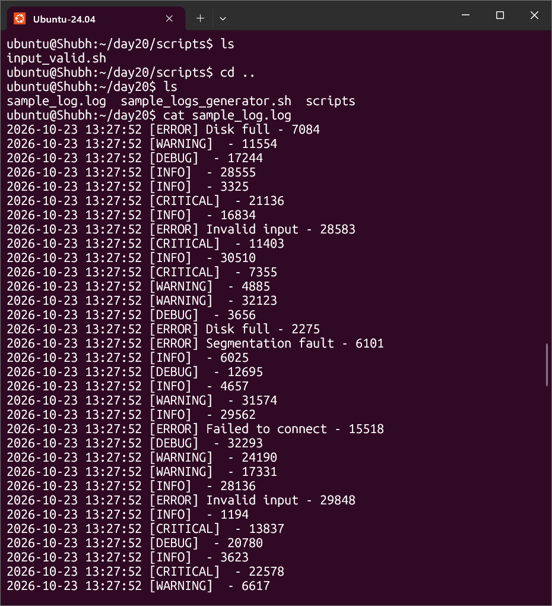
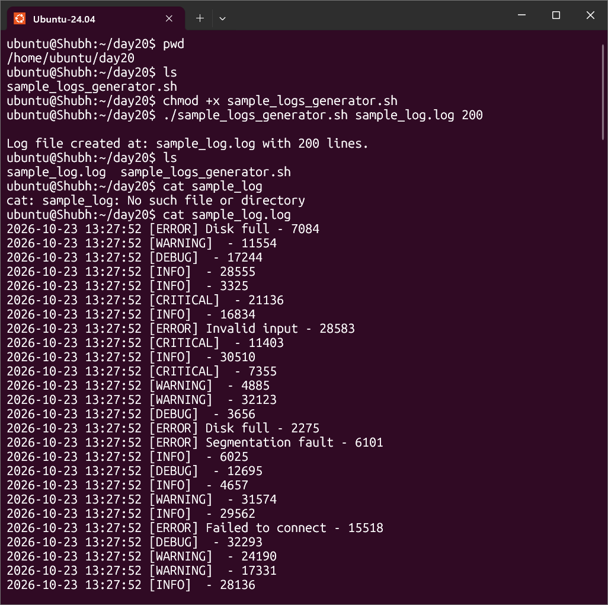
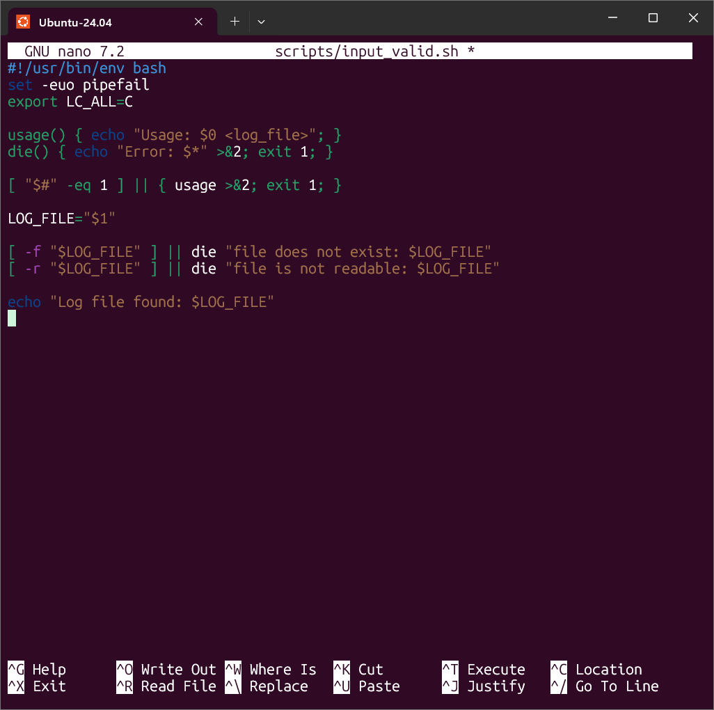
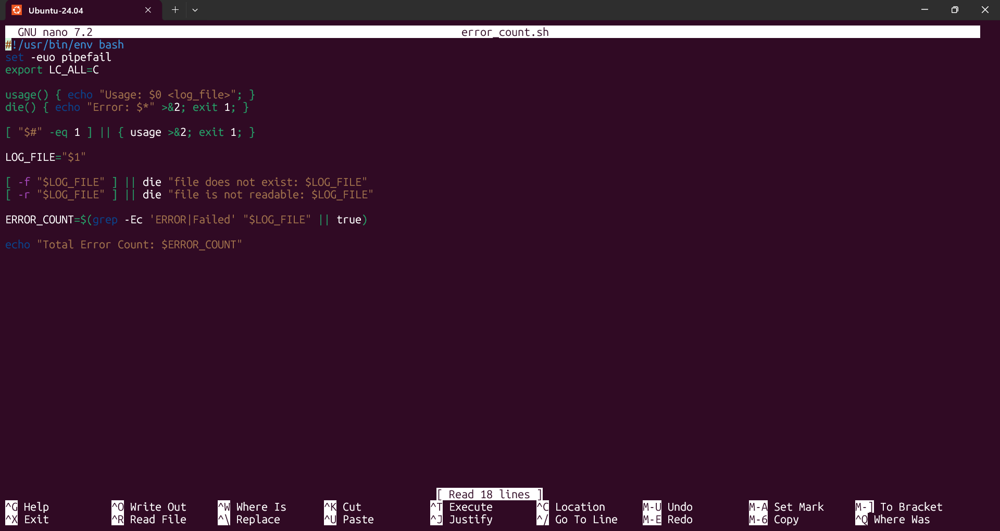
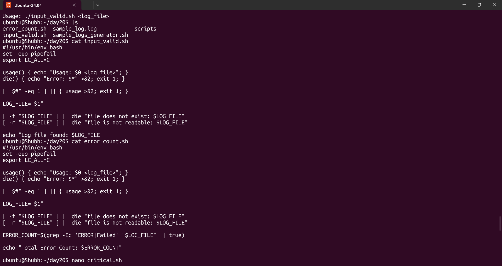
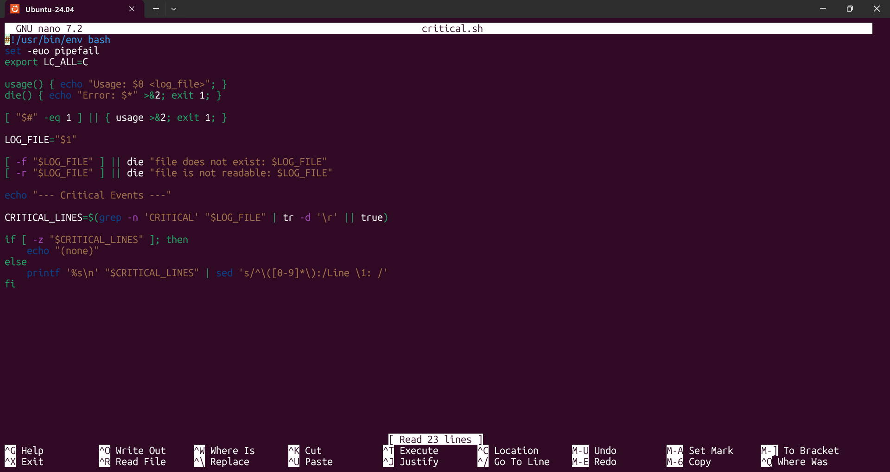
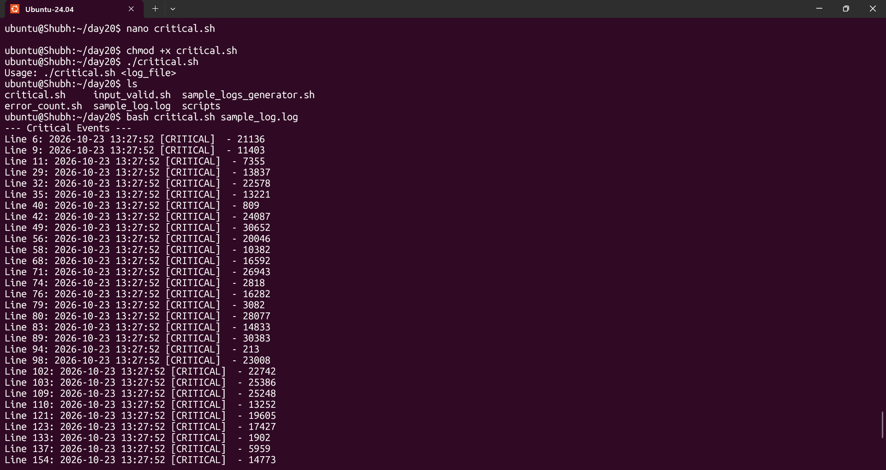
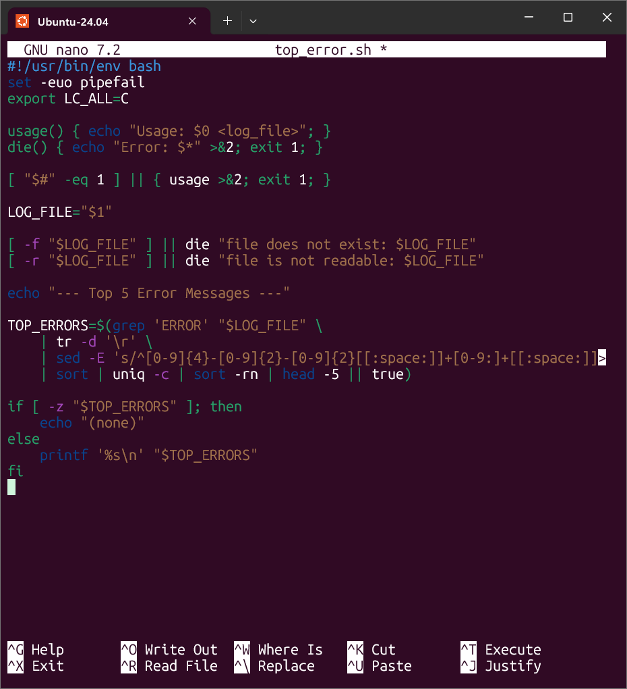
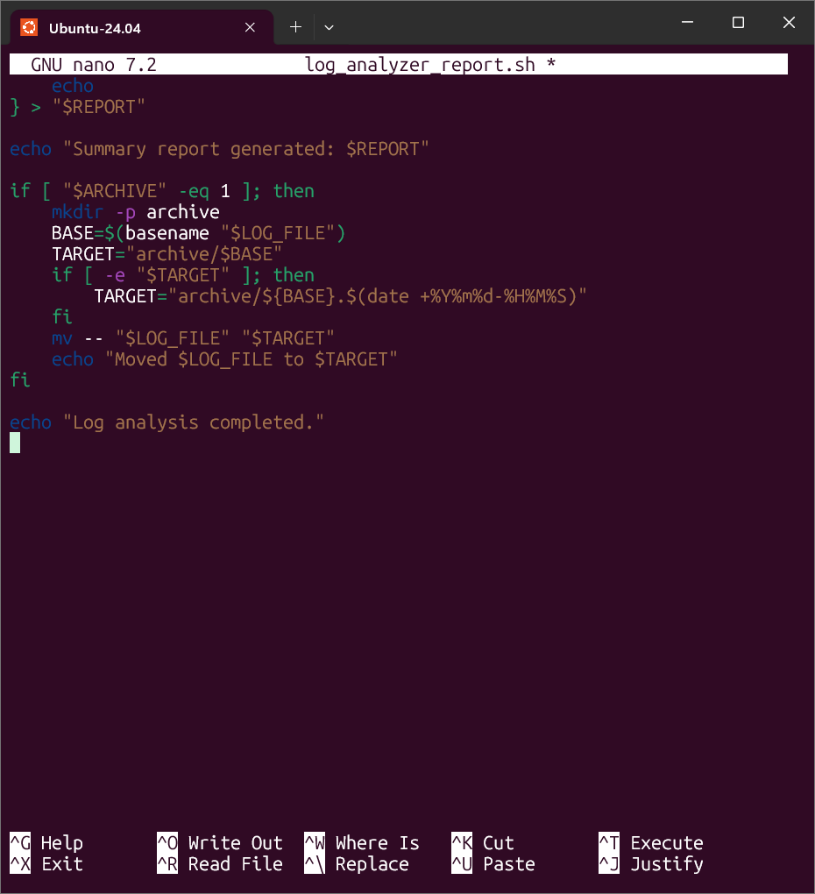

# Day 20 - Bash Scripting Challenge: Log Analyzer and Report Generator

## Overview

Day 20 breaks the log-analysis workflow into small scripts, one per task, so each
command can be tested on its own before being combined into the full report
generator. The scripts live in `scripts/` and use `grep`, `awk`,
`sort`, `uniq`, and `sed` against the 200-line `sample_log.log` fixture.
The numbers below come from the current fixture; regenerating it with
`sample_logs_generator.sh` creates a new random log with different counts.
The screenshots are from a separate run, so their counts differ from the text
examples.

## Create Files and Execute

### 0. Open the project folder

Open a WSL terminal and move into the day folder. The path contains spaces, so
keep it quoted.

```bash
cd "/mnt/d/daily dev/trainwithshubham/90/90Days-Of-DevOps/2026/day-20"
mkdir -p scripts screenshots
```

If you are in Windows PowerShell instead of WSL, the `/mnt/d/...` path will not
work. Open Ubuntu from the Start menu, or run the scripts through `bash`:

```powershell
cd "D:\daily dev\trainwithshubham\90\90Days-Of-DevOps\2026\day-20"
bash ./sample_logs_generator.sh sample_log.log 200
bash ./scripts/input_valid.sh sample_log.log
```

Check that the provided generator and challenge file are present:

```bash
ls README.md sample_logs_generator.sh
```



If `nano` is missing, install it once:

```bash
sudo apt update && sudo apt install -y nano
```

In `nano`, save with `Ctrl+O`, press `Enter`, then exit with `Ctrl+X`.

### 1. Generate the sample log

Remove any old log, fix Windows line endings, then run the generator:

```bash
rm -f sample_log.log
sed -i 's/\r$//' sample_logs_generator.sh
chmod +x sample_logs_generator.sh
./sample_logs_generator.sh sample_log.log 200
```

```text
Log file created at: sample_log.log with 200 lines.
```



### 2. Create and run the input validation script

```bash
nano scripts/input_valid.sh
```

Paste:

```bash
#!/usr/bin/env bash
set -euo pipefail
export LC_ALL=C

usage() { echo "Usage: $0 <log_file>"; }
die() { echo "Error: $*" >&2; exit 1; }

[ "$#" -eq 1 ] || { usage >&2; exit 1; }

LOG_FILE="$1"

[ -f "$LOG_FILE" ] || die "file does not exist: $LOG_FILE"
[ -r "$LOG_FILE" ] || die "file is not readable: $LOG_FILE"

echo "Log file found: $LOG_FILE"
```

Execute:

```bash
chmod +x scripts/input_valid.sh
./scripts/input_valid.sh sample_log.log
```

```text
Log file found: sample_log.log
```



### 3. Create and run the error count script

```bash
nano scripts/error_count.sh
```

Paste:

```bash
#!/usr/bin/env bash
set -euo pipefail
export LC_ALL=C

usage() { echo "Usage: $0 <log_file>"; }
die() { echo "Error: $*" >&2; exit 1; }

[ "$#" -eq 1 ] || { usage >&2; exit 1; }

LOG_FILE="$1"

[ -f "$LOG_FILE" ] || die "file does not exist: $LOG_FILE"
[ -r "$LOG_FILE" ] || die "file is not readable: $LOG_FILE"

ERROR_COUNT=$(grep -Ec 'ERROR|Failed' "$LOG_FILE" || true)

echo "Total Error Count: $ERROR_COUNT"
```

Execute:

```bash
chmod +x scripts/error_count.sh
./scripts/error_count.sh sample_log.log
```

```text
Total Error Count: 50
```





### 4. Create and run the critical events script

```bash
nano scripts/critical.sh
```

Paste:

```bash
#!/usr/bin/env bash
set -euo pipefail
export LC_ALL=C

usage() { echo "Usage: $0 <log_file>"; }
die() { echo "Error: $*" >&2; exit 1; }

[ "$#" -eq 1 ] || { usage >&2; exit 1; }

LOG_FILE="$1"

[ -f "$LOG_FILE" ] || die "file does not exist: $LOG_FILE"
[ -r "$LOG_FILE" ] || die "file is not readable: $LOG_FILE"

echo "--- Critical Events ---"

CRITICAL_LINES=$(grep -n 'CRITICAL' "$LOG_FILE" | tr -d '\r' || true)

if [ -z "$CRITICAL_LINES" ]; then
    echo "(none)"
else
    printf '%s\n' "$CRITICAL_LINES" | sed 's/^\([0-9]*\):/Line \1: /'
fi
```

Execute:

```bash
chmod +x scripts/critical.sh
./scripts/critical.sh sample_log.log
```





### 5. Create and run the top errors script

```bash
nano scripts/top_error.sh
```

Paste:

```bash
#!/usr/bin/env bash
set -euo pipefail
export LC_ALL=C

usage() { echo "Usage: $0 <log_file>"; }
die() { echo "Error: $*" >&2; exit 1; }

[ "$#" -eq 1 ] || { usage >&2; exit 1; }

LOG_FILE="$1"

[ -f "$LOG_FILE" ] || die "file does not exist: $LOG_FILE"
[ -r "$LOG_FILE" ] || die "file is not readable: $LOG_FILE"

echo "--- Top 5 Error Messages ---"

TOP_ERRORS=$(grep 'ERROR' "$LOG_FILE" \
    | tr -d '\r' \
    | sed -E 's/^[0-9]{4}-[0-9]{2}-[0-9]{2}[[:space:]]+[0-9:]+[[:space:]]+\[[^]]+\][[:space:]]*//; s/[[:space:]]+-[[:space:]]+[0-9]+$//' \
    | sort | uniq -c | sort -rn | head -5 || true)

if [ -z "$TOP_ERRORS" ]; then
    echo "(none)"
else
    printf '%s\n' "$TOP_ERRORS"
fi
```

Execute:

```bash
chmod +x scripts/top_error.sh
./scripts/top_error.sh sample_log.log
```




### 6. Create and run the full report script

```bash
nano scripts/log_analyzer_report.sh
```

Paste:

```bash
#!/usr/bin/env bash
set -euo pipefail
export LC_ALL=C

usage() { echo "Usage: $0 <log_file> [--archive]"; }
die() { echo "Error: $*" >&2; exit 1; }

ARCHIVE=0
args=()
for arg in "$@"; do
    case "$arg" in
        --archive) ARCHIVE=1 ;;
        -h|--help) usage; exit 0 ;;
        -*) die "unknown option: $arg" ;;
        *) args+=("$arg") ;;
    esac
done

[ "${#args[@]}" -eq 1 ] || { usage >&2; exit 1; }

LOG_FILE="${args[0]}"

[ -f "$LOG_FILE" ] || die "file does not exist: $LOG_FILE"
[ -r "$LOG_FILE" ] || die "file is not readable: $LOG_FILE"

DATE=$(date +%Y-%m-%d)
REPORT="log_report_${DATE}.txt"
TOTAL_LINES=$(awk 'END { print NR }' "$LOG_FILE")
ERROR_COUNT=$(grep -Ec 'ERROR|Failed' "$LOG_FILE" || true)
CRITICAL_LINES=$(grep -n 'CRITICAL' "$LOG_FILE" | tr -d '\r' || true)
TOP_ERRORS=$(grep 'ERROR' "$LOG_FILE" \
    | tr -d '\r' \
    | sed -E 's/^[0-9]{4}-[0-9]{2}-[0-9]{2}[[:space:]]+[0-9:]+[[:space:]]+\[[^]]+\][[:space:]]*//; s/[[:space:]]+-[[:space:]]+[0-9]+$//' \
    | sort | uniq -c | sort -rn | head -5 || true)

{
    echo "========== LOG ANALYSIS REPORT =========="
    echo
    echo "Date of analysis: $DATE"
    echo "Log file name: $(basename "$LOG_FILE")"
    echo "Total lines processed: $TOTAL_LINES"
    echo "Total error count: $ERROR_COUNT"
    echo
    echo "---------- Top 5 Error Messages ----------"
    if [ -z "$TOP_ERRORS" ]; then
        echo "(none)"
    else
        echo "$TOP_ERRORS"
    fi
    echo
    echo "---------- Critical Events ----------"
    if [ -z "$CRITICAL_LINES" ]; then
        echo "(none)"
    else
        printf '%s\n' "$CRITICAL_LINES" | sed 's/^\([0-9]*\):/Line \1: /'
    fi
    echo
} > "$REPORT"

echo "Summary report generated: $REPORT"

if [ "$ARCHIVE" -eq 1 ]; then
    mkdir -p archive
    BASE=$(basename "$LOG_FILE")
    TARGET="archive/$BASE"
    if [ -e "$TARGET" ]; then
        TARGET="archive/${BASE}.$(date +%Y%m%d-%H%M%S)"
    fi
    mv -- "$LOG_FILE" "$TARGET"
    echo "Moved $LOG_FILE to $TARGET"
fi

echo "Log analysis completed."
```

Execute from the day-20 root so the report is written beside the scripts:

```bash
chmod +x scripts/log_analyzer_report.sh
./scripts/log_analyzer_report.sh sample_log.log
```

```text
Summary report generated: log_report_2026-10-23.txt
Log analysis completed.
```



### 7. Read the generated report

```bash
cat "log_report_$(date +%F).txt"
```

### 8. Optional: archive a processed log

Use a copy so the fixture stays in place.

```bash
cp sample_log.log sample_copy.log
./scripts/log_analyzer_report.sh sample_copy.log --archive
```

## Task 1: Input and Validation

[`scripts/input_valid.sh`](scripts/input_valid.sh) accepts one log path and fails
fast when the argument is missing or the file does not exist.

```bash
chmod +x scripts/input_valid.sh
./scripts/input_valid.sh sample_log.log
```

```text
Log file found: sample_log.log
```

Failure paths:

```bash
$ ./scripts/input_valid.sh
Usage: ./scripts/input_valid.sh <log_file>
$ echo $?
1

$ ./scripts/input_valid.sh missing.log
Error: file does not exist: missing.log
$ echo $?
1
```


## Task 2: Error Count

[`scripts/error_count.sh`](scripts/error_count.sh) counts lines matching either
`ERROR` or `Failed`.

```bash
chmod +x scripts/error_count.sh
./scripts/error_count.sh sample_log.log
```

```text
Total Error Count: 50
```


`grep -Ec` handles the alternation in one pass, and `|| true` keeps the script
alive when a clean log has zero matches.

## Task 3: Critical Events

[`scripts/critical.sh`](scripts/critical.sh) prints every `CRITICAL` line with its
line number in the required `Line N:` format.

```bash
chmod +x scripts/critical.sh
./scripts/critical.sh sample_log.log
```

```text
--- Critical Events ---
Line 6: 2026-10-23 13:08:23 [CRITICAL]  - 22395
Line 14: 2026-10-23 13:08:23 [CRITICAL]  - 27309
Line 19: 2026-10-23 13:08:23 [CRITICAL]  - 768
Line 30: 2026-10-23 13:08:23 [CRITICAL]  - 4750
Line 36: 2026-10-23 13:08:23 [CRITICAL]  - 21858
...
```

The fixture contains 35 critical events in total.


## Task 4: Top Error Messages

[`scripts/top_error.sh`](scripts/top_error.sh) normalizes each `ERROR` line,
counts duplicates, and keeps the top five.

```bash
chmod +x scripts/top_error.sh
./scripts/top_error.sh sample_log.log
```

```text
--- Top 5 Error Messages ---
     12 Segmentation fault
     12 Invalid input
     10 Out of memory
      8 Failed to connect
      8 Disk full
```


The timestamp, `[LEVEL]` tag, and trailing `- $RANDOM` suffix must be stripped
before `sort | uniq -c`; otherwise every line is unique and every count is `1`.
The pipeline is always `sort | uniq -c | sort -rn | head -5`.

## Task 5: Summary Report

[`scripts/log_analyzer_report.sh`](scripts/log_analyzer_report.sh) runs the full
analysis and writes a dated report.

```bash
chmod +x scripts/log_analyzer_report.sh
./scripts/log_analyzer_report.sh sample_log.log
```

```text
Summary report generated: log_report_2026-10-23.txt
Log analysis completed.
```


Generated report: [`log_report_2026-10-23.txt`](log_report_2026-10-23.txt)

```text
========== LOG ANALYSIS REPORT ==========

Date of analysis: 2026-10-23
Log file name: sample_log.log
Total lines processed: 200
Total error count: 50

---------- Top 5 Error Messages ----------
     12 Segmentation fault
     12 Invalid input
     10 Out of memory
      8 Failed to connect
      8 Disk full

---------- Critical Events ----------
Line 6: 2026-10-23 13:08:23 [CRITICAL]  - 22395
Line 14: 2026-10-23 13:08:23 [CRITICAL]  - 27309
Line 19: 2026-10-23 13:08:23 [CRITICAL]  - 768
Line 30: 2026-10-23 13:08:23 [CRITICAL]  - 4750
Line 36: 2026-10-23 13:08:23 [CRITICAL]  - 21858
...
```

The report includes all six required fields: date, file name, total lines, total
error count, top five errors, and critical events with line numbers.


## Task 6 (Optional): Archive Processed Logs

Pass `--archive` to move the analyzed log into `archive/` after the report is
written.

```bash
./scripts/log_analyzer_report.sh sample.log --archive
```

```text
Summary report generated: log_report_2026-10-23.txt
Moved sample.log to archive/sample.log
Log analysis completed.
```

The archive step runs after the report, and a repeated filename gets a timestamp
suffix instead of overwriting an earlier log.


## Reproduce

```bash
cd 2026/day-20
sed -i 's/\r$//' sample_logs_generator.sh scripts/*.sh

chmod +x sample_logs_generator.sh
./sample_logs_generator.sh sample_log.log 200

chmod +x scripts/input_valid.sh
./scripts/input_valid.sh sample_log.log
chmod +x scripts/error_count.sh
./scripts/error_count.sh sample_log.log
chmod +x scripts/critical.sh
./scripts/critical.sh sample_log.log
chmod +x scripts/top_error.sh
./scripts/top_error.sh sample_log.log
chmod +x scripts/log_analyzer_report.sh
./scripts/log_analyzer_report.sh sample_log.log
```

All scripts run from the `day-20` root. The report script writes the dated report
beside them, matching the link above.
`scripts/log_analyzer_report.sh` writes its report to the current directory and only
archives the log when `--archive` is supplied.

## What I Learned

- How to validate user input in Bash scripts before doing any work.
- How to make a script executable with `chmod +x` and run it with `./`.
- How to search and filter log files with `grep` and `grep -E`.
- How to count and rank repeated messages with `sort`, `uniq -c`, and `head`.
- How to extract structured fields from log lines with `awk` and `sed`.
- How to generate a dated report and archive processed logs for repeatable runs.
- How to build a workflow as small, testable scripts instead of one large script.

## Commands Used

- `grep` - locate `ERROR`, `Failed`, and `CRITICAL` lines.
- `chmod` - make the generated scripts executable.
- `awk` - count records and extract fields.
- `sed` - normalize timestamps, levels, and random suffixes.
- `sort` - group identical messages before counting.
- `uniq` - count repeated error messages.
- `head` - keep the top five results.
- `wc` - count processed lines.
- `mkdir` - create the archive directory.
- `mv` - move processed logs into `archive/`.
- `date` - build the report filename.
