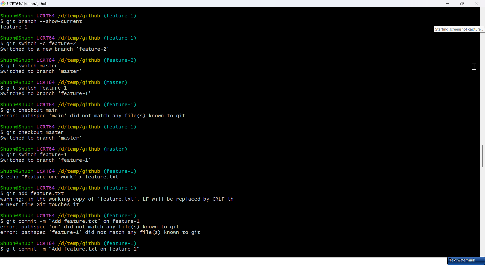
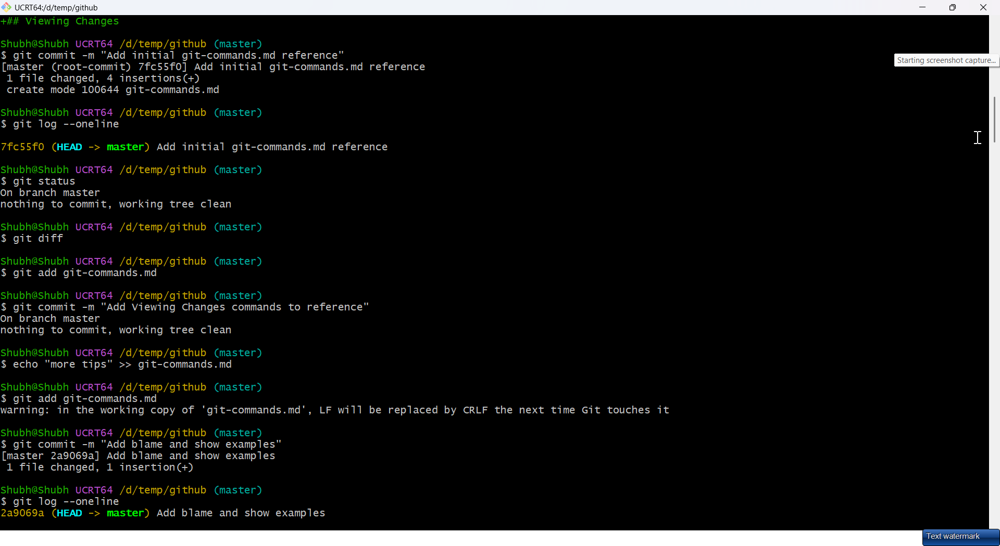
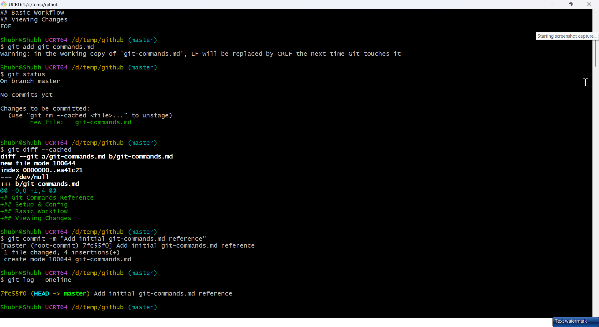
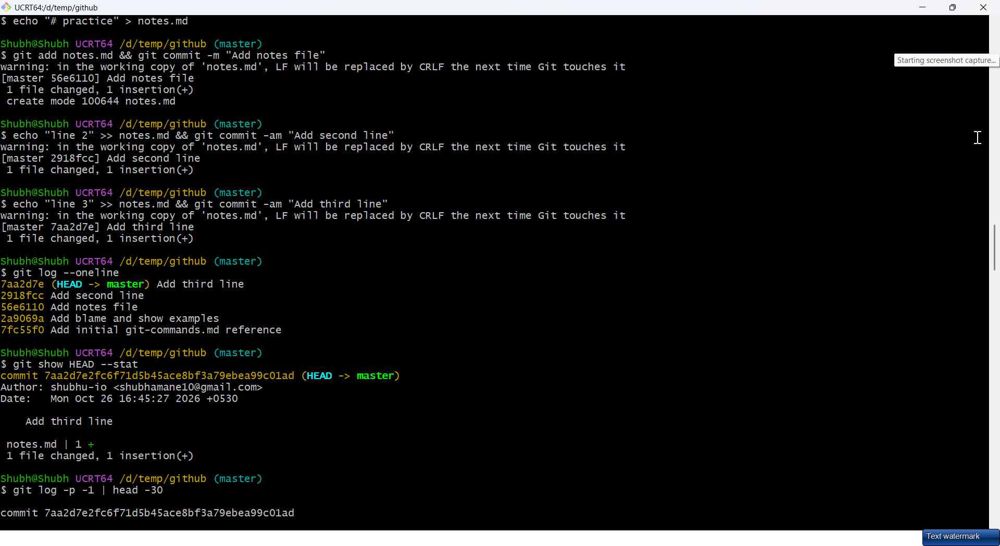

# Day 23 - Git Branching & Working with GitHub

## Task

- Task 1 — Understanding Branches: what is a branch, why not commit to `main`, what is `HEAD`, what happens to files on switch
- Task 2 — Branching Commands Hands-On: list branches, create `feature-1`, switch, single-command create+switch `feature-2`, `git switch` vs `checkout`, branch-only commit absent on `main`, delete a branch, update `git-commands.md`
- Task 3 — Push to GitHub: new empty GitHub repo (no README), connect `origin`, push `main` + `feature-1`, verify both visible, answer `origin` vs `upstream`
- Task 4 — Pull from GitHub: edit a file on GitHub web, pull locally, answer `fetch` vs `pull`
- Task 5 — Clone vs Fork: clone a public repo, fork + clone fork, answer clone vs fork / when each / fork sync via `upstream`

## Environment

| Component | Value / Version | Install / Notes |
|-----------|-----------------|-----------------|
| OS | Windows 10/11 + Git for Windows, or Ubuntu 22.04 / WSL2 | `git --version` must be ≥ 2.40 (for `git switch`) |
| Shell | Git Bash / WSL bash / PowerShell | `switch` needs Git ≥ 2.23; older guides use `checkout` |
| Tools | Git + GitHub free account; HTTPS (PAT) or SSH auth | Create PAT at GitHub → Settings → Developer settings → Tokens (classic) with `repo` scope |
| Repo | Local `devops-git-practice` from Day 22 with 3+ commits | This run used `/d/temp/github` on `master` with 5 commits before branching (`git log --oneline -3` → `7a2d7e`, `2918fcc`, `2a9069a`) |
| Verify | `git --version && gh --version (optional) && git remote -v` | Remote empty before Task 3, populated after |

> **Capture note:** the screenshots embedded below are from my actual run in `/d/temp/github` on branch `master` (this machine's `init.defaultBranch` is still `master`), with `origin` pointing at `https://github.com/shubhu-io/github-practises-cloud`. The task text uses `main`; substitute your own default branch and repo URL where it differs.

## Solution

### Task 1: Understanding Branches

WHY it matters for DevOps: branches are how CI tests changes safely. `main` stays deployable; every PR is a branch that CI builds, tests, and gates before merge.

1. **What is a branch in Git?** — A lightweight movable pointer to a specific commit (a 41-byte ref file under `.git/refs/heads/`). Creating a branch copies no files; it just labels a commit you can advance independently.
2. **Why branches instead of committing to `main`?** — `main` should stay stable/deployable. Branches isolate features, fixes, and experiments so parallel work doesn't break releases, and each unit can be reviewed (PR), tested (CI), and reverted independently.
3. **What is `HEAD`?** — A symbolic reference to your current branch (e.g. `ref: refs/heads/main`, see `.git/HEAD`). New commits advance whichever branch `HEAD` points to. "Detached HEAD" means `HEAD` points directly at a commit hash instead of a branch — commits there are orphaned unless you create a branch.
4. **What happens to files when you switch branches?** — Git rewrites the working directory + index to match the target tip commit. Files unique to the old branch disappear from disk (still safe in history); uncommitted changes that conflict with the switch block it until you commit, stash, or discard.

```bash
nano .git/HEAD
git symbolic-ref HEAD
git branch --show-current
```

Expected output (example — your values will differ):

```text
ref: refs/heads/main
refs/heads/main
main
# (illustrative — your branch name may differ)
```


| Concept | One-liner |
|---------|-----------|
| Branch | Named pointer to a commit |
| `HEAD` | "You are here" pointer (current branch or detached commit) |
| `main` | Conventional stable branch CI deploys from |
| Detached HEAD | Checked-out commit with no branch — don’t commit here casually |

### Task 2: Branching Commands — Hands-On

```bash
git branch                        # list local branches (current has *)
git branch -a                     # list local + remote-tracking branches
git branch -vv                    # list with upstream + last commit
git branch feature-1              # create branch (stay on current)
git switch feature-1              # switch to it (modern)
git switch -c feature-2           # create AND switch in one command
git switch main                   # modern way to move
git checkout feature-1            # older equivalent (still works)
git branch --show-current         # confirm where you are
```


`git switch` vs `git checkout`:

| Command | Scope | Notes |
|---------|-------|-------|
| `git switch <branch>` | Branches only — unambiguous, safe | Prefer for navigation (Git ≥ 2.23) |
| `git checkout <branch>` | Branches + files + detached HEAD | Older all-in-one; `checkout -- <file>` restores files (now `git restore`) |
| `git switch -c <new>` | Create + switch | Equivalent to `checkout -b <new>` |

Make a commit on `feature-1` and verify isolation:

```bash
git switch feature-1
echo "feature one work" >> feature.txt
git add feature.txt && git commit -m "Add feature.txt on feature-1"
git log --oneline -3
git switch main
git log --oneline -3        # feature.txt commit is NOT here
ls feature.txt              # file absent on main (or: ls: cannot access)
git log --all --oneline --graph
```

Expected output (example — your values will differ):

```text
# on feature-1 (tip):
9efdd85 Add feature.txt on feature-1
7a2d7e  Add third line
2918fcc Add second line

# on master (no 9efdd85):
7a2d7e  Add third line
2918fcc Add second line
2a9069a Add blame and show examples

# file absent:
ls: cannot access 'feature.txt': No such file or directory
```




Delete a branch you no longer need:

```bash
git switch -c feature-tmp
git switch main
git branch -d feature-tmp         # safe delete (merged only)
git branch -D old-branch          # force delete (unmerged work discarded)
git branch -d feature-tmp && git push origin --delete feature-tmp  # also drop remote copy
```

Add all branching commands to `git-commands.md` under a `## Branching` table, then commit:

```bash
git add git-commands.md
git commit -m "Add branching commands to reference"
```

### Task 3: Push to GitHub

WHY it matters for DevOps: local history is invisible to CI/teammates. Pushing to a remote is what triggers pipelines, reviews, and deploys.

```bash
# 1. Create empty repo on github.com (NO README — avoids divergent history)
# 2. Connect and push:
git remote add origin https://github.com/<you>/devops-git-practice.git
git remote -v
git push -u origin main           # -u sets upstream so future push/pull need no args
git push -u origin feature-1
git branch -r                     # remote-tracking branches (origin/main, origin/feature-1)
git branch -vv                    # confirm upstream links
```

Expected output (example — your values will differ):

```text
origin  https://github.com/<you>/devops-git-practice.git (fetch)
origin  https://github.com/<you>/devops-git-practice.git (push)
Branch 'main' set up to track remote branch 'main' from 'origin'.
# (illustrative — replace <you> with your username)
```


**`origin` vs `upstream`** — both are just remote nicknames. Convention: `origin` = the remote you cloned/push to by default (usually your fork or your own repo); `upstream` = a second remote pointing at the ORIGINAL project you forked from (read-only sync source). Verify with `git remote -v`; rename freely with `git remote rename`.

| Remote | Points to | Typical use |
|--------|-----------|-------------|
| `origin` | Your copy (fork or own repo) | `git push origin feature-x`, open PRs from here |
| `upstream` | Original project repo | `git fetch upstream` to sync your fork |

### Task 4: Pull from GitHub

Edit a file on GitHub web (repo → file → pencil icon → Commit changes), then bring it down both ways so you feel the difference:

```bash
git fetch origin          # downloads refs → origin/main moves; local files UNCHANGED
git status                # "Your branch is behind 'origin/main' by 1 commit"
git log --oneline HEAD..origin/main   # preview what fetch brought
git merge origin/main     # integrate manually (what pull automates)
# — or in one step: —
git pull                  # fetch + merge
git log --oneline -3
```

**`git fetch` vs `git pull`**:

| Command | What it does | Working branch touched? |
|---------|--------------|--------------------------|
| `git fetch origin` | Updates remote-tracking refs only (`origin/main`) | No — safe to inspect first |
| `git pull` | `fetch` + auto-merge `origin/<branch>` into current | Yes — may create merge commit/conflict |

WHY it matters for DevOps: `fetch` first in scripts/CI lets you diff before merging; blind `pull` inside automation can inject unreviewed conflicts.

### Task 5: Clone vs Fork

```bash
git clone https://github.com/original/repo.git          # read-only local copy of original
# Fork via GitHub "Fork" button, then:
git clone https://github.com/<you>/repo.git            # writable local copy of YOUR fork
cd repo
git remote -v
git remote add upstream https://github.com/original/repo.git
git remote -v                           # origin (you) + upstream (original)
git fetch upstream
git switch main
git merge upstream/main                 # or: git pull upstream main
git push origin main                    # your fork now in sync
```

| Action | Where it happens | Result |
|--------|------------------|--------|
| Clone | Local disk | Download + `.git/` history you can commit in (push only if you have rights) |
| Fork | GitHub servers | Server-side copy under YOUR account you can push branches/PRs from |

- **Clone vs fork** — clone downloads to your machine; fork creates your own GitHub-side copy of someone else's repo (needed when you lack write access to the original).
- **When clone vs fork** — clone when you own the repo or just need the code; fork when contributing to a project you don't own (then open PRs fork → original).
- **Keeping a fork in sync** — `git fetch upstream` → merge/rebase `upstream/main` into your `main` → `git push origin main` (or GitHub's "Sync fork" button).

#### Deep dive: refs, tracking branches, fork-sync script

```bash
nano .git/refs/heads/main
git show-ref --heads
git branch -vv
cat .git/packed-refs 2>/dev/null | head -5 || echo "(packed-refs created after GC)"
```

Expected output (example — your values will differ):

```text
a1b2c3d4e5f6... (40-char SHA — branch = file containing a hash)
a1b2c3d4e5f6 refs/heads/main
a1b2c3d4e5f6 refs/remotes/origin/main
# (example output)
```

Reusable fork-sync script (run weekly on your fork clone):

```bash
git switch main
git fetch upstream
git log --oneline HEAD..upstream/main   # preview incoming
git merge upstream/main -m "Sync fork with upstream"
git push origin main
```

| Ref | Meaning |
|-----|---------|
| `refs/heads/main` | Your local branch pointer |
| `refs/remotes/origin/main` | Last-seen state of your GitHub copy |
| `refs/remotes/upstream/main` | Last-seen state of the original project |
| `HEAD` | Currently checked-out branch (or detached SHA) |

WHY it matters for DevOps: stale forks open PRs against ancient bases — CI fails on conflicts that a 30-second sync would have prevented.

## Commands Used

```bash
git branch
git branch -a
git branch -vv
git branch feature-1
git switch feature-1
git switch -c feature-2
git switch main
git checkout feature-1
git branch --show-current
git branch -d feature-tmp
git branch -D old-branch
git remote add origin https://github.com/<you>/devops-git-practice.git
git remote -v
git push -u origin main
git push -u origin feature-1
git branch -r
git fetch origin
git merge origin/main
git pull
git clone https://github.com/original/repo.git
git remote add upstream https://github.com/original/repo.git
git fetch upstream
git merge upstream/main
git push origin main
git log --all --oneline --graph
```

## Verification

- `git branch` lists `main`, `feature-1`, `feature-2` (deleted tmp gone)
- Commit on `feature-1` visible in `git log feature-1` but absent from `git log main`
- `ls feature.txt` fails on `main`, succeeds on `feature-1`
- `git remote -v` shows `origin` URL; `git branch -vv` shows upstream links
- GitHub repo page branch switcher shows both `main` and `feature-1`
- After web edit, `git pull` brings the change; `git log` shows the GitHub-authored commit
- `git-commands.md` has Branching + Remotes tables and is committed
- Fork has both `origin` (you) and `upstream` (original) remotes

## Key Learnings

- A branch is a cheap pointer — creating one copies nothing.
- `HEAD` tracks the checked-out branch; commits advance it.
- Switching rewrites the worktree; conflicting uncommitted work blocks the switch.
- `switch` (branches) + `restore` (files) replace the overloaded `checkout`.
- `-u` on first push links local ↔ remote so later `push`/`pull` need no args.
- `origin` is yours; `upstream` is the original — both are renameable conventions.
- `fetch` inspects, `pull` integrates — prefer `fetch` before surprise merges.
- Fork (server copy) enables contributions without write access; clone (local copy) is just a download.

## Troubleshooting / Gotchas

- `Your local changes would be overwritten by checkout` — cause: uncommitted edits conflict with target branch; fix: `git stash push -m wip`, switch, then `git stash pop`.
- Push rejected `(non-fast-forward)` — cause: remote moved ahead (web edit); fix: `git pull --rebase` then `git push`.
- Pushed to wrong remote URL — cause: pasted wrong `origin`; fix: `git remote set-url origin <correct-url>` and verify with `git remote -v`.
- Deleted branch still on GitHub — cause: local delete doesn't touch remote; fix: `git push origin --delete <branch>`.
- HTTPS push asks for password and fails — cause: GitHub requires PAT, not password; fix: use a classic token with `repo` scope as the password (or switch to SSH).
- Fork falling behind — cause: sync is manual; fix: periodic `git fetch upstream && git merge upstream/main && git push origin main`.
- `git switch` not found — cause: Git < 2.23; fix: upgrade Git or use `git checkout` equivalents.
- `fatal: invalid reference: main` — cause: this repo's default branch is `master`; fix: `git branch` to confirm, then `git switch master` (or rename the branch).
- `fatal: unrecognized argument: --online` — cause: typo; the flag is `--oneline`, not `--online`.
- `git remote add <url>` prints its usage — cause: the remote name is missing; fix: `git remote add origin <url>`.
- `fatal: 'origin' does not appear to be a git repository` — cause: no `origin` remote is configured yet; fix: `git remote -v` to confirm it is empty, then `git remote add origin <url>`.

### Actual errors captured during this run


## Screenshots

All unique captures from this run now live in [screenshots/](screenshots/). The task proofs are embedded inline in Tasks 1-3 and in the troubleshooting section; this gallery keeps the repo-setup screenshots that show where the Day 23 work started.

### Starting repo state (Day 22 carry-over)











### Coverage notes

- Task 1 proof: `screenshots/15-symbolic-ref-and-detach.png`, `screenshots/16-detached-head-recover-master.png`.
- Task 2 proof: `screenshots/17-branch-create-and-switch.png` through `screenshots/22-checkout-feature-commit.png`, plus the graph in `screenshots/25-push-branches-and-graph.png`.
- Task 3 proof: `screenshots/25-push-branches-and-graph.png`, `screenshots/30-remote-add-origin.png` through `screenshots/32-push-feature-1.png`.
- Task 4/5: no live `fetch`/`pull` or fork-clone capture was taken in this run; only `git help fetch` appears in `screenshots/28-remote-add-missing-name.png`, so those tasks remain command-based.
