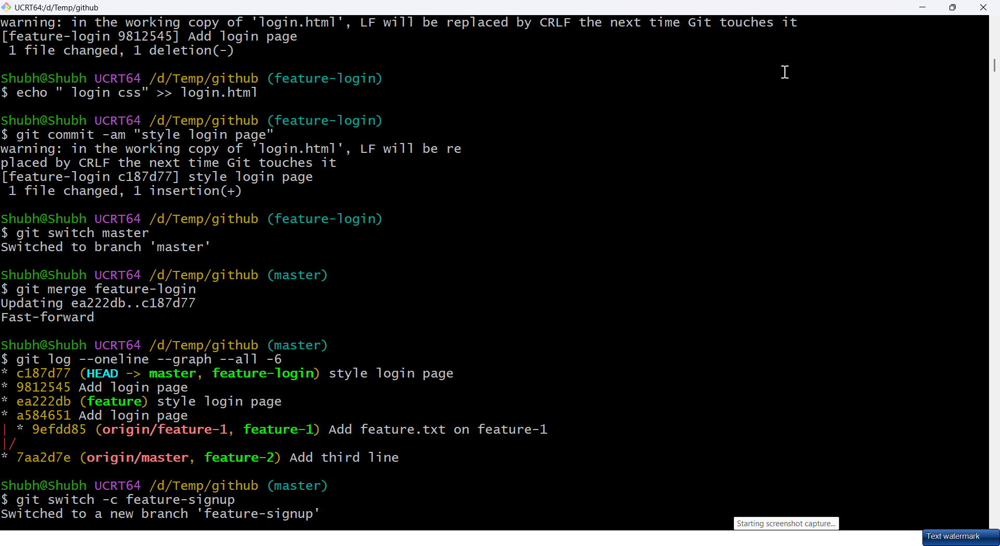
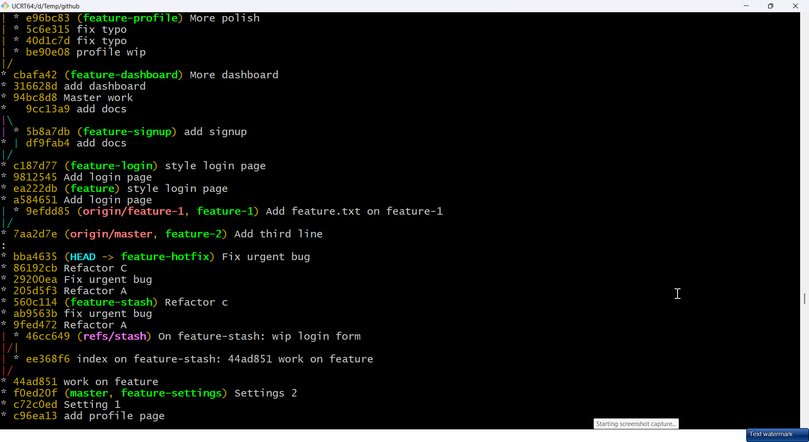
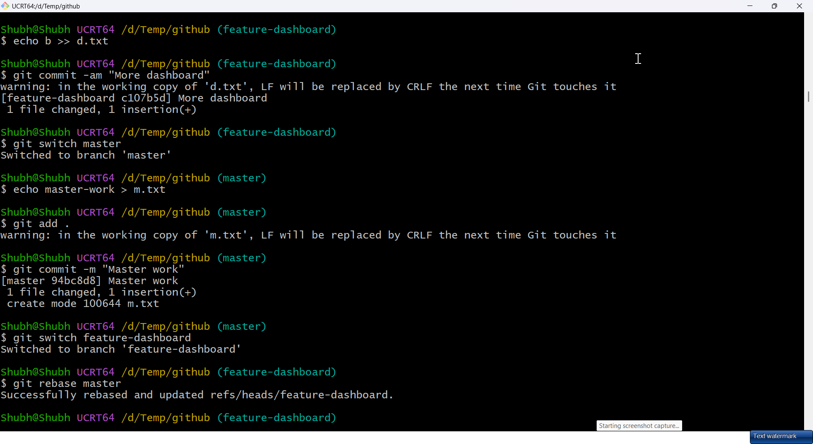
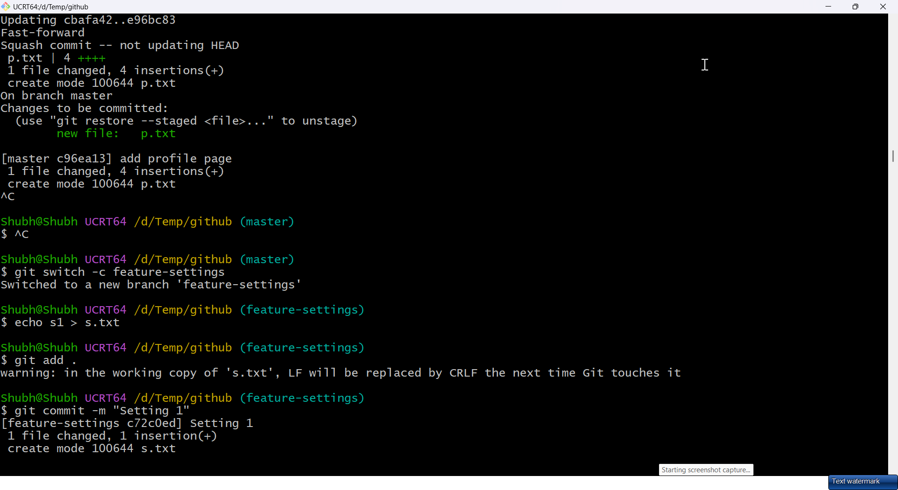
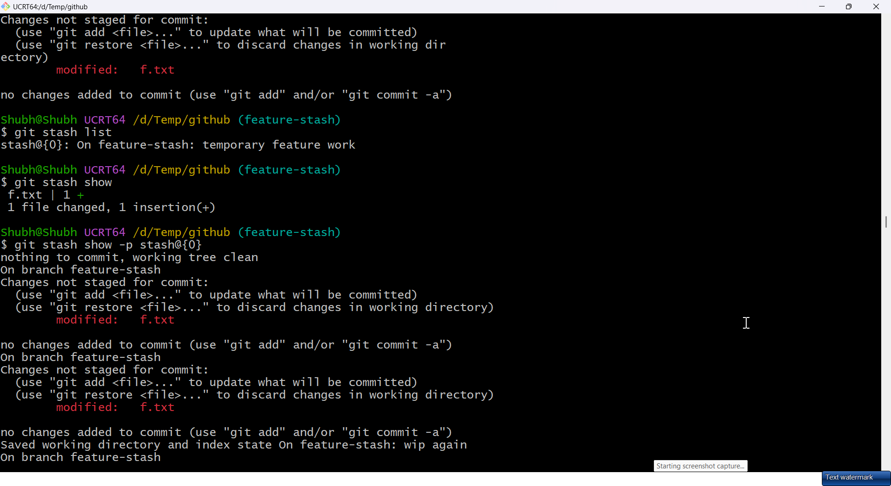
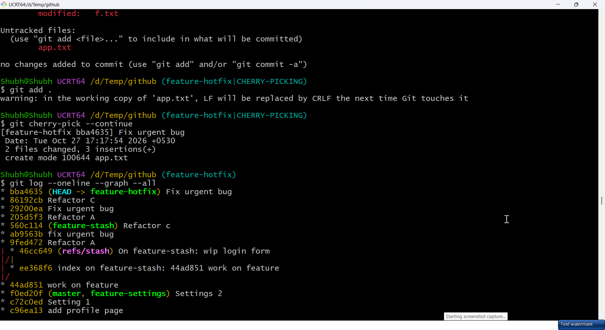

# Day 24 - Advanced Git: Merge, Rebase, Stash & Cherry Pick

## Task

- Task 1 — Git Merge Hands-On: `feature-login` fast-forward merge, `feature-signup` divergent merge commit, intentional same-line conflict; answer fast-forward vs merge commit vs conflict
- Task 2 — Git Rebase Hands-On: `feature-dashboard` with 2–3 commits rebased onto moved `master`; compare `--graph` vs merge; answer what rebase does, history difference, never-rebase-shared rule, rebase vs merge
- Task 3 — Squash vs Merge Commit: `feature-profile` (4–5 tiny commits) via `--squash` vs `feature-settings` regular merge; answer what squash does, when each, trade-off
- Task 4 — Git Stash Hands-On: uncommitted work blocks switch, `stash`/`pop`/`apply`/list/specific-stash; answer `pop` vs `apply` + real-world uses
- Task 5 — Cherry Picking: 3-commit `feature-hotfix`, pick only 2nd commit onto `master`; answer what/why/risks

## Environment

| Component | Value / Version | Install / Notes |
|-----------|-----------------|-----------------|
| OS | Windows 10/11 + Git for Windows, or Ubuntu 22.04 / WSL2 | Git ≥ 2.40 for `switch`/`restore` UX |
| Shell | Git Bash / WSL bash | `git log --oneline --graph --all` is the core visual tool |
| Tools | Local `devops-git-practice` from Days 22–23; `vim`/`nano` for conflict resolution | `[TODO - run on your machine]` — paste `git log --oneline --graph --all -8` as your start state |
| Safety | Work on throwaway `feature-*` branches; keep `master` pushable | Never `--force` a shared branch in this exercise |
| Verify | `git status && git branch -a && git log --oneline --graph --all -10` | Clean tree + visible topology before each task |

## Solution

### Task 1: Git Merge — Hands-On

WHY it matters for DevOps: merges are what CI gates. Understanding fast-forward vs merge commit decides whether `master` stays linear (easy bisect) or records true parallelism (auditable).

Fast-forward case (`master` hasn't moved):

```bash
git switch master && git switch -c feature-login
echo "login form" > login.html
git add . && git commit -m "Add login page"
echo "login css" >> login.html && git commit -am "Style login page"
git switch master
git merge feature-login        # master hasn't moved -> FAST-FORWARD
git log --oneline --graph --all -6
```

Expected output (example — your values will differ):

```text
* c3d4e5f (HEAD -> master, feature-login) Style login page
* b2c3d4e Add login page
* a1b2c3d Previous master commit
# (illustrative — straight line, both labels on same tip; no merge commit)
```

Divergent case (`master` moves too → merge commit):

```bash
git switch -c feature-signup
echo "signup page" > signup.html && git add . && git commit -m "Add signup"
git switch master
echo "docs" > docs.txt && git add . && git commit -m "Add docs"   # master moves too
git merge feature-signup       # now a MERGE COMMIT is created
git log --oneline --graph --all -8
```

Illustrative merge-commit graph:

```text
*   e5f6a7b (HEAD -> master) Merge branch 'feature-signup'
|\
| * d4e5f6a Add signup
* | c3d4e5f Add docs
|/
* b2c3d4e Style login page
# (illustrative — fork + join proves a true merge)
```

Force a merge commit even when fast-forward is possible (keeps feature context):

```bash
git merge --no-ff feature-x -m "Merge feature-x: add login"
```

Intentional conflict (same line, both branches):

```bash
git switch -c conflict-demo
echo "line from feature" > app.txt && git add . && git commit -m "Feature line"
git switch master
echo "line from master" > app.txt && git add . && git commit -m "Master line"
git merge conflict-demo
nano app.txt
```

Illustrative conflict markers:

```text
<<<<<<< HEAD
line from master
=======
line from feature
>>>>>>> conflict-demo
# (illustrative — edit to wanted content, remove markers, then:)
```

```bash
# resolve:
echo "merged line" > app.txt
git add app.txt
git commit -m "Resolve conflict in app.txt"
# bail out instead:
git merge --abort      # gives up cleanly if conflict went wrong
```

Answers:

- **Fast-forward merge** — when `master` has no new commits since the branch forked, Git just slides the `master` pointer forward. No merge commit, no conflict possible, linear history.
- **When a merge commit** — when both sides advanced since the merge-base, Git creates a 2-parent merge commit joining the histories.
- **Merge conflict** — both sides changed the same lines (or one deleted what the other edited). Git halts with markers; human picks the result, stages, commits.

| Situation | Git does |
|-----------|----------|
| Branch ahead, target still | Fast-forward (pointer move) |
| Both ahead (diverged) | Merge commit (or conflict → manual resolve) |
| Same lines both edited | Conflict with `<<<<<<<` / `=======` / `>>>>>>>` |

### Task 2: Git Rebase — Hands-On

```bash
git switch master && git switch -c feature-dashboard
echo a > d.txt && git add . && git commit -m "Add dashboard"
echo b >> d.txt && git commit -am "More dashboard"
git switch master
echo master-work > m.txt && git add . && git commit -m "Master work"
git switch feature-dashboard
git rebase master
git log --oneline --graph --all -8
git switch master && git merge feature-dashboard   # now fast-forwards (already linear)
```

Rebase vs merge history shape:

| Integration | Graph shape | Hashes |
|-------------|-------------|--------|
| Merge | Fork + join, extra merge commit | Original commits keep hashes |
| Rebase | Single straight line | Replayed commits get NEW hashes |

Answers:

- **What rebase does** — replays your feature commits one-by-one onto the new `master` tip. Old branch commits are abandoned; new commits with identical diffs but different parents/hashes are created.
- **History vs merge** — rebase linearizes (as if the feature started after `master`'s new commit); merge preserves true branching with a join commit.
- **Never rebase pushed/shared commits** — rewriting hashes orphans everyone else's clones (duplicates, divergent pulls, forced pushes). Rebase only private, unpushed work.
- **Rebase vs merge** — rebase to clean up LOCAL history before opening a PR; merge to integrate SHARED branches where truthful topology matters.

```bash
# conflict mid-rebase:
git status            # shows stopped at conflicting commit
# fix file, then:
git add <file>
git rebase --continue
# or bail:
git rebase --abort
```

### Task 3: Squash Commit vs Merge Commit

WHY it matters for DevOps: `master` readability gates `git bisect`, release notes, and rollbacks. Squash keeps it tidy; full history keeps it debuggable.

```bash
git switch master && git switch -c feature-profile
echo 1 > p.txt && git add . && git commit -m "Profile wip"
echo 2 >> p.txt && git commit -am "Fix typo"
echo 3 >> p.txt && git commit -am "Format"
echo 4 >> p.txt && git commit -am "More polish"
git switch master
git merge --squash feature-profile
git status              # all changes staged as ONE pending change
git commit -m "Add profile page"   # ONE commit on master
git log --oneline -4
```

Regular merge for comparison:

```bash
git switch -c feature-settings
echo s1 > s.txt && git add . && git commit -m "Settings 1"
echo s2 >> s.txt && git commit -am "Settings 2"
git switch master
git merge feature-settings        # regular merge (or --no-ff) preserves commits + merge commit
git log --oneline --graph --all -8
```

Answers:

- **Squash merging** — collapses all branch commits into a single new commit on the target. Branch history stays on the branch; target gets one clean entry.
- **When squash vs regular** — squash noisy WIP branches (typo/format churn) for a clean `master`; regular merge when each commit is meaningful, bisectable, or must stay attributable.
- **Trade-off** — squashing loses granularity on `master` (no per-step blame/bisect there) and the squashed commit is unlinked from the branch (deleting the branch loses the detailed trail unless the PR preserves it).

| Merge type | `master` gets | Best for |
|------------|-------------|----------|
| `--squash` | 1 commit, no merge commit | Noisy feature → tidy master |
| Default / `--no-ff` | All commits + merge commit | Meaningful steps, audit trail |

### Task 4: Git Stash — Hands-On

WHY it matters for DevOps: urgent hotfix lands while your feature is half-done. Stash lets you park work, switch, fix, return — without junk commits.

```bash
echo "wip line" >> app.txt      # modify a TRACKED file (untracked files need stash -u)
git status --short              # M app.txt — dirty tree

# A dirty tree may refuse the switch; stash first to move safely:
git stash push -m "wip login"   # park the WIP; tree becomes clean
git status                      # clean again
git switch -c feature-stash
echo work > f.txt && git add . && git commit -m "work on feature"
git switch master
git stash list                  # stash@{0}: On master: wip login
git stash show                  # summary of the stashed diff
git stash show -p stash@{0}     # full diff of a stash
git stash apply stash@{0}       # restore, KEEP the entry
git stash drop stash@{0}        # delete manually after use
git stash push -m "wip again"   # stash the restored changes again
git stash pop                   # apply AND drop (most common)
```

Expected output (example — your values will differ):

```text
Saved working directory and index state On master: wip login
stash@{0}: On master: wip login
# (example output)
```

Multiple stashes with messages (recommended):

```bash
echo "login form" >> app.txt && git stash push -m "wip login form"
echo "css tweak" >> app.txt && git stash push -m "wip css tweak"
git stash list
git stash apply stash@{1}
```

Answers:

- **`pop` vs `apply`** — both restore stashed changes; `pop` also deletes the stash entry, `apply` keeps it. Use `pop` normally; `apply` when the same snapshot must be reused (e.g. two branches).
- **Real-world use** — hotfix context-switch, `git pull` on a dirty tree, cleaning the tree before rebase, parking experiments.

| Stash command | Keeps entry? |
|---------------|--------------|
| `git stash pop` | No (apply + drop) |
| `git stash apply` | Yes |
| `git stash drop` | Deletes without applying |

### Task 5: Cherry Picking

```bash
git switch master && git switch -c feature-hotfix
git commit --allow-empty -m "Refactor A"
git commit --allow-empty -m "Fix urgent bug"   # this is the one
git commit --allow-empty -m "Refactor C"
git log --oneline feature-hotfix -4
git switch master
git cherry-pick <hash-of-fix-commit>
git log --oneline -4          # only that one commit applied (new hash)
# conflict/bail:
git cherry-pick --abort
git cherry-pick --continue    # after resolving
```

WHY it matters for DevOps: backport one fix to a release branch without dragging the whole feature line with it.

Answers:

- **What cherry-pick does** — copies ONE commit by hash onto the current branch as a new commit (new hash, same diff/author by default).
- **Real-project use** — hotfix backports (`master` → `release-1.2`), lifting a single fix from a stalled PR, replaying a commit onto a fresh branch.
- **What can go wrong** — conflicts when surrounding code differs; duplicate commits (old + copy) that later merge awkwardly; chains of dependent commits picked piecemeal break. Mitigate with `git cherry-pick -x` (records source hash in message) or merge the branch instead.

## Commands Used

```bash
git switch -c feature-login
git merge feature-login
git merge --no-ff feature-x
git merge --squash feature-profile
git merge --abort
git switch -c feature-dashboard
git rebase master
git rebase --continue
git rebase --abort
git stash
git stash push -m "wip login"
git stash list
git stash show
git stash show -p stash@{0}
git stash apply stash@{0}
git stash pop
git stash drop stash@{0}
git stash clear
git cherry-pick <hash>
git cherry-pick -x <hash>
git cherry-pick --continue
git cherry-pick --abort
git log --oneline --graph --all
```

## Verification

- Fast-forward observed: straight-line graph, no merge commit after `feature-login`
- Merge commit observed: fork + join graph after divergent `feature-signup`
- Intentional conflict created, markers resolved, committed (or `--abort` path tried)
- Rebased `feature-dashboard` shows linear history vs pre-rebase fork
- Squash merge added exactly 1 commit to `master`; regular merge preserved commits + join
- `git stash list` showed entries mid-task, empty after `pop`; `apply` vs `pop` difference stated
- `git log master` contains only the cherry-picked hotfix commit (new hash), not its siblings
- `git-commands.md` updated with merge/rebase/stash/cherry-pick tables

## Key Learnings

- Fast-forward = pointer slide (no divergence); merge commit = 2-parent join (diverged).
- Conflict markers delimit both versions — resolve, stage, commit; `--abort` is always available.
- Rebase replays commits with new hashes into a line; merge preserves true topology.
- Never rebase pushed/shared history — it orphans collaborators' clones.
- Squash tidies `master` at the cost of granular bisect/blame there.
- Stash is a scratch stack: `pop` consumes, `apply` reuses, messages prevent mix-ups.
- Cherry-pick copies one commit (new hash) — ideal for backports, fragile for chains.
- `--graph --all` is the lens for reasoning about all four techniques.

## Troubleshooting / Gotchas

- Committed conflict markers (`<<<<<<<`) — cause: staged without cleaning markers; fix: `grep -rn '<<<<<<<' .` then edit, `git add`, continue.
- Stuck mid-rebase with no idea — cause: conflict paused the replay; fix: resolve, `git add`, `git rebase --continue`, or `git rebase --abort` to bail.
- Rebased a pushed branch, teammates broken — cause: rewrote shared hashes; fix: coordinate, they `git fetch && git reset --hard origin/branch`; prefer `--force-with-lease` over `--force` if you must push.
- `git stash pop` conflicted — cause: stashed context no longer applies cleanly; fix: resolve like a merge, `git add`, then `git stash drop` manually (pop didn't drop on conflict).
- Squash-merged branch still shows "ahead" — cause: squash creates an UNLINKED commit; fix: expected — delete the branch after verifying `master` has the content.
- `cherry-pick` says empty commit — cause: change already present on target; fix: `git cherry-pick --skip` or `--allow-empty` if intentional.
- Lost a branch after merge/delete — cause: deleted ref; fix: `git reflog`, find hash, `git switch -c recovered <hash>`.

## Screenshots



_Fast-forward: `master` slides to `feature-login`; no merge commit._



_Divergent `feature-signup` merge: fork + join graph with a merge commit._



_`feature-dashboard` rebased onto `master`: straight line, rewritten hashes._



_`git merge --squash feature-profile`: staged changes squash into one commit._



_`git stash list`, `git stash show`, and `git stash show -p stash@{0}`._



_`git cherry-pick --continue` followed by `git log --oneline --graph --all` showing the picked commit._

_Conflict-marker screenshot was not captured this session; see the marker examples above._
