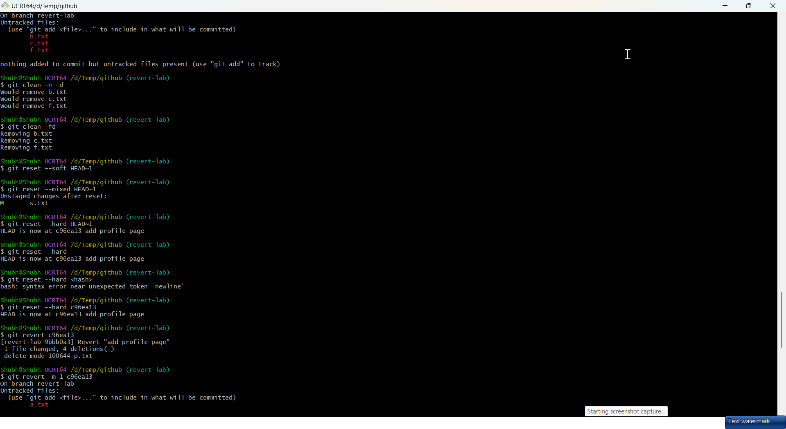
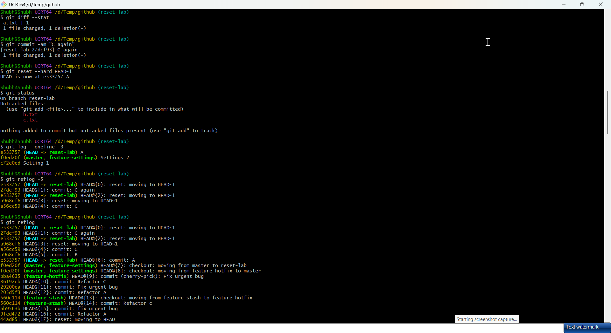
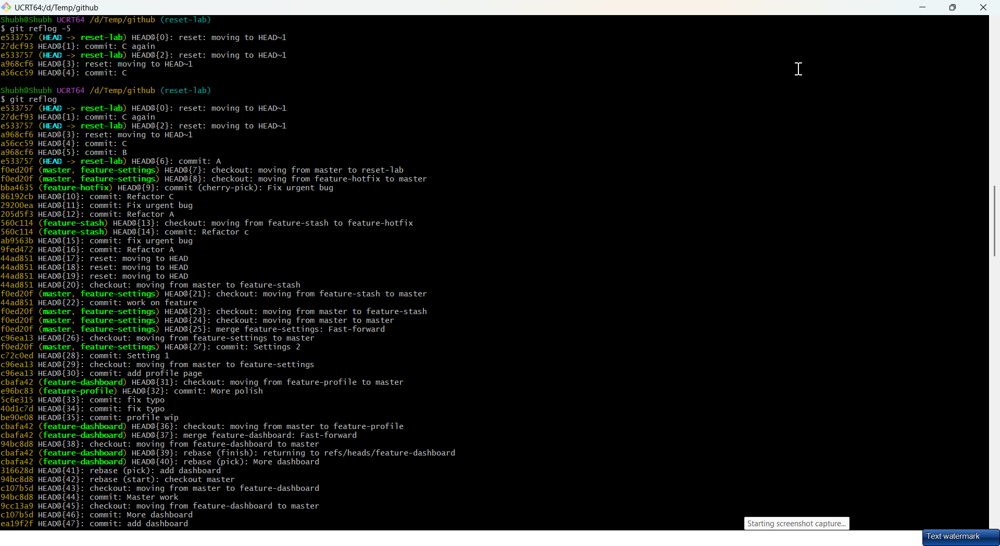
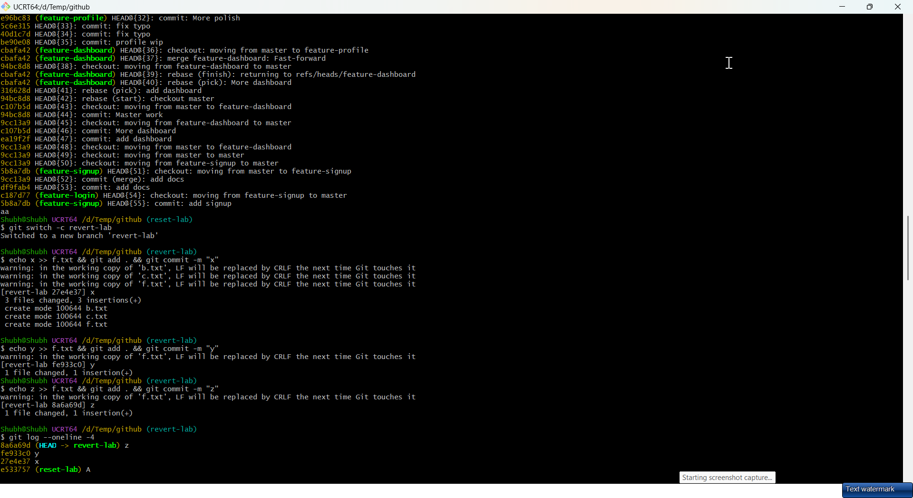
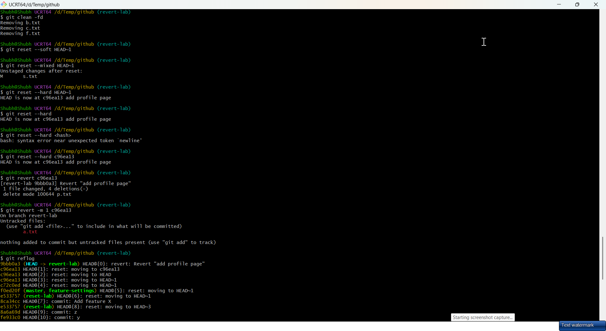

# Day 25 - Git Reset vs Revert & Branching Strategies

## Task

- Task 1 — Git Reset Hands-On: commits A/B/C then `--soft` / `--mixed` / `--hard` back one commit; answer mode differences, which is destructive, when each, reset on pushed commits?
- Task 2 — Git Revert Hands-On: commits X/Y/Z, revert middle commit Y; answer reset vs revert, why revert is safer, when each
- Task 3 — Reset vs Revert Summary: comparison table (what it does / removes history? / safe for shared? / when to use)
- Task 4 — Branching Strategies: GitFlow, GitHub Flow, Trunk-Based Development — each with description, text diagram, usage, pros/cons; answer startup vs large-team vs open-source picks
- Task 5 — Git Commands Reference Update: consolidate Days 22–25 (Setup, Workflow, Branching, Remote, Merging/Rebasing, Stash/Cherry-pick, Reset/Revert)

## Environment

| Component | Value / Version | Install / Notes |
|-----------|-----------------|-----------------|
| OS | Windows 10/11 + Git for Windows, or Ubuntu 22.04 / WSL2 | Git ≥ 2.40 |
| Shell | Git Bash / WSL bash | `reflog` is the safety net for this day — keep a terminal open on it |
| Tools | Local `devops-git-practice` from Days 22–24; GitHub account for push | `[TODO - run on your machine]` — snapshot start: `git log --oneline -5 && git status` |
| Safety | Practice reset ONLY on throwaway branches; `main` resets must be coordinated | `--hard` discards work — commit or stash anything precious first |
| Verify | `git reflog -8 && git log --oneline --graph --all -8` | You can always recover via reflog hashes shown here |

## Solution

### Task 1: Git Reset — Hands-On

WHY it matters for DevOps: cleaning local history before a PR (squash WIP commits, drop debug lines) uses reset. Doing it on shared `main` breaks everyone's clones — so the rule set below.

```bash
cd devops-git-practice
git switch -c reset-lab
echo "a" > a.txt && git add . && git commit -m "A"
echo "b" > b.txt && git add . && git commit -m "B"
echo "c" > c.txt && git add . && git commit -m "C"
git log --oneline -4
```

Expected output (example — your values will differ):

```text
c3d4e5f (HEAD -> reset-lab) C
b2c3d4e B
a1b2c3d A
# (illustrative — your hashes differ)
```

Three modes, same starting point — observe index vs worktree:

```bash
# --- --soft: moves HEAD only, index + working tree untouched ---
git reset --soft HEAD~1
git status   # C's changes are STAGED (in the index), ready to commit again
git log --oneline -3
git commit -m "C again"

# --- --mixed (default): moves HEAD + unstages, files stay on disk ---
git reset --mixed HEAD~1
git status   # C's changes are UNSTAGED but files still exist
git diff --stat
git commit -am "C again"

# --- --hard: moves HEAD + index + working tree, changes GONE ---
git reset --hard HEAD~1
git status   # clean; c.txt is deleted from disk too
git log --oneline -3
git reflog -5   # safety net: shows the old hash of C, recoverable
```




| Mode | HEAD moves? | Index (staged)? | Worktree (files)? | Changes survive? |
|------|-------------|-----------------|-------------------|------------------|
| `--soft HEAD~1` | Yes, back 1 | Kept staged | Untouched | Yes, staged |
| `--mixed HEAD~1` (default) | Yes, back 1 | Unstaged | Untouched | Yes, unstaged |
| `--hard HEAD~1` | Yes, back 1 | Reset to target | Reset to target | No — discarded |

Recovery after a bad reset:

```bash
git reflog            # find the lost hash, e.g. c3d4e5f
git reset --hard c3d4e5f   # restore it
```



Illustrative reflog:

```text
c3d4e5f HEAD@{0}: commit: C again
b2c3d4e HEAD@{1}: reset: moving to HEAD~1
# (example output)
```

Answers:

- `--soft` — moves HEAD back; changes stay **staged**. Use to squash/reword the last commit without re-adding files.
- `--mixed` — default. Moves HEAD back; changes become **unstaged** but files remain. Use to redo a commit while re-choosing what to stage.
- `--hard` — moves HEAD back and **discards** index + worktree changes. Destructive — use only to truly throw work away.
- Destructive mode: `--hard` (loses uncommitted work; recoverable only via `reflog` before GC).
- Reset on pushed commits? **No** on shared branches — it rewrites public history, forcing divergent pulls and `--force`. Use `git revert` instead; coordinate a force-push only on a private throwaway branch.

### Task 2: Git Revert — Hands-On

```bash
git switch -c revert-lab
echo x >> f.txt && git add . && git commit -m "X"
echo y >> f.txt && git add . && git commit -m "Y"
echo z >> f.txt && git add . && git commit -m "Z"
git log --oneline -4
Y_HASH=$(git log --oneline -3 | awk '/ Y$/{print $1}')
git revert $Y_HASH     # editor opens; new commit undoing Y
git log --oneline -5      # X, Y, Z, Revert "Y" — Y is STILL in history
nano f.txt              # the Y line is removed; X and Z lines remain
```

Expected output (example — your values will differ):

```text
e5f6a7b (HEAD -> revert-lab) Revert "Y"
d4e5f6a Z
c3d4e5f Y
b2c3d4e X
# (illustrative — Y kept + undo commit appended)
```



Reverting a merge commit needs a mainline parent:

```bash
git revert -m 1 <merge-hash>
git revert --continue   # after resolving a revert conflict
git revert --abort      # bail out
```



Answers:

- `git revert` creates a **new commit that undoes** a previous commit; the original stays. `git reset` **removes** commits from the branch.
- Revert is safer for shared branches because history only grows — no force-push, no orphaned clones.
- Use **reset** for local/unpushed cleanup; **revert** for anything already pushed/shared, especially `main`.

### Task 3: Reset vs Revert — Summary

|  | `git reset` | `git revert` |
|---|---|---|
| What it does | Moves HEAD (branch pointer) back to an earlier commit | Creates a new commit that undoes a previous commit |
| Removes commit from history? | Yes (from the branch; reflog keeps it temporarily) | No (original stays, new "undo" commit added) |
| Safe for shared/pushed branches? | No — rewrites history, needs force-push | Yes — history only grows |
| Destroys work? | `--hard` destroys uncommitted work | Never destroys; always additive |
| When to use | Local cleanup of unpushed commits | Undoing shipped commits on shared branches |
| Recovery | `git reflog` + reset back to old hash | Revert the revert (`git revert <revert-hash>`) |

#### Deep dive: reset cookbook + decision tree

```bash
# Squash last 3 local commits into one (private branch only):
git reset --soft HEAD~3
git status   # all 3 commits changes staged as one
git commit -m "Add feature X"

# Split a fat commit: uncommit, re-stage in parts:
git reset --mixed HEAD~1
git add -p   # stage hunk by hunk
git commit -m "Part 1"
git commit -am "Part 2"

# Preview untracked cleanup before deleting:
git clean -n -d
git clean -fd   # actually delete (no undo, use -n first)
```

```text
Is the commit pushed/shared?
  NO  (local only) -> git reset (--soft/--mixed/--hard) freely
  YES (pushed) -> must history stay intact?
    YES -> git revert (always safe)
    NO + coordinated throwaway branch -> reset + --force-with-lease (announce first)
```

WHY it matters for DevOps: release branches must only grow (revert). Feature branches pre-PR may be reset for clean review. Branch type decides the tool.

### Task 4: Branching Strategies

WHY it matters for DevOps: the strategy picks CI shape (how many deploy lines), release cadence, and on-call rollback paths. Small teams drown in GitFlow ceremony; regulated releases can't survive on trunk-only.

**1. GitFlow** — `main` (production) + `develop` (integration) + `feature/*` (from `develop`) + `release/*` (freeze cut from `develop`) + `hotfix/*` (from `main`, merged back to both `main` and `develop`).

```text
main    ──●───────────────●───────●──  (tags v1.0, v1.1)
            \             /       /
develop ────●──●──●──●──●──●────●──
              \  /       \
feature        ●●         release──●
                          hotfix────●──●
```

- Used by: versioned desktop/mobile/enterprise apps with scheduled releases (classic example: Magento, older Git-versioned products).
- Pros: structured; supports multiple release lines; clear branch roles; release freeze point for QA.
- Cons: complex; slow integration (long-lived `develop`); merge-heavy; poor fit for continuous deployment.

**2. GitHub Flow** — one long-lived `main` (always deployable) + short-lived `feature/*` branches via pull requests; merge to `main` = deploy (often with CI + required reviews).

```text
main    ──●──────●──────●──  (each ● is a deploy)
               \  /      /
feature         ●●──●──●
              (PR review + CI green → merge)
```

- Used by: GitHub itself, most web/SaaS startups on continuous deployment.
- Pros: simple; fast; fewer conflicts; natural PR review + CI gate per change.
- Cons: single release line — no built-in old-version hotfix lanes; demands strong automated tests/CI and feature flags for big work.

**3. Trunk-Based Development** — everyone commits to `main` (trunk) at least daily; branches live hours to ~2 days max, merge behind CI with feature flags hiding incomplete work.

```text
main (trunk) ──●──●──●──●──●──●──●──  (every commit releasable)
                 \__/        \__/
short-lived       ●●          ●●  (< 2 days, flags guard unfinished)
```

- Used by: Google, Meta, high-velocity SaaS/Kubernetes-adjacent teams.
- Pros: smallest merges; forces frequent integration; enables true CD; scales to many engineers on one line.
- Cons: needs mature CI/CD + feature flags; strict discipline; large features must hide behind flags or split.

Strategy picks:

| Team | Recommendation | Why |
|------|----------------|-----|
| Startup shipping fast (5 devs, weekly) | **GitHub Flow** (Trunk-Based once CI matures) | Minimal ceremony, PR + CI per change, deploys on merge |
| Large team, scheduled releases | **GitFlow** | Release branches give QA a freeze point; hotfix lanes for prod |
| Favorite OSS example | Kubernetes: trunk-based (`main` + `release-x.y` cut branches); React: `main` + per-major release branches (GitHub-Flow-like) | Check any repo's Branches page + `CONTRIBUTING.md` to confirm |

### Task 5: Git Commands Reference Update

`git-commands.md` in this folder now includes the Reset & Revert section covering Days 22–25 (Setup, Workflow, Branching, Merging/Rebasing, Stash/Cherry-pick, Remotes, Viewing, Reset/Revert).

```bash
git reset --soft HEAD~1    # uncommit, keep staged
git reset --mixed HEAD~1   # uncommit, unstage (default)
git reset --hard HEAD~1    # uncommit, discard everything (destructive)
git reset --hard <hash>    # jump branch to any commit (local only)
git revert <hash>          # new commit undoing <hash>
git revert -m 1 <hash>     # revert a merge commit (mainline)
git reflog                 # recover from a bad reset
```

## Commands Used

```bash
git switch -c reset-lab
git log --oneline -4
git reset --soft HEAD~1
git reset --mixed HEAD~1
git reset --hard HEAD~1
git reset --hard <hash>
git status
git diff --stat
git reflog
git revert <hash>
git revert -m 1 <merge-hash>
git revert --continue
git revert --abort
git log --oneline --graph --all
```

## Verification

- After `--soft`, `git status` shows changes as staged; after `--mixed` as unstaged; after `--hard` clean + file gone
- `git reflog` still lists the pre-reset hash — recovery path proven
- After `git revert <hashY>`, `git log --oneline` shows Y AND a `Revert "Y"` commit
- `nano f.txt` confirms only Y's line undone, X/Z intact
- Reset vs revert table filled (all 4 rows)
- All 3 strategies have description + text diagram + usage + pros/cons
- Startup / large-team / OSS picks answered with reasons
- `git-commands.md` contains Reset & Revert table and is committed

## Key Learnings

- Reset moves the branch pointer; revert appends a corrective commit.
- Only `--hard` destroys uncommitted work; `--soft`/`--mixed` preserve it differently.
- Never rewrite shared history — revert instead of resetting pushed commits.
- `git reflog` is the undo button for bad resets (act before GC prunes it).
- GitFlow = scheduled releases; GitHub Flow = continuous deployment; Trunk-Based = daily-to-trunk CD.
- Interactive cleanup (`reset --soft` + re-commit) tidies local PRs without new tools.
- Strategy choice is a deployment choice, not just a Git preference.

## Troubleshooting / Gotchas

- `git revert` on a merge says "is a merge but no -m option given" — cause: merge has 2 parents; fix: `git revert -m 1 <hash>` (keep mainline).
- Lost commit after `--hard`, can't find hash — cause: didn't check reflog; fix: `git reflog`, copy `HEAD@{n}` hash, `git reset --hard <hash>`.
- Revert conflicted — cause: later commits touched the same lines; fix: resolve markers, `git add`, `git revert --continue` (or `--abort`).
- Force-pushed after reset, teammates broken — cause: rewrote public history; fix: coordinate, they rebase/reset to new tip; avoid on shared branches entirely.
- `--soft` vs `--mixed` confusion — cause: both keep files; fix: `git status` tells truth (staged = soft, unstaged = mixed).
- `git reset --hard` didn't delete untracked files — cause: reset only tracks tracked paths; fix: `git clean -fd` (dry-run `-n` first) for untracked cleanup.
- Reverting a revert to redo the change — cause: over-correction; fix: `git revert <revert-hash>` reapplies original (valid workflow, not an error).

