# Day 26 - GitHub CLI: Manage GitHub from Your Terminal

## Task

- Task 1 — Install and Authenticate: install `gh`, `gh auth login`, verify active account, answer supported auth methods
- Task 2 — Working with Repositories: create `my-test-repo` (public + README), `gh repo clone`, `gh repo view`, `gh repo list`, `gh repo view --web`; keep it for Task 4, delete it after the PR merge
- Task 3 — Issues: use `shubhu-io/devops-notes`; confirm the `documentation` label exists, create issue #1 (title/body/label), list open issues, view it by number, comment/edit, close/reopen; answer scripting/automation uses
- Task 4 — Pull Requests: `cd my-test-repo` and branch from `main` → change → push → `gh pr create` (PR #1); list/view/checks/merge; answer merge methods + `gh` review flow
- Task 5 — GitHub Actions & Workflows Preview: list runs and workflows on `cli/cli`, view one run; answer `gh run`/`gh workflow` CI/CD uses
- Task 6 — Useful `gh` Tricks: `gh api`, `gh gist`, `gh release`, `gh alias`, `gh search repos` — try each, keep useful ones in `git-commands.md`

## Environment

| Component | Value / Version | Install / Notes |
|-----------|-----------------|-----------------|
| OS | Windows 11 Home Single Language (10.0.26300) | `winget install --id GitHub.cli`; Ubuntu: `sudo apt install gh` (via GitHub CLI apt repo) or `conda`/`snap` |
| Shell | Git Bash + PowerShell 5.1 | Restart terminal after install so `gh` lands on PATH |
| Tools | `gh` 2.103.3 (2026-10-26), Git 2.56.0.windows.4, GitHub account `shubhu-io` | Verified on this machine — paste your own `gh --version` + `gh auth status` (redact token) |
| Auth | Browser/device flow (interactive) or PAT via `GH_TOKEN`/`GITHUB_TOKEN` (scripts/CI) | Token needs `repo`, `read:org`, `workflow` scopes; add `delete_repo` before the final `gh repo delete` in Task 4 |
| Verify | `gh --version && gh auth status && gh repo list shubhu-io --limit 3` | All three must succeed before Task 2 |

## Solution

### Task 1: Install and Authenticate

WHY it matters for DevOps: browser clicks don't scale. `gh` turns repos, PRs, issues, releases, and workflow runs into scriptable commands CI and cron can drive.

```bash
# Windows:
winget install --id GitHub.cli
# Ubuntu (official repo):
sudo apt update && sudo apt install -y gh
# macOS:
brew install gh

gh --version
gh auth login          # GitHub.com → HTTPS → Paste an authentication token (or browser flow)
gh auth status         # shows active account + token scopes
gh auth refresh -s repo,workflow  # add a missing scope later
gh auth refresh -h github.com -s delete_repo  # only needed before the final repo delete
gh auth switch         # when multiple accounts are stored
echo $GH_TOKEN | gh auth login --with-token   # non-interactive (CI)
```

Expected output (this machine):

```text
gh version 2.103.3 (2026-10-26)
github.com
  ✓ Logged in to github.com account shubhu-io (keyring)
  - Active account: true
  - Git operations protocol: https
  - Token scopes: 'gist', 'read:org', 'repo', 'workflow'
# (token redacted; re-run `gh auth status` to see your exact scopes)
```

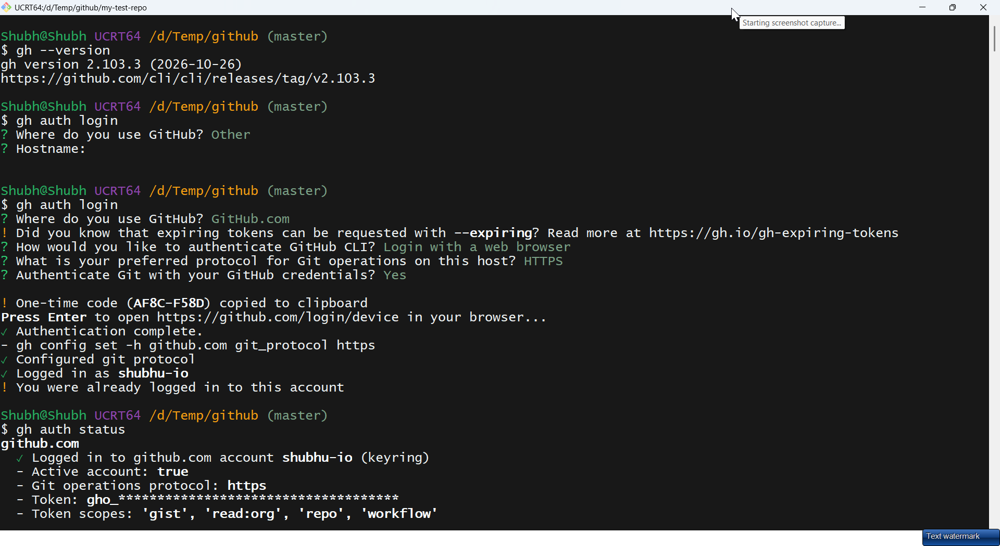

Answers — supported authentication methods:

1. **Browser / device flow** — `gh auth login` opens a browser/device code; no manual token handling (best interactive default).
2. **Personal Access Token (PAT)** — paste a classic/fine-grained token or pipe via `--with-token`; env vars `GH_TOKEN` / `GITHUB_TOKEN` pick it up unattended (standard for scripts/CI).
3. **Git credential + SSH bootstrap** — post-login `gh` can configure git credential helper (`gh auth setup-git`) and upload SSH keys, so `git push`/`pull` reuse the same auth.

| Method | Best for | Secret lives in |
|--------|----------|-----------------|
| Browser flow | Daily interactive use | System keyring |
| `GH_TOKEN` PAT | Scripts, cron, CI runners | Env var / secret store |
| SSH key via `gh` | `git@github.com:` push/pull | `~/.ssh/` + GitHub account |

### Task 2: Working with Repositories

Steps 1–5 (step 6, deletion, runs at the end of Task 4 because the repo is reused for the PR):

```bash
# 1. Create — public with a seeded README
gh repo create my-test-repo --public --add-readme --description "gh CLI practice"

# 2. Clone with gh (not git clone)
gh repo clone shubhu-io/my-test-repo
cd my-test-repo

# 3. View one repo (details in terminal)
gh repo view shubhu-io/my-test-repo

# 4. Open the same repo in the browser
gh repo view --web

# 5. List all repos
gh repo list shubhu-io --limit 20
gh repo list shubhu-io --limit 20 --json name,visibility,updatedAt -q '.[].name'

cd ..   # leave the clone; Task 4 re-enters it with `cd my-test-repo`

# 6. Delete the test repo — run AFTER Task 4 (this wipes the PR too)
# gh repo delete shubhu-io/my-test-repo --yes
```

If `my-test-repo` already exists, skip `gh repo create` and start from the clone. Deleting needs the `delete_repo` scope; without it the command fails even though `repo` is granted:

```bash
gh auth refresh -h github.com -s delete_repo
```

Expected output (fresh clone; on this machine the folder already existed, so `gh repo clone` printed `destination path ... already exists`):

```text
✓ Created repository shubhu-io/my-test-repo on github.com
Cloning into 'my-test-repo'...
shubhu-io/my-test-repo
  [public]
  gh CLI practice
  0 stars | 0 forks
  https://github.com/shubhu-io/my-test-repo
# (your star/fork counts and timestamps will differ)
```

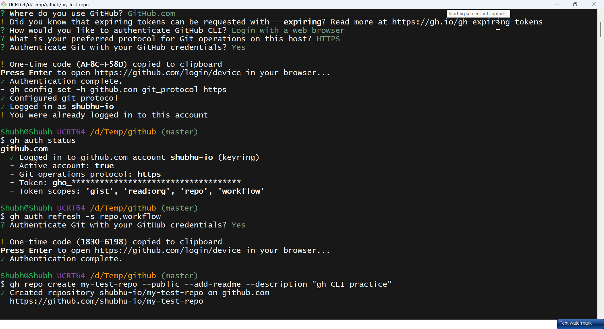
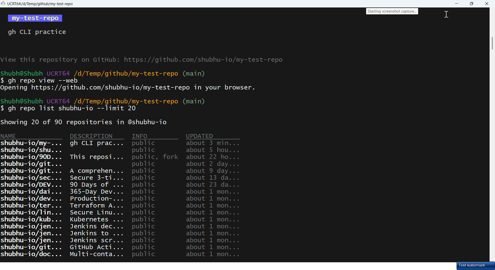
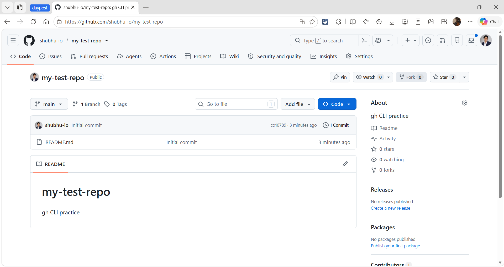

| Flag | Effect |
|------|--------|
| `--public` / `--private` / `--internal` | Visibility |
| `--add-readme` | Seed with README so clone isn't empty |
| `--description` | One-line GitHub description (Day 27 hygiene) |
| `--gitignore Python` | Seed ignore template at creation |

### Task 3: Issues

WHY it matters for DevOps: the issue tracker is the audit trail for incidents, change requests, and follow-up work. `gh issue` makes that trail scriptable — CI can open an incident on a failed deploy, cron can retire stale tickets, and nothing requires a browser tab.

Use one long-lived notes repo for Task 3 (create it once if it does not exist):

```bash
REPO=shubhu-io/devops-notes
# run once if the repo does not exist (it already exists on this machine)
gh repo create devops-notes --public --add-readme --description "Devops notes"
```

Labels must exist before `--label` accepts them. `documentation` is a **default label** on new repos, so check first — `gh label create` fails with "already exists" if you skip this:

```bash
gh label list --repo "$REPO"
# only if documentation is missing:
gh label create documentation --repo "$REPO" --color 0075ca --description "Docs updates"
```

Full issue lifecycle from the terminal:

```bash
# 1. Create — title, body, label (new repo → issue #1)
gh issue create --repo "$REPO" \
  --title "Add Linux notes" \
  --body "Cover processes, signals, and systemd units" \
  --label "documentation"

# 2. List open issues (default) — filter by state, label, assignee
gh issue list --repo "$REPO"
gh issue list --repo "$REPO" --state all --limit 20
gh issue list --repo "$REPO" --label documentation
gh issue list --repo "$REPO" --assignee "@me"

# 3. View one issue by number — details + discussion
gh issue view 1 --repo "$REPO"
gh issue view 1 --repo "$REPO" --comments
gh issue view 1 --repo "$REPO" --web      # full thread in browser

# 4. Comment / edit before closing
gh issue comment 1 --repo "$REPO" --body "Notes added; closing after review."
gh issue edit 1 --repo "$REPO" --body "Cover processes, signals, systemd units, and service management."

# 5. Close — optional reopen proves the reverse command, then close again
gh issue close 1 --repo "$REPO" --reason completed
gh issue reopen 1 --repo "$REPO"      # optional
gh issue close 1 --repo "$REPO" --reason completed
# already closed from an earlier run? reopen first, then run the close commands
```

Expected output (fresh repo; on this machine issue #1 already exists, so reuse it):

```text
✓ Created issue shubhu-io/devops-notes#1 "Add Linux notes"
Showing 1 of 1 open issue in shubhu-io/devops-notes

#1  Add Linux notes  documentation  about 1 minute ago
✓ Closed issue shubhu-io/devops-notes#1 "Add Linux notes"
# (timestamps will differ; if the issue is already closed, reopen it first)
```

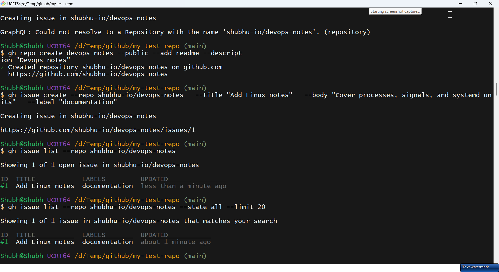
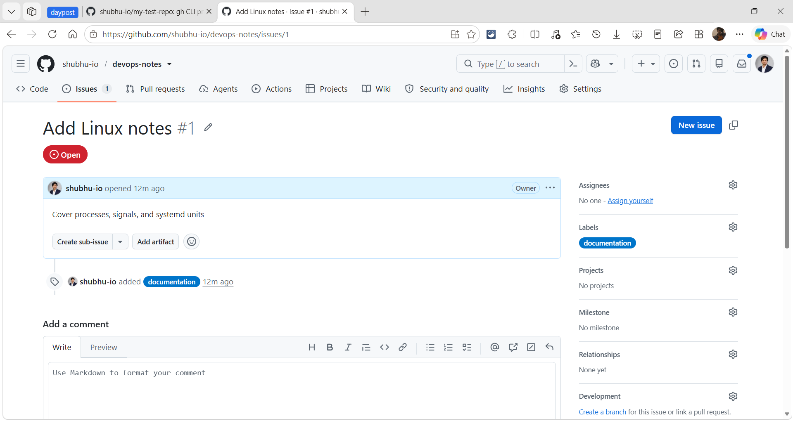
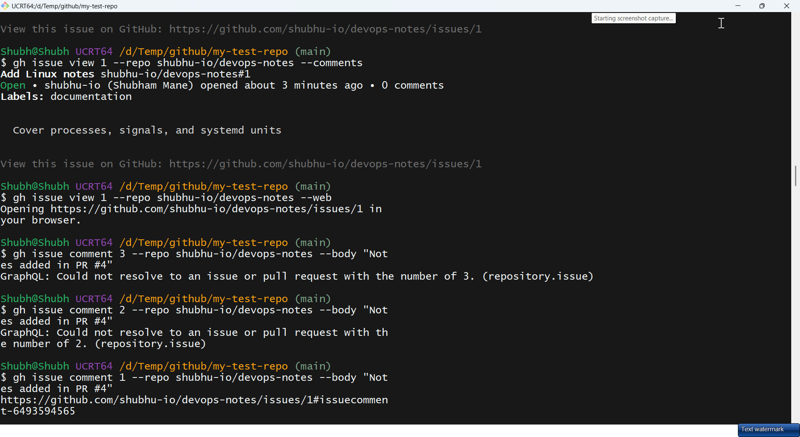

The captures include two real errors: `gh issue create` before `devops-notes` existed (fixed by creating the repo first) and `view 3` / `comment 2` when only #1 exists (issue numbers are per repo).

`gh issue create` flags:

| Flag | Effect |
|------|--------|
| `--title` / `--body` | Issue content; use `--body-file <file>` for long markdown bodies |
| `--label` | Attach existing labels (repeatable / comma-separated) |
| `--assignee @me` | Assign yourself (or `owner`/`org/team`) |
| `--milestone` / `--project` | Attach to a milestone or Projects board |
| `--template` | Start from `.github/ISSUE_TEMPLATE/*` |
| `--web` | Open the browser form instead of passing flags |

Issue command map:

| Command | Does |
|---------|------|
| `gh issue create` | Open an issue |
| `gh issue list` | List issues (open by default; `--state all` also shows closed) |
| `gh issue view <n>` | Show one issue; `--comments`, `--web`, `--json` |
| `gh issue comment <n>` | Add a comment |
| `gh issue edit <n>` | Change title/body/labels/assignees/milestone |
| `gh issue close <n>` | Close (`--reason completed`, or `--reason "not planned"`) |
| `gh issue reopen <n>` | Reopen |
| `gh issue transfer <n> <repo>` | Move the issue to another repo |

Answer — scripting/automation uses of `gh issue`:

- **Nightly hygiene** — list one label, close each ticket from cron without pagination by hand:
  ```bash
  gh issue list --repo shubhu-io/devops-notes --label stale --json number -q '.[].number' \
    | xargs -I{} gh issue close {} --repo shubhu-io/devops-notes --reason "not planned"
  ```
- **CI incident triage** — when a deploy fails, open one issue with the run URL and logs attached:
  ```bash
  gh issue create --repo shubhu-io/devops-notes \
    --title "Deploy failed: $(date +%F)" \
    --body "Run: $RUN_URL" --label "incident"
  ```
- **Release checklist** — create one issue per release from a template file, then close it after the tag ships:
  `gh issue create --title "Release v1.2.0" --body-file checklist.md --label release`.
- **SLA reporting** — `gh issue list --json number,title,createdAt,labels -q ...` feeds a dashboard/standup without scraping HTML; `--repo owner/repo` works from any directory.
- **PR ↔ issue linking** — in a repo where the PR closes an issue, put `Closes #1` in the PR body and GitHub closes it on merge; `gh issue view 1 --comments` confirms the link.

### Task 4: Pull Requests

Full terminal-only PR loop. The `cd` matters: `--repo` targets the API, but `git` commands act on the **current folder**. Branch from the cloned `my-test-repo`, not from `90Days-Of-DevOps`:

```bash
cd my-test-repo                # skip if already inside; if removed: gh repo clone shubhu-io/my-test-repo
git switch main && git pull    # branch from a current base
git switch -c feature-gh-notes
echo "gh notes" > gh.md
git add gh.md && git commit -m "Add gh notes"
git push -u origin feature-gh-notes
gh pr create --title "Add gh notes" --body "Notes from day 26" --base main
gh pr list
gh pr view 1
gh pr view 1 --web
gh pr diff 1
gh pr checks 1
gh pr merge 1 --squash --delete-branch
git switch main && git pull
git log --oneline origin/main -2   # verify the squashed commit before deleting the repo
cd ..
gh repo delete shubhu-io/my-test-repo --yes   # Task 2 step 6, after the merge
```

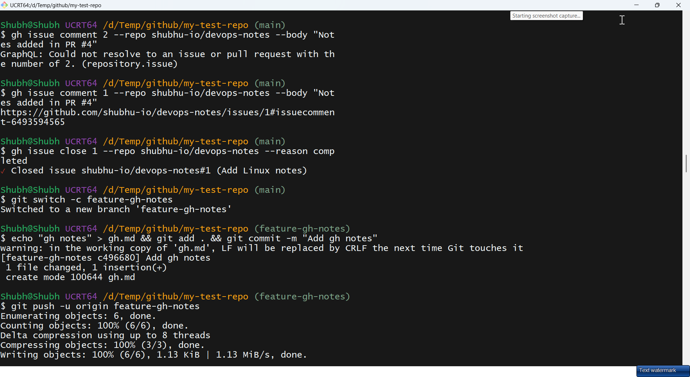

Expected output after recreating the branch from `main` (the first attempt failed with the unrelated-history error covered below):

```text
Creating pull request for feature-gh-notes into main in shubhu-io/my-test-repo
✓ Created pull request shubhu-io/my-test-repo#1
✓ Squashed and merged pull request shubhu-io/my-test-repo#1
✓ Deleted branch feature-gh-notes and switched to branch main
# (the newly created repo has no required checks, so `gh pr checks 1` prints "no checks")
```

If `gh pr create` says "No commits between main and feature-gh-notes" or the compare page shows no common ancestor, the branch was created from the wrong folder. Recreate it from `main` (this deletes only the throwaway branch):

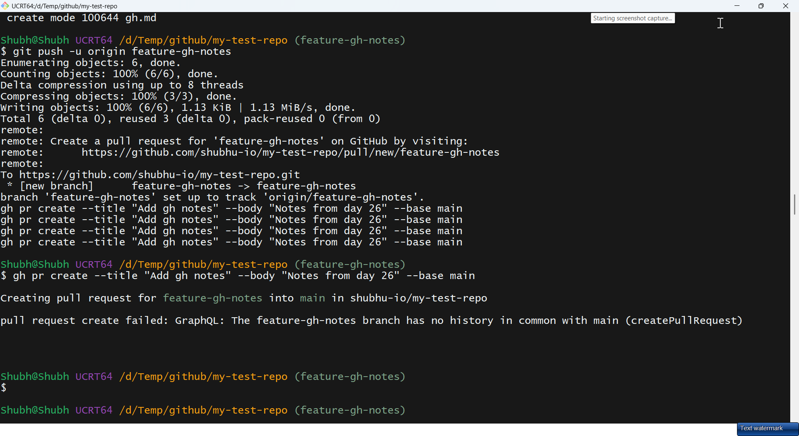

```bash
# from the folder containing the clone; if missing: gh repo clone shubhu-io/my-test-repo && cd my-test-repo
git fetch origin
git switch main && git pull
git branch -D feature-gh-notes 2>/dev/null || true
git push origin --delete feature-gh-notes 2>/dev/null || true
git switch -c feature-gh-notes
echo "gh notes" > gh.md
git add gh.md && git commit -m "Add gh notes"
git push -u origin feature-gh-notes
gh pr create --title "Add gh notes" --body "Notes from day 26" --base main
```

Answers:

- `gh pr merge` methods: `--merge` (3-way merge commit, preserves all commits), `--squash` (one commit on base, tidy `main`), `--rebase` (replay commits linearly). Add `--delete-branch` to clean up, `--admin` to bypass protection (needs rights — avoid in normal flow).
- Reviewing someone else's PR entirely in terminal:

```bash
gh pr list --repo owner/repo
gh pr view 42 --repo owner/repo
gh pr diff 42 --repo owner/repo
gh pr checkout 42 --repo owner/repo   # test locally
gh pr review 42 --approve --body "LGTM"
gh pr review 42 --request-changes --body "Fix the typo on line 10"
gh pr review 42 --comment --body "Nit: rename var"
```

| Merge flag | `main` gets |
|------------|-------------|
| `--merge` | Merge commit + all branch commits |
| `--squash` | Single commit |
| `--rebase` | Replayed commits, no merge commit |

### Task 5: GitHub Actions & Workflows (Preview)

Use a public repo that actually runs Actions — `devops-notes` has no workflows:

```bash
REPO=cli/cli
gh run list --repo "$REPO" --limit 5

# grab the newest run id instead of hard-coding one
RUN_ID=$(gh run list --repo "$REPO" --limit 1 --json databaseId -q '.[0].databaseId')
gh run view "$RUN_ID" --repo "$REPO"
gh run view "$RUN_ID" --repo "$REPO" --log-failed   # pick a failed run to see logs
gh run watch "$RUN_ID" --repo "$REPO"               # stream live

gh workflow list --repo "$REPO" --limit 5
gh workflow view "Unit and Integration Tests" --repo "$REPO"
gh workflow view "Unit and Integration Tests" --yaml --repo "$REPO"
# writes require permission on the repo; keep as a preview
gh workflow run "deploy.yml" --repo owner/repo --ref main
gh workflow enable "Unit and Integration Tests" --repo owner/repo
gh workflow disable "Unit and Integration Tests" --repo owner/repo
```

Expected output (this machine):

```text
Workflow Runs
  [ok] Dependabot PR Triage Scheduler [40851807220]
  [ok] Dependabot PR Triage Scheduler [40848779805]
  [ok] Triage Scheduled Tasks [40848464278]

Unit and Integration Tests	active	25016
Lint	active	925645
Code Scanning	active	1208059
# (run ids and timings change; copy a fresh id from `gh run list`)
```

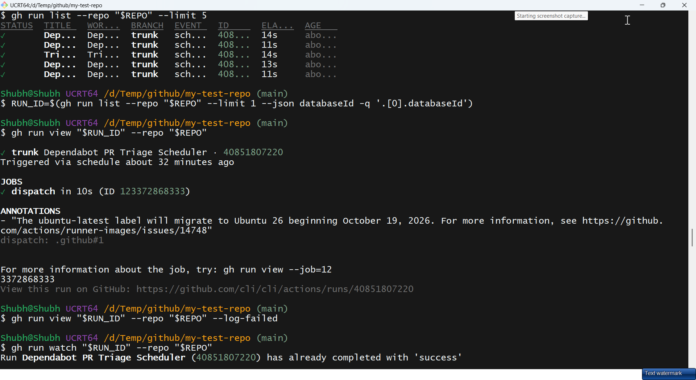
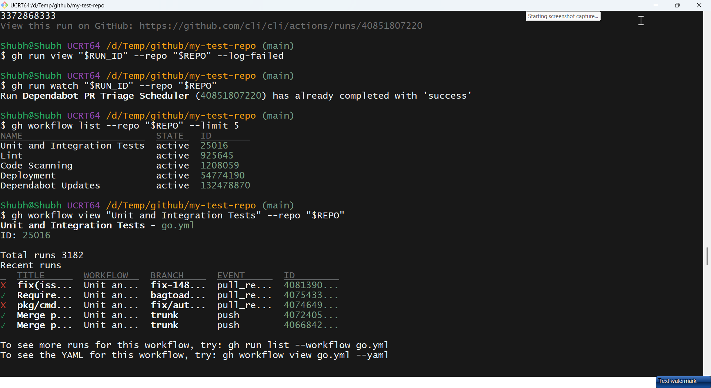
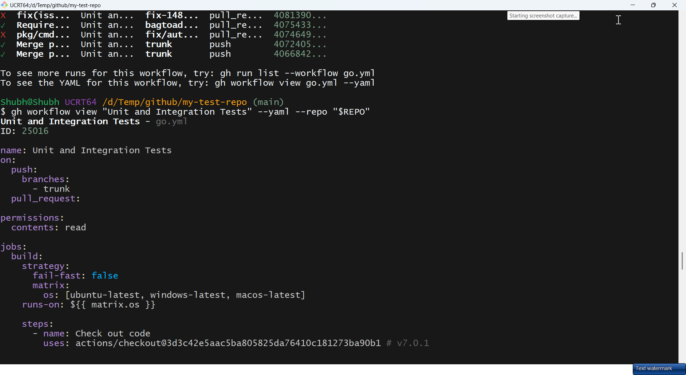

Answer — CI/CD uses:

- Gate deploys on tests: `gh run view $RUN_ID --exit-status` returns non-zero while tests fail — release scripts abort instead of shipping red builds.
- Debug without browser: `gh run watch` streams logs in the terminal where the engineer already works.
- ChatOps/releases: `gh workflow run "deploy.yml" --ref v1.2.0` triggers a dispatch from a release script; `enable/disable` toggles pipelines per environment.

### Task 6: Useful `gh` Tricks

```bash
REPO=shubhu-io/devops-notes
gh api user                                                # raw API call (whoami)
gh api user --jq '.login'                                  # shubhu-io
gh api "repos/$REPO" --jq '.default_branch'                # main
gh api "repos/$REPO/issues" --paginate -q '.[].title'      # paginate long lists
gh gist create notes.md --public --desc "Day 26 notes"
gh gist list --limit 5
gh release create v1.0.0 --repo "$REPO" --title "v1.0.0" --notes "First release"
gh release list --repo "$REPO" --limit 5
gh release view v1.0.0 --repo "$REPO"
gh alias set prc 'pr create --fill'                        # custom shortcut
gh alias list
gh search repos "topic:devops language:python" --limit 5
gh search repos "org:kubernetes stars:>1000" --limit 5
gh browse "$REPO"                                          # open in browser (like --web)
```

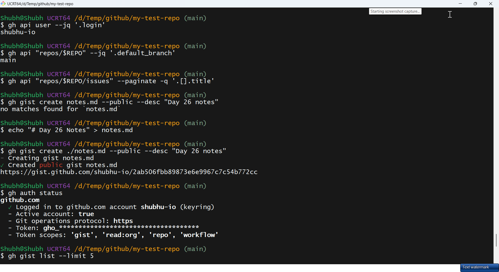
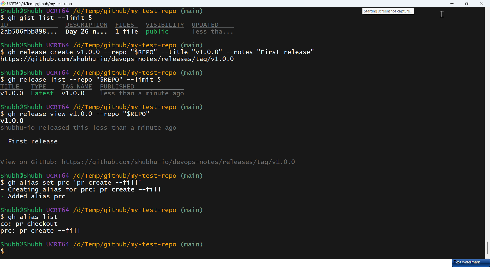

| Trick | DevOps use |
|-------|------------|
| `gh api + --jq` | Any REST endpoint becomes a script (releases, issues, checks) |
| `gh gist` | Share snippets/logs privately with teammates |
| `gh release` | Cut releases from CI after tags pass tests |
| `gh alias` | Shorten long repeated invocations |
| `gh search repos` | Discover base images/actions without leaving terminal |

## Commands Used

```bash
# install (already installed here)
winget install --id GitHub.cli

# Task 1 — auth
gh --version
gh auth login
gh auth status
gh auth refresh -s repo,workflow
gh auth refresh -h github.com -s delete_repo

# Task 2 — repositories (keep my-test-repo until Task 4)
gh repo create my-test-repo --public --add-readme --description "gh CLI practice"
gh repo clone shubhu-io/my-test-repo
cd my-test-repo
gh repo view shubhu-io/my-test-repo
gh repo view --web
gh repo list shubhu-io --limit 20
gh repo list shubhu-io --limit 20 --json name,visibility,updatedAt -q '.[].name'
cd ..

# Task 3 — issues in devops-notes
gh label list --repo shubhu-io/devops-notes
gh issue create --repo shubhu-io/devops-notes \
  --title "Add Linux notes" \
  --body "Cover processes, signals, and systemd units" \
  --label "documentation"
gh issue list --repo shubhu-io/devops-notes
gh issue list --repo shubhu-io/devops-notes --state all --limit 20
gh issue list --repo shubhu-io/devops-notes --label documentation --assignee "@me"
gh issue view 1 --repo shubhu-io/devops-notes --comments
gh issue comment 1 --repo shubhu-io/devops-notes --body "Notes added; closing after review."
gh issue close 1 --repo shubhu-io/devops-notes --reason completed
gh issue reopen 1 --repo shubhu-io/devops-notes
gh issue close 1 --repo shubhu-io/devops-notes --reason completed

# Task 4 — PR in my-test-repo, then delete the test repo
cd my-test-repo
git switch main && git pull
git switch -c feature-gh-notes
echo "gh notes" > gh.md
git add gh.md && git commit -m "Add gh notes"
git push -u origin feature-gh-notes
gh pr create --title "Add gh notes" --body "Notes from day 26" --base main
gh pr list
gh pr view 1
gh pr view 1 --web
gh pr diff 1
gh pr checks 1
gh pr merge 1 --squash --delete-branch
git switch main && git pull
git log --oneline origin/main -2
cd ..
gh repo delete shubhu-io/my-test-repo --yes

# Task 5 — Actions preview on a public repo
gh run list --repo cli/cli --limit 5
RUN_ID=$(gh run list --repo cli/cli --limit 1 --json databaseId -q '.[0].databaseId')
gh run view "$RUN_ID" --repo cli/cli
gh run watch "$RUN_ID" --repo cli/cli
gh workflow list --repo cli/cli --limit 5

# Task 6 — tricks
REPO=shubhu-io/devops-notes
gh api user --jq '.login'
gh api "repos/$REPO" --jq '.default_branch'
gh gist create notes.md --public --desc "Day 26 notes"
gh release create v1.0.0 --repo "$REPO" --title "v1.0.0" --notes "First release"
gh release list --repo "$REPO" --limit 5
gh alias set prc 'pr create --fill'
gh alias list
gh search repos "topic:devops language:python" --limit 5
gh browse "$REPO"
```

## Verification

- `gh --version` shows `2.103.3`; `gh auth status` shows `shubhu-io` with `repo`/`workflow` (and `delete_repo` after the refresh)
- `gh repo list shubhu-io` prints repos (API auth proven); `my-test-repo` is created, used for the PR, then deleted
- `gh issue list` / `gh pr list` return tables (number, title, state)
- Issue lifecycle done in `devops-notes`: `documentation` label confirmed → issue #1 created (title/body/label) → list (open/all/filtered) → view by number → comment/edit → close with reason → reopen
- PR flow in `my-test-repo`: branch from `main` → push → `gh pr create`; the first attempt hit the unrelated-history error, and the branch-recreate fix is documented above
- After the fix, `gh pr checks 1` → `gh pr merge 1 --squash --delete-branch`; `git log origin/main` shows the squashed commit and the remote branch is deleted
- `gh run list --repo cli/cli` prints run statuses; one `gh run view` inspected
- Each Task 6 trick tried once; useful ones appended to `git-commands.md`

## Key Learnings

- `gh` keeps PR/issue/release/workflows in the terminal where automation lives.
- `--repo owner/repo` targets any repo without `cd`-ing into it.
- PAT via `GH_TOKEN` is the unattended standard; browser flow is the interactive default.
- `--json` + `--jq` makes every `gh` command machine-readable for `jq`/scripts.
- `pr create --fill` derives title/body from commits — fast, consistent PRs.
- `merge --squash/--merge/--rebase` mirrors the web UI options exactly.
- `gh api` exposes the entire REST API; `run watch` + `workflow run` close the CI loop.
- Default labels (`documentation`, `bug`, ...) already exist on new repos — check `gh label list` before `gh label create`.
- `--repo` only redirects API calls; `git switch`/`git push` still use the folder you are in, so `cd` into the clone first.
- Issue/PR numbers are per repo: issue #1 in `devops-notes` does not make the first PR in `my-test-repo` #2.
- `delete_repo` is a separate scope from `repo`; refresh it before deleting a repo.
- Issue create/list/view/comment/close are plain commands — the whole lifecycle fits in cron or CI.

## Troubleshooting / Gotchas

- `gh: command not found` after install — cause: PATH not refreshed; fix: restart terminal (Windows) or `hash -r` / new shell (Linux).
- `401 Unauthorized` / `403` on create/push — cause: token lacks scope; fix: `gh auth refresh -s repo,workflow` then retry; check `gh auth status`.
- `gh repo delete` fails with "missing delete_repo scope" — cause: `repo` does not include deletion; fix: `gh auth refresh -h github.com -s delete_repo`, then rerun with `--yes`.
- `gh repo delete` fails because the command still says `yourname/my-test-repo` — cause: placeholder copied literally; fix: `gh api user --jq '.login'` and use `shubhu-io`.
- `gh label create documentation` fails with "already exists" — cause: every new repo ships default labels; fix: skip creation or use `gh label list` first.
- `gh pr create` says "No commits between main and feature-gh-notes" / compare shows no common ancestor — cause: branch was created in the wrong folder (for example `90Days-Of-DevOps` instead of `my-test-repo`); fix: `cd my-test-repo`, recreate the branch from `main` (see Task 4), then push.
- `gh pr checks 1` prints "no checks" — cause: the fresh test repo has no CI workflows; not an error, continue to merge.
- `gh pr merge` blocked by "protected branch" — cause: required reviews/checks unmet; fix: get approvals + green CI; `--admin` only with admin rights (don't bypass casually).
- `gh run view` says run not found — cause: passed workflow NAME not numeric run ID; fix: copy ID from `gh run list` first.
- `gh gist create` shared secrets publicly — cause: forgot default is secret vs `--public` choice; fix: keep sensitive gists secret; rotate anything leaked.
- `GH_TOKEN` ignored — cause: wrong var name or expired token; fix: `echo ${#GH_TOKEN}` non-zero, re-export, `gh auth status` to confirm.
- `gh issue create --label` fails with "label not found" — cause: the repo has no such label; fix: create it once with `gh label create <name>`, then attach.
- `gh issue close 1` on an already closed issue — cause: the lifecycle was run before; fix: `gh issue reopen 1` first, then close again.
- `gh issue close` on a number from another repo — cause: `--repo` omitted, so `gh` used the current directory's repo; fix: always pass `--repo owner/repo` in scripts.
- `gh repo delete` wrong target — cause: typo in `owner/name`; fix: no undo — triple-check name, prefer archive for anything non-trivial.

## Screenshots

All screenshots are from the real `shubhu-io` session and are embedded in the task sections above. Files live in `screenshots/`:

| File | Captured step |
|------|---------------|
| `01-gh-version-auth-status.png` | `gh --version` → `gh auth login` → `gh auth status` |
| `02-gh-repo-create.png` | `gh repo create my-test-repo` |
| `03-gh-repo-view-list.png` | `gh repo view --web` + `gh repo list` |
| `13-github-repo-page.png` | `my-test-repo` page in the browser |
| `04-gh-issue-create-list.png` | `gh issue create` + `gh issue list` in `devops-notes` |
| `14-github-issue-page.png` | Issue #1 in the browser |
| `05-gh-issue-view-comments.png` | `gh issue view --comments` / `--web` |
| `06-gh-issue-close-branch-push.png` | `gh issue close` → branch → commit → push |
| `07-gh-pr-create-error.png` | Real first attempt: PR create failed with unrelated histories |
| `08-gh-run-list-view.png` | `gh run list` + `gh run view` on `cli/cli` |
| `09-gh-workflow-list-view.png` | `gh workflow list` + `gh workflow view` |
| `10-gh-workflow-yaml.png` | `gh workflow view --yaml` |
| `11-gh-api-gist.png` | `gh api` + `gh gist create` |
| `12-gh-release-alias.png` | `gh release` + `gh alias` |

The PR capture records the unrelated-history error from the first attempt; Task 4 shows the branch-recreate fix and the expected successful output.
