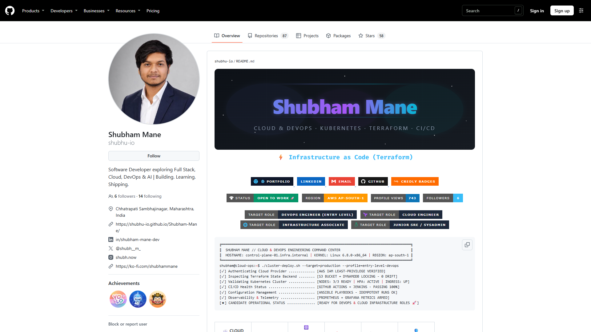
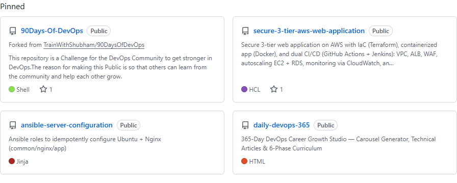
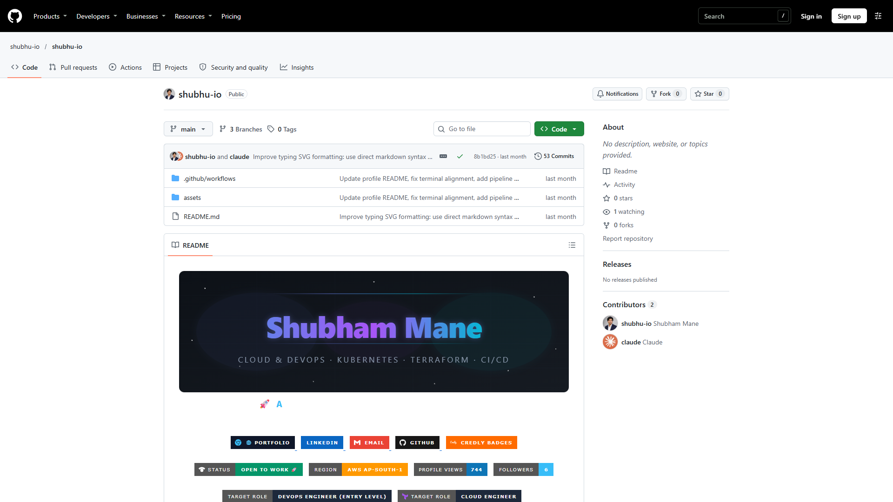
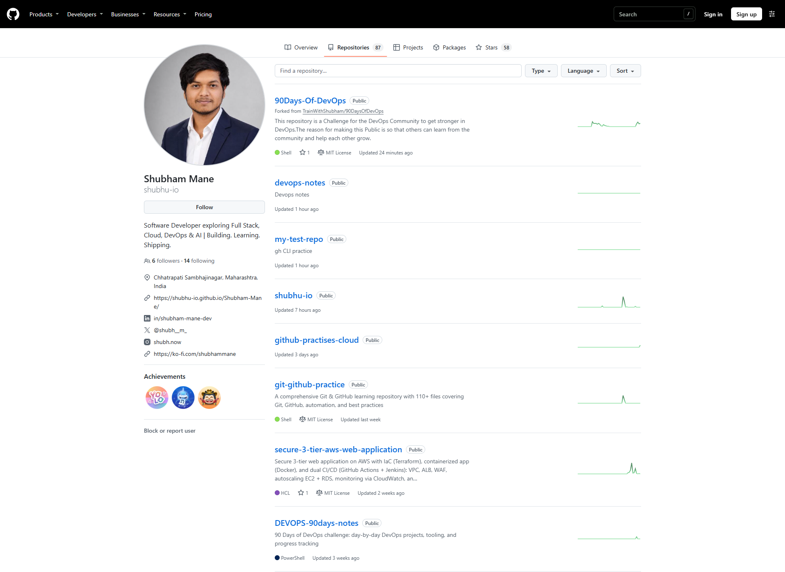

# Day 27 - GitHub Profile Makeover: Build Your Developer Identity

## Task

- Task 1 — Audit Your Current GitHub Profile: view as a stranger; check photo, bio, pins, descriptions, recruiter clarity
- Task 2 — Create Your Profile README: special repo named exactly `username/username` with intro, current work, skills, key repos, contact; keep it clean (15–20 lines)
- Task 3 — Organize Your Repositories: `90-days-of-devops`, `shell-scripts`, `python-scripts`, `devops-notes` — each with a hyphenated name, one-line description, README, `.gitignore`
- Task 4 — Pin Your Best Repos: choose 6 representative pins, each with a description + README
- Task 5 — Clean Up: delete/archive dead repos, rename unclear names, scan for leaked secrets (`.env`, keys, passwords) including history
- Task 6 — Before & After: `before` + `after` screenshots in notes + 3 improvements with why

This write-up audits the live `shubhu-io` profile on **2026-10-29** and records the current state. No public profile or repository changes were made while improving this document.

## Environment

| Component | Actual value / notes |
|-----------|----------------------|
| GitHub account | `shubhu-io` — <https://github.com/shubhu-io> |
| Audit date | 2026-10-29 |
| Public profile stats | Profile counter: 87 public repos, 6 followers, 14 following, 1 public gist. Repo API: 92 total (88 public + 4 private) |
| Local repo | `D:\daily dev\trainwithshubham\90\90Days-Of-DevOps` |
| Shell / CLI | Git Bash + PowerShell 5.1; `gh` 2.103.3; git 2.56.0 |
| Browser capture | Microsoft Edge headless via Playwright; signed-out “stranger view” |
| Profile README repo | `shubhu-io/shubhu-io` — public, default branch `main` |
| Screenshot folder | `2026/day-27/screenshots/` |
| Auth check | `gh auth status` |

## Solution

### Task 1: Audit Your Current GitHub Profile

Hiring managers and OSS maintainers triage a GitHub profile in about 30 seconds. The audit below uses the signed-out view, so it shows what a stranger sees rather than the personalised owner view.

| Check | Actual finding | Verdict |
|-------|----------------|---------|
| Profile picture | Professional headshot is present | Pass |
| Bio | “Software Developer exploring Full Stack, Cloud, DevOps & AI \| Building. Learning. Shipping.” | Pass |
| Pinned repos | 4 pins, not 6; one pin is a fork (`90Days-Of-DevOps`) | Needs work |
| Descriptions | 30 of 92 repos have no description; 28 of those are originals | Needs work |
| Topics | 90 of 92 repos have no topics | Needs work |
| Profile README | Exists, but is 904 lines / 41,695 characters / 73 shields / 1,202 HTML tags | Too long |
| Recruiter clarity | Strong hero, role targets, contact links; weakened by a 9,064 px README and a pinned fork | Mixed |





Audit commands:

```bash
gh auth status
gh api user --jq '{login, name, bio, blog, location, public_repos, public_gists, followers, following}'

gh api "user/repos?per_page=100" --jq '
  {
    total: length,
    public: ([.[] | select(.private == false)] | length),
    private: ([.[] | select(.private == true)] | length),
    originals: ([.[] | select(.fork == false)] | length),
    forks: ([.[] | select(.fork == true)] | length),
    archived: ([.[] | select(.archived == true)] | length),
    no_description: ([.[] | select(.description == null)] | length),
    no_topics: ([.[] | select((.topics | length) == 0)] | length)
  }'
```

Observed totals:

```text
total=92  public=88  private=4  originals=73  forks=19
archived=2  no_description=30  no_topics=90
default branches: main=77, master=14, flow=1
```

`gh api user` reports 87 public repos while `user/repos` returns 88 public entries. The one-repo difference is not material to the audit; use the repo-level list for cleanup counts because it includes the per-repo metadata.

Among the 28 original repos without a description are all 18 `devops-*` repos, `python_projects_300`, `MERN-stack-project`, `Store-Rating-App`, `microservices-kubernetes-project`, `Shubham-Mane`, `shubhu-io`, `To-do-app-`, `Leetcode`, and `github-practises-cloud` — plus one private repo whose name is omitted from this public write-up.

### Task 2: Profile README — Already Exists, Needs Trimming

The special profile repo already exists, so **do not run `gh repo create` again**.

Actual state of `shubhu-io/shubhu-io`:

| Field | Value |
|-------|-------|
| Visibility | Public |
| Default branch | `main` |
| Files | `.github/workflows`, `assets`, `README.md` |
| Description | Empty |
| Topics | None |
| README size | 904 lines, 41,695 characters |
| Visual weight | 73 shields, 1,202 HTML tags |
| Rendered height | About 9,064 px at 1920 px wide |

The README has a strong visual identity: header SVG, typing SVG, portfolio/LinkedIn/email/GitHub/Credly badges, a terminal mock, target-role chips, and skill sections. The problem is length. It violates the task’s 15–20 line guidance and the 4-badge guideline used in this write-up, and a recruiter will not scroll through nine thousand pixels of content.



A trimmed version that keeps the identity but fits the 30-second scan:

```markdown
## Hi, I'm Shubham Mane

Cloud & DevOps engineer in progress — building in public through **90 Days of DevOps**.

**Current focus:** Linux, Git/GitHub, shell scripting, Docker, Kubernetes, AWS, Terraform, CI/CD.

**Pinned work:**
- [secure-3-tier-aws-web-application](https://github.com/shubhu-io/secure-3-tier-aws-web-application) — AWS 3-tier app with Terraform + CI/CD
- [ansible-server-configuration](https://github.com/shubhu-io/ansible-server-configuration) — idempotent Ubuntu/Nginx with Ansible
- [daily-devops-365](https://github.com/shubhu-io/daily-devops-365) — daily DevOps practice
- [devops-notes](https://github.com/shubhu-io/devops-notes) — cheat sheets and references

**Connect:** [Portfolio](https://shubhu-io.github.io/Shubham-Mane/) · [LinkedIn](https://www.linkedin.com/in/shubham-mane-dev) · [Email](mailto:shubhamane10@gmail.com)
```

| Do | Don't |
|----|-------|
| 15–20 lines, what you are doing now | Life-story paragraphs |
| 3–6 skill keywords tied to repos | 73-badge “Christmas tree” |
| Links to 3–4 pinned projects | Dead links to empty repos |
| One contact row | Personal phone/address |

If the short version is approved, edit it with:

```bash
gh repo clone shubhu-io/shubhu-io
cd shubhu-io
# replace README.md with the short version above
git add README.md
git commit -m "docs(profile): shorten profile README"
git push
```

Also fill the empty repo metadata:

```bash
gh repo edit shubhu-io/shubhu-io \
  --description "Profile README — cloud & DevOps portfolio" \
  --add-topic profile-readme \
  --add-topic devops
```

These commands are documented for the cleanup pass; they were not executed while improving the notes.

### Task 3: Organize Your Repositories

The course template lists four repos, but the real account does not match it exactly:

| Intended repo | Actual state | Gap / next action |
|---------------|--------------|-------------------|
| `90-days-of-devops` | `90Days-Of-DevOps` — fork, `master`, has a description | Name is camelCase; it is a fork, so pinning it shows “forked from” |
| `shell-scripts` | Does not exist | 29 `.sh` files are ready in days 7–21 (27 of them in days 16–21) |
| `python-scripts` | Does not exist | Days 7–15 contain **zero** `.py` files; Python work lives in `devops-python`, `python_projects_300`, `To-do-app-`, and later days |
| `devops-notes` | `shubhu-io/devops-notes` — public, `main`, description “Devops notes” | Add topics and polish the README |



The important correction: **do not create an empty `python-scripts` repo from days 7–15**. Those days are Linux/Git/shell work in this repository. Python submissions start later (days 31–48 and 87–88), and separate Python repos already exist.

Create the repo that has real material:

```bash
gh repo create shell-scripts \
  --public \
  --description "Bash automation from 90 Days of DevOps (days 10-21)" \
  --add-readme
```

Populate it while preserving the day folders (the duplicate `greet.sh` names are why a flat copy is a bad idea):

```bash
mkdir -p /tmp/shell-scripts
for d in 10 15 16 17 18 19 20 21; do
  mkdir -p "/tmp/shell-scripts/day-$d"
  cp "2026/day-$d"/*.sh "/tmp/shell-scripts/day-$d/" 2>/dev/null || true
done
cp -r 2026/day-20/scripts /tmp/shell-scripts/day-20/
```

The 29 scripts include `day-10/script.sh`, `day-15/net-check.sh`, `day-16/hello.sh`, `day-17/for_loop.sh`, `day-18/disk_check.sh`, `day-19/backup.sh`, `day-19/log_rotate.sh`, and `day-20/scripts/log_analyzer_report.sh`.

README skeleton:

```markdown
# shell-scripts

Bash automation from 90 Days of DevOps (days 10-21).

## Scripts

| Script | What it does |
|--------|--------------|
| day-16/hello.sh | First script and variables |
| day-17/for_loop.sh | Loop demo |
| day-18/disk_check.sh | Disk usage check |
| day-19/backup.sh | Backup with rotation |
| day-19/log_rotate.sh | Log rotation |
| day-20/scripts/log_analyzer_report.sh | Log analysis report |

## Requirements

Bash 5.x; cron for scheduled jobs.
```

GitHub does not provide a `Shell` gitignore template, so `--gitignore Shell` fails. Create a small `.gitignore` suited to scripts instead:

```gitignore
*.log
*.tmp
.env
```

If a Python repo is created later, use the real source and the Python template:

```bash
gh repo create python-scripts \
  --public \
  --description "Python automation and practice projects" \
  --add-readme \
  --gitignore Python
```

Rename the challenge fork only if the URL change is acceptable:

```bash
gh repo rename -R shubhu-io/90Days-Of-DevOps 90-days-of-devops
git remote set-url origin https://github.com/shubhu-io/90-days-of-devops.git
```

Add topics to the existing notes repo:

```bash
gh repo edit shubhu-io/devops-notes \
  --description "DevOps cheat sheets and references" \
  --add-topic devops \
  --add-topic notes \
  --add-topic linux
```

### Task 4: Pin Your Best Repos

Current pins (4 of 6):

| Pin | Type | Why it is there | Issue |
|-----|------|-----------------|-------|
| `90Days-Of-DevOps` | Fork | Shows challenge consistency | “Forked from TrainWithShubham/90DaysOfDevOps”; not your original |
| `secure-3-tier-aws-web-application` | Original | Strongest AWS/Terraform/CI-CD project | None |
| `ansible-server-configuration` | Original | Configuration management with Ansible | None |
| `daily-devops-365` | Original | Daily practice and curriculum | None |

A stronger six-pin set, all originals:

1. `secure-3-tier-aws-web-application` — AWS, Terraform, Docker, CI/CD
2. `ansible-server-configuration` — Ansible, idempotent server config
3. `daily-devops-365` — consistency and long-running practice
4. `devops-notes` — documentation and reference discipline
5. `microservices-kubernetes-project` — Node.js microservices on Docker/Kubernetes
6. `python_projects_300` — Python breadth and project volume

`90Days-Of-DevOps` can stay pinned if the challenge itself is the strongest signal, but then drop `python_projects_300` and accept that one pin displays as a fork. Prefer six originals when the goal is to show ownership.

Pinning is a web-UI operation: profile → **Customize your pins** → select six → **Save pins**. GitHub’s GraphQL API exposes `pinEnvironment`, `pinIssue`, and `pinIssueComment`, but not a profile-pin mutation.

Verify the current pins:

```bash
gh api graphql -f query='
{
  user(login: "shubhu-io") {
    pinnedItems(first: 6, types: REPOSITORY) {
      nodes {
        ... on Repository {
          nameWithOwner
          isFork
          description
        }
      }
    }
  }
}'
```

### Task 5: Clean Up

Audit findings:

| Finding | Count / examples | Recommended action |
|---------|------------------|--------------------|
| Forks | 19 | Archive or delete unused forks; never pin them |
| Archived | 2 archived repos; one public example is `Countries` (the other is private and not named here) | Review; keep only if links matter |
| No description | 30 repos; 28 originals | Add one-line descriptions |
| No topics | 90 repos | Add 2–3 relevant topics per repo |
| Naming | `To-do-app-`, `github-practises-cloud`, `90Days-Of-DevOps` | Rename to lowercase-hyphen names |
| Test repo | `my-test-repo` from Day 26 | Delete, or keep private |
| Duplicate forks | `90-Days-Of-DevOps` and `90Days-Of-DevOps` | Archive one |
| Private repos | 4 | Names intentionally omitted from this public file |

Suggested descriptions for the highest-value repos:

| Repo | Suggested description | Suggested topics |
|------|-----------------------|------------------|
| `devops-ansible` | Ansible automation labs from 90 Days of DevOps | `ansible`, `devops`, `automation` |
| `devops-docker` | Docker labs and container practice | `docker`, `containers`, `devops` |
| `devops-kubernetes` | Kubernetes manifests and cluster labs | `kubernetes`, `k8s`, `devops` |
| `devops-terraform` | Terraform infrastructure-as-code labs | `terraform`, `iac`, `aws` |
| `devops-jenkins` | Jenkins CI/CD pipeline labs | `jenkins`, `cicd`, `devops` |
| `devops-python` | Python automation for DevOps tasks | `python`, `devops`, `automation` |
| `python_projects_300` | 300 self-contained Python projects from beginner to advanced | `python`, `learning`, `projects` |
| `microservices-kubernetes-project` | Node.js microservices deployed with Docker and Kubernetes | `microservices`, `kubernetes`, `docker` |
| `Store-Rating-App` | Full-stack store rating platform with React, NestJS, MySQL, TypeORM | `react`, `nestjs`, `mysql` |
| `Shubham-Mane` | Personal portfolio built with React, TypeScript, Vite, Tailwind | `portfolio`, `react`, `typescript` |
| `shubhu-io` | Profile README — cloud & DevOps portfolio | `profile-readme`, `devops` |

Bulk-edit example:

```bash
gh repo edit shubhu-io/devops-ansible \
  --description "Ansible automation labs from 90 Days of DevOps" \
  --add-topic ansible \
  --add-topic devops \
  --add-topic automation
```

Rename examples:

```bash
gh repo rename -R shubhu-io/To-do-app- to-do-app
gh repo rename -R shubhu-io/github-practises-cloud github-practices-cloud
```

Archive/delete are destructive and were **not** run. `gh repo delete` also needs the `delete_repo` scope:

```bash
gh auth refresh -s delete_repo
gh repo archive shubhu-io/<repo> --yes
gh repo delete shubhu-io/<repo> --yes
```

Secret scan (run per cloned repo, not only this one):

```bash
grep -rniE "AKIA[0-9A-Z]{16}|BEGIN .* PRIVATE KEY|password[[:space:]]*=|api[_-]?key[[:space:]]*=" . \
  --exclude-dir=.git --exclude-dir=screenshots \
  || echo "no obvious secrets in worktree"

git log -p --all -S "AKIA" --oneline | head
```

If a secret is found: rotate the key first, remove it in a new commit, then scrub history with `git filter-repo` or BFG and coordinate force-pushes. Deletion alone does not revoke a leaked credential.

### Task 6: Before & After

The current state is captured as the “before” set. There is no “after” set yet because the profile changes above have not been applied.

Before screenshots:

- `screenshots/01-profile-before.png` — public profile top, signed out
- `screenshots/02-pinned-repos-before.png` — four pins, including a fork
- `screenshots/03-repositories-before.png` — repositories tab with missing descriptions
- `screenshots/04-profile-readme-repo.png` — profile README repo with empty description/topics

After screenshots to capture once the cleanup is done:

- `screenshots/05-profile-after.png` — same signed-out profile view
- `screenshots/06-pinned-repos-after.png` — six curated pins
- `screenshots/07-repositories-after.png` — descriptions/topics visible

Repeatable capture script:

```python
from playwright.sync_api import sync_playwright

with sync_playwright() as p:
    browser = p.chromium.launch(channel="msedge", headless=True)
    page = browser.new_page(viewport={"width": 1920, "height": 1080})
    page.goto("https://github.com/shubhu-io", wait_until="networkidle")
    page.screenshot(path="screenshots/05-profile-after.png")
    page.locator(".js-pinned-items-reorder-container").screenshot(
        path="screenshots/06-pinned-repos-after.png"
    )
    browser.close()
```

Three improvements to make, with why:

1. **Shorten the profile README from 904 lines / 73 badges to about 20 lines / 4 badges.** The current page is 9,064 px tall; a short README improves the 30-second recruiter scan and mobile load time while keeping the header and contact links.
2. **Replace the pinned fork and add two pins to reach six originals.** Pins are the 30-second resume; originals show ownership, while a fork card leads with “forked from”. A six-pin set covering AWS, Ansible, Kubernetes, Python, documentation, and consistency shows range.
3. **Add descriptions and topics to the 28 original repos that lack them.** Repo cards and search results currently show blank descriptions and no topics; one-line descriptions plus 2–3 topics make the profile scannable and searchable.

## Commands Used

```bash
gh auth status
gh api user --jq '{login, name, bio, blog, location, public_repos, public_gists, followers, following}'
gh api "user/repos?per_page=100" --jq '{total: length, forks: ([.[] | select(.fork)] | length), no_description: ([.[] | select(.description == null)] | length)}'
gh repo view shubhu-io/shubhu-io
gh repo view shubhu-io/90Days-Of-DevOps
gh repo view shubhu-io/devops-notes
gh api graphql -f query='{ user(login: "shubhu-io") { pinnedItems(first: 6, types: REPOSITORY) { nodes { ... on Repository { nameWithOwner isFork description } } } } }'
gh api -H "Accept: application/vnd.github.raw" repos/shubhu-io/shubhu-io/readme | wc -l
```

## Key Learnings

- Audit the live account before editing; the generic task template did not match the actual profile.
- `gh api user` plus `gh api "user/repos?per_page=100"` gives a one-shot profile/repo audit for accounts under 100 repos.
- A profile README can be polished and still be too long: 904 lines is a wall, not a 30-second summary.
- Pins are a web-UI feature; GraphQL exposes pin mutations for environments/issues/comments, not profile pins.
- One fork among four pins is a visible ownership gap, especially when the card says “forked from”.
- The days 7–15 Python assumption is wrong for this repo; copying scripts blindly would create an empty `python-scripts` repo.
- Private repo names should not be pasted into a public notes file.
- Headless Edge via Playwright produces repeatable stranger-view screenshots without exposing the logged-in session.

## Troubleshooting / Gotchas

- `gh repo list ... -q` can fail behind the RTK wrapper (`accepts at most 1 arg(s), received 2`); use `gh api ... --jq` instead.
- Piping `gh` JSON into Python on Windows can include a UTF-8 BOM; decode with `utf-8-sig`.
- Headless Edge logs renderer/sync errors but still writes the screenshot; check the output file.
- Do not screenshot the entire profile README element: it is over 9,000 px tall. Capture the profile viewport and the `.js-pinned-items-reorder-container` element separately.
- Profile pins cannot be changed through the REST or GraphQL API; use **Customize your pins** in the browser.
- `gh repo edit --add-topic` accepts repeated flags, not a comma-separated `--topics` list.
- `gh repo create --gitignore Shell` fails: GitHub’s template list has `Python` and `Node` but no `Shell`; add a custom `.gitignore` after creation.
- `gh repo delete` fails without the `delete_repo` scope; run `gh auth refresh -s delete_repo` first. Archive does not need that scope.
- Renaming a repo changes its URL; update every local remote and CI checkout URL afterward.
- `python-scripts` created from days 7–15 would be empty; define its scope from days 31+, 87–88, or the existing Python repos.

## Screenshots

| # | File | What it shows |
|---|------|---------------|
| 01 | `screenshots/01-profile-before.png` | Public profile top, signed-out stranger view |
| 02 | `screenshots/02-pinned-repos-before.png` | Four current pins, including the `90Days-Of-DevOps` fork |
| 03 | `screenshots/03-repositories-before.png` | Repositories tab with missing descriptions and `my-test-repo` |
| 04 | `screenshots/04-profile-readme-repo.png` | `shubhu-io/shubhu-io` repo with empty description/topics |

After screenshots (`05`–`07`) are still to be captured using the script in Task 6.
