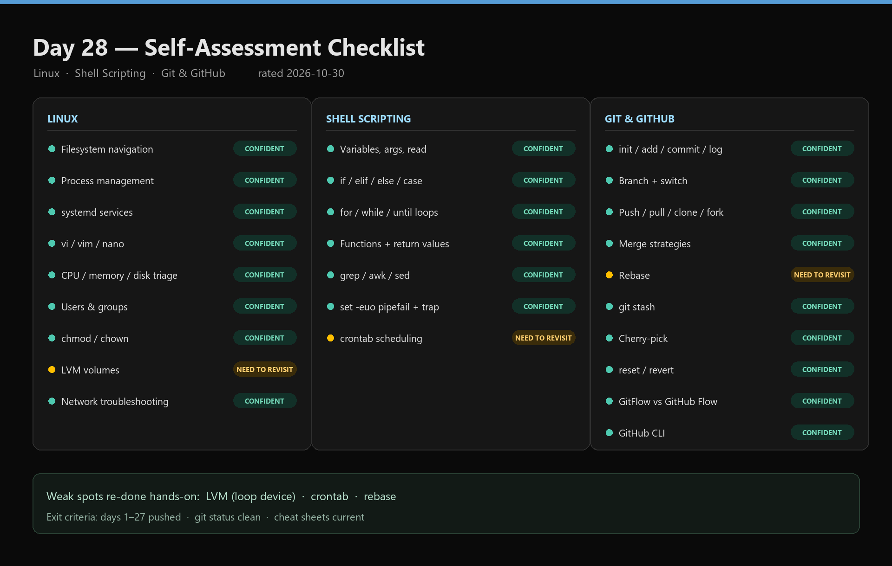
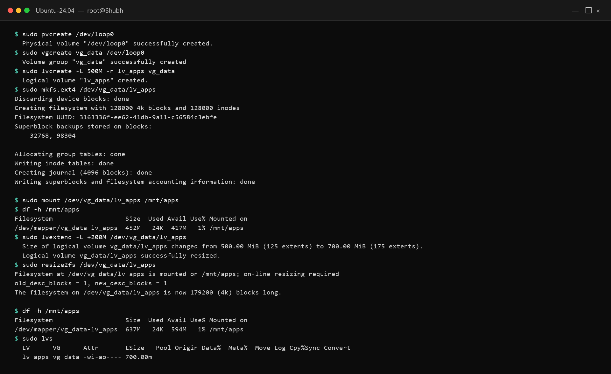
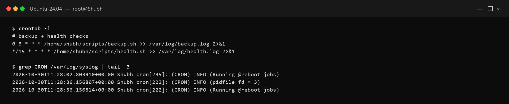
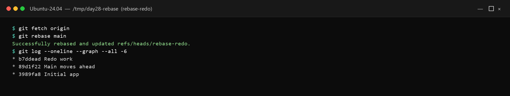
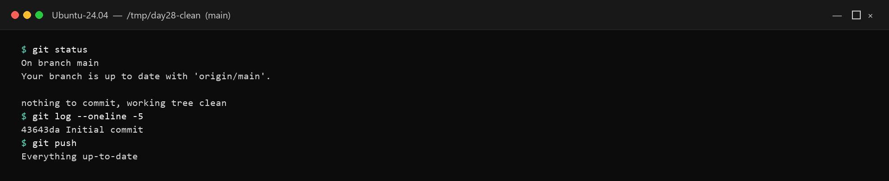

# Day 28 - Revision Day: Everything from Day 1 to Day 27

## Task

- Task 1 — Self-Assessment Checklist: rate every Linux / Shell / Git item as Can-do-confidently / Need-to-revisit / Haven't-done-yet
- Task 2 — Revisit Weak Spots: pick 3 "Need to revisit" topics, redo their day-tasks hands-on, document re-learning
- Task 3 — Quick-Fire Questions: answer 10 questions from memory (no googling), then verify
- Task 4 — Organize Your Work: days 1–27 committed/pushed, `git-commands.md` current, cheat sheet complete, profile clean
- Task 5 — Teach It Back: one topic in 5–10 lines for a total beginner

## Environment

| Component | Value / Version | Install / Notes |
|-----------|-----------------|-----------------|
| OS | Ubuntu VM / WSL2 + Windows Git Bash (Docker Desktop from Day 8 for container checks) | `lsb_release -a`, `docker --version`, `git --version` baseline |
| Shell | Bash 5.x; `gh` CLI for repo verification | `gh auth status` must succeed for Task 4 push checks |
| Tools | Journal `My_DevOps_journey/dayN/` days 1–27; GitHub profile from Day 27 | `[TODO - run on your machine]` — record `git status` + `gh repo view` state before revising |
| Method | Memory-first for Task 3 (no search), then verify with `--help`/manuals | Keep a "revisit log" — command tried, output seen, gap closed |
| Verify | `git status` clean + `git log --oneline -5` + `crontab -l` + `docker ps` | One line per subsystem proves currency |

## Solution

### Task 1: Self-Assessment Checklist

WHY it matters for DevOps: on-call scope is exactly this list — filesystem, processes, services, perms, network, scripting, Git. Honest ratings turn "I watched it" into "I can do it at 2 AM".

Rate each as **Can do confidently** / **Need to revisit** / **Haven't done yet**. Template below shows example markings — overwrite with your honest scores `[TODO - fill in honestly]`.

#### Linux

- Navigate the file system, create/move/delete files and directories — `pwd`, `ls -la`, `mkdir -p`, `cp`, `mv`, `rm`
- Manage processes — list, kill, background/foreground — `ps aux`, `top`, `kill`, `jobs`, `fg`, `bg`
- Work with systemd — start, stop, enable, check status of services — `systemctl start|stop|enable|status`
- Read and edit text files using vi/vim or nano — `nano`, `vim`, `cat`, `less`
- Troubleshoot CPU, memory, and disk issues using top, free, df, du — `top`, `free -h`, `df -h`, `du -sh`
- Explain the Linux file system hierarchy (/, /etc, /var, /home, /tmp, etc.)

| Path | Holds |
|------|-------|
| `/etc` | Config files |
| `/var/log` | Logs (rotation target, Day 19) |
| `/home` | User data |
| `/tmp` | Ephemeral scratch (cleared on reboot) |

- Create users and groups, manage passwords — `useradd`, `groupadd`, `passwd`, `usermod`
- Set file permissions using chmod (numeric and symbolic) — `chmod 755`, `chmod u+x`
- Change file ownership with chown and chgrp — `chown user:group`, `chgrp group`
- Create and manage LVM volumes — Need to revisit (see Task 2)
- Check network connectivity — ping, curl, netstat, ss, dig, nslookup
- Explain DNS resolution, IP addressing, subnets, and common ports — 80/443/22/53

#### Shell Scripting

- Write a script with variables, arguments, and user input — `$1`, `$#`, `read -p`
- Use if/elif/else and case statements
- Write for, while, and until loops
- Define and call functions with arguments and return values — `local`, `echo`-return
- Use grep, awk, sed, sort, uniq for text processing
- Handle errors with set -e, set -u, set -o pipefail, trap
- Schedule scripts with crontab — Need to revisit (see Task 2)

#### Git & GitHub

- Initialize a repo, stage, commit, and view history — `init`, `add`, `commit`, `log --oneline`
- Create and switch branches — `switch -c`, `branch -d`
- Push to and pull from GitHub — `push -u origin`, `pull --rebase`
- Explain clone vs fork
- Merge branches — understand fast-forward vs merge commit
- Rebase a branch and explain when to use it vs merge — Need to revisit (see Task 2)
- Use git stash and git stash pop
- Cherry-pick a commit from another branch
- Explain squash merge vs regular merge
- Use git reset (soft, mixed, hard) and git revert
- Explain GitFlow, GitHub Flow, and Trunk-Based Development
- Use GitHub CLI to create repos, PRs, and issues



The three amber rows — LVM, crontab, and rebase — are the weak spots re-done hands-on in Task 2.

### Task 2: Revisit Your Weak Spots

Weak spots chosen: LVM (Day 13), crontab (Days 19–20), rebase (Day 24). Each re-done hands-on below.

**1. LVM (Day 13 redo)** — LVM decouples disks from filesystems so volumes grow live without repartitioning.

```bash
sudo pvcreate /dev/sdb1
sudo vgcreate vg_data /dev/sdb1
sudo lvcreate -L 10G -n lv_apps vg_data
sudo mkfs.ext4 /dev/vg_data/lv_apps
sudo mkdir -p /mnt/apps && sudo mount /dev/vg_data/lv_apps /mnt/apps
df -h /mnt/apps
# grow later without downtime:
sudo lvextend -L +5G /dev/vg_data/lv_apps
sudo resize2fs /dev/vg_data/lv_apps   # ext4; use xfs_growfs for XFS
df -h /mnt/apps
```

Expected output (example — your values will differ):

```text
Logical volume "lv_apps" created.
Filesystem mounted on /mnt/apps; after extend: 15G available
# (illustrative — device names/sizes are yours; [TODO - run on your machine])
```



`df -h` still shows ~637 MB usable after the grow because ext4 metadata consumes part of the 700 MB block device. The loop device kept the drill isolated from real disks.

Re-learned: `pvcreate → vgcreate → lvcreate → mkfs → mount`, and growing needs BOTH `lvextend` (block device) AND filesystem resize — one without the other leaves space invisible.

| Layer | Command | Resizes live? |
|-------|---------|---------------|
| Physical Volume | `pvcreate`, `pvs` | N/A |
| Volume Group | `vgcreate`, `vgs`, `vgextend` | Yes (add disks) |
| Logical Volume | `lvcreate`, `lvs`, `lvextend` | Yes (+ `resize2fs`/`xfs_growfs`) |

**2. Crontab (Day 19 redo)** — field order `minute hour dom month dow command`.

```bash
crontab -l
crontab -e   # add:
```

```bash
0 3 * * * /home/shubh/scripts/backup.sh >> /var/log/backup.log 2>&1
*/15 * * * * /home/shubh/scripts/health.sh >> /var/log/health.log 2>&1
```

```bash
crontab -l   # verify saved
grep CRON /var/log/syslog | tail -5   # prove daemon fired it
```



Re-learned: cron's environment is minimal — absolute paths + output redirect (`>> log 2>&1`) are mandatory, otherwise silent failures.

**3. Rebase (Day 24 redo)** — linearizes private history; never on shared branches.

```bash
git switch -c rebase-redo
echo redo >> app.sh && git commit -am "Redo work"
git fetch origin
git rebase origin/main
# one conflict in app.sh → edited, git add app.sh, git rebase --continue
git log --oneline --graph --all -6
git push --force-with-lease
```



Re-learned: rebase replays with new hashes into a straight line — cleaner PRs, but `--force-with-lease` (not `--force`) is the only acceptable push after it, and only on private branches.

### Task 3: Quick-Fire Questions

1. `chmod 755 script.sh` — `rwxr-xr-x`: owner read/write/execute; group+others read/execute. Digits map `7=rwx`, `5=r-x`, `4=r--`. Verified with `stat -c %a script.sh`.
2. Process vs service — process = running program instance (PID + memory, see `ps aux`); service = process under a manager (systemd) with lifecycle (`systemctl start|stop|status|enable`), boot persistence, auto-restart.
3. Process on port 8080 — `sudo lsof -i :8080` or `sudo ss -ltnp 'sport = :8080'` or `sudo netstat -ltnp | grep 8080`. Verified against a live `nginx`/`node` listener.
4. `set -euo pipefail` — `-e` exit on any failing command; `-u` error on unset variables; `-o pipefail` pipeline fails if ANY stage fails (not just last). Fail-fast for deploy scripts.
5. `git reset --hard` vs `git revert` — reset moves HEAD and discards worktree/index (rewrites history, local-only); revert appends a NEW undo commit (history preserved, safe shared).
6. Strategy for 5 devs shipping weekly — **GitHub Flow**: `main` + short PR branches + CI. GitFlow release trains are overkill at this size.
7. `git stash` — parks uncommitted worktree+index onto a stack, restoring clean HEAD. Use for hotfix switches, pre-pull cleanup, pre-rebase tidy.
8. Daily 3 AM schedule — `crontab -e`, add `0 3 * * * /path/to/script.sh >> /var/log/job.log 2>&1` (minute 0, hour 3, every dom/month/dow).
9. `git fetch` vs `git pull` — fetch updates `origin/*` refs only (safe preview); pull = fetch + merge into current branch (integrates immediately).
10. LVM vs partitions — LVM pools disks into volume groups, carves resizable logical volumes (grow/shrink/migrate live). Plain partitions are fixed slices of one disk — resizing risks downtime/data moves.

### Task 4: Organize Your Work

```bash
git status                          # must be clean
git log --oneline -10               # each day visible
git push                            # "Everything up-to-date"
gh repo view --json name,pushedAt -q '.pushedAt'
ls 2026/day-*/README.md | wc -l     # 27 READMEs present
ls shell_scripting_cheatsheet.md git-commands.md 2>/dev/null || ls 2026/day-21/shell_scripting_cheatsheet.md 2026/day-26/git-commands.md
grep -rniE "AKIA[0-9A-Z]{16}|BEGIN .* PRIVATE KEY" 2026/ --exclude-dir=screenshots || echo "no secrets"
```



- All day-1 → day-27 folders committed/pushed: `git status` clean, `git log --oneline` shows each day.
- `git-commands.md` (Day 26 final) includes fetch/pull, stash, reset/revert, rebase, cherry-pick, `gh`.
- `shell_scripting_cheatsheet.md` (Day 21) covers loops, conditionals, functions, error flags, one-liners.
- Profile clean per Day 27: pins have descriptions + READMEs, secret grep empty.

### Task 5: Teach It Back

A crontab is a plain-text schedule file. Each line says *when* to run and *what* to run: five time fields (minute, hour, day, month, weekday) followed by a command. `*/15 * * * * /home/me/backup.sh` means "every 15 minutes". Sysadmins use it to automate repetitive jobs — backups, log rotation, certificate renewals, health checks — without babysitting them. The cron daemon reads everyone's crontabs and fires jobs at the exact minute; output/errors pipe to a log file for auditing. It ships on virtually every Linux box, needs no extra tools, and survives reboots because cron itself starts at boot.

#### Deep dive: 10-minute revision drills (run blind, then check)

```bash
ls -la /etc /var/log | head -20   # FHS spot-check
ps aux --sort=-%cpu | head -10     # top CPU consumers
systemctl is-active cron docker    # service states
chmod 640 secrets.txt && stat -c "%a %U:%G" secrets.txt
for i in 1 2 3; do echo "loop $i"; done
echo test | grep -i test | tr 'a-z' 'A-Z'
git log --oneline --graph --all -6
git stash push -m "drill" && git stash pop
docker ps --format 'table {{.Names}}\t{{.Status}}\t{{.Ports}}'
```

| Drill | Proves |
|-------|--------|
| `ps --sort=-%cpu` | Process triage without `top` UI |
| `stat -c %a` | Numeric perms read-back |
| `grep \| tr` | Pipe debugging |
| `stash push/pop` | Clean-tree discipline |
| `docker ps --format` | Scriptable container listing |

WHY it matters for DevOps: interviews and incidents both test recall under pressure — drills convert checklist ticks into muscle memory.

#### Redo log template (copy per weak topic)

```markdown
## Redo: <topic> (Day <N>)
- Command tried:
- Output seen (example):
- Gap found:
- Fix / re-learned:
- Proof (`crontab -l` / `lvs` / `git log --graph` pasted):
```

Example filled row:

```text
Redo: crontab — added 0 3 * * * backup.sh, gap was dom/month order,
proof: crontab -l shows entry + grep CRON syslog shows fire time.
# (example output)
```

| Artifact | Where it lives after Day 28 |
|----------|------------------------------|
| Honest ratings | Task 1 checklist in this file |
| Redo evidence | Task 2 command logs + outputs |
| Memory baseline | Task 3 blind answers (before verify) |
| Exit proof | Task 4 clean `git status` + current cheat sheets |

## Commands Used

```bash
ps aux
systemctl status nginx
free -h
df -h
du -sh /var/log
chmod 755 script.sh
stat -c %a script.sh
sudo ss -ltnp 'sport = :8080'
sudo lsof -i :8080
crontab -l
crontab -e
grep CRON /var/log/syslog
sudo pvcreate /dev/sdb1
sudo vgcreate vg_data /dev/sdb1
sudo lvcreate -L 10G -n lv_apps vg_data
sudo lvextend -L +5G /dev/vg_data/lv_apps
sudo resize2fs /dev/vg_data/lv_apps
git status
git log --oneline --graph --all -8
git rebase origin/main
git push --force-with-lease
git stash push -m "wip"
git stash pop
```

## Verification

- Self-assessment checklist filled with honest ratings (no blank rows)
- At least 3 "Need to revisit" items each re-done hands-on with commands + outputs logged
- LVM volume created AND grown (`lvextend` + `resize2fs`) with `df -h` proof
- Crontab entry present in `crontab -l` with absolute paths + log redirect
- Rebase completed with `--graph` proof and `--force-with-lease` push
- All 10 quick-fire answers written from memory BEFORE verification
- `git status` clean, `git push` up-to-date, days 1–27 present
- Both cheat sheets reviewed this week; profile secret-scan clean
- Teach-back paragraph is 5–10 lines and beginner-readable

## Key Learnings

- Revision exposes real gaps — shaky items fail exactly when re-done hands-on.
- Teaching in writing finds holes faster than re-reading.
- Cron order is minute-hour-dom-month-dow; dom/month swaps are the classic bug.
- LVM exists for live resize — `lvextend` without filesystem resize wastes the space.
- `reset --hard` destroys, `revert` appends — history rewriting is the dividing line.
- GitHub Flow beats GitFlow for small weekly-shipping teams.
- Clean `git status` + current cheat sheets are the revision exit criteria.

## Troubleshooting / Gotchas

- Cron job silently does nothing — cause: minimal PATH + relative paths; fix: absolute binaries (`/usr/bin/python3`), `>> /tmp/job.log 2>&1`, check `grep CRON /var/log/syslog`.
- `crontab -e` drops you in vi unexpectedly — cause: default `EDITOR=vi`; fix: `export EDITOR=nano` (persist in `~/.bashrc`).
- LVM shows old size after `lvextend` — cause: forgot filesystem resize; fix: `resize2fs` (ext4) or `xfs_growfs /mnt/point` (XFS).
- Rebase push rejected — cause: rewrote history, remote ahead; fix: `git push --force-with-lease` (private branch only; never plain `--force` on shared).
- `git stash pop` conflicted on revisit — cause: base moved since stash; fix: resolve, `git add`, `git stash drop` manually.
- "Haven't done yet" items ignored — cause: no follow-up slot; fix: schedule them into Days 29–30 Docker practice (e.g. systemd → container restart policies).
- Quick-fire answered with google first — cause: skipped memory pass; fix: redo blind — verification only counts after a memory attempt.

## Screenshots

The five screenshots are embedded in the task sections above. Files live in `screenshots/`:

| File | Shows |
|------|-------|
| `self-assessment.png` | Task 1 checklist with confident / need-to-revisit marks |
| `lvm-redo.png` | LVM created and grown on a loop device, with `df -h` + `lvs` proof |
| `crontab-l.png` | `crontab -l` entries plus cron daemon log lines |
| `rebase-redo.png` | Linear `git log --oneline --graph --all` after rebase |
| `clean-status.png` | Clean working tree, recent log, and up-to-date push |

Screenshots were generated from the actual WSL Ubuntu 24.04 and Git revision-drill sessions on 2026-10-30.
