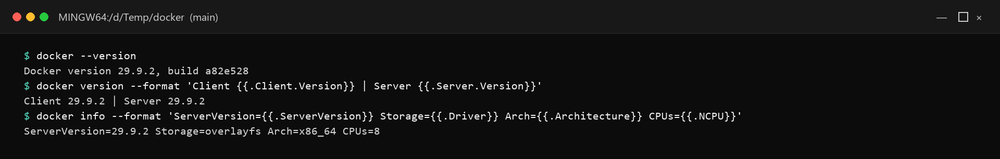
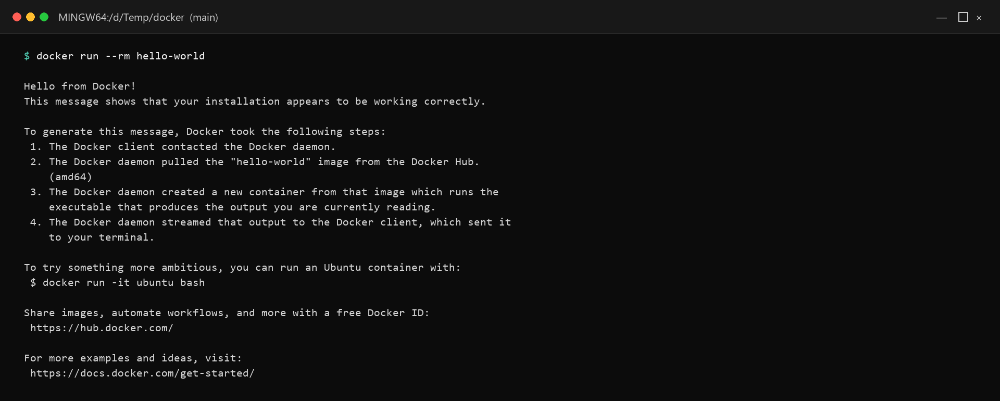
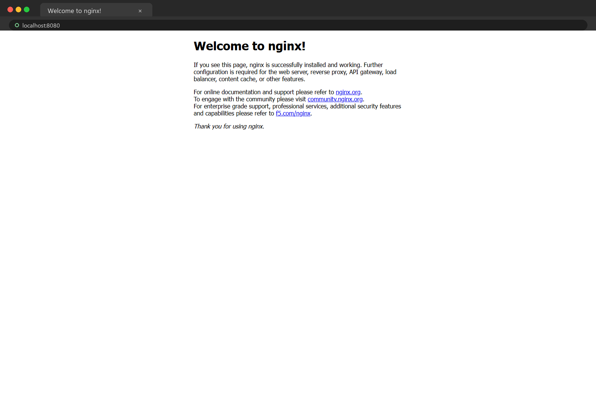
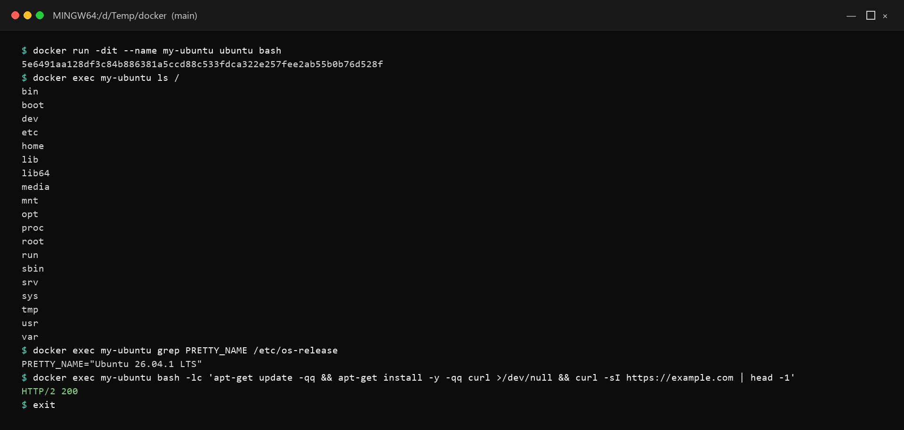
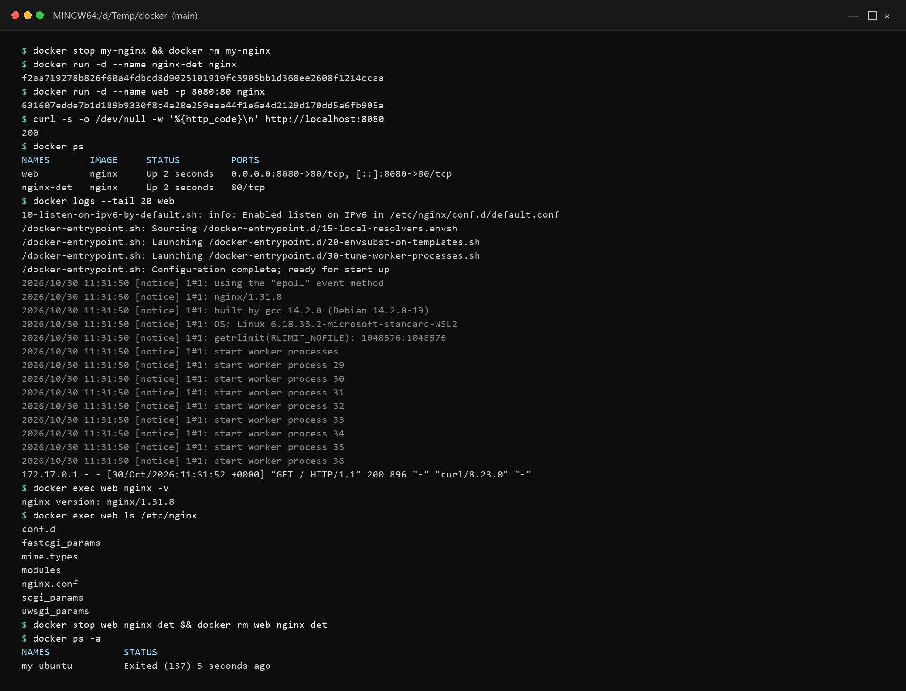

# Day 29 - Introduction to Docker

## Task

- Task 1 — What is Docker?: what is a container + why needed, containers vs VMs, Docker architecture (daemon, client, images, containers, registry); draw/describe architecture
- Task 2 — Install Docker: install, verify, run `hello-world`, read its output
- Task 3 — Run Real Containers: Nginx (browser access), Ubuntu interactive, `docker ps` vs `docker ps -a`, stop + remove
- Task 4 — Explore: detached mode, custom `--name`, `-p` port map, `docker logs`, `docker exec` inside running container

## Environment

| Component | Value / Version | Install / Notes |
|-----------|-----------------|-----------------|
| OS | Windows 10/11 + Docker Desktop, macOS + Docker Desktop, or Ubuntu 22.04 + Docker Engine | WSL2 backend required on Windows (`wsl --install`) |
| Shell | PowerShell / WSL bash / Ubuntu terminal | `docker` must be on PATH in the shell you screenshot |
| Tools | Docker Desktop (`docker --version` → `29.9.2` on this machine); browser for Nginx check; Docker Hub access (no login needed for pulls) | `docker --version` + `docker info --format '{{.ServerVersion}} {{.Driver}}'` recorded below |
| Install (Ubuntu) | Official Docker repo (see Task 2) + `sudo usermod -aG docker $USER` then re-login | Verify with `docker run hello-world` without `sudo` |
| Verify | `docker --version && docker info && docker run hello-world` | All three succeed before Task 3 |

## Solution

### Task 1: What is Docker?

WHY it matters for DevOps: Docker is the unit pipelines ship — build once, run on laptop/CI/prod identically. Every Kubernetes pod, GitHub Action runner, and microservice deploy starts here.

**What is a container and why do we need them?**
A container is a lightweight, isolated process that packages an app with exactly its dependencies (code, runtime, libraries, config) while sharing the host kernel. We need them because "works on my machine" kills releases — containers guarantee identical runtime from laptop to CI to production, start in seconds, and pack densely on one host.

**Containers vs Virtual Machines**

| Aspect | Container | Virtual Machine |
|--------|-----------|-----------------|
| What runs | App + userspace libs on shared host kernel | Full guest OS kernel per VM on a hypervisor |
| Size | MBs (layers shared) | GBs (whole OS disk per VM) |
| Boot | Seconds (process start) | Minutes (OS boot) |
| Isolation | Process/cgroup/namespace (weaker, shared kernel) | Hardware-virtualized (stronger) |
| Density | Dozens–hundreds per host | Single digits per host |
| Use | Microservices, CI jobs, portable deploys | Full-OS isolation, Windows-on-Linux, untrusted tenants |

**Docker architecture**

- **Client** (`docker` CLI): parses your command, talks REST to the daemon.
- **Daemon** (`dockerd`): background service building/running/managing images, containers, networks, volumes.
- **Image**: read-only layered template (app + deps). Built from a Dockerfile, stored by content hash.
- **Container**: runnable instance of an image (image layers + thin writable layer + process).
- **Registry** (Docker Hub): hosted image store; `pull` downloads, `push` uploads.

```text
 docker CLI ---> dockerd (daemon) ---> containers (running processes)
                      |                      |-- networks / volumes
                      v
               Docker Hub (registry) <--- docker pull / docker push
                      ^
                  Dockerfile + docker build = image
```

```bash
docker version   # shows BOTH client and server (proves daemon reachable)
docker info      # daemon state: containers, images, storage driver
```

Observed output:

```text
Client 29.9.2 | Server 29.9.2
ServerVersion=29.9.2 Storage=overlayfs Arch=x86_64 CPUs=8
```



### Task 2: Install Docker

Ubuntu Engine install (official repo — run on your machine):

```bash
sudo apt-get update
sudo apt-get install -y ca-certificates curl gnupg
sudo install -m 0755 -d /etc/apt/keyrings
curl -fsSL https://download.docker.com/linux/ubuntu/gpg | sudo gpg --dearmor -o /etc/apt/keyrings/docker.gpg
echo "deb [arch=$(dpkg --print-architecture) signed-by=/etc/apt/keyrings/docker.gpg] https://download.docker.com/linux/ubuntu $(. /etc/os-release && echo $VERSION_CODENAME) stable" | sudo tee /etc/apt/sources.list.d/docker.list > /dev/null
sudo apt-get update
sudo apt-get install -y docker-ce docker-ce-cli containerd.io docker-buildx-plugin docker-compose-plugin
sudo usermod -aG docker $USER   # log out/in after (group reload)
```

Windows/macOS: install **Docker Desktop** (includes Engine + Compose + GUI), enable WSL2 backend on Windows, start the app until the whale icon is green.

Verify and run hello-world:

```bash
docker --version
docker info --format '{{.ServerVersion}} {{.StorageDriver}}'
docker run hello-world
```

Expected output (example — your values will differ):

```text
Hello from Docker!
This message shows that your installation appears to be working correctly.
...
1. The Docker client contacted the Docker daemon.
2. The Docker daemon pulled the "hello-world" image from the Docker Hub.
3. The Docker daemon created a new container from that image which runs the executable.
4. The Docker daemon streamed that output to the Docker client, which sent it to your terminal.
# (illustrative — excerpt of the real hello-world text)
```

Reading the output: client → daemon → (pull image if missing) → create container → run entrypoint → stream logs → container exits (its job is done).



### Task 3: Run Real Containers

Nginx reachable in the browser:

```bash
docker run -d -p 8080:80 --name my-nginx nginx
docker ps
curl http://localhost:8080 | head -20   # or open http://localhost:8080 in browser
```

Expected output (example — your values will differ):

```text
CONTAINER ID   IMAGE   COMMAND   STATUS         PORTS                  NAMES
a1b2c3d4e5f6   nginx   ...       Up 10 seconds  0.0.0.0:8080->80/tcp   my-nginx
<title>Welcome to nginx!</title>
# (illustrative — ID differs; title proves the port map works)
```



Ubuntu as a mini Linux machine:

```bash
docker run -it --name my-ubuntu ubuntu bash
# inside the container:
ls /
cat /etc/os-release
apt-get update && apt-get install -y curl
curl -I https://example.com
exit
```



Back on the host — running vs all containers, then stop/remove:

```bash
docker ps            # running only (my-nginx Up, my-ubuntu Exited after exit)
docker ps -a         # all, incl. stopped (shows exit codes + names)
docker stop my-nginx
docker rm my-nginx my-ubuntu
docker ps -a         # empty again
```

| Command | Shows |
|---------|-------|
| `docker ps` | Running containers only |
| `docker ps -a` | All (running + exited + created) with exit codes |
| `docker ps -q` | IDs only (for scripting `stop $(docker ps -q)`) |

### Task 4: Explore

Detached vs interactive, names, ports, logs, exec:

```bash
docker run -d --name nginx-det nginx          # detached: background, prints container ID, shell returns
docker ps                                     # nginx-det Up
docker run -d --name web -p 8080:80 nginx     # custom name + port map (host 8080 -> container 80)
curl http://localhost:8080 -o /dev/null -w "%{http_code}\n"
docker logs web                               # buffered logs
docker logs -f web                            # follow live (Ctrl+C detaches, container keeps running)
docker logs --tail 20 --timestamps web        # last 20 lines with timestamps
docker exec -it web bash                      # enter interactively (prompt inside container)
# inside: ls /etc/nginx, cat /usr/share/nginx/html/index.html, exit
docker exec web nginx -v                      # one-off command WITHOUT entering
docker exec web ls /etc/nginx
docker stop web nginx-det && docker rm web nginx-det
```

| Flag / command | Effect |
|----------------|--------|
| `-d` | Detached: daemon runs container in background |
| `-it` | Interactive: `-i` keeps STDIN open + `-t` allocates a TTY |
| `--name web` | Stable handle for stop/logs/exec (else random names) |
| `-p 8080:80` | Host port 8080 → container port 80 (browser reaches Nginx) |
| `docker logs [-f]` | Container stdout/stderr; `-f` streams like `tail -f` |
| `docker exec` | Runs a command in an ALREADY-running container (debug without restart) |



WHY it matters for DevOps: `-d + --name + -p + logs + exec` is the deploy-debug loop — start it detached, expose the port, tail logs, exec in to inspect, stop cleanly.

#### Deep dive: Desktop vs Engine + storage + first-debug drill

| Runtime | Includes | Best for |
|---------|----------|----------|
| Docker Desktop (Win/Mac) | Engine + Compose + GUI + K8s toggle, WSL2/VM backend | Laptops, Day 29 screenshots |
| Docker Engine (Linux) | `dockerd` + CLI via apt repo | Servers, CI runners, prod hosts |

```bash
docker info --format 'Storage: {{.Driver}} | Arch: {{.Architecture}} | CPUs: {{.NCPU}}'
docker system df
docker inspect -f '{{.Config.ExposedPorts}} {{.Config.Cmd}}' nginx
```

First-debug drill (memorize this order on any broken container):

```bash
docker ps -a                          # is it Up or Exited (code)?
docker logs --tail 30 <name>          # what did it print before dying?
docker inspect -f '{{.State.ExitCode}} {{.State.Error}}' <name>
docker exec -it <name> sh             # only if Up; else fix config and re-run
```

WHY it matters for DevOps: exit code + last 30 log lines identify 80 percent of container failures (bad env, missing mount, port clash) without opening the app.

#### Port-map matrix + interactive vs detached cheat row

```bash
docker run -d --name p1 -p 8081:80 nginx
docker run -d --name p2 -p 127.0.0.1:8082:80 nginx   # localhost-only bind
docker ps --format 'table {{.Names}}\t{{.Ports}}'
curl -o /dev/null -w "p1:%{http_code}\n" http://localhost:8081
curl -o /dev/null -w "p2:%{http_code}\n" http://localhost:8082
docker stop p1 p2 && docker rm p1 p2
```

| Run mode | Command | Shell returns? | Container keeps running? |
|----------|---------|----------------|--------------------------|
| Detached | `docker run -d ...` | Immediately (prints ID) | Yes |
| Interactive | `docker run -it ... bash` | No (attached) | Until `exit` |
| Throwaway | `docker run --rm ...` | Per mode | Removed on exit (no clutter) |

WHY it matters for DevOps: `--rm` for CI steps (no disk leak), `-d` for services, `-it` for debugging — picking wrong wastes runners or loses logs.

## Commands Used

```bash
docker --version
docker version
docker info
docker run hello-world
docker run -d -p 8080:80 --name my-nginx nginx
docker run -it --name my-ubuntu ubuntu bash
docker ps
docker ps -a
docker ps -q
docker stop my-nginx
docker rm my-nginx my-ubuntu
docker run -d --name nginx-det nginx
docker run -d --name web -p 8080:80 nginx
docker logs web
docker logs -f web
docker logs --tail 20 --timestamps web
docker exec -it web bash
docker exec web nginx -v
curl http://localhost:8080
```

## Verification

- `docker --version` + `docker info` succeed without `sudo` (user in `docker` group / Desktop running)
- `docker run hello-world` prints the "Hello from Docker!" explanation (all 4 steps readable)
- `curl http://localhost:8080` (or browser) returns the Nginx welcome page (`200` + `<title>Welcome to nginx!</title>`)
- Inside `my-ubuntu`: `/etc/os-release` read + `curl` installed and fetched a URL
- `docker ps` lists running; `docker ps -a` after `exit`/`stop` shows `Exited` rows
- Detached container returns ID immediately; `--name` + `-p` + `logs` + `exec` each used once
- `docker logs --tail 20 web` shows access lines after a `curl`; `docker exec web nginx -v` prints version
- `docker stop` + `docker rm` empties `docker ps -a`

## Key Learnings

- Containers share the host kernel — MBs/seconds vs VMs' GBs/minutes.
- Image = read-only blueprint; container = running instance + thin writable layer.
- `docker version` proves client AND daemon; `docker info` shows daemon state.
- `-d` runs servers in background; `-it` attaches a shell for exploration.
- `--name` + `-p host:container` turns a raw container into an addressable service.
- `docker exec` debugs live containers without restarting them.
- `ps` (running) vs `ps -a` (all + exit codes) is the first triage split.

## Troubleshooting / Gotchas

- `permission denied ... /var/run/docker.sock` — cause: user not in `docker` group or Desktop not running; fix: `sudo usermod -aG docker $USER` + re-login, or start Docker Desktop / `sudo systemctl start docker`.
- `Bind for 0.0.0.0:8080 failed: port is already allocated` — cause: host port busy; fix: `sudo ss -ltnp | grep 8080` to find owner, or map `-p 8081:80`.
- Ubuntu container exits instantly — cause: no foreground process (`-it` missing); fix: always `docker run -it ubuntu bash` for shells; bare `ubuntu` has no daemon to keep it up.
- `docker logs` empty for Nginx — cause: no requests yet (access log) + buffering; fix: `curl localhost:8080` first, then `docker logs --tail 20 web`.
- `bash: command not found` inside container — cause: slim images ship `sh` only; fix: `docker exec -it web sh`.
- Browser can't reach `localhost:8080` on Windows — cause: Desktop/WSL networking hiccup; fix: restart Docker Desktop, verify `docker ps` PORTS column shows `0.0.0.0:8080->80/tcp`.
- Left stopped containers piling up — cause: `stop` without `rm`; fix: `docker rm <name>` or future `docker run --rm` for throwaways.

## Screenshots

The five screenshots are embedded in the task sections above. Files live in `screenshots/`:

| File | Shows |
|------|-------|
| `docker-version.png` | `docker --version`, client/server versions, daemon info |
| `hello-world.png` | Full `docker run hello-world` explanation |
| `nginx-browser.png` | `http://localhost:8080` serving the Nginx welcome page |
| `ubuntu-exec.png` | Ubuntu container filesystem, `os-release`, and `curl` install |
| `ps-logs.png` | `docker ps`, `docker logs`, `nginx -v`, and cleanup state |

Captured from Docker Desktop 29.9.2 with Linux containers on 2026-10-30.
