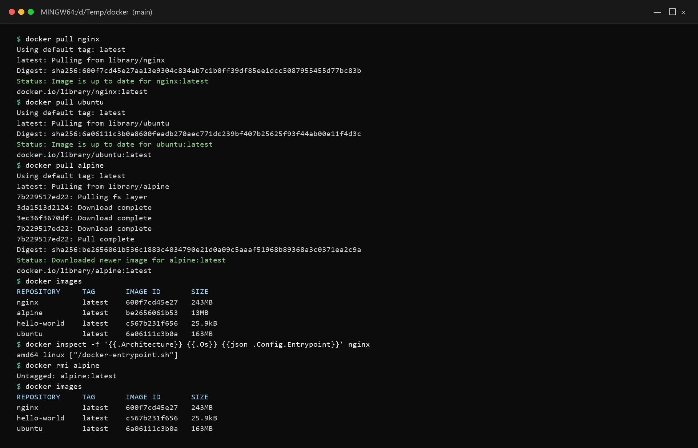
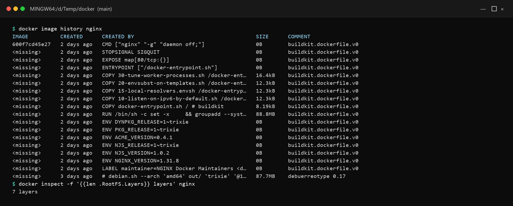
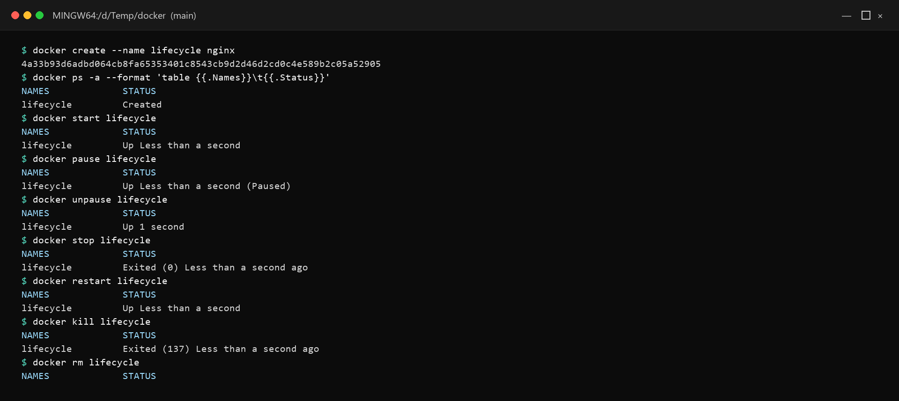
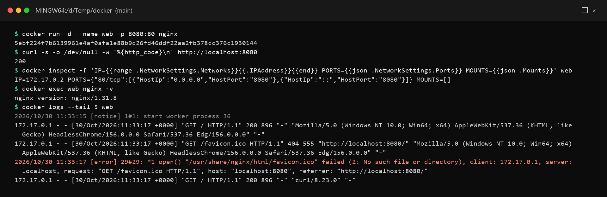
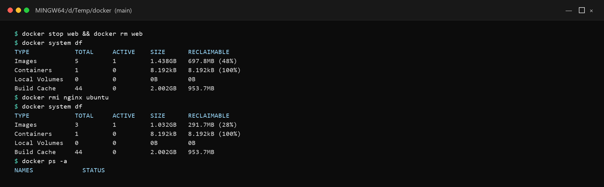

# Day 30 - Docker Images & Container Lifecycle

## Task

- Task 1 — Docker Images: pull `nginx`, `ubuntu`, `alpine`; list + compare sizes; why `alpine` is smaller; `docker inspect` an image; `docker rmi` one image
- Task 2 — Image Layers: `docker image history nginx`; what layers are, why 0B layers exist, why Docker uses layers
- Task 3 — Container Lifecycle: create → start → pause → unpause → stop → restart → kill → remove one container; `docker ps -a` state after each step
- Task 4 — Working with Running Containers: detached Nginx, `logs` + `logs -f`, `exec` in + one-off command, `docker inspect` (IP, ports, mounts)
- Task 5 — Cleanup: stop all in one command, remove all stopped in one command, prune unused images, `docker system df` disk check

## Environment

| Component | Value / Version | Install / Notes |
|-----------|-----------------|-----------------|
| OS | Windows 10/11 + Docker Desktop, or Ubuntu 22.04 + Docker Engine (Day 29 install reused) | Daemon must be running (`docker info` succeeds) |
| Shell | PowerShell / WSL bash / Ubuntu terminal | `$(...)` examples work in bash; PowerShell variants noted where syntax differs |
| Tools | Docker (`docker --version` → `29.9.2` on this machine); images `nginx`, `ubuntu`, `alpine` from Docker Hub (public, no login) | `docker --version` + `docker images` sizes recorded below |
| Disk | ~420 MB for the three pulls (nginx 243 MB, ubuntu 163 MB, alpine 13 MB) | Cleanup in Task 5 reclaims it |
| Verify | `docker --version && docker info --format '{{.Driver}}'` | `overlayfs` on Docker 29 / WSL2 |

## Solution

### Task 1: Docker Images

WHY it matters for DevOps: image size = pull time = deploy speed + registry cost. Choosing `alpine`/slim variants on purpose (and knowing the musl trade-off) is a deploy-speed decision.

```bash
docker pull nginx
docker pull ubuntu
docker pull alpine
docker images
```

Observed output (sizes are Docker Desktop 29.9.2, linux/amd64):

```text
REPOSITORY     TAG       IMAGE ID       SIZE
nginx          latest    600f7cd45e27   243MB
alpine         latest    be2656061b53   13MB
hello-world    latest    c567b231f656   25.9kB   # left over from Day 29
ubuntu         latest    6a06111c3b0a   163MB
```



| Image | Why this size |
|-------|---------------|
| `alpine` ~13 MB | musl libc + BusyBox minimal userspace — fewest packages, fastest pulls |
| `ubuntu` ~163 MB | Full glibc + Debian-style userland (bash, coreutils) — compatible default |
| `nginx` ~243 MB | Debian/Ubuntu base + Nginx + configs + default content (slim/alpine variants ~50 MB) |

Ubuntu vs Alpine: Alpine swaps glibc for musl and GNU tools for BusyBox — tiny and fast, but some prebuilt binaries (glibc-linked) misbehave. Prefer Alpine for Go/static/Rust/Python-slim-style builds you control; prefer Debian/Ubuntu-based for broad compatibility.

Inspect then remove:

```bash
docker inspect nginx:latest | head -60   # config, env, exposed ports, entrypoint, layers
docker inspect -f '{{.Architecture}} {{.Os}} {{.Config.Entrypoint}}' nginx
docker rmi alpine                        # remove once explored
docker images                            # alpine gone, nginx+ubuntu remain
```

What `docker inspect` reveals: repo tags, architecture/OS, env vars, `ExposedPorts`, `Entrypoint`/`Cmd`, `WorkingDir`, layer digests (`RootFS.Layers`), and size metadata.

### Task 2: Image Layers

```bash
docker image history nginx
```

Expected output (example — your values will differ):

```text
IMAGE          CREATED        CREATED BY                                      SIZE
a1b2c3d4e5f6   2 weeks ago    CMD ["nginx" "-g" "daemon off;"]                0B
<missing>      2 weeks ago    EXPOSE 80                                       0B
<missing>      2 weeks ago    RUN apt-get update && apt-get install nginx     55MB
<missing>      2 weeks ago    ENV NGINX_VERSION=1.27                          0B
# (illustrative — real lines/orders vary by nginx release)
```

What layers are: each Dockerfile instruction (`FROM`, `RUN`, `COPY`, `ADD`) produces a read-only filesystem diff stacked via overlayfs; a running container adds one thin writable layer on top. Metadata-only instructions (`ENV`, `EXPOSE`, `CMD`, `LABEL`) create `0B` layers — they change config, not files. Sized layers come from `RUN`/`COPY`/`ADD` that write files.

Why Docker uses layers:

- **Cache**: rebuilds re-run only changed instructions and below — unchanged top layers reuse cache.
- **Sharing**: two images from the same base store that base once on disk and pull it once.
- **Speed**: pushes/pulls transfer only missing layer blobs (content-addressed digests).

```bash
docker inspect -f '{{json .RootFS.Layers}}' nginx | tr ',' '\n' | head
```



### Task 3: Container Lifecycle

WHY it matters for DevOps: `stop` (graceful) vs `kill` (immediate) decides whether connections drain or drop. `pause` freezes without killing — handy for consistent filesystem snapshots.

```bash
docker create --name lifecycle nginx      # created, not started
docker ps -a                              # STATUS: Created

docker start lifecycle
docker ps                                 # STATUS: Up ...

docker pause lifecycle
docker ps                                 # STATUS: Up ... (Paused)

docker unpause lifecycle
docker ps                                 # STATUS: Up ... (unpaused)

docker stop lifecycle                     # SIGTERM, grace period, then SIGKILL
docker ps -a                              # STATUS: Exited (0)

docker restart lifecycle                  # stop + start in one step
docker ps                                 # STATUS: Up ...

docker kill lifecycle                     # immediate SIGKILL (no graceful shutdown)
docker ps -a                              # STATUS: Exited (137)  [128+9 = SIGKILL]

docker rm lifecycle                       # must be stopped first (or -f)
docker ps -a                              # gone
```

State map observed via `docker ps -a` after each step:

| Step | `STATUS` shows |
|------|----------------|
| `create` | `Created` |
| `start` | `Up X seconds` |
| `pause` | `Up X seconds (Paused)` |
| `unpause` | `Up X seconds` again |
| `stop` | `Exited (0)` |
| `restart` | `Up X seconds` (new uptime) |
| `kill` | `Exited (137)` |
| `rm` | Row disappears |



```bash
docker stop -t 30 lifecycle   # extend grace period to 30s before SIGKILL
docker rm -f lifecycle        # force-remove a running container (stop + rm)
```

### Task 4: Working with Running Containers

```bash
docker run -d --name web -p 8080:80 nginx
curl http://localhost:8080 -o /dev/null -w "%{http_code}\n"

docker logs web                    # buffered stdout/stderr
docker logs -f web                 # follow/live stream (Ctrl+C detaches only)
docker logs --tail 20 --timestamps web
curl http://localhost:8080 >/dev/null && docker logs --tail 5 web   # prove access lines appear

docker exec -it web bash           # enter the filesystem (use sh if bash missing)
# inside: ls /etc/nginx, cat /usr/share/nginx/html/index.html, cat /var/log/nginx/access.log, exit

docker exec web nginx -T 2>&1 | head -30    # one-off: dump effective nginx config
docker exec web ls /etc/nginx

docker inspect web | grep -A5 '"IPAddress"'
docker inspect -f 'IP={{range .NetworkSettings.Networks}}{{.IPAddress}}{{end}} PORTS={{json .NetworkSettings.Ports}} MOUNTS={{json .Mounts}}' web
```



Inspect reveals: internal bridge IP (e.g. `172.17.0.2`), host→container port table (`80/tcp → 0.0.0.0:8080`), and volume mounts (empty unless `-v` used). Prefer the `-f` template over raw JSON grep — stable across daemon versions.

| Signal | Command | Behavior |
|--------|---------|----------|
| Graceful | `docker stop` | SIGTERM → app drains → SIGKILL after grace (`-t`) |
| Immediate | `docker kill` | SIGKILL now — connections drop, exit 137 |
| Freeze | `docker pause` / `unpause` | SIGSTOP/SIGCONT all processes — no shutdown |

### Task 5: Cleanup

```bash
docker stop $(docker ps -q)        # stop every running container (no-op message if none)
docker rm $(docker ps -aq)         # remove ALL stopped containers
# PowerShell equivalents:
# docker ps -q | ForEach-Object { docker stop $_ }
# docker ps -aq | ForEach-Object { docker rm $_ }
docker image prune -a              # remove images unused by any container (prompts; -f to skip)
docker system df                   # disk usage: images, containers, build cache, volumes
docker system prune                # broader sweep (stopped containers, unused nets, dangling images)
docker system prune -a --volumes   # nuclear: also unused volumes (DATA LOSS — confirm first)
```



Observed numbers from this machine (build cache belongs to other projects):

```text
TYPE            TOTAL     ACTIVE    SIZE      RECLAIMABLE
Images          5         1         1.438GB   697.8MB (48%)
Containers      1         0         8.192kB   8.192kB (100%)
Build Cache     44        0         2.002GB   953.7MB
# after docker rmi nginx ubuntu:
Images          3         1         1.032GB   291.7MB (28%)
```

Safe order: `stop` → `rm containers` → `prune images` → `df` to confirm. Never `prune --volumes` on a dev box with databases you care about unless backups exist.

#### Deep dive: layer-cache demo + prune safety matrix

```bash
docker pull nginx && docker inspect -f '{{len .RootFS.Layers}} layers' nginx
docker pull nginx:alpine && docker inspect -f '{{len .RootFS.Layers}} layers' nginx:alpine
docker images --format 'table {{.Repository}}:{{.Tag}}\t{{.Size}}'
docker system df -v | head -30
```

| Prune command | Removes | Safe when |
|---------------|---------|-----------|
| `docker container prune` | All stopped containers | No stopped container holds needed logs/files |
| `docker image prune` | Dangling images only (<none> tags) | Almost always safe |
| `docker image prune -a` | All images unused by a container | You can re-pull (bandwidth/time OK) |
| `docker system prune` | Stopped containers + unused nets + dangling images | Dev box tidy-up, nothing precious stopped |
| `docker system prune -a --volumes` | Above + ALL unused volumes (DB data!) | Backups verified, or throwaway env |

WHY it matters for DevOps: CI runners fill disks with layers — scheduled `prune` (minus `--volumes` on stateful hosts) is the standard disk-hygiene cron job.

#### Size-vs-compat chooser + inspect template library

| Workload | Pick | Why |
|----------|------|-----|
| Static Go/Rust binary | `alpine` / `scratch` | Smallest pull, fastest cold start |
| Python/Node app you control | `-slim` variant | Balanced size + glibc compat |
| Legacy/unknown binaries | Full `ubuntu`/`debian` base | Fewest musl surprises |

```bash
docker inspect -f '{{.Id}} {{.RepoTags}}' nginx
docker inspect -f 'Entrypoint={{json .Config.Entrypoint}} Cmd={{json .Config.Cmd}}' nginx
docker inspect -f 'Exposed={{json .Config.ExposedPorts}} Env={{json .Config.Env}}' nginx
docker image history --no-trunc nginx | head -10
```

WHY it matters for DevOps: pinning `nginx:1.27-alpine` (not `latest`) plus knowing entrypoint/cmd makes rollbacks deterministic and `docker run  <override-cmd>` debugging predictable.

## Commands Used

```bash
docker pull nginx
docker pull ubuntu
docker pull alpine
docker images
docker inspect nginx:latest
docker rmi alpine
docker image history nginx
docker create --name lifecycle nginx
docker start lifecycle
docker pause lifecycle
docker unpause lifecycle
docker stop lifecycle
docker restart lifecycle
docker kill lifecycle
docker rm lifecycle
docker ps
docker ps -a
docker run -d --name web -p 8080:80 nginx
docker logs web
docker logs -f web
docker logs --tail 20 --timestamps web
docker exec -it web bash
docker exec web nginx -v
docker inspect web
docker stop $(docker ps -q)
docker rm $(docker ps -aq)
docker image prune -a
docker system df
docker system prune
```

## Verification

- `docker images` lists `nginx` + `ubuntu` with plausible sizes; `alpine` removed via `rmi`
- `docker inspect nginx` output reviewed (env, exposed ports, entrypoint, layer digests)
- `docker image history nginx` pasted with `0B` metadata layers annotated
- Full lifecycle practiced in order; `docker ps -a` STATUS noted per step (Created → Up → Paused → Up → Exited → Up → Exited 137 → gone)
- `docker logs -f web` streams new lines when `curl localhost:8080` runs
- `docker exec` used interactively AND one-off (`nginx -T` / `ls`)
- `docker inspect -f` prints IP (e.g. `172.17.0.2`), port binding `80→8080`, mounts
- Cleanup done: `docker ps -a` empty, `docker system df` shows reclaimed space

## Key Learnings

- Image = immutable stacked read-only layers; container = image + thin writable layer + process.
- `0B` history rows are config-only instructions; sized rows wrote files.
- Layers give cache reuse + cross-image sharing + incremental pulls.
- Alpine trades size for musl/BusyBox — faster deploys, narrower compatibility.
- Lifecycle states (Created/Up/Paused/Exited) are always visible in `ps -a`.
- `stop` drains gracefully; `kill` drops immediately (exit 137) — prefer `stop`.
- `inspect -f` templates beat raw JSON grep for IP/ports/mounts.
- Secrets baked into layers persist even if deleted in a later layer — never `COPY` secrets.

## Troubleshooting / Gotchas

- `docker rm` says "container is running — stop it first" — cause: rm needs stopped state; fix: `docker stop <n> && docker rm <n>` or `docker rm -f <n>`.
- `docker stop $(docker ps -q)` errors with no containers — cause: empty substitution; fix: `docker ps -q | xargs -r docker stop` (`-r` skips empty).
- `docker logs` shows nothing for Nginx — cause: no requests yet; fix: `curl localhost:8080` first, then `docker logs --tail 20 web`.
- `docker exec -it web bash` fails — cause: slim/alpine images lack bash; fix: `docker exec -it web sh`.
- `docker image prune -a` wants to delete too much — cause: it targets ALL unused images; fix: review list first, drop `-a` for dangling-only, re-pull costs time.
- `docker system prune --volumes` wiped DB data — cause: volumes hold state; fix: prevention — never `--volumes` without backups; volumes survive container removal by design.
- HISTORY shows a secret (password in `RUN`/`ENV`) — cause: baked into a layer; fix: rotate the secret now; rebuild with `--secret`/`--build-arg` patterns that don't persist, not plain `ENV`.

## Screenshots

The five screenshots are embedded in the task sections above. Files live in `screenshots/`:

| File | Shows |
|------|-------|
| `docker-images.png` | Pulls, `docker images` sizes, inspect, and `rmi alpine` |
| `image-history.png` | `docker image history nginx` layers with `0B` rows |
| `lifecycle-states.png` | `docker ps -a` STATUS through create → start → pause → stop → kill → rm |
| `inspect-ip.png` | Bridge IP, port mapping, mounts, and access log |
| `system-df.png` | `docker system df` before and after image cleanup |

Captured from Docker Desktop 29.9.2 with Linux containers on 2026-10-30.
