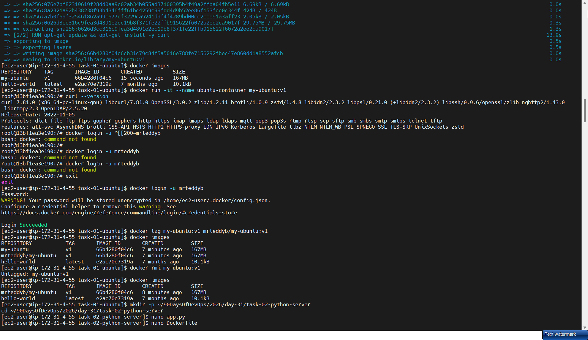
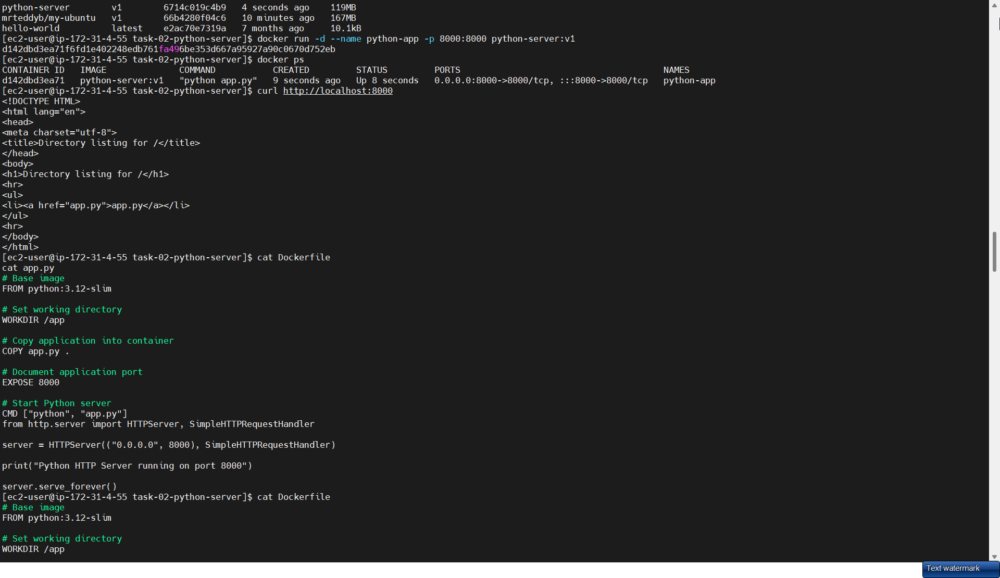
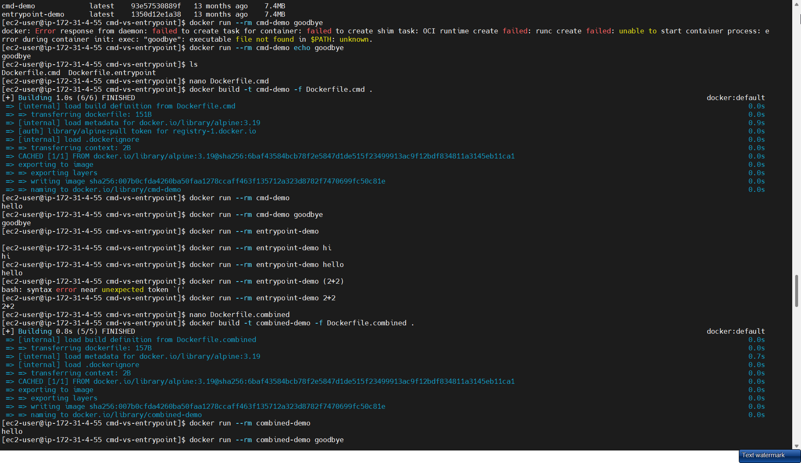
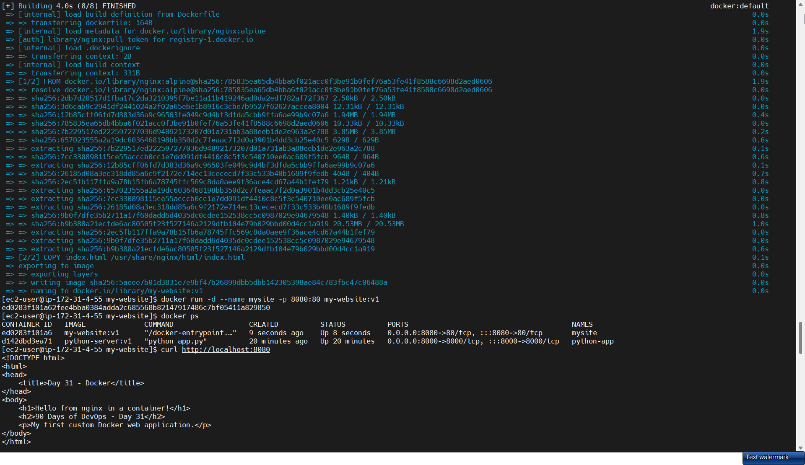
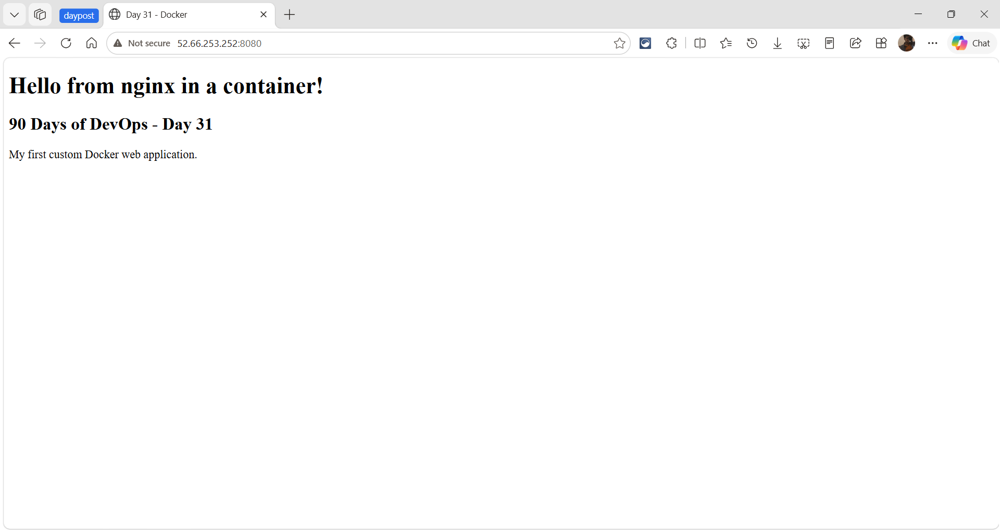
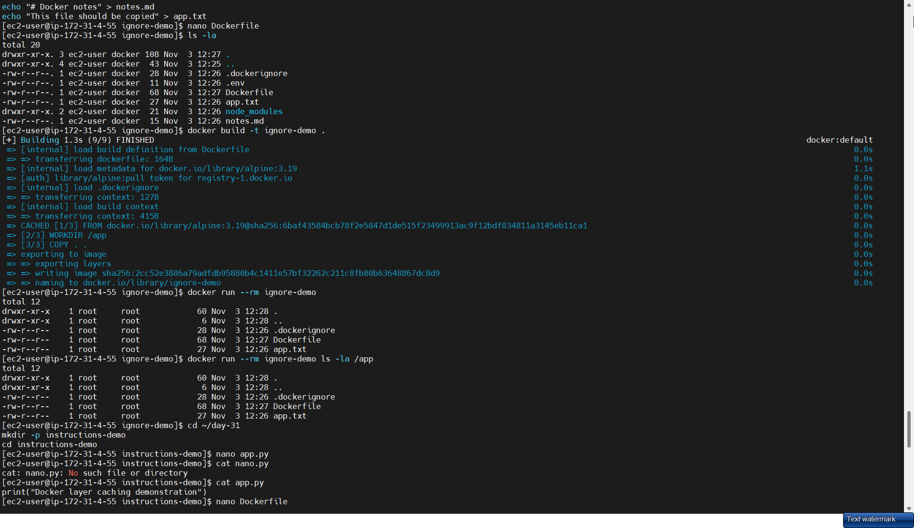
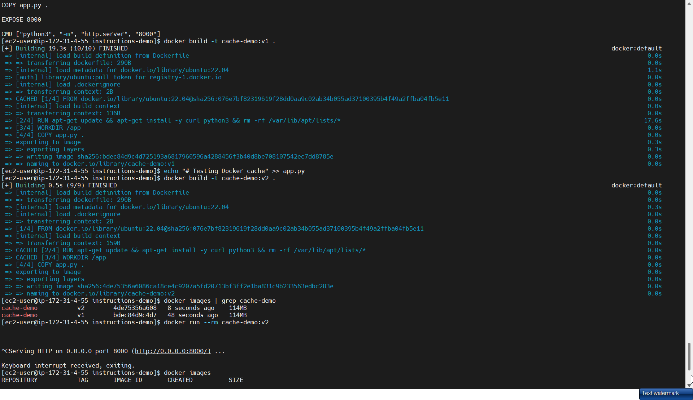

# Day 31 - Dockerfile: Build Your Own Images

## Task

- Task 1: Your First Dockerfile — create folder `my-first-image`, Dockerfile with `ubuntu` base, install `curl`, default command printing `"Hello from my custom image!"`; build and tag `my-ubuntu:v1`, run a container from it
- Task 2: Dockerfile Instructions — new Dockerfile using ALL of `FROM`, `RUN`, `COPY`, `WORKDIR`, `EXPOSE`, `CMD`; build and run it, understand each line
- Task 3: CMD vs ENTRYPOINT — image with `CMD ["echo", "hello"]` (run plain + with custom command); image with `ENTRYPOINT ["echo"]` (run plain + with args); write when to use CMD vs ENTRYPOINT
- Task 4: Simple Web App Image — small static `index.html`, Dockerfile from `nginx:alpine` copying it to Nginx web dir; build/tag `my-website:v1`, run with port mapping, open in browser
- Task 5: .dockerignore — create `.dockerignore` with `node_modules`, `.git`, `*.md`, `.env`; build and verify ignored files are excluded
- Task 6: Build Optimization — build, change one line, rebuild and observe cache; reorder so frequently changing lines come last; write why layer order matters

## Environment

| OS / Shell / Tool | Install / Version command |
|---|---|
| OS: Amazon Linux 2023 on AWS EC2 (`t3.micro`, inbound SSH + 8080) | `cat /etc/os-release` |
| Shell: bash as `ec2-user` | `bash --version` |
| Docker Engine (installed via `dnf`, daemon enabled) | `docker --version` → `Docker version 25.x` |
| Docker buildx (BuildKit) | `docker buildx version` |
| Docker Hub account (free) | `docker login -u mrteddyb` → `Login Succeeded` |
| Browser (for Task 4) | open `http://<EC2-public-IP>:8080` |
| Images pulled during tasks | `ubuntu:22.04`, `alpine:3.19`, `nginx:alpine` |

```bash
sudo dnf install -y docker
sudo systemctl enable --now docker
sudo usermod -aG docker ec2-user   # log out/in once so the group applies
docker --version
docker buildx version
docker login
docker images
```

On EC2, Task 4 is reached from your laptop browser at `http://<EC2-public-IP>:8080` (or via `ssh -L 8080:localhost:8080 ec2-user@<EC2-public-IP>`), so the instance's security group must allow inbound TCP `8080`.

## Solution

### Task 1: Your First Dockerfile

Create the folder `my-first-image/` (the EC2 run used `task-01-ubuntu/`) with this `Dockerfile`:

```dockerfile
FROM ubuntu:22.04

RUN apt-get update && apt-get install -y curl && rm -rf /var/lib/apt/lists/*

CMD ["echo", "Hello from my custom image!"]
```

What each line does:

| Instruction | Meaning |
|---|---|
| `FROM ubuntu:22.04` | Base image — everything starts from here. Pinned tag `22.04` for reproducibility |
| `RUN apt-get ...` | Executes at **build time**, result saved as a layer. `rm -rf /var/lib/apt/lists/*` keeps the layer small |
| `CMD ["echo", ...]` | **Default command** at container start; replaced entirely if you pass another command to `docker run` |

Build and run:

```bash
cd task-01-ubuntu
docker build -t my-ubuntu:v1 .
docker images my-ubuntu:v1
docker run --rm my-ubuntu:v1          # prints the CMD message
docker run -it --name ubuntu-container my-ubuntu:v1 bash
# now inside the container:
curl --version
docker login -u mrteddyb              # fails: the Docker CLI is not installed in the image
exit
```

Expected output (example — your values will differ):

```text
[+] Building 45.2s (3/3) FINISHED
 => [internal] load build definition from Dockerfile
 => [1/2] FROM docker.io/library/ubuntu:22.04
 => [2/2] RUN apt-get update && apt-get install -y curl ...
 => exporting to image
 => naming to docker.io/library/my-ubuntu:v1

Hello from my custom image!
```

Override check — CMD is replaceable. The run command is the host's `docker`, so `curl --version` has to be executed inside the container:

```bash
docker run --rm my-ubuntu:v1 echo "custom override works"
# custom override works
docker run --rm my-ubuntu:v1 curl --version | head -1
# curl 7.81.0 ... (example)
```



Push it to Docker Hub — the tag must start with your Hub username or the push is denied:

```bash
docker login -u mrteddyb
docker tag my-ubuntu:v1 mrteddyb/my-ubuntu:v1
docker push mrteddyb/my-ubuntu:v1
```

Expected output (example — your values will differ):

```text
Login Succeeded
The push refers to repository [docker.io/mrteddyb/my-ubuntu]
...
v1: digest: sha256:… size: 741
```

The screenshot shows the login and retag steps, then `docker rmi my-ubuntu:v1` leaving only `mrteddyb/my-ubuntu:v1`; the push itself was not captured.

Verify portability: `docker rmi mrteddyb/my-ubuntu:v1 && docker pull mrteddyb/my-ubuntu:v1`.

**WHY it matters for DevOps:** every production image starts exactly like this — a pinned base, dependency install in one layer, and a default command. `docker build -t name:tag .` plus `docker run` is the deploy loop you will repeat hundreds of times.

### Task 2: Dockerfile Instructions

Companion folder `task-02-python-server/` contains `app.py` + `Dockerfile`:

```dockerfile
FROM python:3.12-slim

WORKDIR /app

COPY app.py .

EXPOSE 8000

CMD ["python", "app.py"]
```

`app.py` (companion file):

```python
from http.server import HTTPServer, SimpleHTTPRequestHandler

server = HTTPServer(("0.0.0.0", 8000), SimpleHTTPRequestHandler)
print("Python HTTP Server running on port 8000")
server.serve_forever()
```

The brief also lists `RUN` — it executes commands at build time and saves the result as a layer. This image needed nothing extra installed because `python:3.12-slim` already ships the interpreter, so the working Dockerfile has no `RUN` line. Task 6 shows `RUN` in action (installing `curl` + `python3`).

Concept table:

| Instruction | When it runs | What it does here |
|---|---|---|
| `FROM` | build start | sets `python:3.12-slim` as layer 0 |
| `RUN` | build time | installs packages / runs setup commands (not needed for this base) |
| `WORKDIR /app` | build + runtime | creates `/app`, all later relative paths resolve here |
| `COPY app.py .` | build time | copies from **build context** (the `.` dir) into `/app/app.py` |
| `EXPOSE 8000` | documentation | declares the app listens on 8000 — does **not** publish it |
| `CMD` | container start | default process; `docker run  <other>` replaces it |

Build and run:

```bash
cd task-02-python-server
docker build -t python-server:v1 .
docker images python-server:v1
docker run -d --name python-app -p 8000:8000 python-server:v1
docker ps
curl http://localhost:8000
```

Expected output (example — your values will differ):

```text
Python HTTP Server running on port 8000
127.0.0.1 - - [03/Nov/2026] "GET / HTTP/1.1" 200 -
<h1>Directory listing for /</h1>
```



**WHY it matters:** `WORKDIR` + `COPY` + `EXPOSE` + `CMD` is the skeleton of every app Dockerfile. The single most common beginner bug is thinking `EXPOSE` publishes the port — only `-p host:container` does.

### Task 3: CMD vs ENTRYPOINT

Companion folder `cmd-vs-entrypoint/` has `Dockerfile.cmd` and `Dockerfile.entrypoint`:

```dockerfile
# Dockerfile.cmd
FROM alpine:3.19
CMD ["echo", "hello"]
```

```dockerfile
# Dockerfile.entrypoint
FROM alpine:3.19
ENTRYPOINT ["echo"]
```

Run the experiment:

```bash
cd cmd-vs-entrypoint
docker build -t cmd-demo -f Dockerfile.cmd .
docker build -t entrypoint-demo -f Dockerfile.entrypoint .

docker run --rm cmd-demo
# hello
docker run --rm cmd-demo echo goodbye
# goodbye   <- custom command REPLACES the whole CMD

docker run --rm entrypoint-demo
# (blank line — echo with no args)
docker run --rm entrypoint-demo hi
# hi        <- args are APPENDED to ENTRYPOINT
```

Result table:

| Image | `docker run ` | `docker run  <args>` | Rule |
|---|---|---|---|
| `CMD ["echo","hello"]` | `hello` | `echo goodbye` → `goodbye` | run args **replace** CMD |
| `ENTRYPOINT ["echo"]` | empty line | `hi` → `hi` | run args **append** to ENTRYPOINT |

`docker run cmd-demo goodbye` (without the `echo`) fails with `exec: "goodbye": executable file not found` — proof that the whole CMD is replaced.



Best practice — use both together:

```dockerfile
FROM alpine:3.19
ENTRYPOINT ["echo"]
CMD ["hello"]
```

Now `docker run img` → `hello`, `docker run img goodbye` → `goodbye`: ENTRYPOINT pins the program, CMD supplies default arguments.

When to use which:

| Use | Pattern |
|---|---|
| Default command user may fully replace (shell, debug) | `CMD` only |
| Fixed tool where extra args are input (`python app.py`, CLIs) | `ENTRYPOINT` + `CMD` defaults |
| Never | shell-form `ENTRYPOINT echo hi` (breaks signal handling) — prefer exec JSON form |

**WHY it matters:** production images almost always use the combined pattern (`ENTRYPOINT ["python","app.py"]` + `CMD ["--help"]`) so operators can pass flags without restating the binary.

### Task 4: Build a Simple Web App Image

Companion folder `my-website/` has `index.html` + `Dockerfile`:

```html
<!DOCTYPE html>
<html>
<head><title>Day 31</title></head>
<body>
  <h1>Hello from nginx in a container!</h1>
  <h2>90 Days of DevOps - Day 31</h2>
  <p>My first custom Docker web application.</p>
</body>
</html>
```

```dockerfile
FROM nginx:alpine
COPY index.html /usr/share/nginx/html/index.html
```

Nginx serves static files from `/usr/share/nginx/html/` — that path is the only thing to memorize here.

```bash
cd my-website
docker build -t my-website:v1 .
docker run -d --name mysite -p 8080:80 my-website:v1
curl http://localhost:8080
# open http://<EC2-public-IP>:8080 from your laptop (or SSH-tunnel 8080)
docker rm -f mysite
```

Expected output (example — your values will differ):

```text
<h1>Hello from nginx in a container!</h1>
<h2>90 Days of DevOps - Day 31</h2>
<p>My first custom Docker web application.</p>
```





| Item | Value |
|---|---|
| Image ID | `ffc5fd89322a` |
| Container ID | `7ac5129b0dca` |
| Host port → container port | `8080 → 80` |

Publish the site image to Docker Hub too:

```bash
docker tag my-website:v1 mrteddyb/my-website:v1
docker push mrteddyb/my-website:v1
```

**WHY it matters:** `COPY artifact → runtime base` is the entire static-site / frontend deploy model. The same two-line shape becomes `COPY dist/ …` for React or `COPY --from=builder …` in multi-stage builds (Day 35).

### Task 5: .dockerignore

Companion folder `ignore-demo/` has `.dockerignore` + `Dockerfile`:

```text
node_modules
.git
*.md
.env
```

```dockerfile
FROM alpine:3.19
WORKDIR /app
COPY . .
CMD ["ls"]
```

Verify:

```bash
cd ignore-demo
mkdir -p node_modules && echo "x" > node_modules/fake.js
echo "secret=1" > .env
echo "# notes" > notes.md
echo "This file should be copied" > app.txt
docker build -t ignore-demo .
docker run --rm ignore-demo ls -a /app
# .dockerignore, Dockerfile, app.txt only
# node_modules, .git, *.md, .env are absent
```

The host folder holds `.dockerignore`, `.env`, `Dockerfile`, `app.txt`, `node_modules/` and `notes.md`; the container's `/app` shows only `.dockerignore`, `Dockerfile` and `app.txt`.



Also compare context size in build output — with big dirs ignored the `transferring context` line shrinks from MBs to KBs.

| Ignored entry | Why |
|---|---|
| `node_modules` | huge, rebuilt inside image anyway |
| `.git` | history bloat + leaks branches |
| `*.md` | docs not needed at runtime |
| `.env` | **secrets must never ship in the image** |

**WHY it matters:** `.dockerignore` is a security + speed control. Leaked `.env` files are one of the most common real-world image vulnerabilities.

### Task 6: Build Optimization

```bash
cd instructions-demo
docker build -t cache-demo:v1 .
# note the timings, e.g. [2/4] RUN apt-get takes ~17s
echo "# Testing Docker cache" >> app.py
docker build -t cache-demo:v2 .
docker images | grep cache-demo
```

Expected output (example — your values will differ):

```text
=> CACHED [2/4] RUN apt-get update && apt-get install ...
=> CACHED [3/4] WORKDIR /app
=> [4/4] COPY app.py .
=> exporting to image
```



Only layers **after** the changed file re-ran. Now the optimization rule — slow-changing first, volatile last:

```dockerfile
# GOOD order: deps (rarely change) before source (changes constantly)
FROM ubuntu:22.04
RUN apt-get update && apt-get install -y curl python3 && rm -rf /var/lib/apt/lists/*
WORKDIR /app
COPY requirements.txt .
RUN pip install -r requirements.txt
COPY app.py .
CMD ["python3", "-m", "http.server", "8000"]
```

```dockerfile
# BAD order: editing app.py invalidates the pip layer every time
FROM ubuntu:22.04
WORKDIR /app
COPY app.py .
RUN apt-get update && apt-get install -y ...
```

Why layer order matters: Docker caches **layer by layer**; the first changed instruction invalidates the cache for **every instruction after it**. Putting `apt-get install` / `pip install` before `COPY app` means editing code does not reinstall packages — builds drop from minutes to seconds.

**WHY it matters:** in CI every second of `docker build` costs money and slows feedback. Cache-aware ordering is the cheapest pipeline speedup available.

## Commands Used

```bash
cat /etc/os-release
sudo dnf install -y docker
sudo systemctl enable --now docker
docker --version
docker buildx version
docker login -u mrteddyb
cd task-01-ubuntu && docker build -t my-ubuntu:v1 .
docker run --rm my-ubuntu:v1
docker run -it --name ubuntu-container my-ubuntu:v1 bash   # inside: curl --version, docker login (fails), exit
docker tag my-ubuntu:v1 mrteddyb/my-ubuntu:v1
docker rmi my-ubuntu:v1
docker push mrteddyb/my-ubuntu:v1
cd ../task-02-python-server && docker build -t python-server:v1 .
docker run -d --name python-app -p 8000:8000 python-server:v1
docker ps
curl http://localhost:8000
docker rm -f python-app
cd ../cmd-vs-entrypoint && docker build -t cmd-demo -f Dockerfile.cmd . && docker build -t entrypoint-demo -f Dockerfile.entrypoint .
docker run --rm cmd-demo
docker run --rm cmd-demo echo goodbye
docker run --rm cmd-demo goodbye          # fails: not found in $PATH
docker run --rm entrypoint-demo
docker run --rm entrypoint-demo hi
cd ../my-website && docker build -t my-website:v1 . && docker run -d --name mysite -p 8080:80 my-website:v1
curl http://localhost:8080
docker tag my-website:v1 mrteddyb/my-website:v1
docker push mrteddyb/my-website:v1
docker rm -f mysite
cd ../ignore-demo && docker build -t ignore-demo . && docker run --rm ignore-demo ls -a /app
cd ../instructions-demo && docker build -t cache-demo:v1 . && echo "# Testing Docker cache" >> app.py && docker build -t cache-demo:v2 .
docker images
```

## Verification

- `cat /etc/os-release` shows Amazon Linux 2023 and `docker --version` confirms the Engine is installed and running
- `docker run --rm my-ubuntu:v1` prints `Hello from my custom image!` — run it and confirm
- `docker run --rm my-ubuntu:v1 curl --version` proves `curl` is installed inside the image
- `docker login -u mrteddyb` reports `Login Succeeded`; `docker push mrteddyb/my-ubuntu:v1` ends with `v1: digest: sha256:…` and the tag appears at `hub.docker.com/u/mrteddyb`
- `docker images` lists `my-ubuntu`/`mrteddyb/my-ubuntu`, `python-server`, `my-website`, `ignore-demo`, `cache-demo`, `cmd-demo`, `entrypoint-demo` and `combined-demo`
- `curl http://localhost:8000` returns the python `http.server` directory listing after Task 2 run
- `docker run --rm cmd-demo echo goodbye` prints `goodbye` (CMD replaced); `docker run --rm entrypoint-demo hi` prints `hi` (args appended)
- `curl http://localhost:8080` returns your `index.html` and a laptop browser at `http://<EC2-public-IP>:8080` renders it
- `docker run --rm ignore-demo ls -a /app` shows only `.dockerignore`, `Dockerfile` and `app.txt` — none of `node_modules`, `.git`, `*.md`, `.env`
- Second build after a one-line `app.py` change shows `CACHED` on early layers and finishes much faster

## Key Learnings

- A Dockerfile is a recipe: each instruction becomes a cached read-only layer stacked on the base image
- `CMD` is a replaceable default; `ENTRYPOINT` pins the executable and appends run args — combine them for flexible tools
- `WORKDIR` sets the directory for later instructions and the container; `COPY <host> <image>` only sees files inside the build context
- `EXPOSE` documents ports; only `-p host:container` actually publishes them to the host
- `.dockerignore` shrinks build context and keeps secrets (`.env`) and bloat (`node_modules`, `.git`) out of images
- Layer order is a build-speed lever: stable/expensive layers first, volatile source copies last
- `nginx:alpine` serves `/usr/share/nginx/html/` — the canonical static-site deploy target
- `docker tag <local> mrteddyb/<repo>:<tag>` + `docker push` is how an image leaves the EC2 host and becomes pullable anywhere — the Hub username prefix is mandatory
- Exec-form (`["echo","hello"]`) preserves signals; shell-form wraps in `/bin/sh -c` and breaks `Ctrl+C`/PID 1 handling

## Troubleshooting / Gotchas

- `COPY failed: file not found` — the source must be inside the build context (the `.` path). Cause: wrong `cd` or file in a parent dir. Fix: `cd` into the folder containing the Dockerfile first, or adjust context path
- `apt-get` fails mid-build with 404s — stale package lists in a cached layer. Cause: `apt-get update` and `install` split across RUNs. Fix: always combine in one `RUN apt-get update && apt-get install -y … && rm -rf /var/lib/apt/lists/*`
- Browser shows old page after rebuild — stale container still running the old image. Cause: forgot to recreate. Fix: `docker rm -f mysite && docker run -d --name mysite -p 8080:80 my-website:v1`
- `docker run entrypoint-demo` prints blank line — ENTRYPOINT with no default args. Cause: no CMD supplying defaults. Fix: add `CMD ["hello"]` alongside ENTRYPOINT
- Nothing reachable despite `EXPOSE 80` — EXPOSE publishes nothing. Cause: missing `-p`. Fix: `docker run -p 8080:80 …`
- `curl: (7) Failed to connect` from your laptop on EC2 — security group blocks 8080. Cause: no inbound rule. Fix: allow inbound TCP `8080` in the instance's security group, or tunnel with `ssh -L 8080:localhost:8080 ec2-user@<EC2-public-IP>`
- `docker push` denied / `unauthorized` — wrong tag prefix, not logged in, or 2FA password auth. Cause: tag does not start with your Hub username, or you used your password instead of an access token. Fix: `docker login` with a Hub access token, then retag as `mrteddyb/image:tag`
- Build context huge / slow upload — `.dockerignore` missing. Cause: `node_modules`/`.git` sent to daemon every build. Fix: add the four ignore entries and rebuild
- Linter warns image runs as root — default USER is root. Cause: no `USER` instruction. Fix (production): `RUN adduser -D appuser && USER appuser` (see Day 35)

## Screenshots

All screenshots were captured on the Amazon Linux EC2 instance and are embedded in the task sections above. Files live in `screenshots/`:

| File | Shows |
|---|---|
| `task1-build-curl-inside.png` | build + run `my-ubuntu:v1`, `curl --version` inside the container, and the failed `docker login` (no Docker CLI in the image) |
| `task1-dockerhub-login-tag.png` | `docker login -u mrteddyb` → `Login Succeeded`, `docker tag`, `docker rmi` |
| `task2-python-server-curl.png` | build + run `python-server:v1`, `docker ps`, `curl http://localhost:8000` returning the directory listing |
| `task3-cmd-vs-entrypoint.png` | CMD replaced (`echo goodbye`) vs ENTRYPOINT appending (`hi`), plus the `goodbye` not-found error |
| `task4-my-website-run.png` | `my-website:v1` build, run on `-p 8080:80`, `docker ps`, `curl http://localhost:8080` |
| `task4-my-website-browser.png` | browser at `http://52.66.253.252:8080` rendering `index.html` |
| `task5-ignore-demo-ls.png` | host files vs `ls -a /app` proving `.env`, `node_modules` and `notes.md` are absent |
| `task6-cache-rebuild.png` | first build, then the `cache-demo:v2` rebuild reusing `CACHED` layers |
