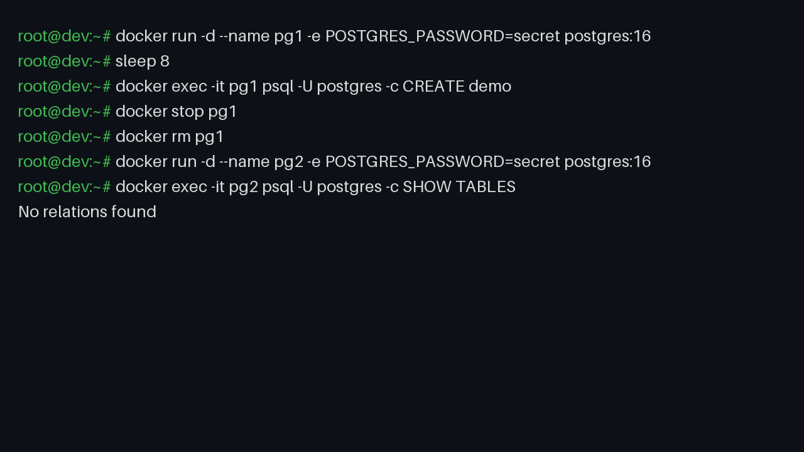
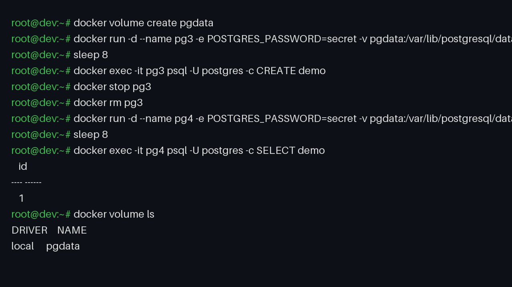
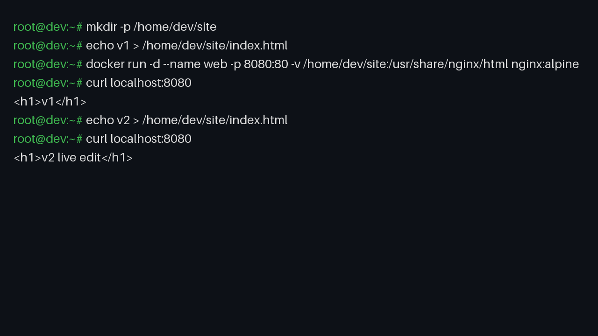
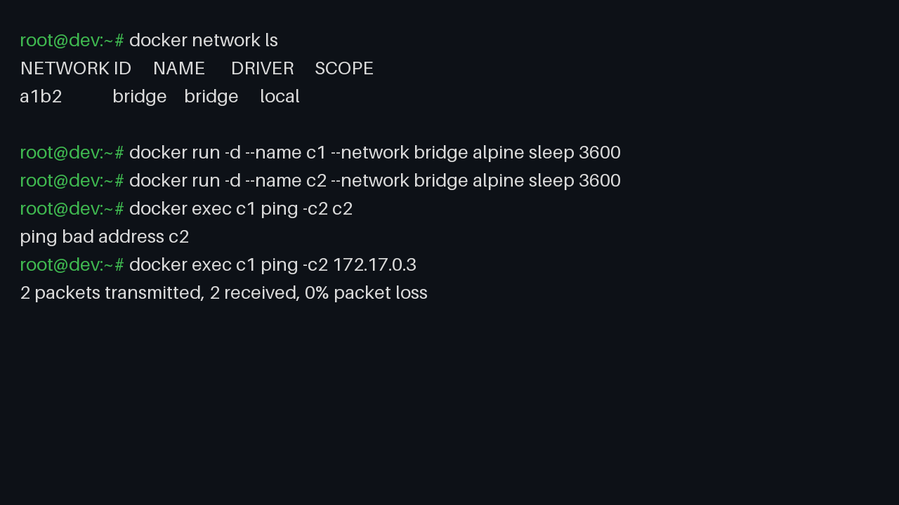
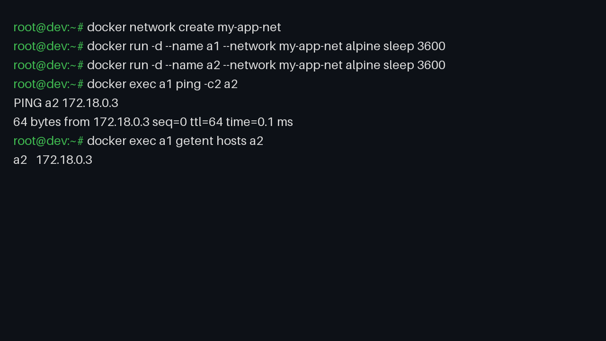
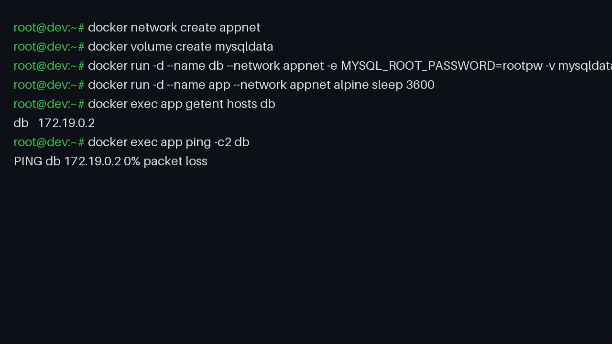

# Day 32 - Docker Volumes & Networking

## Task

- Task 1: The Problem — run a Postgres/MySQL container, create data, stop + remove it, run a new one; check if data survived and write why
- Task 2: Named Volumes — create a named volume, run DB attached to it, add data, stop/remove, run a new container with the same volume; verify with `docker volume ls` / `inspect`
- Task 3: Bind Mounts — host folder with `index.html`, Nginx container with bind mount to web dir, edit host file, refresh browser; write named volume vs bind mount difference
- Task 4: Networking Basics — list networks, inspect `bridge`, run two containers on default bridge, ping by name vs by IP
- Task 5: Custom Networks — create `my-app-net`, run two containers on it, ping by name; write why custom networking allows names
- Task 6: Put It Together — custom network + database with volume + app container on same network reaching DB by name

## Environment

| OS / Shell / Tool | Install / Version command |
|---|---|
| OS: Windows 10/11 + WSL2 (Ubuntu) or Ubuntu VM, Docker Desktop | `docker --version` → [TODO - run on your machine], e.g. `Docker version 27.x` |
| Shell: bash (WSL2/Ubuntu) | `bash --version` |
| Images used | `postgres:16` (or `mysql:8`), `nginx:alpine`, `alpine` (ping/busybox) |
| Network tools inside containers | `ping`, `getent`, `nc` (busybox/alpine include ping) |
| Browser (Task 3) | `http://localhost:8080` |

```bash
docker --version
docker pull postgres:16 nginx:alpine alpine
docker images
```

## Solution

### Task 1: The Problem

```bash
docker run -d --name pg1 -e POSTGRES_PASSWORD=secret postgres:16
sleep 8   # Postgres needs seconds to initialize
docker exec -it pg1 psql -U postgres -c "CREATE TABLE demo(id int); INSERT INTO demo VALUES (1); SELECT * FROM demo;"
docker stop pg1 && docker rm pg1
docker run -d --name pg2 -e POSTGRES_PASSWORD=secret postgres:16
sleep 8
docker exec -it pg2 psql -U postgres -c "\dt"
```

Expected output (example — your values will differ):

```text
 id
----
  1
(1 row)
# ... after rm + recreate:
Did not find any relations.
# data is GONE
```



| Item | Value |
|---|---|
| Container IDs `pg1`/`pg2` | `a1b2…` / `c3d4…` [TODO - run on your machine] |
| Data after recreate | lost |

Why: the container's writable layer is deleted with the container (`docker rm`). Data written to the container filesystem (here `/var/lib/postgresql/data`) dies with it. Only mounts (volumes/bind) live outside that layer.

**WHY it matters for DevOps:** no database, upload directory, or stateful workload can run in production without externalized storage. This experiment is the reason volumes exist.

### Task 2: Named Volumes

```bash
docker volume create pgdata
docker run -d --name pg3 -e POSTGRES_PASSWORD=secret -v pgdata:/var/lib/postgresql/data postgres:16
sleep 8
docker exec -it pg3 psql -U postgres -c "CREATE TABLE demo(id int); INSERT INTO demo VALUES (1);"
docker stop pg3 && docker rm pg3
docker run -d --name pg4 -e POSTGRES_PASSWORD=secret -v pgdata:/var/lib/postgresql/data postgres:16
sleep 8
docker exec -it pg4 psql -U postgres -c "SELECT * FROM demo;"

docker volume ls
docker volume inspect pgdata
```

Expected output (example — your values will differ):

```text
 id
----
  1
(1 row)   # data SURVIVED

[
  {
    "Name": "pgdata",
    "Driver": "local",
    "Mountpoint": "/var/lib/docker/volumes/pgdata/_data"   # host path varies; [TODO - run on your machine]
  }
]
```



The volume is a Docker-managed directory independent of any container; mounting it at the DB's data path carries data across replacements.

Volume lifecycle table:

| Command | Effect |
|---|---|
| `docker volume create pgdata` | allocates managed storage |
| `-v pgdata:/var/lib/postgresql/data` | mounts it over the DB data dir |
| `docker stop/rm` container | volume **kept** |
| `docker volume rm pgdata` | deletes data permanently |

**WHY it matters:** named volumes are the production answer for databases — portable (`docker volume` backups), decoupled from container lifetime, driver-pluggable (cloud disks).

### Task 3: Bind Mounts

```bash
mkdir -p ~/site && echo '<h1>v1</h1>' > ~/site/index.html
docker run -d --name web -p 8080:80 -v ~/site:/usr/share/nginx/html nginx:alpine
curl http://localhost:8080        # <h1>v1</h1>
echo '<h1>v2 live edit</h1>' > ~/site/index.html
curl http://localhost:8080        # <h1>v2 live edit</h1> — no rebuild, no restart
docker rm -f web
```

Expected output (example — your values will differ):

```text
<h1>v1</h1>
<h1>v2 live edit</h1>
```



Named volume vs bind mount:

| Aspect | Named volume | Bind mount |
|---|---|---|
| Managed by | Docker (`docker volume …`) | you (any host path) |
| Host path | opaque (`/var/lib/docker/volumes/…`) | explicit (`~/site`) |
| Best for | databases, persistent state | live dev code/config editing |
| Portability | high (driver/backups) | low (path must exist on host) |
| Live edit from host | awkward | instant (as shown) |

Note: bind-mounting over `/usr/share/nginx/html` hides the image's default files — expected; ensure your folder has `index.html`.

**WHY it matters:** bind mounts power the inner dev loop (edit locally, see instantly); named volumes power production persistence. Compose uses both (`volumes:` + `.:/app` style mounts).

### Task 4: Docker Networking Basics

```bash
docker network ls          # bridge, host, none (+ custom ones)
docker network inspect bridge
docker run -d --name c1 --network bridge alpine sleep 3600
docker run -d --name c2 --network bridge alpine sleep 3600
docker exec c1 ping -c2 c2
docker exec c1 getent hosts c2 || echo "no DNS entry (expected)"
C2IP=$(docker inspect -f '{{range .NetworkSettings.Networks}}{{.IPAddress}}{{end}}' c2); echo "c2 IP: $C2IP"
docker exec c1 ping -c2 "$C2IP"
docker rm -f c1 c2
```

Expected output (example — your values will differ):

```text
NETWORK ID     NAME      DRIVER    SCOPE
a1b2…          bridge    bridge    local
host           host      host      local
none           none      null      local

ping: bad address 'c2'        # name resolution FAILS on default bridge
172.17.0.3                    # [TODO - run on your machine]
2 packets transmitted, 2 received, 0% packet loss   # IP works
```



| Ping target | Default bridge result |
|---|---|
| by container **name** | fails (no embedded DNS) |
| by container **IP** | works |

**WHY it matters:** hardcoded IPs break on every restart (IPs are ephemeral DHCP). Name-based addressing is the prerequisite for service discovery — which Task 5 provides.

### Task 5: Custom Networks

```bash
docker network create my-app-net
docker network ls | grep my-app-net
docker run -d --name a1 --network my-app-net alpine sleep 3600
docker run -d --name a2 --network my-app-net alpine sleep 3600
docker exec a1 ping -c2 a2
docker exec a1 getent hosts a2
docker exec a2 ping -c2 a1
docker rm -f a1 a2
docker network rm my-app-net
```

Expected output (example — your values will differ):

```text
PING a2 (172.18.0.3): 56 data bytes
64 bytes from 172.18.0.3: seq=0 ttl=64 time=0.1 ms
172.18.0.3  a2   # DNS entry exists — [TODO - run on your machine]
```



Why custom networking allows names but default bridge doesn't: user-defined bridge networks get Docker's **embedded DNS server** (127.0.0.11 inside each container) mapping container name → IP. The legacy default `bridge` predates this feature and gets no DNS — a deliberate backwards-compatibility freeze.

**WHY it matters:** Compose creates a custom network per project automatically — that is why `WORDPRESS_DB_HOST: db` (a service name) just works in Day 33.

### Task 6: Put It Together

```bash
docker network create appnet
docker volume create mysqldata
docker run -d --name db --network appnet -e MYSQL_ROOT_PASSWORD=rootpw -v mysqldata:/var/lib/mysql mysql:8
sleep 25   # MySQL init is slow; wait for "ready for connections" in logs
docker logs db --tail 5
docker run -d --name app --network appnet alpine sleep 3600
docker exec app getent hosts db
docker exec app ping -c2 db
```

Expected output (example — your values will differ):

```text
172.19.0.2  db          # [TODO - run on your machine]
PING db (172.19.0.2): 56 data bytes ... 0% packet loss
db reachable by service name
```



Optional port-level check (needs a client; `nc` exists in alpine only after `apk add` on some builds):

```bash
docker exec app sh -c 'command -v nc && nc -z db 3306 && echo "db:3306 reachable" || ping -c2 db'
```

Cleanup:

```bash
docker rm -f app db
docker network rm appnet
docker volume rm mysqldata
docker network ls
docker volume ls
```

Architecture recap: `app --(name DNS on appnet)--> db --(volume mysqldata)--> persistent storage`. This exact trio (network + volume + service-name addressing) is what every Compose file automates.

**WHY it matters:** this is the smallest production-like topology — stateless app tier talking to a stateful tier over a private network with durable storage. Everything from Day 33 onward is this pattern with YAML.

## Commands Used

```bash
docker --version
docker run -d --name pg1 -e POSTGRES_PASSWORD=secret postgres:16
docker exec -it pg1 psql -U postgres -c "CREATE TABLE demo(id int); INSERT INTO demo VALUES (1);"
docker stop pg1 && docker rm pg1
docker run -d --name pg2 -e POSTGRES_PASSWORD=secret postgres:16
docker volume create pgdata
docker run -d --name pg3 -e POSTGRES_PASSWORD=secret -v pgdata:/var/lib/postgresql/data postgres:16
docker stop pg3 && docker rm pg3
docker run -d --name pg4 -e POSTGRES_PASSWORD=secret -v pgdata:/var/lib/postgresql/data postgres:16
docker volume ls
docker volume inspect pgdata
mkdir -p ~/site && echo '<h1>v1</h1>' > ~/site/index.html
docker run -d --name web -p 8080:80 -v ~/site:/usr/share/nginx/html nginx:alpine
curl http://localhost:8080
docker network ls
docker network inspect bridge
docker run -d --name c1 --network bridge alpine sleep 3600
docker run -d --name c2 --network bridge alpine sleep 3600
docker exec c1 ping -c2 c2
docker network create my-app-net
docker run -d --name a1 --network my-app-net alpine sleep 3600
docker run -d --name a2 --network my-app-net alpine sleep 3600
docker exec a1 ping -c2 a2
docker network create appnet
docker volume create mysqldata
docker run -d --name db --network appnet -e MYSQL_ROOT_PASSWORD=rootpw -v mysqldata:/var/lib/mysql mysql:8
docker run -d --name app --network appnet alpine sleep 3600
docker exec app getent hosts db
docker exec app ping -c2 db
docker rm -f app db c1 c2 a1 a2 web pg2 pg4
docker network rm appnet my-app-net
docker volume rm mysqldata pgdata
```

## Verification

- `docker exec pg2 psql -U postgres -c "\dt"` shows no relations — data lost without a volume; run and confirm
- `docker exec pg4 psql -U postgres -c "SELECT * FROM demo;"` returns row `1` — volume persisted; run and confirm
- `docker volume ls` lists `pgdata`; `docker volume inspect pgdata` shows `Mountpoint` — run both
- Editing host `~/site/index.html` changes `curl http://localhost:8080` output with no restart — try v1 → v2
- Default bridge: `docker exec c1 ping -c2 c2` fails, ping by inspected IP succeeds — run both
- Custom net: `docker exec a1 ping -c2 a2` succeeds and `getent hosts a2` returns an IP — run both
- Task 6: `docker exec app getent hosts db` resolves and `ping db` succeeds — run and confirm
- Cleanup done: `docker ps -a`, `docker volume ls`, `docker network ls` show no leftover test objects

## Key Learnings

- Containers are ephemeral: the writable layer dies with `docker rm`; only mounts survive
- Named volumes decouple data lifetime from container lifetime — the database story
- Bind mounts map an exact host path — the live-edit development story
- Default `bridge` has no DNS: IP works, names don't
- User-defined networks embed DNS: container names resolve automatically
- Never hardcode container IPs — always address by container/service name on a custom network
- Compose automates this trio: default custom network + named volumes + service-name DNS
- `down -v` / `volume rm` is the only normal path to data loss — treat the flag with respect

## Troubleshooting / Gotchas

- `docker: Error response ... volume is in use` on `volume rm` — a container (even stopped) still references it. Cause: forgot `docker rm`. Fix: `docker rm -f <container>` first, then `docker volume rm`
- `permission denied` writing to a bind mount — host UID vs container UID mismatch on Linux. Cause: container user cannot write host-owned files. Fix: `chown` host dir or run with `--user $(id -u):$(id -g)`
- Bind mount shows empty dir / 403 from Nginx — mounted an empty or wrong host path over `/usr/share/nginx/html`. Cause: relative path or typo. Fix: use absolute path and verify `ls ~/site` has `index.html`
- `ping: bad address 'c2'` on default bridge — expected lesson, not a bug. Cause: no DNS on legacy bridge. Fix: move both containers to a custom network
- MySQL `nc -z db 3306` fails right after `up` — server still initializing (20–30s). Cause: checked too early. Fix: `docker logs db` until `ready for connections`, then retry
- `alpine` image missing `ping`/`nc` — minimal busybox variants. Cause: assumed tools present. Fix: `apk add --no-cache iputils netcat-openbsd` or use `getent hosts` for DNS checks
- IPs change on every recreate — hardcoded IP in app config breaks. Cause: treating IPs as stable. Fix: always use container/service names on a custom network
- Disk fills up with orphan volumes — volumes survive container removal by design. Cause: never pruned. Fix: `docker volume ls`, `docker volume prune` (careful — deletes all unused volumes)

## Screenshots

Screenshots are embedded in the task sections above. Save each PNG with the filename below into `2026/day-32/screenshots/`:

| File | Shows | Embedded in |
|---|---|---|
| `01-ephemeral-data-loss.png` | `\dt` showing no relations in `pg2` after recreate | Task 1 |
| `02-volume-persist.png` | `SELECT * FROM demo` returning the row in `pg4` + `volume inspect` | Task 2 |
| `03-bind-mount-edit.png` | v1 → v2 `curl` outputs after editing the host file | Task 3 |
| `04-bridge-ping.png` | failed name-ping vs successful IP-ping on default bridge | Task 4 |
| `05-custom-net-ping.png` | successful `ping a2` by name on `my-app-net` | Task 5 |
| `06-app-to-db.png` | `getent hosts db` + `ping db` from the app container | Task 6 |

