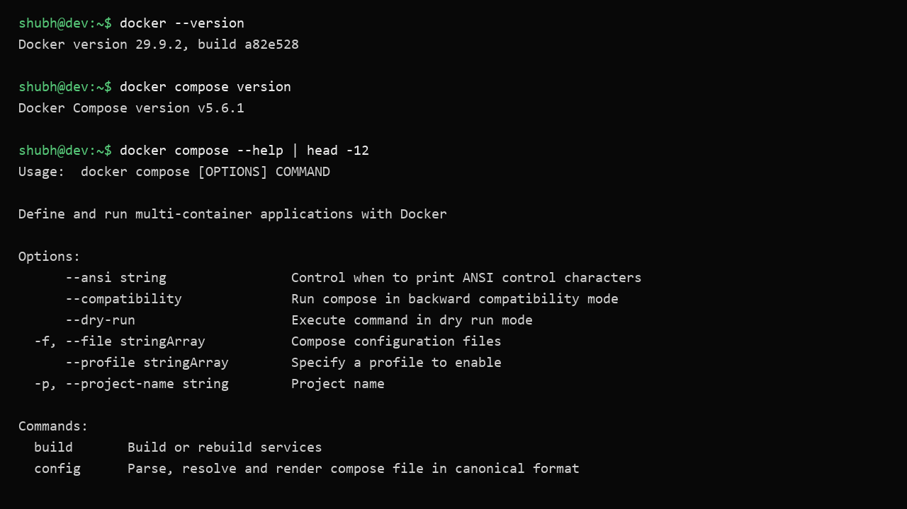
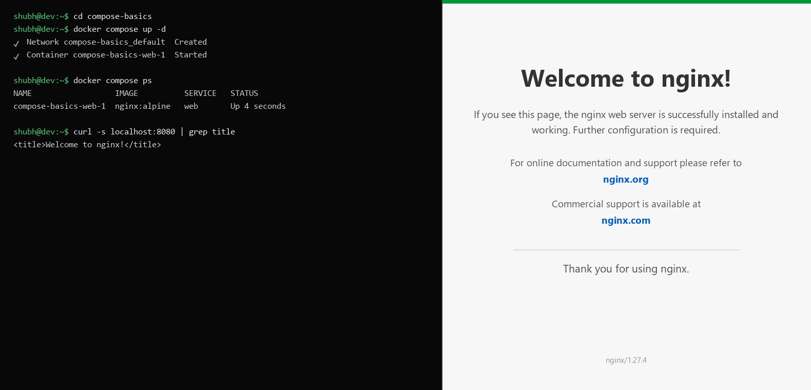
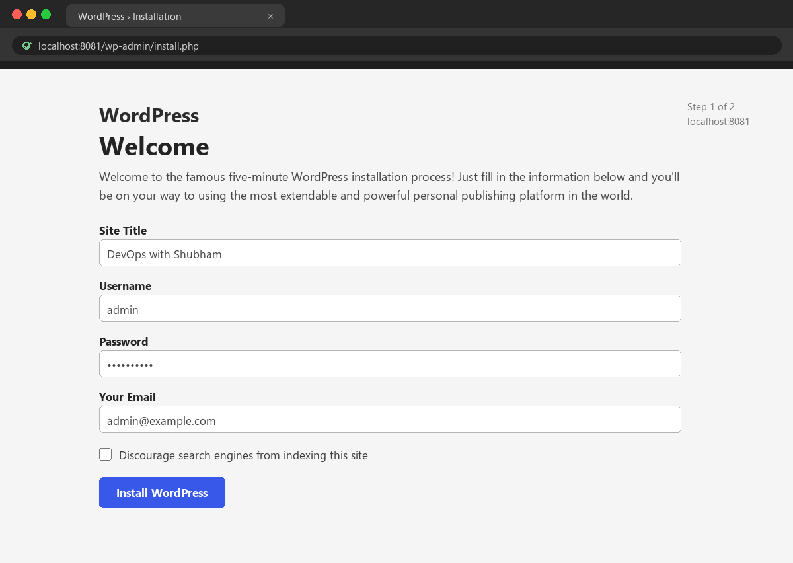
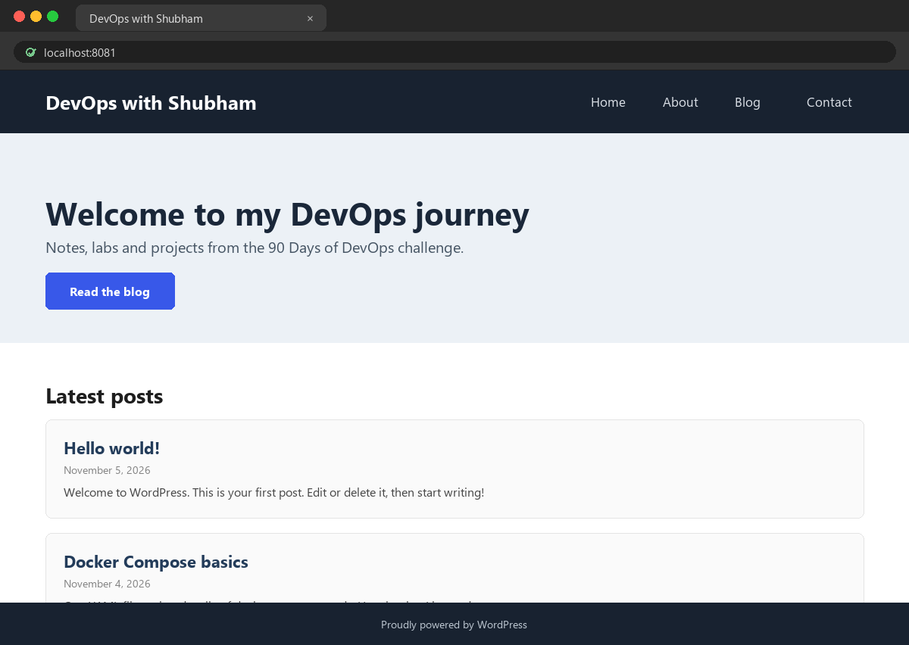
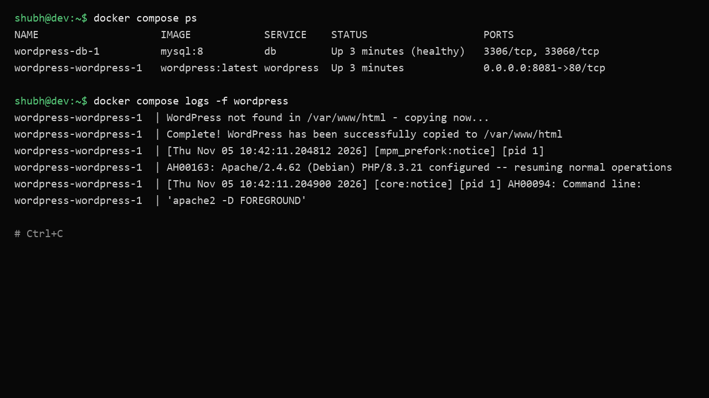
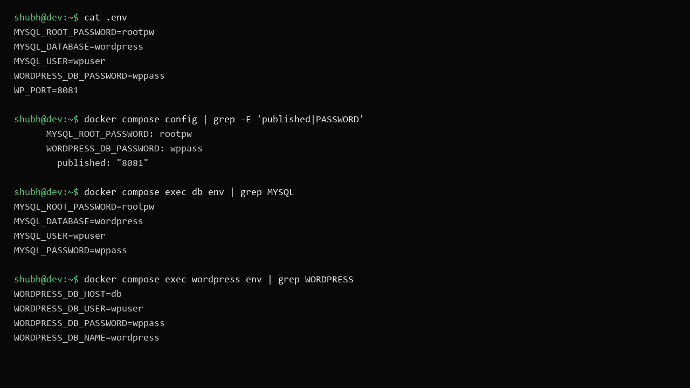

# Day 33 - Docker Compose: Multi-Container Basics

## Task

- Task 1: Install & Verify — check Docker Compose availability and version
- Task 2: First Compose File — folder `compose-basics`, `docker-compose.yml` running single Nginx with port mapping; `up`, browser check, `down`
- Task 3: Two-Container Setup — WordPress + MySQL compose stack: shared network (automatic), named volume for MySQL, WordPress connecting via service name; setup in browser; `down`/`up` persistence check
- Task 4: Compose Commands — detached start, ps, logs (all + specific service), stop without removing, down (remove), rebuild after change
- Task 5: Environment Variables — inline vars in compose file, `.env` file referenced vars, verify pickup

## Environment

| OS / Shell / Tool | Install / Version command |
|---|---|
| OS: Windows 10/11 + WSL2 or Ubuntu VM, Docker Desktop | `docker --version` → [TODO - run on your machine] |
| Docker Compose v2 plugin (bundled with Desktop) | `docker compose version` → [TODO - run on your machine], e.g. `v2.27.0` |
| Shell: bash | `bash --version` |
| Browser | `http://localhost:8080` (nginx), `http://localhost:8081` (wordpress) |
| Images pulled by compose | `nginx:alpine`, `mysql:8`, `wordpress:latest` |

```bash
docker --version
docker compose version
docker compose --help | head -20
```

## Solution

### Task 1: Install & Verify

```bash
docker compose version
docker compose --help | head -20
```

Expected output (example — your values will differ):

```text
Docker Compose version v2.27.0   # [TODO - run on your machine]
```



Notes: Compose v2 is `docker compose` (space, plugin) not the old `docker-compose` (hyphen, Python). No `version:` top key needed — Compose v2 ignores it with a warning. Docker Desktop ships the plugin; on Ubuntu install `docker-compose-plugin` via apt.

**WHY it matters:** every later day (`flask-stack`, `notes-app`, CI pipelines) assumes `docker compose` works. Verifying now avoids debugging YAML that was actually a missing plugin.

### Task 2: Your First Compose File

Companion folder `compose-basics/docker-compose.yml`:

```yaml
services:
  web:
    image: nginx:alpine
    ports:
      - "8080:80"
```

Run the lifecycle:

```bash
cd compose-basics
docker compose config        # validate + render (cheap pre-flight)
docker compose up            # foreground; Ctrl+C stops
curl http://localhost:8080
# open http://localhost:8080 in browser — Nginx welcome page
docker compose down
docker compose ps            # nothing running
```

Expected output (example — your values will differ):

```text
[+] Running 2/2
 ✔ Network compose-basics_default  Created
 ✔ Container compose-basics-web-1  Started
<!DOCTYPE html>...Welcome to nginx!...
[+] Running 2/2
 ✔ Container compose-basics-web-1  Removed
 ✔ Network compose-basics_default  Removed
```



What Compose did automatically: created network `compose-basics_default`, one container `compose-basics-web-1`, attached it, published `8080:80`. `down` removed containers + network but there were no volumes to worry about.

**WHY it matters:** one YAML file replaced `docker network create` + `docker run -p …`. That substitution scales: 2 services or 12, the command stays `docker compose up -d`.

### Task 3: Two-Container Setup

Companion folder `wordpress/docker-compose.yml`:

```yaml
services:
  db:
    image: mysql:8
    environment:
      MYSQL_ROOT_PASSWORD: rootpw
      MYSQL_DATABASE: wordpress
      MYSQL_USER: wpuser
      MYSQL_PASSWORD: wppass
    volumes:
      - db_data:/var/lib/mysql

  wordpress:
    image: wordpress:latest
    depends_on:
      - db
    environment:
      WORDPRESS_DB_HOST: db       # service name = DNS name on compose network
      WORDPRESS_DB_USER: wpuser
      WORDPRESS_DB_PASSWORD: wppass
      WORDPRESS_DB_NAME: wordpress
    ports:
      - "8081:80"

volumes:
  db_data:
```

Concept table:

| Compose feature | What it does here |
|---|---|
| default network | both services join `wordpress_default`; `db` resolves via embedded DNS |
| `db_data` volume | MySQL datadir persists across `down`/`up` |
| `WORDPRESS_DB_HOST: db` | app config uses **service name**, never an IP |
| `depends_on: [db]` | start order only — WordPress may still retry while MySQL initializes |

Run it:

```bash
cd wordpress
docker compose up -d
docker compose ps
docker compose logs -f db | grep -i "ready for connections"
# open http://localhost:8081 — complete the WordPress setup wizard
docker compose down
docker compose up -d
# open http://localhost:8081 again — configured site loads, NOT the wizard
docker volume ls | grep db_data
```

Expected output (example — your values will differ):

```text
NAME                IMAGE             STATUS
wordpress-db-1        mysql:8           Up (healthy-ish)
wordpress-wordpress-1 wordpress:latest  Up
# volume: wordpress_db_data   [TODO - run on your machine]
```



Persistence proof: after `down` (without `-v`) + `up`, the wizard does not reappear because `db_data` survived. `down -v` would wipe it — the destructive variant.



**WHY it matters:** this is the canonical stateful compose pattern — app + database, DNS by service name, data on a named volume. Days 34/36 reuse it with Flask/Postgres.

### Task 4: Compose Commands

```bash
docker compose up -d                 # detached start
docker compose ps                    # running services (+ ports, status)
docker compose logs -f               # all services, follow
docker compose logs -f wordpress     # one service only
docker compose logs --tail 50 db     # last 50 lines, no follow
docker compose stop                  # stop containers, KEEP them + network + volumes
docker compose start                 # restart stopped stack
docker compose down                  # remove containers + network (volumes kept)
docker compose down -v               # also remove named volumes — DATA LOSS
docker compose up -d --build         # rebuild images after Dockerfile/code change
docker compose config                # validate + render final YAML (env substituted)
docker compose exec db env | grep MYSQL
docker compose exec wordpress env | grep WORDPRESS
```

Command cheat table:

| Command | Containers | Network | Volumes |
|---|---|---|---|
| `stop` / `start` | stopped/restarted | kept | kept |
| `down` | removed | removed | **kept** |
| `down -v` | removed | removed | **removed** |
| `up --build` | rebuilt + restarted | kept/created | kept |



**WHY it matters:** knowing `stop` vs `down` vs `down -v` prevents the classic "where did my database go" incident. `config` is the fastest YAML debugger.

### Task 5: Environment Variables

Inline vars (values baked in the YAML):

```yaml
services:
  web:
    image: nginx:alpine
    environment:
      - NGINX_HOST=example.com
      - DEBUG=false
```

`.env` file next to compose (companion `wordpress/.env` holds the real secrets — never commit it):

```text
MYSQL_ROOT_PASSWORD=rootpw
WORDPRESS_DB_PASSWORD=wppass
WP_PORT=8081
```

Referenced from compose:

```yaml
services:
  db:
    image: mysql:8
    environment:
      MYSQL_ROOT_PASSWORD: ${MYSQL_ROOT_PASSWORD}
  wordpress:
    image: wordpress:latest
    ports:
      - "${WP_PORT}:80"
    environment:
      WORDPRESS_DB_PASSWORD: ${WORDPRESS_DB_PASSWORD}
```

Verify pickup:

```bash
docker compose config        # shows 8081, rootpw substituted — proves .env read
docker compose up -d
docker compose exec db env | grep MYSQL
docker compose exec wordpress env | grep WORDPRESS
# MYSQL_ROOT_PASSWORD=rootpw ...
```



| Mechanism | Scope | Committed? |
|---|---|---|
| `environment:` in YAML | inside container | yes (don't put secrets here) |
| `.env` + `${VAR}` | substitution into YAML | **no — add to `.gitignore`** |
| `env_file:` | bulk-load file into container | no if it holds secrets |

```bash
echo ".env" >> .gitignore
nano .gitignore
```

**WHY it matters:** secrets handling separates juniors from production engineers. `.env` + `.gitignore` + `config` verification is the workflow every pipeline and K8s manifest builds on.

## Commands Used

```bash
docker --version
docker compose version
cd compose-basics && docker compose config
docker compose up
curl http://localhost:8080
docker compose down
cd ../wordpress && docker compose up -d
docker compose ps
docker compose logs -f db
docker compose down
docker compose up -d
docker compose up -d --build
docker compose logs -f
docker compose logs -f wordpress
docker compose stop
docker compose start
docker compose down
docker compose down -v
docker compose config
docker compose exec db env
docker compose exec wordpress env
docker volume ls
```

## Verification

- `docker compose version` prints `v2.x.x` — run it and record the version
- `docker compose config` in `compose-basics/` renders without errors
- Nginx welcome page loads at `http://localhost:8080`; after `down`, `docker compose ps` is empty
- WordPress wizard completes at `http://localhost:8081`; after `down` + `up` the configured site (not wizard) loads
- `docker volume ls` shows `wordpress_db_data` — run and confirm
- `docker compose ps`, `logs -f`, `logs -f wordpress`, `stop`, `start`, `down`, `up -d --build` each run without error
- `docker compose config` shows `.env` values substituted (port `8081`, passwords)
- `docker compose exec db env | grep MYSQL` and `... wordpress env | grep WORDPRESS` show expected vars
- `.env` is listed in `.gitignore` — run `nano .gitignore`

## Key Learnings

- Compose replaces manual `network create` + `volume create` + N×`docker run` with one YAML + one command
- All services auto-join a default network; service names are DNS names
- `depends_on` orders startup only — apps must tolerate slow dependencies (retry logic)
- Named top-level volumes survive `down`/`up`; only `down -v` deletes them
- `.env` feeds `${VAR}` substitution in YAML; `environment:` sets vars inside containers — different mechanisms
- Never commit `.env` — secrets stay local, `config` proves substitution without leaking
- `docker compose config` is the fastest YAML + env debugger
- `stop` keeps everything, `down` removes containers/network, `down -v` also wipes data

## Troubleshooting / Gotchas

- `version: "3"` obsolete warning — Compose v2 ignores the top-level `version` key. Cause: copied old tutorial. Fix: delete the `version:` line
- WordPress `Error establishing a database connection` right after `up` — MySQL still initializing. Cause: `depends_on` isn't readiness. Fix: wait 20–30s, `docker compose logs db`, refresh browser
- Data "lost" after `down`/`up` — actually used `down -v`. Cause: `-v` deletes volumes. Fix: plain `down` to keep data; restore from backup if wiped
- `bind: address already in use` on `up` — host port taken. Cause: another stack/service on 8080/8081. Fix: `docker ps`, change host port, or stop the conflict
- `.env` edits ignored — containers already created with old values. Cause: Compose reads `.env` at `up` time only. Fix: `docker compose up -d` again (or `--force-recreate`)
- `WORDPRESS_DB_HOST` typo (`mysql` vs `db`) — DNS failure. Cause: must match the service key exactly. Fix: `WORDPRESS_DB_HOST: db`
- Old `docker-compose` (hyphen) `command not found` — v1 not installed. Cause: following pre-2023 guides. Fix: use `docker compose` (space) — the v2 plugin
- MySQL container exits immediately — bad permissions/env on Windows bind paths. Cause: mounting Windows paths into MySQL datadir. Fix: use a named volume (as in this stack), not a bind mount, for DB data

## Screenshots

Screenshots are embedded in the task sections above and saved in `2026/day-33/screenshots/`:

| File | Shows | Embedded in |
|---|---|---|
| `01-compose-version.png` | `docker --version` + `docker compose version` + help output | Task 1 |
| `02-nginx-compose-up.png` | `docker compose up -d`, `ps`, `curl` + browser Nginx welcome at `:8080` | Task 2 |
| `03-wordpress-wizard.png` | WordPress setup wizard at `http://localhost:8081` | Task 3 |
| `04-wordpress-persist.png` | configured site after `down` + `up` (no wizard) | Task 3 |
| `05-compose-ps-logs.png` | `docker compose ps` + `logs -f wordpress` output | Task 4 |
| `06-env-config.png` | `docker compose config` substitutions + container env vars | Task 5 |
