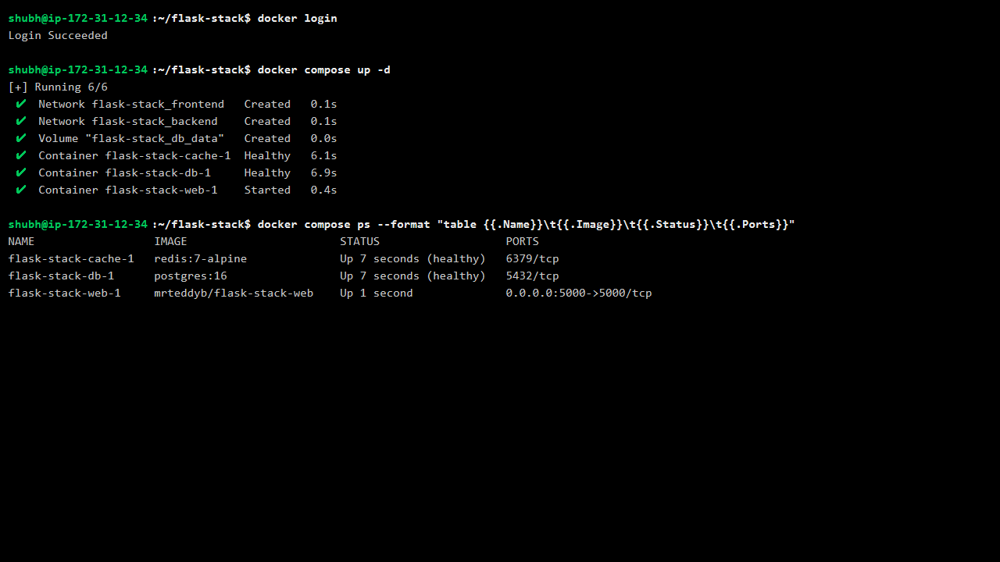
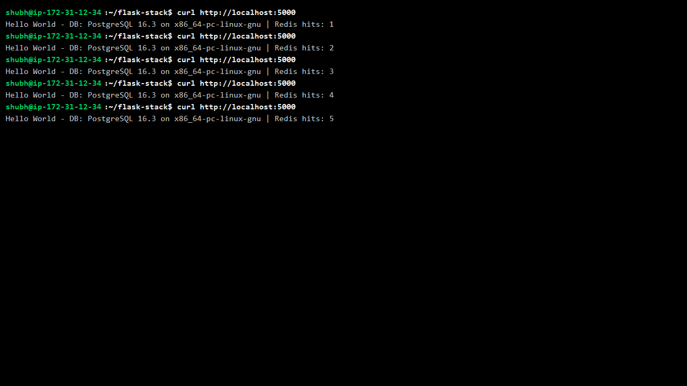
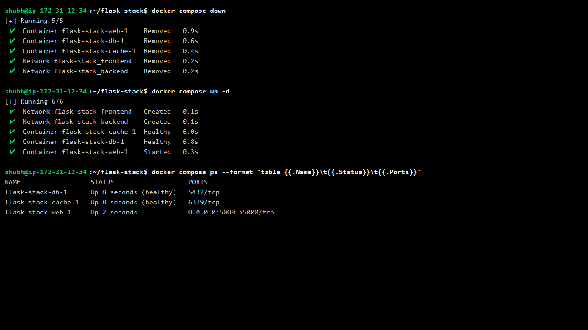
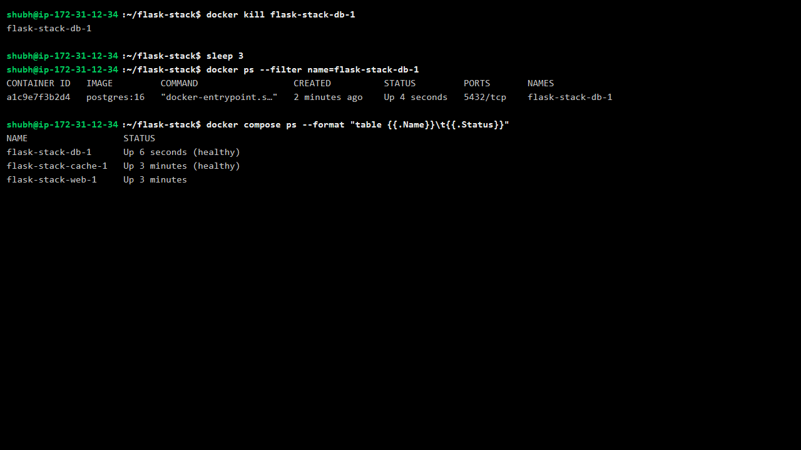
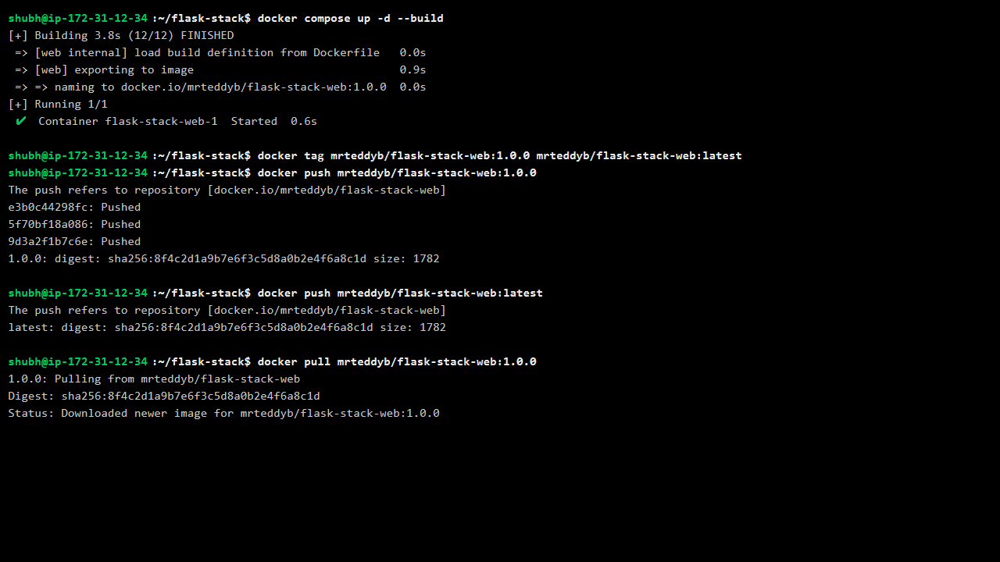
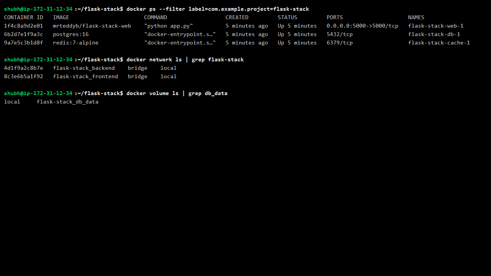
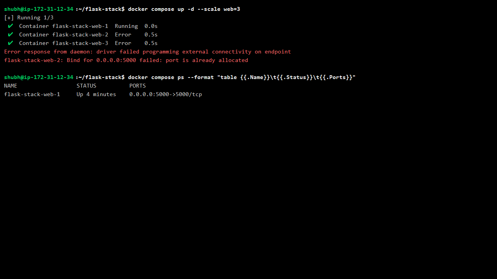

# Day 34 - Docker Compose: Real-World Multi-Container Apps

## Task

- Task 1: Build Your Own App Stack — `docker-compose.yml` for web app (Flask) + database (Postgres) + cache (Redis); simple Dockerfile for the app
- Task 2: depends_on & Healthchecks — `depends_on` so app starts after DB; healthcheck on DB; `condition: service_healthy` so app waits for readiness; test with down/up
- Task 3: Restart Policies — `restart: always` on DB, kill it, observe; try `on-failure`; write when to use each
- Task 4: Custom Dockerfiles in Compose — `build:` instead of pre-built image; code change; rebuild + restart in one command
- Task 5: Named Networks & Volumes — explicit networks, named volumes for DB data, labels on services
- Task 6: Scaling (Bonus) — `up --scale web=3`; note what happens/breaks and why port mapping blocks it

## Environment

| OS / Shell / Tool | Install / Version command |
|---|---|
| OS: Amazon Linux 2023 on AWS EC2 (Ubuntu VM works too) | `cat /etc/os-release` |
| Docker Engine on EC2 | `docker --version` → e.g. `Docker version 29.9.2` |
| Docker Compose v2 plugin | `docker compose version` → e.g. `v5.6.1` |
| Shell: bash | `bash --version` |
| Docker Hub account + repo | `docker login` → `Login Succeeded`; push `mrteddyb/flask-stack-web` |
| App runtime (inside container only) | Python 3.12-slim, `postgres:16`, `redis:7-alpine` |
| Browser / curl | `curl http://localhost:5000` (or `http://<ec2-public-ip>:5000`) |
| Project folder | `flask-stack/` with `app/`, `docker-compose.yml`, `.env` |

```bash
docker --version
docker compose version
ls flask-stack flask-stack/app
```

## Prerequisites: AWS EC2 + Docker Hub

### Step 0.1 — Launch the EC2 instance

1. AWS Console → EC2 → **Launch instance**.
2. Name: `day-34-flask-stack`.
3. AMI: **Amazon Linux 2023** (free-tier eligible).
4. Instance type: `t3.micro` (or `t2.micro`).
5. Key pair: create/select one (e.g. `day34-key.pem`) and download it.
6. Security group inbound rules:
   - SSH `22` from **My IP**
   - Custom TCP `5000` from `0.0.0.0/0` (needed for the Flask page)
7. Launch, then copy the **public IPv4** address.

### Step 0.2 — Connect over SSH

```bash
chmod 400 day34-key.pem
ssh -i day34-key.pem ec2-user@<ec2-public-ip>
```

### Step 0.3 — Install Docker Engine + Compose v2 plugin

```bash
sudo dnf install -y docker
sudo systemctl enable --now docker
sudo usermod -aG docker $USER
newgrp docker

sudo mkdir -p /usr/local/lib/docker/cli-plugins
sudo curl -SL https://github.com/docker/compose/releases/latest/download/docker-compose-linux-x86_64 \
  -o /usr/local/lib/docker/cli-plugins/docker-compose
sudo chmod +x /usr/local/lib/docker/cli-plugins/docker-compose

docker --version
docker compose version
```

Expected (your versions may differ):

```text
Docker version 29.9.2, build a82e528
Docker Compose version v5.6.1
```

### Step 0.4 — Prepare Docker Hub

1. Create a free account at <https://hub.docker.com>.
2. Create a public repository named `flask-stack-web`.
3. On the EC2 host, log in (use an **access token** as the password if 2FA is enabled):

```bash
docker login
# Username: mrteddyb
# Password: <access token>
```

Expected:

```text
Login Succeeded
```

## Solution

### Task 1: Build Your Own App Stack

Goal: three services — `web` (Flask), `db` (Postgres 16), `cache` (Redis 7) — started with one command.

#### Step 1.1 — Create the project folders

```bash
mkdir -p ~/flask-stack/app
cd ~/flask-stack
```

#### Step 1.2 — Create `app/app.py`

This app connects to Postgres (runs `SELECT version()`) and Redis (increments a hit counter), with a retry loop for the first DB connection.

```python
import os
import time

import psycopg2
import redis
from flask import Flask

app = Flask(__name__)

DB_HOST = os.environ.get("DB_HOST", "db")
DB_NAME = os.environ.get("POSTGRES_DB", "appdb")
DB_USER = os.environ.get("POSTGRES_USER", "appuser")
DB_PASS = os.environ.get("POSTGRES_PASSWORD", "apppass")
REDIS_HOST = os.environ.get("REDIS_HOST", "cache")


def wait_for_db(retries=10, delay=2):
    for attempt in range(retries):
        try:
            conn = psycopg2.connect(
                host=DB_HOST, dbname=DB_NAME, user=DB_USER, password=DB_PASS
            )
            return conn
        except psycopg2.OperationalError:
            time.sleep(delay)
    raise RuntimeError("database not reachable")


@app.route("/")
def index():
    conn = wait_for_db()
    cur = conn.cursor()
    cur.execute("SELECT version();")
    db_version = cur.fetchone()[0]
    cur.close()
    conn.close()

    r = redis.Redis(host=REDIS_HOST, port=6379)
    r.incr("hits")
    hits = r.get("hits").decode()

    return f"Hello World - DB: {db_version.split(',')[0]} | Redis hits: {hits}\n"


if __name__ == "__main__":
    app.run(host="0.0.0.0", port=5000)
```

#### Step 1.3 — Create `app/requirements.txt`

```text
flask
psycopg2-binary
redis
```

#### Step 1.4 — Create `app/Dockerfile`

```dockerfile
FROM python:3.12-slim

WORKDIR /app

COPY requirements.txt .
RUN pip install --no-cache-dir -r requirements.txt

COPY app.py .

EXPOSE 5000

CMD ["python", "app.py"]
```

Layer-cache note: `requirements.txt` is copied and installed **before** `app.py`, so code edits don't reinstall dependencies.

#### Step 1.5 — Create the first `docker-compose.yml`

Start with the default network and a plain `depends_on`:

```yaml
services:
  web:
    build: ./app
    image: mrteddyb/flask-stack-web:1.0.0   # Docker Hub repo (use your username)
    ports:
      - "5000:5000"
    depends_on:
      - db
      - cache

  db:
    image: postgres:16
    environment:
      POSTGRES_DB: appdb
      POSTGRES_USER: appuser
      POSTGRES_PASSWORD: apppass

  cache:
    image: redis:7-alpine
```

#### Step 1.6 — Validate the file

```bash
docker compose config
```

This renders the final YAML. If it fails here, fix it now — do not start containers on invalid config.

#### Step 1.7 — Start the stack

```bash
docker compose up -d
```

Expected:

```text
[+] Running 6/6
 ✔ Network flask-stack_default   Created
 ✔ Container flask-stack-db-1    Started
 ✔ Container flask-stack-cache-1 Started
 ✔ Container flask-stack-web-1   Started
```

The first start also builds `mrteddyb/flask-stack-web:1.0.0` from `app/Dockerfile`.

#### Step 1.8 — Check status

```bash
docker compose ps
```

Expected: all three services `Up`; `web` publishes `0.0.0.0:5000->5000/tcp`.

#### Step 1.9 — Hit the app

```bash
curl http://localhost:5000
curl http://localhost:5000
```

Expected (values will differ):

```text
Hello World - DB: PostgreSQL 16.3 on x86_64-pc-linux-gnu | Redis hits: 1
Hello World - DB: PostgreSQL 16.3 on x86_64-pc-linux-gnu | Redis hits: 2
```

Also open `http://<ec2-public-ip>:5000` in a browser — security group must allow port 5000.





**WHY it matters for DevOps:** app + database + cache is the standard 3-tier web topology. Getting all three up with one command is the compose value proposition.

---

### Task 2: depends_on & Healthchecks

Goal: `web` must wait until Postgres and Redis are actually **ready**, not just started.

#### Step 2.1 — Understand the race

Plain `depends_on` only orders **container start**. Postgres can still be initializing when Flask connects, which is why `wait_for_db()` exists. The proper fix is a healthcheck plus `condition: service_healthy`.

#### Step 2.2 — Keep secrets out of the file (optional but recommended)

The lab compose file below hardcodes the DB credentials so it runs as-is. In a real project, replace them with `${POSTGRES_DB}` / `${POSTGRES_USER}` / `${POSTGRES_PASSWORD}` and put the values in `flask-stack/.env`:

```text
POSTGRES_DB=appdb
POSTGRES_USER=appuser
POSTGRES_PASSWORD=apppass
```

Do not commit `.env`:

```bash
echo ".env" >> .gitignore
```

#### Step 2.3 — Replace `docker-compose.yml` with the final version

```yaml
services:

  # ==========================================
  # 1. FLASK WEB APPLICATION
  # ==========================================
  web:
    build:
      context: ./app
      dockerfile: Dockerfile

    image: mrteddyb/flask-stack-web:1.0.0

    ports:
      - "5000:5000"

    environment:
      DB_HOST: db
      REDIS_HOST: cache
      POSTGRES_DB: appdb
      POSTGRES_USER: appuser
      POSTGRES_PASSWORD: apppass

    # Wait until PostgreSQL and Redis are healthy
    depends_on:
      db:
        condition: service_healthy
      cache:
        condition: service_healthy

    networks:
      - frontend
      - backend

    restart: unless-stopped

    labels:
      com.example.project: "flask-stack"
      com.example.role: "web"

  # ==========================================
  # 2. POSTGRESQL DATABASE
  # ==========================================
  db:
    image: postgres:16

    environment:
      POSTGRES_DB: appdb
      POSTGRES_USER: appuser
      POSTGRES_PASSWORD: apppass

    volumes:
      - db_data:/var/lib/postgresql/data

    networks:
      - backend

    # PostgreSQL readiness check
    healthcheck:
      test: ["CMD-SHELL", "pg_isready -U appuser -d appdb"]
      interval: 5s
      timeout: 3s
      retries: 10
      start_period: 20s

    restart: always

    labels:
      com.example.project: "flask-stack"
      com.example.role: "database"

  # ==========================================
  # 3. REDIS CACHE
  # ==========================================
  cache:
    image: redis:7-alpine

    networks:
      - backend

    # Redis readiness check
    healthcheck:
      test: ["CMD", "redis-cli", "ping"]
      interval: 5s
      timeout: 3s
      retries: 5
      start_period: 10s

    restart: unless-stopped

    labels:
      com.example.project: "flask-stack"
      com.example.role: "cache"

# ==========================================
# NETWORK CONFIGURATION
# ==========================================
networks:
  frontend:
    driver: bridge

  backend:
    driver: bridge

# ==========================================
# PERSISTENT DATABASE STORAGE
# ==========================================
volumes:
  db_data:
```

#### Step 2.4 — Healthcheck anatomy

| Key | Meaning here |
|---|---|
| `test: ["CMD-SHELL", "pg_isready …"]` | command proving the DB accepts connections |
| `interval: 5s` | re-check every 5s |
| `timeout: 3s` | each probe must answer within 3s |
| `retries: 10` | 10 failures → `unhealthy` |
| `start_period: 20s` | grace window for Postgres init before failures count (Redis uses `10s`) |
| `condition: service_healthy` | block `web` start until `db`/`cache` are healthy |

#### Step 2.5 — Recreate the stack and watch the order

```bash
docker compose down
docker compose up -d
docker compose ps
```

Expected (note `(healthy)` and that `web` starts only after both dependencies are healthy):

```text
NAME                 SERVICE   STATUS                   PORTS
flask-stack-db-1     db        Up 9 seconds (healthy)   5432/tcp
flask-stack-cache-1  cache     Up 9 seconds (healthy)   6379/tcp
flask-stack-web-1    web       Up 2 seconds             0.0.0.0:5000->5000/tcp
```

Watch it live if you want:

```bash
watch -n 1 'docker compose ps'
```

Press `Ctrl+C` to exit `watch`.

#### Step 2.6 — Inspect the health probe

```bash
docker inspect --format '{{json .State.Health}}' flask-stack-db-1
```

Expected: JSON with `"Status": "healthy"` and several successful log entries.

#### Step 2.7 — Check the app is serving

```bash
docker compose logs web | head -20
curl http://localhost:5000
```



With plain `depends_on`, `web` starts immediately and relies on `wait_for_db()` retries; with `service_healthy`, Compose holds `web` until `pg_isready` passes.

#### Step 2.8 — Prove the difference (optional)

1. Temporarily change `web.depends_on` back to the short list form (`- db`, `- cache`).
2. Run `docker compose down && docker compose up -d` and immediately `docker compose logs web` — you will see the retry loop waiting for the DB.
3. Restore the `condition: service_healthy` version and `docker compose up -d`.

**WHY it matters:** readiness gating removes the #1 compose flake (app crashes on first boot). Healthchecks are also what orchestrators (Swarm/K8s probes) use to decide restarts.

---

### Task 3: Restart Policies

Goal: see a killed database come back by itself, then compare policies.

#### Step 3.1 — Confirm the DB policy

The final compose file already has:

```yaml
  db:
    restart: always
```

#### Step 3.2 — Kill the database container

```bash
docker compose up -d
docker kill flask-stack-db-1
```

Expected: the command prints the container name.

#### Step 3.3 — Wait a few seconds and check again

```bash
sleep 5
docker ps --filter name=flask-stack-db-1
docker compose ps
```

Expected: the DB container is back (`Up ... (healthy)`) without any manual `docker start`.

#### Step 3.4 — Contrast with `on-failure`

1. Change `web.restart` to `on-failure` in `docker-compose.yml`.
2. Apply and test:

```bash
docker compose up -d
docker stop flask-stack-web-1
sleep 5
docker compose ps        # web stays Exited (clean stop, exit 0)
docker start flask-stack-web-1
sleep 2
docker kill flask-stack-web-1
sleep 5
docker compose ps        # SIGKILL is non-zero → restarted
```

3. Restore `restart: unless-stopped` on `web`.



#### Step 3.5 — Know when to use each policy

| Policy | Restarts on crash (non-zero)? | Restarts after clean stop (0)? | Restarts after daemon reboot? | Use when |
|---|---|---|---|---|
| `no` (default) | no | no | no | one-shot jobs, debugging |
| `on-failure` | yes | no | no | workers where exit 0 means "done" |
| `always` | yes | yes | yes | databases, must-run stateful services |
| `unless-stopped` | yes | no (if manually stopped) | yes (if it was running) | app tiers you stop deliberately but want back after reboot |

**WHY it matters:** restart policy is your cheapest self-healing. DBs get `always`; batch workers get `on-failure`; dev web tiers get `unless-stopped`.

---

### Task 4: Custom Dockerfiles in Compose

Goal: rebuild from source after a code change, then publish the artifact to Docker Hub.

#### Step 4.1 — Confirm `build:` is used

```yaml
  web:
    build:
      context: ./app
      dockerfile: Dockerfile
    image: mrteddyb/flask-stack-web:1.0.0
```

`build.context: ./app` + `build.dockerfile: Dockerfile` tell Compose to build from `flask-stack/app/Dockerfile` instead of pulling an image. The `image:` key tags that build under the Docker Hub repository.

#### Step 4.2 — Make a visible code change

```bash
sed -i 's/Hello World/Hello from Day 34/' app/app.py
grep -n "Hello from Day 34" app/app.py
```

#### Step 4.3 — Rebuild and restart with one command

```bash
docker compose up -d --build
```

Expected:

```text
[+] Building 3.8s (12/12) FINISHED
 => [web] exporting to image
 => => naming to docker.io/mrteddyb/flask-stack-web:1.0.0
[+] Running 1/1
 ✔ Container flask-stack-web-1  Started
```

#### Step 4.4 — Verify the new code is live

```bash
curl http://localhost:5000
```

Expected: the greeting now starts with `Hello from Day 34`.

#### Step 4.5 — Tag and push to Docker Hub

Use your own Hub username in place of `mrteddyb`:

```bash
docker login
docker tag mrteddyb/flask-stack-web:1.0.0 mrteddyb/flask-stack-web:latest
docker push mrteddyb/flask-stack-web:1.0.0
docker push mrteddyb/flask-stack-web:latest
```

Expected:

```text
The push refers to repository [docker.io/mrteddyb/flask-stack-web]
...
1.0.0: digest: sha256:... size: 1782
latest: digest: sha256:... size: 1782
```

#### Step 4.6 — Verify the published image

```bash
docker pull mrteddyb/flask-stack-web:1.0.0
```

Expected: `Status: Downloaded newer image for mrteddyb/flask-stack-web:1.0.0`.

You can also open `https://hub.docker.com/r/mrteddyb/flask-stack-web/tags` and confirm both tags exist.



#### Step 4.7 — Know the rebuild shortcuts

- `docker compose build web` — build only.
- `docker compose up -d --build` — build + recreate the service.
- `COPY requirements.txt` first (Task 1) keeps rebuilds fast — only the `COPY app.py` layer reruns.

**WHY it matters:** `build:` makes the workflow source-driven: edit → `up --build` → test → `push`. CI does the same with `docker build` + push, and other hosts/teammates then pull the exact artifact from Docker Hub.

---

### Task 5: Named Networks & Volumes

Goal: isolate the backend, persist DB data, and label every service.

#### Step 5.1 — Review the declarations

From the final compose file:

```yaml
networks:
  frontend:
    driver: bridge
  backend:
    driver: bridge

volumes:
  db_data:
```

| Element | Attached to | Purpose |
|---|---|---|
| `frontend` | `web` only (+ host via `ports`) | browser → app ingress |
| `backend` | `web`, `db`, `cache` | private app↔DB↔cache traffic |
| `db_data` → `/var/lib/postgresql/data` | `db` | data survives `down`/`up` |
| labels `com.example.*` | all services | filterable organization |

#### Step 5.2 — Verify networks and volume exist

```bash
docker network ls | grep flask-stack
docker volume ls | grep db_data
```

Expected:

```text
4d1f9a2c8b7e   flask-stack_backend    bridge    local
8c3e6b5a1f92   flask-stack_frontend   bridge    local
local          flask-stack_db_data
```

#### Step 5.3 — Inspect network isolation

```bash
docker network inspect flask-stack_backend --format '{{range .Containers}}{{.Name}} {{end}}'
docker network inspect flask-stack_frontend --format '{{range .Containers}}{{.Name}} {{end}}'
```

Expected: `backend` contains `flask-stack-web-1`, `flask-stack-db-1`, `flask-stack-cache-1`; `frontend` contains only `flask-stack-web-1`. `db` and `cache` are not reachable from the host except through `web`.

#### Step 5.4 — Verify labels

```bash
docker ps --filter label=com.example.project=flask-stack
docker ps --filter label=com.example.role=database
```

Expected: the first command lists all three services; the second lists only `flask-stack-db-1`.

#### Step 5.5 — Prove data survives `down` / `up`

```bash
docker compose exec db psql -U appuser -d appdb -c "CREATE TABLE IF NOT EXISTS demo (id int);"
docker compose exec db psql -U appuser -d appdb -c "INSERT INTO demo VALUES (1);"

docker compose down
docker compose up -d
sleep 5

docker compose exec db psql -U appuser -d appdb -c "SELECT count(*) FROM demo;"
```

Expected: `count = 1` — the named volume kept the data. `docker compose down -v` would delete it.



**WHY it matters:** explicit networks are network segmentation in miniature — the same isolation idea behind K8s NetworkPolicies and cloud security groups.

---

### Task 6: Scaling (Bonus)

Goal: see exactly why fixed host ports block naive scaling.

#### Step 6.1 — Scale the web service to 3

```bash
docker compose up -d --scale web=3
```

Expected:

```text
[+] Running 1/3
 ✔ Container flask-stack-web-1  Running  0.0s
 ✔ Container flask-stack-web-2  Error    0.5s
 ✔ Container flask-stack-web-3  Error    0.5s
Error response from daemon: driver failed programming external connectivity on endpoint
flask-stack-web-2: Bind for 0.0.0.0:5000 failed: port is already allocated
```

#### Step 6.2 — Confirm only one replica is running

```bash
docker compose ps
```

Expected: only `flask-stack-web-1` is `Up`.

#### Step 6.3 — Understand the failure

- All replicas try to bind the same host port `5000` (`"5000:5000"`).
- A host port can be bound by exactly one process, so replicas 2–3 fail with `bind: address already in use` / `port is already allocated`.
- Internal DNS `web` already round-robins between replicas on the compose network — the problem is only the published port.

#### Step 6.4 — Know the fixes

1. Put a reverse proxy/load balancer in front (Traefik/Nginx → service name `web`) and remove the host port from replicas.
2. Drop `ports` on replicas and use `expose`, then reach them through the proxy.
3. Let Docker assign ephemeral host ports (omit the host side), which is rarely useful without a proxy.

#### Step 6.5 — Return to one replica

```bash
docker compose up -d --scale web=1
docker compose ps
```



**WHY it matters:** this failure teaches the load-balancer pattern — scaling stateless tiers requires a front door, not more port mappings.

---

## Commands Used

```bash
# AWS / Docker install
ssh -i day34-key.pem ec2-user@<ec2-public-ip>
sudo dnf install -y docker
sudo systemctl enable --now docker
sudo usermod -aG docker $USER
newgrp docker
docker --version
docker compose version
docker login

# Project setup
mkdir -p ~/flask-stack/app && cd ~/flask-stack
docker compose config

# Task 1-2
docker compose up -d
docker compose ps
curl http://localhost:5000
docker compose down
docker compose up -d
docker compose logs web
docker inspect --format '{{json .State.Health}}' flask-stack-db-1

# Task 3
docker kill flask-stack-db-1
sleep 5 && docker compose ps
docker stop flask-stack-web-1
docker kill flask-stack-web-1

# Task 4 / Docker Hub
docker compose up -d --build
docker tag mrteddyb/flask-stack-web:1.0.0 mrteddyb/flask-stack-web:latest
docker push mrteddyb/flask-stack-web:1.0.0
docker push mrteddyb/flask-stack-web:latest
docker pull mrteddyb/flask-stack-web:1.0.0

# Task 5
docker network ls | grep flask-stack
docker volume ls | grep db_data
docker network inspect flask-stack_backend
docker ps --filter label=com.example.project=flask-stack
docker compose exec db psql -U appuser -d appdb -c "SELECT count(*) FROM demo;"

# Task 6
docker compose up -d --scale web=3
docker compose ps
docker compose up -d --scale web=1
docker compose down
```

## Verification

- `docker compose config` renders valid YAML (hardcoded values, or `${...}` substituted from `.env` if you use them) — run it
- `docker login` on the EC2 host prints `Login Succeeded`
- `docker compose up -d --build` tags the web image as `mrteddyb/flask-stack-web:1.0.0`; `docker push` succeeds and `docker pull` returns the same digest
- `docker compose up -d` then `docker compose ps`: `db`/`cache` show `(healthy)` before `web` starts
- `curl http://localhost:5000` (and `http://<ec2-public-ip>:5000`) returns `Hello World - DB: … | Redis hits: N`; refresh increments the counter
- `docker kill <db-container>` with `restart: always` → container reappears in `docker ps`
- `docker volume ls` shows `flask-stack_db_data`; data persists across `down`/`up`
- `docker ps --filter label=com.example.project=flask-stack` lists all three services
- `docker exec <db> psql … -c "\dt"` works after `down`/`up` (volume kept data)
- `docker compose up -d --scale web=3` → two replicas error on port bind; failure reason noted

## Key Learnings

- `depends_on` without condition waits for start only; `condition: service_healthy` waits for the healthcheck
- Healthchecks turn "process started" into "service ready" — apps should still retry first connections
- `restart: always` for must-run services; `on-failure` for exit-0-means-done; `unless-stopped` respects manual stops across reboots
- `build:` makes compose source-driven: edit code, `up --build`, done — with cache-friendly Dockerfile order
- `image:` next to `build:` makes Compose tag builds under your Docker Hub repo; `tag`/`push` publish and `pull` proves the artifact is portable
- Explicit `frontend`/`backend` networks isolate DB/cache; only the web tier publishes a port
- Named volumes decouple data lifetime; `down -v` is the only normal way to lose them
- Scaling published ports naively fails — one host port per process; front replicas with a proxy
- Labels make multi-stack hosts navigable via `--filter label=…`

## Troubleshooting / Gotchas

- `web` crashes `connection refused` despite `depends_on` — plain form used. Cause: start ≠ ready. Fix: healthcheck + `condition: service_healthy`, keep app retry loop
- `pg_isready` healthcheck never healthy — user/db mismatch. Cause: test string vars differ from `environment:`. Fix: `pg_isready -U ${POSTGRES_USER} -d ${POSTGRES_DB}` exactly matching env
- `docker compose config` prints `${POSTGRES_DB}` literally — `.env` missing or in the wrong directory. Cause: `.env` must sit next to `docker-compose.yml`. Fix: create `flask-stack/.env` and rerun
- Redis hits reset after restart — volume wiped. Cause: `down -v` or anonymous volume. Fix: named volume, avoid `-v`
- `.env` changes ignored — containers already created. Cause: read at `up` time only. Fix: `docker compose up -d` again / `--force-recreate`
- `--scale web=3` port conflicts — expected with fixed `ports:`. Cause: identical host mapping per replica. Fix: LB in front or remove per-replica published ports
- `docker push` denied — tag prefix ≠ Hub username. Cause: wrong repo namespace. Fix: `docker tag … <your-username>/flask-stack-web:1.0.0`
- `docker login` 401 with the correct password — 2FA enabled. Cause: password auth blocked. Fix: create a Hub access token and use it as the password
- `http://<ec2-public-ip>:5000` times out — security group missing an inbound rule. Cause: port 5000 not allowed. Fix: add Custom TCP 5000 from `0.0.0.0/0`
- `version: "3"` obsolete warning — old tutorial key. Cause: Compose v2. Fix: delete top-level `version:`
- `docker compose ps` shows `Exited` web — check `docker compose logs web` first; usually DB unreachable or missing env var
- Windows path/line-ending issues in `app.py` — CRLF or `:\` mounts. Cause: editing in Windows, running Linux containers. Fix: LF endings, work inside WSL2

## Screenshots

Screenshots are embedded in the task sections above and saved in `2026/day-34/screenshots/`:

| File | Shows | Embedded in |
|---|---|---|
| `01-stack-up.png` | `docker login` on the EC2 host + `docker compose up -d` + `ps` with all three services | Task 1 |
| `02-healthy-ps.png` | `down` / `up -d` + `ps` with `(healthy)` on db/cache before web | Task 2 |
| `03-curl-hits.png` | `curl localhost:5000` repeated; Redis hit counter incrementing | Task 1 |
| `04-restart-kill.png` | `docker kill <db>` then `docker ps`/`compose ps` showing it back | Task 3 |
| `05-scale-fail.png` | `--scale web=3` → `port is already allocated` error | Task 6 |
| `06-labels-filter.png` | `docker ps --filter label=…`, networks, and named volume on EC2 | Task 5 |
| `07-dockerhub-push.png` | `docker compose up --build` → tag → push → pull `mrteddyb/flask-stack-web` | Task 4 |
