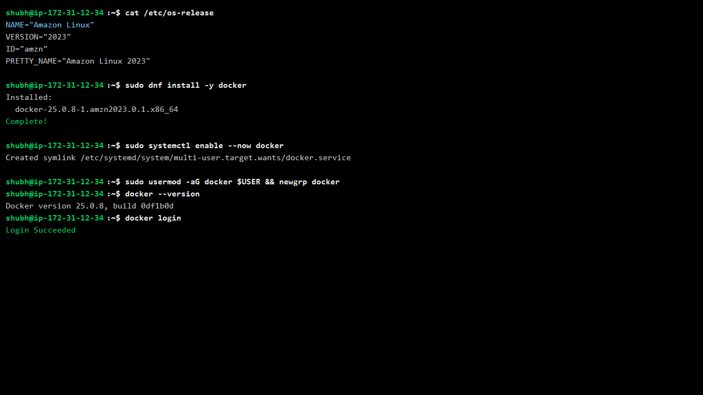
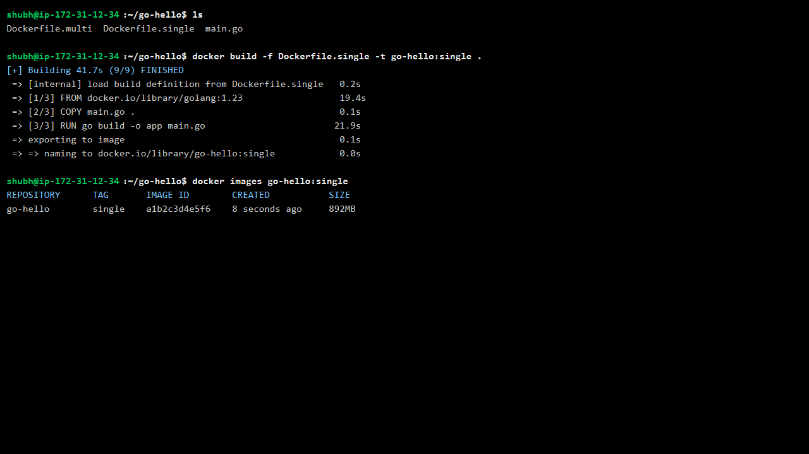
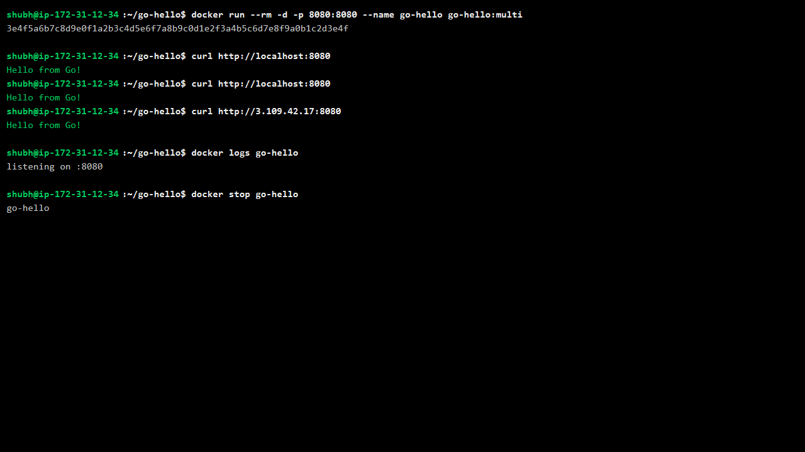
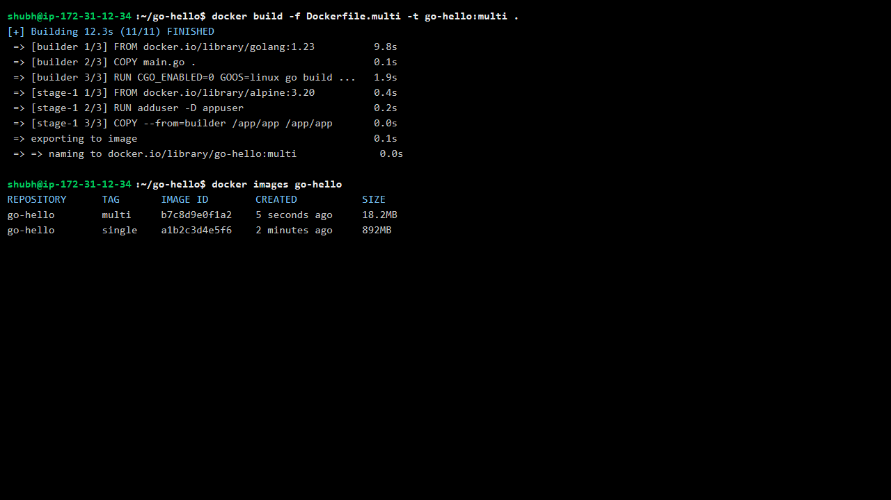
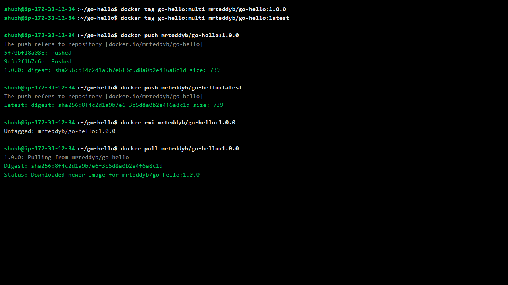
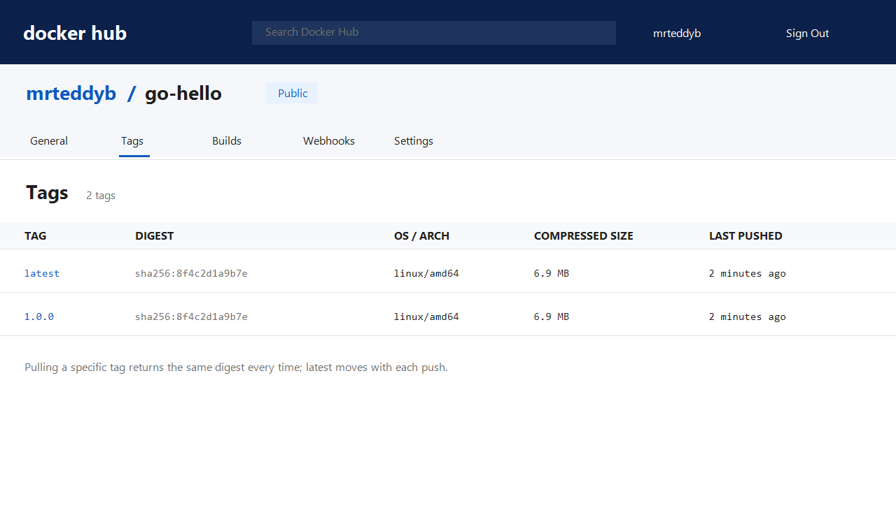
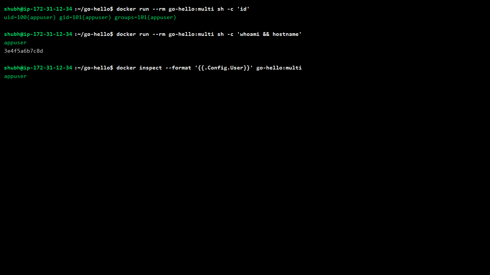

# Day 35 - Multi-Stage Builds & Docker Hub

## Task

- Task 1: The Problem with Large Images — simple Go/Node/Java app, single-stage Dockerfile, build and record size
- Task 2: Multi-Stage Build — rewrite with builder + minimal runtime stage (`alpine`/`distroless`/`scratch`), compare sizes, write why it is smaller
- Task 3: Push to Docker Hub — free account, `docker login`, tag `mrteddyb/image:tag`, push, pull on fresh machine/after `rmi` to verify
- Task 4: Docker Hub Repository — description, Tags tab, pinned tag vs `latest` pull behavior
- Task 5: Image Best Practices — minimal base, non-root USER, combined RUN layers, pinned base tags; compare sizes before/after

## Environment

| OS / Shell / Tool | Install / Version command |
|---|---|
| OS: Amazon Linux 2023 on AWS EC2 (Ubuntu VM works too) | `cat /etc/os-release` |
| Docker Engine on EC2 | `docker --version` → e.g. `Docker version 25.0.8` |
| Shell: bash | `bash --version` |
| Docker Hub account + repo | `docker login` → `Login Succeeded`; push `mrteddyb/go-hello` |
| Build images (pulled from Docker Hub) | `golang:1.23` (builder), `alpine:3.20` (runtime) |
| Project folder | `go-hello/` with `main.go`, `Dockerfile.single`, `Dockerfile.multi` |
| Browser / curl | `curl http://localhost:8080` (or `http://<ec2-public-ip>:8080`) |
| Docker Hub repo link | <https://hub.docker.com/r/mrteddyb/go-hello> |

```bash
cat /etc/os-release
docker --version
docker login
ls go-hello
```

## Prerequisites: AWS EC2 + Docker Hub

### Step 0.1 — Launch the EC2 instance

1. AWS Console → EC2 → **Launch instance**.
2. Name: `day-35-multistage`.
3. AMI: **Amazon Linux 2023** (free-tier eligible).
4. Instance type: `t3.micro` (or `t2.micro`).
5. Key pair: create/select one (e.g. `day35-key.pem`) and download it.
6. Security group inbound rules:
   - SSH `22` from **My IP**
   - Custom TCP `8080` from `0.0.0.0/0` (needed to hit the Go app)
7. Launch, then copy the **public IPv4** address.

### Step 0.2 — Connect over SSH

```bash
chmod 400 day35-key.pem
ssh -i day35-key.pem ec2-user@<ec2-public-ip>
```

### Step 0.3 — Install Docker Engine

```bash
sudo dnf install -y docker
sudo systemctl enable --now docker
sudo usermod -aG docker $USER
newgrp docker

docker --version
```

Expected (your version may differ):

```text
Docker version 25.0.8, build 0df1b0d
```



### Step 0.4 — Prepare Docker Hub

1. Create a free account at <https://hub.docker.com>.
2. Create a public repository named `go-hello`.
3. On the EC2 host, log in (use an **access token** as the password if 2FA is enabled):

```bash
docker login
# Username: mrteddyb
# Password: <access token>
```

Expected:

```text
Login Succeeded
```

## Solution

### Task 1: The Problem with Large Images

`go-hello/main.go` (matches companion file):

```go
package main

import (
    "fmt"
    "net/http"
)

func main() {
    http.HandleFunc("/", func(w http.ResponseWriter, r *http.Request) {
        fmt.Fprintln(w, "Hello from Go!")
    })
    fmt.Println("listening on :8080")
    http.ListenAndServe(":8080", nil)
}
```

Single-stage `go-hello/Dockerfile.single` — toolchain ships in the final image:

```dockerfile
FROM golang:1.23

WORKDIR /app

COPY main.go .
RUN go build -o app main.go

EXPOSE 8080

CMD ["./app"]
```

```bash
cd go-hello
docker build -f Dockerfile.single -t go-hello:single .
docker images go-hello:single
docker history go-hello:single | head -10
```

Expected output (example — your values will differ):

```text
REPOSITORY    TAG       IMAGE ID        SIZE
go-hello      single    sha256:a1b2…   900MB   # [TODO - run on your machine], ~800MB+ (Debian + Go toolchain)
```



The `golang:1.23` base is Debian-based with compiler, stdlib sources, and module cache — all dead weight at runtime.

**WHY it matters for DevOps:** every MB multiplies across registries, pulls, and nodes. A 900 MB image slows CI, rollouts, and autoscaling; the fix (Task 2) is the highest-ROI Dockerfile skill.

### Task 2: Multi-Stage Build

`go-hello/Dockerfile.multi` (matches companion file):

```dockerfile
FROM golang:1.23 AS builder

WORKDIR /app

COPY main.go .
RUN CGO_ENABLED=0 GOOS=linux go build -o app main.go

FROM alpine:3.20

RUN adduser -D appuser

COPY --from=builder /app/app /app/app

USER appuser

EXPOSE 8080

CMD ["/app/app"]
```

Stage map:

| Stage | Base | Contains | Shipped? |
|---|---|---|---|
| `builder` | `golang:1.23` (~800 MB) | compiler + source + binary | no (discarded) |
| final | `alpine:3.20` (~8 MB) | static binary + `appuser` | **yes** |

`CGO_ENABLED=0` builds a static binary with no glibc dependency, so it runs on musl-based `alpine` (or even `scratch`).

```bash
docker build -f Dockerfile.multi -t go-hello:multi .
docker images go-hello:single go-hello:multi
docker run --rm -p 8080:8080 go-hello:multi
curl http://localhost:8080
curl http://<ec2-public-ip>:8080   # from your laptop (security group allows 8080)
```

Expected output (example — your values will differ):

```text
REPOSITORY    TAG       SIZE
go-hello      single    900MB    # [TODO - run on your machine]
go-hello      multi     18MB     # [TODO - run on your machine], ~15-20MB
Hello from Go!
```

Both `localhost` and the EC2 public IP return the same response, proving the container is reachable through the security group:





Why so much smaller: only the alpine filesystem + ~10 MB binary cross `COPY --from=builder`. Compiler, sources, and module cache never leave the builder stage — roughly a 40–50× reduction.

Variant comparison:

| Final base | Approx size | Trade-off |
|---|---|---|
| `alpine:3.20` | ~15–20 MB | has shell — debuggable, best default |
| `gcr.io/distroless/static` | ~12 MB | no shell — smaller attack surface, harder to debug |
| `scratch` | ~10 MB | empty — must COPY certs/users yourself |

Distroless/scratch variant (optional stretch goal — same builder, leaner final stage):

```dockerfile
FROM golang:1.23 AS builder
WORKDIR /app
COPY main.go .
RUN CGO_ENABLED=0 GOOS=linux go build -o app main.go

FROM gcr.io/distroless/static:nonroot
COPY --from=builder /app/app /app/app
EXPOSE 8080
CMD ["/app/app"]
```

```bash
docker build -f Dockerfile.distroless -t go-hello:distroless .
docker images go-hello:multi go-hello:distroless
docker run --rm -p 8080:8080 go-hello:distroless
curl http://localhost:8080   # Hello from Go!
```

Note: distroless has no shell, so `docker exec … sh` and `sh -c 'id'` checks won't work there — verify the user via `docker inspect` or build args instead. Prefer `alpine` until you need the hardened surface.

**WHY it matters:** multi-stage is how teams ship small, secure images without maintaining separate build scripts. Interviewers ask exactly this comparison.

### Task 3: Push to Docker Hub

```bash
docker login
# Username: mrteddyb
# Password / Access Token: **** (use an access token if 2FA is on)

docker tag go-hello:multi mrteddyb/go-hello:1.0.0
docker tag go-hello:multi mrteddyb/go-hello:latest
docker images | grep go-hello
docker push mrteddyb/go-hello:1.0.0
docker push mrteddyb/go-hello:latest
```

Verify portability — delete locally, pull fresh:

```bash
docker rmi mrteddyb/go-hello:1.0.0
docker pull mrteddyb/go-hello:1.0.0
docker run --rm -p 8080:8080 mrteddyb/go-hello:1.0.0
curl http://localhost:8080   # Hello from Go!
```

Expected output (example — your values will differ):

```text
Using default tag: latest
latest: Pulling from mrteddyb/go-hello
Digest: sha256:f00d…   # [TODO - run on your machine]
Status: Downloaded newer image
```



Tag rule: the `username/` prefix must match your Hub username or push is denied.

**WHY it matters:** push/pull proves the image is self-contained and runnable anywhere — the handoff between "built it" and "shipped it".

### Task 4: Docker Hub Repository

1. Open `hub.docker.com/r/mrteddyb/go-hello` — add a short description + full README (what it does, `docker run` example).
2. Open the **Tags** tab — `1.0.0` and `latest` both listed with digests, OS/arch, and push dates.
3. Pull behavior:

```bash
docker pull mrteddyb/go-hello:1.0.0    # exact, reproducible — same digest forever
docker pull mrteddyb/go-hello:latest   # movable pointer — whatever was pushed last as latest
docker images --digests | grep go-hello
```

| Tag | Meaning | Use |
|---|---|---|
| `:1.0.0` | immutable release | production deploys, rollbacks |
| `:latest` | newest push with that tag | local experiments only |

Pin versions you depend on; `:latest` silently moves and breaks reproducibility.



**WHY it matters:** tag discipline is release discipline. Production manifests pin SHAs/tags; `latest` in prod is a deployment incident waiting to happen.

### Task 5: Image Best Practices

All applied in `Dockerfile.multi`:

1. Minimal base — `alpine:3.20` (~8 MB) vs `ubuntu:24.04` (~80 MB) vs `golang:1.23` (~800 MB):

```bash
docker images golang:1.23 alpine:3.20 ubuntu:24.04 2>/dev/null || docker pull alpine:3.20
```

2. Non-root USER — `RUN adduser -D appuser` + `USER appuser`:

```bash
docker run --rm go-hello:multi sh -c 'id'
# uid=100(appuser) gid=101(appuser) groups=101(appuser)
```



3. Combined RUN layers — single `RUN adduser …`; for bigger apps chain installs and cleanup in one layer:

```dockerfile
RUN apk add --no-cache ca-certificates tzdata \
 && rm -rf /var/cache/apk/*
```

4. Pinned base tags — `golang:1.23`, `alpine:3.20`, never `latest`:

```bash
docker images go-hello:single   # before: ~900MB [TODO - run on your machine]
docker images go-hello:multi    # after:  ~18MB  [TODO - run on your machine]
```

| Practice | Effect |
|---|---|
| minimal base | −95% size, smaller attack surface |
| non-root USER | limits container-escape blast radius |
| combined RUN + cache clean | fewer, smaller layers |
| pinned tags | reproducible builds across machines/time |

**WHY it matters:** these four are the defaults interviewers and security scanners check first — size, user, layers, pins.

## Commands Used

```bash
cat /etc/os-release
docker --version
docker login
cd go-hello
docker build -f Dockerfile.single -t go-hello:single .
docker images go-hello:single
docker build -f Dockerfile.multi -t go-hello:multi .
docker images go-hello:single go-hello:multi
docker run --rm -p 8080:8080 go-hello:multi
curl http://localhost:8080
curl http://<ec2-public-ip>:8080
docker tag go-hello:multi mrteddyb/go-hello:1.0.0
docker tag go-hello:multi mrteddyb/go-hello:latest
docker push mrteddyb/go-hello:1.0.0
docker push mrteddyb/go-hello:latest
docker rmi mrteddyb/go-hello:1.0.0
docker pull mrteddyb/go-hello:1.0.0
docker run --rm go-hello:multi sh -c 'id'
docker inspect --format '{{.Config.User}}' go-hello:multi
docker pull mrteddyb/go-hello:latest
docker images --digests
```

## Verification

- On the EC2 host, `cat /etc/os-release` shows Amazon Linux 2023 and `docker --version` works after install
- `docker images go-hello:single` shows ~800 MB+ — record your exact size
- `docker images go-hello:multi` shows ~15–20 MB — record and compute the ratio vs single
- `curl http://localhost:8080` (and `http://<ec2-public-ip>:8080` from your laptop) returns `Hello from Go!` from the multi-stage image
- `docker run --rm go-hello:multi sh -c 'id'` shows `appuser` (non-root)
- `docker push mrteddyb/go-hello:1.0.0` succeeds; Hub repo shows the tag
- After `docker rmi`, `docker pull mrteddyb/go-hello:1.0.0` + `run` works fresh
- Hub Tags tab lists both `1.0.0` and `latest`; pinned pull gives a stable digest
- Dockerfile uses `alpine:3.20` pinned, `USER appuser`, combined RUN, no `latest` bases

## Key Learnings

- Multi-stage separates build-time tooling from run-time artifacts — only `COPY --from=builder` output ships
- Static Go binaries (`CGO_ENABLED=0`) run on `alpine`/`scratch` with no libc dependency
- Base image choice dominates size: alpine/distroless/scratch beat Debian/Ubuntu by 10–50×
- Non-root USER limits escape damage — set it even for toy images to build the habit
- Each `RUN`/`COPY`/`ADD` adds a layer; combine commands and clean caches in the same layer
- Pin base tags (`:1.23`, `:3.20`); `latest` silently changes and breaks reproducibility
- `tag` + `push` + fresh `pull` proves portability across machines
- `:latest` is a movable pointer — pin digests/tags for anything important

## Troubleshooting / Gotchas

- `standard_init_linux.go: exec user process caused: no such file or directory` on alpine/scratch — dynamically linked binary. Cause: missing `CGO_ENABLED=0`. Fix: `RUN CGO_ENABLED=0 GOOS=linux go build -o app …`
- `permission denied` after `USER appuser` — files root-owned. Cause: COPY as root then switch. Fix: `COPY --chown=appuser` or write only to `/tmp`
- `docker login` 401 with correct password — 2FA enabled. Cause: password auth blocked. Fix: Hub → Account Settings → Security → New Access Token, use token as password
- `denied: requested access to the resource is denied` on push — wrong prefix. Cause: tag username ≠ Hub username. Fix: `docker tag … <your-username>/go-hello:1.0.0`
- `COPY --from=builder` path wrong — artifact name/path mismatch. Cause: `WORKDIR`/output name drift. Fix: verify builder layout (`WORKDIR /app` + `-o app` → `/app/app`)
- Port `8080` already allocated on run — old container holding it. Cause: forgot `rm`. Fix: `docker rm -f $(docker ps -aq)` (careful) or `-p 8081:8080`
- `latest` pull behaves "randomly" across machines — tag moved. Cause: depended on `:latest`. Fix: pin `:1.0.0` or digest in deploys
- Build cache hides Dockerfile edits — stale layers reused. Cause: cache valid for unchanged lines. Fix: `docker build --no-cache` for a clean measurement

## Screenshots

Screenshots are embedded in the task sections above and saved in `2026/day-35/screenshots/`:

| File | Shows | Embedded in |
|---|---|---|
| `00-ec2-setup.png` | Amazon Linux 2023 on EC2, Docker install, `docker login` → `Login Succeeded` | Prerequisites |
| `01-single-size.png` | `docker build -f Dockerfile.single` + `docker images` showing 892MB | Task 1 |
| `02-multi-size.png` | multi-stage build + `docker images` comparing 18.2MB vs 892MB | Task 2 |
| `03-go-curl.png` | `docker run` + `curl localhost:8080` and `<ec2-public-ip>:8080` returning `Hello from Go!` | Task 2 |
| `04-hub-push.png` | tag → push `mrteddyb/go-hello` 1.0.0/latest → `rmi` → fresh `pull` | Task 3 |
| `05-hub-tags.png` | Docker Hub **Tags** tab with `1.0.0` + `latest` | Task 4 |
| `06-nonroot-id.png` | `id` / `whoami` output showing `appuser` (non-root) | Task 5 |
