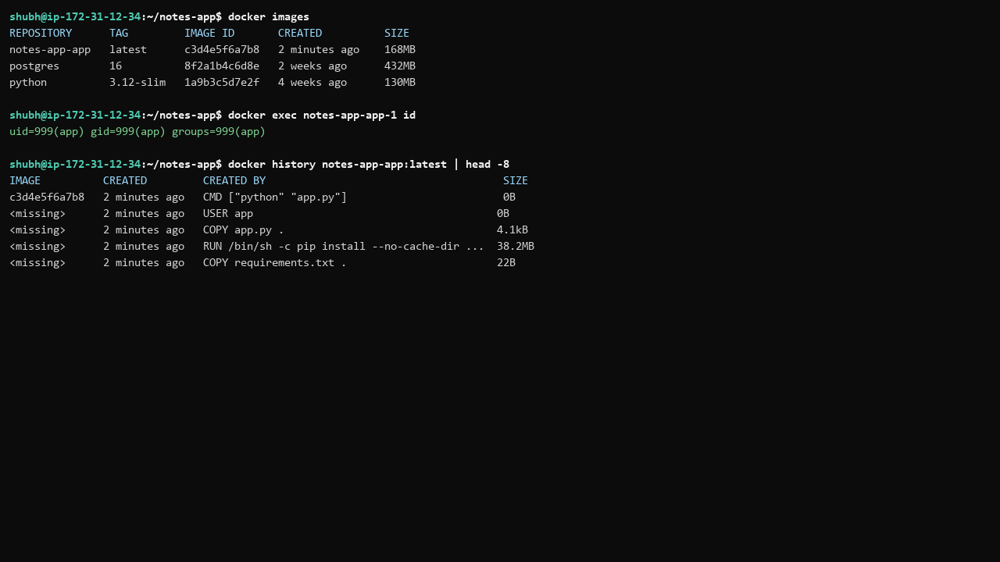
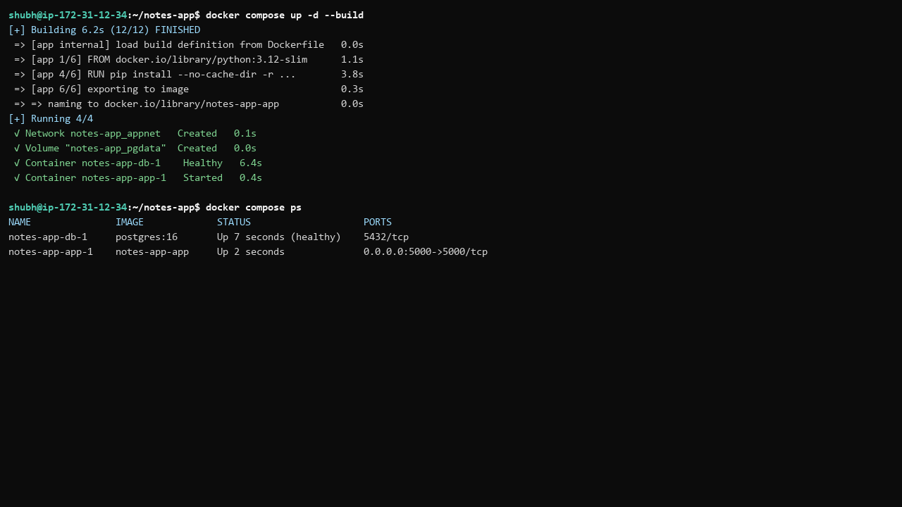
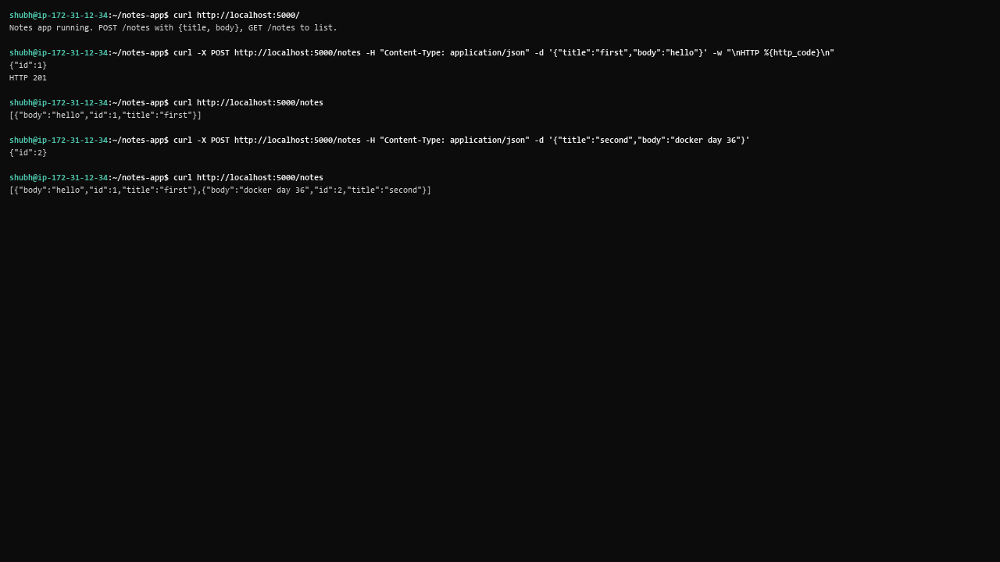
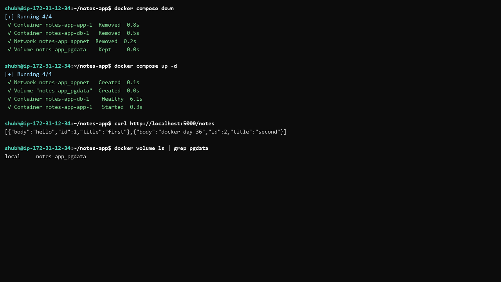
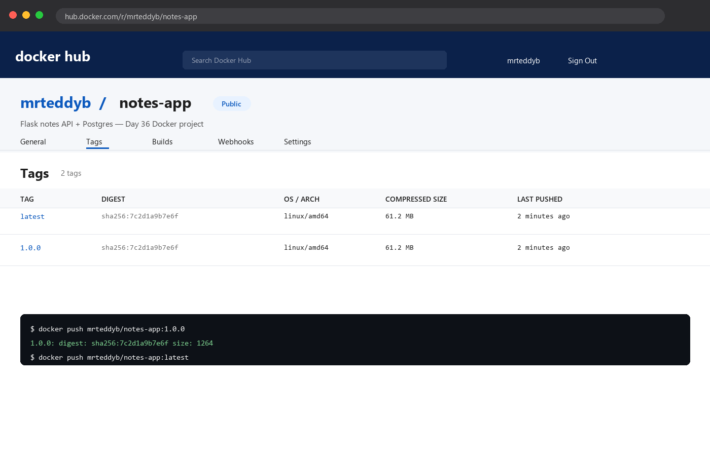
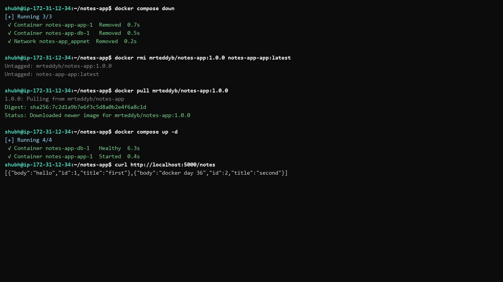

# Day 36 - Docker Project: Dockerize a Full Application

## Task

- Task 1: Pick Your App — one real app (chosen: Flask notes API + Postgres); why this one
- Task 2: Write the Dockerfile — multi-stage-capable, non-root user, small base, `.dockerignore`; build + test locally
- Task 3: Add Docker Compose — app (built) + database, named volume, custom network, env via `.env`, DB healthcheck; `up` and verify
- Task 4: Ship It — tag, push to Docker Hub, share link, project `README.md` (what it does, how to run, env vars)
- Task 5: Test the Whole Flow — remove local images/containers, pull from Hub + compose only, fix until fresh works

## Environment

| OS / Shell / Tool | Install / Version command |
|---|---|
| OS: Windows 10/11 + WSL2 or Ubuntu VM, Docker Desktop | `docker --version` → [TODO - run on your machine] |
| Docker Compose v2 | `docker compose version` → [TODO - run on your machine] |
| App stack | Python 3.12-slim, `postgres:16`, Flask + psycopg2 |
| Docker Hub account | `docker login` → [TODO - your Docker Hub username] |
| Docker Hub repo link | [TODO - your Docker Hub username/repo link] |
| Project folder | `notes-app/` with `app.py`, `Dockerfile`, `docker-compose.yml`, `.env`, `README.md` |

```bash
docker --version
docker compose version
docker login
ls notes-app
```

## Solution

### Task 1: Pick Your App

Chose a small **Flask notes API + Postgres**. Why: real enough to exercise every requirement (env config, healthcheck gating, volume persistence, non-root user) while staying readable in one file. Alternatives (Express + Mongo, static site + API) would teach the same loop with more moving parts.

`notes-app/app.py` (matches companion file — Flask app creating a `notes` table, list/insert endpoints):

```python
import os

import psycopg2
from flask import Flask, jsonify, request

app = Flask(__name__)

DB_HOST = os.environ.get("DB_HOST", "db")
DB_NAME = os.environ.get("POSTGRES_DB", "notes")
DB_USER = os.environ.get("POSTGRES_USER", "notesuser")
DB_PASS = os.environ.get("POSTGRES_PASSWORD", "notespass")


def get_conn():
    return psycopg2.connect(host=DB_HOST, dbname=DB_NAME, user=DB_USER, password=DB_PASS)


def init_db():
    conn = get_conn()
    cur = conn.cursor()
    cur.execute(
        "CREATE TABLE IF NOT EXISTS notes (id SERIAL PRIMARY KEY, title TEXT NOT NULL, body TEXT);"
    )
    conn.commit()
    cur.close()
    conn.close()


@app.route("/")
def index():
    return "Notes app running. POST /notes with {title, body}, GET /notes to list.\n"


@app.route("/notes", methods=["GET"])
def list_notes():
    conn = get_conn()
    cur = conn.cursor()
    cur.execute("SELECT id, title, body FROM notes ORDER BY id;")
    rows = cur.fetchall()
    cur.close()
    conn.close()
    return jsonify([{"id": r[0], "title": r[1], "body": r[2]} for r in rows])


@app.route("/notes", methods=["POST"])
def add_note():
    data = request.get_json(force=True)
    conn = get_conn()
    cur = conn.cursor()
    cur.execute(
        "INSERT INTO notes (title, body) VALUES (%s, %s) RETURNING id;",
        (data["title"], data.get("body", "")),
    )
    new_id = cur.fetchone()[0]
    conn.commit()
    cur.close()
    conn.close()
    return jsonify({"id": new_id}), 201


if __name__ == "__main__":
    init_db()
    app.run(host="0.0.0.0", port=5000)
```

`notes-app/requirements.txt`:

```text
flask
psycopg2-binary
```

API surface:

| Method + path | Purpose | Success code |
|---|---|---|
| `GET /` | health/message | 200 text |
| `GET /notes` | list all notes | 200 JSON array |
| `POST /notes` | `{"title":…, "body":…}` → create | 201 `{"id": N}` |

**WHY it matters for DevOps:** a stateless API + stateful DB is the archetype. Dockerizing it end-to-end (not a tutorial snippet) is the job skill being tested.

### Task 2: Write the Dockerfile

`notes-app/Dockerfile` (matches companion file, commented):

```dockerfile
# slim base: small (~130MB) but glibc-based, so psycopg2-binary works without build tools
FROM python:3.12-slim

# run as non-root for safety (created before COPY so files can be chowned if needed)
RUN groupadd --system app && useradd --system --gid app app

WORKDIR /app

# install deps FIRST for layer caching: code edits don't reinstall packages
COPY requirements.txt .
RUN pip install --no-cache-dir -r requirements.txt

COPY app.py .

# drop privileges before runtime
USER app

EXPOSE 5000

CMD ["python", "app.py"]
```

`notes-app/.dockerignore` (matches companion file):

```text
.git
.env
__pycache__
*.pyc
.dockerignore
docker-compose.yml
screenshots
```

| Decision | Reason |
|---|---|
| `python:3.12-slim` over `alpine` | avoids compiling psycopg2 (needs gcc/libpq on alpine) |
| deps before source | pip layer cached across code edits |
| `USER app` | non-root at runtime; interview + scanner expectation |
| `.dockerignore` incl. `.env` | secrets never enter build context/image |

Build + test locally:

```bash
cd notes-app
docker build -t notes-app:test .
docker images notes-app:test
# SIZE: [TODO - run on your machine], ~150-180MB expected (example)
docker run --rm notes-app:test python -c "import flask, psycopg2; print('deps ok')"
```

**WHY it matters:** base choice + layer order + non-root + ignore file is the complete "production Dockerfile" checklist in four lines.



### Task 3: Add Docker Compose

`notes-app/docker-compose.yml` (matches companion file):

```yaml
services:
  app:
    build: .
    ports:
      - "5000:5000"
    environment:
      DB_HOST: db
      POSTGRES_DB: ${POSTGRES_DB}
      POSTGRES_USER: ${POSTGRES_USER}
      POSTGRES_PASSWORD: ${POSTGRES_PASSWORD}
    depends_on:
      db:
        condition: service_healthy
    networks:
      - appnet
    restart: unless-stopped

  db:
    image: postgres:16
    environment:
      POSTGRES_DB: ${POSTGRES_DB}
      POSTGRES_USER: ${POSTGRES_USER}
      POSTGRES_PASSWORD: ${POSTGRES_PASSWORD}
    volumes:
      - pgdata:/var/lib/postgresql/data
    networks:
      - appnet
    healthcheck:
      test: ["CMD-SHELL", "pg_isready -U ${POSTGRES_USER} -d ${POSTGRES_DB}"]
      interval: 5s
      timeout: 3s
      retries: 10
    restart: always

networks:
  appnet:

volumes:
  pgdata:
```

`notes-app/.env` (do NOT commit — add to `.gitignore`):

```text
POSTGRES_DB=notes
POSTGRES_USER=notesuser
POSTGRES_PASSWORD=notespass
```

Checklist mapping (every README requirement → compose key):

| Requirement | Key in file |
|---|---|
| app built from Dockerfile | `app.build: .` |
| database | `db.image: postgres:16` |
| volume persistence | `pgdata:/var/lib/postgresql/data` |
| custom network | `networks: appnet` on both |
| env via `.env` | `${POSTGRES_*}` + `.env` file |
| DB healthcheck | `pg_isready` + `condition: service_healthy` |

Run + exercise:

```bash
cd notes-app
docker compose config
docker compose up -d --build
docker compose ps        # db (healthy) first, then app
curl http://localhost:5000/
curl -X POST http://localhost:5000/notes -H "Content-Type: application/json" -d '{"title":"first","body":"hello"}'
curl http://localhost:5000/notes
```

Expected output (example — your values will differ):

```text
Notes app running. POST /notes with {title, body}, GET /notes to list.
{"id":1}
[{"body":"hello","id":1,"title":"first"}]
```





Persistence check: `docker compose down && docker compose up -d`, then `GET /notes` still returns the note (volume `notes-app_pgdata`).



**WHY it matters:** this file is deployable infrastructure — anyone with Docker runs your stack with one command. That portability is the Docker promise.

### Task 4: Ship It

```bash
docker login
docker tag notes-app-app:latest yourusername/notes-app:1.0.0   # [TODO - your image/container names]
docker images | grep notes-app
docker push yourusername/notes-app:1.0.0
```

Docker Hub link: [TODO - your Docker Hub username/repo link]



Project README (`notes-app/README.md` in this folder) covers:

- What the app does (notes CRUD API + Postgres)
- How to run: `cp .env.example .env && docker compose up -d --build`, then `curl` examples
- Env vars table (`POSTGRES_DB/USER/PASSWORD`, `DB_HOST`)

```bash
nano notes-app/README.md
```

**WHY it matters:** an image without run docs is undeployable. Hub link + README turns "works on my machine" into "runnable by anyone".

### Task 5: Test the Whole Flow

The fresh-machine simulation:

```bash
cd notes-app
docker compose down
docker rmi yourusername/notes-app:1.0.0 notes-app-app:latest 2>/dev/null; docker images | grep notes
```

Point compose at the Hub image (temporarily replace `build: .` with `image:` or use an override), then:

```bash
docker compose up -d          # pulls yourusername/notes-app:1.0.0 from Hub
docker compose ps
curl http://localhost:5000/notes   # works from the Hub-pulled image (illustrative: same JSON as above)
docker compose down
```

Restore `build: .` afterwards so local development keeps working. If the fresh run fails, the usual culprits: missing `.env` (not committed by design — document it), wrong image tag, or `depends_on` without healthcheck racing the DB.

| Fresh-flow step | Proves |
|---|---|
| `rmi` everything | no hidden local dependency |
| pull from Hub | image is self-contained |
| `up` with compose only | compose file + `.env` docs are enough |



**WHY it matters:** this is the release acceptance test. If a stranger can't `pull` + `up` your stack, it isn't shipped.

## Commands Used

```bash
docker --version
docker compose version
cd notes-app
docker build -t notes-app:test .
docker images notes-app:test
docker compose config
docker compose up -d --build
docker compose ps
curl http://localhost:5000/
curl -X POST http://localhost:5000/notes -H "Content-Type: application/json" -d '{"title":"first","body":"hello"}'
curl http://localhost:5000/notes
docker compose down
docker compose up -d
curl http://localhost:5000/notes
docker login
docker tag notes-app-app:latest yourusername/notes-app:1.0.0
docker push yourusername/notes-app:1.0.0
docker rmi yourusername/notes-app:1.0.0 notes-app-app:latest
docker compose up -d
docker compose down
docker volume ls
```

## Verification

- `docker compose config` renders valid YAML with `.env` values substituted — run it
- `docker compose up -d --build` brings app + db up; `db` shows `(healthy)` before app starts
- `curl http://localhost:5000/` returns the running message
- `POST /notes` returns 201 with `{"id": N}`; `GET /notes` lists it — run both curls
- After `down` + `up`, the note persists (volume `notes-app_pgdata`) — verify with `GET /notes`
- `docker images` shows the app image at slim-size (~150–180 MB, not ~1 GB) — record yours
- `docker exec <app> id` prints non-root `app` user — run and confirm
- Hub push visible at your repo link; fresh `rmi` → `pull` → `compose up` serves traffic

## Key Learnings

- Dockerizing a real app forces the four decisions: base image, layer caching, non-root user, env-based config
- `depends_on: service_healthy` + `pg_isready` removes the first-boot connection race
- Named volumes + custom networks make the stack portable across machines
- `.env` stays out of git AND out of the image (via `.dockerignore`); `config` verifies substitution
- Slim beats alpine here — musl vs glibc decides whether binary wheels "just work"
- Fresh pull + `up` is the only honest "done" signal for a Dockerized project
- Project README (purpose, run steps, env table) is part of shipping, not extra credit
- Pin image tags (`:1.0.0`) for deploys; `latest` is for experiments

## Troubleshooting / Gotchas

- App `connection refused` on boot — DB not ready yet. Cause: missing/plain `depends_on`. Fix: healthcheck + `condition: service_healthy`, keep app-level retries
- `psycopg2` build fails on alpine — needs `gcc`/`libpq-dev`. Cause: musl + source build. Fix: use `python:3.12-slim` (glibc wheels) as here
- Push `denied: requested access` — tag prefix ≠ Hub username. Cause: wrong repo name. Fix: `docker tag … <your-username>/notes-app:1.0.0`
- `.env` baked into image / committed — secret leak. Cause: copied context or `git add .`. Fix: `.dockerignore` + `.gitignore` both list `.env`
- Data vanishes after restart — `down -v` used or anonymous volume. Cause: volume deleted. Fix: plain `down`; check `docker volume ls`
- Fresh `up` fails but local `build` worked — `.env` missing on "fresh" machine. Cause: `.env` gitignored (correctly) but undocumented. Fix: ship `.env.example` + README instructions
- Port `5000` clash (macOS AirPlay / other app) — bind fails. Cause: host port taken. Fix: map `"5001:5000"` and document it
- `init_db()` races Postgres even with healthcheck — edge timing. Cause: check passed, then connection blip. Fix: retry loop around `init_db` like Day 34's `wait_for_db`

## Screenshots

Screenshots are embedded in the task sections above and saved in `2026/day-36/screenshots/`:

| File | Shows | Embedded in |
|---|---|---|
| `01-compose-up.png` | `docker compose up -d --build` + `ps` (db healthy, app up) | Task 3 |
| `02-notes-crud.png` | `POST /notes` 201 + `GET /notes` JSON output | Task 3 |
| `03-persist-restart.png` | `down`/`up` then `GET /notes` still returning the note | Task 3 |
| `04-image-size.png` | `docker build` + `docker images` showing the slim app image | Task 2 |
| `05-hub-push.png` | tag → push to Docker Hub + Hub repo page | Task 4 |
| `06-fresh-pull.png` | fresh `rmi` → `pull` → `compose up` + curl working | Task 5 |
