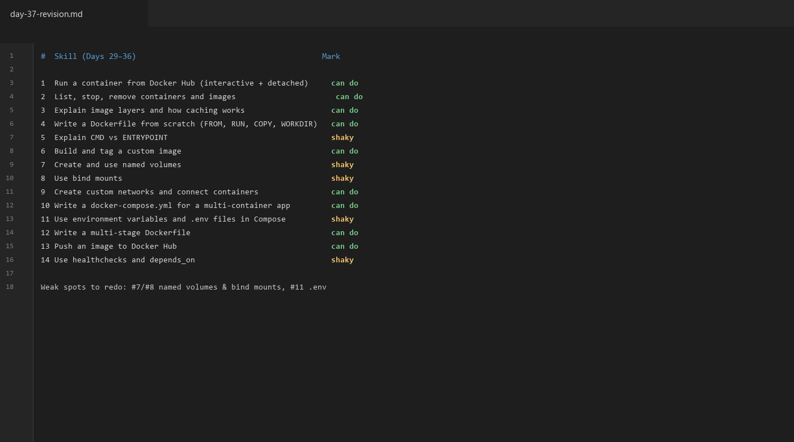
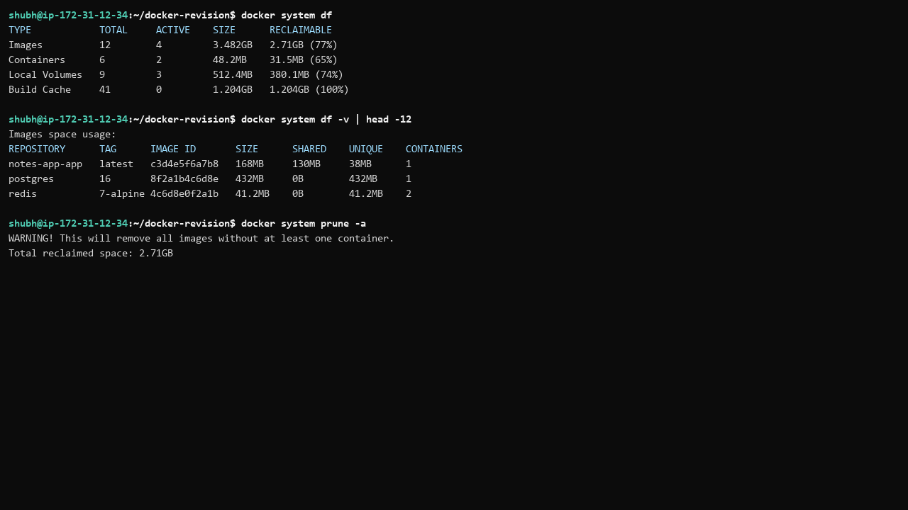
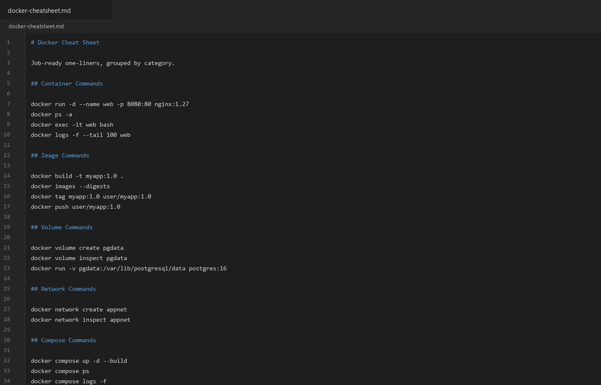
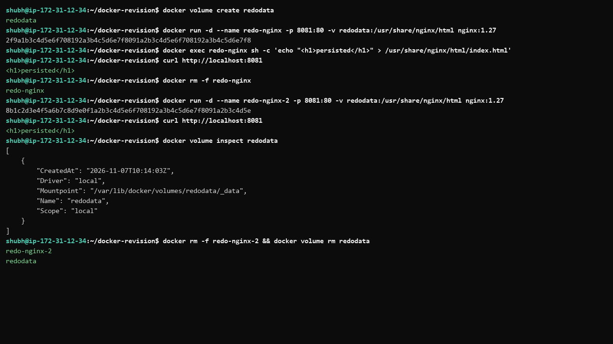
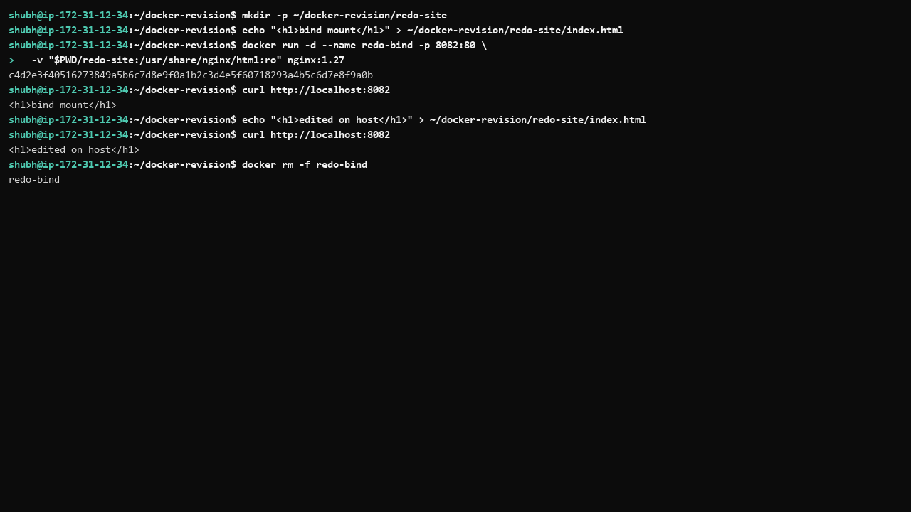
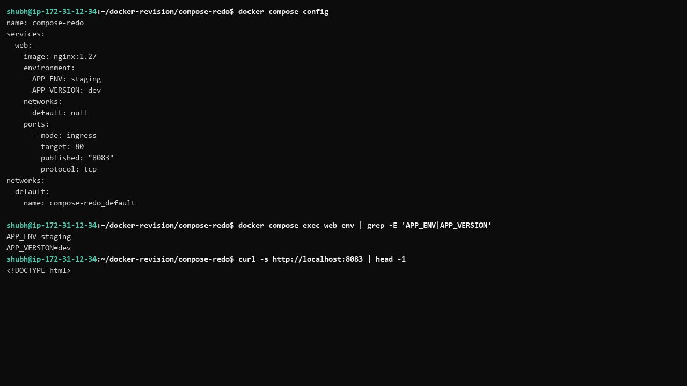

# Day 37 - Docker Revision & Cheat Sheet

## Task

- Self-assessment checklist: honestly mark 14 Docker skills (Days 29–36) as can do / shaky / haven't done
- Quick-fire questions: answer 8 from memory (image vs container, data loss, custom-network DNS, `down -v`, multi-stage, COPY vs ADD, `-p`, disk usage), then verify
- Build Your Docker Cheat Sheet: categorized `docker-cheatsheet.md` (containers, images, volumes, networks, compose, cleanup, Dockerfile instructions), one line per command
- Revisit Weak Spots: pick 2 shaky topics and redo their hands-on tasks
- Suggested flow: 10 min checklist + 10 min questions + 20 min cheat sheet + 10 min redo

## Environment

| OS / Shell / Tool | Install / Version command |
|---|---|
| OS: Windows 10/11 + WSL2 backend, or Docker Engine on Ubuntu VM | `wsl --version` / `lsb_release -a` |
| Shell: bash (WSL2/Ubuntu) | `bash --version` |
| Docker Engine | `docker --version` → [TODO - record your exact version] |
| Docker Compose v2 | `docker compose version` → [TODO - record your exact version] |
| Docker Hub free account (push/pull checks) | `docker login` → [TODO - your Docker Hub account] |
| Redo working dir | `~/docker-revision` inside WSL2/Ubuntu |

```bash
docker --version
docker compose version
docker system df
docker run --rm hello-world
```

## Solution

### Self-Assessment Results

Honest first pass (change any mark before submitting — the value is in the honesty):

| # | Skill (Days 29–36) | Mark |
| --- | --- | --- |
| 1 | Run a container from Docker Hub (interactive + detached) | can do |
| 2 | List, stop, remove containers and images | can do |
| 3 | Explain image layers and how caching works | can do |
| 4 | Write a Dockerfile from scratch with FROM, RUN, COPY, WORKDIR, CMD | can do |
| 5 | Explain CMD vs ENTRYPOINT | shaky |
| 6 | Build and tag a custom image | can do |
| 7 | Create and use named volumes | shaky |
| 8 | Use bind mounts | shaky |
| 9 | Create custom networks and connect containers | can do |
| 10 | Write a `docker-compose.yml` for a multi-container app | can do |
| 11 | Use environment variables and `.env` files in Compose | shaky |
| 12 | Write a multi-stage Dockerfile | can do |
| 13 | Push an image to Docker Hub | can do |
| 14 | Use healthchecks and `depends_on` | shaky |

Weak spots to redo today: **named volumes / bind mounts** (#7, #8) and **Compose environment variables / `.env`** (#11). Both redos are fully worked below.



**WHY it matters for DevOps:** senior engineers schedule revision deliberately. A 60-minute consolidation pass converts tutorial-following into durable, interview-ready skill.

### Quick-Fire Answers (from memory, then verified)

1. **Image vs container** — An image is an immutable read-only template: stacked layers plus metadata (default cmd, env, exposed ports). A container is a runnable instance: the image layers plus a thin writable layer, its own process tree, network namespace, and mounts. One image → many containers.

2. **Data inside a container when removed** — Anything in the container's writable layer is deleted with `docker rm`. Data in named volumes or bind mounts lives outside that layer and survives. That is why Task 1 of Day 32 loses data and Task 2 keeps it.

3. **Two containers on the same custom network** — Docker runs an embedded DNS server on user-defined networks, so container A reaches B by container name (or network alias) on whatever port the process listens on, e.g. `curl http://db:5432` or `ping a2`. On the legacy default `bridge`, name resolution does not exist — use IPs or (deprecated) `--link`.

4. **`docker compose down -v` vs `docker compose down`** — `down` stops and removes containers and networks but **keeps** named volumes. `down -v` also removes named volumes declared in the file (plus anonymous volumes), so all persisted data is gone. The `-v` flag is the "wipe my database" switch.

5. **Multi-stage builds** — They keep compilers, SDKs, and build dependencies in an earlier stage and `COPY --from=builder` only the built artifact into the final stage. Result: 10–50× smaller images, smaller attack surface, faster pulls; you can build on one base (Debian SDK) and run on another (alpine/scratch).

6. **COPY vs ADD** — `COPY` copies files/dirs from the build context (or `--from=` another stage). `ADD` does the same plus auto-extracts local tars and fetches remote URLs. Those extras are surprising and cache-unfriendly — use `COPY` unless you specifically need `ADD` behavior.

7. **`-p 8080:80`** — Publishes host port 8080 to container port 80 (`HOST:CONTAINER`). `http://localhost:8080` forwards to port 80 inside the container. Without `-p`, the container is reachable only from its Docker network. `EXPOSE 80` alone publishes nothing.

8. **Docker disk usage** — `docker system df` summarizes images, containers, volumes, and build cache with a reclaimable column; `docker system df -v` breaks it down per object. Reclaim with `docker system prune` (safe-ish) or `prune -a --volumes` (destructive).



Concept linkage table:

| Question | Day it came from | One-line anchor |
|---|---|---|
| image vs container | 29–30 | layers (read-only) + writable layer = container |
| data loss | 32 | writable layer dies; mounts survive |
| custom DNS | 32–33 | embedded DNS on user-defined networks |
| `down -v` | 33 | `-v` wipes volumes |
| multi-stage | 35 | builder discarded, artifact shipped |
| COPY vs ADD | 31 | COPY default; ADD = tar+URL magic |
| `-p` | 31–32 | HOST:CONTAINER publishing |
| `system df` | 37 | measure before pruning |

### Cheat Sheet Built

Full categorized sheet: `docker-cheatsheet.md` next to this file (enriched with examples, flags, and the five rules). The seven commands to never blank on:

```bash
docker run -d --name web -p 8080:80 nginx:1.27   # run detached with published port
docker ps -a                                     # every container, incl. stopped
docker exec -it web bash                         # shell inside running container (sh on alpine)
docker logs -f --tail 100 web                    # follow recent logs
docker build -t myapp:1.0 .                      # build + tag
docker compose up -d --build                     # start whole stack
docker system df                                 # what Docker is eating
```

Verify the sheet against the CLI as you read it: `docker <cmd> --help` for any flag you don't trust. Fix the sheet, not your memory.



### Interview Rapid-Fire (say each in under 60 seconds)

Practice these aloud — they are the Docker questions interviewers actually ask:

1. "Image vs container?" → read-only layer stack vs running instance + writable layer.
2. "Where does DB data live?" → named volume mounted at the datadir; never the container layer.
3. "Why is my compose app crashing on boot?" → `depends_on` isn't readiness; add healthcheck + `service_healthy` + app retries.
4. "How do you shrink an image?" → multi-stage, minimal base, combined RUNs, pinned tags, `.dockerignore`.
5. "How do containers find each other?" → custom network + container/service name via embedded DNS.
6. "`down` vs `down -v`?" → latter wipes named volumes too.
7. "How do you ship an image?" → `tag username/repo:version`, `push`, fresh `pull` + `up` to prove it.
8. "How do you check disk pressure?" → `docker system df`, then prune containers/images/build-cache before touching volumes.

Score yourself: 8/8 fluent = Docker week consolidated; any hesitation = that day's redo is tomorrow's warm-up.

### Week-29–36 One-Line Map

| Day | Core skill | File that proves it |
|---|---|---|
| 29–30 | containers + images basics | `docker run`/`images` fluency |
| 31 | Dockerfiles + cache | `my-ubuntu:v1`, `my-website:v1` |
| 32 | volumes + networking | `pgdata` survival, `my-app-net` name ping |
| 33 | compose basics | WordPress + MySQL stack |
| 34 | compose production patterns | `flask-stack` healthchecks/labels |
| 35 | multi-stage + Hub | `go-hello:multi` + Hub tags |
| 36 | end-to-end project | `notes-app` fresh-pull proof |
| 37 | revision (today) | this file + enriched cheat sheet |

### Redo 1: Named Volume Persistence (Weak Spots #7/#8)

Goal: prove data written by one container survives its removal, then contrast with a read-only bind mount.

```bash
mkdir -p ~/docker-revision && cd ~/docker-revision

docker volume create redodata
docker run -d --name redo-nginx -p 8081:80 -v redodata:/usr/share/nginx/html nginx:1.27
docker exec redo-nginx sh -c 'echo "<h1>persisted</h1>" > /usr/share/nginx/html/index.html'
curl http://localhost:8081          # <h1>persisted</h1>

docker rm -f redo-nginx             # container gone, volume stays
docker volume inspect redodata      # Mountpoint on host still present — [TODO - run on your machine]

docker run -d --name redo-nginx-2 -p 8081:80 -v redodata:/usr/share/nginx/html nginx:1.27
curl http://localhost:8081          # still <h1>persisted</h1> → volume survived
docker rm -f redo-nginx-2
docker volume rm redodata
```

Expected output (example — your values will differ):

```text
<h1>persisted</h1>
<h1>persisted</h1>   # after container replacement — persistence proven
```

Bind mount comparison (host directory, not Docker-managed):

```bash
mkdir -p ~/docker-revision/redo-site
echo "<h1>bind mount</h1>" > ~/docker-revision/redo-site/index.html
docker run -d --name redo-bind -p 8082:80 \
  -v "$PWD/redo-site:/usr/share/nginx/html:ro" nginx:1.27
curl http://localhost:8082          # <h1>bind mount</h1>

echo "<h1>edited on host</h1>" > ~/docker-revision/redo-site/index.html
curl http://localhost:8082          # visible instantly, no rebuild
docker rm -f redo-bind
```

What clicked: named volume = Docker-managed storage outliving containers (databases); bind mount = exact host path mapping, ideal for dev because host edits appear live. `:ro` makes the mount read-only inside the container — good hygiene for served content.





### Redo 2: Compose Env Vars and `.env` (Weak Spot #11)

Goal: variable substitution, automatic `.env` loading, and required-vs-default variables in one stack.

`~/docker-revision/compose-redo/docker-compose.yml`:

```yaml
services:
  web:
    image: nginx:1.27
    ports:
      - "${HOST_PORT}:80"
    environment:
      APP_ENV: ${APP_ENV}
      APP_VERSION: ${APP_VERSION:-dev}
```

`~/docker-revision/compose-redo/.env`:

```text
HOST_PORT=8083
APP_ENV=staging
```

Run and inspect resolution:

```bash
cd ~/docker-revision/compose-redo
docker compose config          # ${HOST_PORT} → 8083, ${APP_ENV} → staging, ${APP_VERSION:-dev} → dev
docker compose up -d
docker compose exec web env | grep -E 'APP_ENV|APP_VERSION'
curl http://localhost:8083
docker compose down
```

Expected output (example — your values will differ):

```text
APP_ENV=staging
APP_VERSION=dev
<!DOCTYPE html>...Welcome to nginx!...
```

Notes that stuck:

- Compose auto-reads `.env` in the project dir for **substitution**; no `env_file:` needed for that path.
- `${VAR}` → empty string + warning when unset; `${VAR:-default}` falls back; `${VAR:?err}` fails fast with `err` — use `:?` for required secrets.
- `environment:` sets vars **inside** the container; `.env` feeds substitution **in the YAML**. Different mechanisms, constantly confused — now separated.
- `.env` belongs in `.gitignore`; commit `.env.example` with dummy values instead.

**WHY these redos matter:** volumes/mounts and env handling are the two areas where "shaky" becomes a production incident (lost data, leaked secrets). Redoing them under no tutorial pressure is the fix.



## Commands Used

```bash
docker --version
docker compose version
docker system df
docker system df -v
docker run --rm hello-world
mkdir -p ~/docker-revision && cd ~/docker-revision
docker volume create redodata
docker run -d --name redo-nginx -p 8081:80 -v redodata:/usr/share/nginx/html nginx:1.27
docker exec redo-nginx sh -c 'echo "<h1>persisted</h1>" > /usr/share/nginx/html/index.html'
curl http://localhost:8081
docker rm -f redo-nginx
docker volume inspect redodata
docker run -d --name redo-nginx-2 -p 8081:80 -v redodata:/usr/share/nginx/html nginx:1.27
curl http://localhost:8081
docker rm -f redo-nginx-2
docker volume rm redodata
docker run -d --name redo-bind -p 8082:80 -v "$PWD/redo-site:/usr/share/nginx/html:ro" nginx:1.27
curl http://localhost:8082
docker rm -f redo-bind
cd ~/docker-revision/compose-redo
docker compose config
docker compose up -d
docker compose exec web env
curl http://localhost:8083
docker compose down
docker ps -a
docker volume ls
```

## Verification

- `docker run --rm hello-world` exits 0 — daemon reachable; run it
- All 14 checklist items honestly marked; 2 weak spots named above
- All 8 quick-fire answers written in own words without peeking first
- Redo 1: `curl :8081` still returns `persisted` after container replacement, before volume deletion
- `docker volume inspect redodata` shows a `Mountpoint`; after `rm`, `volume ls` no longer lists it
- Redo 1 bind mount: `curl :8082` reflects host edit immediately
- Redo 2: `docker compose config` contains `8083` + `staging`; `exec web env` shows `APP_ENV=staging`, `APP_VERSION=dev`
- `docker system df` runs and reclaimable column understood
- Every cheat sheet command cross-checked with `docker <cmd> --help`
- Cleanup: `docker ps -a` and `docker volume ls` show no redo leftovers

## Key Learnings

- Images are read-only layer stacks; containers add a disposable writable layer — one sentence explains most Docker behavior
- State has two correct homes: named volumes (Docker-managed) and bind mounts (host-managed); everything else dies with the container
- User-defined bridge networks give automatic DNS by name; default bridge does not
- `docker compose down -v` is the "wipe my database" command — `-v` is the only difference
- Multi-stage builds separate build tooling from run artifacts, shrinking images 10–50×
- `COPY` is the safe default; `ADD`'s tar/URL magic is rarely wanted and hurts caching
- Port mapping is `HOST:CONTAINER`; forgetting this is the top "why can't I reach it" bug
- In Compose, `.env` handles file substitution while `environment:` handles in-container config — know which problem you're solving
- A failing pipeline/check is a feature — red means the safety net worked, not that Docker is broken

## Troubleshooting / Gotchas

- `docker volume rm` → "volume is in use" — a container (even stopped) references it. Cause: skipped `docker rm`. Fix: `docker rm` the container first, or `volume rm -f`
- Bind mount serves 403/directory listing — wrong host path or unreadable perms. Cause: relative path or container user can't read. Fix: absolute path, check ownership, add `:ro` only after it works rw
- Compose warns `variable is not set` — `.env` not in the compose directory or misnamed (`env` vs `.env`). Cause: wrong CWD. Fix: `ls -a`, `cd` to the compose dir
- `curl: connection refused` after `up` — wrong host port from typo'd `HOST_PORT`. Cause: substitution silently empty. Fix: `docker compose config` to see the real port, `docker compose ps` for mappings
- `config` prints literal `${VAR}` — escaped as `$${VAR}` or `--no-interpolate` passed. Cause: double-`$` is intentional escape. Fix: single `$` for real substitution
- WSL2 disk filling C: — volumes + old images. Cause: never pruned. Fix: `docker system prune -a` (careful), move Docker data disk if chronic
- Editing files via `docker exec … vi` then losing them — writable-layer illusion. Cause: edits aren't in any mount. Fix: volumes/bind mounts for anything worth keeping
- Cheat sheet command fails on your machine — version drift (e.g. `docker compose` vs old `docker-compose`). Cause: outdated memorization. Fix: `docker <cmd> --help` is ground truth; update the sheet

## Screenshots

Screenshots are embedded in the task sections above and saved in `2026/day-37/screenshots/`:

| File | Shows | Embedded in |
|---|---|---|
| `01-checklist.png` | marked 14-item self-assessment table | Self-Assessment Results |
| `02-redo-volume.png` | volume persistence proof (`curl` before/after container replace) | Redo 1 |
| `03-redo-bind.png` | bind-mount live-edit `curl` outputs | Redo 1 |
| `04-redo-compose-env.png` | `docker compose config` with substituted values | Redo 2 |
| `05-system-df.png` | `docker system df` disk usage | Quick-Fire Answers |
| `06-cheatsheet.png` | `docker-cheatsheet.md` in the editor | Cheat Sheet Built |
