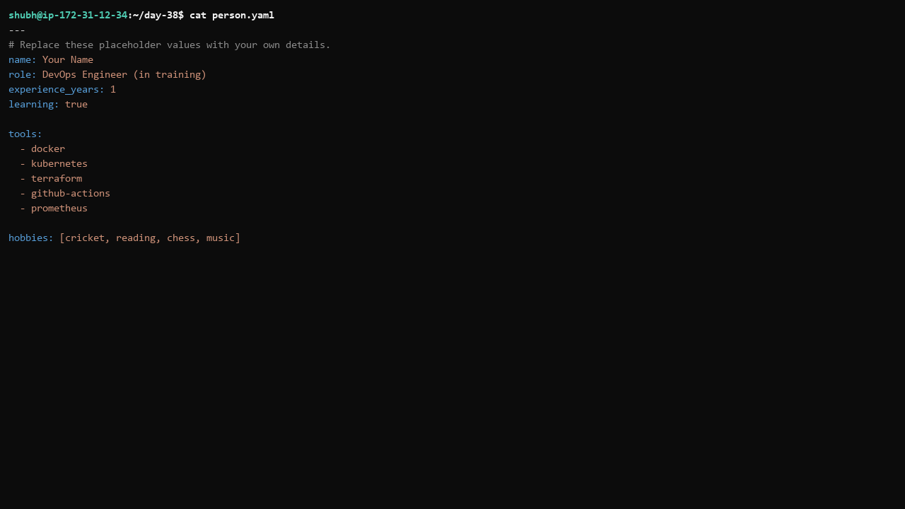
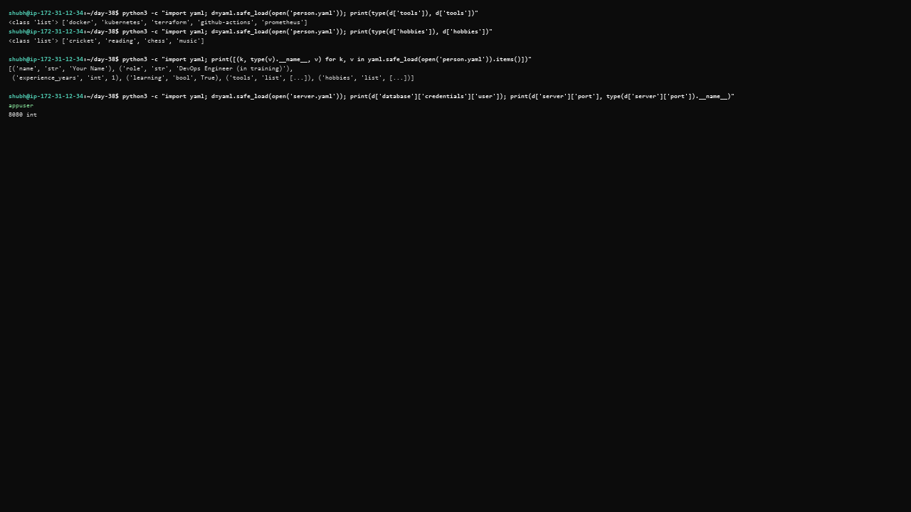
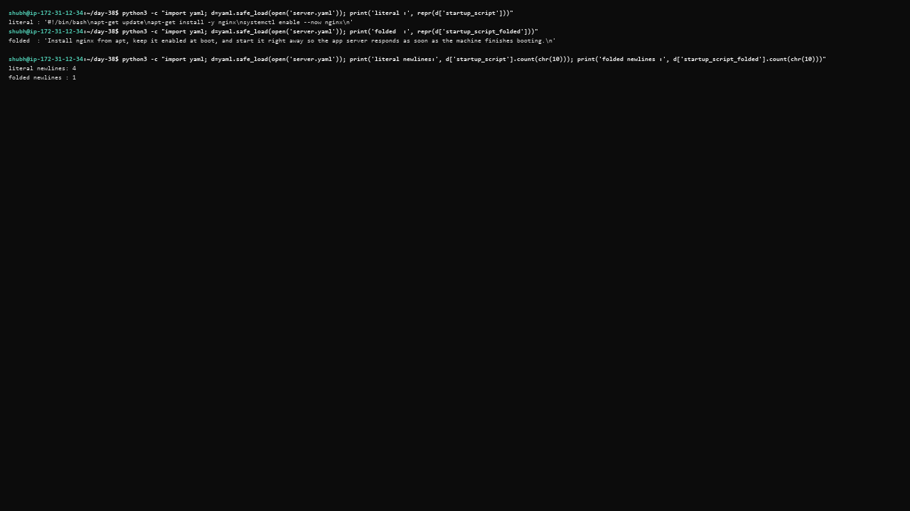
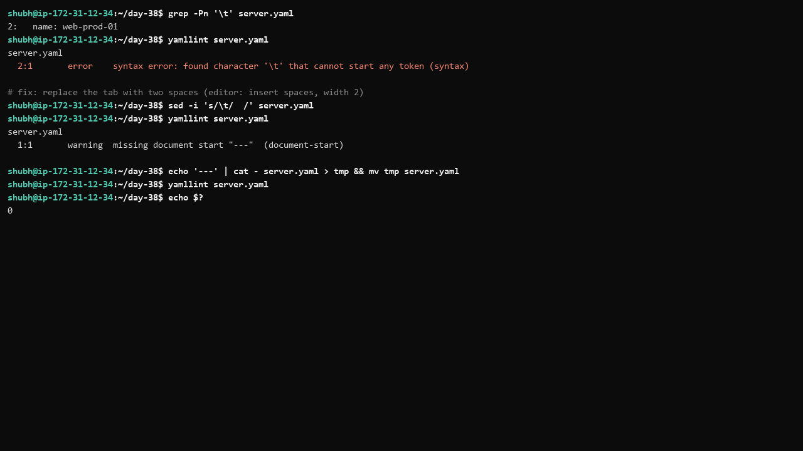
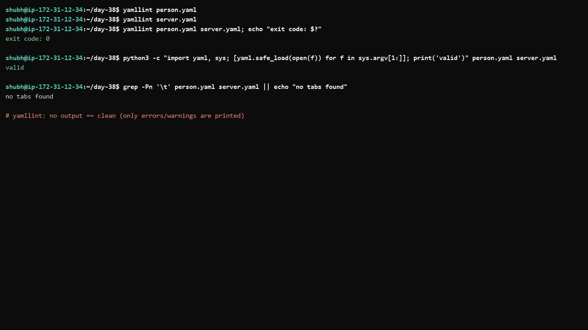
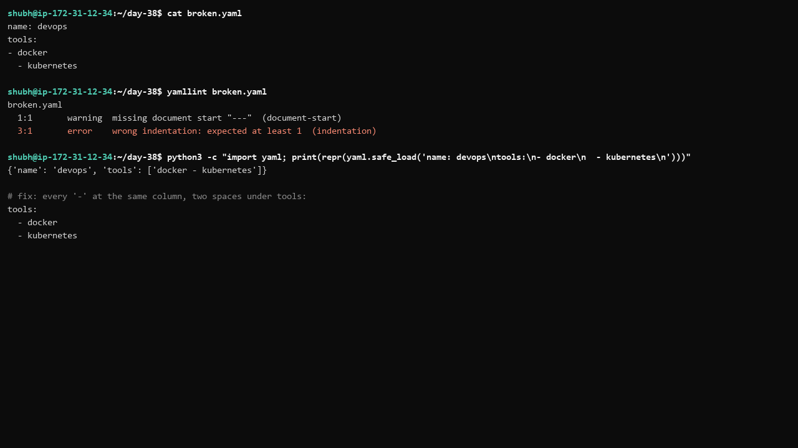

# Day 38 - YAML Basics

## Task

- Task 1: Key-Value Pairs — `person.yaml` with `name`, `role`, `experience_years`, `learning` (boolean); `cat` check, no tabs
- Task 2: Lists — add `tools` (5-item block list) and `hobbies` (inline `[item1, item2]`); write the two list styles
- Task 3: Nested Objects — `server.yaml` with nested `server` (`name`, `ip`, `port`) and `database` (`host`, `name`, `credentials` → `user`, `password`); tab experiment
- Task 4: Multi-line Strings — `startup_script` with `|` (literal) and `>` (folded); write when to use each
- Task 5: Validate Your YAML — install yamllint or online validator; validate both; break indentation, record error, fix, re-validate
- Task 6: Spot the Difference — diagnose why Block 2 is broken vs Block 1
- Documentation: include both YAML files + 3 key learnings

## Environment

| OS / Shell / Tool | Install / Version command |
|---|---|
| OS: Ubuntu VM / WSL2 (any shell with Python 3 works) | `lsb_release -a` |
| Python 3 + PyYAML (parser) | `python3 --version` → [TODO - record your version]; `python3 -c "import yaml; print(yaml.__version__)"` |
| yamllint (style + syntax checker) | `yamllint --version` → [TODO - record your version], e.g. `1.38.0` |
| Editor with spaces-only indent | set tab width 2, "insert spaces" |
| Files in this folder | `person.yaml`, `server.yaml` |

```bash
python3 --version
python3 -c "import yaml; print(yaml.__version__)"
yamllint --version
nano person.yaml
nano server.yaml
```

## Solution

### Task 1: Key-Value Pairs

Scalars are plain `key: value` lines — note the **space after the colon**. `true` is a boolean; `"true"` would be a string. Leading `---` is the document-start marker (yamllint's default config warns without it). Companion file `person.yaml` in this folder:

```yaml
---
# Replace these placeholder values with your own details.
name: Your Name
role: DevOps Engineer (in training)
experience_years: 1
learning: true
```



How it parses (verify yourself):

```bash
python3 -c "import yaml; d=yaml.safe_load(open('person.yaml')); print([(k, type(v).__name__, v) for k, v in d.items() if k in ('name','role','experience_years','learning')]))"
# [('name', 'str', 'Your Name'), ('role', 'str', ...), ('experience_years', 'int', 1), ('learning', 'bool', True)]  (example)
```



| Key | YAML type | Gotcha |
|---|---|---|
| `name`, `role` | string | quote if value contains `: `, ` #`, or starts with `*`, `&`, `!` |
| `experience_years: 1` | integer | `01` or large IDs may need quotes |
| `learning: true` | boolean | `True/true/yes/on` all parse as bool — quote `"on"` if you mean the word |

**WHY it matters for DevOps:** every CI workflow, Compose file, and K8s manifest is key-value YAML. Typing rules (`true` vs `"true"`, `1.10` → `1.1`) cause real pipeline bugs.

### Task 2: Lists

Two ways to write a list in YAML:

1. **Block sequence** — each item on its own line starting with `- `, same indentation.
2. **Flow sequence** — inline with square brackets: `[item1, item2]`.

Companion `person.yaml` additions:

```yaml
tools:
  - docker
  - kubernetes
  - terraform
  - github-actions
  - prometheus

hobbies: [cricket, reading, chess, music]
```

Both parse to the same structure:

```bash
python3 -c "import yaml; d=yaml.safe_load(open('person.yaml')); print(type(d['tools']), d['tools']); print(type(d['hobbies']), d['hobbies'])"
# <class 'list'> ['docker', 'kubernetes', 'terraform', 'github-actions', 'prometheus']
# <class 'list'> ['cricket', 'reading', 'chess', 'music']
```

Style rule: block style for long/important lists (readable diffs), flow style for short ones. Dictionaries have a flow form too (`{a: 1, b: 2}`) — common in GitHub Actions `with:` blocks.

**WHY it matters:** `steps:` in Actions and `services:` children are block sequences; matrix axes and port lists often use flow style. Recognizing both makes any workflow readable.

### Task 3: Nested Objects

Each nesting level = 2 more spaces. A key whose value is indented beneath it becomes a nested map. Companion `server.yaml`:

```yaml
---
server:
  name: web-prod-01
  ip: 10.0.1.25
  port: 8080

database:
  host: db-prod-01
  name: appdb
  credentials:
    user: appuser
    password: change-me
```

Parsed shape: `database.credentials.user` is three levels deep. `port: 8080` is an integer; `ip: 10.0.1.25` stays a string (not a valid number). Access path check:

```bash
python3 -c "import yaml; d=yaml.safe_load(open('server.yaml')); print(d['database']['credentials']['user']); print(d['server']['port'], type(d['server']['port']).__name__)"
# appuser
# 8080 int
```

**Tab experiment:** replace the two spaces before `name:` under `server:` with a tab, then validate:

```text
$ yamllint server.yaml
server.yaml
  2:1       error    syntax error: found character '\t' that cannot start any token (syntax)
```

PyYAML agrees: `yaml.scanner.ScannerError: found character '\t' that cannot start any token`. YAML forbids tabs anywhere in indentation — spaces only. Set your editor to insert spaces, width 2. Detect tabs with `grep -Pn '\t' *.yaml`.

**WHY it matters:** K8s manifests nest 5+ levels (`spec.template.spec.containers[0].env`). One tab or one-space drift silently re-parents a key.

### Task 4: Multi-line Strings

`|` (literal block) preserves every newline. `>` (folded block) joins lines into spaces. Same map can't hold two `startup_script` keys, so the folded variant lives under `startup_script_folded`. Companion `server.yaml` additions:

```yaml
# | keeps every newline, so this is a real script.
startup_script: |
  #!/bin/bash
  apt-get update
  apt-get install -y nginx
  systemctl enable --now nginx

# > folds lines into one line, so this is prose.
startup_script_folded: >
  Install nginx from apt, keep it enabled at boot,
  and start it right away so the app server responds
  as soon as the machine finishes booting.
```

Proof after parsing:

```bash
python3 -c "import yaml; d=yaml.safe_load(open('server.yaml')); print(repr(d['startup_script'])); print(repr(d['startup_script_folded']))"
# '#!/bin/bash\napt-get update\napt-get install -y nginx\nsystemctl enable --now nginx\n'
# 'Install nginx from apt, keep it enabled at boot, and start it right away so the app server responds as soon as the machine finishes booting.\n'
```



When to use which:

| Style | Keeps newlines? | Use for |
|---|---|---|
| `\|` literal | yes | shell scripts, PEM keys, `known_hosts`, embedded configs, code |
| `>` folded | no (folds to spaces) | descriptions, long prose, commit-style messages |
| `\|-` / `>-` | strip final newline | exact-output comparisons, command substitution |
| `\|+` / `>+` | keep trailing blank lines | files where trailing newlines matter |

**WHY it matters:** Actions `run: |` blocks and K8s ConfigMap data use literal blocks daily; folded blocks keep long `description:` fields readable.

### Task 5: Validate Your YAML

Install + run yamllint:

```bash
# Ubuntu / WSL2
sudo apt install -y yamllint
# or without root (use --break-system-packages only if pip blocks on PEP 668)
python3 -m pip install --user yamllint
# or with pipx
pipx install yamllint

yamllint person.yaml server.yaml
echo $?      # 0 and no output = both files clean (example)
```

Intentionally break indentation (tab at start of line 2 in `person.yaml` copy) and validate:

```text
$ yamllint person.yaml
person.yaml
  2:1       error    syntax error: found character '\t' that cannot start any token (syntax)
```

Missing `---` is only a warning — fix it anyway for clean default config:

```text
  1:1       warning  missing document start "---"  (document-start)
```

Fix the tab back to two spaces, re-run `yamllint person.yaml server.yaml` → exit 0, no output.





No-yamllint fallback (pure Python parse check, no style rules):

```bash
python3 -c "import yaml, sys; [yaml.safe_load(open(f)) for f in sys.argv[1:]]; print('valid')" person.yaml server.yaml
# valid
grep -Pn '\t' person.yaml server.yaml || echo "no tabs found"
```

**WHY it matters:** validating before `git push` catches the tab/indent errors that otherwise fail CI with cryptic line-number messages.

### Task 6: Spot the Difference

```yaml
# Block 1 - correct
name: devops
tools:
  - docker
  - kubernetes
```

```yaml
# Block 2 - broken
name: devops
tools:
- docker
  - kubernetes
```

What's wrong with Block 2: the two `-` items sit at **different indentation levels** — `- docker` flush with `tools:`, `- kubernetes` two spaces deeper. This does **not** always fail loudly. PyYAML parses it successfully but wrong:

```bash
python3 -c "import yaml; print(repr(yaml.safe_load('name: devops\ntools:\n- docker\n  - kubernetes\n')))"
# {'name': 'devops', 'tools': ['docker - kubernetes']}   (example)
```

`tools` becomes a **one-item list** with the merged string `docker - kubernetes` — the indented line is treated as a continuation of the plain scalar. yamllint does flag the structure:

```text
$ yamllint broken.yaml
broken.yaml
  1:1       warning  missing document start "---"  (document-start)
  3:1       error    wrong indentation: expected at least 1  (indentation)
```



Fix: every `-` of one sequence at the same column, two spaces under the parent key:

```yaml
name: devops
tools:
  - docker
  - kubernetes
```

Lesson: "it parsed without an error" ≠ correct YAML. Check the resulting data structure, not just the exit code.

**WHY it matters:** this silent-merge class of bug hits `steps:` and env lists in Actions — a mis-indented step joins the previous string instead of running.

## Commands Used

```bash
python3 --version
python3 -c "import yaml; print(yaml.__version__)"
yamllint --version
nano person.yaml
nano server.yaml
python3 -c "import yaml; d=yaml.safe_load(open('person.yaml')); print(d)"
python3 -c "import yaml; d=yaml.safe_load(open('server.yaml')); print(repr(d['startup_script'])); print(repr(d['startup_script_folded']))"
yamllint person.yaml server.yaml
echo $?
grep -Pn '\t' person.yaml server.yaml || echo "no tabs found"
python3 -c "import yaml, sys; [yaml.safe_load(open(f)) for f in sys.argv[1:]]; print('valid')" person.yaml server.yaml
yamllint broken.yaml || true
```

## Verification

- `nano person.yaml` shows `name`, `role`, `experience_years`, `learning: true` with spaces-only indent — run `grep -Pn '\t' person.yaml` (expect nothing)
- `tools` is a 5-item block list, `hobbies` inline flow list; Python `type()` check shows both as `list`
- `server.yaml` has nested `server` + `database.credentials` keys; `d['database']['credentials']['user']` prints `appuser`
- `repr()` of `startup_script` contains `\n` newlines; folded version has none inside — run both prints
- Tab experiment reproduces `found character '\t' that cannot start any token`; removing the tab makes `yamllint` pass
- `yamllint person.yaml server.yaml` exits 0 with no output (clean default style)
- Block 2 explained as merged scalar `['docker - kubernetes']`, not just "it errors" — parser output captured
- 3 key learnings written (see Key Learnings)

## Key Learnings

- YAML structure is indentation: spaces only, 2 per level, every item of one list at the same column — a tab anywhere in indent is a syntax error
- Lists have two styles — block (`- item`) and flow (`[a, b]`) — parsing identically; same for maps (`{a: 1}`)
- `|` preserves newlines (scripts, keys, configs), `>` folds them (prose); `|-`/`>-` strip the trailing newline
- Plain scalars auto-type: `true` is bool, `"true"` is string, `8080` int, `1.10` → float `1.1` — quote version-like/ID-like values
- Mis-indentation can silently merge items into strings, so validate structure with a parser/yamllint, not just "no error"
- `#` needs a preceding space (or quotes) to be literal; values with `: `, ` #`, or leading specials must be quoted
- `---` silences document-start warnings and is the CI convention
- yamllint belongs in pre-commit/CI because every pipeline and K8s manifest is YAML

## Troubleshooting / Gotchas

- `found character '\t' that cannot start any token` — tab in indentation. Cause: editor tabs. Fix: `grep -Pn '\t' file.yaml`, replace with spaces, set editor to spaces-2
- List silently becomes one joined string (`docker - kubernetes`) — items at mixed indent. Cause: `-` columns differ. Fix: align every `-` under the parent key
- `version: 1.10` parses as `1.1` float — unquoted dotted numbers. Cause: YAML float typing. Fix: `version: "1.10"`
- `message: Error: failed` invalid — colon+space inside plain scalar. Cause: `": "` ends the key. Fix: quote — `message: "Error: failed"`
- `password: p #ss` becomes `p` + comment — ` #` starts comments. Cause: unquoted hash. Fix: `password: "p #ss"` (no-space `p#ss` is fine unquoted)
- yamllint `line-length` (max 80) failures on long lines — default rule. Cause: long URLs/commands. Fix: wrap with `>` blocks or tune `.yamllint` config
- Duplicate keys keep last value silently — `key-duplicates` rule exists for this. Cause: copy-paste. Fix: heed yamllint's reported column
- Empty `key:` parses as `None`, not `""` — implicit null. Cause: expecting empty string. Fix: `key: ""` when empty-string semantics needed

## Screenshots

Screenshots are embedded in the task sections above and saved in `2026/day-38/screenshots/`:

| File | Shows | Embedded in |
|---|---|---|
| `01-person-cat.png` | `cat person.yaml` clean file | Task 1 |
| `02-parse-check.png` | Python `safe_load` type prints for scalars/lists | Task 1 |
| `03-tab-error.png` | yamllint tab syntax error + fix | Task 5 |
| `04-multiline-repr.png` | `repr()` proving `\|` vs `>` behaviour | Task 4 |
| `05-yamllint-clean.png` | clean `yamllint` run (exit 0, no output) | Task 5 |
| `06-block2-merge.png` | parser output showing `['docker - kubernetes']` | Task 6 |
