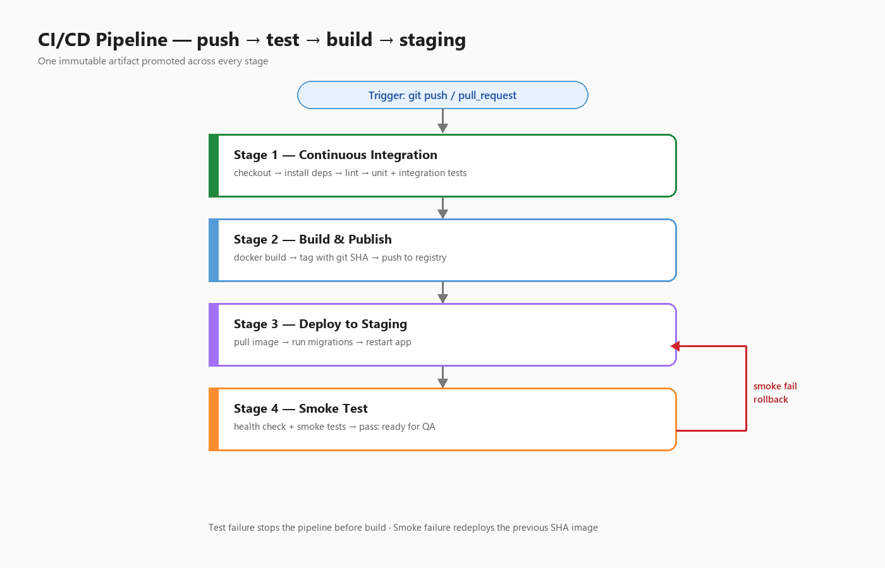
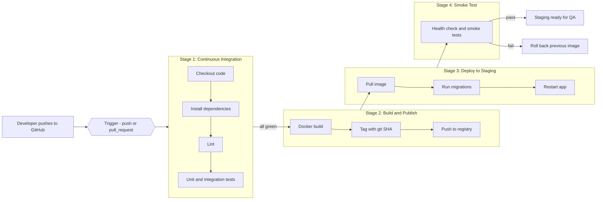
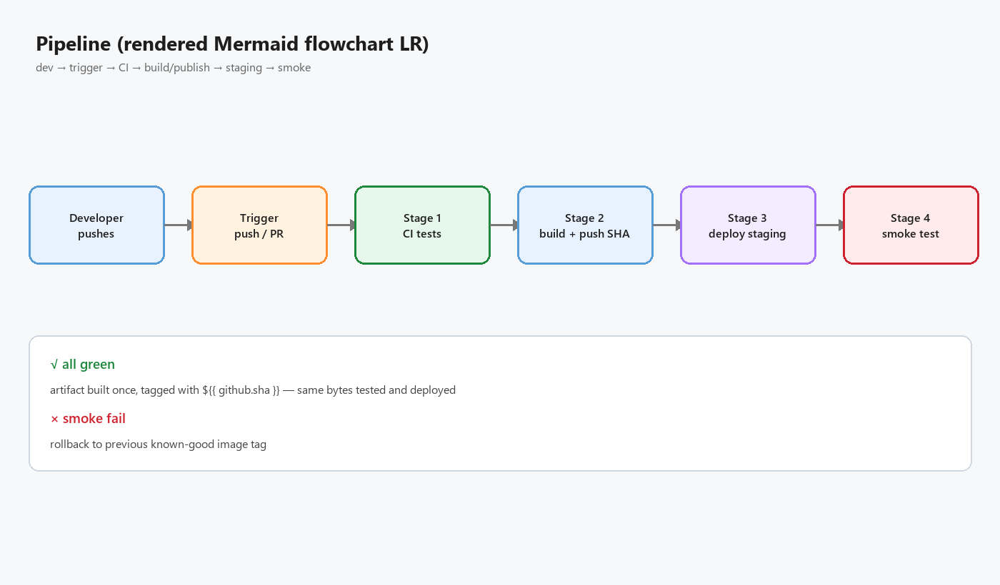
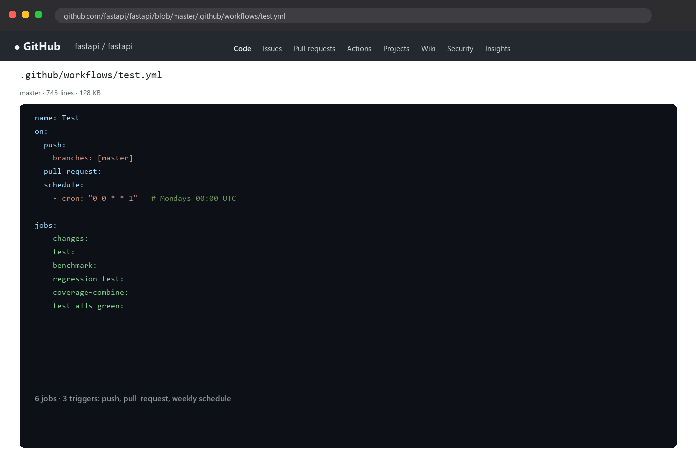
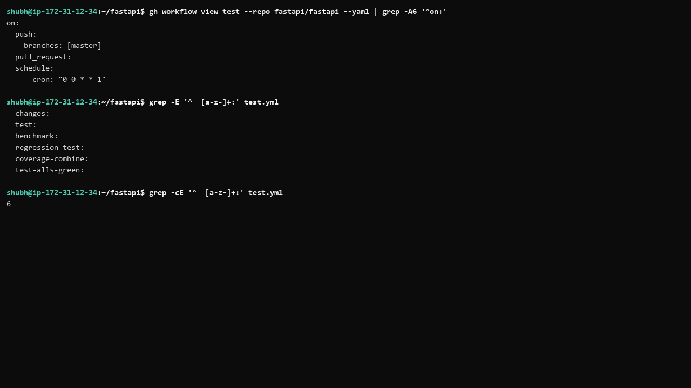

# Day 39 - What is CI/CD?

## Task

- Task 1: The Problem — 5 developers pushing + manually deploying: what goes wrong, "works on my machine", safe manual deploy frequency
- Task 2: CI vs CD — 2–3 line definitions of Continuous Integration, Continuous Delivery, Continuous Deployment + one real-world example each
- Task 3: Pipeline Anatomy — what trigger, stage, job, step, runner, artifact each do
- Task 4: Draw a Pipeline — push → test → Docker build → staging deploy, 3+ stages (text + Mermaid + hand-drawn photo)
- Task 5: Explore in the Wild — open-source repo `.github/workflows/` file: triggers, job count, purpose

## Environment

| OS / Shell / Tool | Install / Version command |
|---|---|
| Research/diagram day — no local tooling required | n/a |
| GitHub free account + browser | `github.com` → [TODO - use your own GitHub account] |
| Optional: paper/whiteboard or Excalidraw for hand-drawn diagram | photo → `screenshots/` |
| Reference repo explored | `fastapi/fastapi` `.github/workflows/test.yml` (as of 2026) |
| Your own repo exploration | [TODO - your repo, e.g. `kubernetes/kubernetes` workflow] |

```bash
# No installs today. Optional: list a repo's workflows via gh CLI
gh workflow list --repo fastapi/fastapi
```

## Solution

### Task 1: The Problem

**1. What can go wrong when 5 developers deploy manually to production?**

- Two people deploy different versions minutes apart; the second silently overwrites the first — no one knows what is live.
- No shared test gate: each developer tests only their change, so integration bugs (A's migration vs B's code) reach production untested.
- Environment drift: the server accumulates untracked packages/config, so behavior differs from every laptop — debugging moves to production.
- Release nights: copy files over SSH, restart services by hand, hope nothing was missed; each step is a human-error opportunity.
- No reliable rollback or audit trail: hard to say who deployed what, harder to undo it — `git log` says one thing, the server another.
- One bad deploy takes down production for everyone because there is no staging step, health check, or canary.

**2. "It works on my machine" — meaning and why it's real**

It means code runs only on the developer's laptop due to its specific OS, package versions, env vars, or local files. The team can't reproduce failures elsewhere, so fixes are guesses. It's real because deployments become gambles: the same commit behaves differently per machine. The fix is environment parity — pinned dependencies, same runtime, and containers/CI jobs running in clean, reproducible environments (the Docker of Days 31–36 exists to kill this sentence).

**3. Safe manual deploy frequency?**

Realistically **once, maybe twice a day** — a manual deploy costs hours of coordination plus human-error risk, so teams default to weekly/nightly "release trains". That number is a symptom: automation + tests + repeatable deploys raise it from ~1 to dozens per day (Amazon's oft-cited 2011 Velocity average was a deploy every ~11.7 seconds — most teams need 10+/day, not thousands, but the direction is the point).

| Manual process | Deploy confidence | Feedback speed |
|---|---|---|
| SSH + copy + restart by hand | low (untested, unaudited) | days |
| Scripted deploy, no CI | medium (repeatable, still untested) | daily |
| CI/CD pipeline | high (tested artifact, traceable, rollback-able) | minutes–hours |

**WHY it matters for DevOps:** CI/CD exists to convert deploys from scary events into boring non-events. Every pipeline feature (tests, artifacts, approvals) traces back to one row of the failure list above.

### Task 2: CI vs CD

**Continuous Integration (CI)** — Developers merge small changes into shared `main` frequently (multiple times a day). Every push/PR automatically builds and tests in a clean environment, catching integration conflicts, broken builds, and test failures within minutes. *Example: FastAPI's `test.yml` runs the full pytest matrix on every PR and every push to `master` — red means "don't merge".*

**Continuous Delivery** — Extends CI: every passing change is built into a deployable artifact and auto-deployed to **staging**, so software is always release-ready. "Delivery" = release prepared and verified, but production needs a human decision (approval button, release window). *Example: merge to `main` → CI tests → Docker image pushed → staging auto-deployed → production job waits on a GitHub Environment reviewer.*

**Continuous Deployment** — Extends Delivery by removing the manual gate: every green commit ships to production automatically. Requires strong tests, monitoring, and fast rollback. *Example: Etsy/Netflix-style pipelines where dozens of green commits reach users daily with no per-release approval.*

One-line separator:

| Practice | Question it answers | Human gate before prod? |
|---|---|---|
| Continuous Integration | "Does it all work together?" | n/a (no deploy) |
| Continuous Delivery | "Is it releasable right now?" | **yes** |
| Continuous Deployment | "Is it already live?" | **no** |

CI integrates and tests; Delivery makes every build releasable but a human says "go"; Deployment lets the pipeline say "go".

**WHY it matters:** teams that confuse Delivery with Deployment either ship unreviewed (risk) or gate everything (slow). Naming the model decides the approval design in Day 40+ workflows.

### Task 3: Pipeline Anatomy

| Part | What it does | GitHub Actions equivalent |
| --- | --- | --- |
| Trigger | Event starting the pipeline: push, PR, tag, schedule/cron, manual | `on:` (`push`, `pull_request`, `schedule`, `workflow_dispatch`) |
| Stage | Logical phase (build, test, deploy); ordered, can gate the next | No native object — simulated with `needs:` between job groups |
| Job | Unit of work in a stage; own isolated runner; parallel unless `needs:` | Key under `jobs:` |
| Step | Single command/action in a job; shares the job's workspace, runs in order | Item under `steps:` (`run:` or `uses:`) |
| Runner | Machine/container executing a job (GitHub-hosted, self-hosted) | `runs-on:` (`ubuntu-latest`, etc.) |
| Artifact | Output kept after a job (binary, report, image digest) for later jobs/humans | `actions/upload-artifact` / `download-artifact` |

Rule of thumb: **stage** = "what phase?", **job** = "what machine?", **step** = "what exactly happened?". Jobs are isolated — files don't cross jobs unless uploaded as artifacts or rebuilt. A Docker image pushed to a registry is the cross-stage artifact in container pipelines.

Minimal mapping example (foreshadows Day 40):

```yaml
on: [push]            # trigger
jobs:                 # jobs container
  greet:              # job (needs a runner below)
    runs-on: ubuntu-latest   # runner
    steps:            # steps container
      - uses: actions/checkout@v4   # step (action)
      - run: echo hi                # step (command)
```

**WHY it matters:** these six nouns are the shared vocabulary across Jenkins, GitLab CI, CircleCI, and Actions. Learn them once, read any tool's YAML.

### Task 4: Draw a Pipeline

Scenario: developer pushes to GitHub; app is tested, built into a Docker image, deployed to staging.

Text diagram (photograph a hand-drawn version into `screenshots/` too — rough is fine):

```text
[Developer: git push / open PR]
              |
              v  Trigger: push to main, pull_request
+----------------------------------------------------------+
| Stage 1: Continuous Integration (test)                   |
|   checkout -> install deps -> lint -> unit + integration |
+----------------------------------------------------------+
              | all green
              v
+----------------------------------------------------------+
| Stage 2: Build and Publish                               |
|   docker build -> tag with git SHA -> push to registry   |
+----------------------------------------------------------+
              |
              v
+----------------------------------------------------------+
| Stage 3: Deploy to Staging                               |
|   pull image -> run DB migrations -> restart app          |
+----------------------------------------------------------+
              |
              v
+----------------------------------------------------------+
| Stage 4: Smoke Test                                      |
|   health check + smoke tests -> pass: ready for QA        |
|                              -> fail: roll back prev img |
+----------------------------------------------------------+
```



Same pipeline as Mermaid (renders on GitHub):





Design decisions (say these out loud in an interview):

1. Stage 1 fails fast — broken code never reaches a build.
2. Exactly **one** immutable artifact built in Stage 2, tagged with the commit SHA — traceable, rollback-able.
3. Stage 3 deploys **that same artifact**, never a rebuild — what CI tested is what ships.
4. Stage 4 proves the deploy works and owns the rollback decision.
5. Test failure → pipeline stops before build, nothing deploys. Smoke failure → previous image redeployed.

**WHY it matters:** "build once, promote the same artifact" plus "SHA tags" is the deployment correctness core. Everything else is tooling.

### Task 5: Explore in the Wild

Repo checked: `fastapi/fastapi`, file `.github/workflows/test.yml` (content as of 2026):

- **Triggers?** Three: `push` to `master`, every `pull_request`, weekly `schedule` (`cron: "0 0 * * 1"` — Mondays 00:00 UTC).
- **Job count?** Six: `changes`, `test`, `benchmark`, `regression-test`, `coverage-combine`, `test-alls-green`.
- **What does it do?** Job by job:
  - `changes` — `dorny/paths-filter` checks whether source (`fastapi/**`, `tests/**`, `pyproject.toml`, …) changed, so docs-only PRs skip expensive jobs.
  - `test` — main CI: installs with `uv`, runs pytest over an OS × Python matrix (incl. free-threaded `3.14t`), `fail-fast: false`.
  - `benchmark` — CodSpeed performance + memory benchmarks on `ubuntu-latest`.
  - `regression-test` — for PRs, checks out base revision, applies changed tests, verifies they fail on base — real regression proof.
  - `coverage-combine` — merges per-matrix coverage artifacts, fails under 100%.
  - `test-alls-green` — aggregate gate (`re-actors/alls-green`) that branch protection watches: one required check reflecting all others.
- **Impression:** pure CI half — gates merges with tests/benchmarks/coverage, doesn't deploy. Releases live in separate workflows (`prepare-release.yml`, `publish.yml`): typical CI + controlled-delivery split.



Now do one repo you know:

| Question | My answer |
| --- | --- |
| Repo + workflow file | [TODO - your repo, e.g. `kubernetes/kubernetes` `.github/workflows/...`] |
| Triggers | [TODO - run on your machine: read the `on:` block] |
| Number of jobs | [TODO - count keys under `jobs:`] |
| What does it do? | [TODO - one line per job, best guess] |

How to read any workflow fast: `on:` → triggers; `jobs:` keys → count; each job's `runs-on` + `steps` (`uses:` = actions, `run:` = commands); `needs:` → ordering.



**WHY it matters:** reading real pipelines is how abstractions become concrete. FastAPI's split (CI gates merges, separate release workflows) is the industry-normal shape.

### Glossary: Terms You'll See in Real Pipelines

| Term | Meaning | Where you'll meet it |
|---|---|---|
| Canary deploy | New version to a small % of traffic first, watch metrics, then roll out | Stage 3 strategies, Argo Rollouts |
| Blue/green | Two full environments; switch traffic from blue to green after verification | Deploy stage alternatives |
| Rollback | Redeploy the previous known-good artifact (previous SHA tag) | Stage 4 failure path |
| Promotion | Moving the same immutable artifact dev → staging → prod | Stage 2 → 3 handoff |
| Environment protection | Manual approval / wait timer before a deploy job runs | GitHub Environments, Delivery gate |
| Branch protection | Require green CI checks before merge to `main` | `test-alls-green`-style aggregate gates |
| DORA metrics | Deploy frequency, lead time, change-fail rate, restore time — the industry scoreboard | Retrospectives, platform teams |
| Ephemeral environment | Short-lived deploy per PR (preview URL), destroyed on merge | PR-triggered deploy jobs |

### DORA Lens on Today's Scenario

| Metric | Manual process (Task 1) | With this pipeline (Task 4) |
|---|---|---|
| Deploy frequency | weekly/nightly train | multiple per day |
| Lead time (commit → prod) | days | < 1 hour |
| Change-fail rate | high (untested integration) | lower (gated + smoke-tested) |
| Restore time | hours (who deployed what?) | minutes (previous SHA tag) |

You don't need to memorize DORA — just know the pipeline's job is to move every row in the right direction.

### From Diagram to Day 40 (what comes next)

| Diagram stage (today) | Becomes in Day 40+ |
|---|---|
| Trigger (push/PR) | `on: push / pull_request` block in `hello.yml` and later workflows |
| CI stage (checkout → test) | `jobs:` with `actions/checkout`, setup + `run:` test steps |
| Build & publish (SHA tag) | `docker build` + `docker push user/app:${{ github.sha }}` steps |
| Deploy + smoke test | Environment-gated deploy job + `curl` health-check step with rollback |

Keep this mapping beside you when writing the first workflow — every key in `hello.yml` is one box from Task 4's diagram.

### Common Pipeline Smells (spot them in the wild)

| Smell | Why it hurts | Healthy alternative |
|---|---|---|
| 45-minute CI stage | Developers merge without waiting | Cache deps, parallelize matrices, keep CI under ~10 min |
| Deploy rebuilds the image | Tested bytes ≠ shipped bytes | Build once, promote the SHA-tagged digest |
| `:latest` in deploy jobs | Rollback/audit impossible | Pin SHA or version tags downstream of build |
| Secrets echoed in logs | Leaked tokens in plain text | Secret store + masking, never `echo $SECRET` |
| Flaky tests re-run blindly | Team stops trusting red | Quarantine or fix flakes; track re-run rate |

## Commands Used

```bash
gh workflow list --repo fastapi/fastapi
gh workflow view test --repo fastapi/fastapi
curl -s https://raw.githubusercontent.com/fastapi/fastapi/master/.github/workflows/test.yml | head -60
grep -E '^  [a-z-]+:' test.yml
grep -A5 '^on:' test.yml
```

## Verification

- Task 1 written: ≥4 manual-deploy failure modes, "works on my machine" explained, realistic frequency (~1/day) stated
- CI / Delivery / Deployment each defined in 2–3 lines with one real example; one-line separator memorized
- Anatomy table covers all six parts with Actions equivalents; `stage/job/step` distinction statable without notes
- Diagram shows trigger + ≥3 stages for the exact scenario, one immutable SHA-tagged artifact, and failure/rollback paths
- Failure behavior traced both ways: test fail → nothing builds; smoke fail → rollback
- FastAPI exploration filled: real file path, real triggers, 6 jobs with per-job purpose
- Personal repo row started (file path + triggers + job count at minimum)
- Delivery-vs-Deployment difference statable in one sentence (human approval before prod)

## Key Learnings

- CI/CD is a practice, not a tool — Actions, Jenkins, GitLab CI, CircleCI implement the same idea
- CI = integrate frequently + test every change in a clean environment; bugs caught minutes after introduction
- Delivery = always releasable + human prod gate; Deployment = no gate, green commits ship — not the same thing
- Pipelines compose triggers → stages → jobs → steps on runners producing artifacts — learn once, read any tool
- Build the artifact once, promote it unchanged; rebuilding per stage destroys reproducibility
- SHA tags make deploys traceable and rollbacks trivial; `:latest` makes both impossible
- A failing pipeline is a feature — it blocks bad code cheaply; ignored red pipelines destroy trust
- Small frequent changes are easier to test, review, and roll back — the core delivery-performance lever

## Troubleshooting / Gotchas

- Calling everything "CD" — Delivery (human gate) vs Deployment (auto-ship) confusion. Cause: sloppy naming. Fix: ask "who approves prod?" — human = Delivery
- Thinking CI = "run tests" only — merging rarely isn't CI. Cause: pipeline on unmerged branches. Fix: small PRs to shared mainline daily
- 30+ minute pipelines get bypassed — people merge red. Cause: no caching/parallelism. Fix: cache deps, split lint/test matrices, keep CI under ~10 min
- Flaky tests teach re-run reflex — pipeline loses authority. Cause: tolerated flakes. Fix: quarantine/fix flakes immediately, track re-run rate
- Rebuilding the image per stage — deployed bytes ≠ tested bytes. Cause: `build` in deploy job. Fix: build once, push with SHA, pull that digest downstream
- Secrets in logs/images — leaked tokens. Cause: `echo $SECRET`, baked `.env`. Fix: platform secret store + masking, never print secrets
- `:latest` in deploy jobs — un-auditable moving target. Cause: convenience. Fix: pin SHA/version tags everywhere downstream of build
- Assuming jobs share files — they don't (fresh runners). Cause: writing in job A, reading in job B. Fix: `upload-artifact`/`download-artifact` or rebuild/push-pull

## Screenshots

Screenshots are embedded in the task sections above and saved in `2026/day-39/screenshots/`:

| File | Shows | Embedded in |
|---|---|---|
| `01-pipeline-diagram.png` | four-stage pipeline diagram (trigger → CI → build → deploy → smoke) | Task 4 |
| `02-mermaid-render.png` | rendered Mermaid version of the same pipeline | Task 4 |
| `03-fastapi-workflow.png` | FastAPI `test.yml` showing `on:` + jobs | Task 5 |
| `04-triggers-jobs.png` | triggers and the six job names highlighted | Task 5 |
