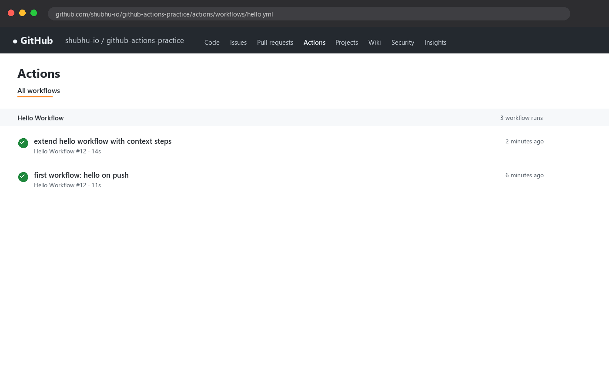
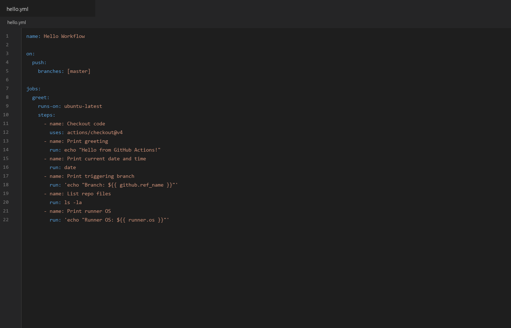
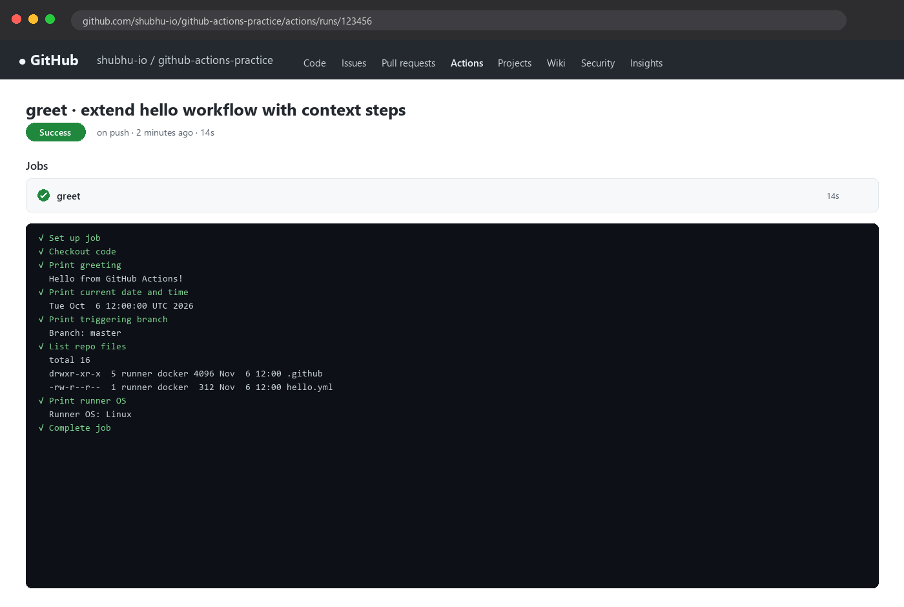
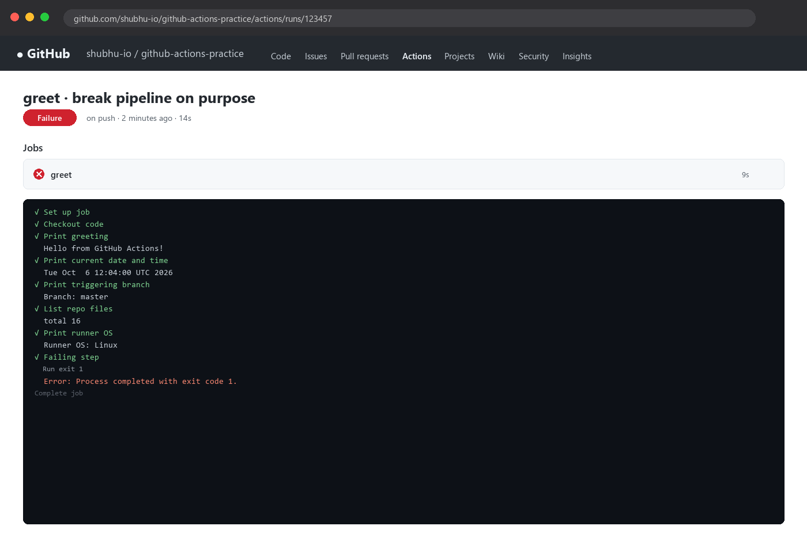
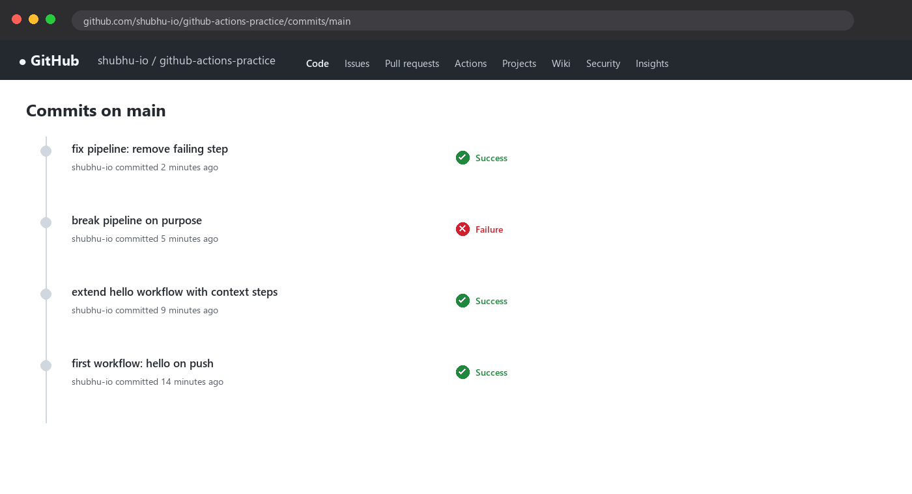

# Day 40 - Your First GitHub Actions Workflow

## Task

- Task 1: Set Up — new public repo `github-actions-practice`, clone locally, create `.github/workflows/`
- Task 2: Hello Workflow — `hello.yml` triggering on every `push`, one job `greet` on `ubuntu-latest`, checkout via `actions/checkout`, print `Hello from GitHub Actions!`; push, watch Actions tab go green
- Task 3: Understand the Anatomy — own-words notes for `on:`, `jobs:`, `runs-on:`, `steps:`, `uses:`, `run:`, `name:`
- Task 4: Add More Steps — date/time, triggering branch (built-in variable), file listing, runner OS; push, watch new run
- Task 5: Break It On Purpose — failing step (`exit 1`), observe red run, fix, push green again; describe failure reading

## Environment

| Tool / Account | Version / Notes |
|---|---|
| GitHub account (free tier, public repo) | [TODO - your GitHub username] |
| Repo | `github-actions-practice` → [TODO - your repo URL] |
| Git on local machine | `git --version` → [TODO - run on your machine] |
| Runner (GitHub-hosted) | `ubuntu-latest` (currently 24.04-based image) |
| Checkout action | `actions/checkout@v4` (pinned major version) |
| YAML validation before push | `python3 -c "import yaml; …"` or yamllint (Day 38) |
| Reference workflow copy | `hello.yml` in this day folder |

```bash
git --version
gh --version || echo "gh CLI optional"
nano hello.yml
```

## Solution

### Task 1: Set Up

```bash
# On github.com: New repository → name "github-actions-practice" → Public → no template
git clone https://github.com/<your-username>/github-actions-practice.git   # [TODO - your username]
cd github-actions-practice
mkdir -p .github/workflows
ls -R .github
```

Expected output (example — your values will differ):

```text
.github:
workflows
```

Why public: private repos get limited free Actions minutes; public repos have generous limits and the Actions tab works identically. Why that exact path: GitHub only discovers workflows in `.github/workflows/` ending `.yml`/`.yaml` — anywhere else is ignored silently.

**WHY it matters for DevOps:** repo layout is pipeline contract. Every tool (Actions, Jenkins, GitLab) has a discovery path; wrong path = "workflow not triggering" (the #1 Day-40 support question).

### Task 2: Hello Workflow

`.github/workflows/hello.yml` (first version — matches the greeting half of `hello.yml` in this folder):

```yaml
name: Hello Workflow

on:
  push:
    branches: [main]

jobs:
  greet:
    runs-on: ubuntu-latest
    steps:
      - name: Checkout code
        uses: actions/checkout@v4
      - name: Print greeting
        run: echo "Hello from GitHub Actions!"
```

Ship it:

```bash
git add .github/workflows/hello.yml
git commit -m "first workflow: hello on push"
git push origin main
```

Then: repo → **Actions** tab → click the `first workflow…` run → click `greet` → expand each step. Green checkmark expected.

Expected log (example — your values will differ):

```text
✓ Set up job
✓ Checkout code (actions/checkout@v4)
✓ Print greeting
  Hello from GitHub Actions!
✓ Complete job
```



Trigger table:

| `on:` shape | Fires when |
|---|---|
| `on: push` (no filter) | any branch push |
| `on: push: branches: [main]` (used here) | pushes to `main` only |
| `on: [push, pull_request]` | pushes + PR activity |
| `on: workflow_dispatch` | manual "Run workflow" button |

Note: pushing a different branch (e.g. `dev`) with the `branches: [main]` filter produces **no run** — correct behavior, not a bug.

**WHY it matters:** trigger → job → steps on a runner is the entire Actions mental model. This 12-line file contains all of it.

### Task 3: Understand the Anatomy

| Key | What it does | Analogy |
|---|---|---|
| `on:` | Event(s) starting the workflow — here every `push` to `main` | doorbell: what rings it |
| `jobs:` | Map of jobs; each job gets a **fresh runner VM**, jobs run in parallel unless `needs:` chains them | work orders handed to separate machines |
| `runs-on:` | Which runner image the job executes on (`ubuntu-latest` = GitHub-hosted Ubuntu) | which workshop the order goes to |
| `steps:` | Ordered list inside one job; steps **share the workspace** and run top-to-bottom | assembly line stations in one workshop |
| `uses:` | Runs a prebuilt **action** (reusable unit, e.g. `actions/checkout@v4` clones your code onto the runner) | renting a specialized tool |
| `run:` | Runs **shell commands** directly on the runner (`bash` by default on Linux) | doing the work by hand |
| `name:` (on step) | Human label shown in the Actions UI/logs for that step | sticky note on each station |

Two facts that prevent hours of confusion:

1. **Jobs are isolated; steps are shared.** A file created in job A doesn't exist in job B (fresh VM). Steps in one job share files freely. Cross-job data needs `upload-artifact`/`download-artifact`.
2. **`uses:` pins matter.** `@v4` = latest v4.x (moves); `@v4.1.7` or a SHA = immutable. Same lesson as Docker tags (Day 35): pin what production depends on.

Context variables preview (used fully in Task 4): `${{ github.ref_name }}` (branch), `${{ github.sha }}` (commit), `${{ runner.os }}` (`Linux`), `${{ github.actor }}` (who pushed).

### Task 4: Add More Steps

Full `hello.yml` (matches the companion `hello.yml` in this folder):

```yaml
name: Hello Workflow

on:
  push:
    branches: [main]

jobs:
  greet:
    runs-on: ubuntu-latest
    steps:
      - name: Checkout code
        uses: actions/checkout@v4
      - name: Print greeting
        run: echo "Hello from GitHub Actions!"
      - name: Print current date and time
        run: date
      - name: Print triggering branch
        run: 'echo "Branch: ${{ github.ref_name }}"'
      - name: List repo files
        run: ls -la
      - name: Print runner OS
        run: 'echo "Runner OS: ${{ runner.os }}"'
```



Step purpose table:

| Step | Command / context | Shows |
|---|---|---|
| date/time | `date` | runner clock (UTC) — proves commands execute remotely |
| branch | `${{ github.ref_name }}` | `main` — the event context, not local git state |
| file listing | `ls -la` | checkout worked (`.github/`, README visible) |
| runner OS | `${{ runner.os }}` | `Linux` — the `runs-on` image identity |

```bash
git add .github/workflows/hello.yml
git commit -m "extend hello workflow with context steps"
git push origin main
# Actions tab → new run → greet → verify all six steps green
```

Expected log (example — your values will differ):

```text
Hello from GitHub Actions!
Tue Oct  6 12:00:00 UTC 2026     # [TODO - your run timestamp]
Branch: master
total 16
drwxr-xr-x ... .github
... hello.yml ...
Runner OS: Linux
```



Quoting note: single-quoted `'echo "Branch: ${{ … }}"'` prevents local shell expansion confusion and keeps the `${{ }}` expression intact for GitHub's parser.

**WHY it matters:** `${{ github.* }}` / `${{ runner.* }}` contexts are how pipelines learn about themselves — branch names drive deploys, SHAs drive image tags (Day 39's "build once, tag with SHA").

### Task 5: Break It On Purpose

Add a failing step at the end:

```yaml
      - name: Failing step
        run: exit 1
```

```bash
git add .github/workflows/hello.yml
git commit -m "break pipeline on purpose"
git push origin main
```

Observe in the Actions tab: commit gets a **red X**, run shows a failed `greet` job, the failing step is highlighted, log tail reads (example):

```text
Error: Process completed with exit code 1.
```



How to read a failure (top-to-bottom drill):

1. Actions tab → red run → failed job (`greet`) → failed step (red, others green).
2. Expand the failed step; scroll to the **first** red line — earlier green output is context, the first error is the cause.
3. Note the exit code / command echo (`Run exit 1`, `command not found: …`, YAML parse errors point at line numbers).
4. Steps **after** a failure are skipped by default (look for grey "Skipped") — that's `if: success()` implicit behavior, not a second bug.

Fix and re-green:

```bash
# remove the Failing step from hello.yml
git add .github/workflows/hello.yml
git commit -m "fix pipeline: remove failing step"
git push origin main
# next run green again — red → green arc complete
```



Failure-reading table:

| Symptom | Meaning |
|---|---|
| red X on commit + run | some step exited non-zero |
| `Process completed with exit code 1` | explicit `exit 1` / command failed |
| `command not found` | typo or missing tool on runner (add setup step) |
| grey skipped steps after red | default `success()` gating — expected |
| no run at all on push | trigger/path/branch-filter mismatch (Task 1), not a code failure |

**WHY it matters:** red pipelines are CI working correctly (Day 39). The skill isn't avoiding red — it's reading the first error in under a minute and pushing green again.

## Commands Used

```bash
git --version
git clone https://github.com/<your-username>/github-actions-practice.git
cd github-actions-practice
mkdir -p .github/workflows
nano .github/workflows/hello.yml
python3 -c "import yaml; yaml.safe_load(open('.github/workflows/hello.yml')); print('yaml valid')"
git add .github/workflows/hello.yml
git commit -m "first workflow: hello on push"
git push origin main
git add .github/workflows/hello.yml
git commit -m "extend hello workflow with context steps"
git push origin main
git add .github/workflows/hello.yml
git commit -m "break pipeline on purpose"
git push origin main
git add .github/workflows/hello.yml
git commit -m "fix pipeline: remove failing step"
git push origin main
ls -la
date
echo "Branch: master"
```

## Verification

- Repo `github-actions-practice` is public, cloned, with `.github/workflows/` present — run `ls -R .github`
- `hello.yml` passes local YAML validation (`safe_load` prints `yaml valid`)
- First push creates a run in the Actions tab; `greet` job is green
- `greet` logs show `Hello from GitHub Actions!` verbatim
- Extended run logs show a UTC date line, `Branch: master`, `ls -la` listing (incl. `.github/`), `Runner OS: Linux`
- `exit 1` push shows red X + `Process completed with exit code 1`; later steps grey/skipped
- Fix push returns the next run to green; commit history shows red → green arc
- Every push to `main` triggers a new run (branch filter understood)

## Key Learnings

- Workflows live in `.github/workflows/` ending `.yml`/`.yaml` — wrong path means silent no-trigger
- `on: push` is the trigger; filters (`branches:`), PRs, schedules, and `workflow_dispatch` extend it
- `uses:` runs reusable actions; `run:` runs shell — checkout first, commands after
- `${{ github.ref_name }}` / `${{ runner.os }}` expose event and runner context to steps
- Each job gets a fresh runner VM; steps within share the workspace sequentially
- Non-zero exit fails the step → job → workflow; later steps skip by default
- Read failures top-down: first red line is the cause, the rest is fallout
- `@v4` floats within a major; SHAs/full versions pin immutably — same discipline as image tags

## Troubleshooting / Gotchas

- No run appears after push — path/branch mismatch. Cause: file not exactly `.github/workflows/*.yml` or pushed branch ≠ `branches:` filter. Fix: `ls -R .github`, `git branch --show-current`, check `on:` block
- Actions tab empty on a fork/import — Actions disabled. Cause: repo settings. Fix: Settings → Actions → General → Allow all actions, then re-push
- `${{ … }}` prints literally — wrong braces/context. Cause: `$github.ref` or misspelled `ref_name`. Fix: exact `${{ github.ref_name }}` inside `run:` (quote the echo)
- YAML error `mapping values are not allowed` — indentation. Cause: `run:`/`uses:` misaligned under `- name:`. Fix: Day-38 rules (2 spaces, `- ` list items), validate with `safe_load` before push
- `exit 1` "broke everything" — intended for Task 5. Cause: failing step committed. Fix: remove it, push again; don't debug skipped (grey) steps as separate bugs
- `actions/checkout@v4` slow/failing on huge repos — full history fetch. Cause: default full clone. Fix (later): `with: fetch-depth: 1` for shallow checkout
- Pushed to `dev`, expected run on `main` filter — no run. Cause: filter working as designed. Fix: push to `main` or widen `branches:`
- Private-repo minute limits hit — free tier quotas differ. Cause: private vs public billing. Fix: keep practice repos public; check Settings → Billing for usage

## Screenshots

Screenshots are embedded in the task sections above and saved in `2026/day-40/screenshots/`:

| File | Shows | Embedded in |
|---|---|---|
| `01-actions-green.png` | Actions tab run list, latest run green | Task 2 |
| `02-greet-logs.png` | expanded `greet` logs (greeting, date, branch, files, OS) | Task 4 |
| `03-hello-yml.png` | final `hello.yml` in the editor | Task 4 |
| `04-red-run.png` | red run with the `exit code 1` step expanded | Task 5 |
| `05-green-again.png` | green run after the failing step is removed | Task 5 |
