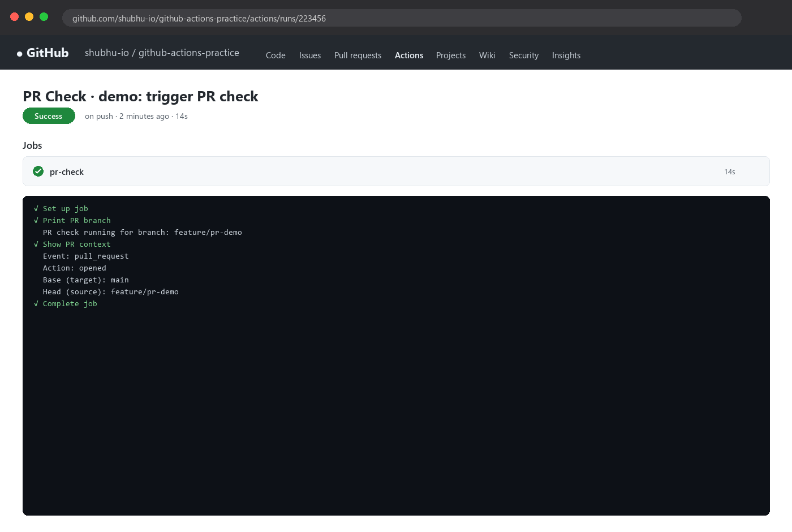
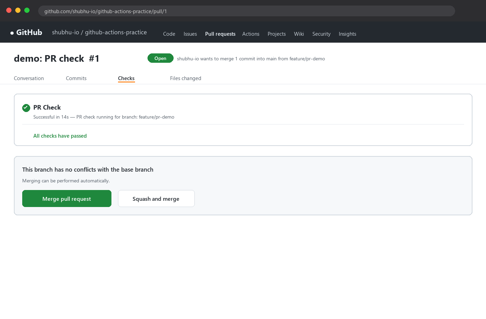
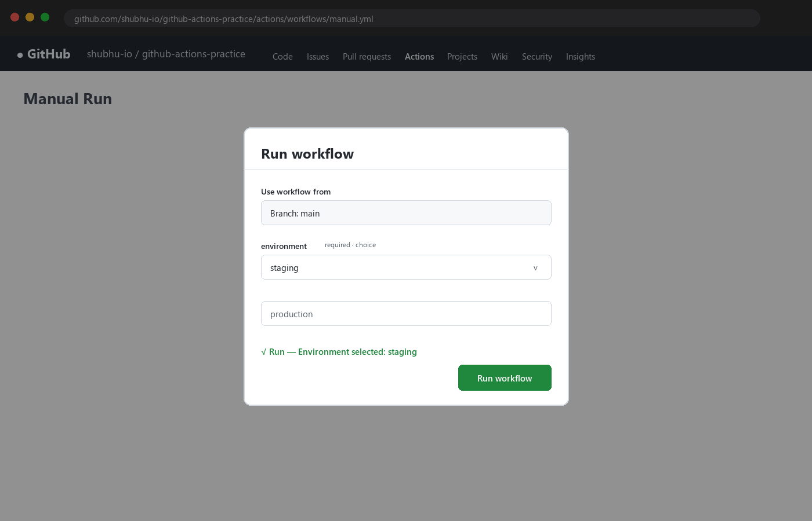
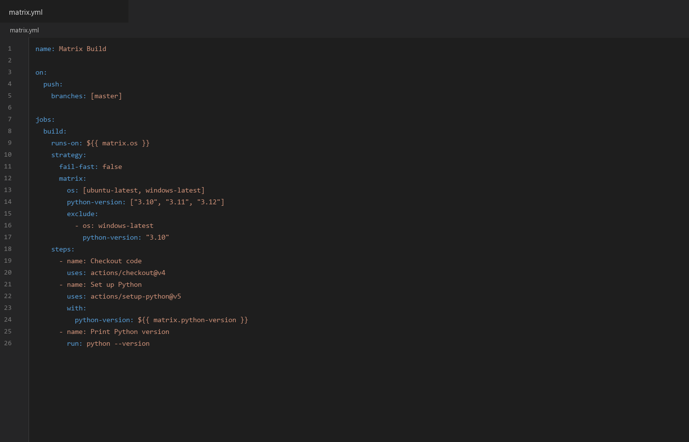
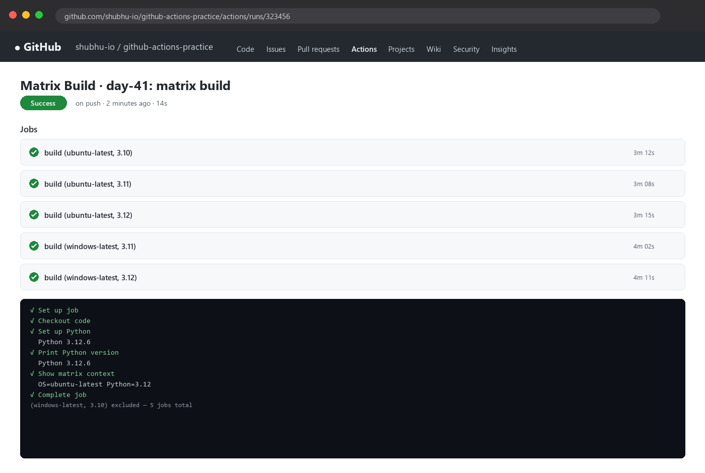
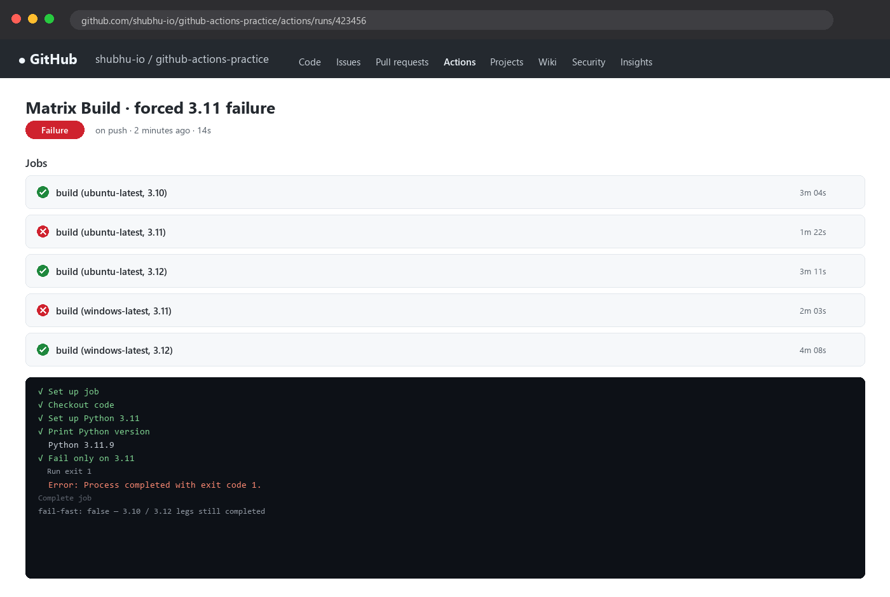

# Day 41 - Triggers & Matrix Builds

## Task

Recap of every challenge task from `README.md`:

- **Task 1 — Trigger on Pull Request:** Create `.github/workflows/pr-check.yml` triggered only when a PR is opened or updated against `main`; print `PR check running for branch: <branch name>`; create a branch, push, open a PR and watch it run; verify it shows on the PR page.
- **Task 2 — Scheduled Trigger:** Add a `schedule:` cron trigger running every day at midnight UTC; answer in notes the cron expression for every Monday at 9 AM.
- **Task 3 — Manual Trigger:** Create `.github/workflows/manual.yml` with `workflow_dispatch:` plus an `environment` input (staging/production); print the input; trigger from Actions tab via **Run workflow**; verify the input is printed.
- **Task 4 — Matrix Builds:** Create `.github/workflows/matrix.yml` running the same job across Python `3.10`, `3.11`, `3.12` (install Python + print version, 3 parallel jobs); then extend to 2 operating systems and compute the total job count.
- **Task 5 — Exclude & Fail-Fast:** Exclude one combination (e.g. Python 3.10 on Windows); set `fail-fast: false`, trigger a failure in one job and observe the rest; document `fail-fast: true` (default) vs `false`.
- **Documentation deliverable:** `day-41-triggers.md` with each workflow YAML, screenshots of runs, and the Task 2 cron answer.

## Environment

| OS / Tool | Version / Notes |
|---|---|
| OS | Windows 11 + WSL2 Ubuntu 22.04 (your local shell) |
| Git | `git --version` → `git version 2.43.0` (example) |
| `gh` CLI | `gh --version` → `gh version 2.62.0` (example) |
| GitHub account | free tier, repo `github-actions-practice` |
| Actions runner images | `ubuntu-latest`, `windows-latest` |
| Actions used | `actions/checkout@v4`, `actions/setup-python@v5` |
| Python matrix | `3.10`, `3.11`, `3.12` (quoted strings in YAML) |
| Default branch | `main` (schedules and `branches:` filters assume this) |
| `[TODO - run on your machine]` | Paste real `gh --version`, `git --version`, runner image versions from your run logs |

Check your tooling:

```bash
gh --version
git --version
gh auth status
```

Expected output (example — your values will differ):

```text
gh version 2.62.0 (2024-11-01)
git version 2.43.0
Logged in to github.com account <you> with scope repo, workflow
```

## Solution

### Task 1: Trigger on Pull Request

**Concept:** `on: pull_request` fires for PR lifecycle events against the *target* branch. `types: [opened, synchronize]` covers "PR just opened" and "new commits pushed to the PR branch". `${{ github.head_ref }}` is the source branch name (only populated on `pull_request` events).

**WHY it matters for DevOps:** PR checks are the quality gate before merge — lint, test, and policy run automatically on every proposed change instead of relying on humans to remember.

`pr-check.yml` (saved in this folder):

```yaml
name: PR Check

on:
  pull_request:
    types: [opened, synchronize]
    branches: [main]

jobs:
  pr-check:
    runs-on: ubuntu-latest
    steps:
      - name: Print PR branch
        run: 'echo "PR check running for branch: ${{ github.head_ref }}"'
      - name: Show PR context
        run: |
          echo "Event: ${{ github.event_name }}"
          echo "Action: ${{ github.event.action }}"
          echo "Base (target): ${{ github.base_ref }}"
          echo "Head (source): ${{ github.head_ref }}"
```

Run it end to end:

```bash
git checkout -b feature/pr-demo
echo "# demo" >> demo.txt
git add demo.txt
git commit -m "demo: trigger PR check"
git push -u origin feature/pr-demo
gh pr create --base main --head feature/pr-demo --title "demo: PR check" --body "Testing day-41 PR trigger"
gh pr view --web
```

Expected log output (example):

```text
PR check running for branch: feature/pr-demo
Event: pull_request
Action: opened
Base (target): main
Head (source): feature/pr-demo
```

The check appears in two places: the **Checks** section at the bottom of the PR page and the **Actions** tab under `PR Check`.





| PR event type | When it fires | Typical use |
|---|---|---|
| `opened` | PR first created | First validation run |
| `synchronize` | New commits pushed to PR branch | Re-validate on every update |
| `reopened` | Closed PR re-opened | Re-run after discussion |
| `closed` | PR closed/merged | Cleanup or merge-only deploy |

### Task 2: Scheduled Trigger

**Concept:** `on: schedule` uses POSIX cron in **UTC**, evaluated on the default branch only. Five fields: `minute hour day-of-month month day-of-week`.

```yaml
on:
  schedule:
    - cron: '0 0 * * *'   # every day at 00:00 UTC

jobs:
  nightly:
    runs-on: ubuntu-latest
    steps:
      - run: echo "Nightly run at $(date -u)"
```

Cron cheat table:

| Expression | Meaning |
|---|---|
| `0 0 * * *` | Every day at midnight UTC (Task 2 requirement) |
| `0 9 * * 1` | **Answer:** every Monday at 9:00 AM UTC |
| `30 2 * * 1` | Every Monday at 02:30 UTC |
| `0 */6 * * *` | Every 6 hours (00:00, 06:00, 12:00, 18:00) |
| `*/15 * * * *` | Every 15 minutes (avoid — wastes minutes) |

**WHY it matters for DevOps:** Schedules drive nightly builds, dependency scans, backup verification, and health checks without human triggers — the "robot that never sleeps".

> Note: GitHub schedules are best-effort. Expect delays under load, and GitHub auto-disables scheduled workflows after 60 days of repo inactivity. Always add `workflow_dispatch:` alongside `schedule:` so you can test manually.

Verify the cron is registered:

```bash
gh workflow view "Scheduled Demo" --yaml | grep -A3 schedule
gh run list --workflow=scheduled-demo.yml --limit 5
```

### Task 3: Manual Trigger

**Concept:** `workflow_dispatch` adds a **Run workflow** button in the Actions tab. Typed `inputs` (choice/string/boolean) parameterise a run — e.g. pick the target environment.

`manual.yml` (saved in this folder):

```yaml
name: Manual Run

on:
  workflow_dispatch:
    inputs:
      environment:
        description: 'Target environment'
        required: true
        default: 'staging'
        type: choice
        options:
          - staging
          - production

jobs:
  manual:
    runs-on: ubuntu-latest
    steps:
      - name: Print input
        run: 'echo "Environment selected: ${{ inputs.environment }}"'
      - name: Gate production
        if: ${{ inputs.environment == 'production' }}
        run: echo "Extra caution: this would deploy to PRODUCTION"
```

Trigger it two ways:

```bash
# From CLI (equivalent of clicking Run workflow):
gh workflow run manual.yml -f environment=staging
gh run watch
# Production path:
gh workflow run manual.yml -f environment=production
```

Expected output (example — your values will differ):

```text
Environment selected: staging
```

UI path: **Actions tab → Manual Run → Run workflow →** select branch + `environment` → **Run workflow**. The queued run prints your choice in its logs.



**WHY it matters for DevOps:** Manual dispatches power one-click deploys, hotfix rollbacks, and environment promotions without giving everyone shell access to production.

### Task 4: Matrix Builds

**Concept:** A matrix fans one job definition out into N parallel jobs — the cartesian product of every axis. One YAML block tests the whole support matrix at once.

Start Python-only (3 jobs):

```yaml
strategy:
  matrix:
    python-version: ["3.10", "3.11", "3.12"]
```

Then add the OS axis (3 × 2 = **6 jobs**):

```yaml
strategy:
  matrix:
    os: [ubuntu-latest, windows-latest]
    python-version: ["3.10", "3.11", "3.12"]
```

Full `matrix.yml` saved in this folder:

```yaml
name: Matrix Build

on:
  push:
    branches: [main]

jobs:
  build:
    runs-on: ${{ matrix.os }}
    strategy:
      fail-fast: false
      matrix:
        os: [ubuntu-latest, windows-latest]
        python-version: ["3.10", "3.11", "3.12"]
        exclude:
          - os: windows-latest
            python-version: "3.10"
    steps:
      - name: Checkout code
        uses: actions/checkout@v4
      - name: Set up Python
        uses: actions/setup-python@v5
        with:
          python-version: ${{ matrix.python-version }}
      - name: Print Python version
        run: python --version
      - name: Show matrix context
        run: echo "OS=${{ matrix.os }} Python=${{ matrix.python-version }}"
```



Expected Actions view (example):

```text
Matrix Build / build (ubuntu-latest, 3.10)      ✅
Matrix Build / build (ubuntu-latest, 3.11)      ✅
Matrix Build / build (ubuntu-latest, 3.12)      ✅
Matrix Build / build (windows-latest, 3.11)     ✅
Matrix Build / build (windows-latest, 3.12)     ✅
(windows-latest, 3.10 excluded — 5 jobs total)
```



**WHY it matters for DevOps:** One commit proves compatibility everywhere you ship. Without a matrix you either test one combo (and hope) or maintain N copy-pasted jobs (and drift).

### Task 5: Exclude & Fail-Fast

Exclude removes combinations you do not support:

```yaml
exclude:
  - os: windows-latest
    python-version: "3.10"
```

6 combinations − 1 excluded = **5 jobs**.

`fail-fast` controls blast radius when one leg fails:

| Setting | Behaviour |
|---|---|
| `fail-fast: true` (default) | First failing matrix job **cancels** the remaining jobs |
| `fail-fast: false` | Every matrix job runs to completion; you see the full failure pattern |

Show it — add a deliberately failing leg:

```yaml
- name: Fail only on 3.11
  if: matrix.python-version == '3.11'
  run: exit 1
```

With `fail-fast: false` the 3.11 legs go red while 3.10/3.12 still finish green, proving the failure is version-specific rather than global. With `true`, the later jobs would show grey `cancelled`.



**WHY it matters for DevOps:** `false` during debugging shows the whole failure map (is it one Python or all Windows?); `true` in steady state saves minutes and money by stopping early.

## Commands Used

```bash
# --- Task 1: PR trigger ---
git checkout -b feature/pr-demo
echo "# demo" >> demo.txt
git add demo.txt && git commit -m "demo: trigger PR check"
git push -u origin feature/pr-demo
gh pr create --base main --head feature/pr-demo --title "demo: PR check" --body "Testing day-41 PR trigger"
gh run list --workflow=pr-check.yml --limit 5
gh run view --log --job=pr-check

# --- Task 2: schedule ---
gh workflow view "Matrix Build" --yaml | grep -A3 schedule

# --- Task 3: manual dispatch ---
gh workflow run manual.yml -f environment=staging
gh workflow run manual.yml -f environment=production
gh run watch

# --- Task 4 + 5: matrix ---
git add .github/workflows/matrix.yml && git commit -m "day-41: matrix build" && git push
gh run list --workflow=matrix.yml --limit 5
gh run view --log
python --version
```

## Verification

- Run `gh run list --workflow=pr-check.yml` — a run appears after opening the PR with `opened` action.
- Open the PR page on GitHub — the `PR Check` status appears under Checks.
- Push another commit to the PR branch — a second run with action `synchronize` appears.
- `grep -A3 schedule` on the scheduled workflow shows `cron: '0 0 * * *'`; notes answer Monday 9 AM as `0 9 * * 1`.
- Click **Run workflow** on `Manual Run` with `staging` — logs print `Environment selected: staging`; repeat with `production`.
- Actions tab for `Matrix Build` shows 5 parallel jobs (6 minus the excluded `windows-latest + 3.10`).
- Each matrix leg logs its own `python --version` (3.10/3.11/3.12) and `OS=... Python=...` context line.
- With `fail-fast: false`, force one leg to `exit 1` — that leg is red, the others still finish instead of cancelling.

## Key Learnings

- `pull_request.types` (`opened`, `synchronize`, …) scopes exactly which PR activity triggers a run; `branches:` matches the PR *target*.
- Schedules are UTC POSIX cron on the default branch only, best-effort and auto-disabled after 60 idle days.
- `workflow_dispatch.inputs` (choice/string/boolean) turns a workflow into a parameterised button; read via `${{ inputs.<name> }}`.
- A matrix is a cartesian product: axes multiply (`3 Pythons × 2 OSes = 6 jobs`); quote versions so YAML keeps them strings.
- `exclude:` removes unsupported combos; `include:` adds one-off extras beyond the product.
- `fail-fast: true` (default) cancels siblings on first failure; `false` reveals the full failure map — use false while debugging.
- Windows legs need `python --version` (not `python3`) and PowerShell-safe quoting.
- Pair every `schedule:` with `workflow_dispatch:` so the workflow is testable without waiting for the clock.

## Troubleshooting / Gotchas

- **Cron never fired:** cause — schedules only run from the default branch or repo was idle 60+ days (auto-disabled). Fix — merge the workflow to `main`, push any commit to re-enable, and test via `gh workflow run`.
- **PR workflow did not trigger:** cause — `branches:` filter matches the *base* branch, not your feature branch. Fix — ensure the PR targets `main` and `types:` includes `opened, synchronize`.
- **Double runs on every PR:** cause — having both `on: push` and `on: pull_request` without filters fires twice for PRs from same repo. Fix — scope `push` to `main` only or add `if:` conditions.
- **Matrix versions behave oddly (`3.10` → `3.1`):** cause — unquoted `3.10` parses as a YAML float. Fix — always quote: `"3.10"`.
- **Manual inputs empty (`${{ inputs.environment }}` blank):** cause — reading `github.event.inputs` on new runners or wrong expression. Fix — use `${{ inputs.environment }}` for `workflow_dispatch`.
- **`fail-fast` seemed ignored:** cause — it only cancels *pending* siblings; already-running jobs finish. Fix — expect in-flight jobs to complete; check cancelled (grey) status on queued ones.
- **Windows leg fails on `python3 --version`:** cause — Windows images expose `python`, not `python3`. Fix — use `python --version` for cross-OS steps.

## Screenshots

Screenshots are embedded in the task sections above and saved in `2026/day-41/screenshots/`:

| File | Shows | Embedded in |
|---|---|---|
| `actions-pr-check-green.png` | `PR Check` run green on PR open, log with the source branch | Task 1 |
| `pr-page-check.png` | PR page **Checks** section showing the `PR Check` status | Task 1 |
| `actions-manual-run.png` | **Run workflow** dialog + green run printing `Environment selected: staging` | Task 3 |
| `actions-matrix-5-jobs.png` | `Matrix Build` with 5 parallel legs (one excluded), all green | Task 4 |
| `workflow-yaml-matrix.png` | `matrix.yml` showing `strategy.matrix` + `exclude` + `fail-fast` | Task 4 |
| `logs-fail-fast.png` | one forced failure with `fail-fast: false` — siblings still completed | Task 5 |
