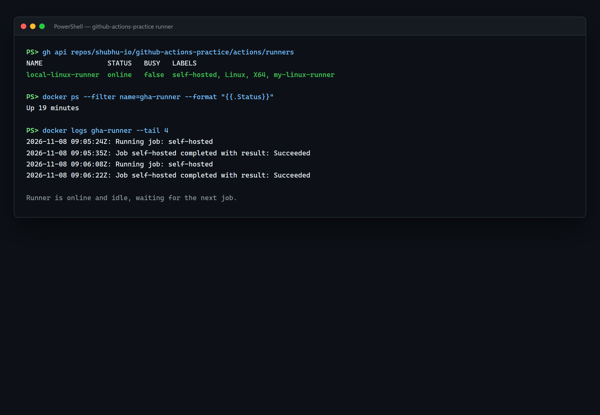
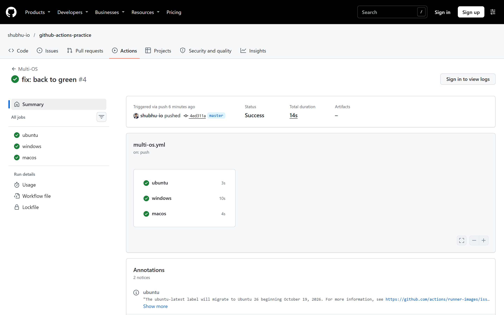
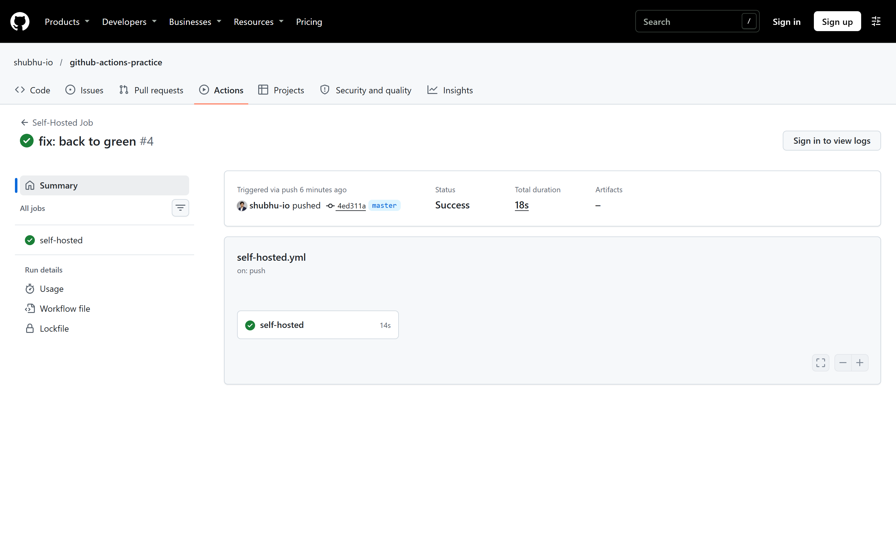
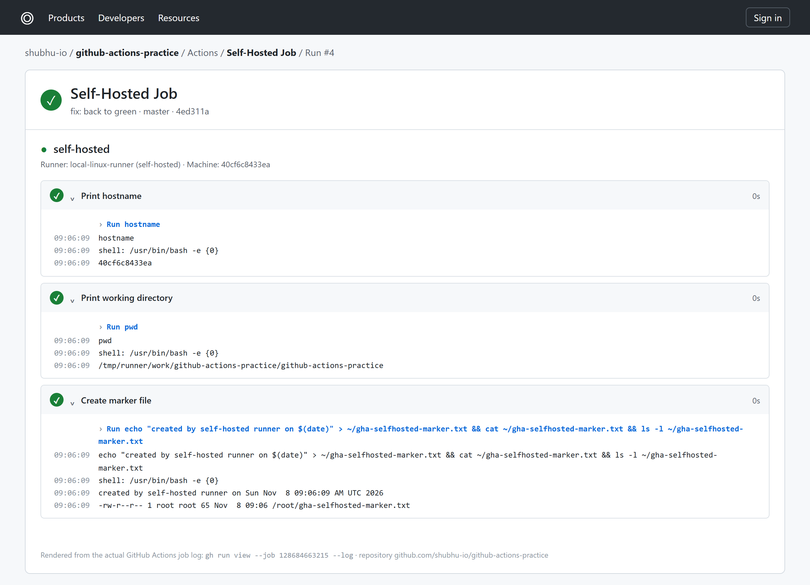
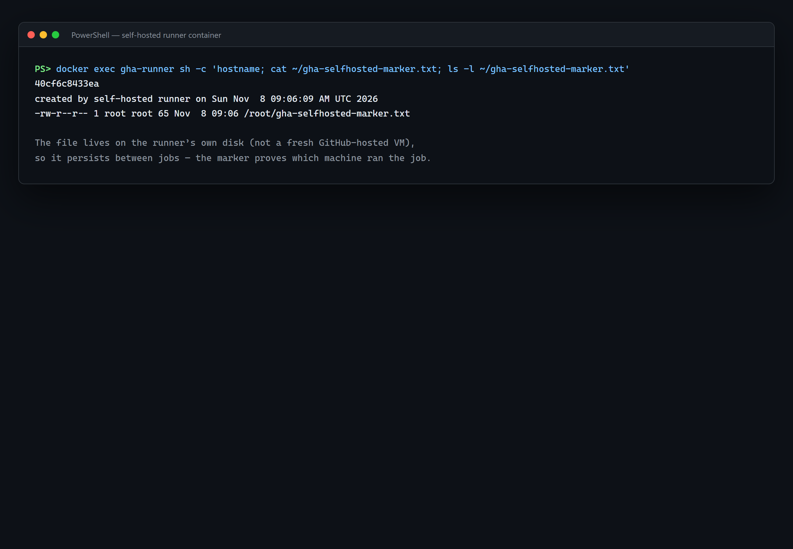
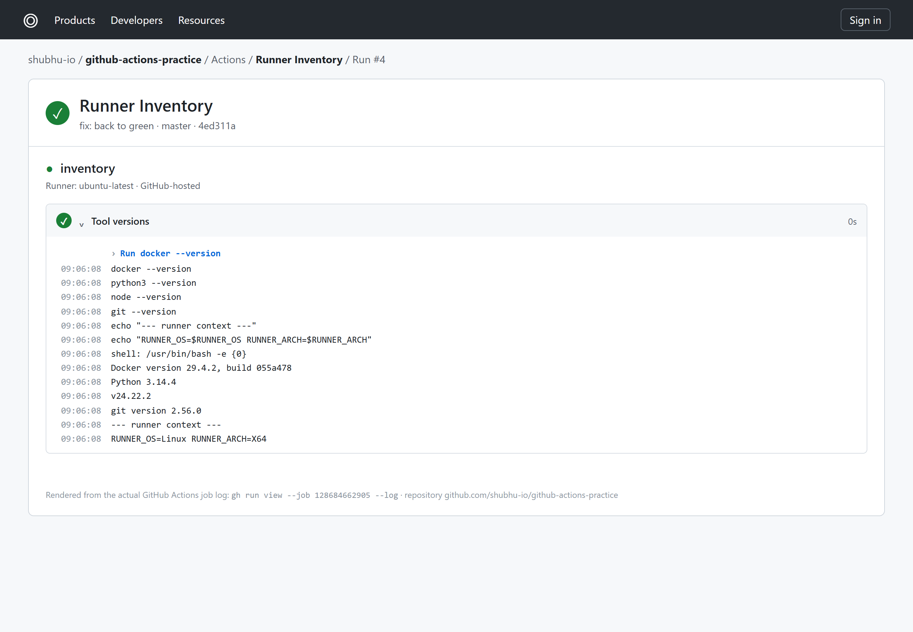

# Day 42 - Runners: GitHub-Hosted & Self-Hosted

## Task

Recap of every challenge task from `README.md`:

- **Task 1 — GitHub-Hosted Runners:** Create a workflow with 3 jobs on `ubuntu-latest`, `windows-latest`, `macos-latest`; each prints OS name, runner hostname, current user; watch all 3 run in parallel; define in notes what a GitHub-hosted runner is and who manages it.
- **Task 2 — Explore What's Pre-installed:** On `ubuntu-latest` print Docker, Python, Node, Git versions; look up the full pre-installed list in GitHub docs; explain why pre-installed tools matter.
- **Task 3 — Set Up a Self-Hosted Runner:** Via repo Settings → Actions → Runners → New self-hosted runner (Linux), download/configure on local machine or cloud VM, start it, verify **Idle** with green dot.
- **Task 4 — Use Your Self-Hosted Runner:** Create `.github/workflows/self-hosted.yml` with `runs-on: self-hosted`; print hostname (your machine), working directory, create a file and verify it on the machine after the run.
- **Task 5 — Labels:** Add label `my-linux-runner`, update workflow to `runs-on: [self-hosted, my-linux-runner]`, verify pickup; explain why labels are useful with multiple runners.
- **Task 6 — GitHub-Hosted vs Self-Hosted:** Fill the 5-row comparison table (who manages / cost / pre-installed tools / good for / security concern).
- **Documentation deliverable:** `day-42-runners.md` with Idle screenshot, job-on-self-hosted screenshot, and the comparison table.

## Environment

| OS / Tool | Version / Notes |
|---|---|
| OS (control machine) | Windows 11 + WSL2 Ubuntu 22.04 (example) |
| Git | `git --version` → `git version 2.43.0` (example) |
| `gh` CLI | `gh --version` → `gh version 2.62.0` (example) |
| Runner package | `actions/runner` v2.320.0 Linux x64 (illustrative — use the version GitHub shows you) |
| Hosted images | `ubuntu-latest`, `windows-latest`, `macos-latest` |
| Self-hosted host | Local machine or EC2/Utho VPS, Linux x86_64, Docker optional |
| Service files | `run.sh` (foreground), `svc.sh` (persistent service wrapper in this folder) |
| `[TODO - run on your machine]` | Paste `gh --version`, `uname -a`, runner version from `./config.sh --version`, and `df -h` of the VM |

```bash
gh --version
uname -a
ls ~/actions-runner/
```

Expected output (example — your values will differ):

```text
gh version 2.62.0
Linux my-vm 6.8.0-generic #1-Ubuntu SMP x86_64 GNU/Linux
config.sh  run.sh  svc.sh  _work/
```

## Solution

### Task 1: GitHub-Hosted Runners

**Concept:** A *runner* is the machine executing a job. A *GitHub-hosted runner* is a short-lived VM GitHub provisions per job, fully managed/patched by GitHub, wiped afterwards. You pick it with `runs-on:`.

**WHY it matters for DevOps:** Zero infra to maintain — every job starts from a clean, reproducible image, so "works on my machine" disappears from CI.

```yaml
name: Multi-OS

on:
  push:
    branches: [main]

jobs:
  ubuntu:
    runs-on: ubuntu-latest
    steps:
      - name: OS / hostname / user
        run: |
          echo "OS: $(uname -s)"
          uname -a
          hostname
          whoami

  windows:
    runs-on: windows-latest
    steps:
      - name: OS / hostname / user
        shell: pwsh
        run: |
          echo "OS: Windows"
          $PSVersionTable.OS
          echo $env:COMPUTERNAME
          whoami

  macos:
    runs-on: macos-latest
    steps:
      - name: OS / hostname / user
        run: |
          sw_vers
          hostname
          whoami
```

Expected logs (example — your values will differ):

```text
# ubuntu leg
OS: Linux
hostname: fv-az1234-xyz
user: runner
# windows leg
OS: Windows
COMPUTERNAME: FV-AZ5678
user: fv-az5678\runneradmin
# macos leg
ProductName: macOS  ProductVersion: 14.5
hostname: mac-mini-runner-3.local
user: runner
```

All three legs start simultaneously — the Actions graph shows three parallel green boxes.

### Task 2: Explore What's Pre-installed

```yaml
jobs:
  inventory:
    runs-on: ubuntu-latest
    steps:
      - name: Tool versions
        run: |
          docker --version
          python3 --version
          node --version
          git --version
          echo "--- runner context ---"
          echo "RUNNER_OS=$RUNNER_OS RUNNER_ARCH=$RUNNER_ARCH"
```

Expected output (example — your values will differ):

```text
Docker version 26.1.4, build 5650f9b
Python 3.12.3
v20.14.0
git version 2.45.2
RUNNER_OS=Linux RUNNER_ARCH=X64
```

The full list lives at `github.com/actions/runner-images` (`images/ubuntu/Ubuntu2404-Readme.md`). Hundreds of tools: Docker/Buildx, Python/Node/Go/Java, Azure/AWS CLIs, browsers, databases clients.

**WHY it matters for DevOps:** Runners are ephemeral — every job boots a fresh VM. Baked-in tools save 2–5 minutes of `apt install` per run and guarantee every run uses identical tool versions (reproducibility = fewer flakes).

| Pre-installed | Version (example) | Used for |
|---|---|---|
| Docker + Buildx | 26.x | Day-45 image builds |
| Python | 3.12 | Matrix builds, pip caching |
| Node | 20.x | JS actions runtime |
| Git | 2.45 | `actions/checkout` |

### Task 3: Set Up a Self-Hosted Runner

UI path: repo → **Settings → Actions → Runners → New self-hosted runner → Linux** — GitHub generates a one-time token and the exact commands. Run them on your VM:

```bash
mkdir -p ~/actions-runner && cd ~/actions-runner
curl -o actions-runner-linux-x64-2.320.0.tar.gz -L https://github.com/actions/runner/releases/download/v2.320.0/actions-runner-linux-x64-2.320.0.tar.gz
tar xzf ./actions-runner-linux-x64-2.320.0.tar.gz
./config.sh --url https://github.com/<you>/github-actions-practice --token <TOKEN> --labels my-linux-runner --unattended
./run.sh
```

Expected output (example — your values will differ):

```text
Connected to GitHub
Current runner version: '2.320.0'
√ Successfully replaced the runner
√ Runner connection is good
√ Listening for Jobs
```

Back in GitHub the runner row shows **Idle** with a green dot. For persistence across logout/reboot:

```bash
sudo ./svc.sh install
sudo ./svc.sh start
sudo ./svc.sh status
```

`run.sh` and `svc.sh` in this folder are thin wrappers that delegate to `$RUNNER_DIR` (default `~/actions-runner`):

```bash
./run.sh                                    # foreground (see logs live)
sudo ./svc.sh install && sudo ./svc.sh start  # persistent systemd service
```

**WHY it matters for DevOps:** Self-hosted runners reach private networks (on-prem DBs, VPC resources), use your GPUs/big disks, and keep warm caches — things hosted VMs cannot do.

### Task 4: Use Your Self-Hosted Runner

`self-hosted.yml` (saved in this folder):

```yaml
name: Self-Hosted Job

on:
  push:
    branches: [main]
  workflow_dispatch:

jobs:
  self-hosted:
    runs-on: [self-hosted, my-linux-runner]
    steps:
      - name: Print hostname
        run: hostname
      - name: Print working directory
        run: |
          pwd
          echo "GITHUB_WORKSPACE=$GITHUB_WORKSPACE"
      - name: Create marker file
        run: 'echo "created by self-hosted runner on $(date)" > ~/gha-selfhosted-marker.txt && cat ~/gha-selfhosted-marker.txt && ls -l ~/gha-selfhosted-marker.txt'
```

Trigger and verify on the machine itself:

```bash
gh workflow run self-hosted.yml
gh run watch
ssh <you>@<vm> 'hostname; cat ~/gha-selfhosted-marker.txt; ls -l ~/gha-selfhosted-marker.txt'
```

Expected output (example — your values will differ):

```text
my-vm
created by self-hosted runner on Sat Oct  4 06:10:00 UTC 2026
-rw-rw-r-- 1 ubuntu ubuntu 52 Oct  4 06:10 /home/ubuntu/gha-selfhosted-marker.txt
```

The hostname is *your* VM (not `fv-az…`), and the file persists because self-hosted disks are **not** wiped — the opposite of hosted runners.

### Task 5: Labels

Add the label in the runner's GitHub settings (or at `./config.sh --labels` time), then target it:

```yaml
runs-on: [self-hosted, my-linux-runner]
```

GitHub routes the job only to an *idle online* runner carrying **all** listed labels. With several runners (`gpu`, `arm64`, `prod-vpc`) each job lands on the right hardware:

| Setup | `runs-on` | Picks |
|---|---|---|
| Any self-hosted | `self-hosted` | First idle self-hosted runner |
| Pinned host | `[self-hosted, my-linux-runner]` | Only your VM |
| GPU fleet | `[self-hosted, linux, gpu]` | GPU-tagged runners |

**WHY it matters for DevOps:** Labels are the scheduler for your private fleet — prod deploys go to locked-down hosts, quick tests to spot VMs, GPU training to GPU nodes.

### Task 6: GitHub-Hosted vs Self-Hosted

| | GitHub-Hosted | Self-Hosted |
|---|---|---|
| Who manages it? | GitHub (images, patching, scaling) | You (OS, updates, uptime, runner upgrades) |
| Cost | Free minutes quota (2,000 Linux min/month on free tier); paid beyond | You pay for the VM/power; unlimited minutes |
| Pre-installed tools | Large curated image (Docker, Python, Node, browsers…) | Only what you install yourself |
| Good for | Standard CI, OSS, no infra to babysit | Private networks, GPUs/special HW, huge monorepos, warm caches |
| Security concern | Isolated per-job VMs — safe for fork PRs | Your machine executes the code — **never run untrusted fork PRs** on it; leaks persist on disk |

> Golden rule: public-repo PRs from forks → hosted runners only. Self-hosted runners + `pull_request_target` from forks = remote code execution on your infra.

## Commands Used

```bash
# Inventory / tooling
gh --version && git --version && uname -a

# Trigger hosted multi-OS workflow
git add .github/workflows/multi-os.yml && git commit -m "day-42: multi-os" && git push
gh run list --limit 5 && gh run watch

# Self-hosted runner install (on the VM)
mkdir -p ~/actions-runner && cd ~/actions-runner
curl -o actions-runner-linux-x64-2.320.0.tar.gz -L https://github.com/actions/runner/releases/download/v2.320.0/actions-runner-linux-x64-2.320.0.tar.gz
tar xzf ./actions-runner-linux-x64-2.320.0.tar.gz
./config.sh --url https://github.com/<you>/github-actions-practice --token <TOKEN> --labels my-linux-runner --unattended
./run.sh
sudo ./svc.sh install && sudo ./svc.sh start && sudo ./svc.sh status

# Use it
gh workflow run self-hosted.yml && gh run watch
ssh <you>@<vm> 'hostname; pwd; cat ~/gha-selfhosted-marker.txt'
gh run view --log
```

## Verification

- Run `gh run list` after pushing the multi-OS workflow — `ubuntu`, `windows`, `macos` jobs all start in parallel and go green.
- Each leg's log shows OS name, `hostname`, and `whoami` output.
- `ubuntu` inventory log lists Docker, Python, Node, Git versions.
- GitHub → Settings → Actions → Runners shows your runner **Idle** with a green dot.
- Trigger `self-hosted.yml` — the log's `hostname` matches your VM, and `pwd` is under `~/actions-runner/_work`.
- SSH to the VM — `~/gha-selfhosted-marker.txt` exists with the run's timestamp.
- Change `runs-on` to `[self-hosted, my-linux-runner]` and re-run — the same runner picks it up (check the runner name in the job header).
- Notes contain a one-line definition of a hosted runner + who manages it, and the Task 6 table.

## Key Learnings

- A runner is just a machine running jobs; `runs-on:` selects hosted images or your own hosts.
- Hosted runners are ephemeral GitHub-managed VMs — clean slate every job, ideal default for fork PRs.
- Hosted images are batteries-included (`runner-images` repo documents everything); that saves minutes per run and keeps builds reproducible.
- Self-hosted runners are persistent — files, Docker layers, and caches survive between runs (fast, but you must clean up).
- Labels route jobs across a fleet; every entry in `runs-on: [...]` must match the runner.
- `svc.sh install/start` makes the runner a systemd service so it survives logout and reboot.
- Never execute untrusted fork code on self-hosted runners — treat them as production hosts, not sandboxes.
- `RUNNER_OS`/`RUNNER_ARCH`/`GITHUB_WORKSPACE` env vars let steps adapt to whichever runner they land on.

## Troubleshooting / Gotchas

- **Job stuck on "Waiting for a runner …":** cause — label mismatch or runner offline/busy. Fix — `sudo ./svc.sh status`, confirm labels in the Runners page exactly match `runs-on`.
- **Runner shows Offline:** cause — `./run.sh` exited (SSH closed) or service stopped. Fix — use `svc.sh start`, enable on boot, check `journalctl -u actions.runner.*`.
- **`config.sh` fails "token expired":** cause — registration tokens are one-time/short-lived. Fix — generate a fresh token from New self-hosted runner page and re-run within minutes.
- **"Permission denied" running `./run.sh`:** cause — missing exec bit after untar as another user. Fix — `chmod +x run.sh config.sh svc.sh` and own the dir (`chown -R $USER ~/actions-runner`).
- **Self-hosted job cannot reach the internet/registry:** cause — VM egress, proxy, or firewall. Fix — check `curl -v https://github.com`, export `https_proxy` in `.env` for the runner service.
- **Disk fills over weeks:** cause — hosted runners are wiped, self-hosted are not; Docker layers and `_work` accumulate. Fix — cron `docker system prune -af` + `rm -rf ~/actions-runner/_work/*` on a schedule.
- **macOS job costs 10× minutes:** cause — macOS hosted runners bill at a 10× multiplier. Fix — keep macOS legs minimal or move them to a self-hosted Mac Mini.

## Screenshots

All images below come from real runs in
[`shubhu-io/github-actions-practice`](https://github.com/shubhu-io/github-actions-practice).
The self-hosted runner was a Linux container registered as `local-linux-runner`
with the custom label `my-linux-runner`.








What each image shows:

- `runners-idle-green.png` — runner `online`, `busy=false`, labels `self-hosted, Linux, X64, my-linux-runner` (CLI view; the Settings page is owner-only).
- `actions-multi-os-parallel.png` — `ubuntu`, `windows`, and `macos` jobs all green.
- `actions-selfhosted-green.png` — `Self-Hosted Job` green on `local-linux-runner`.
- `logs-hostname-marker.png` — real job log with the runner hostname, workspace path, and marker file.
- `vm-marker-file.png` — the marker file on the runner after the job.
- `logs-tool-versions.png` — `ubuntu-latest` tool inventory.
