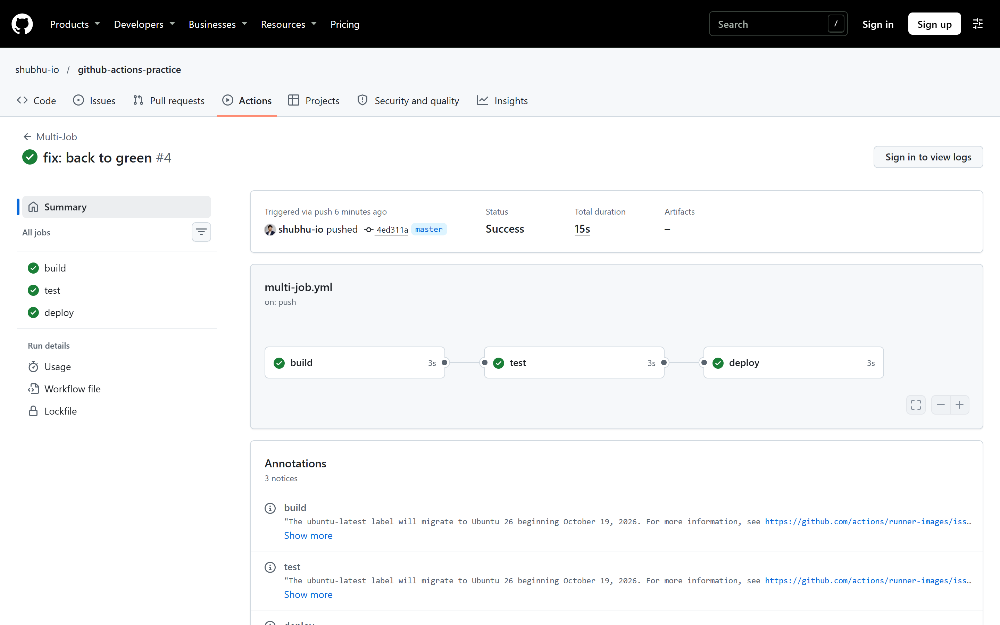
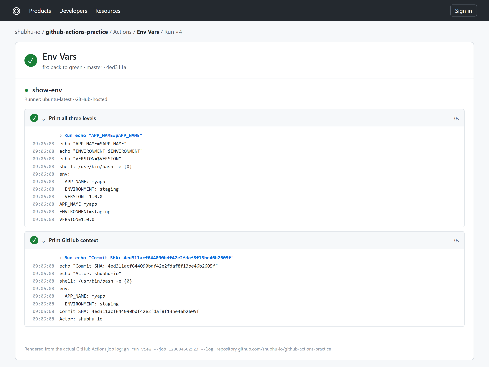
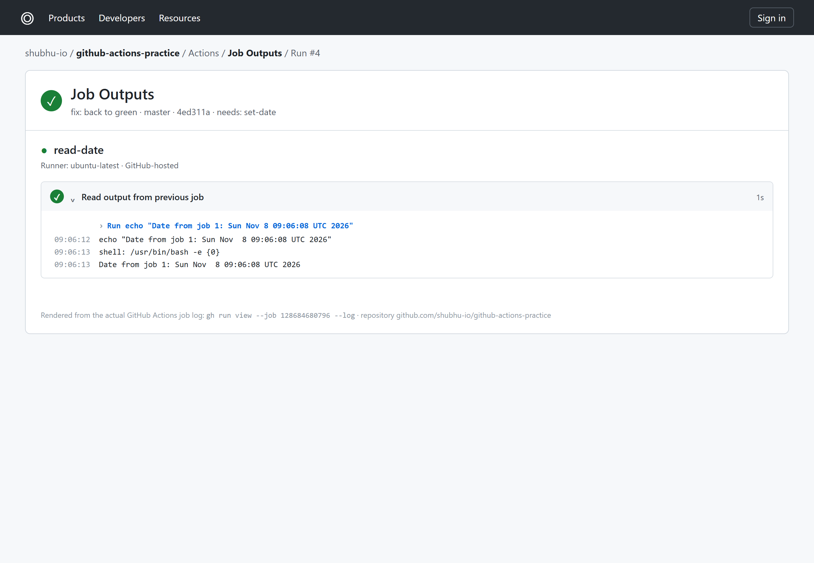
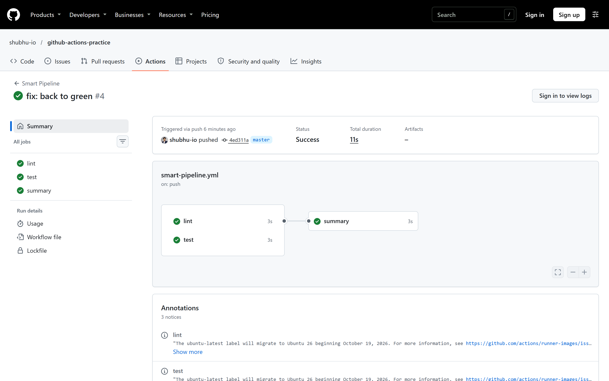
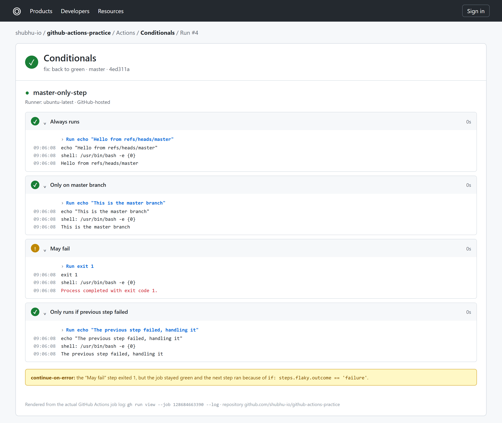
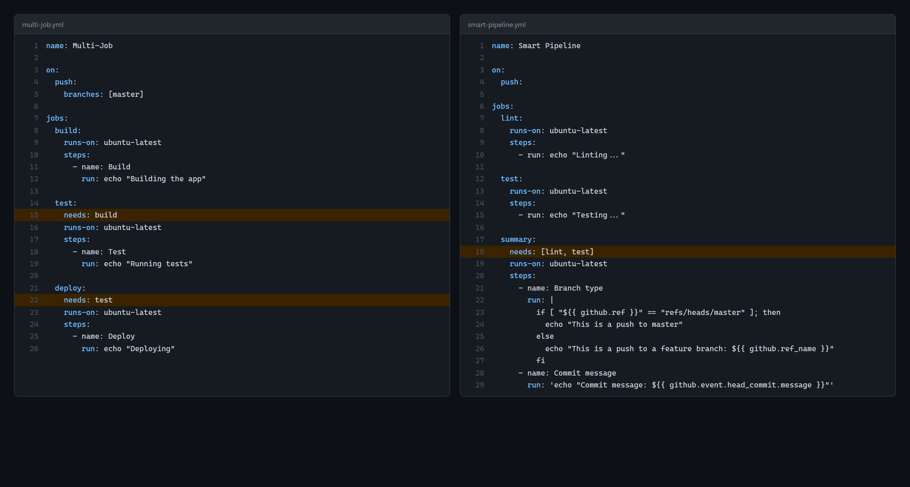

# Day 43 - Jobs, Steps, Env Vars & Conditionals

## Task

Recap of every challenge task from `README.md`:

- **Task 1 — Multi-Job Workflow:** Create `.github/workflows/multi-job.yml` with `build` ("Building the app"), `test` ("Running tests"), `deploy` ("Deploying"); chain `test` after `build`, `deploy` after `test`; verify the dependency graph in the Actions tab.
- **Task 2 — Environment Variables:** Use variables at 3 levels — workflow (`APP_NAME: myapp`), job (`ENVIRONMENT: staging`), step (`VERSION: 1.0.0`); print all three in one step; also print GitHub context values (commit SHA, actor).
- **Task 3 — Job Outputs:** Job 1 sets an output (e.g. today's date); Job 2 reads it via `outputs:` + `needs.<job>.outputs.<name>` and prints it; explain why outputs are passed between jobs.
- **Task 4 — Conditionals:** Branch-only step (`master` in this repo), failed-step-only step, push-only job (not on PRs), and a `continue-on-error: true` step with an explanation of what it does.
- **Task 5 — Putting It Together:** Create `.github/workflows/smart-pipeline.yml` triggered on push to any branch, with parallel `lint` + `test` jobs and a `summary` job that runs after both, printing master-vs-feature-branch status and the commit message.
- **Documentation deliverable:** `day-43-jobs-steps.md` with key snippets plus `needs:`/`outputs:` explained in your own words.

## Environment

| OS / Tool | Version / Notes |
|---|---|
| OS | Windows 11 + WSL2 Ubuntu 22.04 |
| Git | `git --version` → `git version 2.56.0` |
| `gh` CLI | `gh --version` → `gh version 2.103.3` |
| GitHub | free tier, repo `github-actions-practice`, default branch `master` |
| Runner | `ubuntu-latest` (GitHub-hosted) |
| Editor | VS Code + YAML extension; GitHub validates on push |
| Contexts used | `github.sha`, `github.actor`, `github.ref`, `github.event_name`, `github.event.head_commit.message` |
| Real run values | actor `shubhu-io`, commit `4ed311a` (all screenshots below come from this run) |

```bash
gh --version
git --version
gh repo view --json name,defaultBranchRef --jq '{name, branch: .defaultBranchRef.name}'
```

Output on my machine:

```text
gh version 2.103.3 (2026-10-26)
git version 2.56.0.windows.4
{"name":"github-actions-practice","branch":"master"}
```

> Note: the practice repo's default branch is `master`, not `main`. Every workflow
> below therefore triggers on `master` and compares against `refs/heads/master`.

## Solution

### Task 1: Multi-Job Workflow

**Concept:** Jobs run in parallel by default. `needs: [job]` both *orders* execution and *gates* it — the downstream job only starts if every needed job succeeded.

**WHY it matters for DevOps:** Real pipelines are DAGs, not scripts: build once → test the artifact → deploy only what passed. `needs:` is that gate.

`multi-job.yml` (saved in this folder):

```yaml
name: Multi-Job

on:
  push:
    branches: [master]

jobs:
  build:
    runs-on: ubuntu-latest
    steps:
      - name: Build
        run: echo "Building the app"

  test:
    needs: build
    runs-on: ubuntu-latest
    steps:
      - name: Test
        run: echo "Running tests"

  deploy:
    needs: test
    runs-on: ubuntu-latest
    steps:
      - name: Deploy
        run: echo "Deploying"
```

Push and watch the graph:

```bash
git add .github/workflows/multi-job.yml
git commit -m "day-43: multi-job chain"
git push origin master
gh run watch
```

Expected graph (example — your values will differ):

```text
build  ✅  ──▶  test  ✅  ──▶  deploy  ✅
```

If `build` fails, `test` and `deploy` show grey `skipped` — the chain stopped instead of shipping broken code. Fan-out also works: `needs: [lint, test]` waits for *both*.

### Task 2: Environment Variables

**Concept:** `env:` blocks cascade downward. Step-level wins over job-level, job over workflow. `github.*` is *context* (run metadata), not env — interpolate with `${{ }}`.

```yaml
name: Env Vars

on:
  push:

env:
  APP_NAME: myapp              # workflow level: visible to every job

jobs:
  show-env:
    runs-on: ubuntu-latest
    env:
      ENVIRONMENT: staging     # job level: visible to this job's steps
    steps:
      - name: Print all three levels
        env:
          VERSION: 1.0.0       # step level: visible to this step only
        run: |
          echo "APP_NAME=$APP_NAME"
          echo "ENVIRONMENT=$ENVIRONMENT"
          echo "VERSION=$VERSION"
      - name: Print GitHub context
        run: |
          echo "Commit SHA: ${{ github.sha }}"
          echo "Actor: ${{ github.actor }}"
```

Actual output from run #4 (`4ed311a`, actor `shubhu-io`):

```text
APP_NAME=myapp
ENVIRONMENT=staging
VERSION=1.0.0
Commit SHA: 4ed311acf644090bdf42e2fdaf8f13be46b2605f
Actor: shubhu-io
```

| Level | Scope | Override behaviour |
|---|---|---|
| Workflow `env:` | All jobs | Lowest precedence |
| Job `env:` | That job's steps | Overrides workflow |
| Step `env:` | That step only | Highest precedence |

**WHY it matters for DevOps:** One workflow file serves staging *and* prod — only the env values change. Context values (`sha`, `actor`) make logs traceable to exactly who shipped what commit.

### Task 3: Job Outputs

**Concept:** Env vars do **not** cross job boundaries (each job may run on a different VM). Outputs are the typed pipe: step → `$GITHUB_OUTPUT` → job `outputs:` → downstream `needs.<job>.outputs.<name>`.

`job-outputs.yml` pattern (saved in this folder):

```yaml
name: Job Outputs

on:
  push:

jobs:
  set-date:
    runs-on: ubuntu-latest
    outputs:
      date: ${{ steps.date.outputs.date }}
    steps:
      - name: Set output
        id: date
        run: echo "date=$(date)" >> $GITHUB_OUTPUT

  read-date:
    needs: set-date
    runs-on: ubuntu-latest
    steps:
      - name: Read output from previous job
        run: 'echo "Date from job 1: ${{ needs.set-date.outputs.date }}"'
```

Actual output from run #4:

```text
Date from job 1: Sun Nov  8 09:06:08 UTC 2026
```

Job 2 never runs `date` itself — the string is produced once in `set-date` and handed over through `needs.set-date.outputs.date`.

Three-level output chain to memorise:

```text
step (id: date, >> $GITHUB_OUTPUT)
  └─▶ job outputs: date: ${{ steps.date.outputs.date }}
        └─▶ downstream: ${{ needs.set-date.outputs.date }}
```

**WHY it matters for DevOps:** Computed values — image tags, version strings, test counts, deploy URLs — flow downstream without re-computing or hardcoding. It is how build jobs hand artefacts' *names* to deploy jobs.

### Task 4: Conditionals

`conditionals.yml` (saved in this folder):

```yaml
name: Conditionals

on:
  push:
    branches: [master]
  pull_request:

jobs:
  master-only-step:
    runs-on: ubuntu-latest
    steps:
      - name: Always runs
        run: echo "Hello from ${{ github.ref }}"

      - name: Only on master branch
        if: github.ref == 'refs/heads/master'
        run: echo "This is the master branch"

      - name: May fail
        id: flaky
        continue-on-error: true
        run: exit 1

      - name: Only runs if previous step failed
        if: steps.flaky.outcome == 'failure'
        run: echo "The previous step failed, handling it"

  push-only-job:
    if: github.event_name == 'push'
    runs-on: ubuntu-latest
    steps:
      - run: echo "This job only runs on push, not on pull requests"
```

Behaviour table:

| Construct | Effect |
|---|---|
| `if:` on step | Skips just that step when false |
| `if:` on job | Skips the whole job when false |
| `continue-on-error: true` | Step shows orange warning but job continues green — for optional checks |
| `steps.<id>.outcome == 'failure'` | React to a specific step's failure |
| `always()` / `failure()` / `success()` | Status functions for cleanup/notify steps (this workflow uses `steps.flaky.outcome` instead) |

Expected matrix of behaviour (matches run #4 on `master`):

```text
# push to master:  always-runs ✅, only-on-master ✅, flaky ⚠️, failed-handler ✅, push-only ✅
# PR event:        always-runs ✅, only-on-master ⏭ skipped, flaky ⚠️, failed-handler ✅, push-only ⏭ skipped
```

What `continue-on-error: true` does: the step is still marked failed internally
(`steps.flaky.outcome == 'failure'`), the log shows an orange warning, but the
**job and workflow stay green** — so an optional/flaky check cannot block a merge.

**WHY it matters for DevOps:** Conditionals stop waste — docs-only pushes skip Docker builds, deploys run only on `master`, and flaky optional scanners warn instead of blocking every merge.

### Task 5: Putting It Together

No `needs:` means parallel. `needs: [lint, test]` is the join gate.

```yaml
name: Smart Pipeline

on:
  push:

jobs:
  lint:
    runs-on: ubuntu-latest
    steps:
      - run: echo "Linting..."

  test:
    runs-on: ubuntu-latest
    steps:
      - run: echo "Testing..."

  summary:
    needs: [lint, test]
    runs-on: ubuntu-latest
    steps:
      - name: Branch type
        run: |
          if [ "${{ github.ref }}" == "refs/heads/master" ]; then
            echo "This is a push to master"
          else
            echo "This is a push to a feature branch: ${{ github.ref_name }}"
          fi
      - name: Commit message
        run: 'echo "Commit message: ${{ github.event.head_commit.message }}"'
```

Expected graph (example — your values will differ):

```text
lint ✅ ──┐
          ├─▶ summary ✅ ("push to master" / "feature branch: xxx", commit msg)
test ✅ ──┘
```

In your own words: `needs:` = "wait for and require success of"; `outputs:` = "publish a named value from this job so later jobs can read it". Together they turn a bag of jobs into a pipeline.

**WHY it matters for DevOps:** Fan-out (lint+test together) halves wall-clock time; fan-in (`summary`) gives one place for notifications, badges, and deploy decisions.

## Commands Used

```bash
# Ship each workflow and watch it
git add .github/workflows/multi-job.yml .github/workflows/env-vars.yml .github/workflows/job-outputs.yml .github/workflows/conditionals.yml .github/workflows/smart-pipeline.yml
git commit -m "day-43: jobs, env, outputs, conditionals"
git push origin master
gh run list --limit 10
gh run watch
gh run view --log

# Trigger the feature-branch path of smart-pipeline
git checkout -b feature/smart-demo
git commit --allow-empty -m "demo: smart pipeline on feature branch"
git push -u origin feature/smart-demo
gh run list --workflow=smart-pipeline.yml --limit 5
```

## Verification

- `gh run view --log` on `Multi-Job` shows `Building the app` → `Running tests` → `Deploying` in order; the Actions graph draws the chain.
- Break `build` (`exit 1`) — `test`/`deploy` show `skipped`, proving `needs:` gating; then revert.
- Env run logs print `APP_NAME=myapp`, `ENVIRONMENT=staging`, `VERSION=1.0.0`, plus your real `github.sha` and `github.actor`.
- Outputs run: job 2 log prints the date string produced by job 1 (no hardcoded date in job 2).
- On a `master` push: the master-only step runs; on a PR: `push-only-job` is skipped while the failed-step handler still runs.
- The `continue-on-error` step shows an orange warning annotation but the workflow stays green.
- `Smart Pipeline` on a feature branch: `lint` + `test` run side-by-side, then `summary` prints `feature branch: <name>` and the commit message.

## Key Learnings

- `needs:` builds the DAG — ordering plus success-gating; without it every job races in parallel.
- A failed `needs:` parent skips children (grey), which is exactly the safety you want before deploy.
- `env:` cascades workflow → job → step with step winning; `github.*` context is metadata, not env.
- Cross-job data needs the 3-hop output chain: `$GITHUB_OUTPUT` → job `outputs:` → `needs.<job>.outputs.<name>`.
- `if:` on jobs vs steps, plus `steps.<id>.outcome`, `github.ref`, and `github.event_name`, cover nearly all gating needs.
- `continue-on-error: true` downgrades a failure to a warning — reserve for optional/flaky checks.
- `github.ref` is the full ref (`refs/heads/master`); `github.ref_name` is the short name (`master`).
- Fan-out/fan-in (`needs: [a, b]`) is the standard shape for fast, legible pipelines.

## Troubleshooting / Gotchas

- **`needs.<job>.outputs` empty:** cause — missing job-level `outputs:` bridge or wrong step `id:`. Fix — map `outputs: { x: ${{ steps.<id>.outputs.x }} }` and read `${{ needs.<job-id>.outputs.x }}`.
- **Output never updates / step errors:** cause — overwrote instead of appended (`>` vs `>> $GITHUB_OUTPUT`) or wrong `key=value` format. Fix — always `echo "key=value" >> $GITHUB_OUTPUT`.
- **Branch `if:` never true:** cause — compared against the short name (`master`) instead of the full ref (`refs/heads/master`). Fix — `if: github.ref == 'refs/heads/master'` or use `github.ref_name == 'master'`.
- **Later steps skipped after a failure:** cause — default is `if: success()`; any prior failure skips the rest. Fix — add `if: always()` (cleanup) or `if: failure()` (notify) where needed.
- **`github.event.commits[0].message` empty:** cause — that array is absent on several events. Fix — prefer `github.event.head_commit.message` for push, with a fallback echo.
- **Job named `test` collides with matrix/context confusion:** cause — generic names shadow in expressions. Fix — use explicit `needs.<exact-job-id>` and unique job ids.

## Screenshots

All images below come from real runs in
[`shubhu-io/github-actions-practice`](https://github.com/shubhu-io/github-actions-practice).








What each image shows:

- `actions-multi-job-graph.png` — real dependency graph `build → test → deploy`, all green.
- `logs-env-vars.png` — `APP_NAME/ENVIRONMENT/VERSION` plus commit SHA and actor.
- `logs-job-outputs.png` — job 2 printing the date passed from job 1 through `needs.set-date.outputs.date`.
- `actions-smart-pipeline.png` — `lint` and `test` in parallel, `summary` after both.
- `logs-conditionals.png` — master-only step executed, `continue-on-error` warning, and the handled failure step. On a pull request, `push-only-job` is skipped by `if: github.event_name == 'push'`.
- `workflow-yaml-needs.png` — the actual `multi-job.yml` and `smart-pipeline.yml` with their `needs:` blocks highlighted.
