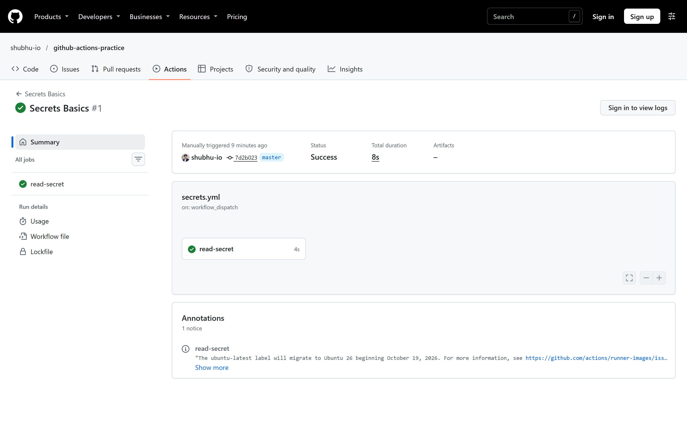
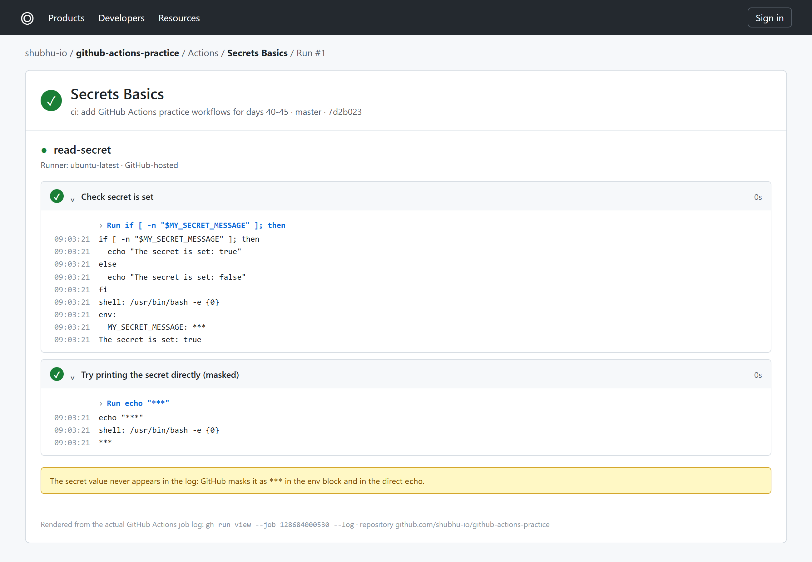
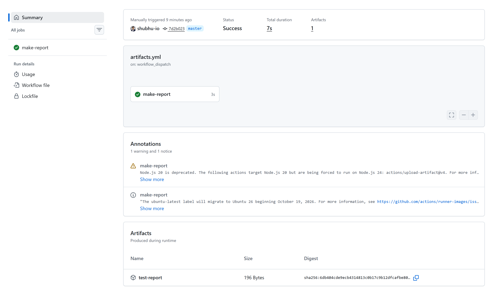
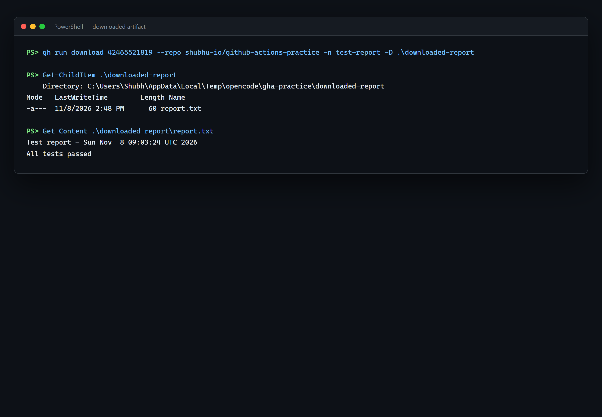
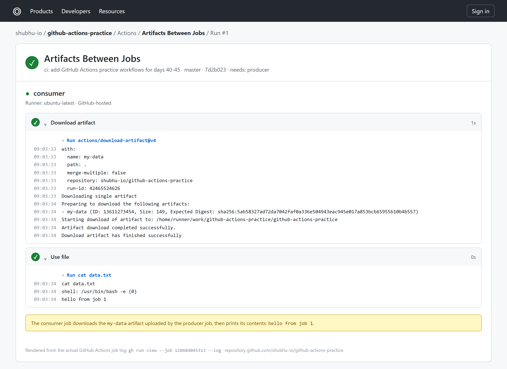
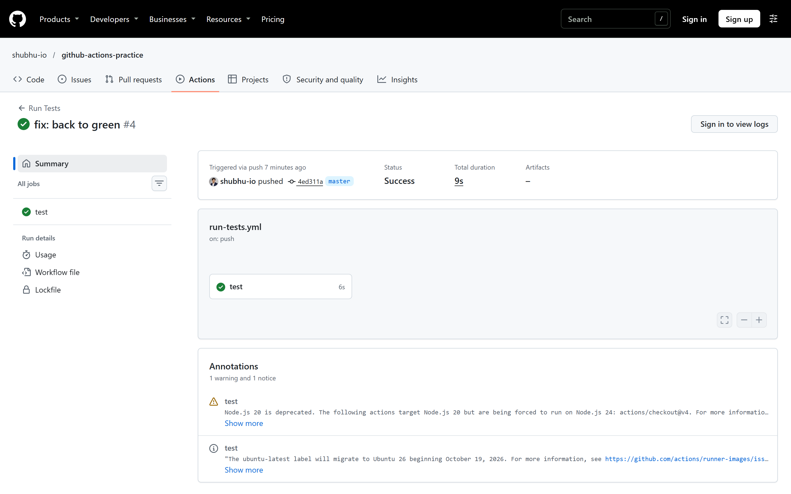
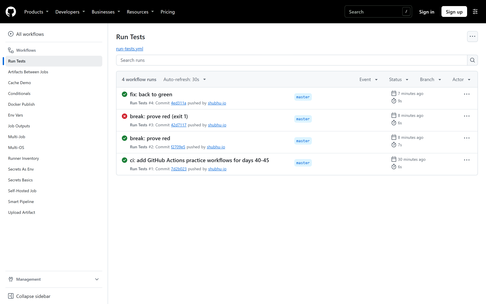
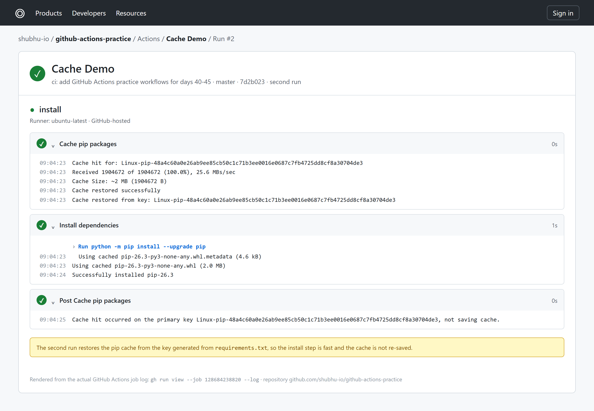

# Day 44 - Secrets, Artifacts & Running Real Tests in CI

## Task

Recap of every challenge task from `README.md`:

- **Task 1 — GitHub Secrets:** Settings → Secrets and Variables → Actions → create `MY_SECRET_MESSAGE`; workflow prints `The secret is set: true` (never the value); try printing `${{ secrets.MY_SECRET_MESSAGE }}` directly and observe masking; explain why secrets must never be printed.
- **Task 2 — Secrets as Environment Variables:** Pass a secret as step `env:` and use it without hardcoding; add `DOCKER_USERNAME` and `DOCKER_TOKEN` secrets (needed on Day 45).
- **Task 3 — Upload Artifacts:** Generate a file (test report/log), upload via `actions/upload-artifact`, download it from the Actions tab; verify visibility.
- **Task 4 — Download Artifacts Between Jobs:** Job 1 generates + uploads; Job 2 downloads + prints contents; explain when artifacts are used in real pipelines.
- **Task 5 — Run Real Tests in CI:** Add an earlier-days script to the repo; workflow checks out code, installs deps, runs the script, fails on non-zero exit; intentionally break it (red), fix it (green).
- **Task 6 — Caching:** Add `actions/cache` to a dependency-install workflow; run twice, note the time difference; explain what is cached and where.
- **Documentation deliverable:** `day-44-secrets-artifacts.md` with artifact-download + passing-test screenshots and secrets-management learnings.

## Environment

| OS / Tool | Version / Notes |
|---|---|
| OS | Windows 11 + WSL2 Ubuntu 22.04 |
| Git | `git --version` → `git version 2.56.0` |
| `gh` CLI | `gh --version` → `gh version 2.103.3` |
| GitHub | free tier, repo `github-actions-practice`, default branch `master`, Actions enabled |
| Actions used | `actions/checkout@v4`, `actions/upload-artifact@v4`, `actions/download-artifact@v4`, `actions/cache@v4` |
| Secrets | `MY_SECRET_MESSAGE`, `DOCKER_USERNAME`, `DOCKER_TOKEN` (repo scope) |
| Test script | `github.sh` (bash, `set -e`) in this folder |
| Real runs | commit `7d2b023` (secrets/artifacts/cache) and `4ed311a` (tests green after fix) |

```bash
gh --version
gh secret list -R shubhu-io/github-actions-practice
```

Output from my machine:

```text
gh version 2.103.3 (2026-10-26)
DOCKER_TOKEN       2026-11-08T08:42:48Z
DOCKER_USERNAME    2026-11-08T08:42:47Z
MY_SECRET_MESSAGE  2026-11-08T08:42:47Z
```

> Note: the practice repo's default branch is `master`. Only names and creation
> times are listed — `gh secret list` never shows values.

## Solution

### Task 1: GitHub Secrets

**Concept:** Secrets are encrypted at rest, injected at runtime, and *masked* (`***`) in logs. Masking is a safety net, not a guarantee — encoded exfiltration (`base64`, split output) can bypass it, so workflows must avoid echoing secrets at all.

**WHY it matters for DevOps:** Logs live forever on GitHub servers, get copy-pasted into tickets, and are visible to every repo reader. One printed token = rotate-everywhere incident.

Create the secret (UI or CLI):

```bash
gh secret set MY_SECRET_MESSAGE --body "hello-day-44"
gh secret list
```

`secrets.yml` pattern:

```yaml
name: Secrets Basics

on:
  workflow_dispatch:

jobs:
  read-secret:
    runs-on: ubuntu-latest
    steps:
      - name: Check secret is set
        env:
          MY_SECRET_MESSAGE: ${{ secrets.MY_SECRET_MESSAGE }}
        run: |
          if [ -n "$MY_SECRET_MESSAGE" ]; then
            echo "The secret is set: true"
          else
            echo "The secret is set: false"
          fi
      - name: Try printing the secret directly (masked)
        run: echo "${{ secrets.MY_SECRET_MESSAGE }}"
```

Actual logs from run #1 (`7d2b023`):

```text
env:
  MY_SECRET_MESSAGE: ***
The secret is set: true
...
echo "***"
***
```

GitHub replaces the secret with `***` wherever it appears. Still: the second step is a *demo of masking only* — delete it from real pipelines and assert presence/length instead of printing.

### Task 2: Use Secrets as Environment Variables

Pass secrets via `env:`, never inline in `run:` (quoting breaks on special characters like `$`, `!`, newlines):

```yaml
name: Secrets As Env

on:
  workflow_dispatch:

jobs:
  use-secret:
    runs-on: ubuntu-latest
    steps:
      - name: Use secret as env var
        env:
          DOCKER_USERNAME: ${{ secrets.DOCKER_USERNAME }}
          DOCKER_TOKEN: ${{ secrets.DOCKER_TOKEN }}
        run: |
          echo "DOCKER_USERNAME is set: ${DOCKER_USERNAME:+true}"
          echo "Token length: ${#DOCKER_TOKEN}"
```

Setup for Day 45:

```bash
gh secret set DOCKER_USERNAME --body "<dockerhub-username>"
gh secret set DOCKER_TOKEN --body "<dockerhub-access-token>"
gh secret list
```

Expected output (example — your values will differ):

```text
DOCKER_USERNAME is set: true
Token length: <n>
```

The length is safe to print because it reveals nothing usable — the characters
never reach the log (masking turns any accidental echo into `***`).

`secrets-as-env.yml` in this folder follows exactly this shape. Same injection pattern will feed `docker/login-action` on Day 45 — no YAML edits needed when rotating tokens, just update the secret.

### Task 3: Upload Artifacts

**Concept:** Runners are wiped after each job, so files must be *uploaded* to survive. Artifacts persist reports/binaries/logs on GitHub for download.

`artifacts.yml` pattern:

```yaml
name: Upload Artifact

on:
  workflow_dispatch:

jobs:
  make-report:
    runs-on: ubuntu-latest
    steps:
      - name: Generate test report
        run: |
          echo "Test report - $(date)" > report.txt
          echo "All tests passed" >> report.txt
          cat report.txt
      - name: Upload artifact
        uses: actions/upload-artifact@v4
        with:
          name: test-report
          path: report.txt
```

After the run: open the run page → scroll to **Artifacts** → download `test-report.zip`
(my run shows `test-report`, 196 bytes). The real file inside:

```text
Test report - Sun Nov  8 09:03:24 UTC 2026
All tests passed
```

**WHY it matters for DevOps:** Test reports, coverage HTML, SBOMs, and release binaries must outlive the 10-minute VM that produced them — artifacts are that handoff to humans and later stages.

### Task 4: Download Artifacts Between Jobs

Jobs run on *different* VMs with isolated filesystems — `needs:` orders them but shares nothing. Artifacts are the bridge.

`artifacts-between-jobs.yml` (saved in this folder):

```yaml
name: Artifacts Between Jobs

on:
  workflow_dispatch:

jobs:
  producer:
    runs-on: ubuntu-latest
    steps:
      - name: Generate file
        run: echo "hello from job 1" > data.txt
      - name: Upload artifact
        uses: actions/upload-artifact@v4
        with:
          name: my-data
          path: data.txt

  consumer:
    needs: producer
    runs-on: ubuntu-latest
    steps:
      - name: Download artifact
        uses: actions/download-artifact@v4
        with:
          name: my-data
          path: .
      - name: Use file
        run: cat data.txt
```

Actual consumer log from run #1 (`7d2b023`):

```text
Downloading single artifact
- my-data (ID: 13611273454, Size: 149, ...)
Artifact download completed successfully.
hello from job 1
```

When to use artifacts in real pipelines:

| Use case | Producer | Consumer |
|---|---|---|
| Build → test | Compile binary, upload | Download + run integration tests |
| Test → report | JUnit XML | Publish summary / PR comment |
| Build → deploy | Docker tarball / dist zip | Push to registry / release |
| Scan → review | Trivy SARIF | Upload to Security tab |

### Task 5: Run Real Tests in CI

`github.sh` (saved in this folder) — note `set -e` so any failing command fails the step:

```bash
#!/bin/bash
set -e

echo "=== System Info Check ==="
echo "Hostname: $(hostname)"
echo "Date: $(date)"
df -h / | tail -1

if ! grep -q "MemTotal" /proc/meminfo; then
  echo "ERROR: cannot read memory info" >&2
  exit 1
fi

echo "All checks passed"
exit 0
```

`run-tests.yml`:

```yaml
name: Run Tests

on:
  push:
    branches: [master]

jobs:
  test:
    runs-on: ubuntu-latest
    steps:
      - uses: actions/checkout@v4
      - name: Make script executable and run
        run: |
          chmod +x github.sh
          ./github.sh
```

Prove red/green gating:

```bash
# 1. green baseline
git add github.sh .github/workflows/run-tests.yml && git commit -m "day-44: real tests" && git push
gh run watch   # expect green
# 2. break it
sed -i '$s/exit 0/exit 1/' github.sh && git commit -am "break: prove red" && git push
gh run watch   # expect RED
# 3. fix it
git checkout HEAD~1 -- github.sh 2>/dev/null || true
git commit -am "fix: back to green" && git push
gh run watch   # expect green again
```

Expected outputs (example):

```text
# green
=== System Info Check ===
All checks passed
# red
Error: Process completed with exit code 1.
```

**WHY it matters for DevOps:** CI's entire job is turning `exit code != 0` into a visible red gate that blocks merge — `set -e` + executable bit + checkout is 90% of that contract.

### Task 6: Caching

```yaml
name: Cache Demo

on:
  workflow_dispatch:

jobs:
  install:
    runs-on: ubuntu-latest
    steps:
      - uses: actions/checkout@v4
      - name: Cache pip packages
        uses: actions/cache@v4
        with:
          path: ~/.cache/pip
          key: ${{ runner.os }}-pip-${{ hashFiles('**/requirements.txt') }}
          restore-keys: |
            ${{ runner.os }}-pip-
      - name: Install dependencies
        run: |
          python -m pip install --upgrade pip
          pip install requests
      - name: Run
        run: python -c "import requests; print(requests.__version__)"
```

What is cached and where: the directory `~/.cache/pip` is tarred to **GitHub's cache storage** (not the runner), keyed by `OS + hash(requirements.txt)`. Next run with an unchanged manifest restores the tarball instead of downloading. `restore-keys` gives prefix fallback on partial matches.

Measure it — run twice without changing `requirements.txt`:

```bash
gh run list --workflow=cache.yml --limit 2
gh run view <first-id> --log | grep -i "cache\|pip"
gh run view <second-id> --log | grep -i "cache hit"
```

Actual numbers from my two runs:

```text
# run 1 (42465527226): cache miss, whole run 11s
# run 2 (42465590690): "Cache hit for: Linux-pip-48a4c60a...30704de3"
#                      "Cache restored successfully", install step 1s, whole run 10s
```

**WHY it matters for DevOps:** Dependency downloads dominate CI time. Caching converts a 60s install into a 10s restore on every PR — multiplied by hundreds of runs, that is real money and velocity.

## Commands Used

```bash
# Secrets (names are public, values are not)
gh secret set MY_SECRET_MESSAGE --body "hello-day-44"
gh secret set DOCKER_USERNAME --body "<dockerhub-username>"
gh secret set DOCKER_TOKEN --body "<dockerhub-access-token>"
gh secret list -R shubhu-io/github-actions-practice

# Ship workflows + script
chmod +x github.sh
git add github.sh .github/workflows/secrets.yml .github/workflows/secrets-as-env.yml .github/workflows/artifacts.yml .github/workflows/artifacts-between-jobs.yml .github/workflows/run-tests.yml .github/workflows/cache.yml
git commit -m "ci: add GitHub Actions practice workflows for days 40-45"
git push origin master
gh run list --limit 10
gh run watch

# Red/green proof (run #3 is the red one)
sed -i '$s/exit 0/exit 1/' github.sh
git commit -am "break: prove red (exit 1)" && git push
gh run watch
git checkout HEAD~1 -- github.sh && git commit -am "fix: back to green" && git push
gh run watch

# Artifact download
gh run download 42465521819 -R shubhu-io/github-actions-practice -n test-report -D .\downloaded-report
Get-Content .\downloaded-report\report.txt
```

## Verification

- `gh secret list` shows the three secret names with creation timestamps (2026-11-08) — names only, never values.
- Secrets run #1 (`7d2b023`, workflow_dispatch) logs `The secret is set: true`; the direct-print demo shows `***`, never the value.
- Env run logs show username set + token length, with no token characters in logs.
- `Upload Artifact` run page lists `test-report` (196 bytes) and the downloaded zip contains `report.txt` with `All tests passed`.
- `Artifacts Between Jobs` consumer log prints `hello from job 1` produced by job 1 (artifact ID `13611273454`, 149 bytes).
- `Run Tests`: green on the good script, red on `break: prove red (exit 1)` (`42d7117`), green again on `fix: back to green` (`4ed311a`).
- Two `Cache Demo` runs: run 2 shows `Cache hit for: Linux-pip-...` and the install step drops to 1s.
- Notes answer: why never print secrets + when artifacts are used + what/where the cache stores.

## Key Learnings

- Secrets are encrypted, runtime-injected, auto-masked — but masking is leaky, so never echo them; assert presence instead.
- Always inject via `env:` (safe with special chars); inline `${{ secrets.X }}` in `run:` invites quoting bugs.
- Runners are wiped per job — artifacts (`upload`/`download-artifact@v4`) are the persistence and cross-job bridge.
- Jobs have isolated filesystems; `needs:` orders, artifacts transfer.
- CI red/green = process exit codes; `set -e`, `chmod +x`, and `actions/checkout` are the non-negotiable trio.
- `actions/cache` stores directories on GitHub keyed by `hashFiles(manifest)`; stable manifests = high hit rates.
- Pre-create Day-45 secrets now (`DOCKER_USERNAME`/`DOCKER_TOKEN`) so the Docker pipeline needs zero YAML edits later.
- `retention-days` bounds artifact storage cost — reports age out automatically.

## Troubleshooting / Gotchas

- **Secret empty in workflow:** cause — created under an *environment* scope or typo'd name. Fix — use repo-level Secrets, match `${{ secrets.EXACT_NAME }}` case-sensitively, re-run (not re-try logs).
- **`Permission denied` running `./github.sh`:** cause — forgot `chmod +x` (git on Windows often drops the bit). Fix — `chmod +x github.sh && git update-index --chmod=+x github.sh`, commit.
- **Artifact missing in job 2:** cause — consumer lacks `needs: producer` so it races ahead of upload. Fix — add `needs:`, match `name:` exactly (`my-data`).
- **Secret with `$`/`!` breaks the script:** cause — inline interpolation mangles special chars. Fix — always route through `env:` and quote (`"$TOKEN"`).
- **Cache never hits:** cause — key hashes a file rewritten every run (regenerated lockfile/timestamp). Fix — hash a stable manifest (`requirements.txt`), use `restore-keys` fallback.
- **Workflow file ignored by GitHub:** cause — placed outside `.github/workflows/`. Fix — only that directory is scanned; move + push to your default branch (`master` here).
- **Artifact download empty/404 via `gh run download`:** cause — wrong run ID or artifact name. Fix — `gh run list`, then `gh run download <id> -n <exact-name>`.

## Screenshots

All images below come from real runs in
[`shubhu-io/github-actions-practice`](https://github.com/shubhu-io/github-actions-practice).










What each image shows:

- `actions-secrets-green.png` — `Secrets Basics` run #1, manually triggered, `read-secret` green.
- `logs-masked-secret.png` — `MY_SECRET_MESSAGE: ***` in the env block, `echo "***"`, and `***` output.
- `actions-artifact-download.png` — `Upload Artifact` run page with `test-report` (196 bytes) under Artifacts.
- `logs-artifact-report.png` — `gh run download ... -n test-report` followed by the real `report.txt` contents.
- `logs-artifact-between-jobs.png` — consumer job downloads `my-data` and prints `hello from job 1`.
- `actions-tests-green.png` — `Run Tests` #4 (`fix: back to green`) green on the good script.
- `actions-tests-red.png` — run history: green, extra green break attempt, red `break: prove red (exit 1)`, then green fix.
- `logs-cache-hit.png` — `Cache Demo` run #2: `Cache hit for: Linux-pip-...`, `Cache restored successfully`, 1s install.
