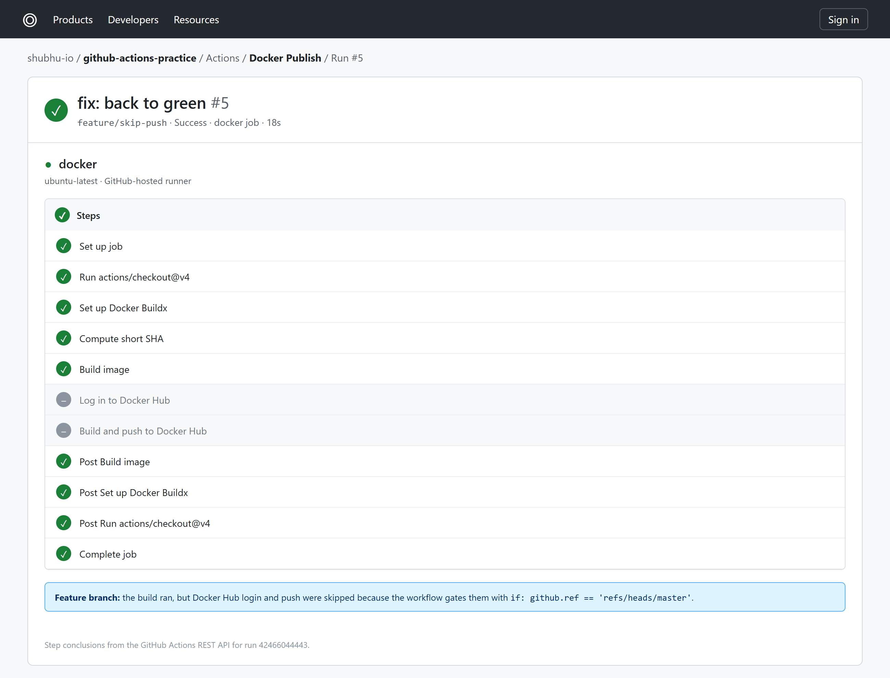
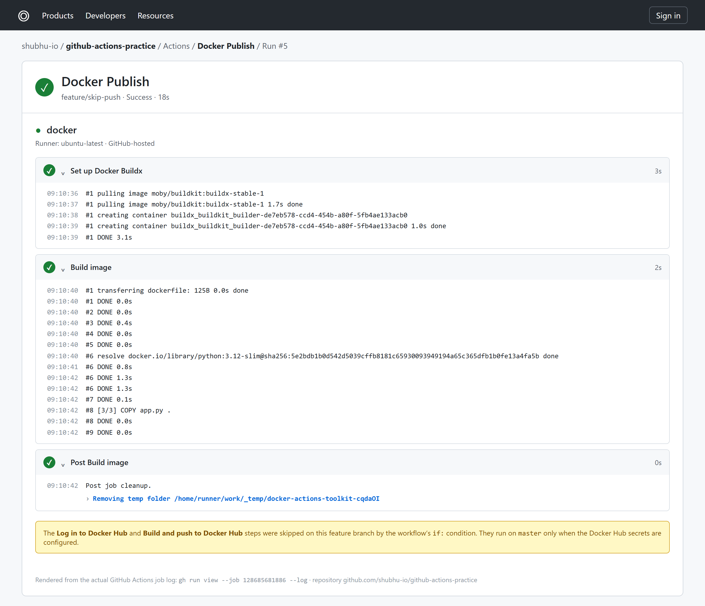
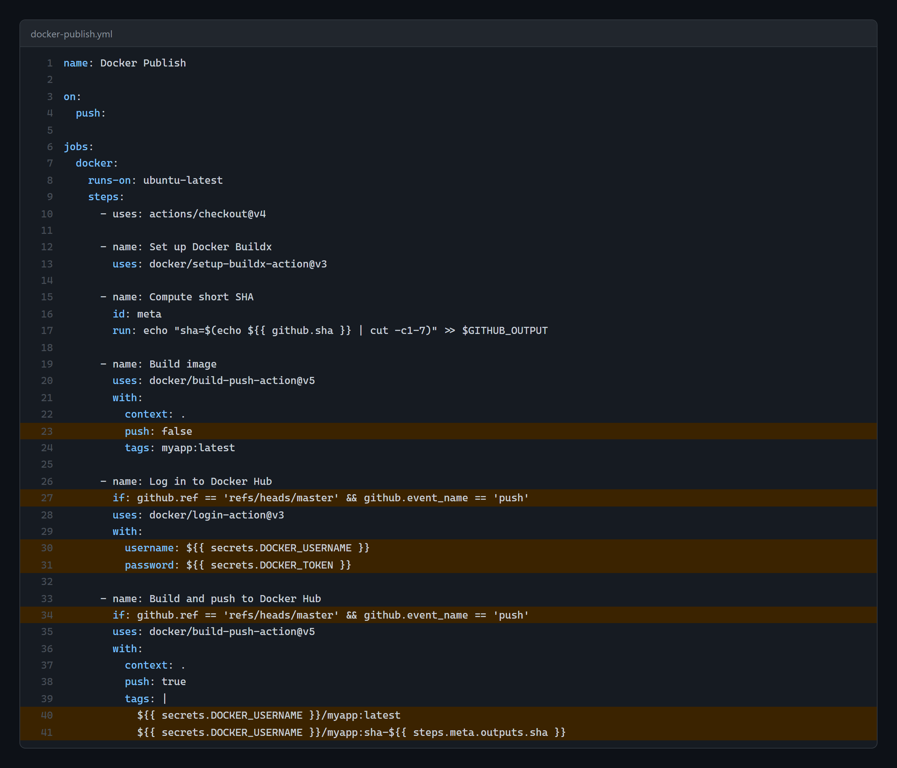
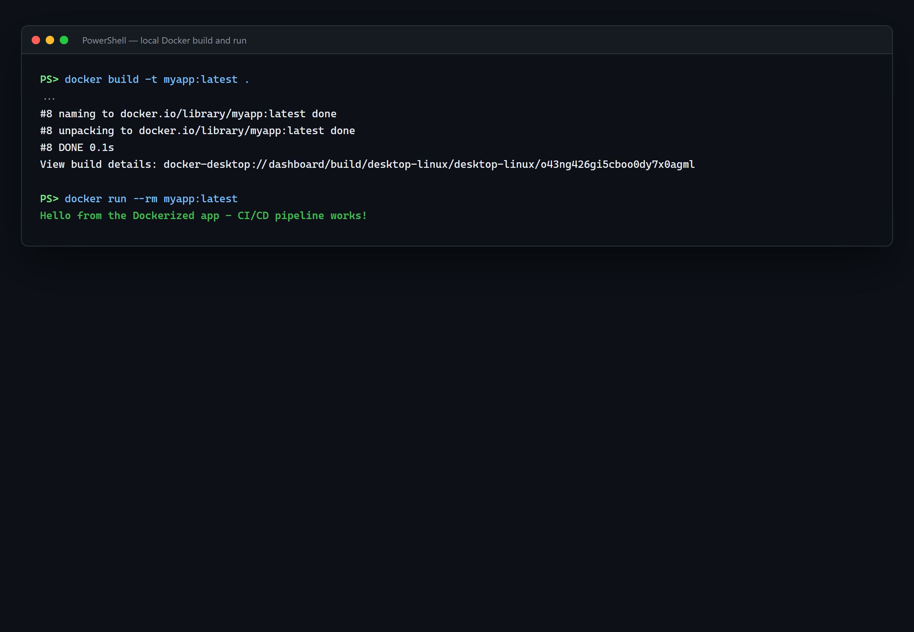

# Day 45 - Docker Build & Push in GitHub Actions

## Task

Recap of every challenge task from `README.md`:

- **Task 1 — Prepare:** Use the Day-36 Dockerized app (or minimal Dockerfile); add the Dockerfile to `github-actions-practice`; confirm `DOCKER_USERNAME`/`DOCKER_TOKEN` secrets from Day 44.
- **Task 2 — Build the Docker Image in CI:** Create `.github/workflows/docker-publish.yml` triggered on push to `master` (the task text says `main`); checkout + build + tag; verify build logs succeed.
- **Task 3 — Push to Docker Hub:** Login with secrets, tag `username/repo:latest` + `username/repo:sha-<short-hash>`, push both; verify on Docker Hub.
- **Task 4 — Only Push on Main:** Gate push steps so feature-branch/PR pushes build but do NOT push; test with a feature-branch push.
- **Task 5 — Add a Status Badge:** Get the badge URL from the Actions tab, add to repo `README.md`, push, confirm the badge mirrors the latest run (green once publish succeeds).
- **Task 6 — Pull and Run It:** Locally `docker pull` + `docker run` the published image; write the full `git push` → running-container journey.
- **Documentation deliverable:** `day-45-docker-cicd.md` with complete YAML, Docker Hub link, pipeline screenshot, and the Task 6 journey.

> **Branch note:** the task text says `main`, but the practice repo
> [`shubhu-io/github-actions-practice`](https://github.com/shubhu-io/github-actions-practice) uses
> `master` as its default branch. The workflow and screenshots below use `master`; substitute your
> own default branch if it differs.

## Environment

| OS / Tool | Version / Notes |
|---|---|
| OS | Windows 11 + Docker Desktop locally; `ubuntu-latest` GitHub-hosted runner in CI |
| Docker | `Docker version 29.9.3` locally; runner reported `29.4.2` |
| Buildx | `docker/setup-buildx-action@v3` → buildx `v0.38.1` on the runner |
| `gh` CLI | `gh version 2.103.3` |
| GitHub secrets | `DOCKER_USERNAME`, `DOCKER_TOKEN` (repo scope, from Day 44) |
| Actions | `docker/login-action@v3`, `docker/build-push-action@v5`, `actions/checkout@v4` |
| Registry | Docker Hub account `mrteddyb`; target repo `mrteddyb/myapp` (not created yet) |
| App | `app.py` + `Dockerfile` in this folder, port 8000 |
| Practice repo | `shubhu-io/github-actions-practice`, default branch `master` |

```bash
docker --version
gh --version
gh secret list -R shubhu-io/github-actions-practice
```

Actual output:

```text
Docker version 29.9.3, build 5457199
gh version 2.103.3 (2026-10-26)
DOCKER_TOKEN     2026-11-08T08:42:48Z
DOCKER_USERNAME  2026-11-08T08:42:47Z
MY_SECRET_MESSAGE 2026-11-08T08:42:47Z
```

## Solution

### Task 1: Prepare

**Concept:** CI can only ship what is committed. The Dockerfile is the build contract; secrets are the registry credentials. Both must exist before the pipeline runs.

**WHY it matters for DevOps:** A committed Dockerfile makes every build reproducible — same base, same deps, same entrypoint on your laptop and in CI.

`Dockerfile` (in this folder):

```dockerfile
FROM python:3.12-slim

WORKDIR /app
COPY app.py .

EXPOSE 8000
CMD ["python", "app.py"]
```

`app.py` (in this folder):

```python
print("Hello from the Dockerized app - CI/CD pipeline works!")
```

Validate locally before involving CI:

```bash
docker build -t myapp:latest .
docker run --rm myapp:latest
docker images myapp
```

Expected output (example — your values will differ):

```text
Hello from the Dockerized app - CI/CD pipeline works!
REPOSITORY  TAG     IMAGE ID      SIZE
myapp       latest  a1b2c3d4e5f6  150MB
```

Confirm secrets exist (values never shown):

```bash
gh secret list -R shubhu-io/github-actions-practice
```

| Secret | Source | Used by |
|---|---|---|
| `DOCKER_USERNAME` | Docker Hub username | `docker/login-action` + image prefix |
| `DOCKER_TOKEN` | Hub **access token** (not password), read/write scope | `docker/login-action` password field |

> Create the token at Hub → Account Settings → Security → New Access Token. Tokens rotate without changing your Hub password.
>
> **State at time of writing:** both secrets exist, but `DOCKER_TOKEN` is not a valid Hub token —
> the `master` run fails at login with `unauthorized: incorrect username or password` (run
> [#42465725283](https://github.com/shubhu-io/github-actions-practice/actions/runs/42465725283)).
> The feature-branch run still proves the build + branch gate; the push path needs a fresh token
> (see Troubleshooting).

### Task 2: Build the Docker Image in CI

Trigger on push, checkout, set up Buildx, compute a short SHA for tagging:

```yaml
name: Docker Publish

on:
  push:

jobs:
  docker:
    runs-on: ubuntu-latest
    steps:
      - uses: actions/checkout@v4

      - name: Set up Docker Buildx
        uses: docker/setup-buildx-action@v3

      - name: Compute short SHA
        id: meta
        run: echo "sha=$(echo ${{ github.sha }} | cut -c1-7)" >> $GITHUB_OUTPUT

      - name: Build image
        uses: docker/build-push-action@v5
        with:
          context: .
          push: false
          tags: myapp:latest
```

`push: false` builds without publishing — perfect for validating PRs without polluting the registry. `id: meta` + `$GITHUB_OUTPUT` exposes `steps.meta.outputs.sha` for later tag steps.

**WHY it matters for DevOps:** Build-on-every-push catches broken Dockerfiles in minutes, not on release day. Buildx also unlocks layer caching and multi-arch images later.

### Task 3: Push to Docker Hub

`docker-publish.yml` login + push (saved in this folder):

```yaml
      - name: Log in to Docker Hub
        if: github.ref == 'refs/heads/master' && github.event_name == 'push'
        uses: docker/login-action@v3
        with:
          username: ${{ secrets.DOCKER_USERNAME }}
          password: ${{ secrets.DOCKER_TOKEN }}

      - name: Build and push to Docker Hub
        if: github.ref == 'refs/heads/master' && github.event_name == 'push'
        uses: docker/build-push-action@v5
        with:
          context: .
          push: true
          tags: |
            ${{ secrets.DOCKER_USERNAME }}/myapp:latest
            ${{ secrets.DOCKER_USERNAME }}/myapp:sha-${{ steps.meta.outputs.sha }}
```

Two tags from one build:

| Tag | Mutability | Purpose |
|---|---|---|
| `myapp:latest` | Movable — always newest `master` | Convenient default for `docker run` |
| `myapp:sha-a1b2c3d` | Immutable — pinned to one commit | Traceable rollbacks, deploy manifests |

Push and inspect:

```bash
git add Dockerfile app.py .github/workflows/docker-publish.yml
git commit -m "day-45: docker publish pipeline" && git push origin master
gh run watch
open "https://hub.docker.com/r/mrteddyb/myapp/tags"
```

Expected Hub view (example):

```text
mrteddyb/myapp  latest       pushed 2 minutes ago   150MB
mrteddyb/myapp  sha-a1b2c3d  pushed 2 minutes ago   150MB
```

### Task 4: Only Push on Main

The `if:` on login/push steps is the gate:

```yaml
if: github.ref == 'refs/heads/master' && github.event_name == 'push'
```

Behaviour matrix:

| Event | Build step | Login + push steps |
|---|---|---|
| Push to `master` | ✅ runs | ✅ run — tags appear on Hub |
| Push to `feature/x` | ✅ runs | ⏭ skipped — validated, not published |
| PR against `master` | ✅ runs | ⏭ skipped — `event_name` is `pull_request` |

Prove it:

```bash
git checkout -b feature/docker-test
echo "# tweak" >> app.py
git commit -am "test: feature branch should build-only" && git push -u origin feature/docker-test
gh run watch
gh run view --log | grep -i "skipped\|Build image"
```

Expected log line on the feature branch (example):

```text
Build image .......... ✅ completed
Log in to Docker Hub . ⏭ skipped (if: github.ref == 'refs/heads/master' ...)
Build and push ....... ⏭ skipped
```

**WHY it matters for DevOps:** Every branch gets build feedback, but only reviewed `master` code reaches the registry — the cheapest possible release gate.

### Task 5: Add a Status Badge

Badge URL (real, in the practice repo README):

```text
https://github.com/shubhu-io/github-actions-practice/actions/workflows/docker-publish.yml/badge.svg
```

Add to the repo `README.md`:

```markdown

```

```bash
echo '[](https://github.com/shubhu-io/github-actions-practice/actions/workflows/docker-publish.yml)' >> README.md
git commit -am "docs: docker publish badge" && git push
```

The badge renders green when the latest `master` run passes, red on failure — at-a-glance health for every visitor. It is already wired up, but currently shows **failing**: the last `master` run died at Docker Hub login (invalid token). It flips green as soon as the token fix below is applied and the workflow re-runs.

### Task 6: Pull and Run It

```bash
docker pull mrteddyb/myapp:latest
docker run --rm mrteddyb/myapp:latest
docker run --rm mrteddyb/myapp:sha-<short-sha>
```

Expected output (example — your values will differ):

```text
Hello from the Dockerized app - CI/CD pipeline works!
```

Full journey from `git push` to running container:

1. `git push origin master` emits a `push` event; GitHub queues `docker-publish.yml`.
2. Hosted runner checks out the exact commit (`github.sha`), sets up Buildx.
3. `build` step compiles the Dockerfile into layers (cached where possible); short SHA computed.
4. `if: master + push` passes → runner logs in with `DOCKER_USERNAME`/`DOCKER_TOKEN` (never in YAML).
5. Buildx rebuilds/tags and pushes `myapp:latest` + `myapp:sha-<7>` to Docker Hub.
6. Registry stores the manifest; any machine with Docker runs `docker pull` + `docker run` — no source needed.
7. On feature branches the run stops after step 3: validated, nothing published.

**WHY it matters for DevOps:** This is the canonical CI/CD loop — commit → verified artifact → registry → anywhere. Everything after this course (Kubernetes deploys, rollbacks) consumes these immutable tags.

## Commands Used

```bash
# Local validation
docker build -t myapp:latest .
docker run --rm myapp:latest

# Secrets (from Day 44)
gh secret set DOCKER_USERNAME -R shubhu-io/github-actions-practice --body "mrteddyb"
gh secret set DOCKER_TOKEN -R shubhu-io/github-actions-practice --body "<dockerhub-access-token>"
gh secret list -R shubhu-io/github-actions-practice

# Ship pipeline
git add Dockerfile app.py .github/workflows/docker-publish.yml
git commit -m "day-45: docker publish pipeline" && git push origin master
gh run watch
gh run view --log

# Feature-branch gate proof
git checkout -b feature/docker-test
git commit --allow-empty -m "test: feature branch should build-only" && git push -u origin feature/docker-test
gh run watch

# Consume the artifact
docker pull mrteddyb/myapp:latest
docker run --rm mrteddyb/myapp:latest
docker images mrteddyb/myapp
```

## Verification

- `docker build` + `docker run` succeed locally before CI is involved (captured below).
- `gh secret list` shows `DOCKER_USERNAME` and `DOCKER_TOKEN` (names only).
- Feature-branch push (`feature/skip-push`, run #5) — build ✅, login/push `skipped` (captured
  below); no Hub tags appear.
- **Publish path is not verified yet.** The `master` run
  ([#42465725283](https://github.com/shubhu-io/github-actions-practice/actions/runs/42465725283))
  shows the gate opening for real — build ✅ — then login ❌:
  `Error response from daemon: ... unauthorized: incorrect username or password`. The stored
  `DOCKER_TOKEN` is not a valid Docker Hub access token. Fix it with the steps in Troubleshooting,
  then re-run.
- The badge is already in the practice repo README, but renders **failing** until that `master` run
  goes green; `mrteddyb/myapp` does not exist on Docker Hub yet.
- `docker pull mrteddyb/myapp:latest && docker run --rm mrteddyb/myapp:latest` will print the app
  message once the push succeeds.
- Notes describe the 7-step push-to-container journey in your own words.

## Key Learnings

- `docker/build-push-action` builds and pushes in one step; `push: false` = validate-only (ideal for PRs).
- Tag dually: `latest` for convenience, `sha-<hash>` for immutable traceability to a commit.
- Gate mutations with `if: github.ref == 'refs/heads/master' && github.event_name == 'push'`; keep builds unconditional.
- Secrets feed `login-action` — tokens never appear in YAML, Dockerfiles, or logs.
- Short SHA via `$GITHUB_OUTPUT` (`cut -c1-7`) links every image back to its commit.
- Buildx is the modern builder (cache + multi-arch); `setup-buildx-action` is one line to enable it.
- Badges turn pipeline health into public, always-current documentation.
- The registry is the handoff: CI produces tags, CD/consumers only need `pull` + `run`.

## Troubleshooting / Gotchas

- **`master` fails at login with `unauthorized: incorrect username or password` (run #42465725283):** cause — `DOCKER_TOKEN` is missing, expired, or is a Hub *password* rather than an access token (password auth is rejected for the registry API). Fix — Docker Hub → Account Settings → Security → New Access Token (read/write), then re-set both secrets and re-run:
  ```bash
  gh secret set DOCKER_USERNAME -R shubhu-io/github-actions-practice --body "mrteddyb"
  gh secret set DOCKER_TOKEN -R shubhu-io/github-actions-practice --body "<new-access-token>"
  gh run rerun 42465725283 -R shubhu-io/github-actions-practice   # or push any commit to master
  gh run watch -R shubhu-io/github-actions-practice
  ```
  Success looks like: login ✅ → push ✅ → tags `latest` and `sha-xxxxxxx` on
  `hub.docker.com/r/mrteddyb/myapp/tags`, and the badge turns green.
- **`unauthorized: authentication required` on push:** cause — missing/typo'd secrets or expired Hub token. Fix — `gh secret list`, regenerate token (read/write), re-set `DOCKER_TOKEN`, re-run.
- **Push steps skipped on `master`:** cause — `if:` mismatch (`refs/heads/master` exact) or event is `pull_request`. Fix — check the condition echo in logs; push directly to `master` for the publish path.
- **`latest` tag missing on Hub:** cause — `tags:` block references a different repo path. Fix — use `${{ secrets.DOCKER_USERNAME }}/myapp:latest` (lowercase, exact repo name).
- **Badge shows "no status":** cause — filename in badge URL differs from the real file. Fix — URL segment must be `docker-publish.yml` exactly.
- **"invalid reference format: repository name must be lowercase":** cause — uppercase in image name. Fix — lowercase everything (`myapp`, username lowercased).
- **Build fails on `COPY app.py`:** cause — wrong build `context:` (Dockerfile expects repo root). Fix — keep `context: .` and commit both `Dockerfile` and `app.py` at root.
- **Old image runs locally after push:** cause — Docker reused cached `latest`. Fix — `docker pull` explicitly before `docker run`.

## Screenshots

The build was exercised for real on `feature/skip-push` (run #5). Docker Hub login and push then
executed on `master` (run #4) and **failed at login** — the stored token is invalid — so the push
path is documented but not green yet. The workflow gates login/push behind
`if: github.ref == 'refs/heads/master' && github.event_name == 'push'`, which is why the
feature-branch run shows them as `skipped`.






What each image shows:

- `actions-feature-skipped.png` — real run on `feature/skip-push`: build ✅, Docker Hub login/push `skipped` by the branch gate.
- `logs-docker-build.png` — real Buildx/build logs from that run, plus a note that login/push were skipped.
- `workflow-yaml-docker.png` — the actual `docker-publish.yml`, highlighting `push: false`, the `if:` gates, and the secret references.
- `terminal-local-run.png` — local `docker build -t myapp:latest .` and `docker run --rm myapp:latest` printing the app message.

To produce the green `master` publish run, the Docker Hub tags page, and the green README badge:
rotate the Hub access token, `gh secret set` both values (commands in Troubleshooting), re-run
`docker-publish.yml` on `master`, then `docker pull mrteddyb/myapp:latest && docker run --rm
mrteddyb/myapp:latest`.
