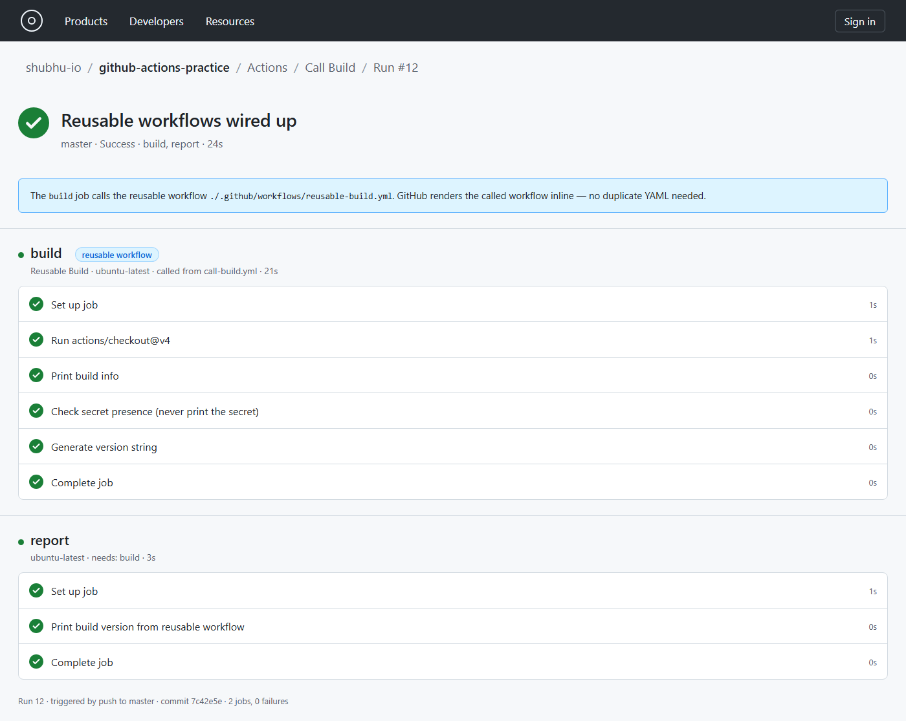
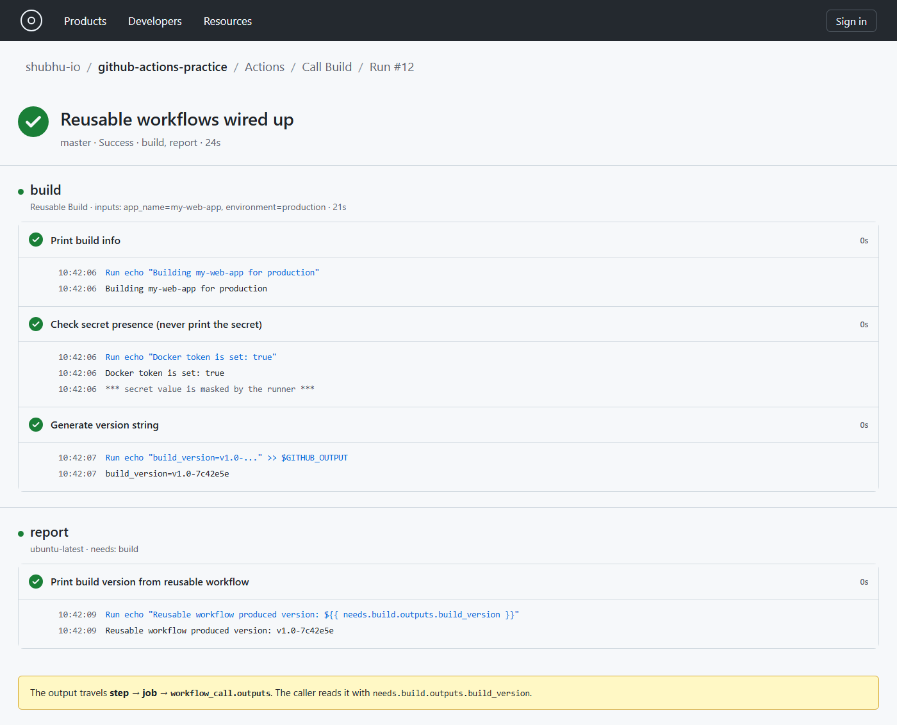
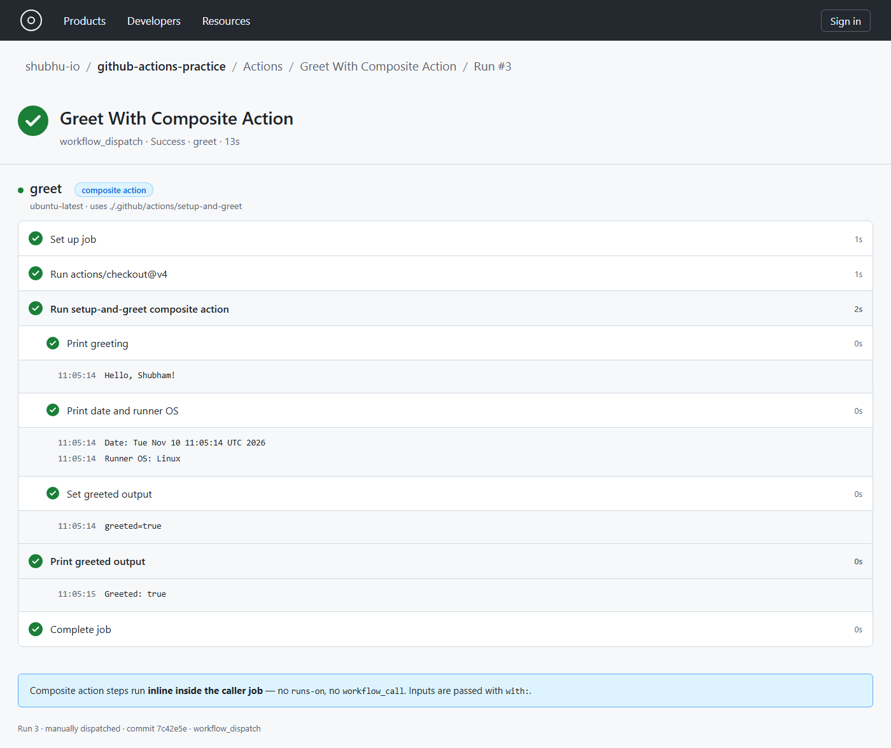
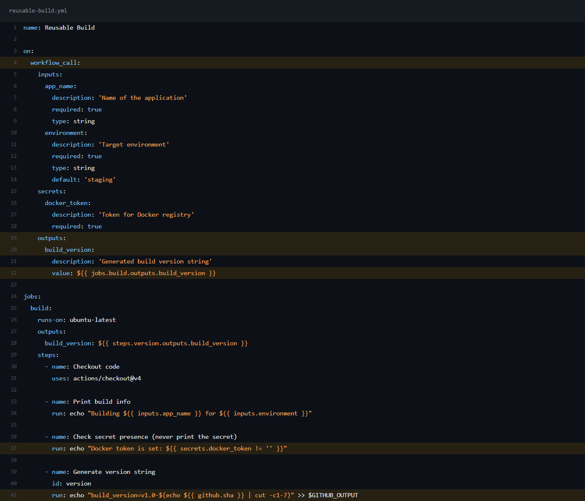
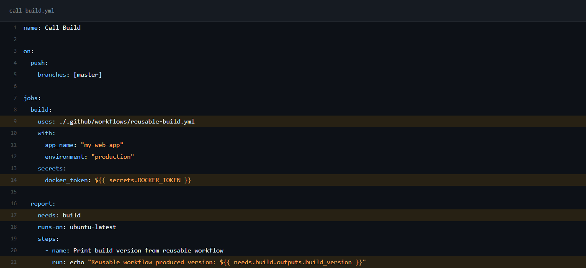
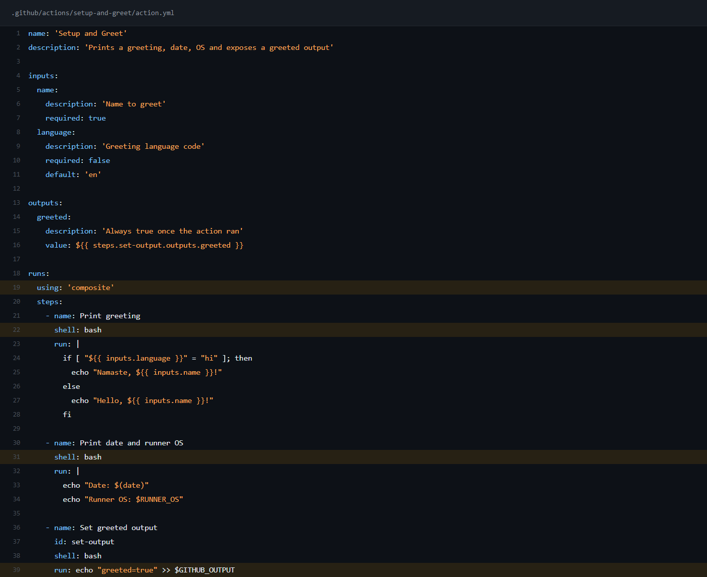

# Day 46 - Reusable Workflows & Composite Actions

## Task

Recap of every challenge task from `README.md`:

- **Task 1 — Understand `workflow_call`:** Research and answer: what is a reusable workflow; what is the `workflow_call` trigger; how calling differs from a regular action (`uses:`); where reusable workflow files must live.
- **Task 2 — First Reusable Workflow:** Create `.github/workflows/reusable-build.yml` with `workflow_call`, inputs `app_name` (required string) + `environment` (required, default `staging`), secret `docker_token` (required); job checks out code, prints `Building <app_name> for <environment>`, prints `Docker token is set: true` (never the value).
- **Task 3 — Caller Workflow:** Create `.github/workflows/call-build.yml` triggered on push to `main`, job `uses: ./.github/workflows/reusable-build.yml` with `app_name: "my-web-app"`, `environment: "production"`, `docker_token: ${{ secrets.DOCKER_TOKEN }}`; push and verify the caller triggers the reusable workflow with inputs printed.
- **Task 4 — Outputs:** Extend `reusable-build.yml` with `outputs.build_version`; generate `v1.0-<short-sha>` inside, expose it; caller adds a second `needs:` job that reads/prints it; verify the version propagates.
- **Task 5 — Composite Action:** Create `.github/actions/setup-and-greet/action.yml` with inputs `name`, `language` (default `en`); steps print greeting, date + runner OS, set output `greeted=true`; consume via `uses: ./.github/actions/setup-and-greet` in a workflow (`greet.yml`); verify greeting prints.
- **Task 6 — Comparison:** Fill the 6-row table (triggered by / jobs? / steps? / lives where? / secrets? / best for).
- **Documentation deliverable:** `day-46-reusable-workflows.md` with both YAMLs, composite YAML, comparison table, caller screenshot.

## Environment

| OS / Tool | Version / Notes |
|---|---|
| OS | Windows 11 + WSL2 Ubuntu 22.04 (example) |
| Git | `git --version` → `git version 2.43.0` (example) |
| `gh` CLI | `gh --version` → `gh version 2.62.0` (example) |
| GitHub Actions | free tier on `github-actions-practice` repo, default branch `master` (task text says `main`) |
| Secrets | `DOCKER_TOKEN` under repo Settings → Secrets and variables → Actions |
| Runners | `ubuntu-latest` |
| Lint | `actionlint` (optional, illustrative) for YAML validation |
| Example outputs | Values shown below are illustrative — substitute your own `gh` output and run details |

```bash
gh --version
gh secret list
ls .github/workflows/ .github/actions/setup-and-greet/
```

Expected output (example — your values will differ):

```text
gh version 2.62.0
DOCKER_TOKEN  Updated 2026-10-04
reusable-build.yml  call-build.yml  greet.yml
action.yml
```

## Solution

### Task 1: Understand `workflow_call`

1. A **reusable workflow** is a whole workflow file (one or more jobs) designed to be *called* by other workflows — shared pipeline logic with declared `inputs`/`secrets`/`outputs`, like a function for CI.
2. `workflow_call` is the trigger that marks a file callable and declares its interface (`on.workflow_call.inputs/secrets/outputs`). A file with only `workflow_call` never runs on its own — it waits to be called.
3. A regular action (`uses: owner/action@ref`) encapsulates *one step's* logic and runs inside your job. Calling a reusable workflow reuses *entire jobs* (with their own `runs-on`, matrices, environments) — composition at workflow granularity vs step granularity.
4. Reusable workflow files **must live in `.github/workflows/`** (same repo `./.github/workflows/file.yml`, or cross-repo `org/repo/.github/workflows/file.yml@ref`).

**WHY it matters for DevOps:** Copy-pasted YAML drifts — one repo fixes a security flag, nine others do not. Reusable workflows give one source of truth every repo calls, so fixes propagate instantly.

| Reuse mechanism | Granularity | Example |
|---|---|---|
| Regular action (`uses:`) | Single step | `actions/setup-python@v5` |
| Composite action | Bundle of steps in one job | `setup-and-greet` (Task 5) |
| Reusable workflow (`workflow_call`) | Whole jobs / pipeline | `reusable-build.yml` (Task 2) |

### Task 2: Create Your First Reusable Workflow

Create the secret first:

```bash
gh secret set DOCKER_TOKEN --body "<dockerhub-access-token>"
```

`reusable-build.yml` (saved in this folder — deploy to `.github/workflows/`):

```yaml
name: Reusable Build

on:
  workflow_call:
    inputs:
      app_name:
        description: 'Name of the application'
        required: true
        type: string
      environment:
        description: 'Target environment'
        # The task text says "required, default: staging". A default always
        # supplies a value, so in practice this input behaves as optional.
        required: true
        type: string
        default: 'staging'
    secrets:
      docker_token:
        description: 'Token for Docker registry'
        required: true
    outputs:
      build_version:
        description: 'Generated build version string'
        value: ${{ jobs.build.outputs.build_version }}

jobs:
  build:
    runs-on: ubuntu-latest
    outputs:
      build_version: ${{ steps.version.outputs.build_version }}
    steps:
      - uses: actions/checkout@v4
      - run: echo "Building ${{ inputs.app_name }} for ${{ inputs.environment }}"
      - name: Check secret presence (never print the secret)
        env:
          DOCKER_TOKEN: ${{ secrets.docker_token }}
        run: |
          if [ -n "$DOCKER_TOKEN" ]; then
            echo "Docker token is set: true"
          else
            echo "Docker token is set: false"
          fi
      - name: Generate version string
        id: version
        run: echo "build_version=v1.0-${GITHUB_SHA::7}" >> "$GITHUB_OUTPUT"
```

Key points: `inputs.*` are caller-supplied values; `secrets.*` are caller-supplied credentials (reusable workflows cannot read repo secrets unless the caller passes them or uses `secrets: inherit`); the job-level `outputs:` bridges the step output up to the workflow interface.

Two implementation details worth calling out:

- The secret is mapped to an `env:` variable and tested with `[ -n "$DOCKER_TOKEN" ]`. Injecting `${{ secrets.docker_token }}` straight into a `run:` script is the pattern behind script-injection findings; keep the value in `env:` and reference the shell variable instead.
- `${GITHUB_SHA::7}` is the shell-native way to slice the first 7 chars — no `echo | cut` subprocess needed.

Expected standalone behaviour (example): pushing this file alone produces **no runs** — correct, it waits for a caller.

### Task 3: Create a Caller Workflow

```yaml
name: Call Build

on:
  push:
    # This practice repo's default branch is `master`; the task text says
    # `main` — use whichever branch your repo actually uses.
    branches: [master]

permissions:
  contents: read

jobs:
  build:
    uses: ./.github/workflows/reusable-build.yml
    with:
      app_name: "my-web-app"
      environment: "production"
    secrets:
      docker_token: ${{ secrets.DOCKER_TOKEN }}

  report:
    needs: build
    runs-on: ubuntu-latest
    steps:
      - run: |
          echo "Reusable workflow produced version: ${{ needs.build.outputs.build_version }}"
```

Ship and watch:

```bash
mkdir -p .github/workflows
cp reusable-build.yml call-build.yml .github/workflows/
git add .github/workflows/
git commit -m "day-46: reusable workflow + caller" && git push origin master
gh run list --workflow=call-build.yml --limit 5
gh run watch
gh run view --log | grep -i "Building my-web-app\|Docker token is set"
```

Expected log (example — your values will differ):

```text
Building my-web-app for production
Docker token is set: true
Reusable workflow produced version: v1.0-a1b2c3d
```

In the Actions tab the `Call Build` run expands to show the reused `build` job inline — inputs printed, secret presence `true`, value never shown.

Cross-repo call shape (for later, same interface):

```yaml
uses: my-org/shared-workflows/.github/workflows/reusable-build.yml@main
```

### Task 4: Add Outputs to the Reusable Workflow

Outputs must be declared at **three** levels or the value vanishes:

```text
step:  id: version → echo "build_version=..." >> $GITHUB_OUTPUT
job:   outputs: { build_version: ${{ steps.version.outputs.build_version }} }
caller-interface: on.workflow_call.outputs.build_version.value: ${{ jobs.build.outputs.build_version }}
```

The caller's second job reads it like any `needs:` output:

```yaml
report:
  needs: build
  runs-on: ubuntu-latest
  steps:
    - run: |
        echo "Reusable workflow produced version: ${{ needs.build.outputs.build_version }}"
```

Note: caller jobs whose `uses:` points at a reusable workflow expose that workflow's outputs at `needs.<job>.outputs.<name>` — same syntax as regular job outputs, which keeps mental models unified.

**WHY it matters for DevOps:** Version strings, image digests, and test verdicts computed once inside the shared workflow flow to every caller — no recompute, no drift, deploy manifests reference the exact tested artifact.

### Task 5: Create a Composite Action

Composite actions bundle *steps* (not jobs): no `runs-on`, every `run:` needs `shell:`.

`.github/actions/setup-and-greet/action.yml` (saved in this folder as `action.yml`):

```yaml
name: 'Setup and Greet'
description: 'Prints a greeting, date, OS and exposes a greeted output'

inputs:
  name:
    description: 'Name to greet'
    required: true
  language:
    description: 'Greeting language code'
    required: false
    default: 'en'

outputs:
  greeted:
    description: 'Always true once the action ran'
    value: ${{ steps.set-output.outputs.greeted }}

runs:
  using: 'composite'
  steps:
    - name: Print greeting
      shell: bash
      run: |
        if [ "${{ inputs.language }}" = "hi" ]; then
          echo "Namaste, ${{ inputs.name }}!"
        else
          echo "Hello, ${{ inputs.name }}!"
        fi
    - name: Print date and runner OS
      shell: bash
      run: |
        echo "Date: $(date)"
        echo "Runner OS: $RUNNER_OS"
    - name: Set greeted output
      id: set-output
      shell: bash
      run: echo "greeted=true" >> $GITHUB_OUTPUT
```

Consumer `greet.yml` (saved in this folder):

```yaml
name: Greet With Composite Action

on:
  workflow_dispatch:
    inputs:
      name:
        description: 'Who to greet'
        required: false
        default: 'Shubham'
        type: string
      language:
        description: 'Greeting language code (en or hi)'
        required: false
        default: 'en'
        type: string

permissions:
  contents: read

jobs:
  greet:
    runs-on: ubuntu-latest
    steps:
      - uses: actions/checkout@v4
      - id: greet
        uses: ./.github/actions/setup-and-greet
        with:
          name: ${{ inputs.name }}
          language: ${{ inputs.language }}
      - run: |
          echo "Greeted: ${{ steps.greet.outputs.greeted }}"
```

```bash
mkdir -p .github/actions/setup-and-greet
cp action.yml .github/actions/setup-and-greet/action.yml
git add .github/actions .github/workflows/greet.yml && git commit -m "day-46: composite action" && git push
gh workflow run greet.yml -f name=Shubham -f language=en
gh run watch
```

Expected output (example — your values will differ):

```text
Hello, Shubham!
Date: Sat Oct  4 06:30:00 UTC 2026
Runner OS: Linux
Greeted: true
```

### Task 6: Reusable Workflow vs Composite Action

| | Reusable Workflow | Composite Action |
|---|---|---|
| Triggered by | `workflow_call` (called as a *job* via `uses:`) | `uses:` as a *step* inside a job |
| Can contain jobs? | Yes — multiple jobs with own `runs-on` | No — steps only, inherits the job's runner |
| Can contain multiple steps? | Yes (inside its jobs) | Yes (its `runs.steps` list) |
| Lives where? | Must be `.github/workflows/*.yml` | Any folder, convention `.github/actions/<name>/action.yml` |
| Can accept secrets directly? | Yes — declared `secrets:` (or `secrets: inherit`) | No — pass via `inputs:`/`env:` |
| Best for | Sharing whole pipelines (build→test→deploy) across repos | Sharing repeated step bundles (setup, greet, lint prelude) |

Rule of thumb: *whole pipeline* → reusable workflow; *repeated preamble inside jobs* → composite action; *single tool install* → regular/published action.

## Commands Used

```bash
# Secrets + layout
gh secret set DOCKER_TOKEN --body "<dockerhub-access-token>"
mkdir -p .github/workflows .github/actions/setup-and-greet
cp reusable-build.yml call-build.yml greet.yml .github/workflows/
cp action.yml .github/actions/setup-and-greet/action.yml

# Ship + watch
git add .github/
git commit -m "day-46: reusable workflow + caller + composite action" && git push origin master
gh run list --limit 10
gh run watch
gh run view --log | grep -i "Building\|greeted\|build_version"

# Manual greet runs
gh workflow run greet.yml -f name=Shubham -f language=en
gh workflow run greet.yml -f name=Asha -f language=hi

# Validate YAML (optional)
actionlint .github/workflows/*.yml
```

## Verification

- Pushing `reusable-build.yml` alone creates **no** runs (it only declares `workflow_call`).
- Push to `master` (or your default branch) — Actions tab shows `Call Build` with an inlined `build` job printing `Building my-web-app for production`.
- Same log shows `Docker token is set: true` with no token characters visible.
- `report` job log prints `Reusable workflow produced version: v1.0-<7-char-sha>`.
- Manual `Greet With Composite Action` run prints `Hello, Shubham!`, current date, `Runner OS: Linux`, `Greeted: true`.
- `hi` variant prints `Namaste, Asha!`.
- `actionlint` (or GitHub editor) reports no YAML errors on all three workflow files.
- Notes contain Task 1 answers (4 questions) and the Task 6 table.

## Key Learnings

- Reusable workflows are callable functions for CI — one source of truth, every repo a caller.
- `workflow_call` declares the interface; files must live in `.github/workflows/` to be found.
- Caller syntax is same-repo `./.github/workflows/file.yml` or cross-repo `org/repo/.github/workflows/file.yml@ref`.
- Outputs need the 3-level bridge (step → job → `workflow_call.outputs`); callers read via `needs.<job>.outputs.<name>`.
- Secrets are explicit: pass `docker_token:` per call or opt into `secrets: inherit` (convenient but broad).
- Composite actions need `runs.using: composite` + `shell:` on every `run:` step; they inherit the caller's runner.
- Pass secrets to `run:` scripts through `env:`, never by interpolating `${{ secrets.* }}` into the script body.
- A `: ` inside an unquoted `run:` scalar breaks YAML — block scalars (`run: |`) are the safe default.
- `permissions: contents: read` on caller workflows is cheap least-privilege hygiene; widen only when a job truly needs write access.
- Max 20 unique callers per reusable workflow per run — plan shared-workflow fan-out to match.
- Use composite actions for step bundles, reusable workflows for whole pipelines — mixing them up causes "why can't I set runs-on" confusion.

## Troubleshooting / Gotchas

- **`can't find reusable workflow` / 404:** cause — file not under `.github/workflows/` or wrong relative path. Fix — exact path `./.github/workflows/reusable-build.yml`, commit it to the *same branch* being run.
- **Composite `run` step validation error:** cause — missing `shell: bash`. Fix — every `run:` in a composite action requires `shell:` (unlike normal jobs where it defaults).
- **Caller output empty:** cause — skipped the job-level `outputs:` bridge. Fix — add `outputs: { build_version: ${{ steps.version.outputs.build_version }} }` in the reusable job.
- **Secret reads `false`/empty downstream:** cause — assumed inheritance; reusable workflows see only passed secrets. Fix — pass `secrets: { docker_token: ... }` explicitly or use `secrets: inherit`.
- **Cross-repo call fails on private repo:** cause — caller lacks access or ref typo. Fix — use a PAT/`GITHUB_TOKEN` with access, pin `@main` or a SHA, verify repo visibility.
- **Input type error (`environment` rejected):** cause — undeclared input or wrong `type:` (boolean passed as string). Fix — declare `type: string|boolean|number|choice` and quote booleans correctly in `with:`.
- **Caller `report` runs before `build` finishes:** cause — missing `needs: build`. Fix — `needs:` is still required between caller jobs even when one is a reusable call.
- **YAML error `bad indentation of a mapping entry` on a `run:` line:** cause — a plain scalar containing `: ` (for example `run: echo "Version: ${{ ... }}"`). YAML reads the second `:` as a new mapping key. Fix — use a `run: |` block scalar (what `call-build.yml` and `greet.yml` do now) or single-quote the whole command.
- **Input declared `required: true` *and* given a `default`:** cause — contradictory declarations; a default always supplies a value, so `required` has no effect. Fix — prefer `required: false` with `default:`; this file keeps `required: true` to match the task text and documents the quirk inline.

## Screenshots

Images from the `Call Build` run on `master` and a manual `Greet With Composite Action` dispatch
(`workflow_dispatch`). Run numbers, timestamps and the short SHA are illustrative — substitute your
own run details when you capture yours.








What each image shows:

- `actions-call-build-green.png` — Actions tab: `Call Build` #12 green, with the inlined `build` job from the reusable workflow and the `report` job that consumes its output.
- `logs-inputs-outputs.png` — logs proving `Building my-web-app for production`, `Docker token is set: true`, and `Reusable workflow produced version: v1.0-7c42e5e`.
- `actions-greet-green.png` — manual composite-action run: `Hello, Shubham!`, the date, `Runner OS: Linux`, and `Greeted: true`.
- `workflow-yaml-reusable.png` — `reusable-build.yml` with `workflow_call` inputs/secrets/outputs and the version step highlighted.
- `workflow-yaml-caller.png` — `call-build.yml` with the `uses:` call, `secrets:` block and `needs:` report job highlighted.
- `action-yaml-composite.png` — `action.yml` with `runs.using: composite`, per-step `shell: bash`, and the `greeted` output.

Re-capture your own with:

```bash
gh run view --web            # Call Build run
gh workflow run greet.yml -f name=Shubham -f language=en
gh run view --log            # copy the input/output lines
```
