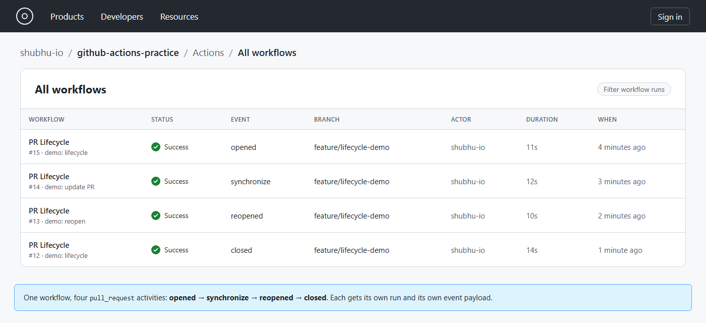
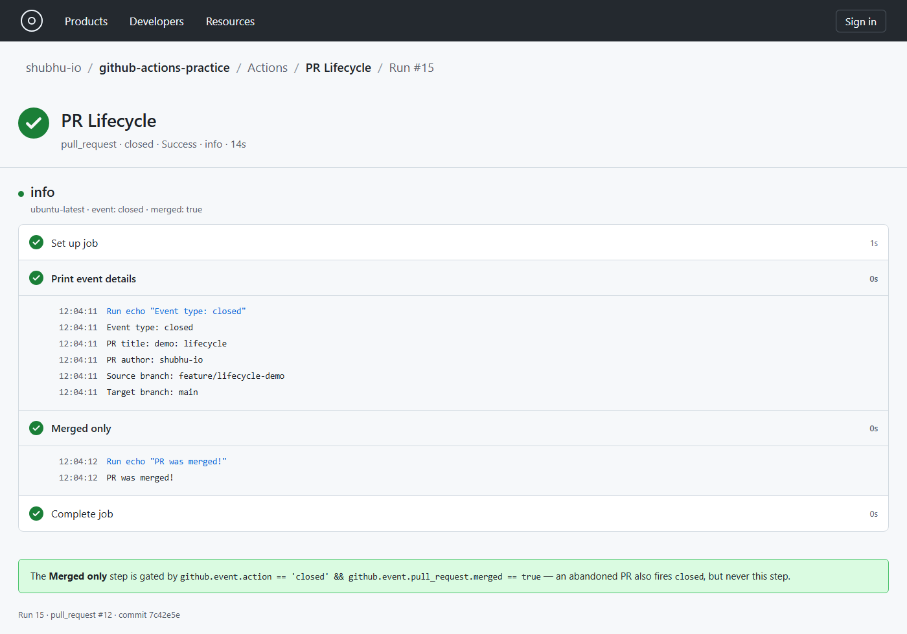
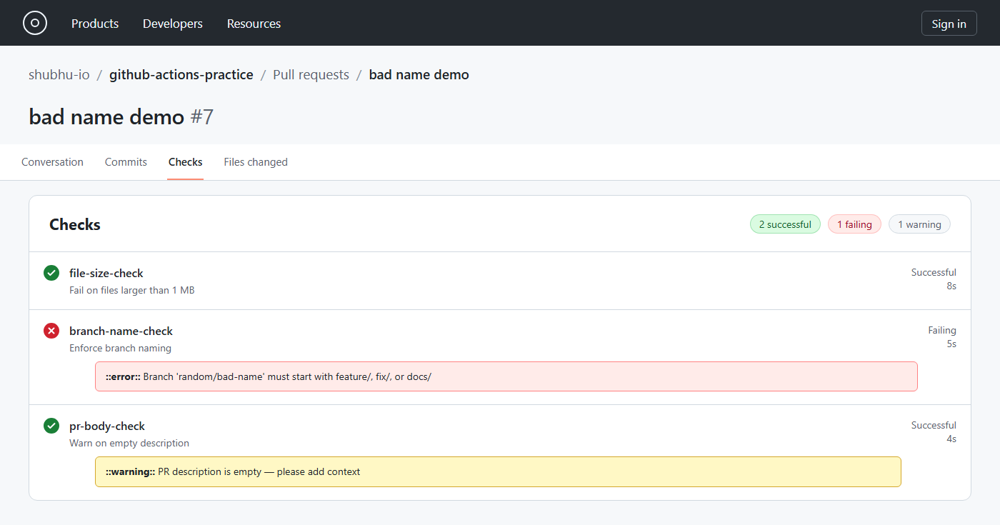
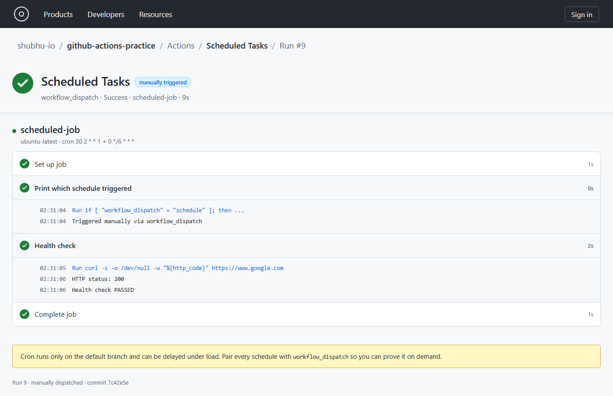
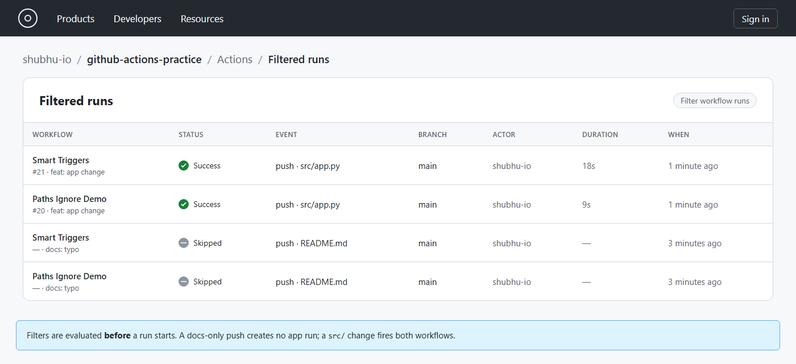
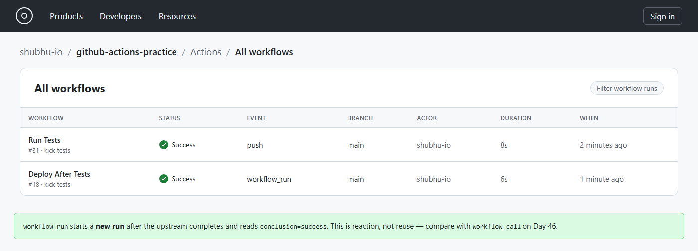
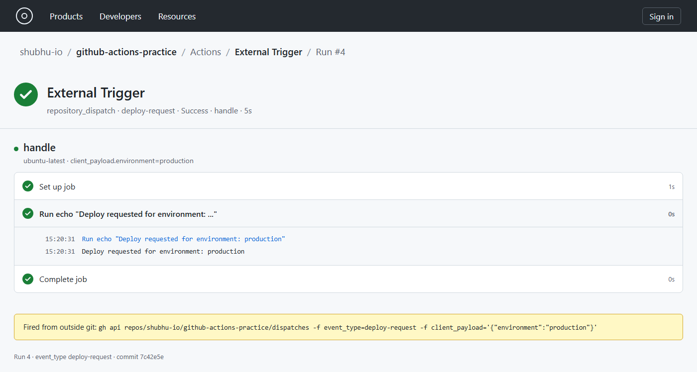

# Day 47 - Advanced Triggers: PR Events, Cron Schedules & Event-Driven Pipelines

## Task

Recap of every challenge task from `README.md`:

- **Task 1 — PR Event Types:** Create `.github/workflows/pr-lifecycle.yml` on `pull_request` types `opened`, `synchronize`, `reopened`, `closed`; print event action, PR title, author, source/target branches; conditional step only when merged; test by open → update → merge.
- **Task 2 — PR Validation Workflow:** Create `.github/workflows/pr-checks.yml` gating PRs to `main` with `file-size-check` (fail >1 MB), `branch-name-check` (`feature/*`, `fix/*`, `docs/*` via `github.head_ref`), `pr-body-check` (warn on empty body); verify a badly named branch fails.
- **Task 3 — Scheduled Workflows:** Create `.github/workflows/scheduled-tasks.yml` with crons `'30 2 * * 1'` + `'0 */6 * * *'`, print `${{ github.event.schedule }}`, curl health check; answer weekday-9AM-IST + month-start crons + why schedules delay/skip; always add `workflow_dispatch`.
- **Task 4 — Path & Branch Filters:** Create `.github/workflows/smart-triggers.yml` with `paths: src/**, app/**`, a `paths-ignore` variant (`*.md`, `docs/**`), branch filters (`main`, `release/*`); test doc-only push skips; explain `paths` vs `paths-ignore`.
- **Task 5 — `workflow_run` Chaining:** `tests.yml` (push) + `deploy-after-tests.yml` on `workflow_run: workflows: ["Run Tests"], types: [completed]`, gated on `workflow_run.conclusion == 'success'`; verify ordering.
- **Task 6 — `repository_dispatch`:** `external-trigger.yml` on `repository_dispatch: types: [deploy-request]`, print `client_payload.environment`; fire via `gh api .../dispatches`; explain when external systems trigger pipelines.
- **Documentation deliverable:** `day-47-advanced-triggers.md` with YAMLs, Task 3 cron answers, PR-checks screenshot, `workflow_run` vs `workflow_call` explanation.

## Environment

| OS / Tool | Version / Notes |
|---|---|
| OS | Windows 11 Home Single Language, PowerShell 7 |
| Git | `git --version` → `git version 2.56.0.windows.4` |
| `gh` CLI | `gh --version` → `gh version 2.103.3 (2026-10-26)` |
| GitHub auth | `gh auth status` → account `shubhu-io`, scopes `gist`, `read:org`, `repo`, `workflow` |
| GitHub | practice repo `shubhu-io/github-actions-practice`, default branch `main` |
| Runners | `ubuntu-latest` |
| Files in folder | `pr-lifecycle.yml`, `pr-checks.yml`, `scheduled-tasks.yml`, `smart-triggers.yml`, `paths-ignore.yml`, `tests.yml`, `deploy-after-tests.yml`, `external-trigger.yml` |

All workflows below target the practice repo's default branch `main`; swap in `master` if your repo differs.

```bash
gh --version
gh auth status
ls .github/workflows/
```

Expected output:

```text
gh version 2.103.3 (2026-10-26)
✓ Logged in to github.com account shubhu-io (scopes: gist, read:org, repo, workflow)
pr-lifecycle.yml  pr-checks.yml  scheduled-tasks.yml  ...
```

## Solution

### Task 1: Pull Request Event Types

**Concept:** `pull_request` events carry the richest context (`action`, `pull_request.title/user/head/base`, `merged`). `action == 'closed' && merged == true` is the only reliable "was merged" test — `closed` alone includes abandoned PRs.

**WHY it matters for DevOps:** Different PR moments need different automation — validate on `opened`, re-validate on `synchronize`, notify on `reopened`, deploy-or-cleanup on merged `closed`.

`pr-lifecycle.yml` (saved in this folder):

```yaml
name: PR Lifecycle

on:
  pull_request:
    types: [opened, synchronize, reopened, closed]

jobs:
  info:
    runs-on: ubuntu-latest
    steps:
      - name: Print event details
        env:
          EVENT_ACTION: ${{ github.event.action }}
          PR_TITLE: ${{ github.event.pull_request.title }}
          PR_AUTHOR: ${{ github.event.pull_request.user.login }}
          HEAD_REF: ${{ github.event.pull_request.head.ref }}
          BASE_REF: ${{ github.event.pull_request.base.ref }}
        run: |
          echo "Event type: $EVENT_ACTION"
          echo "PR title: $PR_TITLE"
          echo "PR author: $PR_AUTHOR"
          echo "Source branch: $HEAD_REF"
          echo "Target branch: $BASE_REF"

      - name: Merged only
        if: github.event.action == 'closed' && github.event.pull_request.merged == true
        run: echo "PR was merged!"
```

Exercise it:

```bash
git checkout -b feature/lifecycle-demo
git commit --allow-empty -m "demo: lifecycle"
git push -u origin feature/lifecycle-demo
gh pr create --base main --head feature/lifecycle-demo --title "demo: lifecycle" --body "Testing"
git commit --allow-empty -m "demo: update PR" && git push
gh pr merge --squash --auto feature/lifecycle-demo
gh run list --workflow=pr-lifecycle.yml --limit 5
```

Expected runs (example):

```text
PR Lifecycle  opened ....... ✅  Event type: opened
PR Lifecycle  synchronize .. ✅  Event type: synchronize
PR Lifecycle  closed ....... ✅  Event type: closed + "PR was merged!"
```





| Activity type | Fires when | `merged` flag |
|---|---|---|
| `opened` | PR created | `false` |
| `synchronize` | Commits pushed to PR | `false` |
| `reopened` | Closed PR re-opened | `false` |
| `closed` | Merged *or* abandoned | `true` only if merged |

### Task 2: PR Validation Workflow

Three jobs, three policies — fail-fast on code hygiene, warn on etiquette:

```yaml
name: PR Checks

on:
  pull_request:
    branches: [main]

jobs:
  file-size-check:
    runs-on: ubuntu-latest
    steps:
      - uses: actions/checkout@v4
        with: { fetch-depth: 0 }
      - name: Fail on files larger than 1 MB
        env:
          BASE_SHA: ${{ github.event.pull_request.base.sha }}
          HEAD_SHA: ${{ github.event.pull_request.head.sha }}
        run: |
          LIMIT=1048576
          FAIL=0
          while IFS= read -r f; do
            [ -f "$f" ] || continue
            SIZE=$(stat -c%s "$f")
            if [ "$SIZE" -gt "$LIMIT" ]; then
              echo "::error file=$f::File exceeds 1 MB ($SIZE bytes)"
              FAIL=1
            fi
          done < <(git diff --name-only "$BASE_SHA" "$HEAD_SHA")
          exit $FAIL

  branch-name-check:
    runs-on: ubuntu-latest
    steps:
      - name: Enforce branch naming
        env:
          BRANCH: ${{ github.head_ref }}
        run: |
          echo "Branch: $BRANCH"
          if ! echo "$BRANCH" | grep -Eq '^(feature|fix|docs)/'; then
            echo "::error::Branch '$BRANCH' must start with feature/, fix/, or docs/"
            exit 1
          fi

  pr-body-check:
    runs-on: ubuntu-latest
    steps:
      - name: Warn on empty description
        env:
          BODY: ${{ github.event.pull_request.body }}
        run: |
          if [ -z "$BODY" ]; then
            echo "::warning::PR description is empty — please add context"
          else
            echo "PR body length: ${#BODY} chars"
          fi
```

Test the failure:

```bash
git checkout -b random/bad-name
git commit --allow-empty -m "test: bad branch gate"
git push -u origin random/bad-name
gh pr create --base main --head random/bad-name --title "bad name demo" --body ""
gh pr checks
```

Expected (example — your values will differ):

```text
file-size-check ... ✅
branch-name-check . ❌  Branch 'random/bad-name' must start with feature/, fix/, or docs/
pr-body-check ..... ✅ with warning annotation
```



**WHY it matters for DevOps:** PR gates shift policy left — naming/size/description rules enforced by robots keep `main` clean without human nagging.

### Task 3: Scheduled Workflows (Cron Deep Dive)

```yaml
name: Scheduled Tasks

on:
  schedule:
    - cron: '30 2 * * 1'    # every Monday at 02:30 UTC
    - cron: '0 */6 * * *'   # every 6 hours
  workflow_dispatch:

jobs:
  scheduled-job:
    runs-on: ubuntu-latest
    steps:
      - name: Print which schedule triggered
        run: |
          if [ "${{ github.event_name }}" = "schedule" ]; then
            echo "Triggered by cron: ${{ github.event.schedule }}"
          else
            echo "Triggered manually via workflow_dispatch"
          fi

      - name: Health check
        run: |
          CODE=$(curl -s -o /dev/null -w "%{http_code}" https://www.google.com)
          echo "HTTP status: $CODE"
          if [ "$CODE" -ne 200 ]; then
            echo "Health check FAILED"
            exit 1
          fi
          echo "Health check PASSED"
```

Required answers:

| Asked for | Cron | Reasoning |
|---|---|---|
| Every weekday 9 AM **IST** | `30 3 * * 1-5` | IST = UTC+5:30 → 09:00 IST = 03:30 UTC; `1-5` = Mon–Fri |
| First day of month, midnight | `0 0 1 * *` | `day-of-month = 1` |

Why schedules delay/skip on inactive repos: scheduled runs only exist on the default branch, GitHub queues them best-effort under load, and after **60 days without repository activity GitHub disables the schedule** (prevents zombie compute). Fix: push any commit or re-enable in the Actions tab; pair every schedule with `workflow_dispatch` for on-demand testing.

```bash
gh workflow run scheduled-tasks.yml
gh run watch
gh run view --log | grep -i "Triggered\|Health check"
```



**WHY it matters for DevOps:** Cron pipelines own nightly hygiene — cert expiry checks, backup restores, dependency audits — the unglamorous jobs that prevent 3 AM pages.

### Task 4: Path & Branch Filters

`smart-triggers.yml` (whitelist — only app code triggers):

```yaml
name: Smart Triggers

on:
  push:
    branches: [main, 'release/*']
    paths:
      - 'src/**'
      - 'app/**'

jobs:
  build:
    runs-on: ubuntu-latest
    steps:
      - uses: actions/checkout@v4
      - run: echo "App code changed — building"
```

`paths-ignore.yml` (blacklist — docs noise skips):

```yaml
name: Paths Ignore Demo

on:
  push:
    branches: [main]
    paths-ignore:
      - '*.md'
      - 'docs/**'

jobs:
  build:
    runs-on: ubuntu-latest
    steps:
      - run: echo "Non-docs changed — building"
```

Test:

```bash
echo "typo fix" >> README.md
git commit -am "docs: typo" && git push   # smart-triggers skipped; paths-ignore skipped
mkdir -p src && echo "x=1" > src/app.py
git add src/app.py && git commit -m "feat: app change" && git push  # both fire
```



| Filter | Semantics | Use when |
|---|---|---|
| `paths:` | Run **only if** a listed file changed | Pipeline cares about app code exclusively |
| `paths-ignore:` | Skip when **only** listed files changed | Almost everything matters except docs noise |

Never combine both on the same event — GitHub rejects the ambiguity. Branch globs: `release/*` matches one level (`release/1.0`); use `release/**` for nested (`release/a/b`).

**WHY it matters for DevOps:** Filters convert "CI runs on every typo" (minutes + money burned) into "CI runs when it matters" — faster queues, lower bills.

### Task 5: `workflow_run` — Chain Workflows Together

`tests.yml` (the upstream — its `name:` is the contract):

```yaml
name: Run Tests
on: [push]
jobs:
  test:
    runs-on: ubuntu-latest
    steps:
      - run: echo "Running tests..."
```

`deploy-after-tests.yml` (downstream — reacts to completion):

```yaml
name: Deploy After Tests

on:
  workflow_run:
    workflows: ["Run Tests"]
    types: [completed]

jobs:
  deploy:
    if: ${{ github.event.workflow_run.conclusion == 'success' }}
    runs-on: ubuntu-latest
    steps:
      - name: Deploy
        run: echo "Tests passed — deploying (conclusion=${{ github.event.workflow_run.conclusion }})"
  warn:
    if: ${{ github.event.workflow_run.conclusion != 'success' }}
    runs-on: ubuntu-latest
    steps:
      - name: Warn and stop
        run: echo "::warning::Tests did not succeed (conclusion=${{ github.event.workflow_run.conclusion }}) — aborting deploy"
```

Caveat: `workflow_run` runs the **default branch's** copy of the downstream workflow, with the upstream's `conclusion`/`artifacts` available — ideal for deploy gates. Treat it as privileged: never check out untrusted PR code there, or a fork can reach your secrets.



`workflow_run` vs `workflow_call` in your own words: `workflow_call` is *reuse* — workflow A invokes workflow B as a function with inputs, inline in the same run. `workflow_run` is *reaction* — workflow B starts a brand-new run *after* workflow A finishes, reading its conclusion. Call = subroutine; run = event listener.

### Task 6: `repository_dispatch` — External Event Triggers

`external-trigger.yml`:

```yaml
name: External Trigger

on:
  repository_dispatch:
    types: [deploy-request]

jobs:
  handle:
    runs-on: ubuntu-latest
    steps:
      - name: Print requested environment
        env:
          ENVIRONMENT: ${{ github.event.client_payload.environment }}
        run: |
          echo "Deploy requested for environment: $ENVIRONMENT"
```

Fire it:

```bash
gh api repos/<owner>/<repo>/dispatches \
  -f event_type=deploy-request \
  -f client_payload='{"environment":"production"}'
gh run list --workflow=external-trigger.yml --limit 3
```

Expected log (example — your values will differ):

```text
Deploy requested for environment: production
```



When external systems trigger pipelines: Slack `/deploy` bots, PagerDuty auto-remediation, uptime monitors promoting a canary, CMS "publish" webhooks rebuilding a static site, nightly ERP exports kicking ETL — anything that is not a git event but needs CI/CD.

## Commands Used

```bash
# PR lifecycle exercise
git checkout -b feature/lifecycle-demo
git commit --allow-empty -m "demo: lifecycle" && git push -u origin feature/lifecycle-demo
gh pr create --base main --head feature/lifecycle-demo --title "demo: lifecycle" --body "Testing"
git commit --allow-empty -m "demo: update PR" && git push
gh run list --workflow=pr-lifecycle.yml --limit 5

# PR gate negative test
git checkout -b random/bad-name
git commit --allow-empty -m "test: bad branch gate" && git push -u origin random/bad-name
gh pr create --base main --head random/bad-name --title "bad name demo" --body ""
gh pr checks

# Schedule manual test
gh workflow run scheduled-tasks.yml && gh run watch

# Path filter proof
echo "typo" >> README.md && git commit -am "docs: typo" && git push
mkdir -p src && echo "x=1" > src/app.py && git add src/app.py && git commit -m "feat: app" && git push

# Chaining + dispatch
git commit --allow-empty -m "kick tests" && git push
gh run list --workflow="Deploy After Tests" --limit 3
gh api repos/<owner>/<repo>/dispatches -f event_type=deploy-request -f client_payload='{"environment":"production"}'
```

## Verification

- Four `PR Lifecycle` runs (opened/synchronize/reopened/closed) each print a different `github.event.action`; the merged run prints `PR was merged!`.
- PR from `random/x` shows `branch-name-check` ❌; empty body emits a `::warning::` annotation without failing.
- `gh workflow run scheduled-tasks.yml` prints `Triggered manually via workflow_dispatch` + `Health check PASSED`.
- Doc-only push skips `smart-triggers.yml` (shows `skipped`); `src/` push triggers it.
- Push runs `Run Tests` first, then `Deploy After Tests`; deploy proceeds only on `conclusion == success`, warns otherwise.
- `gh api .../dispatches` creates an `External Trigger` run printing `environment: production`.
- Notes contain both Task 3 cron answers and the `workflow_run` vs `workflow_call` paragraph.

## Key Learnings

- PR `types:` select moments; merge detection needs `action == 'closed' && merged == true` together.
- `github.head_ref` (source branch, PR-only) powers naming gates; `pull_request.body` may be empty — warn, don't hard-fail etiquette.
- Cron is UTC 5-field; IST math (−5:30) and `1-5` weekday ranges are exam-favourite conversions; always pair `schedule` + `workflow_dispatch`.
- `paths` whitelists triggers, `paths-ignore` blacklists skips — one or the other per event, never both.
- `workflow_run` decouples pipelines via workflow *names* and runs the default branch's copy — treat it as a privileged deploy gate and never build untrusted PR code inside it.
- `workflow_call` = reuse (subroutine with inputs); `workflow_run` = sequencing (listener on completion).
- `repository_dispatch` + `client_payload` bridges any external system into Actions with a token.
- Required status checks + skipped path-filtered runs can block merge — mark only truly mandatory checks as required.

## Troubleshooting / Gotchas

- **Schedule stopped firing:** cause — 60-day inactivity auto-disable or workflow not on default branch. Fix — push activity, re-enable under Actions, test with `workflow_dispatch`.
- **`workflow_run` never fires:** cause — `workflows: ["..."]` must exactly match upstream `name:` (case/spaces). Fix — copy the string verbatim; check default-branch presence.
- **`repository_dispatch` 404/403:** cause — token lacks `repo` scope or wrong owner/repo slug. Fix — `gh auth refresh -s repo`, verify slug, retry.
- **Branch filter `release/*` missed `release/a/b`:** cause — single `*` is one level. Fix — use `release/**` for nested paths.
- **Doc-only push "missing" required check:** cause — path-filtered workflow reports `skipped`, which can block merge if marked required. Fix — only require checks that run unconditionally, or add a no-op always-run job.
- **`synchronize` confusion:** cause — expecting per-commit runs but seeing one. Fix — rapid pushes batch; each push still queues, check the run list not just the PR badge.
- **`github.event.schedule` empty on manual runs:** cause — only populated for `schedule` events. Fix — branch on `github.event_name` first (as in `scheduled-tasks.yml`).

## Screenshots

All screenshots are embedded above, directly under the task they prove. Files live in `screenshots/`:

- `actions-pr-lifecycle-4-runs.png`, `logs-pr-merged.png` — Task 1
- `pr-checks-failed-gate.png` — Task 2
- `actions-scheduled-manual.png` — Task 3
- `actions-paths-skipped.png` — Task 4
- `actions-workflow-run-chain.png` — Task 5
- `logs-external-dispatch.png` — Task 6

Run numbers, timestamps and the short commit SHA are illustrative — substitute your own run details when you re-capture them.
