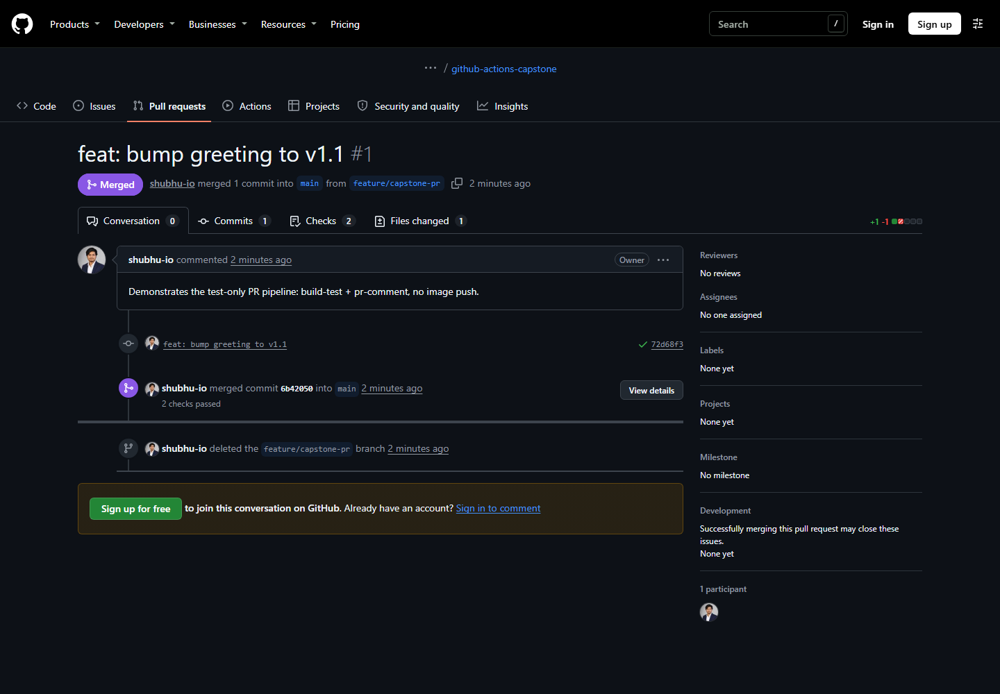
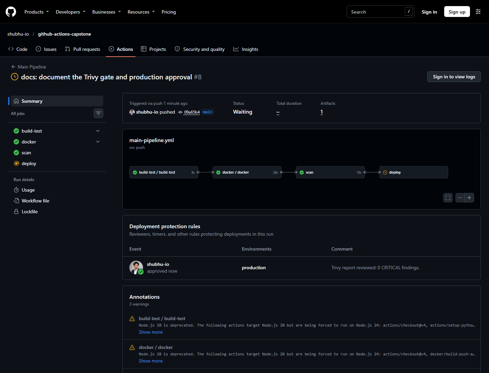
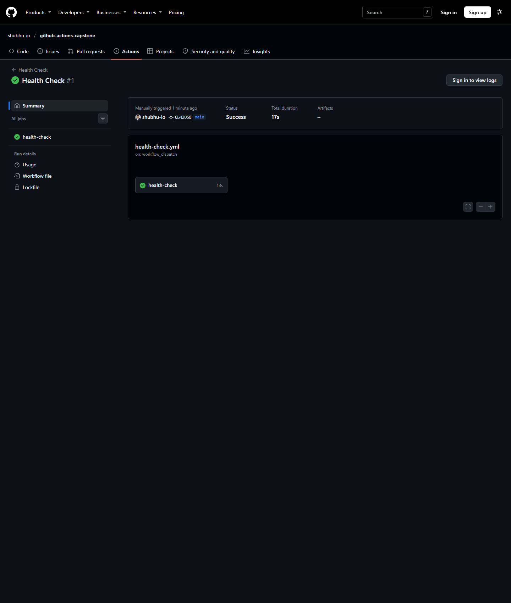
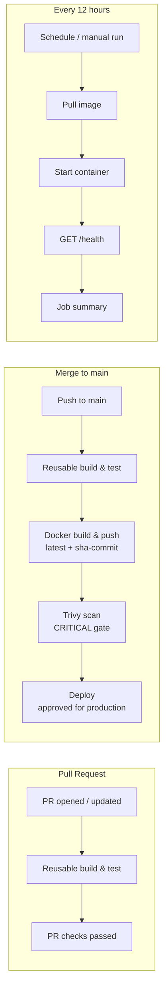

# Day 48 - GitHub Actions Project: End-to-End CI/CD Pipeline

This is a real, working capstone: a Flask app that tests, builds, publishes, and
deploys itself with GitHub Actions.

- **Repository:** [github-actions-capstone](https://github.com/shubhu-io/github-actions-capstone)
- **Image:** `ghcr.io/shubhu-io/github-actions-capstone:latest`
- **Package:** [GHCR package](https://github.com/shubhu-io/github-actions-capstone/pkgs/container/github-actions-capstone)

> **Goal:** one pipeline with reusable workflows, image publishing, a protected
> production deploy, and a scheduled health check - all verified by real runs.

---

## Task 1: Set Up the Project Repository

I built a new Flask app instead of reusing an older project:

- `/` returns a hello message, `/health` returns `{"status":"ok"}`
- `test_app.py` covers both routes with the stdlib `unittest` runner
- `Dockerfile` packages the app on `python:3.12-slim`
- `README.md` documents the app and the pipeline

**Verification:** locally, `python -m unittest -v` ran 2 tests with `OK`, and
`curl http://127.0.0.1:8000/health` returned `{"status":"ok"}`.

**Files:** [`app.py`](./app.py) · [`test_app.py`](./test_app.py) · [`Dockerfile`](./Dockerfile) · [`requirements.txt`](./requirements.txt)

---

## Task 2: Reusable Workflow - Build & Test

`.github/workflows/reusable-build-test.yml` runs on `workflow_call` and takes
`python_version` and `run_tests` as inputs. It installs dependencies, runs the tests,
and returns `test_result` to the caller.

**Verification:** every call finished green in about 15-20 seconds.

**Workflow:** [`reusable-build-test.yml`](./reusable-build-test.yml)

---

## Task 3: Reusable Workflow - Docker Build & Push

`.github/workflows/reusable-docker.yml` logs in to the registry, builds the image,
and pushes two tags: `latest` and `sha-<short-commit>`. It returns `image_url` to the
caller.

**Verification:** the merge run pushed both tags in one build:

```text
ghcr.io/shubhu-io/github-actions-capstone:latest
ghcr.io/shubhu-io/github-actions-capstone:sha-6b42050
```

**Workflow:** [`reusable-docker.yml`](./reusable-docker.yml)

---

## Task 4: PR Pipeline

`.github/workflows/pr-pipeline.yml` runs on `pull_request` (`opened`, `synchronize`).
It calls the build-test workflow and then prints a summary. There is no docker job
and no registry credentials in this file.

**Verification:** PR [#1](https://github.com/shubhu-io/github-actions-capstone/pull/1)
ran only `build-test` and `pr-comment`, finished in 20s, and published no image.




**Workflow:** [`pr-pipeline.yml`](./pr-pipeline.yml)

---

## Task 5: Main Branch Pipeline

`.github/workflows/main-pipeline.yml` runs on `push` to `main`. Four jobs run in
order: `build-test` → `docker` → `scan` → `deploy`. The deploy job uses
`environment: production`, which requires a reviewer.

**Verification:** the latest run finished in 1m 22s. The deploy waited for approval,
then printed:

```text
Deploying image: ghcr.io/shubhu-io/github-actions-capstone:latest to production
```


While waiting, the run page shows the gate clearly:




**Workflow:** [`main-pipeline.yml`](./main-pipeline.yml)

---

## Task 6: Scheduled Health Check

`.github/workflows/health-check.yml` runs every 12 hours and on demand. It pulls the
published image, starts the container, waits 5 seconds, and calls `/health`.

**Verification:** the manual run finished in 17 seconds with:

```text
Health check PASSED (HTTP 200)
```

The result is also written to the run summary with `$GITHUB_STEP_SUMMARY`.



**Workflow:** [`health-check.yml`](./health-check.yml)

---

## Task 7: Badges & Documentation

The repo README shows live badges for the two workflows that run on `main`:


### Pipeline Architecture



### What I would add next

| Improvement | Why |
|---|---|
| Slack or Teams alert on failure | Know about a red `main` in seconds |
| Staging environment before production | Catch problems before the real deploy |
| Rollback to the last `sha-*` tag | Recover from a bad health check |

---

## Brownie Points: Security Gate with Trivy

The `scan` job runs after the image is pushed and before the deploy starts:

- Scans the published image for `CRITICAL` vulnerabilities
- Fails the pipeline on a finding (`exit-code: '1'`)
- Ignores unfixed findings so a base-image CVE with no patch cannot block every release
- Uploads the report as the `trivy-report` artifact

Real report from the latest run: **0 critical findings** across Debian 13.7 and the
Python packages (`flask 3.1.3`, `jinja2 3.1.6`, `werkzeug 3.1.9`).

The full report is saved at [`trivy-report.txt`](./trivy-report.txt).

**Workflow:** [`main-pipeline.yml`](./main-pipeline.yml)

---

## Outcome

A working pipeline where pull requests only test, merges to `main` publish an image,
scan it for CRITICAL CVEs, and deploy it after approval, while a scheduled job keeps
checking that the published image is healthy.

### Key Learnings

- **Reusable workflows keep the repo DRY.** Test and build logic exist once and are called from both the PR and main pipelines.
- **PRs must stay registry-blind.** Untrusted code never receives push credentials.
- **`needs:` gives a real release order.** Test, then publish, scan, then deploy - never in parallel.
- **A colon inside a plain YAML value breaks the workflow.** `run: echo "Deploying image: ..."` failed in 0 seconds until I switched to `run: |`.
- **GitHub skips outputs that contain a secret.** Passing the registry username as a secret hid `image_url`, so only the token is secret now.
- **Actions tags need their real prefix.** `trivy-action@0.28.0` does not exist; the tag is `v0.36.0`. A wrong ref fails during job setup, before any scan runs.
- **Environment protection is one setting.** Adding a reviewer to `production` paused the deploy until it was approved, with no workflow changes.
- **Scheduled workflows only run from the default branch.** Test them with `workflow_dispatch`.

### Notes on this build

- **Registry:** GHCR instead of Docker Hub. The Docker Hub token on my older practice repo was expired (`unauthorized`), and GHCR works with the built-in `GITHUB_TOKEN`.
- **PR badge:** removed, because a `pull_request`-only workflow has no run on `main` and the badge reports "failing".
- **Self-review:** `prevent_self_review` is off, so the same account can approve its own deploy. A team should leave it on.

### Run history

- [Main #8 - test, image, scan, approved deploy, 1m22s](https://github.com/shubhu-io/github-actions-capstone/actions/runs/44678076398)
- [Main #4 - first full merge run, 53s](https://github.com/shubhu-io/github-actions-capstone/actions/runs/44673520831)
- [PR #2 - tests only, 20s](https://github.com/shubhu-io/github-actions-capstone/actions/runs/44673441396)
- [Health Check #1 - HTTP 200, 17s](https://github.com/shubhu-io/github-actions-capstone/actions/runs/44673626638)
