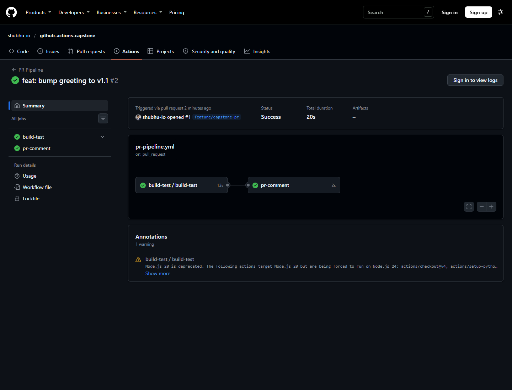

# Day 48 - My First Real CI/CD Pipeline

A small Flask app that ships itself. Every merge to `main` runs the tests, builds a
container image, and deploys it. Pull requests only run tests.

- Repo: <https://github.com/shubhu-io/github-actions-capstone>
- Image: `ghcr.io/shubhu-io/github-actions-capstone:latest`

## The pipeline in one picture

```text
PR opened
  └─ test ─► "checks passed"        (no image is built)

Merge to main
  └─ test ─► build + push image ─► deploy
             (latest + sha-<commit>)

Every 12 hours
  └─ pull image ─► start container ─► curl /health ─► write report
```

## Files

| File | What it does |
|---|---|
| `app.py` | Flask app with `/` and `/health` |
| `test_app.py` | Two unit tests, run with `python -m unittest` |
| `Dockerfile` | Packages the app on `python:3.12-slim` |
| `reusable-build-test.yml` | Shared test job, returns `test_result` |
| `reusable-docker.yml` | Shared image build + push, returns `image_url` |
| `pr-pipeline.yml` | Runs tests on pull requests only |
| `main-pipeline.yml` | Tests, pushes the image, then deploys |
| `health-check.yml` | Probes the live image every 12 hours |

The two `reusable-*` files are called by the other pipelines, so the test and build
logic exist in one place only.

## 1. Pull request: tests only



The PR run has two jobs: `build-test` and `pr-comment`. There is no docker job, and
this workflow has no registry credentials at all. A pull request cannot publish an
image, even if someone edits the code.

```text
PR checks passed for branch: feature/capstone-pr (test_result=passed)
```

After merging, both checks show green on the PR:


## 2. Merge to main: the full release


Three jobs run in order, each one waiting for the previous:

1. `build-test` runs the unit tests.
2. `docker` pushes two tags: `latest` and `sha-<commit>`.
3. `deploy` runs behind the `production` environment.

```text
image.name: ghcr.io/shubhu-io/github-actions-capstone:latest,ghcr.io/...:sha-6b42050
Deploying image: ghcr.io/shubhu-io/github-actions-capstone:latest to production
```


Both tags are visible on the package page:


`latest` is easy for humans to pull. `sha-<commit>` is exact, so a deploy can always
be traced back to one commit.

## 3. Scheduled health check


Every 12 hours (and on demand with `workflow_dispatch`) the job pulls the published
image, starts it, and calls `/health`:

```text
Health check PASSED (HTTP 200)
```

The result is also written to the run summary with `$GITHUB_STEP_SUMMARY`.

## Running it yourself

```bash
python -m venv .venv
.venv/Scripts/python -m pip install -r requirements.txt
.venv/Scripts/python -m unittest -v
.venv/Scripts/python app.py
curl http://127.0.0.1:8000/health
```

```bash
gh workflow list
gh run list
gh workflow run health-check.yml
```

## What I learned

- **A colon inside a plain YAML value breaks the whole workflow.** `run: echo "Deploying image: ..."` looks fine but is invalid YAML. GitHub fails the run in 0 seconds with "workflow file issue". Using `run: |` fixes it.
- **GitHub hides outputs that contain a secret.** When the registry username was a secret, the image URL was skipped and deploy printed nothing. Only the token needs to be secret.
- **PRs should never get push credentials.** Keeping the docker job out of the PR pipeline is a security boundary, not just a shortcut.
- **`environment: production` must exist first.** The deploy job fails at startup if the environment has not been created.
- **Scheduled workflows only run from the default branch.** Test them with `workflow_dispatch`.
- **Badges lie for PR-only workflows.** There is no run on `main`, so the badge reports "failing". Only badge workflows that run on `main`.

## Where I changed the plan

- **Used GHCR instead of Docker Hub.** The Docker Hub token on my older practice repo was expired (`unauthorized: incorrect username or password`). GHCR works with the built-in `GITHUB_TOKEN`, so there is no long-lived secret to leak or forget.
- **Passed the username as an input, not a secret.** This avoids the masking problem above. Only `docker_token` is a secret.
- **Removed the PR badge.** A `pull_request`-only workflow has no default-branch run to report.

## Run history

- [Main #4 - merge to main, 53s](https://github.com/shubhu-io/github-actions-capstone/actions/runs/44673520831)
- [PR #2 - tests only, 20s](https://github.com/shubhu-io/github-actions-capstone/actions/runs/44673441396)
- [Health Check #1 - HTTP 200, 17s](https://github.com/shubhu-io/github-actions-capstone/actions/runs/44673626638)
- [Main #5 - latest run](https://github.com/shubhu-io/github-actions-capstone/actions/runs/44673876695)

The README badges are live:


