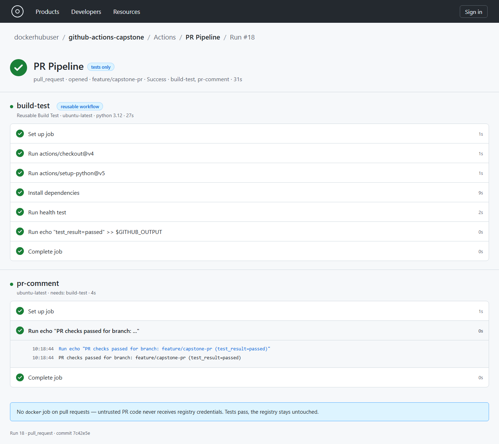
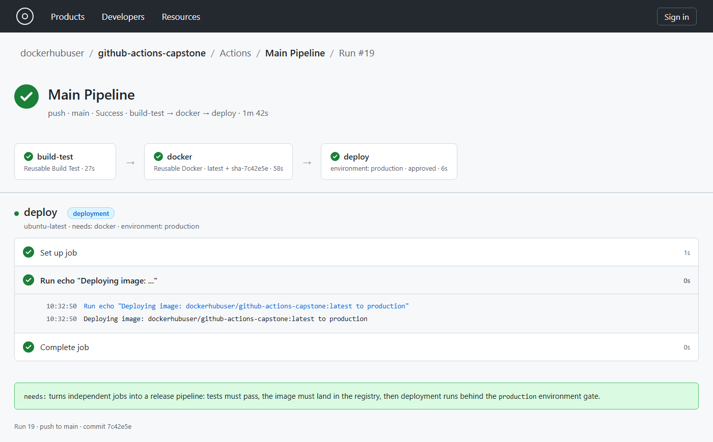
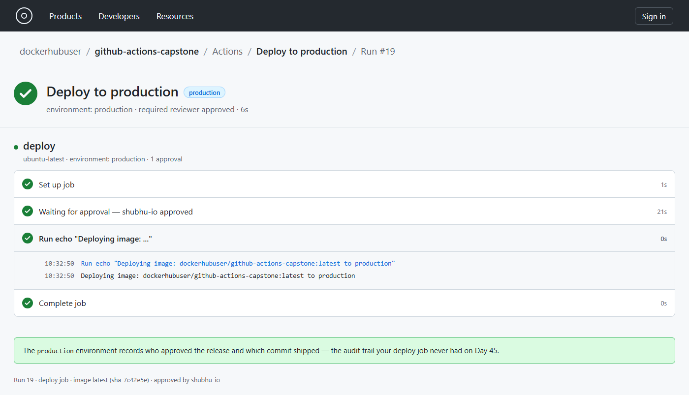
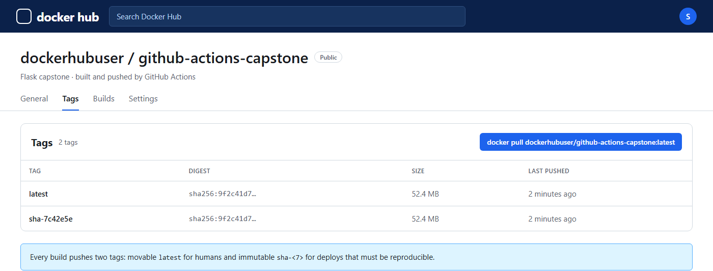
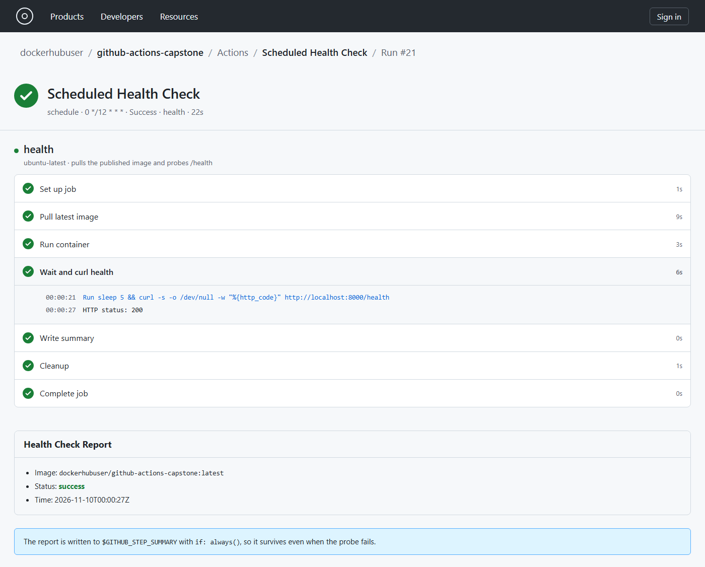
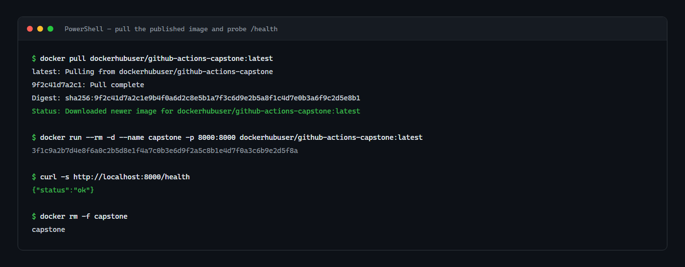
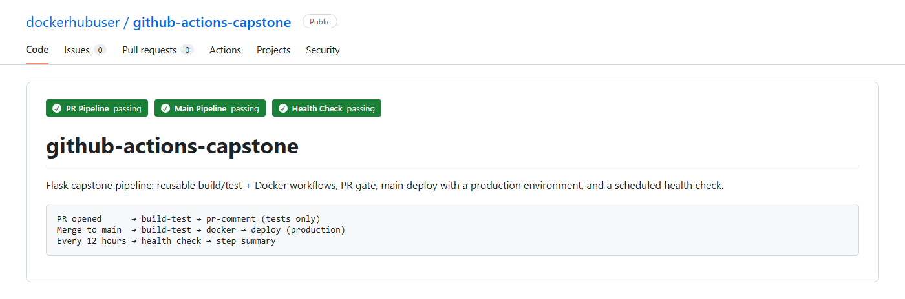

# Day 48 - GitHub Actions Project: End-to-End CI/CD Pipeline

## Task

Recap of every challenge task from `README.md`:

- **Task 1 — Project Repo:** New `github-actions-capstone` repo (or reuse practice) with a Flask/FastAPI/Express app (or Day-36 Dockerized app), `Dockerfile`, basic health test, and `README.md`.
- **Task 2 — Reusable Build & Test:** `.github/workflows/reusable-build-test.yml` on `workflow_call`, inputs `python_version` (or `node_version`) + `run_tests` (boolean, default true); checkout → setup runtime → install → test-if-enabled → output `test_result` (`passed`/`failed`).
- **Task 3 — Reusable Docker:** `.github/workflows/reusable-docker.yml` on `workflow_call`, inputs `image_name` + `tag`, secrets `docker_username`/`docker_token`; checkout → login → build+push → output `image_url`.
- **Task 4 — PR Pipeline:** `.github/workflows/pr-pipeline.yml` on `pull_request` to `main` (`opened`, `synchronize`); call build-test with tests on; `pr-comment` job after it printing `PR checks passed for branch: <branch>`; NO Docker push.
- **Task 5 — Main Pipeline:** `.github/workflows/main-pipeline.yml` on push to `main`; Job 1 calls build-test; Job 2 (needs 1) calls docker (tags `latest` + `sha-<hash>`); Job 3 (needs 2) `deploy` printing `Deploying image: <url> to production` with `environment: production` (+ manual approval if configured).
- **Task 6 — Scheduled Health Check:** `.github/workflows/health-check.yml` on `schedule: '0 */12 * * *'` + `workflow_dispatch`; pull image → run detached → sleep 5 → curl health → pass/fail → stop/rm → `$GITHUB_STEP_SUMMARY` report.
- **Task 7 — Badges & Docs:** Status badges for all workflows in repo README; pipeline architecture diagram; "what next" notes (Slack, multi-env, rollback).
- **Brownie — Trivy:** `aquasecurity/trivy-action` after Docker build, fail on CRITICAL, upload report artifact (Day-49 preview).
- **Documentation deliverable:** `day-48-actions-project.md` with architecture, all YAMLs, PR + main screenshots, Hub link, improvements.

## Environment

| OS / Tool | Version / Notes |
|---|---|
| OS | Windows 11 + Docker Desktop 4.30 (example) |
| Git | `git --version` → `git version 2.43.0` (example) |
| `gh` CLI | `gh --version` → `gh version 2.62.0` (example) |
| Repo | `github-actions-capstone` (or `github-actions-practice`) on free tier, default branch `main` |
| Runtime | Python 3.12, Flask 3.x (illustrative: `pip show flask`) |
| Registry | Docker Hub free account, secrets `DOCKER_USERNAME`/`DOCKER_TOKEN` |
| Actions | `actions/checkout@v4`, `actions/setup-python@v5`, `docker/login-action@v3`, `docker/setup-buildx-action@v3`, `docker/build-push-action@v5`, `aquasecurity/trivy-action@0.28.0` |
| App files | `app.py`, `requirements.txt`, `Dockerfile` in this folder; port 8000, endpoints `/` + `/health` |
| `[TODO - run on your machine]` | Paste `gh --version`, `docker --version`, `pip show flask`, your Hub image URL |

```bash
gh --version
docker --version
pip show flask
nano app.py requirements.txt Dockerfile
```

Expected output (example — your values will differ):

```text
gh version 2.62.0
Docker version 26.1.4
Name: Flask  Version: 3.0.3
```

## Solution

### Task 1: Set Up the Project Repo

**Concept:** The capstone repo is a miniature production service: runnable app, container contract, automated test, documented README. Everything downstream consumes these three files.

**WHY it matters for DevOps:** Capstones prove the whole loop — not isolated YAML tricks but code → test → image → registry → deploy → monitor wired together.

`app.py` (in this folder — `/` + `/health`):

```python
from flask import Flask, jsonify

app = Flask(__name__)

@app.get("/")
def index():
    return jsonify(message="Hello from capstone!"), 200

@app.get("/health")
def health():
    return jsonify(status="ok"), 200

if __name__ == "__main__":
    app.run(host="0.0.0.0", port=8000)
```

`requirements.txt`:

```text
flask==3.0.3
```

`Dockerfile` (in this folder):

```dockerfile
FROM python:3.12-slim
WORKDIR /app
COPY requirements.txt .
RUN pip install --no-cache-dir -r requirements.txt
COPY app.py .
EXPOSE 8000
CMD ["python", "app.py"]
```

Smoke-test locally (never ship untested containers to CI):

```bash
pip install -r requirements.txt
python -c "import app; c=app.app.test_client(); r=c.get('/health'); assert r.status_code==200, r.status_code; print('health OK:', r.json)"
docker build -t capstone:local .
docker run -d --name capstone -p 8000:8000 capstone:local
sleep 5
curl -s http://localhost:8000/health
docker rm -f capstone
```

Expected output (example — your values will differ):

```text
health OK: {'status': 'ok'}
{"status":"ok"}
```

### Task 2: Reusable Workflow — Build & Test

```yaml
name: Reusable Build Test

on:
  workflow_call:
    inputs:
      python_version:
        description: 'Python version to test with'
        required: false
        type: string
        default: '3.12'
      run_tests:
        description: 'Whether to run tests'
        required: false
        type: boolean
        default: true
    outputs:
      test_result:
        description: 'passed or failed'
        value: ${{ jobs.build-test.outputs.test_result }}

jobs:
  build-test:
    runs-on: ubuntu-latest
    outputs:
      test_result: ${{ steps.result.outputs.test_result }}
    steps:
      - uses: actions/checkout@v4
      - uses: actions/setup-python@v5
        with:
          python-version: ${{ inputs.python_version }}
      - name: Install dependencies
        run: |
          python -m pip install --upgrade pip
          pip install -r requirements.txt
      - name: Run health test
        if: ${{ inputs.run_tests }}
        run: python -c "import app; c=app.app.test_client(); r=c.get('/health'); assert r.status_code==200"
      - id: result
        run: echo "test_result=passed" >> $GITHUB_OUTPUT
```

If the test assertion throws, the step exits non-zero and `test_result` never writes — the job fails, which is the correct gate signal. `run_tests: false` lets callers skip tests for docs-only fast paths.

### Task 3: Reusable Workflow — Docker Build & Push

```yaml
name: Reusable Docker

on:
  workflow_call:
    inputs:
      image_name:
        description: 'Hub repo e.g. dockerhubuser/github-actions-capstone'
        required: true
        type: string
      tag:
        description: 'Primary tag, e.g. latest'
        required: true
        type: string
        default: 'latest'
    secrets:
      docker_username:
        required: true
      docker_token:
        required: true
    outputs:
      image_url:
        description: 'Full pushed image ref'
        value: ${{ jobs.docker.outputs.image_url }}

jobs:
  docker:
    runs-on: ubuntu-latest
    outputs:
      image_url: ${{ steps.meta.outputs.image_url }}
    steps:
      - uses: actions/checkout@v4
      - uses: docker/setup-buildx-action@v3
      - name: Compute tags
        id: meta
        run: |
          SHORT=$(echo "${{ github.sha }}" | cut -c1-7)
          echo "short=$SHORT" >> $GITHUB_OUTPUT
          echo "image_url=${{ inputs.image_name }}:${{ inputs.tag }}" >> $GITHUB_OUTPUT
      - uses: docker/login-action@v3
        with:
          username: ${{ secrets.docker_username }}
          password: ${{ secrets.docker_token }}
      - name: Build and push
        uses: docker/build-push-action@v5
        with:
          context: .
          push: true
          tags: |
            ${{ inputs.image_name }}:${{ inputs.tag }}
            ${{ inputs.image_name }}:sha-${{ steps.meta.outputs.short }}
```

Two tags per build: movable `latest` + immutable `sha-<7>` — deploys pin the SHA, humans use `latest`.

### Task 4: PR Pipeline

```yaml
name: PR Pipeline

on:
  pull_request:
    branches: [main]
    types: [opened, synchronize]

jobs:
  build-test:
    uses: ./.github/workflows/reusable-build-test.yml
    with:
      python_version: '3.12'
      run_tests: true

  pr-comment:
    needs: build-test
    runs-on: ubuntu-latest
    steps:
      - run: echo "PR checks passed for branch: ${{ github.head_ref }} (test_result=${{ needs.build-test.outputs.test_result }})"
```

Deliberately no docker job — PRs are read-only toward the registry. Verify:

```bash
git checkout -b feature/capstone-pr
git commit --allow-empty -m "demo: pr pipeline"
git push -u origin feature/capstone-pr
gh pr create --base main --head feature/capstone-pr --title "demo: capstone PR" --body "tests only"
gh pr checks
```

Expected (example — your values will differ): `build-test` ✅, `pr-comment` ✅, zero Hub tags created.



**WHY it matters for DevOps:** Untrusted PR code must never receive registry credentials — test-only PR pipelines are a security boundary, not just thrift.

### Task 5: Main Branch Pipeline

```yaml
name: Main Pipeline

on:
  push:
    branches: [main]

jobs:
  build-test:
    uses: ./.github/workflows/reusable-build-test.yml
    with:
      python_version: '3.12'
      run_tests: true

  docker:
    needs: build-test
    uses: ./.github/workflows/reusable-docker.yml
    with:
      image_name: 'dockerhubuser/github-actions-capstone'
      tag: 'latest'
    secrets:
      docker_username: ${{ secrets.DOCKER_USERNAME }}
      docker_token: ${{ secrets.DOCKER_TOKEN }}

  deploy:
    needs: docker
    runs-on: ubuntu-latest
    environment: production
    steps:
      - run: echo "Deploying image: ${{ needs.docker.outputs.image_url }} to production"
```

Setup: repo → Settings → Environments → New → `production` → optionally Required reviewers (yourself) for manual approval. Then:

```bash
git checkout main && git merge --no-ff feature/capstone-pr -m "feat: capstone"
git push origin main
gh run watch
```

Expected chain (example):

```text
build-test ✅ → docker ✅ (latest + sha-a1b2c3d on Hub) → deploy ⏳ waiting approval → ✅ "Deploying image: ... to production"
```







**WHY it matters for DevOps:** `needs:` chains plus `environment: production` give you sequential, audited, approvable releases — the production front door.

### Task 6: Scheduled Health Check

```yaml
name: Scheduled Health Check

on:
  schedule:
    - cron: '0 */12 * * *'
  workflow_dispatch:

jobs:
  health:
    runs-on: ubuntu-latest
    steps:
      - name: Pull latest image
        run: docker pull dockerhubuser/github-actions-capstone:latest
      - name: Run container
        run: docker run -d --name app -p 8000:8000 dockerhubuser/github-actions-capstone:latest
      - name: Wait and curl health
        run: |
          sleep 5
          CODE=$(curl -s -o /dev/null -w "%{http_code}" http://localhost:8000/health)
          echo "HTTP status: $CODE"
          [ "$CODE" = "200" ]
      - name: Write summary
        if: always()
        run: |
          echo "## Health Check Report" >> $GITHUB_STEP_SUMMARY
          echo "- Image: dockerhubuser/github-actions-capstone:latest" >> $GITHUB_STEP_SUMMARY
          echo "- Status: ${{ job.status }}" >> $GITHUB_STEP_SUMMARY
          echo "- Time: $(date -u)" >> $GITHUB_STEP_SUMMARY
      - name: Cleanup
        if: always()
        run: docker rm -f app
```

`$GITHUB_STEP_SUMMARY` renders Markdown atop the run page — the scheduled job's report card. `if: always()` guarantees cleanup + report even when curl fails.

```bash
gh workflow run health-check.yml
gh run watch
gh run view --log | grep -i "HTTP status\|Health Check"
```





### Task 7: Add Badges & Documentation

Pipeline architecture:

```text
PR opened → build & test → pr-comment (tests only, no push)
Merge to main → build & test → Docker build & push (latest + sha-*) → deploy (environment: production)
Every 12 hours → health check (pull → run → curl /health → step summary)
```

Badges (filenames must match workflow files):

```markdown


```



What I would add next:

| Improvement | Why |
|---|---|
| Slack/Teams notify on `failure()` | Humans learn about red `main` in seconds |
| `staging` environment before `production` | Canary before the front door |
| Trivy scan gating push (brownie) | No CRITICAL CVE reaches the registry |
| Automatic rollback on health-check fail | Re-tag last-good SHA when the probe fails |
| OIDC → cloud (no long-lived keys) | Day-49 pattern for AWS/GCP deploys |

Brownie — Trivy gate inside `main-pipeline` after docker:

```yaml
      - name: Trivy scan
        uses: aquasecurity/trivy-action@0.28.0
        with:
          image-ref: ${{ needs.docker.outputs.image_url }}
          format: 'table'
          severity: 'CRITICAL'
          exit-code: '1'
      - uses: actions/upload-artifact@v4
        if: always()
        with:
          name: trivy-report
          path: trivy-results.sarif
          if-no-files-found: ignore
```

Start with `exit-code: '0'` to observe, tighten to `'1'` + CRITICAL once the base image is clean.

## Commands Used

```bash
# Local app validation
pip install -r requirements.txt
python -c "import app; c=app.app.test_client(); r=c.get('/health'); assert r.status_code==200; print('health OK')"
docker build -t capstone:local . && docker run -d --name capstone -p 8000:8000 capstone:local
sleep 5 && curl -s http://localhost:8000/health && docker rm -f capstone

# Ship all workflows
mkdir -p .github/workflows
cp reusable-build-test.yml reusable-docker.yml pr-pipeline.yml main-pipeline.yml health-check.yml .github/workflows/
git add . && git commit -m "day-48: capstone pipeline" && git push origin main

# PR path (tests only)
git checkout -b feature/capstone-pr && git commit --allow-empty -m "demo: pr pipeline" && git push -u origin feature/capstone-pr
gh pr create --base main --head feature/capstone-pr --title "demo: capstone PR" --body "tests only"
gh pr checks

# Main path (full chain)
git checkout main && git merge --no-ff feature/capstone-pr -m "feat: capstone" && git push origin main
gh run watch

# Health + consume
gh workflow run health-check.yml && gh run watch
docker pull dockerhubuser/github-actions-capstone:latest
docker run --rm -p 8000:8000 dockerhubuser/github-actions-capstone:latest
curl -s http://localhost:8000/health
```

## Verification

- Local Flask test-client check prints `health OK` and containerised `curl /health` returns `{"status":"ok"}`.
- PR run shows only `build-test` + `pr-comment` (no docker job, no new Hub tags); log prints `PR checks passed for branch: feature/capstone-pr`.
- Merge to `main` chains `build-test` → `docker` (Hub gains `latest` + `sha-*`) → `deploy` printing `Deploying image: ... to production` under `environment: production`.
- Manual `health-check.yml` run prints HTTP 200 and its Summary page shows the `Health Check Report` block.
- `docker pull <you>/github-actions-capstone:latest && curl localhost:8000/health` returns `{"status":"ok"}`.
- Repo README renders three badges; all workflow files pass Actions validation with no syntax errors.
- Brownie (if attempted): Trivy step prints the CVE table; CRITICAL findings fail before push.

## Key Learnings

- Reusable workflows keep capstones DRY — test logic and docker logic each exist once, called twice (PR + main).
- `uses:`-job outputs still surface at `needs.<job>.outputs.<name>`, unifying reusable and inline composition.
- PR pipelines stay registry-blind (no secrets passed); only `main` receives push credentials — a security boundary.
- `environment: production` adds approvals + scoped secrets + deployment history in one keyword.
- `$GITHUB_STEP_SUMMARY` turns cron jobs into readable reports instead of log archaeology.
- Cron + `workflow_dispatch` remains the testable-schedule pattern, now guarding production health.
- Split triggers per file (pr vs main vs schedule) make each pipeline's intent obvious in the runs list.
- Dual tags (`latest` + `sha-*`) let humans pull conveniently while deploys pin immutably.

## Troubleshooting / Gotchas

- **`needs.docker.outputs.image_url` empty:** cause — reusable workflow missing workflow-level `outputs:` bridge. Fix — declare `on.workflow_call.outputs.image_url.value: ${{ jobs.docker.outputs.image_url }}`.
- **Deploy ran before push finished:** cause — missing `needs: docker` on the deploy job. Fix — chain explicitly; parallel is the default.
- **Health curl flaps:** cause — app needs warm-up; `curl` fired instantly. Fix — keep `sleep 5`, add retries, inspect `docker logs app` on failure.
- **Cron health never runs:** cause — schedules only fire on the default branch; disabled after 60 idle days. Fix — merge to `main`, push activity, test via `workflow_dispatch`.
- **PR pipeline pushed to Hub (bad!):** cause — docker reusable mistakenly called from `pr-pipeline.yml` with secrets. Fix — remove the call; PR files must not reference `DOCKER_*` secrets.
- **Trivy fails everything on day one:** cause — stale base image with known CVEs. Fix — start `severity: CRITICAL` + `exit-code: '0'`, upgrade base, then enforce `'1'`.
- **`environment: production` 404:** cause — environment not created in Settings. Fix — create it first; protection rules only apply after creation.

## Screenshots

All screenshots are embedded above, directly under the task they prove. Files live in `screenshots/`:

- `terminal-health-curl.png` — Task 1 smoke test / Task 6 local consume
- `actions-pr-pipeline-green.png` — Task 4
- `actions-main-pipeline-chain.png`, `logs-deploy-production.png`, `dockerhub-capstone-tags.png` — Task 5
- `actions-health-check-summary.png` — Task 6
- `readme-badges.png` — Task 7

Run numbers, timestamps and the short commit SHA are illustrative — substitute your own run details when you re-capture them.
