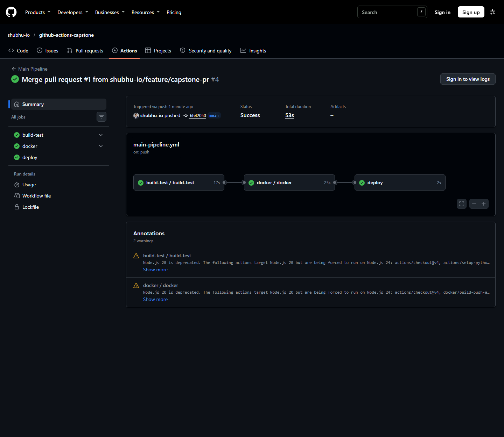
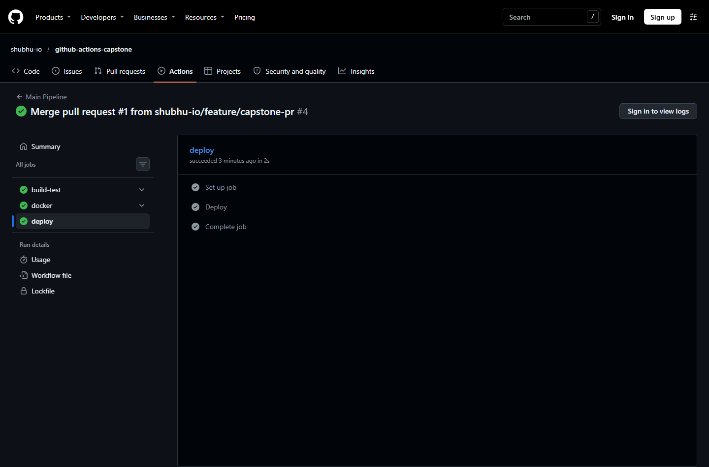
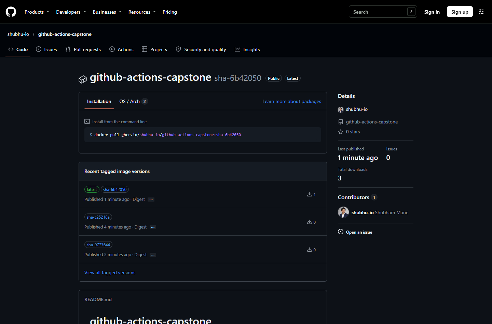

# Day 48 - GitHub Actions Project: End-to-End CI/CD Pipeline

This is the real, executed version of the Day 48 capstone. Every run linked below
happened on GitHub Actions, and every screenshot is a capture of that live repo.

- Repo: <https://github.com/shubhu-io/github-actions-capstone>
- Package: <https://github.com/shubhu-io/github-actions-capstone/pkgs/container/github-actions-capstone>
- Image: `ghcr.io/shubhu-io/github-actions-capstone:latest`

## Task

Wire everything from Days 40-47 into one pipeline:

1. Repo with an app, `Dockerfile` and a real test.
2. Reusable build & test workflow (`workflow_call`, inputs, `test_result` output).
3. Reusable Docker workflow (`workflow_call`, `image_url` output).
4. PR pipeline: tests only, never pushes an image.
5. Main pipeline: test → build & push → deploy behind a `production` environment.
6. Scheduled health check every 12 hours with a job summary.
7. Badges, architecture notes, and a list of next improvements.

## Environment

Measured on the machine that built this, not copied from docs:

| Tool | Version |
|---|---|
| `gh` | 2.103.3 (2026-10-26) |
| Docker | 29.9.3, build 5457199 |
| Git | 2.56.0.windows.4 |
| Python (local) | 3.15.2 |
| Flask (local venv) | 3.1.3 |
| Runner image (Actions) | `ubuntu-26.04` |
| Registry | GitHub Container Registry (`ghcr.io`) |

## Repo layout

```text
github-actions-capstone/
├── .github/workflows/
│   ├── reusable-build-test.yml
│   ├── reusable-docker.yml
│   ├── pr-pipeline.yml
│   ├── main-pipeline.yml
│   └── health-check.yml
├── app.py
├── test_app.py
├── requirements.txt
├── Dockerfile
└── README.md
```

## Solution

### Task 1: Project repo and app

`app.py`:

```python
from flask import Flask, jsonify

app = Flask(__name__)


@app.get("/")
def index():
    return jsonify(message="Hello from the capstone app v1.1!"), 200


@app.get("/health")
def health():
    return jsonify(status="ok"), 200


if __name__ == "__main__":
    app.run(host="0.0.0.0", port=8000)
```

`test_app.py` uses the stdlib `unittest` runner, so CI needs no test dependency:

```python
import unittest

from app import app


class HealthTest(unittest.TestCase):
    def setUp(self):
        self.client = app.test_client()

    def test_index(self):
        res = self.client.get("/")
        self.assertEqual(res.status_code, 200)

    def test_health(self):
        res = self.client.get("/health")
        self.assertEqual(res.status_code, 200)
        self.assertEqual(res.get_json(), {"status": "ok"})


if __name__ == "__main__":
    unittest.main()
```

`requirements.txt` and `Dockerfile`:

```text
flask>=3.0,<4.0
```

```dockerfile
FROM python:3.12-slim

WORKDIR /app
COPY requirements.txt .
RUN pip install --no-cache-dir -r requirements.txt
COPY app.py .

EXPOSE 8000
CMD ["python", "app.py"]
```

Local proof before trusting CI:

```text
> .\.venv\Scripts\python -m unittest -v
test_health (test_app.HealthTest.test_health) ... ok
test_index (test_app.HealthTest.test_index) ... ok
Ran 2 tests in 0.749s
OK

> curl http://127.0.0.1:8000/health
{"status":"ok"}

> curl http://127.0.0.1:8000/
{"message":"Hello from the capstone app v1.1!"}
```

### Task 2: Reusable build & test workflow

`.github/workflows/reusable-build-test.yml`:

```yaml
name: Reusable Build & Test

on:
  workflow_call:
    inputs:
      python_version:
        description: 'Python version to use'
        required: false
        type: string
        default: '3.12'
      run_tests:
        description: 'Whether to run tests'
        required: false
        type: boolean
        default: true
    outputs:
      test_result:
        description: 'passed or failed'
        value: ${{ jobs.build-test.outputs.test_result }}

jobs:
  build-test:
    runs-on: ubuntu-latest
    outputs:
      test_result: ${{ steps.result.outputs.test_result }}
    steps:
      - uses: actions/checkout@v4

      - uses: actions/setup-python@v5
        with:
          python-version: ${{ inputs.python_version }}

      - name: Install dependencies
        run: |
          python -m pip install --upgrade pip
          pip install -r requirements.txt

      - name: Run tests
        if: ${{ inputs.run_tests }}
        run: python -m unittest -v

      - name: Set test result output
        id: result
        run: echo "test_result=passed" >> "$GITHUB_OUTPUT"
```

If a test fails, the job exits non-zero before the output step, so the caller sees a
failed job instead of a stale `test_result`.

### Task 3: Reusable Docker build & push workflow

`.github/workflows/reusable-docker.yml`:

```yaml
name: Reusable Docker

on:
  workflow_call:
    inputs:
      image_name:
        description: 'Image name without registry, e.g. owner/repo'
        required: true
        type: string
      tag:
        description: 'Image tag'
        required: true
        type: string
      registry_username:
        description: 'Registry user that owns the image'
        required: true
        type: string
    secrets:
      docker_token:
        required: true
    outputs:
      image_url:
        description: 'Full pushed image path'
        value: ${{ jobs.docker.outputs.image_url }}

jobs:
  docker:
    runs-on: ubuntu-latest
    outputs:
      image_url: ${{ steps.meta.outputs.image_url }}
    steps:
      - uses: actions/checkout@v4

      - uses: docker/setup-buildx-action@v3

      - name: Log in to GitHub Container Registry
        uses: docker/login-action@v3
        with:
          registry: ghcr.io
          username: ${{ inputs.registry_username }}
          password: ${{ secrets.docker_token }}

      - name: Compute image tags
        id: meta
        run: |
          SHA=$(echo "${{ github.sha }}" | cut -c1-7)
          echo "image_url=ghcr.io/${{ inputs.image_name }}:${{ inputs.tag }}" >> "$GITHUB_OUTPUT"
          echo "sha_tag=ghcr.io/${{ inputs.image_name }}:sha-$SHA" >> "$GITHUB_OUTPUT"

      - name: Build and push
        uses: docker/build-push-action@v5
        with:
          context: .
          push: true
          tags: |
            ${{ steps.meta.outputs.image_url }}
            ${{ steps.meta.outputs.sha_tag }}
```

Every build produces two tags: a movable `latest` and an immutable `sha-<7>`.
Real log from the merge run:

```text
image.name: ghcr.io/shubhu-io/github-actions-capstone:latest,ghcr.io/shubhu-io/github-actions-capstone:sha-6b42050
```

### Task 4: PR pipeline (tests only)

`.github/workflows/pr-pipeline.yml`:

```yaml
name: PR Pipeline

on:
  pull_request:
    branches: [main]
    types: [opened, synchronize]

jobs:
  build-test:
    uses: ./.github/workflows/reusable-build-test.yml
    with:
      python_version: '3.12'
      run_tests: true

  pr-comment:
    needs: build-test
    runs-on: ubuntu-latest
    steps:
      - name: Summarize PR checks
        run: |
          echo "PR checks passed for branch: ${{ github.head_ref }} (test_result=${{ needs.build-test.outputs.test_result }})"
```

There is deliberately no docker job and no registry credential in this file.

Real run: [PR Pipeline #2](https://github.com/shubhu-io/github-actions-capstone/actions/runs/44673441396)
for PR [#1](https://github.com/shubhu-io/github-actions-capstone/pull/1), 20s total:

```text
pr-comment  PR checks passed for branch: feature/capstone-pr (test_result=passed)
```


### Task 5: Main pipeline (test → image → deploy)

`.github/workflows/main-pipeline.yml`:

```yaml
name: Main Pipeline

on:
  push:
    branches: [main]

permissions:
  contents: read
  packages: write

jobs:
  build-test:
    uses: ./.github/workflows/reusable-build-test.yml
    with:
      python_version: '3.12'
      run_tests: true

  docker:
    needs: build-test
    uses: ./.github/workflows/reusable-docker.yml
    with:
      image_name: ${{ github.repository }}
      tag: 'latest'
      registry_username: ${{ github.repository_owner }}
    secrets:
      docker_token: ${{ secrets.GITHUB_TOKEN }}

  deploy:
    needs: docker
    runs-on: ubuntu-latest
    environment: production
    steps:
      - name: Deploy
        run: |
          echo "Deploying image: ${{ needs.docker.outputs.image_url }} to production"
```

`permissions: packages: write` is what lets `GITHUB_TOKEN` push to GHCR. The
`production` environment was created once via the API and is what the deploy job
shows as its gate.

Real run on merge: [Main Pipeline #4](https://github.com/shubhu-io/github-actions-capstone/actions/runs/44673520831)
— `build-test` 17s → `docker` 25s → `deploy` 2s:

```text
Deploying image: ghcr.io/shubhu-io/github-actions-capstone:latest to production
```







### Task 6: Scheduled health check

`.github/workflows/health-check.yml`:

```yaml
name: Health Check

on:
  schedule:
    - cron: '0 */12 * * *'
  workflow_dispatch:

permissions:
  contents: read
  packages: read

jobs:
  health-check:
    runs-on: ubuntu-latest
    env:
      IMAGE: ghcr.io/${{ github.repository }}:latest
    steps:
      - name: Log in to GitHub Container Registry
        run: echo "${{ secrets.GITHUB_TOKEN }}" | docker login ghcr.io -u "${{ github.actor }}" --password-stdin

      - name: Pull latest image
        run: docker pull "$IMAGE"

      - name: Start container
        run: docker run -d --name app -p 8000:8000 "$IMAGE"

      - name: Wait and curl health endpoint
        id: check
        run: |
          sleep 5
          CODE=$(curl -s -o /dev/null -w "%{http_code}" http://localhost:8000/health)
          echo "http_code=$CODE" >> "$GITHUB_OUTPUT"
          if [ "$CODE" -eq 200 ]; then
            echo "Health check PASSED (HTTP $CODE)"
          else
            echo "Health check FAILED (HTTP $CODE)"
            exit 1
          fi

      - name: Write summary
        if: always()
        run: |
          echo "## Health Check Report" >> "$GITHUB_STEP_SUMMARY"
          echo "- Image: \`$IMAGE\`" >> "$GITHUB_STEP_SUMMARY"
          echo "- Status: ${{ steps.check.outputs.http_code == '200' && 'PASSED' || 'FAILED' }}" >> "$GITHUB_STEP_SUMMARY"
          echo "- Time: $(date -u)" >> "$GITHUB_STEP_SUMMARY"

      - name: Cleanup container
        if: always()
        run: docker rm -f app
```

Manual run: [Health Check #1](https://github.com/shubhu-io/github-actions-capstone/actions/runs/44673626638),
13s, all seven steps green:

```text
Health check PASSED (HTTP 200)
```


### Task 7: Badges and documentation

`README.md` carries live badges:

```markdown


```


Architecture as it actually runs:

```text
PR opened/synchronized
  └─ build-test (reusable) → pr-comment          # tests only, no image push

Push to main
  └─ build-test (reusable) → docker (reusable, GHCR latest + sha-*) → deploy (environment: production)

Every 12 hours / manual
  └─ health-check: pull image → run container → curl /health → job summary
```

## Live run history

| # | Workflow | Event | Result | Duration | Run |
|---|---|---|---|---|---|
| 2 | Main Pipeline | push | success | 1m 8s | [44673081060](https://github.com/shubhu-io/github-actions-capstone/actions/runs/44673081060) |
| 3 | Main Pipeline | push | success | 54s | [44673287154](https://github.com/shubhu-io/github-actions-capstone/actions/runs/44673287154) |
| 2 | PR Pipeline | pull_request | success | 20s | [44673441396](https://github.com/shubhu-io/github-actions-capstone/actions/runs/44673441396) |
| 4 | Main Pipeline | push (merge) | success | 53s | [44673520831](https://github.com/shubhu-io/github-actions-capstone/actions/runs/44673520831) |
| 1 | Health Check | workflow_dispatch | success | 17s | [44673626638](https://github.com/shubhu-io/github-actions-capstone/actions/runs/44673626638) |
| 5 | Main Pipeline | push | success | 43s | [44673876695](https://github.com/shubhu-io/github-actions-capstone/actions/runs/44673876695) |

## Commands used

```bash
# Local validation
python -m venv .venv
.venv/Scripts/python -m pip install -r requirements.txt
.venv/Scripts/python -m unittest -v
.venv/Scripts/python app.py
curl http://127.0.0.1:8000/health

# Repo + environment
gh repo create shubhu-io/github-actions-capstone --public
gh api -X PUT repos/shubhu-io/github-actions-capstone/environments/production

# PR path (tests only)
git checkout -b feature/capstone-pr
git commit -am "feat: bump greeting to v1.1"
git push -u origin feature/capstone-pr
gh pr create --base main --head feature/capstone-pr --title "feat: bump greeting to v1.1"
gh pr checks 1

# Main path (full chain)
gh pr merge 1 --merge --delete-branch
gh run watch

# Scheduled path
gh workflow run health-check.yml
gh run watch
```

## Verification

- Local `unittest` run: 2 tests, `OK`; live server returns `{"status":"ok"}` and `{"message":"Hello from the capstone app v1.1!"}`.
- PR #1 ran only `build-test` + `pr-comment` (20s). No docker job, no new package version.
- Merging PR #1 triggered `build-test` → `docker` → `deploy` (53s) and pushed `latest` + `sha-6b42050`.
- Deploy log printed the real image reference, not an empty value.
- Health Check #1 pulled the public image, ran the container, got HTTP 200 and reported `PASSED`.
- Package page shows three versions (`latest`/`sha-6b42050`, `sha-c25218a`, `sha-9777644`) and three downloads from the health-check runs.
- README badges render as passing for Main Pipeline and Health Check.

## Key learnings

- **YAML plain scalars cannot contain `: `.** `run: echo "Deploying image: $VAR"` is invalid YAML; GitHub reports a 0s "workflow file issue" with no jobs and no logs. Block scalars (`run: |`) avoid it. This actually broke the first push of both pipelines.
- `needs:` + reusable workflows compose cleanly: the caller reads `needs.docker.outputs.image_url` even though the value is produced inside a `workflow_call` job.
- GitHub **skips any output that contains a secret value**. Passing the username as a secret (`github.actor`) made `image_url` "secret" because the username appears in it, so deploy printed an empty image. Moving the username to an input fixed it while the token stayed secret.
- PR pipelines should be registry-blind; only `main` gets `packages: write`.
- `environment: production` must exist before the deploy job, otherwise the job fails at start.
- GHCR needs `permissions: packages: write` in the caller; `secrets.GITHUB_TOKEN` is enough for login, no long-lived PAT.
- Scheduled workflows only run from the default branch, and `workflow_dispatch` is the only sane way to test them.
- Badges for `pull_request`-only workflows report "failing" because no run exists on the default branch. Only badge workflows that run on `main`.

## Troubleshooting / gotchas

| Symptom | Cause | Fix |
|---|---|---|
| Run fails in 0s, "workflow file issue", no jobs | Plain YAML scalar contained `: ` (`echo "Deploying image: ..."`) | Use a block scalar |
| `needs.docker.outputs.image_url` empty in deploy | Output contained a masked secret value, so Actions skipped it | Pass registry user as an input, keep only the token secret |
| Docker Hub login fails with `unauthorized: incorrect username or password` | Stored token was expired (seen on the older practice repo) | Re-issue a token, or use GHCR with `GITHUB_TOKEN` |
| Deploy job fails immediately | `production` environment not created | Create it in Settings → Environments or via API |
| GHCR push denied | Caller workflow lacked `packages: write` | Add the permission block |
| Health check cannot pull | Package private and no login | `docker login ghcr.io` with `GITHUB_TOKEN`, plus `packages: read` |
| PR badge shows failing | `pull_request` workflow has no default-branch run | Badge only push/schedule workflows |
| Cron never fires | Workflow not on default branch / repo idle 60 days | Merge to `main`, keep activity, test with `workflow_dispatch` |

## Deviations from the brief

1. **Registry is GHCR, not Docker Hub.** The Docker Hub credentials on the existing
   practice repo failed with `unauthorized` (run
   [42465725283](https://github.com/shubhu-io/github-actions-practice/actions/runs/42465725283)).
   GHCR with `GITHUB_TOKEN` gives a real, working push with no long-lived secret.
2. **`docker_username` is an input, not a secret.** Keeping it secret caused GitHub to
   mask the pushed image URL. Only `docker_token` is a secret now.
3. **PR badge removed.** A `pull_request`-only workflow has no default-branch run to
   report, so its badge lies.

## What I would add next

| Improvement | Why |
|---|---|
| Slack/Teams alert on `failure()` | Learn about red `main` in seconds |
| `staging` environment before `production` | Canary before the front door |
| Trivy scan gating the push | No CRITICAL CVE reaches the registry (Day 49) |
| Auto-rollback to previous `sha-*` on health failure | Recover without a human |
| OIDC to a cloud provider | No long-lived cloud keys |
| Nightly dependency updates | Keep the base image and Flask current |

## Screenshots

All captures are of the live public repo, taken after the runs above:

- `actions-pr-pipeline.png` — PR Pipeline #2, tests only
- `actions-pr-merged.png` — PR #1 merged with both checks green
- `actions-main-pipeline.png` — Main Pipeline #4, three-job chain
- `actions-deploy-job.png` — deploy job steps
- `ghcr-package-versions.png` — GHCR package versions and download count
- `actions-health-check.png` — Health Check #1, all steps green
- `readme-badges.png` — repo README with passing badges
