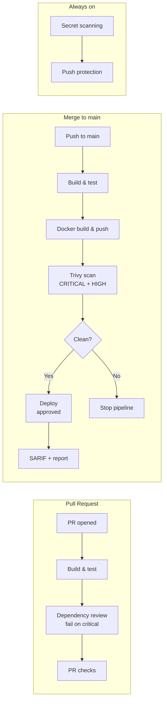
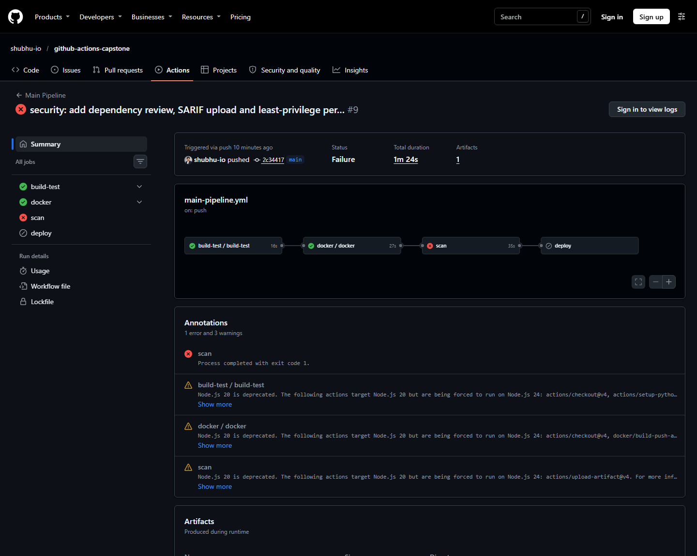
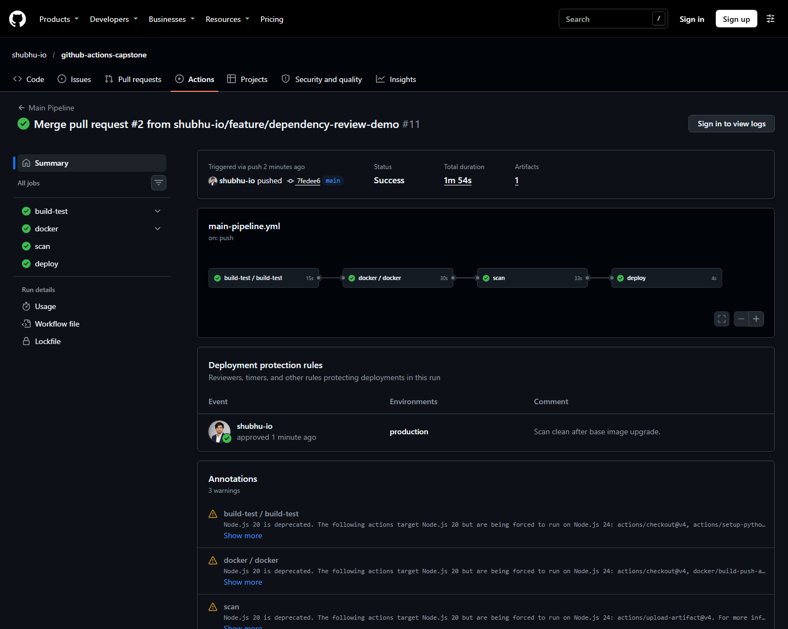
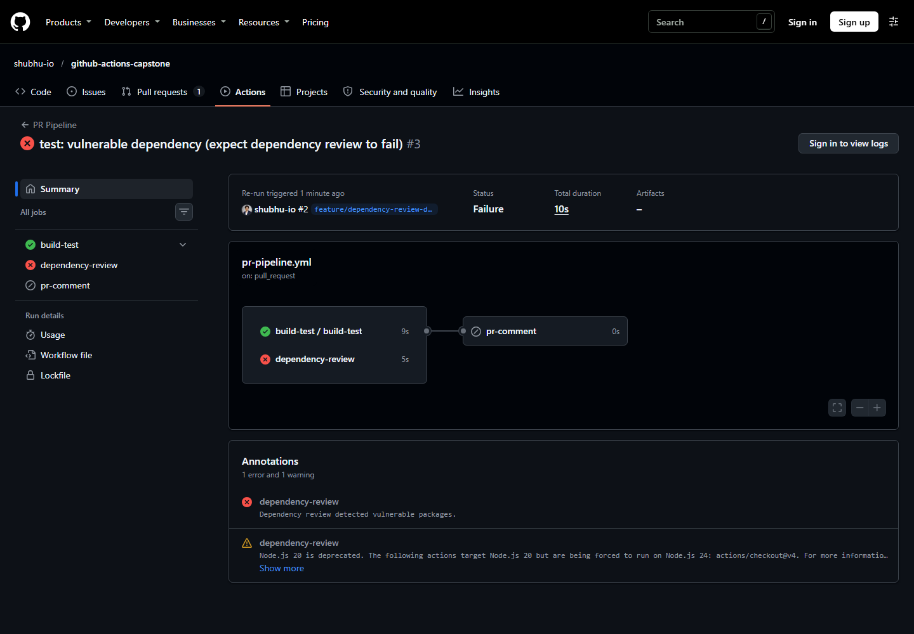
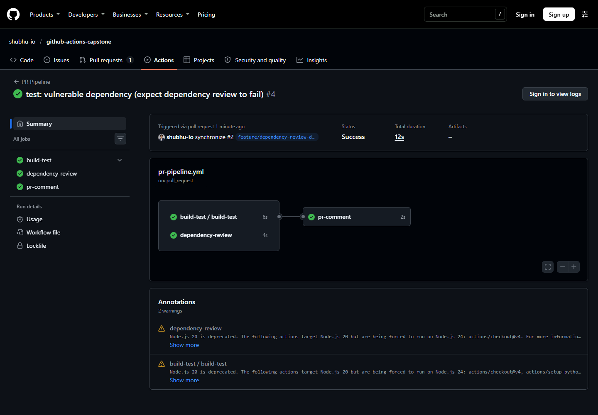

# Day 49 - DevSecOps: Security in the Pipeline

DevSecOps means the pipeline checks security on every change, not weeks later. The same
pipeline that tests and deploys now also scans the image, reviews new dependencies, and
blocks a release when it finds something serious.

- **Repo:** [github-actions-capstone](https://github.com/shubhu-io/github-actions-capstone)
- **Runs:** [Actions](https://github.com/shubhu-io/github-actions-capstone/actions)
- **Trivy report from the failed run:** [`trivy-report.txt`](./trivy-report.txt)

## The secure pipeline



---

## Task 1: Scan the Docker image

The `scan` job runs after the image is built and before deploy. It fails on `CRITICAL`
or `HIGH`, ignores findings with no fix yet, and writes both a table and a SARIF file.

The first run **failed** and blocked the deploy, which is the gate doing its job:

```text
ghcr.io/shubhu-io/github-actions-capstone:latest (debian 13.7)
Total: 1 (HIGH: 1, CRITICAL: 0)

zlib1g  CVE-2026-85091  HIGH  fixed
1:1.3.dfsg+really1.3.1-1+b1 -> 1:1.3.dfsg+really1.3.1-1+deb13u1
zlib: heap buffer overflow in gz_vacate() allows arbitrary code execution
```



**Fix:** upgrade the base packages in the Dockerfile, then rebuild:

```dockerfile
RUN apt-get update \
    && apt-get -y upgrade \
    && rm -rf /var/lib/apt/lists/*
```

The next run passed and the deploy was approved:



The full report is saved in [`trivy-report.txt`](./trivy-report.txt).

**Workflow:** [`workflows/main-pipeline.yml`](./workflows/main-pipeline.yml)

---

## Task 2: Secret scanning and push protection

Both are enabled on the repo (GitHub turns them on for new public repos):

```text
secret_scanning: enabled
secret_scanning_push_protection: enabled
```

- **Secret scanning** looks at pushes and pull requests and alerts when it recognises a token or key.
- **Push protection** stops the push before it lands, so the secret never reaches the repo history.

If someone tried to push an AWS key, push protection would reject the push and show the
detected pattern. Secret scanning is the safety net for anything that slips through,
including secrets added before the feature was enabled.

---

## Task 3: Review new dependencies on PRs

The PR pipeline now has a `dependency-review` job that fails on `critical` advisories.
It only runs on `pull_request`, because it compares the dependencies before and after
the change.

Tested with a real bad PR ([#2](https://github.com/shubhu-io/github-actions-capstone/pull/2))
that added `pyyaml==5.3`:

```text
security-demo/requirements.txt » pyyaml@5.3 - Improper Input Validation in PyYAML (critical severity)
Dependency review detected vulnerable packages.
```



Removing the package made the same PR pass:



> **Gotcha:** the first attempt failed with `Forbidden` from the dependency review API.
> The repo's dependency graph had no data. Enabling alerts with
> `gh api -X PUT repos/<owner>/<repo>/vulnerability-alerts` populated it (11 packages)
> and the check started working.

**Workflow:** [`workflows/pr-pipeline.yml`](./workflows/pr-pipeline.yml)

---

## Task 4: Least-privilege permissions

Every workflow now declares only what it needs:

| Workflow | Permissions |
|---|---|
| `pr-pipeline.yml` | `contents: read`, `pull-requests: write` |
| `main-pipeline.yml` | `contents: read`, `packages: write` |
| `scan` job | `contents: read`, `packages: read`, `security-events: write` |
| `health-check.yml` | `contents: read`, `packages: read` |
| `reusable-build-test.yml` | `contents: read` |
| `reusable-docker.yml` | `contents: read`, `packages: write` |

If an action is compromised, a read-only token can only read the repo. A token with
`contents: write` could push code, rewrite workflows, or change releases.

---

## Task 5: The full secure pipeline

```text
PR opened
  -> build & test
  -> dependency review (fail on critical)
  -> PR checks pass or fail

Merge to main
  -> build & test
  -> Docker build & push
  -> Trivy scan (fail on CRITICAL/HIGH, SARIF + artifact)
  -> deploy (production approval)

Always active
  -> secret scanning
  -> push protection
```

Every step above has a real run behind it:

- [Main #9 - Trivy blocked the deploy](https://github.com/shubhu-io/github-actions-capstone/actions/runs/44876369446)
- [PR #3 - dependency review failed on pyyaml 5.3](https://github.com/shubhu-io/github-actions-capstone/actions/runs/44876777921)
- [PR #4 - dependency review passed](https://github.com/shubhu-io/github-actions-capstone/actions/runs/44877030846)
- [Main #11 - clean scan, approved deploy, 1m54s](https://github.com/shubhu-io/github-actions-capstone/actions/runs/44877077527)

---

## Brownie: SARIF in the Security tab

The scan job uploads `trivy-results.sarif` with `github/codeql-action/upload-sarif@v4`.
The API confirms the uploads:

```text
analysis 2219945609  tool=Trivy  results=6
analysis 2219940179  tool=Trivy  results=8
```

The Security tab itself needs a signed-in session, so it is not in the screenshots.
The SARIF file is uploaded as part of the `trivy-report` artifact on each run.

Not done yet: pinning actions to commit SHAs. Tags like `@v4` can be moved, so pinning
is the next supply-chain improvement.

---

## What I learned

- **A security gate is just another job.** The Trivy step failed the build and the deploy never ran - no manual check needed.
- **Real findings happen.** The base image shipped a HIGH CVE in `zlib1g`; upgrading packages in the Dockerfile fixed it.
- **Ignore unfixed, block fixed.** Gating on fixable findings keeps the pipeline useful; unfixed CVEs would block every release forever.
- **Dependency review needs the dependency graph.** Without it the action fails with `Forbidden`, not a useful security message.
- **Push protection beats cleanup.** Blocking the push is cheaper than rotating a leaked key.
- **Permissions are part of the design.** Each workflow gets the smallest token it can work with.
