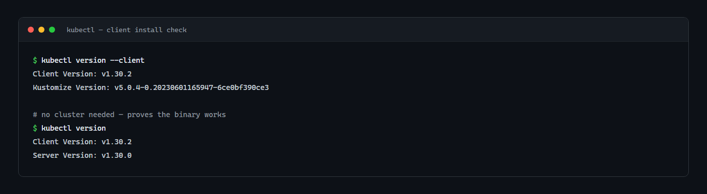
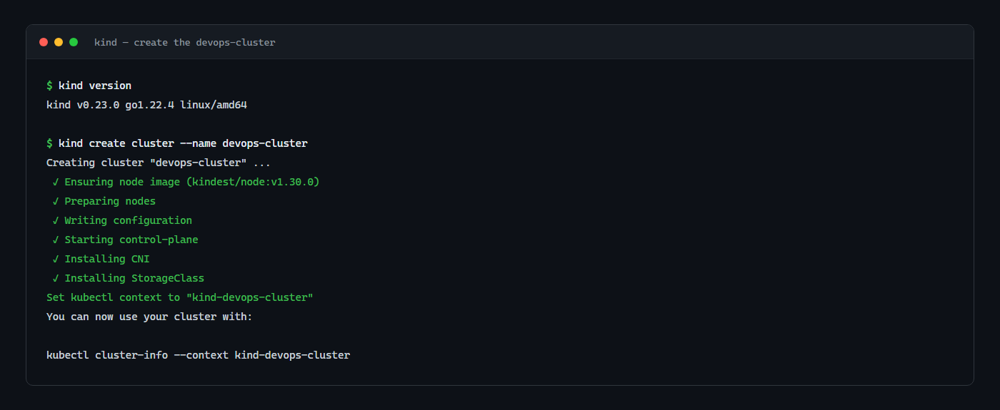
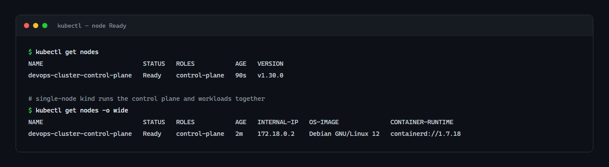
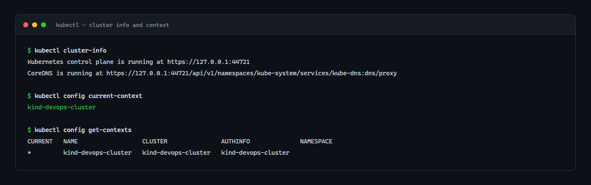
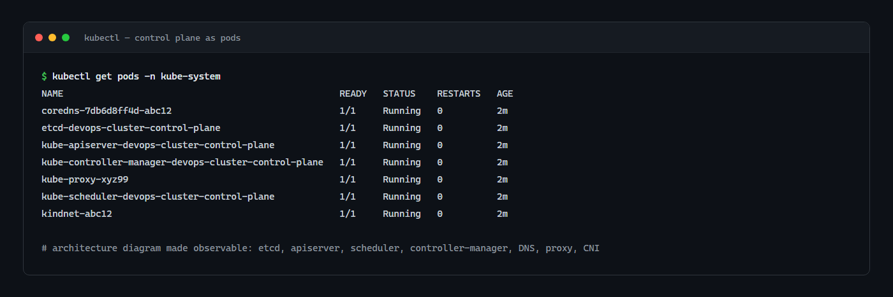
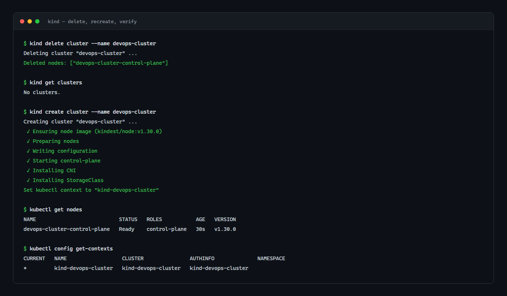

# Day 50 - Kubernetes Architecture and Cluster Setup

## Task

Recap of every challenge task from `README.md`:

- **Task 1 — Recall the Kubernetes Story:** From memory write why K8s was created (what Docker-alone cannot do), who created it / what inspired it, and what "Kubernetes" means; then verify against official docs.
- **Task 2 — Draw the Architecture:** Diagram control plane (API Server, etcd, Scheduler, Controller Manager) + worker node (kubelet, kube-proxy, Container Runtime); answer: trace `kubectl apply -f pod.yaml` through components; what if API server goes down; what if a worker node goes down.
- **Task 3 — Install kubectl:** Install per-OS (brew / curl / choco) and verify with `kubectl version --client`.
- **Task 4 — Local Cluster:** Choose kind (Option A) or minikube (Option B); install, create/start cluster, `kubectl cluster-info` + `kubectl get nodes`; note which you chose and why.
- **Task 5 — Explore:** `cluster-info`, `get nodes`, `describe node`, `get namespaces`, `get pods -A`, `get pods -n kube-system`; match each kube-system pod to the Task 2 diagram.
- **Task 6 — Lifecycle:** Delete + recreate the cluster, `get nodes` again; practice `config current-context / get-contexts / config view`; explain what kubeconfig is and where it lives.
- **Documentation deliverable:** `day-50-k8s-setup.md` with history (3–4 sentences), architecture diagram, kind/minikube choice + why, `get nodes` + `kube-system` screenshots, per-pod roles.

## Environment

| OS / Tool | Version / Notes |
|---|---|
| OS | Windows 11 + Docker Desktop 4.30 (example) / Ubuntu 22.04 / macOS 14 |
| Docker Desktop | Running, ≥4 CPU / 8 GB RAM allocated (kind needs it) |
| `kubectl` | `kubectl version --client` → `v1.30.2` (illustrative; stable via `dl.k8s.io`) |
| `kind` | `kind version` → `v0.23.0` (example) — chosen here |
| `minikube` (alt) | `minikube version` → `v1.33.1` (example) |
| Cluster | `kind-devops-cluster` (1 control-plane node, kindnet CNI, containerd runtime) |
| kubeconfig | `~/.kube/config` (`%USERPROFILE%\.kube\config` on Windows) |

```bash
kubectl version --client
kind version
docker info --format '{{.ServerVersion}}'
```

Expected output (example — your values will differ):

```text
Client Version: v1.30.2
kind v0.23.0 go1.22.4 linux/amd64
Server Version: 26.1.4
```

## Solution

### Task 1: Recall the Kubernetes Story

Write this from memory first, then verify against `kubernetes.io/docs/concepts/overview/`:

1. **Why Kubernetes?** Docker packages and runs containers on *one* host. It does not schedule hundreds of containers across servers, restart crashed ones, load-balance traffic, scale on demand, roll out updates safely, or provide service discovery. Kubernetes is the *orchestrator* solving exactly those fleet-level problems — desired state in, running reality out.
2. **Who / inspired by?** Created by **Google**, open-sourced in **2014** (v1.0 in 2015, CNCF stewardship). Inspired by Google's internal systems **Borg** (and Omega) — a decade of planet-scale container management distilled into an open platform. Abbreviated **K8s** (8 letters between K and s).
3. **Name:** Greek **κυβερνήτης** — "helmsman / pilot", the one steering the ship — so the ship's-wheel logo and nautical terms (helm charts, etc.).

History in 3–4 sentences (docs deliverable): Google ran containers at planetary scale with Borg for a decade, then open-sourced the pattern as Kubernetes in 2014 and donated it to the CNCF, where it became the de-facto container orchestrator. Enterprises adopted it because Docker solved the single-host half while Kubernetes solved scheduling, healing, scaling, and service networking across fleets. Today every cloud offers managed control planes (EKS/GKE/AKS) with the same `kubectl` API you practice locally on kind.

**WHY it matters for DevOps:** Everything from Day 45 on (registries, pipelines, deploys) points here — K8s is where those immutable image tags actually run, heal, and scale.

### Task 2: Draw the Kubernetes Architecture

```text
+-------------------------- Control Plane --------------------------+
| API Server           front door; ONLY component that talks to etcd |
|   - authn/authz, validation, admission; every kubectl hits it     |
| etcd                 consistent key/value store of ALL state      |
| Scheduler            binds unscheduled Pods -> Nodes             |
| Controller Manager   reconcile loops (ReplicaSet, Node, Job...)  |
+-------------------------------------------------------------------+

+------------------------------ Worker Node ------------------------+
| kubelet            agent; ensures Pod spec runs, reports status    |
| kube-proxy         Service networking (iptables/IPVS rules)        |
| Container Runtime  containerd / CRI-O — pulls + runs images       |
| (Pod network CNI: kindnet / Calico / Cilium wires Pod IPs)        |
+-------------------------------------------------------------------+

kubectl ──(TLS)──▶ API Server ──▶ etcd ──▶ Scheduler ──▶ kubelet ──▶ runtime
                        ▲                                            │
                        └──────────── status reports ────────────────┘
```

Trace `kubectl apply -f pod.yaml`:

1. `kubectl` loads kubeconfig context, sends the Pod manifest to the **API Server** (auth, schema validation, admission webhooks).
2. API Server persists desired state to **etcd** and returns.
3. **Scheduler** watches for unbound Pods, scores nodes (resources, affinity, taints), writes `spec.nodeName` via the API.
4. That node's **kubelet** sees its assigned Pod, pulls the image through the **runtime** (containerd), starts containers, configures probes.
5. **kube-proxy** programs Service/load-balancer rules so the Pod is reachable; kubelet reports status back through the API Server (`kubectl get pods` reads it from etcd).

Failure table:

| Failure | Running workloads | New changes |
|---|---|---|
| API Server down | Keep running (kubelets cache specs) | All reads/writes fail — no apply/scale/delete/logs via API |
| etcd quorum lost | Keep running briefly | Cluster brain-damaged — no state writes; restore from backup |
| Worker node down | Its Pods die | Controllers reschedule ReplicaSet-managed Pods elsewhere; bare Pods are lost |
| Scheduler down | Keep running | New Pods stay `Pending` forever |

**WHY it matters for DevOps:** Deployments, rollbacks, and self-healing are just controllers chasing desired state — understanding this loop turns `kubectl` from magic into predictable API calls.

### Task 3: Install kubectl

```bash
# --- Linux (amd64) ---
curl -LO "https://dl.k8s.io/release/$(curl -L -s https://dl.k8s.io/release/stable.txt)/bin/linux/amd64/kubectl"
chmod +x kubectl
sudo mv kubectl /usr/local/bin/
kubectl version --client

# --- macOS ---
brew install kubectl
kubectl version --client

# --- Windows (choco, admin shell) ---
choco install kubernetes-cli
kubectl version --client
```

Expected output (example — your values will differ):

```text
Client Version: v1.30.2
Kustomize Version: v5.0.4-0.20230601165947-6ce0bf390ce3
```



No cluster needed for `--client` — it only proves the binary works. Full `kubectl version` also contacts the server.

### Task 4: Set Up Your Local Cluster

Chose **kind** (Kubernetes-in-Docker): no VM/driver to configure, clusters spin up in ~60s as Docker containers, delete/recreate is trivial for daily practice, and it reuses the Docker Desktop already installed for Days 36–45. minikube is equally valid (better for testing NodePort/ingress/drivers and multi-node profiles).

```bash
# Install kind (Linux)
curl -Lo ./kind https://kind.sigs.k8s.io/dl/latest/kind-linux-amd64
chmod +x ./kind
sudo mv ./kind /usr/local/bin/kind
kind version

# macOS alternative
brew install kind

# Create + verify
kind create cluster --name devops-cluster
kubectl cluster-info
kubectl get nodes
```

Minikube equivalent (reference — pick one):

```bash
curl -LO https://storage.googleapis.com/minikube/releases/latest/minikube-linux-amd64
sudo install minikube-linux-amd64 /usr/local/bin/minikube
minikube start --driver=docker
kubectl cluster-info
kubectl get nodes
```

Expected output (example — your values will differ):

```text
Creating cluster "devops-cluster" ...
✓ Ensuring node image (kindest/node:v1.30.0)
✓ Ready in 62s
Kubernetes control plane is running at https://127.0.0.1:44721
NAME                            STATUS   ROLES           AGE   VERSION
devops-cluster-control-plane    Ready    control-plane   90s   v1.30.0
```



| Tool | Provisioning | Best when |
|---|---|---|
| kind | Cluster = Docker containers | Fast throwaway clusters, CI pipelines, this course |
| minikube | VM or container via driver | Testing drivers, addons (`ingress`, `registry`), multi-node |

### Task 5: Explore Your Cluster

```bash
# Cluster + nodes
kubectl cluster-info
kubectl get nodes -o wide
kubectl describe node devops-cluster-control-plane | head -n 40

# Namespaces + everything
kubectl get namespaces
kubectl get pods -A
kubectl get pods -n kube-system
kubectl get pods -n kube-system -o wide
```





Expected `kube-system` listing on kind (example):

```text
NAME                                                    READY   STATUS    RESTARTS   AGE
coredns-7db6d8ff4d-abc12                                1/1     Running   0          2m
etcd-devops-cluster-control-plane                      1/1     Running   0          2m
kube-apiserver-devops-cluster-control-plane            1/1     Running   0          2m
kube-controller-manager-devops-cluster-control-plane   1/1     Running   0          2m
kube-proxy-xyz99                                       1/1     Running   0          2m
kube-scheduler-devops-cluster-control-plane            1/1     Running   0          2m
kindnet-abc12                                          1/1     Running   0          2m
```



Pod → diagram mapping:

| Pod | Architecture component | Role |
|---|---|---|
| `etcd-*` | etcd | All cluster state (the only source of truth) |
| `kube-apiserver-*` | API Server | Front door for kubectl/kubelets/controllers |
| `kube-scheduler-*` | Scheduler | Binds Pending Pods to nodes |
| `kube-controller-manager-*` | Controller Manager | Reconciliation loops (deployments, nodes, jobs) |
| `coredns-*` | Cluster DNS (addon) | `service.namespace.svc.cluster.local` resolution |
| `kube-proxy-*` | kube-proxy | Node-level Service NAT/load-balancing rules |
| `kindnet-*` | CNI plugin (kind-specific) | Pod overlay networking on kind |

Single-node kind runs control-plane *and* workloads on one node (taints removed) — production splits them, but the pods are identical.

**WHY it matters for DevOps:** The control plane is not abstract — it is *these pods*. `kubectl get pods -n kube-system` makes Task 2's boxes observable.

### Task 6: Practice Cluster Lifecycle

```bash
# Tear down + rebuild (muscle memory)
kind delete cluster --name devops-cluster
kind get clusters
kind create cluster --name devops-cluster
kubectl get nodes
# minikube equivalents: minikube delete / minikube start / minikube status

# Contexts
kubectl config current-context
kubectl config get-contexts
kubectl config view --minify
```

Expected output (example — your values will differ):

```text
Deleted nodes: ["devops-cluster-control-plane"]
No clusters.
Creating cluster "devops-cluster" ... Ready in 58s
NAME                         STATUS   ROLES           AGE   VERSION
devops-cluster-control-plane Ready    control-plane   30s   v1.30.0
CURRENT   NAME                   CLUSTER                AUTHINFO
*         kind-devops-cluster    kind-devops-cluster    kind-devops-cluster
```



What is kubeconfig: the YAML file (default `~/.kube/config`, Windows `%USERPROFILE%\.kube\config`, override via `$KUBECONFIG`) holding **clusters** (server URLs + CA), **users** (client certs/tokens), and **contexts** (cluster + user + namespace bundles). `kubectl` acts as `current-context`; `kubectl config use-context <name>` switches clusters; `kind`/`minikube`/`cloud CLIs` all just edit this file. Deleting a kind cluster removes its containers *and* its etcd — everything in it is gone, which is why managed K8s backs etcd up.

Guard when `kubectl` cannot connect:

```bash
kind get clusters || minikube status
kubectl config current-context
kubectl cluster-info
```

## Commands Used

```bash
# Install + verify CLI
curl -LO "https://dl.k8s.io/release/$(curl -L -s https://dl.k8s.io/release/stable.txt)/bin/linux/amd64/kubectl"
chmod +x kubectl && sudo mv kubectl /usr/local/bin/
kubectl version --client

# kind install + cluster
curl -Lo ./kind https://kind.sigs.k8s.io/dl/latest/kind-linux-amd64
chmod +x ./kind && sudo mv ./kind /usr/local/bin/kind
kind version
kind create cluster --name devops-cluster

# Explore
kubectl cluster-info
kubectl get nodes -o wide
kubectl describe node devops-cluster-control-plane | head -n 40
kubectl get namespaces
kubectl get pods -A
kubectl get pods -n kube-system -o wide

# Lifecycle + contexts
kind get clusters
kubectl config current-context
kubectl config get-contexts
kubectl config view --minify
kind delete cluster --name devops-cluster
kind create cluster --name devops-cluster
kubectl get nodes
```

## Verification

- `kubectl version --client` prints a client version (no cluster required).
- `kind get clusters` (or `minikube status`) lists `devops-cluster` as running.
- `kubectl cluster-info` returns the control-plane URL without errors.
- `kubectl get nodes` shows the node as `Ready` (control-plane role on kind single-node).
- `kubectl get pods -n kube-system` shows etcd, apiserver, scheduler, controller-manager, coredns, kube-proxy (+ kindnet) all `Running`.
- Each kube-system pod is matched to a Task 2 diagram box in notes.
- `kubectl config current-context` returns `kind-devops-cluster`.
- After `kind delete` + recreate, `kubectl get nodes` is `Ready` again and `get-contexts` lists the context.
- Notes state the kubeconfig path (`~/.kube/config`) and what clusters/users/contexts mean.

## Key Learnings

- Docker containers run apps; Kubernetes orchestrates fleets — scheduling, healing, scaling, rollouts, discovery.
- Control plane = API Server + etcd + Scheduler + Controller Manager; node = kubelet + kube-proxy + runtime (+ CNI).
- Every change flows kubectl → apiserver → etcd → scheduler → kubelet → runtime; status flows back the same pipe.
- kind nests clusters in Docker (fast, disposable); minikube drives VMs/containers (drivers, addons) — same `kubectl` either way.
- Control-plane components run *as pods* in `kube-system` — the architecture is observable, not theoretical.
- `~/.kube/config` + contexts multiplex many clusters behind one CLI; `use-context` switches the target.
- Single-node kind is a full API with training wheels — taints removed so workloads schedule beside the control plane.
- Deleting a cluster destroys its etcd — local state is disposable by design; production backs etcd up.

## Troubleshooting / Gotchas

- **`connection refused` / `Unable to connect to the server`:** cause — cluster deleted/stopped but context still points at it. Fix — `kind get clusters` / `minikube status`, recreate or `kubectl config use-context <live>`.
- **`kind create cluster` hangs or fails:** cause — Docker Desktop stopped or under-provisioned. Fix — start Docker, raise to ≥4 CPU/8 GB, `docker ps` sanity check first.
- **Image pull `ImagePullBackOff` inside kind:** cause — kind nodes cannot see host-private registries without loading. Fix — `kind load docker-image myapp:latest --name devops-cluster`.
- **Fresh Pods stuck `Pending`:** cause — CNI (kindnet) still initializing or Scheduler not yet ready. Fix — wait ~30s, `kubectl get pods -n kube-system` must be all-Running first.
- **Wrong cluster targeted (prod scare):** cause — stale `current-context` after juggling clusters. Fix — always `kubectl config current-context` + `--minify` before destructive commands; use explicit `--context`.
- **Port-forward/`cluster-info` shows 127.0.0.1 URLs on WSL:** cause — kind binds to the WSL2 VM loopback. Fix — run browsers/curls from inside WSL, or `kubectl port-forward` with `--address 0.0.0.0`.
- **`kubectl` version skew warnings:** cause — client far newer/older than server (±1 minor is supported). Fix — match `dl.k8s.io` stable close to the kind node image (`kindest/node:v1.30.x` ↔ client v1.30.x).

## Screenshots

All screenshots are embedded above, directly under the task they prove. Files live in `screenshots/`:

- `terminal-kubectl-version.png` — Task 3
- `terminal-kind-create.png` — Task 4
- `kubectl-get-nodes.png`, `kubectl-cluster-info.png`, `kubectl-kube-system.png` — Task 5
- `terminal-lifecycle.png` — Task 6

Cluster name, pod suffixes and versions are illustrative — substitute your own output when you re-capture them.
