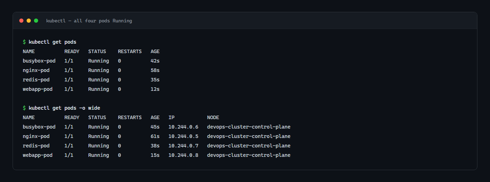
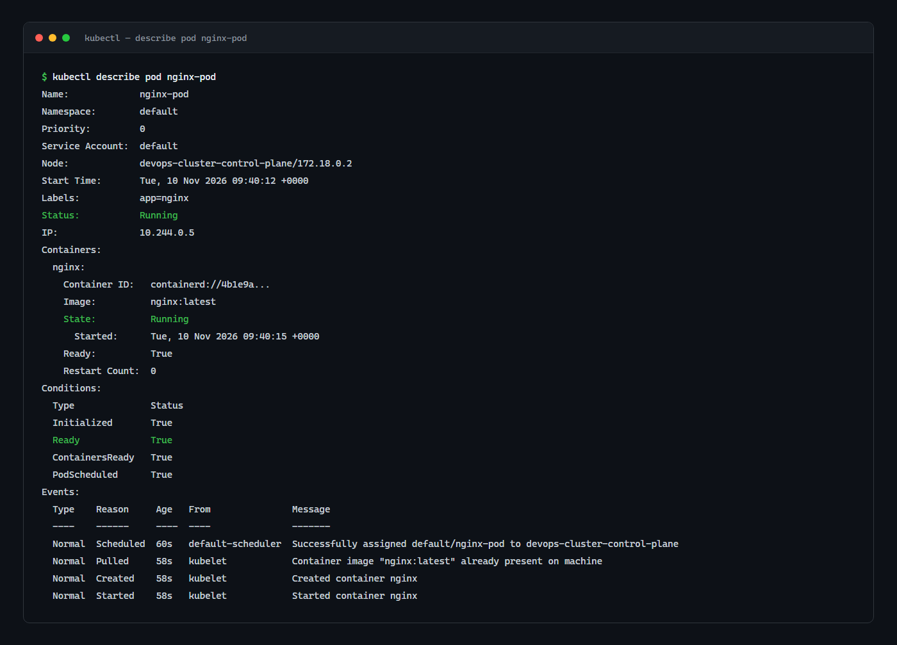
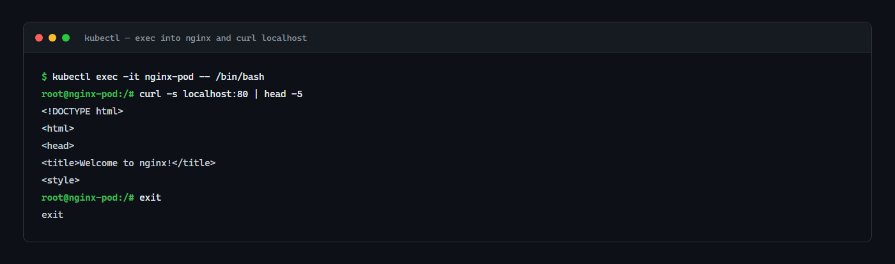
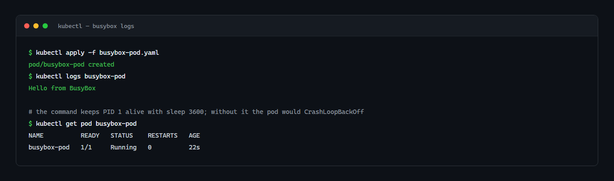
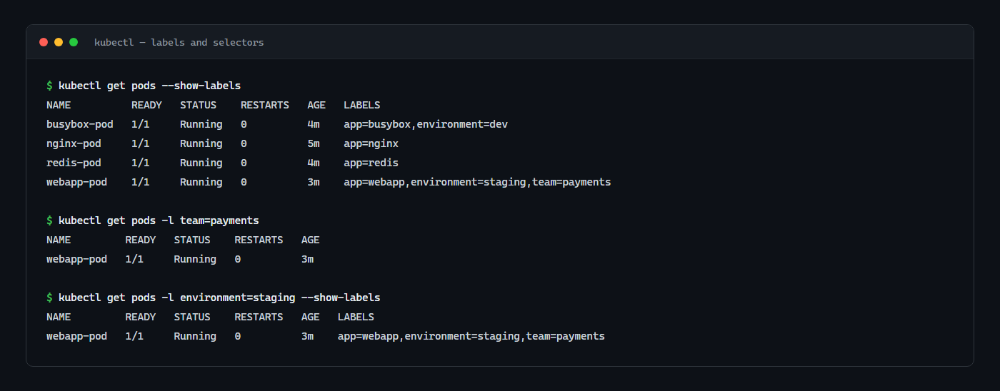
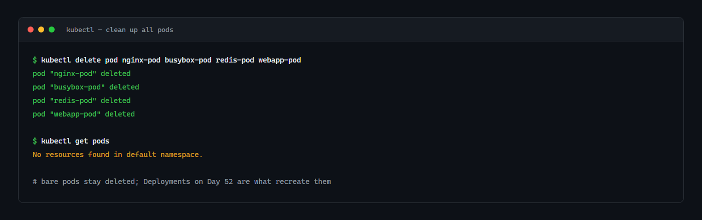

# Day 51 - Kubernetes Manifests and Your First Pods

## Task
- Task 1: Create your first Pod (`nginx-pod.yaml` with nginx:latest), apply it, and explore with `describe`, `logs`, and `exec` + in-pod `curl`.
- Task 2: Write a custom Pod from scratch (`busybox-pod.yaml` with `command` keeping it alive) and verify `Hello from BusyBox` in logs.
- Task 3: Compare imperative (`kubectl run`, `kubectl get -o yaml`, `--dry-run=client -o yaml`) vs declarative (`kubectl apply -f`) workflows.
- Task 4: Validate manifests before applying with `--dry-run=client` / `--dry-run=server`, including an intentionally broken manifest.
- Task 5: Practice Pod labels and filtering (`--show-labels`, `-l`, `kubectl label`), plus a third Pod with at least 3 labels (app, environment, team).
- Task 6: Clean up all Pods and observe that a standalone Pod is gone forever (motivation for Deployments on Day 52).

## Environment

| OS / Tool | Version / Notes |
|---|---|
| OS | Windows 11 + Docker Desktop (WSL2 backend), run on 2026-11-23 |
| Docker | Server 29.9.3 (kind needs a running Docker daemon) |
| `kubectl` | Client `v1.36.1`, server `v1.34.0` (kubectl prints a minor-version-skew warning) |
| `kind` | `v0.30.0`, cluster `devops-cluster` from Day 50 |
| Cluster | 1 control-plane node `devops-cluster-control-plane`, kindnet CNI, containerd `2.1.3` |
| Images | nginx:latest, busybox:latest, redis:latest |

```bash
kubectl version --output=yaml
kind version
kubectl get nodes -o wide
```

```text
clientVersion:
  gitVersion: v1.36.1
  platform: windows/amd64
serverVersion:
  gitVersion: v1.34.0
kind v0.30.0 go1.24.6 windows/amd64

NAME                           STATUS   ROLES           AGE   VERSION   INTERNAL-IP   OS-IMAGE                         CONTAINER-RUNTIME
devops-cluster-control-plane   Ready    control-plane   32s   v1.34.0   172.19.0.2    Debian GNU/Linux 12 (bookworm)   containerd://2.1.3
```

## Solution

### Manifest anatomy (the four required fields)

Every Kubernetes resource is a YAML manifest with four top-level fields:

```yaml
apiVersion: v1          # which API group/version serves this resource
kind: Pod               # resource type
metadata:               # identity: name (required), labels, namespace
  name: my-pod
  labels:
    app: my-app
spec:                   # desired state: containers, images, ports
  containers:
  - name: my-container
    image: nginx:latest
    ports:
    - containerPort: 80
```

| Field | What it does | Pod value today | Later values |
|---|---|---|---|
| `apiVersion` | Which API group serves the resource | `v1` | `apps/v1` (Deployment), `v1` (Service) |
| `kind` | Resource type | `Pod` | `Deployment`, `Service`, `ConfigMap` |
| `metadata` | Identity: `name` (required), `labels`, `namespace` | `name: nginx-pod` | Same shape everywhere |
| `spec` | Desired state (what you want running) | `containers[]` | Replicas, selector, template |

- For Pods `apiVersion` is always `v1` (later: `apps/v1` for Deployments, etc.).
- `labels` are user-defined key-values - Kubernetes itself ignores their meaning; selectors use them.
- **WHY it matters:** every Day 52-60 manifest reuses this skeleton. Learn it once, read any resource.

### Task 1: Create Your First Pod (Nginx)

`nginx-pod.yaml` (matches the file in this folder):

```yaml
apiVersion: v1
kind: Pod
metadata:
  name: nginx-pod
  labels:
    app: nginx
spec:
  containers:
  - name: nginx
    image: nginx:latest
    ports:
    - containerPort: 80
```

```bash
kubectl apply -f nginx-pod.yaml
kubectl get pods
kubectl get pods -o wide
kubectl describe pod nginx-pod
kubectl logs nginx-pod
kubectl exec -it nginx-pod -- /bin/bash
# inside the container:
curl -s localhost:80 | head -5
exit
```

All four pods from today's tasks were applied together, so `get pods` shows them side by side:

```text
NAME          READY   STATUS    RESTARTS   AGE
busybox-pod   1/1     Running   0          33s
nginx-pod     1/1     Running   0          33s
redis-pod     1/1     Running   0          32s
webapp-pod    1/1     Running   0          32s
```

```text
NAME          READY   STATUS    RESTARTS   AGE   IP           NODE
busybox-pod   1/1     Running   0          33s   10.244.0.6   devops-cluster-control-plane
nginx-pod     1/1     Running   0          33s   10.244.0.5   devops-cluster-control-plane
redis-pod     1/1     Running   0          32s   10.244.0.8   devops-cluster-control-plane
webapp-pod    1/1     Running   0          32s   10.244.0.7   devops-cluster-control-plane
```

(The trailing `NOMINATED NODE` / `READINESS GATES` columns were trimmed here for width.)

`describe` excerpt - the pod is scheduled, the image is pulled, and the container is running:

```text
Name:             nginx-pod
Namespace:        default
Node:             devops-cluster-control-plane/172.19.0.2
Start Time:       Mon, 23 Nov 2026 17:19:12 +0530
Labels:           app=nginx
Status:           Running
IP:               10.244.0.5
Containers:
  nginx:
    Image:          nginx:latest
    Port:           80/TCP
    State:          Running
      Started:      Mon, 23 Nov 2026 17:19:29 +0530
    Ready:          True
    Restart Count:  0
QoS Class:         BestEffort
Events:
  Type    Reason     Age   From               Message
  ----    ------     ----  ----               -------
  Normal  Scheduled  0s    default-scheduler  Successfully assigned default/nginx-pod to devops-cluster-control-plane
```

`curl` from *inside* the nginx container returns the real welcome page:

```text
<!DOCTYPE html>
<html>
<head>
<title>Welcome to nginx!</title>
<style>
```







- `apply` creates the Pod; `-o wide` adds node + pod IP.
- `describe` shows Events - the debugging timeline (Scheduled, Pulled, Created, Started).
- `logs` shows container stdout/stderr; `exec` gives a shell (`/bin/bash` on nginx, `/bin/sh` on busybox/alpine).
- In-pod `curl localhost:80` returning HTML proves the container really serves traffic, not just that it is Running.

### Task 2: Create a Custom Pod (BusyBox)

`busybox-pod.yaml` (written from scratch, matches the file in this folder):

```yaml
apiVersion: v1
kind: Pod
metadata:
  name: busybox-pod
  labels:
    app: busybox
    environment: dev
spec:
  containers:
  - name: busybox
    image: busybox:latest
    command: ["sh", "-c", "echo Hello from BusyBox && sleep 3600"]
```

```bash
kubectl apply -f busybox-pod.yaml
kubectl get pods
kubectl logs busybox-pod   # Hello from BusyBox
kubectl exec -it busybox-pod -- sh
# inside: hostname; env | head; exit
```

Actual log output:

```text
Hello from BusyBox
```

BusyBox has no long-lived server, so without the `command` that keeps it alive, the container exits immediately and the pod enters `CrashLoopBackOff`. The `command` field overrides the image `ENTRYPOINT` - `sleep 3600` keeps PID 1 alive.



**WHY it matters:** one-off/debug tools (busybox, curl images) always need a sleep/loop command; servers (nginx, redis) do not.

### Task 3: Imperative vs Declarative

```bash
# Imperative: create now, no file
kubectl run redis-pod --image=redis:latest
kubectl get pods

# See the full server-generated manifest (status, uid, timestamps added)
kubectl get pod redis-pod -o yaml

# Scaffold YAML without creating anything (template trick)
kubectl run test-pod --image=nginx --dry-run=client -o yaml
kubectl run test-pod --image=nginx --dry-run=client -o yaml > test-pod.yaml
```

Real dry-run output - compare it with the handwritten `nginx-pod.yaml`:

```yaml
apiVersion: v1
kind: Pod
metadata:
  labels:
    run: test-pod     # kubectl adds this label automatically
  name: test-pod
spec:
  containers:
  - image: nginx
    name: test-pod
    resources: {}
  dnsPolicy: ClusterFirst
  restartPolicy: Always
status: {}
```

`kubectl get pod redis-pod -o yaml` is much bigger - the server adds `creationTimestamp`, `generation`, `resourceVersion`, `uid`, `namespace`, `status`, node assignment, volumes, tolerations, and more:

```yaml
metadata:
  creationTimestamp: "2026-11-23T11:49:13Z"
  labels:
    run: redis-pod     # kubectl v1.36 uses run=, not app=
  name: redis-pod
  namespace: default
  resourceVersion: "587"
  uid: a0dc3ac3-fbb2-4ac8-9a09-351d91d6e120
```

| Approach | Command | Strength | Weakness |
|---|---|---|---|
| Imperative | `kubectl run`, `kubectl create`, `kubectl expose` | Fast, great for probes/templates | Not reviewable, not in git |
| Declarative | YAML + `kubectl apply -f` | Git-friendly, reviewable, repeatable | Slower for one-offs |

- **Imperative**: tell Kubernetes *what to do now*. Quick, good for probes/templates.
- **Declarative**: declare *what you want* in YAML and `kubectl apply` reconciles it. Git-friendly, reviewable, repeatable - the production way.
- The dry-run YAML already has the same four-field skeleton (`apiVersion`, `kind`, `metadata`, `spec`) as the handwritten file; only the label key (`run=`) and scaffolding (`resources: {}`, `dnsPolicy`, `restartPolicy`, `status: {}`) differ.
- **WHY it matters:** Days 52-60 are all declarative files in git. Use imperative only to scaffold, then save to a file.

### Task 4: Validate Before Applying

```bash
# Client-side: YAML syntax + known schema only, no live state
kubectl apply -f nginx-pod.yaml --dry-run=client

# Server-side: validated against the live API server (defaulting, admission, quotas)
kubectl apply -f nginx-pod.yaml --dry-run=server
```

```text
pod/nginx-pod unchanged (dry run)
pod/nginx-pod unchanged (server dry run)
```

Now break it on purpose - remove the `image:` line into a throwaway copy (never commit the broken file) and re-run:

```bash
kubectl apply -f broken-nginx-pod.yaml --dry-run=client
kubectl apply -f broken-nginx-pod.yaml --dry-run=server
```

Actual behaviour on kubectl v1.36 / Kubernetes v1.34:

```text
pod/nginx-pod configured (dry run)      # client side does NOT catch the missing image
The Pod "nginx-pod" is invalid: spec.containers[0].image: Required value
```

This is the key lesson: `--dry-run=client` validates YAML and basic structure only. Required-field validation (and defaulting, quotas, admission) happens **server-side** - the API server rejects the pod because the container runtime would have nothing to pull and run.

### Task 5: Pod Labels and Filtering

```bash
kubectl get pods --show-labels
kubectl get pods -l app=nginx
kubectl get pods -l environment=dev

# Add a label to a live pod
kubectl label pod nginx-pod environment=production
kubectl get pods --show-labels

# Remove it again (trailing minus)
kubectl label pod nginx-pod environment-
```

Real output:

```text
$ kubectl get pods --show-labels
NAME          READY   STATUS    RESTARTS   AGE   LABELS
busybox-pod   1/1     Running   0          48s   app=busybox,environment=dev
nginx-pod     1/1     Running   0          48s   app=nginx
redis-pod     1/1     Running   0          47s   run=redis-pod
webapp-pod    1/1     Running   0          47s   app=webapp,environment=staging,team=payments

$ kubectl get pods -l app=nginx
NAME        READY   STATUS    RESTARTS   AGE
nginx-pod   1/1     Running   0          48s

$ kubectl get pods -l environment=dev
NAME          READY   STATUS    RESTARTS   AGE
busybox-pod   1/1     Running   0          48s

$ kubectl label pod nginx-pod environment=production
pod/nginx-pod labeled

$ kubectl get pods --show-labels
NAME          READY   STATUS    RESTARTS   AGE   LABELS
busybox-pod   1/1     Running   0          49s   app=busybox,environment=dev
nginx-pod     1/1     Running   0          49s   app=nginx,environment=production
redis-pod     1/1     Running   0          48s   run=redis-pod
webapp-pod    1/1     Running   0          48s   app=webapp,environment=staging,team=payments

$ kubectl label pod nginx-pod environment-
pod/nginx-pod unlabeled
```

Note: in current kubectl, `kubectl run` labels the pod `run=<name>` (older releases used `app=<name>`), so on this cluster `-l app=redis` returns nothing and you must select with `-l run=redis-pod`.

Third pod with 3 labels (`webapp-pod.yaml`, matches the file in this folder):

```yaml
apiVersion: v1
kind: Pod
metadata:
  name: webapp-pod
  labels:
    app: webapp
    environment: staging
    team: payments
spec:
  containers:
  - name: webapp
    image: nginx:latest
```

```bash
kubectl apply -f webapp-pod.yaml
kubectl get pods -l team=payments
kubectl get pods -l environment=staging --show-labels
kubectl get pods -l 'team in (payments, backend)' --show-labels
```

```text
$ kubectl apply -f webapp-pod.yaml
pod/webapp-pod created

$ kubectl get pods -l team=payments
NAME         READY   STATUS    RESTARTS   AGE
webapp-pod   1/1     Running   0          48s

$ kubectl get pods -l environment=staging --show-labels
NAME         READY   STATUS    RESTARTS   AGE   LABELS
webapp-pod   1/1     Running   0          48s   app=webapp,environment=staging,team=payments
```

Selectors are case-sensitive and exact-match; `--show-labels` is how you debug a filter that returns nothing.



### Task 6: Clean Up

```bash
kubectl delete pod nginx-pod busybox-pod redis-pod webapp-pod
# Or delete using the manifest file:
kubectl delete -f nginx-pod.yaml
# Verify everything is gone
kubectl get pods
```

Actual output:

```text
pod "nginx-pod" deleted from default namespace
pod "busybox-pod" deleted from default namespace
pod "redis-pod" deleted from default namespace
pod "webapp-pod" deleted from default namespace
No resources found in default namespace.
```



Deleting a standalone Pod removes it forever - nothing recreates it. That is why production uses Deployments (Day 52) which keep the desired replica count via a controller.

| Object | After `kubectl delete pod` | Who recreates it? |
|---|---|---|
| Standalone Pod | Gone forever | Nobody (you must re-apply) |
| Deployment-managed Pod (Day 52) | Replacement created in seconds | Deployment controller |

## Commands Used

```bash
kubectl apply -f nginx-pod.yaml
kubectl get pods
kubectl get pods -o wide
kubectl describe pod nginx-pod
kubectl logs nginx-pod
kubectl exec -it nginx-pod -- /bin/bash
kubectl exec nginx-pod -- curl -s localhost:80
kubectl apply -f busybox-pod.yaml
kubectl logs busybox-pod
kubectl run redis-pod --image=redis:latest
kubectl get pod redis-pod -o yaml
kubectl run test-pod --image=nginx --dry-run=client -o yaml
kubectl apply -f nginx-pod.yaml --dry-run=client
kubectl apply -f nginx-pod.yaml --dry-run=server
kubectl apply -f broken-nginx-pod.yaml --dry-run=client
kubectl apply -f broken-nginx-pod.yaml --dry-run=server
kubectl get pods --show-labels
kubectl get pods -l app=nginx
kubectl get pods -l environment=dev
kubectl label pod nginx-pod environment=production
kubectl get pods --show-labels
kubectl label pod nginx-pod environment-
kubectl apply -f webapp-pod.yaml
kubectl get pods -l team=payments
kubectl get pods -l environment=staging --show-labels
kubectl get pods -l 'team in (payments, backend)' --show-labels
kubectl delete pod nginx-pod busybox-pod redis-pod webapp-pod
kubectl delete -f webapp-pod.yaml
kubectl get pods
```

## Verification

- `kubectl get pods` showed `nginx-pod`, `busybox-pod`, `redis-pod`, `webapp-pod` all `1/1 Running` (checked with `kubectl wait --for=condition=Ready`).
- `kubectl get pods -o wide` showed pod IPs `10.244.0.5`-`10.244.0.8` on `devops-cluster-control-plane`.
- `kubectl describe pod nginx-pod` showed `State: Running`, `Ready: True`, `Restart Count: 0`, plus a `Scheduled` event.
- `kubectl logs busybox-pod` printed `Hello from BusyBox`.
- `kubectl exec nginx-pod -- curl -s localhost:80` returned the `Welcome to nginx!` HTML.
- `kubectl run test-pod --image=nginx --dry-run=client -o yaml` printed a manifest with the same four top-level fields (`apiVersion`, `kind`, `metadata`, `spec`) as the handwritten files.
- Removing `image:` from a copy of `nginx-pod.yaml` passed `--dry-run=client` but failed `--dry-run=server` with `spec.containers[0].image: Required value`.
- `kubectl get pods -l team=payments` returned only `webapp-pod`; `-l environment=dev` returned only `busybox-pod`.
- `kubectl get pods -l 'team in (payments, backend)'` returned only `webapp-pod`.
- `kubectl label pod nginx-pod environment=production` then `environment-` added and removed the label (`app=nginx` remained).
- After deleting all pods, `kubectl get pods` reported `No resources found in default namespace.`
- Deleting with `kubectl delete -f webapp-pod.yaml` also removed the pod, proving manifest-based cleanup works.

## Key Learnings

- A manifest = apiVersion + kind + metadata + spec; that shape covers every K8s resource.
- Pods are the smallest schedulable unit; normally you manage them via controllers, not bare.
- `command:` keeps short-lived tools alive; otherwise they exit and CrashLoopBackOff.
- Imperative = act now; declarative = desired state in YAML + apply. Declarative wins in teams.
- `--dry-run=client` checks YAML shape only; `--dry-run=server` is what actually rejects invalid required fields.
- `kubectl run` now labels pods `run=<name>` - do not assume `app=` in selectors.
- Labels are arbitrary key-values used only by selectors - your organizational layer.
- `kubectl describe` Events are the first debugging stop; `logs` is the second; `exec` is the third.
- Deleting a bare Pod is permanent; controllers (Deployments) are what give resilience.

## Troubleshooting / Gotchas

- Pod stuck `CrashLoopBackOff` - cause: container exits immediately (missing/ended `command` on busybox). Fix: check `kubectl logs <pod>` and `kubectl describe pod`; add `sleep 3600` to the command.
- `ImagePullBackOff` / `ErrImagePull` - cause: typo in image name/tag or no network/rate limit. Fix: `kubectl describe pod` shows the pull error; correct the tag, pre-pull, or retry.
- `kubectl exec` says `/bin/bash not found` - cause: minimal images (busybox, alpine) ship only `/bin/sh`. Fix: use `kubectl exec -it <pod> -- /bin/sh`.
- `apply` says `spec.containers[0].image: Required value` - cause: a required field got dropped while hand-editing. Fix: restore `image:` and re-run `--dry-run=server` (client-side dry-run will not catch it).
- Label selector returns nothing - cause: spelling/case mismatch, or assuming `kubectl run` sets `app=` instead of `run=`. Fix: `kubectl get pods --show-labels` and copy the exact key=value.
- `curl localhost:80` fails inside pod - cause: nginx not Ready yet or wrong `containerPort`. Fix: `kubectl get pod -w` until `1/1 Running`, then exec again.
- Old pod still showing after delete - cause: it is `Terminating` (grace period). Fix: wait, or as a last resort `kubectl delete pod <name> --force --grace-period=0`.
- Broken YAML `unknown field "foo"` - cause: indentation error or invented field. Fix: validate with `--dry-run=client` and check 2-space indentation.
- `kubectl` warns `version difference between client (1.36) and server (1.34) exceeds the supported minor version skew of +/-1` - cause: kubectl is two minors newer than the kind node image. Fix: use a client within +/-1 minor of the server (or accept the warning for local practice; every command here still worked).

## Screenshots

All screenshots are embedded above, directly under the task they prove. Files live in `screenshots/`:

- `01-get-pods.png`, `02-describe-nginx.png`, `04-exec-curl.png` - Task 1
- `03-logs-busybox.png` - Task 2
- `05-labels-filter.png` - Task 5
- `06-cleanup.png` - Task 6

Ages and pod IPs vary between captures and between kubectl versions; the state (all pods `Running`, then `No resources found`) is what the screenshots prove.
