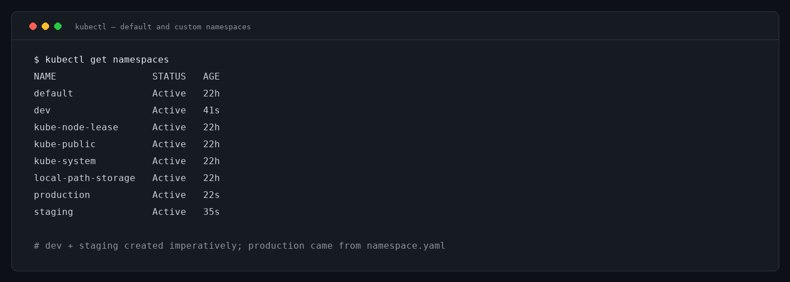
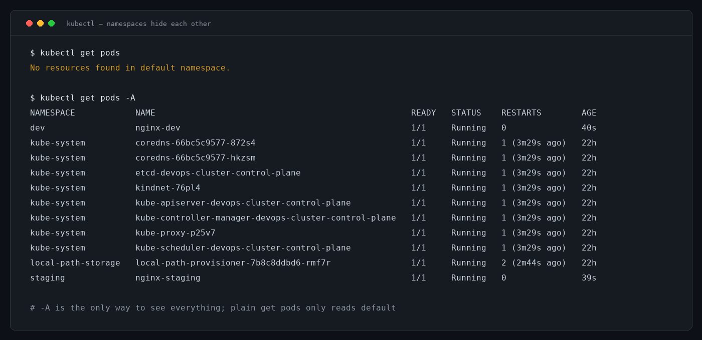
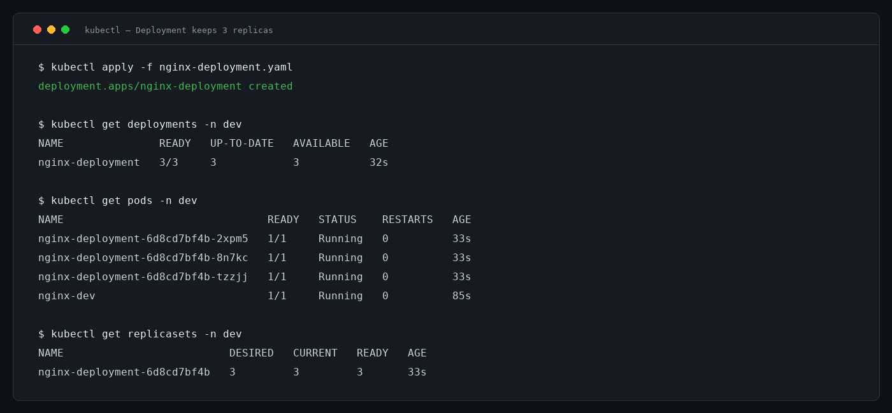
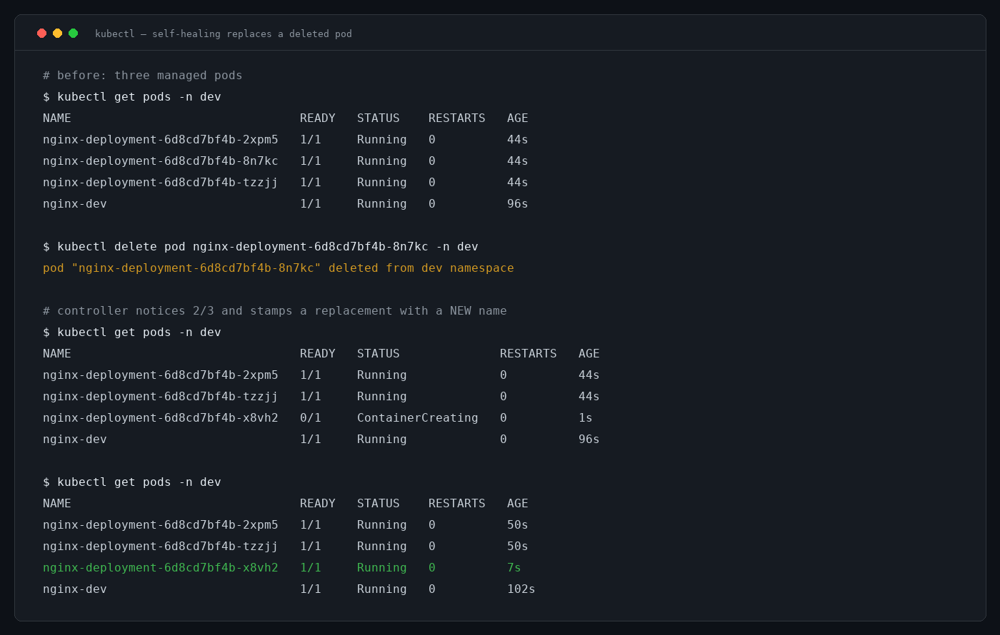
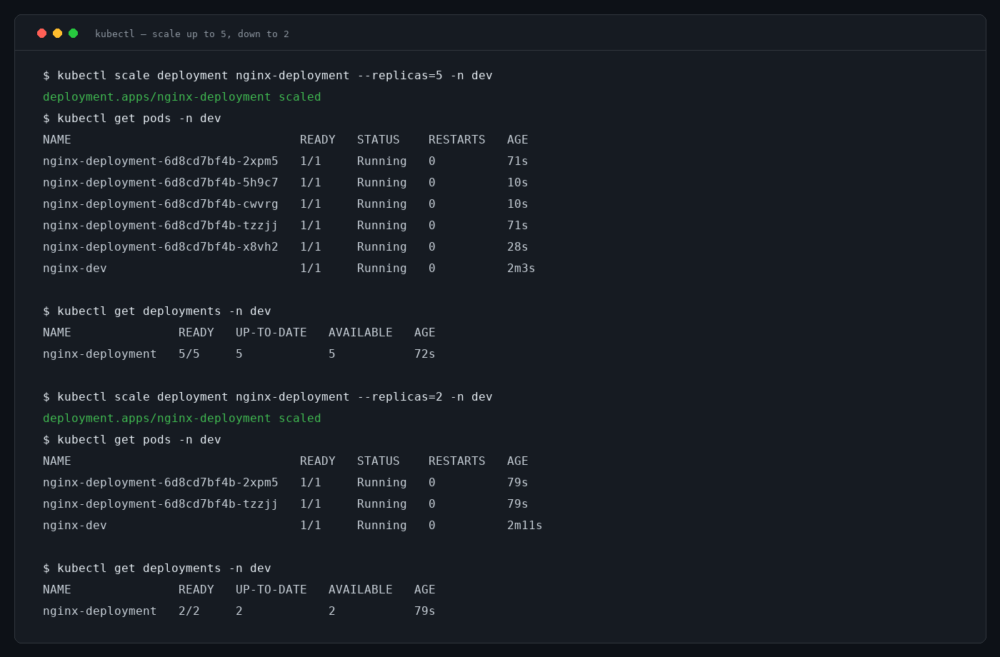
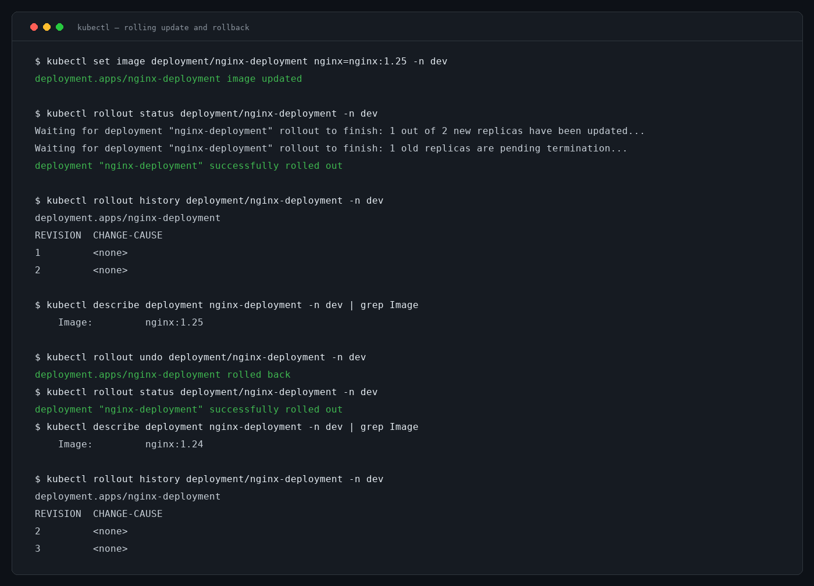

# Day 52 - Kubernetes Namespaces and Deployments

## Task
- Task 1: List the built-in namespaces (`default`, `kube-system`, `kube-public`, `kube-node-lease`) and inspect what runs in `kube-system`.
- Task 2: Create custom namespaces (`dev`, `staging` imperatively + `production` via `namespace.yaml`), run pods in them, and compare `get pods` vs `get pods -A`.
- Task 3: Create your first Deployment (`nginx-deployment.yaml`, 3 replicas, nginx:1.24) and explain each section vs a standalone Pod.
- Task 4: Prove self-healing — delete a managed Pod and watch the controller recreate it with a new name.
- Task 5: Scale the Deployment up/down imperatively (`kubectl scale`) and declaratively (edit YAML + apply).
- Task 6: Perform a rolling update (`kubectl set image` to nginx:1.25) with `rollout status/history`, then roll back with `rollout undo`.
- Task 7: Clean up Deployments, Pods, and namespaces.

## Environment

| OS / Tool | Version / Notes |
|---|---|
| OS | Windows 11 + Docker Desktop (WSL2 backend), run on 2026-11-24 |
| Docker | Server 29.9.3 (kind needs a running Docker daemon) |
| `kubectl` | Client `v1.36.1`, server `v1.34.0` (kubectl prints a minor-version-skew warning) |
| `kind` | `v0.30.0`, cluster `devops-cluster` from Day 50 (1 control-plane node) |
| Cluster | `devops-cluster-control-plane`, kindnet CNI, containerd `2.1.3` |
| Images | nginx:latest, nginx:1.24, nginx:1.25 |

```bash
kubectl version --output=yaml
kind version
docker info --format '{{.ServerVersion}}'
kubectl get nodes -o wide
```

```text
clientVersion:
  gitVersion: v1.36.1
  platform: windows/amd64
serverVersion:
  gitVersion: v1.34.0
  platform: linux/amd64
kind v0.30.0 go1.24.6 windows/amd64
29.9.3

NAME                           STATUS   ROLES           AGE   VERSION   INTERNAL-IP   OS-IMAGE                         CONTAINER-RUNTIME
devops-cluster-control-plane   Ready    control-plane   22h   v1.34.0   172.19.0.2    Debian GNU/Linux 12 (bookworm)   containerd://2.1.3
```

## Solution

### Why namespaces exist

A namespace is a **logical partition inside one cluster**. Every resource name (pod, deployment, service) only has to be unique *within* its namespace, so you can run `web` in `dev`, `staging`, and `production` on the same cluster without collisions. Namespaces are also the unit for:

- **RBAC** — "the `dev` team can edit only the `dev` namespace".
- **Resource quotas / limit ranges** — cap CPU and memory per environment.
- **Cleanup** — deleting a namespace deletes everything inside it.

Namespaces are **not** network isolation. Pods in different namespaces can talk to each other by default; you need a `NetworkPolicy` (later in the course) to block that.

### Task 1: Explore Default Namespaces

Every cluster ships with the same four namespaces; list them and look inside `kube-system` (control-plane components — do not touch):

```bash
kubectl get namespaces
kubectl get pods -n kube-system
kubectl get pods -n kube-system -o wide
```

Actual output on my cluster (the extra `local-path-storage` namespace comes from the storage provisioner add-on, not from today's tasks):

```text
NAME                 STATUS   AGE
default              Active   22h
kube-node-lease      Active   22h
kube-public          Active   22h
kube-system          Active   22h
local-path-storage   Active   22h

NAME                                                   READY   STATUS    RESTARTS        AGE
coredns-66bc5c9577-872s4                               1/1     Running   1 (2m16s ago)   22h
coredns-66bc5c9577-hkzsm                               1/1     Running   1 (2m16s ago)   22h
etcd-devops-cluster-control-plane                      1/1     Running   1 (2m16s ago)   22h
kindnet-76pl4                                          1/1     Running   1 (2m16s ago)   22h
kube-apiserver-devops-cluster-control-plane            1/1     Running   1 (2m16s ago)   22h
kube-controller-manager-devops-cluster-control-plane   1/1     Running   1 (2m16s ago)   22h
kube-proxy-p25v7                                       1/1     Running   1 (2m16s ago)   22h
kube-scheduler-devops-cluster-control-plane            1/1     Running   1 (2m16s ago)   22h
```

| Namespace | Purpose |
|---|---|
| `default` | Where resources land when you do not pass `-n` |
| `kube-system` | Control plane + cluster add-ons (DNS, CNI, kube-proxy) |
| `kube-public` | Readable by everyone; cluster info such as `cluster-info` |
| `kube-node-lease` | Node heartbeat/lease objects used for failure detection |
| `local-path-storage` | Add-on namespace for the kind local storage provisioner |

The 8 pods in `kube-system` map directly to the Day 50 architecture:

| Pod | Role |
|---|---|
| `etcd-...` | The cluster database — stores every object |
| `kube-apiserver-...` | Front door; the only component that talks to etcd |
| `kube-controller-manager-...` | Runs controllers (including the Deployment/ReplicaSet loops used today) |
| `kube-scheduler-...` | Assigns new pods to nodes |
| `coredns-...` ×2 | Cluster DNS (`nginx-dev.dev.svc.cluster.local`) |
| `kindnet-...` | CNI plugin providing pod-to-pod networking |
| `kube-proxy-...` | Programs service/iptables rules on the node |

**Verify:** 8 pods were running in `kube-system`: 4 control-plane components (etcd, API server, controller manager, scheduler) + 2 CoreDNS replicas + kindnet + kube-proxy.

### Task 2: Create and Use Custom Namespaces

```bash
kubectl create namespace dev
kubectl create namespace staging
kubectl apply -f namespace.yaml   # creates 'production' from the manifest below
kubectl get namespaces
```

```text
namespace/dev created
namespace/staging created
namespace/production created

NAME                 STATUS   AGE
default              Active   22h
dev                  Active   41s
kube-node-lease      Active   22h
kube-public          Active   22h
kube-system          Active   22h
local-path-storage   Active   22h
production           Active   22s
staging              Active   35s
```



`namespace.yaml` (matches the file in this folder):

```yaml
apiVersion: v1
kind: Namespace
metadata:
  name: production
```

Run pods in specific namespaces and list across all of them:

```bash
kubectl run nginx-dev --image=nginx:latest -n dev
kubectl run nginx-staging --image=nginx:latest -n staging
kubectl get pods
kubectl get pods -n dev
kubectl get pods -n staging
kubectl get pods -A
```

Actual output:

```text
# plain get pods reads only the default namespace
No resources found in default namespace.

# -A shows every namespace in the cluster
NAMESPACE            NAME                                                   READY   STATUS    RESTARTS        AGE
dev                  nginx-dev                                              1/1     Running   0               40s
kube-system          coredns-66bc5c9577-872s4                               1/1     Running   1 (3m29s ago)   22h
kube-system          coredns-66bc5c9577-hkzsm                               1/1     Running   1 (3m29s ago)   22h
kube-system          etcd-devops-cluster-control-plane                      1/1     Running   1 (3m29s ago)   22h
kube-system          kindnet-76pl4                                          1/1     Running   1 (3m29s ago)   22h
kube-system          kube-apiserver-devops-cluster-control-plane            1/1     Running   1 (3m29s ago)   22h
kube-system          kube-controller-manager-devops-cluster-control-plane   1/1     Running   1 (3m29s ago)   22h
kube-system          kube-proxy-p25v7                                       1/1     Running   1 (3m29s ago)   22h
kube-system          kube-scheduler-devops-cluster-control-plane            1/1     Running   1 (3m29s ago)   22h
local-path-storage   local-path-provisioner-7b8c8ddbd6-rmf7r                1/1     Running   2 (2m44s ago)   22h
staging              nginx-staging                                          1/1     Running   0               39s
```



`kubectl get pods` without `-n` only shows `default` — use `-n <ns>` or `-A` for everything else. This is the #1 beginner confusion; always check your namespace first.

**Verify:** plain `kubectl get pods` showed nothing; `kubectl get pods -A` showed `nginx-dev` in `dev` and `nginx-staging` in `staging`.

### Task 3: Create Your First Deployment

A Deployment declares desired state: "keep 3 identical pods running." The controller compares desired vs actual and repairs drift automatically.

`nginx-deployment.yaml` (matches the file in this folder):

```yaml
apiVersion: apps/v1
kind: Deployment
metadata:
  name: nginx-deployment
  namespace: dev
  labels:
    app: nginx
spec:
  replicas: 3
  selector:
    matchLabels:
      app: nginx
  template:
    metadata:
      labels:
        app: nginx
    spec:
      containers:
      - name: nginx
        image: nginx:1.24
        ports:
        - containerPort: 80
```

```bash
kubectl apply -f nginx-deployment.yaml
kubectl rollout status deployment/nginx-deployment -n dev
kubectl get deployments -n dev
kubectl get pods -n dev
kubectl get replicasets -n dev
```

Actual output:

```text
deployment.apps/nginx-deployment created
Waiting for deployment "nginx-deployment" rollout to finish: 0 of 3 updated replicas are available...
Waiting for deployment "nginx-deployment" rollout to finish: 1 of 3 updated replicas are available...
Waiting for deployment "nginx-deployment" rollout to finish: 2 of 3 updated replicas are available...
deployment "nginx-deployment" successfully rolled out

NAME               READY   UP-TO-DATE   AVAILABLE   AGE
nginx-deployment   3/3     3            3           32s

NAME                                READY   STATUS    RESTARTS   AGE
nginx-deployment-6d8cd7bf4b-2xpm5   1/1     Running   0          33s
nginx-deployment-6d8cd7bf4b-8n7kc   1/1     Running   0          33s
nginx-deployment-6d8cd7bf4b-tzzjj   1/1     Running   0          33s
nginx-dev                           1/1     Running   0          85s

NAME                          DESIRED   CURRENT   READY   AGE
nginx-deployment-6d8cd7bf4b   3         3         3       33s
```



How the object chain works:

```text
Deployment (desired: 3 replicas, template v1)
   └── ReplicaSet  nginx-deployment-6d8cd7bf4b  (desired: 3)
          ├── Pod  ...-2xpm5
          ├── Pod  ...-8n7kc
          └── Pod  ...-tzzjj
```

- The Deployment owns a **ReplicaSet** per template revision; the ReplicaSet owns the Pods.
- `6d8cd7bf4b` is a hash of the pod template. Change the template (image, env, labels) and you get a **new** ReplicaSet.
- `kubectl delete deployment` cascades down the chain and removes the ReplicaSet and Pods too.

Key differences vs a standalone Pod:

| Field | Pod (Day 51) | Deployment (today) | Why |
|---|---|---|---|
| `apiVersion` | `v1` | `apps/v1` | Different API group |
| `kind` | `Pod` | `Deployment` | Controller object |
| `replicas` | N/A | `3` | Desired pod count, always maintained |
| `selector.matchLabels` | N/A | `app: nginx` | How the Deployment finds its pods |
| `template` | N/A | Pod blueprint | Every replica is stamped from this |

Column meanings:

| Column | Meaning |
|---|---|
| `READY` | ready replicas / desired replicas (`3/3` is healthy) |
| `UP-TO-DATE` | pods running the **current** template (not an old revision) |
| `AVAILABLE` | ready pods that have passed the minimum-ready duration |

**Verify:** `READY 3/3`, `UP-TO-DATE 3`, `AVAILABLE 3` — all three mean the rollout is complete and every replica is serving.

### Task 4: Self-Healing — Delete a Pod and Watch It Come Back

```bash
kubectl get pods -n dev
kubectl delete pod nginx-deployment-6d8cd7bf4b-8n7kc -n dev
kubectl get pods -n dev
kubectl get pods -n dev
```

Actual output:

```text
# before: three managed pods
NAME                                READY   STATUS    RESTARTS   AGE
nginx-deployment-6d8cd7bf4b-2xpm5   1/1     Running   0          44s
nginx-deployment-6d8cd7bf4b-8n7kc   1/1     Running   0          44s
nginx-deployment-6d8cd7bf4b-tzzjj   1/1     Running   0          44s
nginx-dev                           1/1     Running   0          96s

$ kubectl delete pod nginx-deployment-6d8cd7bf4b-8n7kc -n dev
pod "nginx-deployment-6d8cd7bf4b-8n7kc" deleted from dev namespace

# one second later: the controller noticed 2/3 and stamped a replacement
NAME                                READY   STATUS              RESTARTS   AGE
nginx-deployment-6d8cd7bf4b-2xpm5   1/1     Running             0          44s
nginx-deployment-6d8cd7bf4b-tzzjj   1/1     Running             0          44s
nginx-deployment-6d8cd7bf4b-x8vh2   0/1     ContainerCreating   0          1s
nginx-dev                           1/1     Running             0          96s

# seven seconds later: the replacement is Running
NAME                                READY   STATUS    RESTARTS   AGE
nginx-deployment-6d8cd7bf4b-2xpm5   1/1     Running   0          50s
nginx-deployment-6d8cd7bf4b-tzzjj   1/1     Running   0          50s
nginx-deployment-6d8cd7bf4b-x8vh2   1/1     Running   0          7s
nginx-dev                           1/1     Running   0          102s
```



The ReplicaSet controller notices only 2 of 3 replicas exist and immediately creates a replacement. The new pod gets a **different name** (new random suffix, `x8vh2` instead of `8n7kc`) and a new IP, unlike a standalone pod which is gone forever.

| Object deleted | Result |
|---|---|
| Standalone Pod (Day 51) | Gone forever, nothing recreates it |
| Deployment Pod (today) | Replacement with a new random name in seconds |

**Verify:** the replacement had a different name (`...-x8vh2` vs `...-8n7kc`) — the ReplicaSet is immutable, so it creates a new pod rather than reviving the old one.

**WHY it matters:** this controller loop is the whole reason production uses Deployments — crashes, node drains, and evictions self-repair without a human.

### Task 5: Scale the Deployment

```bash
# Scale up to 5
kubectl scale deployment nginx-deployment --replicas=5 -n dev
kubectl get pods -n dev
kubectl get deployments -n dev

# Scale down to 2
kubectl scale deployment nginx-deployment --replicas=2 -n dev
kubectl get pods -n dev
kubectl get deployments -n dev
```

Actual output:

```text
deployment.apps/nginx-deployment scaled

NAME                                READY   STATUS    RESTARTS   AGE
nginx-deployment-6d8cd7bf4b-2xpm5   1/1     Running   0          71s
nginx-deployment-6d8cd7bf4b-5h9c7   1/1     Running   0          10s
nginx-deployment-6d8cd7bf4b-cwvrg   1/1     Running   0          10s
nginx-deployment-6d8cd7bf4b-tzzjj   1/1     Running   0          71s
nginx-deployment-6d8cd7bf4b-x8vh2   1/1     Running   0          28s
nginx-dev                           1/1     Running   0          2m3s

NAME               READY   UP-TO-DATE   AVAILABLE   AGE
nginx-deployment   5/5     5            5           72s

deployment.apps/nginx-deployment scaled

NAME                                READY   STATUS    RESTARTS   AGE
nginx-deployment-6d8cd7bf4b-2xpm5   1/1     Running   0          79s
nginx-deployment-6d8cd7bf4b-tzzjj   1/1     Running   0          79s
nginx-dev                           1/1     Running   0          2m11s

NAME               READY   UP-TO-DATE   AVAILABLE   AGE
nginx-deployment   2/2     2            2           79s
```



Declarative alternative: edit `replicas:` in `nginx-deployment.yaml` and run `kubectl apply -f nginx-deployment.yaml` again. The Deployment spec is the source of truth — `kubectl scale` just patches that one field.

| Method | Command | Best for |
|---|---|---|
| Imperative | `kubectl scale deployment X --replicas=N -n dev` | Quick experiments, incidents |
| Declarative | Edit YAML `replicas:` + `kubectl apply -f` | Git history, reviews, production |

**Verify:** scaling up created 3 new pods within seconds; scaling down terminated the extra pods (`Terminating` → gone), leaving exactly 2. The Deployment's desired count is the only thing that matters — it adds or removes pods to match.

### Task 6: Rolling Update and Rollback

```bash
kubectl set image deployment/nginx-deployment nginx=nginx:1.25 -n dev
kubectl rollout status deployment/nginx-deployment -n dev
kubectl rollout history deployment/nginx-deployment -n dev
kubectl describe deployment nginx-deployment -n dev | grep Image
kubectl rollout undo deployment/nginx-deployment -n dev
kubectl rollout status deployment/nginx-deployment -n dev
kubectl describe deployment nginx-deployment -n dev | grep Image
kubectl rollout history deployment/nginx-deployment -n dev
```

Actual output:

```text
deployment.apps/nginx-deployment image updated
Waiting for deployment "nginx-deployment" rollout to finish: 1 out of 2 new replicas have been updated...
Waiting for deployment "nginx-deployment" rollout to finish: 1 old replicas are pending termination...
deployment "nginx-deployment" successfully rolled out

deployment.apps/nginx-deployment
REVISION  CHANGE-CAUSE
1         <none>
2         <none>

    Image:         nginx:1.25

deployment.apps/nginx-deployment rolled back
deployment "nginx-deployment" successfully rolled out

    Image:         nginx:1.24

deployment.apps/nginx-deployment
REVISION  CHANGE-CAUSE
2         <none>
3         <none>
```



What happened:

1. `set image` changed the pod template, so the Deployment created a **new ReplicaSet** (`77bf8679f9`) and scaled the old one (`6d8cd7bf4b`) down.
2. New pods must become `Ready` before old ones are removed. With 2 replicas and the default strategy (`maxSurge 25%`, `maxUnavailable 25%`), that means **one new pod at a time**, so the app never drops below 2 serving pods.
3. `rollout undo` set the template back to nginx:1.24. Kubernetes reused the old ReplicaSet and recorded it as revision 3 — which is why `history` then shows `2` and `3`, not `1` and `2`.
4. `rollout history` shows `<none>` for `CHANGE-CAUSE` because `--record` is deprecated and I did not add the `kubernetes.io/change-cause` annotation. In real pipelines, annotate each deploy so history is readable.

**Verify:** after the rollback, `describe ... | grep Image` showed `nginx:1.24` (the previous version), and `rollout history` listed revision `3` as the current one.

**WHY it matters:** this is the safe-deploy primitive. Helm rollbacks (Day 59) and the WordPress capstone (Day 60) reuse the same revision/ReplicaSet machinery — you are not learning a kubectl trick, you are learning how every production deploy controller works.

### Task 7: Clean Up

```bash
kubectl delete deployment nginx-deployment -n dev
kubectl delete pod nginx-dev -n dev
kubectl delete pod nginx-staging -n staging
kubectl delete namespace dev staging production
kubectl get namespaces
kubectl get pods -A
```

Actual output:

```text
deployment.apps "nginx-deployment" deleted from dev namespace
pod "nginx-dev" deleted from dev namespace
pod "nginx-staging" deleted from staging namespace
namespace "dev" deleted
namespace "staging" deleted
namespace "production" deleted

NAME                 STATUS   AGE
default              Active   22h
kube-node-lease      Active   22h
kube-public          Active   22h
kube-system          Active   22h
local-path-storage   Active   22h

NAMESPACE            NAME                                                   READY   STATUS    RESTARTS      AGE
kube-system          coredns-66bc5c9577-872s4                               1/1     Running   1 (10m ago)   22h
kube-system          coredns-66bc5c9577-hkzsm                               1/1     Running   1 (10m ago)   22h
kube-system          etcd-devops-cluster-control-plane                      1/1     Running   1 (10m ago)   22h
kube-system          kindnet-76pl4                                          1/1     Running   1 (10m ago)   22h
kube-system          kube-apiserver-devops-cluster-control-plane            1/1     Running   1 (10m ago)   22h
kube-system          kube-controller-manager-devops-cluster-control-plane   1/1     Running   1 (10m ago)   22h
kube-system          kube-proxy-p25v7                                       1/1     Running   1 (10m ago)   22h
kube-system          kube-scheduler-devops-cluster-control-plane            1/1     Running   1 (10m ago)   22h
local-path-storage   local-path-provisioner-7b8c8ddbd6-rmf7r                1/1     Running   2 (10m ago)   22h
```

Deleting a namespace deletes **everything** inside it (pods, deployments, services, secrets). That is convenient for a lab and catastrophic in production — always `kubectl get all -n <ns>` before deleting one. The remaining `kube-system` and `local-path-storage` workloads are cluster add-ons, not mine.

**Verify:** `dev`, `staging`, and `production` are gone; only default/system namespaces and cluster add-on pods remain.

## Commands Used

```bash
kubectl version --output=yaml
kind version
kubectl get namespaces
kubectl get pods -n kube-system
kubectl get pods -n kube-system -o wide
kubectl create namespace dev
kubectl create namespace staging
kubectl apply -f namespace.yaml
kubectl get namespaces
kubectl run nginx-dev --image=nginx:latest -n dev
kubectl run nginx-staging --image=nginx:latest -n staging
kubectl get pods
kubectl get pods -n dev
kubectl get pods -n staging
kubectl get pods -A
kubectl apply -f nginx-deployment.yaml
kubectl rollout status deployment/nginx-deployment -n dev
kubectl get deployments -n dev
kubectl get pods -n dev
kubectl get replicasets -n dev
kubectl delete pod nginx-deployment-6d8cd7bf4b-8n7kc -n dev
kubectl scale deployment nginx-deployment --replicas=5 -n dev
kubectl scale deployment nginx-deployment --replicas=2 -n dev
kubectl set image deployment/nginx-deployment nginx=nginx:1.25 -n dev
kubectl rollout history deployment/nginx-deployment -n dev
kubectl describe deployment nginx-deployment -n dev
kubectl rollout undo deployment/nginx-deployment -n dev
kubectl delete deployment nginx-deployment -n dev
kubectl delete pod nginx-dev -n dev
kubectl delete pod nginx-staging -n staging
kubectl delete namespace dev staging production
kubectl get pods -A
```

## Verification

- [x] `kubectl get namespaces` showed `default`, `kube-system`, `kube-public`, `kube-node-lease` plus `dev`, `staging`, `production` (and the add-on `local-path-storage`).
- [x] `kubectl get pods -A` showed `nginx-dev` and `nginx-staging`; plain `kubectl get pods` showed `No resources found in default namespace.`
- [x] `kubectl get deployments -n dev` showed `3/3` READY with `UP-TO-DATE 3 AVAILABLE 3`.
- [x] Deleting `...-8n7kc` produced a replacement `...-x8vh2`, Running within 7 seconds.
- [x] After `--replicas=5` the Deployment reported `5/5`; after `--replicas=2` exactly 2 pods remained.
- [x] `rollout history` listed revisions; after `rollout undo`, `describe ... | grep Image` showed `nginx:1.24` again.
- [x] After cleanup, `dev`/`staging`/`production` were gone and no workload pods remained.

## Key Learnings

- Namespaces partition **names**, not traffic; use `-n` to select one and `-A` to see everything.
- A Deployment + ReplicaSet controller keeps the desired replica count regardless of pod crashes or node issues.
- Self-healing is the core difference from standalone pods: managed pods are recreated with new names and IPs.
- `selector.matchLabels` and the pod template's labels must match or the API rejects the Deployment.
- Scaling works both imperatively (`kubectl scale`) and declaratively (edit YAML + apply); both converge to the same desired state.
- Rolling updates replace pods gradually, gated by readiness; `rollout undo` restores the previous template and reuses its ReplicaSet.
- Deployments create one ReplicaSet per template revision; old ReplicaSets are kept (up to `revisionHistoryLimit`) so rollback is instant.
- `READY / UP-TO-DATE / AVAILABLE` together tell you whether a rollout is complete and serving.
- Namespace deletion is a recursive, irreversible delete — the most dangerous command in this lab.

## Troubleshooting / Gotchas

- `kubectl get pods` shows nothing and you panic — cause: you are looking at `default`. Fix: use `-n <ns>` or `-A`.
- `kubectl apply` fails with `selector does not match template labels` — cause: `spec.selector.matchLabels` differs from `spec.template.metadata.labels`. Fix: make them identical; re-apply.
- Deployment shows `0/3` and pods never appear — cause: unschedulable (resource requests, taints) or the selector was edited after creation (immutable). Fix: `kubectl describe deployment` + `kubectl get events`, recreate the Deployment if the selector must change.
- New pods stuck `ImagePullBackOff` after `set image` — cause: typo in tag (e.g. `nginx:1.256`) or registry rate limit. Fix: `kubectl describe pod` for the pull error, correct the tag.
- `kubectl rollout undo` prints a warning that the resource was previously managed with `kubectl apply` — cause: `undo` does not update `last-applied-configuration`. Fix: prefer `kubectl apply -f` with the previous manifest, or re-apply the file after the undo so Git and the cluster agree.
- `rollout undo` fails with "no previous revision" — cause: you have not updated the Deployment yet. Fix: run a `set image` first, then undo.
- `rollout history` shows `<none>` for every change — cause: `--record` is deprecated. Fix: annotate the Deployment with `kubernetes.io/change-cause` on each deploy.
- Deleted pod keeps coming back — cause: it is managed by a Deployment. Fix: expected self-healing; delete the Deployment instead.
- Namespace stuck in `Terminating` — cause: finalizers pending, usually stuck pods. Fix: inspect `kubectl get pods -A` in that namespace, delete remaining workloads, then retry.
- `rollout status` hangs — cause: new pods never become Ready (bad image/probe). Fix: `kubectl get pods -n dev`, `kubectl describe pod`, then `rollout undo`.
- Accidentally deleted the wrong namespace — cause: `kubectl delete namespace` has no undo and wipes everything inside. Fix: prevention only — always `get all` first, never script namespace deletes against production.
- Client/server minor skew warning (`1.36` vs `1.34`) — harmless for these commands, but pin kubectl to within one minor version of the cluster in CI.

## Screenshots

All screenshots are embedded above, directly under the task they prove. Files live in `screenshots/`:

- `01-namespaces.png` — Task 2: default + custom namespaces
- `02-pods-all-namespaces.png` — Task 2: `get pods` vs `get pods -A`
- `03-deployment-pods.png` — Task 3: Deployment `3/3`, pods and ReplicaSet
- `04-self-healing.png` — Task 4: deleted pod replaced with a new name
- `05-scale.png` — Task 5: scale up to 5 and down to 2
- `06-rollout.png` — Task 6: rolling update to 1.25 and rollback to 1.24

Ages, pod suffixes, and IPs are from my actual run on 2026-11-24; your values will differ.
