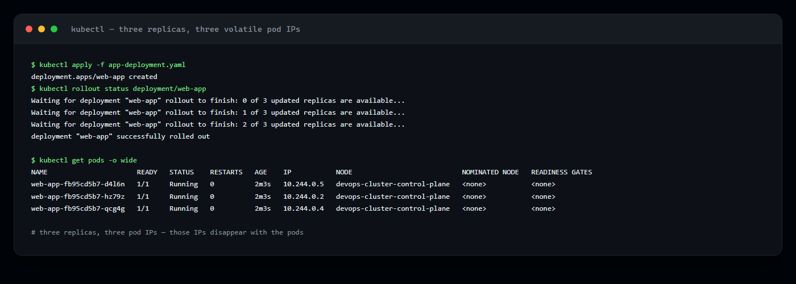
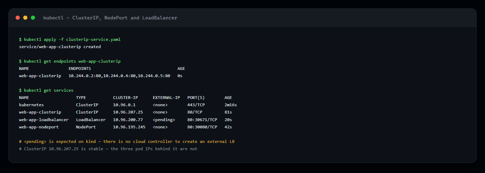
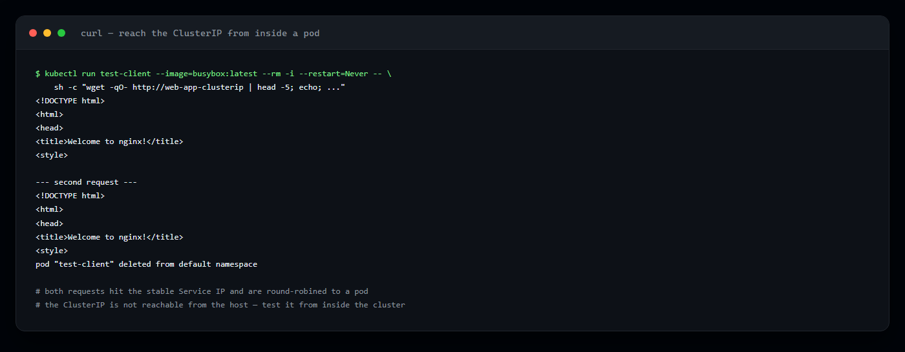
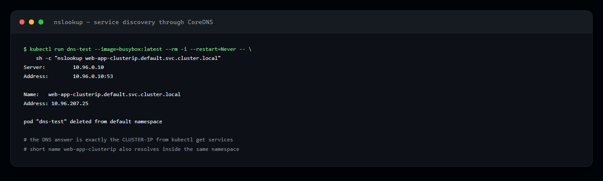
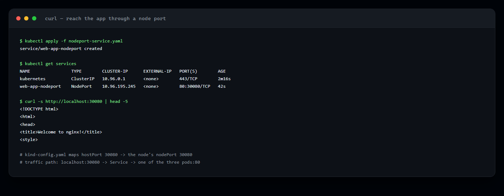
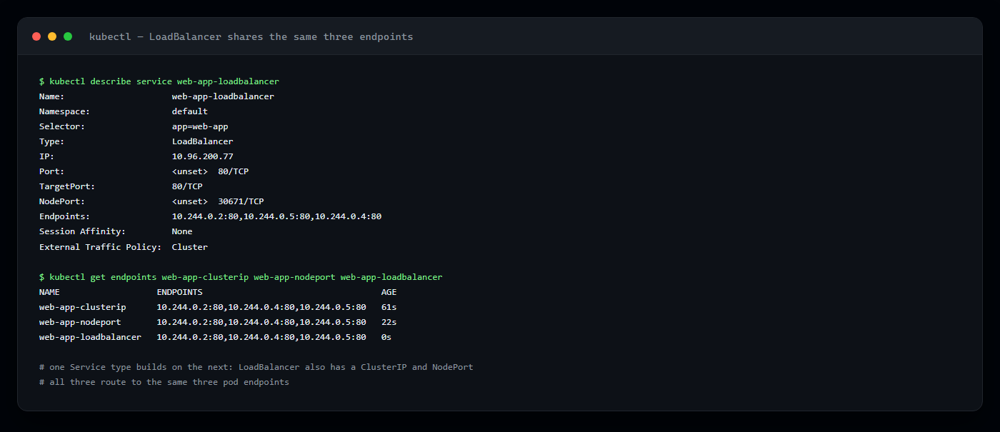

# Day 53 - Kubernetes Services

## Task
- Task 1: Deploy a 3-replica nginx Deployment (`app-deployment.yaml`) and note that pod IPs change on restart.
- Task 2: Expose it with a ClusterIP Service (`clusterip-service.yaml`) and test from inside the cluster with a busybox client.
- Task 3: Use Kubernetes DNS for service discovery (short name vs FQDN, `nslookup` check).
- Task 4: Expose it with a NodePort Service (`nodeport-service.yaml`, 30080) and access it from outside the cluster.
- Task 5: Create a LoadBalancer Service (`loadbalancer-service.yaml`) and explain why EXTERNAL-IP stays `<pending>` locally.
- Task 6: Compare the three service types side by side (`get services -o wide`, `describe`, `get endpoints`).
- Task 7: Clean up Deployment + all three Services.

## Environment

| OS / Tool | Version / Notes |
|---|---|
| OS | Windows 11 + Docker Desktop (WSL2 backend), run on 2026-11-25 |
| Docker | Server 29.9.3 (kind needs a running Docker daemon) |
| `kubectl` | Client `v1.36.1`, server `v1.34.0` (kubectl prints a minor-version-skew warning) |
| `kind` | `v0.30.0`, cluster `devops-cluster`, node image `kindest/node:v1.34.0` (1 control-plane node) |
| Cluster | `devops-cluster-control-plane`, kindnet CNI, containerd `2.1.3` |
| Images | nginx:1.25, busybox:latest |

The Day 50 cluster had been removed when Docker Desktop restarted, so I recreated it with a port mapping for the NodePort task:

```yaml
# kind-config.yaml (matches the file in this folder)
kind: Cluster
apiVersion: kind.x-k8s.io/v1alpha4
nodes:
- role: control-plane
  extraPortMappings:
  - containerPort: 30080
    hostPort: 30080
    protocol: TCP
```

```bash
kind create cluster --name devops-cluster --config kind-config.yaml
kubectl get nodes -o wide
kubectl version --output=yaml
kind version
docker info --format '{{.ServerVersion}}'
```

```text
NAME                           STATUS   ROLES           AGE   VERSION   INTERNAL-IP   EXTERNAL-IP   OS-IMAGE                         KERNEL-VERSION                      CONTAINER-RUNTIME
devops-cluster-control-plane   Ready    control-plane   96s   v1.34.0   172.19.0.2    <none>        Debian GNU/Linux 12 (bookworm)   6.18.58.1-microsoft-standard-WSL2   containerd://2.1.3

clientVersion:
  gitVersion: v1.36.1
serverVersion:
  gitVersion: v1.34.0
kind v0.30.0 go1.24.6 windows/amd64
29.9.3
```

## Solution

### Why Services exist

Every Pod gets its own IP, and that IP dies with the Pod. A Deployment also runs several identical Pods, so there is no single Pod IP a client could safely use. A Service fixes both problems:

- **Stable virtual IP + DNS name** — survives Pod restarts, scaling and rollouts.
- **Label-based load balancing** — kube-proxy spreads connections across every Ready Pod whose labels match the Service selector.
- **Decoupling** — clients talk to `web-app-clusterip`, not to `10.244.0.x`.

```text
[Client] --> [Service (stable IP)] --> [Pod 1]
                                   --> [Pod 2]
                                   --> [Pod 3]
```

A Service does **not** run a proxy process. kube-proxy programs iptables/IPVS rules on every node, and the Service IP is virtual — it only exists in those rules. That is why a ClusterIP cannot be pinged or reached from your laptop.

### Task 1: Deploy the Application

`app-deployment.yaml` (matches the file in this folder):

```yaml
apiVersion: apps/v1
kind: Deployment
metadata:
  name: web-app
  labels:
    app: web-app
spec:
  replicas: 3
  selector:
    matchLabels:
      app: web-app
  template:
    metadata:
      labels:
        app: web-app
    spec:
      containers:
      - name: nginx
        image: nginx:1.25
        ports:
        - containerPort: 80
```

```bash
kubectl apply -f app-deployment.yaml
kubectl rollout status deployment/web-app
kubectl get pods -o wide
```

Actual output:

```text
deployment.apps/web-app created
Waiting for deployment "web-app" rollout to finish: 0 of 3 updated replicas are available...
Waiting for deployment "web-app" rollout to finish: 1 of 3 updated replicas are available...
Waiting for deployment "web-app" rollout to finish: 2 of 3 updated replicas are available...
deployment "web-app" successfully rolled out

NAME                      READY   STATUS    RESTARTS   AGE    IP           NODE                           NOMINATED NODE   READINESS GATES
web-app-fb95cd5b7-d4l6n   1/1     Running   0          2m3s   10.244.0.5   devops-cluster-control-plane   <none>           <none>
web-app-fb95cd5b7-hz79z   1/1     Running   0          2m3s   10.244.0.2   devops-cluster-control-plane   <none>           <none>
web-app-fb95cd5b7-qcg4g   1/1     Running   0          2m3s   10.244.0.4   devops-cluster-control-plane   <none>           <none>
```



Delete any one of these Pods and its replacement comes back with a different IP — the Deployment hash (`fb95cd5b7`) stays, the Pod suffix and IP do not. Those addresses are exactly what a client must never hardcode.

**Verify:** all 3 pods were Running, each with a distinct IP (`10.244.0.2`, `.4`, `.5`) on the single kind node.

### Task 2: ClusterIP Service (Internal Access)

ClusterIP is the default type: a stable internal IP reachable only from inside the cluster.

`clusterip-service.yaml` (matches the file in this folder):

```yaml
apiVersion: v1
kind: Service
metadata:
  name: web-app-clusterip
spec:
  type: ClusterIP
  selector:
    app: web-app
  ports:
  - port: 80
    targetPort: 80
```

- `selector.app: web-app` picks every Pod carrying that label — the same label the Deployment stamps on its Pods.
- `port: 80` is what the Service listens on; `targetPort: 80` is the container port. They do not have to match.

```bash
kubectl apply -f clusterip-service.yaml
kubectl get services
kubectl get endpoints web-app-clusterip
kubectl describe service web-app-clusterip
```

Actual output:

```text
service/web-app-clusterip created

NAME                TYPE        CLUSTER-IP     EXTERNAL-IP   PORT(S)   AGE
kubernetes          ClusterIP   10.96.0.1      <none>        443/TCP   55s
web-app-clusterip   ClusterIP   10.96.207.25   <none>        80/TCP    0s

Warning: v1 Endpoints is deprecated in v1.33+; use discovery.k8s.io/v1 EndpointSlice
NAME                ENDPOINTS                                   AGE
web-app-clusterip   10.244.0.2:80,10.244.0.4:80,10.244.0.5:80   0s

Name:                     web-app-clusterip
Namespace:                default
Selector:                 app=web-app
Type:                     ClusterIP
IP:                       10.96.207.25
Port:                     <unset>  80/TCP
TargetPort:               80/TCP
Endpoints:                10.244.0.4:80,10.244.0.2:80,10.244.0.5:80
Session Affinity:         None
Internal Traffic Policy:  Cluster
Events:                   <none>
```



The **Endpoints** object is the bridge between the Service and the Pods: the Service selector is resolved into the list of Pod IPs, and kube-proxy load-balances across exactly those. Empty endpoints = the Service matches nothing (usually a label typo).

Test from inside the cluster, because the ClusterIP does not exist outside it:

```bash
kubectl run test-client --image=busybox:latest --rm -i --restart=Never -- \
  sh -c "wget -qO- http://web-app-clusterip | head -5; echo; echo '--- second request ---'; wget -qO- http://web-app-clusterip | head -5"
```

Actual output:

```text
<!DOCTYPE html>
<html>
<head>
<title>Welcome to nginx!</title>
<style>

--- second request ---
<!DOCTYPE html>
<html>
<head>
<title>Welcome to nginx!</title>
<style>
pod "test-client" deleted from default namespace
```



**Verify:** the Service responded with the nginx welcome page. Both requests hit `10.96.207.25:80` and were forwarded to a Ready Pod — never to the Pod IP directly.

### Task 3: Discover Services with DNS

CoreDNS gives every Service an A record: `<service>.<namespace>.svc.cluster.local`. Short names work inside the same namespace thanks to the Pod's DNS search path (`default.svc.cluster.local`, `svc.cluster.local`, `cluster.local`).

```bash
kubectl run dns-test --image=busybox:latest --rm -i --restart=Never -- \
  sh -c "nslookup web-app-clusterip.default.svc.cluster.local"
```

Actual output:

```text
Server:         10.96.0.10
Address:        10.96.0.10:53

Name:   web-app-clusterip.default.svc.cluster.local
Address: 10.96.207.25

pod "dns-test" deleted from default namespace
```



`10.96.0.10` is the CoreDNS Service (`kube-dns`), and the answer `10.96.207.25` is exactly the CLUSTER-IP from `kubectl get services`.

**Verify:** `nslookup` returned the same IP as the ClusterIP. The short name `web-app-clusterip` resolves too when queried from a Pod in `default`.

**WHY it matters:** DNS is how services find each other without hardcoded IPs — Day 60's WordPress reaches MySQL by name (`mysql-0.mysql.capstone.svc.cluster.local`), not by IP.

### Task 4: NodePort Service (External Access via Node)

NodePort opens the same port on every node, then forwards it to the Service (which forwards to the Pods). Range is fixed at 30000-32767.

`nodeport-service.yaml` (matches the file in this folder):

```yaml
apiVersion: v1
kind: Service
metadata:
  name: web-app-nodeport
spec:
  type: NodePort
  selector:
    app: web-app
  ports:
  - port: 80
    targetPort: 80
    nodePort: 30080
```

```bash
kubectl apply -f nodeport-service.yaml
kubectl get services
kubectl get nodes -o wide
curl -s http://localhost:30080 | head -5
```

Actual output:

```text
service/web-app-nodeport created

NAME                TYPE        CLUSTER-IP      EXTERNAL-IP   PORT(S)        AGE
kubernetes          ClusterIP   10.96.0.1       <none>        443/TCP        2m16s
web-app-clusterip   ClusterIP   10.96.207.25    <none>        80/TCP         81s
web-app-nodeport    NodePort    10.96.195.245   <none>        80:30080/TCP   42s

NAME                           STATUS   ROLES           AGE    VERSION   INTERNAL-IP   EXTERNAL-IP
devops-cluster-control-plane   Ready    control-plane   96s    v1.34.0   172.19.0.2    <none>

<!DOCTYPE html>
<html>
<head>
<title>Welcome to nginx!</title>
<style>
```



On kind, `localhost:30080` only works because `kind-config.yaml` publishes `hostPort 30080 -> containerPort 30080` on the node container. Without that mapping the port exists only **inside** the kind node, and `curl localhost:30080` from the host fails even though the Service is healthy. (Day 50's plain `kind create cluster` had no mapping, which is why the cluster was recreated for today's task.)

**Verify:** `curl` from Windows returned the nginx welcome page on `localhost:30080`, so traffic went host -> kind node port -> Service -> Pod:80.

### Task 5: LoadBalancer Service (Cloud External Access)

In a cloud, a LoadBalancer Service asks the cloud controller manager to provision a real external load balancer (AWS NLB/ELB, GCP forwarding rule, Azure LB). Locally there is no cloud controller, so the EXTERNAL-IP stays `<pending>` forever — expected, not broken.

`loadbalancer-service.yaml` (matches the file in this folder):

```yaml
apiVersion: v1
kind: Service
metadata:
  name: web-app-loadbalancer
spec:
  type: LoadBalancer
  selector:
    app: web-app
  ports:
  - port: 80
    targetPort: 80
```

```bash
kubectl apply -f loadbalancer-service.yaml
kubectl get services -o wide
kubectl describe service web-app-loadbalancer
```

Actual output:

```text
service/web-app-loadbalancer created

NAME                   TYPE           CLUSTER-IP      EXTERNAL-IP   PORT(S)        AGE    SELECTOR
kubernetes             ClusterIP      10.96.0.1       <none>        443/TCP        116s   <none>
web-app-clusterip      ClusterIP      10.96.207.25    <none>        80/TCP         61s    app=web-app
web-app-loadbalancer   LoadBalancer   10.96.200.77    <pending>     80:30671/TCP   0s     app=web-app
web-app-nodeport       NodePort       10.96.195.245   <none>        80:30080/TCP   22s    app=web-app
```

**Verify:** EXTERNAL-IP showed `<pending>` because kind has no cloud provider to allocate a load balancer. Kubernetes still allocated a ClusterIP and a NodePort (`30671`) behind the scenes.

**WHY it matters:** the same manifest is what you ship to EKS. The cloud controller fills in the external address there; nothing in your YAML changes.

### Task 6: Understand the Service Types Side by Side

```bash
kubectl get services -o wide
kubectl describe service web-app-loadbalancer
kubectl get endpoints web-app-clusterip web-app-nodeport web-app-loadbalancer
```

Actual output:

```text
Name:                     web-app-loadbalancer
Namespace:                default
Selector:                 app=web-app
Type:                     LoadBalancer
IP:                       10.96.200.77
Port:                     <unset>  80/TCP
TargetPort:               80/TCP
NodePort:                 <unset>  30671/TCP
Endpoints:                10.244.0.2:80,10.244.0.5:80,10.244.0.4:80
Session Affinity:         None
External Traffic Policy:  Cluster

Warning: v1 Endpoints is deprecated in v1.33+; use discovery.k8s.io/v1 EndpointSlice
NAME                   ENDPOINTS                                   AGE
web-app-clusterip      10.244.0.2:80,10.244.0.4:80,10.244.0.5:80   61s
web-app-nodeport       10.244.0.2:80,10.244.0.4:80,10.244.0.5:80   22s
web-app-loadbalancer   10.244.0.2:80,10.244.0.4:80,10.244.0.5:80   0s
```



| Type | Accessible From | Use Case | What it adds |
|---|---|---|---|
| ClusterIP | Inside the cluster only | Internal service-to-service traffic | Stable virtual IP + DNS |
| NodePort | Outside via `<NodeIP>:<NodePort>` | Dev/test, direct node access | A port (30000-32767) on every node |
| LoadBalancer | Outside via cloud load balancer | Production traffic in cloud | Cloud LB + external IP |

Each type builds on the previous one: LoadBalancer contains a NodePort, which contains a ClusterIP. The `describe` above proves it — the LoadBalancer Service has `IP: 10.96.200.77` **and** `NodePort: 30671`.

**Verify:** all three Services resolved to the same three Pod endpoints (`10.244.0.2`, `.4`, `.5`), and the LoadBalancer Service had a ClusterIP and an auto-assigned NodePort.

### Task 7: Clean Up

```bash
kubectl delete -f app-deployment.yaml
kubectl delete -f clusterip-service.yaml
kubectl delete -f nodeport-service.yaml
kubectl delete -f loadbalancer-service.yaml
kubectl get pods
kubectl get services
```

Actual output:

```text
deployment.apps "web-app" deleted from default namespace
service "web-app-clusterip" deleted from default namespace
service "web-app-nodeport" deleted from default namespace
service "web-app-loadbalancer" deleted from default namespace

No resources found in default namespace.

NAME         TYPE        CLUSTER-IP   EXTERNAL-IP   PORT(S)   AGE
kubernetes   ClusterIP   10.96.0.1    <none>        443/TCP   2m26s
```

Only the built-in `kubernetes` Service remains. Deleting the Deployment also removed its ReplicaSet and Pods, and deleting each Service released its ClusterIP and NodePort.

**Verify:** no workload Pods and no `web-app-*` Services remained.

## Commands Used

```bash
kind create cluster --name devops-cluster --config kind-config.yaml
kubectl get nodes -o wide
kubectl apply -f app-deployment.yaml
kubectl rollout status deployment/web-app
kubectl get pods -o wide
kubectl apply -f clusterip-service.yaml
kubectl get services
kubectl get endpoints web-app-clusterip
kubectl describe service web-app-clusterip
kubectl run test-client --image=busybox:latest --rm -i --restart=Never -- sh -c "..."
kubectl run dns-test --image=busybox:latest --rm -i --restart=Never -- sh -c "nslookup ..."
kubectl apply -f nodeport-service.yaml
curl -s http://localhost:30080
kubectl apply -f loadbalancer-service.yaml
kubectl get services -o wide
kubectl describe service web-app-loadbalancer
kubectl get endpoints web-app-clusterip web-app-nodeport web-app-loadbalancer
kubectl delete -f app-deployment.yaml
kubectl delete -f clusterip-service.yaml
kubectl delete -f nodeport-service.yaml
kubectl delete -f loadbalancer-service.yaml
kubectl get pods
kubectl get services
```

## Verification

- [x] `kubectl get pods -o wide` showed 3 Running pods with IPs `10.244.0.2`, `.4`, `.5`.
- [x] `kubectl get services` showed `web-app-clusterip` at `10.96.207.25:80`.
- [x] `wget` from a busybox pod returned the nginx welcome page twice.
- [x] `nslookup web-app-clusterip.default.svc.cluster.local` returned `10.96.207.25` (same as the ClusterIP).
- [x] `curl localhost:30080` from the Windows host returned the nginx page through the NodePort.
- [x] `web-app-loadbalancer` showed `EXTERNAL-IP <pending>` and an auto NodePort `30671` on kind.
- [x] `describe` showed ClusterIP + NodePort + LoadBalancer on the same Service.
- [x] `kubectl get endpoints` listed the same 3 pod IPs for all three Services.
- [x] After cleanup, only the built-in `kubernetes` Service remained and no pods were left.

## Key Learnings

- A Service is a stable virtual IP + DNS name in front of volatile Pods; kube-proxy does the load balancing with iptables/IPVS rules.
- The selector must match Pod labels, and Endpoints are the resolved Pod IP list — empty Endpoints means broken routing.
- ClusterIP is internal-only; NodePort adds a fixed port on every node; LoadBalancer adds a cloud LB and includes the other two.
- DNS: short name inside the namespace, `<service>.<ns>.svc.cluster.local` across namespaces; CoreDNS answers at `10.96.0.10`.
- `port` (Service) and `targetPort` (Pod) are independent — a Service can map 80 to 8080.
- On kind, a NodePort is only reachable from the host if the cluster was created with `extraPortMappings`; otherwise it lives inside the node container.
- LoadBalancer `<pending>` on a local cluster is normal — there is no cloud controller to provision an external LB.
- Deleting a Service releases its ClusterIP and NodePort; never hardcode either, always use DNS.
- `v1 Endpoints` is deprecated in 1.33+; `EndpointSlice` is the replacement, but `kubectl get endpoints` still works and is the fastest debugging view.

## Troubleshooting / Gotchas

- `wget` to the ClusterIP fails from your laptop — cause: ClusterIP only exists inside the cluster. Fix: test from a temporary busybox pod (`kubectl run ... --rm -i`).
- Service has `<none>` endpoints — cause: selector labels do not match Pod labels (or Pods are not Ready). Fix: `kubectl get pods --show-labels`, then align `spec.selector`.
- `curl localhost:30080` refused on kind — cause: the cluster was created without `extraPortMappings`, so the NodePort exists only inside the node container. Fix: recreate with a kind config mapping host 30080 to container 30080, or test from inside the node (`docker exec devops-cluster-control-plane curl -s localhost:30080`).
- NodePort rejected on apply — cause: port outside 30000-32767 or already allocated. Fix: omit `nodePort` and let Kubernetes assign one, or pick a free port in range.
- LoadBalancer stuck `<pending>` — cause: no cloud provider on kind/minikube. Fix: expected; use `minikube tunnel`, NodePort, or `kubectl port-forward` for local access.
- `nslookup` prints NXDOMAIN lines before the answer — cause: busybox tries the DNS search domains (`svc.cluster.local`, `cluster.local`) first. Fix: query the FQDN (`web-app-clusterip.default.svc.cluster.local`) for clean output; the answer is still correct.
- `Warning: v1 Endpoints is deprecated in v1.33+` — cause: kubectl is warning about the Endpoints API, not an error. Fix: ignore for now; use `kubectl get endpointslice` going forward.
- Stale ClusterIP after delete/recreate — cause: ClusterIPs are reallocated. Fix: never hardcode a ClusterIP; always use the Service DNS name.
- `kubectl` says `connection refused` to `127.0.0.1:<port>` — cause: the kind cluster was removed (e.g. Docker Desktop restart) but the context still points at it. Fix: `kind get clusters`; recreate and the context is rewritten.
- Client/server version skew (`1.36` vs `1.34`) — harmless for these commands; keep kubectl within one minor version of the cluster in CI.

## Screenshots

All screenshots are embedded above, directly under the task they prove. Files live in `screenshots/`:

- `01-pods-wide.png` — Task 1: three web-app pods and their IPs
- `02-services.png` — Task 2: ClusterIP created, endpoints, and all Service types
- `03-clusterip-wget.png` — Task 2: in-cluster `wget` against the ClusterIP
- `04-dns-nslookup.png` — Task 3: DNS resolving the Service name to its ClusterIP
- `05-nodeport-browser.png` — Task 4: `curl localhost:30080` through the NodePort
- `06-describe-endpoints.png` — Task 6: LoadBalancer describe + shared endpoints

Pod names, IPs, ClusterIPs, NodePorts and ages are from my actual run on 2026-11-25; your values will differ.
