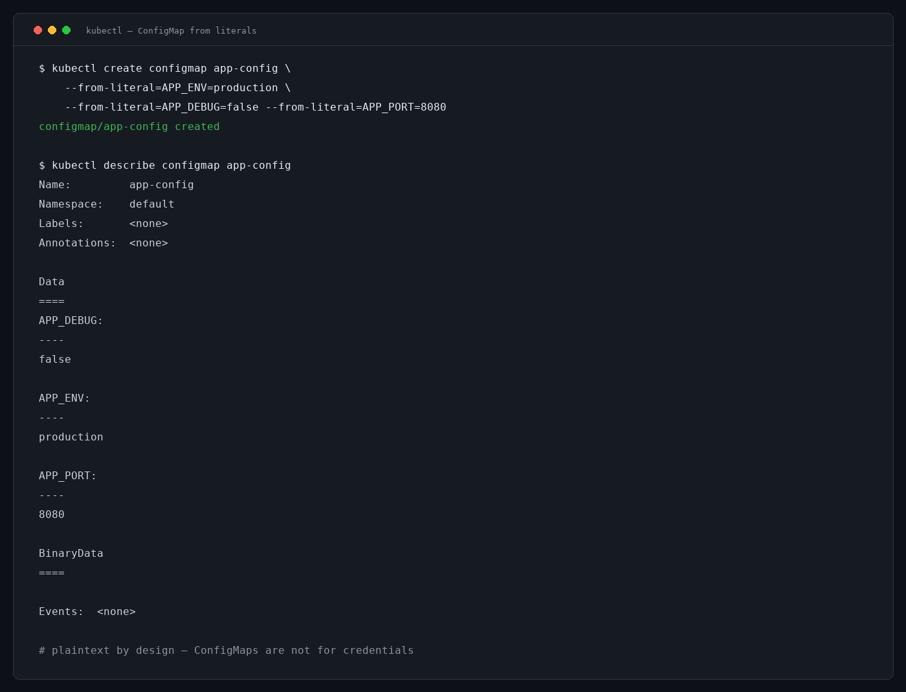
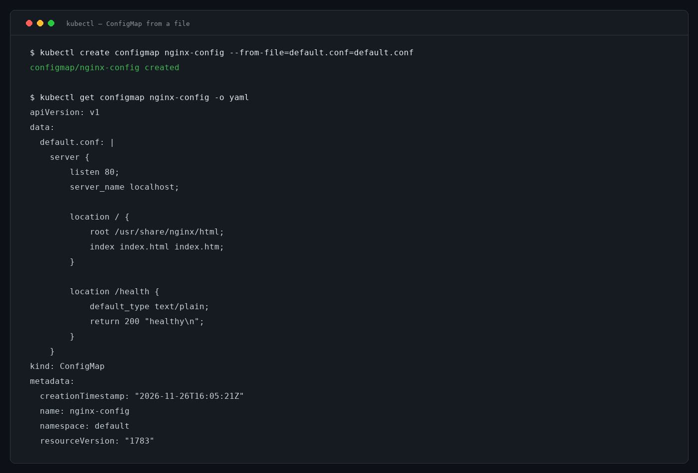
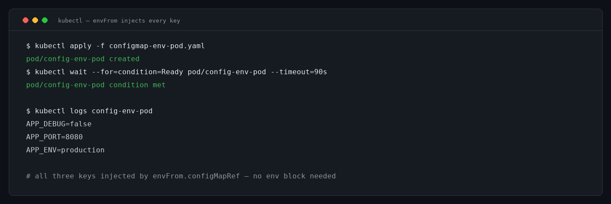
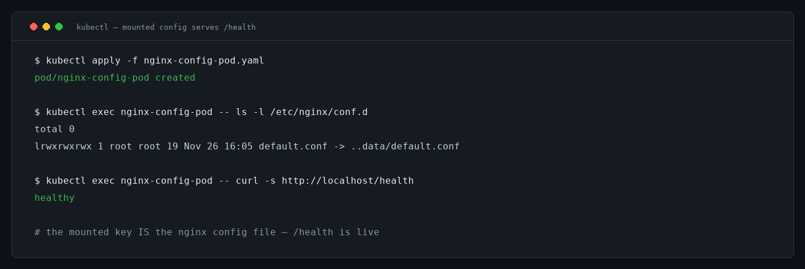
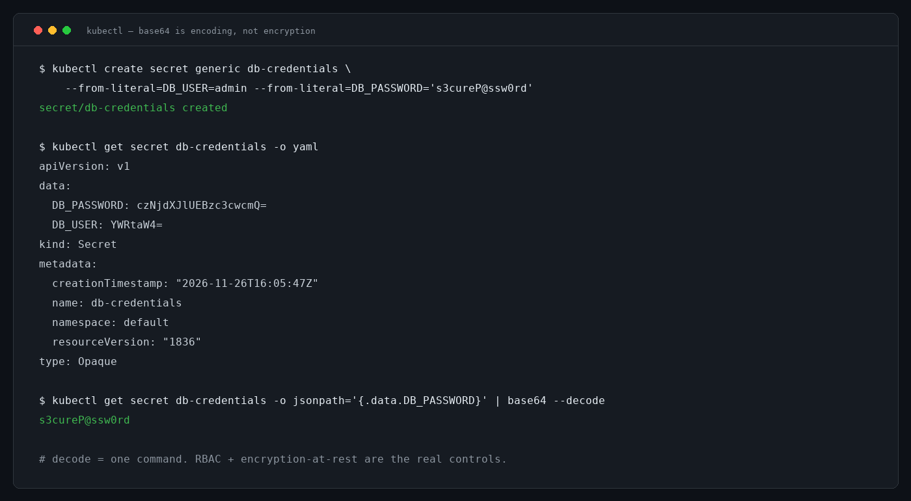
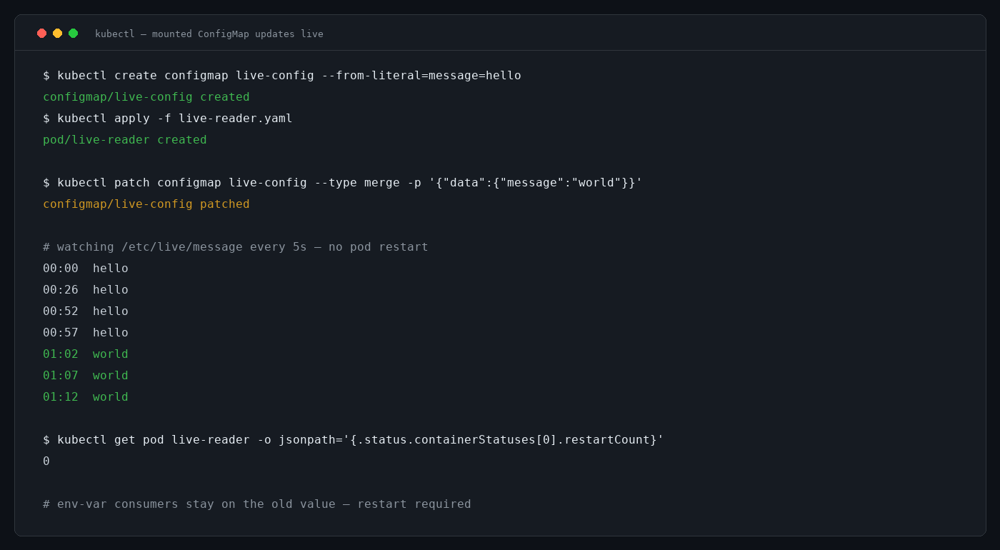

# Day 54 - Kubernetes ConfigMaps and Secrets

## Task

- Task 1: Create `app-config` from literals (`APP_ENV`, `APP_DEBUG`, `APP_PORT`) and inspect it.
- Task 2: Create `nginx-config` from `default.conf` with a `/health` endpoint.
- Task 3: Consume both ConfigMaps in Pods (`envFrom` + volume mount) and hit `/health`.
- Task 4: Create the `db-credentials` Secret and decode its base64 values.
- Task 5: Consume the Secret as a single env var and as a mounted volume; confirm plaintext files.
- Task 6: Patch `live-config` and watch the volume-mounted value change with no restart (env vars stay stale).
- Task 7: Clean up every Pod, ConfigMap and Secret.

## Environment

| OS / Tool | Version / Notes |
|---|---|
| OS | Windows 11 (10.0.26300) + Docker Desktop (WSL2 backend), run on 2026-11-26 |
| Docker | Server `29.9.3` (needed for kind) |
| `kubectl` | Client `v1.36.1`, server `v1.34.0` (minor-version-skew warning, harmless) |
| `kind` | `v0.30.0`, cluster `devops-cluster` reused from Day 50/53, node `kindest/node:v1.34.0` |
| Cluster | `devops-cluster-control-plane`, Ready, containerd `2.1.3` |
| Images | `nginx:1.25` (ships `curl` at `/usr/bin/curl`), `busybox:latest` |

The cluster from Day 53 was still there once Docker Desktop started, so no recreation step was needed:

```bash
kubectl get nodes -o wide
kubectl version
kind version
```

```text
NAME                           STATUS   ROLES           AGE   VERSION   INTERNAL-IP   EXTERNAL-IP   OS-IMAGE                         KERNEL-VERSION                      CONTAINER-RUNTIME
devops-cluster-control-plane   Ready    control-plane   33h   v1.34.0   172.19.0.2    <none>        Debian GNU/Linux 12 (bookworm)   6.18.58.1-microsoft-standard-WSL2   containerd://2.1.3

Client Version: v1.36.1
Server Version: v1.34.0
Warning: version difference between client (1.36) and server (1.34) exceeds the supported minor version skew of +/-1
kind v0.30.0 go1.24.6 windows/amd64
```

## Solution

### ConfigMaps vs Secrets, and env vars vs volumes

A **ConfigMap** stores non-sensitive key-value data or whole config files. A **Secret** stores the same shape of data for credentials, tokens and keys. Both live in the API server and are mounted into Pods at runtime, so the image stays the same while config changes.

| | ConfigMap | Secret |
|---|---|---|
| Intended content | Non-sensitive config (URLs, flags, `nginx.conf`) | Passwords, tokens, certs, API keys |
| Stored value | Plaintext in etcd | base64-encoded in etcd (encoding, not encryption) |
| `kubectl describe` | Shows the values | Shows only byte counts |
| Extra protections | — | RBAC separation, tmpfs on nodes, optional encryption at rest |

Two delivery methods, with a big behavioural difference:

| | Environment variables | Volume mount |
|---|---|---|
| Granularity | One key (`env`) or all keys (`envFrom`) | One file per key |
| Best for | Simple settings read once at startup | Full config files, certs, anything reloadable |
| Updates after edit | Never — frozen at container start | Yes, kubelet syncs the volume (~30-60s) |
| Requires restart | Yes | No (unless the app caches the file) |

### Task 1: Create a ConfigMap from Literals

`--from-literal` is for small values typed on the command line.

```bash
kubectl create configmap app-config \
  --from-literal=APP_ENV=production \
  --from-literal=APP_DEBUG=false \
  --from-literal=APP_PORT=8080

kubectl describe configmap app-config
kubectl get configmap app-config -o yaml
```

Actual output:

```text
configmap/app-config created
Name:         app-config
Namespace:    default
Labels:       <none>
Annotations:  <none>

Data
====
APP_DEBUG:
----
false

APP_ENV:
----
production

APP_PORT:
----
8080

BinaryData
====

Events:  <none>
```

```yaml
apiVersion: v1
data:
  APP_DEBUG: "false"
  APP_ENV: production
  APP_PORT: "8080"
kind: ConfigMap
metadata:
  creationTimestamp: "2026-11-26T16:05:16Z"
  name: app-config
  namespace: default
  resourceVersion: "1778"
  uid: c1c03e7f-0d7e-4535-a726-a51e2f7c052b
```

`describe` prints the values in the clear, and `APP_PORT` is a **string** (`"8080"`) even though it looks numeric — ConfigMap data is always string-to-string. This is exactly why ConfigMaps must never hold credentials.



**Verify:** all three key-value pairs were visible, as plaintext, in both `describe` and `-o yaml`.

### Task 2: Create a ConfigMap from a File

Full config files go in with `--from-file`. The form `key=path` sets the key name, and that key becomes the filename inside the Pod. `default.conf` (in this folder) adds a `/health` endpoint to the stock nginx config:

```nginx
server {
    listen 80;
    server_name localhost;

    location / {
        root /usr/share/nginx/html;
        index index.html index.htm;
    }

    location /health {
        default_type text/plain;
        return 200 "healthy\n";
    }
}
```

```bash
kubectl create configmap nginx-config --from-file=default.conf=default.conf
kubectl get configmap nginx-config -o yaml
```

Actual output:

```text
configmap/nginx-config created
apiVersion: v1
data:
  default.conf: |
    server {
        listen 80;
        server_name localhost;

        location / {
            root /usr/share/nginx/html;
            index index.html index.htm;
        }

        location /health {
            default_type text/plain;
            return 200 "healthy\n";
        }
    }
kind: ConfigMap
metadata:
  creationTimestamp: "2026-11-26T16:05:21Z"
  name: nginx-config
  namespace: default
  resourceVersion: "1783"
  uid: 30d51290-e851-4397-9d52-b009f1979f3c
```

The entire file sits under `data.default.conf` — one ConfigMap key can hold a whole config file, newlines included.



**Verify:** `-o yaml` showed the full `default.conf` contents under the `default.conf` key.

### Task 3: Use ConfigMaps in a Pod

**Pod 1 — every key as an env var** with `envFrom` (`configmap-env-pod.yaml`):

```yaml
apiVersion: v1
kind: Pod
metadata:
  name: config-env-pod
spec:
  restartPolicy: Never
  containers:
  - name: busybox
    image: busybox:latest
    command: ['sh', '-c', 'env | grep APP_ ; sleep 3600']
    envFrom:
    - configMapRef:
        name: app-config
```

```bash
kubectl apply -f configmap-env-pod.yaml
kubectl wait --for=condition=Ready pod/config-env-pod --timeout=90s
kubectl logs config-env-pod
```

Actual output:

```text
pod/config-env-pod created
pod/config-env-pod condition met
APP_DEBUG=false
APP_PORT=8080
APP_ENV=production
```



**Pod 2 — the config file mounted into nginx** with a volume (`nginx-config-pod.yaml`):

```yaml
apiVersion: v1
kind: Pod
metadata:
  name: nginx-config-pod
  labels:
    app: nginx-config
spec:
  containers:
  - name: nginx
    image: nginx:1.25
    ports:
    - containerPort: 80
    volumeMounts:
    - name: nginx-conf
      mountPath: /etc/nginx/conf.d
      readOnly: true
  volumes:
  - name: nginx-conf
    configMap:
      name: nginx-config
```

```bash
kubectl apply -f nginx-config-pod.yaml
kubectl wait --for=condition=Ready pod/nginx-config-pod --timeout=120s
kubectl exec nginx-config-pod -- ls -l /etc/nginx/conf.d
kubectl exec nginx-config-pod -- curl -s http://localhost/health
```

Actual output:

```text
pod/nginx-config-pod created
pod/nginx-config-pod condition met
total 0
lrwxrwxrwx 1 root root 19 Nov 26 16:05 default.conf -> ..data/default.conf
healthy
```

The mounted key appears as `/etc/nginx/conf.d/default.conf`, and nginx serves `healthy` from the new `/health` route — proof the mounted file, not an image-baked config, is in use. `nginx:1.25` already contains `curl` at `/usr/bin/curl`, so the in-pod test works without installing anything.



**Verify:** the env Pod logged all three `APP_*` variables, and `curl` inside the nginx Pod returned `healthy`.

### Task 4: Create a Secret

`kubectl create secret generic` works like a ConfigMap, except the values end up base64-encoded.

```bash
kubectl create secret generic db-credentials \
  --from-literal=DB_USER=admin \
  --from-literal=DB_PASSWORD='s3cureP@ssw0rd'

kubectl get secret db-credentials -o yaml
kubectl get secret db-credentials -o jsonpath='{.data.DB_PASSWORD}' | base64 --decode; echo
echo -n 's3cureP@ssw0rd' | base64
```

Actual output:

```text
secret/db-credentials created
apiVersion: v1
data:
  DB_PASSWORD: czNjdXJlUEBzc3cwcmQ=
  DB_USER: YWRtaW4=
kind: Secret
metadata:
  creationTimestamp: "2026-11-26T16:05:47Z"
  name: db-credentials
  namespace: default
  resourceVersion: "1836"
  uid: aa5db71a-ec7c-42a2-bc2a-b61686caf233
type: Opaque
```

The stored value `czNjdXJlUEBzc3cwcmQ=` decodes back to `s3cureP@ssw0rd`, and re-encoding the plaintext produces the same string — a clean round trip. Note `kubectl describe secret` would show only `DB_PASSWORD: 14 bytes`, not the value, so `-o yaml` is how you inspect (and decode) it.

base64 is **encoding**: anyone who can read the Secret can decode it in one command. The real protections are RBAC (who may `get` Secrets), tmpfs on the node (so it is not written to disk), and optional encryption-at-rest in etcd. For production, enable a KMS provider and never commit Secret manifests with real values.



**Verify:** the password decoded back to `s3cureP@ssw0rd` and `echo -n ... | base64` reproduced the stored value.

### Task 5: Use Secrets in a Pod

One key as an env var (`secretKeyRef`), plus the whole Secret mounted as files (`secret-pod.yaml`):

```yaml
apiVersion: v1
kind: Pod
metadata:
  name: secret-pod
spec:
  restartPolicy: Never
  containers:
  - name: busybox
    image: busybox:latest
    command: ['sh', '-c', 'env | grep DB_; echo "--- mounted files ---"; ls -l /etc/db-credentials; echo "--- DB_USER ---"; cat /etc/db-credentials/DB_USER; echo; echo "--- DB_PASSWORD ---"; cat /etc/db-credentials/DB_PASSWORD; echo; sleep 3600']
    env:
    - name: DB_USER
      valueFrom:
        secretKeyRef:
          name: db-credentials
          key: DB_USER
    volumeMounts:
    - name: db-creds
      mountPath: /etc/db-credentials
      readOnly: true
  volumes:
  - name: db-creds
    secret:
      secretName: db-credentials
```

```bash
kubectl apply -f secret-pod.yaml
kubectl wait --for=condition=Ready pod/secret-pod --timeout=90s
kubectl logs secret-pod
kubectl exec secret-pod -- cat /etc/db-credentials/DB_PASSWORD
```

Actual output:

```text
pod/secret-pod created
pod/secret-pod condition met
DB_USER=admin
--- mounted files ---
total 0
lrwxrwxrwx    1 root     root            18 Nov 26 16:06 DB_PASSWORD -> ..data/DB_PASSWORD
lrwxrwxrwx    1 root     root            14 Nov 26 16:06 DB_USER -> ..data/DB_USER
--- DB_USER ---
admin
--- DB_PASSWORD ---
s3cureP@ssw0rd
s3cureP@ssw0rd
```

Each Secret key became a file, and the file contents are **decoded plaintext** — base64 exists only in the API representation. This is why a compromised Pod means compromised credentials regardless of the encoding.

**Verify:** `DB_USER` was injected as an env var, both mounted files existed, and `cat` returned `admin` / `s3cureP@ssw0rd` (not base64).

### Task 6: Update a ConfigMap and Observe Propagation

Environment variables are snapshotted at container start; volume-mounted ConfigMaps are re-synced by the kubelet. This task proves both halves.

```bash
kubectl create configmap live-config --from-literal=message=hello
```

`live-reader.yaml` mounts `live-config` and prints the file every 5 seconds:

```yaml
apiVersion: v1
kind: Pod
metadata:
  name: live-reader
spec:
  restartPolicy: Never
  containers:
  - name: busybox
    image: busybox:latest
    command: ['sh', '-c', 'while true; do echo "message: $(cat /etc/live/message)"; sleep 5; done']
    volumeMounts:
    - name: live
      mountPath: /etc/live
  volumes:
  - name: live
    configMap:
      name: live-config
```

```bash
kubectl apply -f live-reader.yaml
kubectl exec live-reader -- cat /etc/live/message
# in another terminal:
kubectl patch configmap live-config --type merge -p '{"data":{"message":"world"}}'
```

Watching the mounted file every 5 seconds after the patch:

```text
configmap/live-config patched
00:00  hello
00:05  hello
00:10  hello
00:15  hello
00:21  hello
00:26  hello
00:31  hello
00:36  hello
00:41  hello
00:46  hello
00:52  hello
00:57  hello
01:02  world
01:07  world
01:12  world
01:17  world
```

The value flipped `hello` → `world` after about **62 seconds**, and the Pod never restarted (`restartCount=0`, `startTime` unchanged at `2026-11-26T16:06:29Z`). The path is atomic: kubelet writes a new timestamped directory and repoints the `..data` symlink, so a reader never sees a half-written file.

Now the env-var side. `app-config` was patched to `APP_ENV=staging` while `config-env-pod` was running:

```text
$ kubectl get configmap app-config -o jsonpath='{.data.APP_ENV}'
staging

$ kubectl exec config-env-pod -- env | grep APP_ENV
APP_ENV=production
```

The ConfigMap says `staging`; the Pod still says `production`. Environment variables are set once when the container starts — picking up a change requires recreating the Pod (or `kubectl rollout restart deployment/...`).



**Verify:** the volume-mounted value changed to `world` without a restart, while the env-var consumer stayed on the old value.

### Task 7: Clean Up

```bash
kubectl delete pod config-env-pod nginx-config-pod secret-pod live-reader --ignore-not-found
kubectl delete configmap app-config nginx-config live-config --ignore-not-found
kubectl delete secret db-credentials --ignore-not-found

kubectl get pods
kubectl get configmaps
kubectl get secrets
```

Actual output:

```text
pod "config-env-pod" deleted from default namespace
pod "nginx-config-pod" deleted from default namespace
pod "secret-pod" deleted from default namespace
pod "live-reader" deleted from default namespace
configmap "app-config" deleted from default namespace
configmap "nginx-config" deleted from default namespace
configmap "live-config" deleted from default namespace
secret "db-credentials" deleted from default namespace

No resources found in default namespace.
NAME               DATA   AGE
kube-root-ca.crt   1      33h
No resources found in default namespace.
```

Only the auto-created `kube-root-ca.crt` ConfigMap remains — every object created today is gone.

**Verify:** no Pods, no `app-config`/`nginx-config`/`live-config`, and no `db-credentials` Secret were left in `default`.

## Commands Used

```bash
kubectl create configmap app-config --from-literal=APP_ENV=production --from-literal=APP_DEBUG=false --from-literal=APP_PORT=8080
kubectl describe configmap app-config
kubectl get configmap app-config -o yaml
kubectl create configmap nginx-config --from-file=default.conf=default.conf
kubectl get configmap nginx-config -o yaml
kubectl apply -f configmap-env-pod.yaml
kubectl logs config-env-pod
kubectl apply -f nginx-config-pod.yaml
kubectl exec nginx-config-pod -- ls -l /etc/nginx/conf.d
kubectl exec nginx-config-pod -- curl -s http://localhost/health
kubectl create secret generic db-credentials --from-literal=DB_USER=admin --from-literal=DB_PASSWORD='s3cureP@ssw0rd'
kubectl get secret db-credentials -o yaml
kubectl get secret db-credentials -o jsonpath='{.data.DB_PASSWORD}' | base64 --decode
kubectl apply -f secret-pod.yaml
kubectl logs secret-pod
kubectl exec secret-pod -- cat /etc/db-credentials/DB_PASSWORD
kubectl create configmap live-config --from-literal=message=hello
kubectl apply -f live-reader.yaml
kubectl patch configmap live-config --type merge -p '{"data":{"message":"world"}}'
kubectl exec live-reader -- cat /etc/live/message
kubectl patch configmap app-config --type merge -p '{"data":{"APP_ENV":"staging"}}'
kubectl exec config-env-pod -- env | grep APP_ENV
kubectl delete pod config-env-pod nginx-config-pod secret-pod live-reader --ignore-not-found
kubectl delete configmap app-config nginx-config live-config --ignore-not-found
kubectl delete secret db-credentials --ignore-not-found
kubectl get pods
kubectl get configmaps
kubectl get secrets
```

> On my Windows host the two base64 one-liners and the 5-second polling loop were run through PowerShell equivalents (`[Convert]::FromBase64String`, a `for` loop with `Start-Sleep`); the commands above are the bash form shown in the task. All `kubectl` output is from the real run.

## Verification

- [x] `kubectl describe configmap app-config` showed `APP_ENV=production`, `APP_DEBUG=false`, `APP_PORT=8080`, all plaintext.
- [x] `kubectl get configmap nginx-config -o yaml` contained the whole `default.conf` under the `default.conf` key.
- [x] `kubectl logs config-env-pod` printed `APP_DEBUG`, `APP_PORT`, `APP_ENV` (via `envFrom`).
- [x] `kubectl exec nginx-config-pod -- curl -s http://localhost/health` returned `healthy`.
- [x] `kubectl get secret db-credentials -o yaml` showed both values base64-encoded; decoding returned `s3cureP@ssw0rd`.
- [x] `secret-pod` got `DB_USER=admin` from `secretKeyRef` and plaintext files under `/etc/db-credentials`.
- [x] After patching `live-config`, the mounted value flipped to `world` in ~62s with `restartCount=0`.
- [x] `config-env-pod` stayed on `APP_ENV=production` after `app-config` was patched to `staging`.
- [x] Cleanup left no Pods, no app ConfigMaps and no `db-credentials` Secret in `default`.

## Key Learnings

- ConfigMaps hold non-sensitive config, Secrets hold credentials — both decouple configuration from the image so you never rebuild to change a value.
- `--from-literal` is for small CLI values; `--from-file=key=path` embeds a whole file, and the key becomes the mounted filename.
- ConfigMap/Secret data is always string-to-string (`APP_PORT` became `"8080"`); Secret values are base64 in the API, decoded when mounted or injected.
- base64 is encoding, not encryption: `-o yaml` + `base64 --decode` recovers the plaintext instantly. RBAC, tmpfs and encryption-at-rest provide the actual protection.
- `envFrom` injects every key; `env` + `valueFrom` (or `secretKeyRef`) injects one key. Env vars are frozen at container start.
- Volume mounts create one file per key and auto-update (~30-60s) through the `..data` symlink swap; `subPath` mounts do not update.
- Mounted Secret files are plaintext, so anything that can read the volume already has the credential.
- Any ConfigMap update changes `resourceVersion`; apps that read config in a loop may still cache it, so "mounted" does not automatically mean "reloaded".
- `kubectl rollout restart deployment/<name>` is the standard way to pick up env-var or `envFrom` changes.
- `kubectl describe secret` hides values (byte counts only) and `describe configmap` shows them — a quick reminder of which object is meant for secrets.

## Troubleshooting / Gotchas

- `CreateContainerConfigError` on Pod start — cause: the referenced ConfigMap/Secret (or one key in `secretKeyRef`) is missing or misspelled. Fix: `kubectl describe pod <name>` shows the exact missing object, then check `kubectl get cm,secret`.
- `/health` returns 404 — cause: the file mounted at the wrong path or nginx still serving the default config. Fix: verify `mountPath: /etc/nginx/conf.d` and the key is `default.conf` (`kubectl exec ... -- ls -l /etc/nginx/conf.d`), then `nginx -T` to dump the loaded config.
- `curl: not found` inside the Pod — cause: slim/alpine images often lack curl. On `nginx:1.25` it exists at `/usr/bin/curl`; otherwise use `wget -qO-`, or test from a throwaway busybox Pod.
- Mounted value never updates — cause: you changed an env-var consumer (needs Pod recreate), used `subPath`, or checked within the sync window. Fix: wait 30-60s and confirm with `kubectl get cm <name> -o yaml` that the edit landed.
- `kubectl patch` fails with a JSON parse error — cause: PowerShell/cmd quoting of `-p '{"data":...}'`. Fix: run it from bash, or escape the quotes for your shell.
- A key is missing from the env — cause: `envFrom` silently skips keys that are not valid env var names (for example `my.key`). Fix: use `env` + `valueFrom` for those, or rename the key.
- ConfigMap edit rejected with `field is immutable` — cause: the ConfigMap was created with `immutable: true`. Fix: delete and recreate it (that is the point of immutable objects).
- Secret still shows old value after `kubectl apply` — cause: `apply` with a manifest that lacks the key leaves existing data in place, or the Pod was not restarted. Fix: patch explicitly and recreate/restart the consumer.
- base64 decode output looks corrupted — cause: the value was encoded with a trailing newline (`echo` instead of `echo -n`). Fix: always encode with `echo -n`, and append `; echo` only for display.

## Screenshots

All screenshots are embedded above, directly under the task they prove. Files live in `screenshots/`:

- `01-app-config.png` — Task 1: `describe` showing the three plaintext keys
- `02-nginx-config.png` — Task 2: `default.conf` stored as one ConfigMap key
- `03-env-pod-logs.png` — Task 3: `envFrom` injecting all keys
- `04-health-endpoint.png` — Task 3: mounted config serving `/health`
- `05-secret-decode.png` — Task 4: base64 values and the decode round trip
- `06-live-update.png` — Task 6: mounted value changing `hello` → `world` without a restart

Pod names, IPs, timestamps and resource versions are from my actual run on 2026-11-26; your values will differ.
