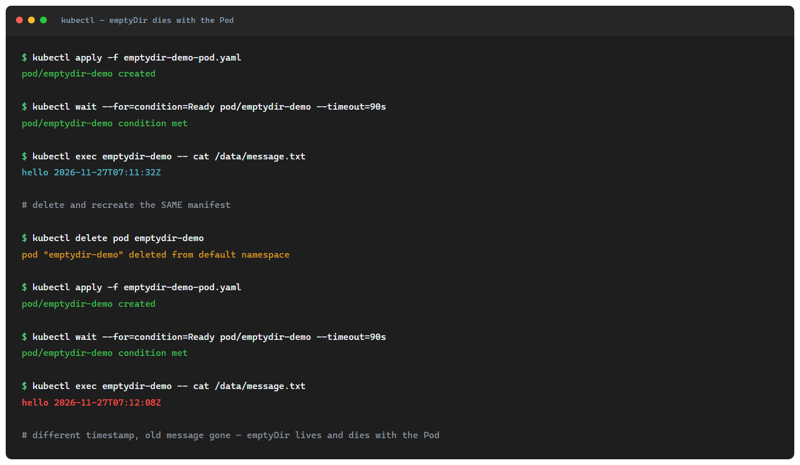
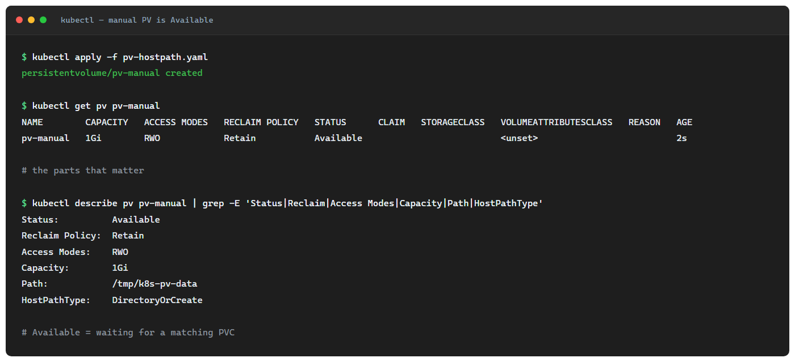
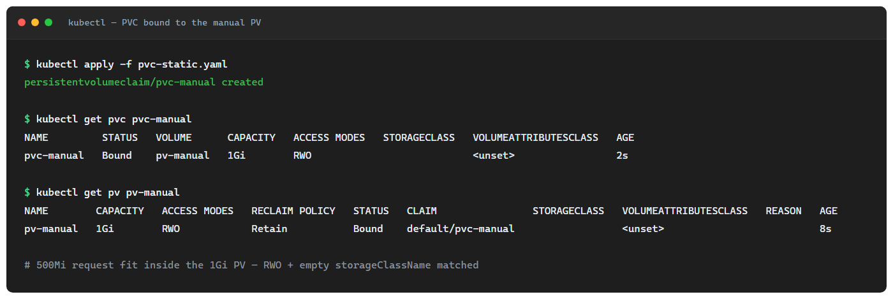
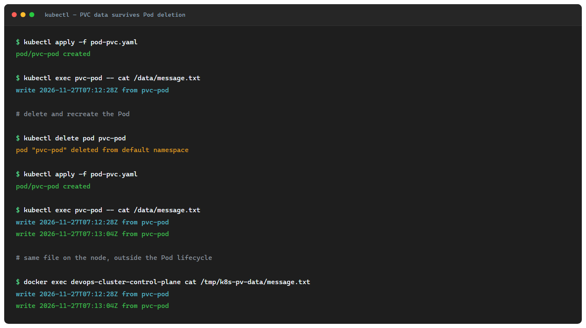
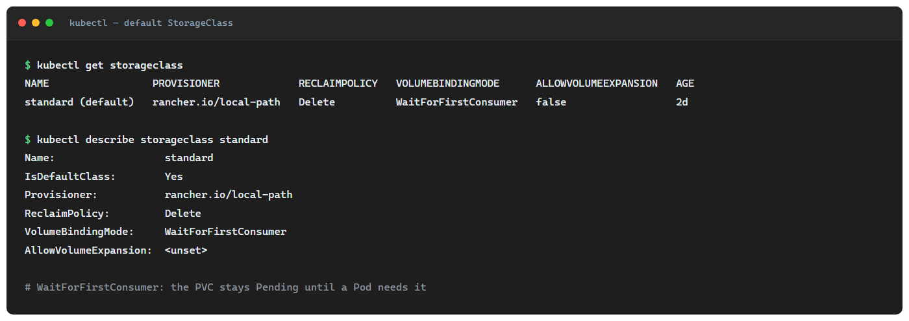
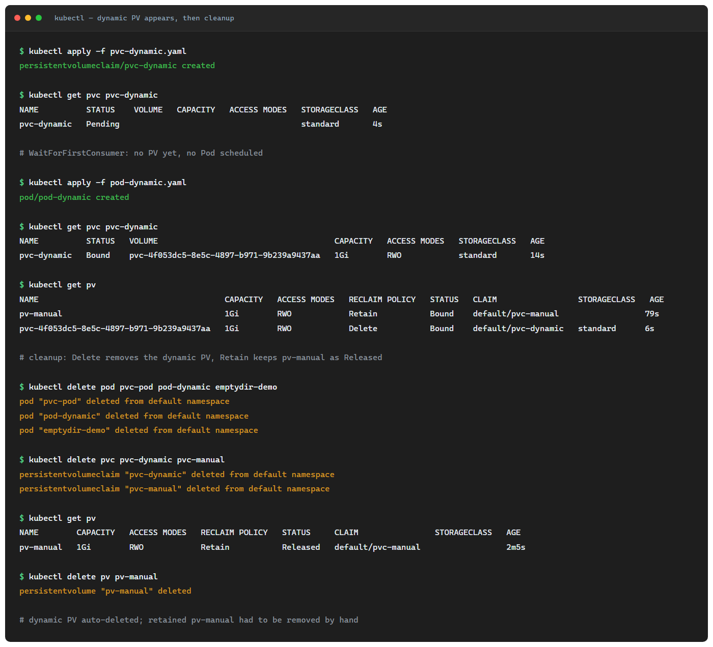

# Day 55 - Persistent Volumes (PV) and Persistent Volume Claims (PVC)

## Task

- Prove data loss with an ephemeral Pod backed by `emptyDir`.
- Create a static PersistentVolume (1Gi, RWO, `Retain`, `hostPath`) and see it `Available`.
- Create a 500Mi PVC, bind it to that PV, and confirm both show `Bound`.
- Mount the PVC in a Pod, delete the Pod, and prove the data survives.
- Inspect the default StorageClass and let it provision a PV dynamically.
- Clean up and observe `Retain` vs `Delete` reclaim behaviour.

## Environment

| OS / Tool | Version / Notes |
|---|---|
| OS | Windows 11 (10.0.26300) + Docker Desktop (WSL2 backend), run on 2026-11-27 |
| Docker | Server `29.9.3` (needed for kind) |
| `kubectl` | Client `v1.36.1`, server `v1.34.0` (minor-version-skew warning, harmless) |
| `kind` | `v0.30.0`, cluster `devops-cluster` reused from Day 50/53/54, node `kindest/node:v1.34.0` |
| Cluster | `devops-cluster-control-plane`, Ready, containerd `2.1.3` |
| Images | `busybox:latest` |
| Storage | `hostPath` under `/tmp/k8s-pv-data` for the static test; `standard` (`rancher.io/local-path`) for the dynamic test |

The Day 54 cluster was still running, so there was nothing to recreate:

```bash
kubectl get nodes -o wide
kubectl version
kind version
```

```text
NAME                           STATUS   ROLES           AGE   VERSION   INTERNAL-IP   EXTERNAL-IP   OS-IMAGE                         KERNEL-VERSION                      CONTAINER-RUNTIME
devops-cluster-control-plane   Ready    control-plane   2d    v1.34.0   172.19.0.2    <none>        Debian GNU/Linux 12 (bookworm)   6.18.58.1-microsoft-standard-WSL2   containerd://2.1.3

Client Version: v1.36.1
Kustomize Version: v5.8.1
Server Version: v1.34.0
Warning: version difference between client (1.36) and server (1.34) exceeds the supported minor version skew of +/-1

kind v0.30.0 go1.24.6 windows/amd64
```

## Solution

Everything in a container is tied to the Pod: the writable layer, `emptyDir`, `configMap`/`secret` volumes, and even `downwardAPI` files. Delete the Pod and all of it goes. A **PersistentVolume (PV)** is cluster-scoped storage owned by the admin; a **PersistentVolumeClaim (PVC)** is a namespaced request for a slice of it owned by the developer. The Pod mounts the PVC, never the PV.

| | PersistentVolume (PV) | PersistentVolumeClaim (PVC) |
|---|---|---|
| Scope | Cluster-wide | Namespaced |
| Created by | Admin (static) or provisioner (dynamic) | Developer |
| Describes | Actual storage: capacity, path/disk, reclaim policy | A request: size, access mode, storage class |
| Lifecycle | `Available` -> `Bound` -> `Released`/deleted | `Pending` -> `Bound` |
| Deleted with namespace | No | Yes |

Access modes and reclaim policies decide who can mount a volume and what happens to the data afterwards:

| Access mode | Short | Meaning |
|---|---|---|
| `ReadWriteOnce` | RWO | Read-write by a single node |
| `ReadOnlyMany` | ROX | Read-only by many nodes |
| `ReadWriteMany` | RWX | Read-write by many nodes (needs a networked provisioner) |

| Reclaim policy | On PVC deletion |
|---|---|
| `Retain` | PV stays, becomes `Released`, data untouched, manual cleanup required |
| `Delete` | PV and its backing storage are removed |
| `Recycle` | Deprecated; do not use |

Static provisioning means the admin writes PV manifests up front. Dynamic provisioning means the developer writes only a PVC with a `storageClassName`, and the class's provisioner creates the PV on demand. `hostPath` is single-node learning storage only — it breaks as soon as the Pod moves to another node.

### Task 1: See the Problem — Data Lost on Pod Deletion

`emptyDir` is scratch space that lives exactly as long as the Pod. The manifest writes one timestamped line and then sleeps so the container stays up:

`emptydir-demo-pod.yaml` (in this folder):

```yaml
apiVersion: v1
kind: Pod
metadata:
  name: emptydir-demo
spec:
  restartPolicy: Never
  containers:
  - name: writer
    image: busybox:latest
    command: ["sh", "-c", "echo \"hello $(date -u +%FT%TZ)\" > /data/message.txt; cat /data/message.txt; sleep 3600"]
    volumeMounts:
    - name: scratch
      mountPath: /data
  volumes:
  - name: scratch
    emptyDir: {}
```

```bash
kubectl apply -f emptydir-demo-pod.yaml
kubectl wait --for=condition=Ready pod/emptydir-demo --timeout=90s
kubectl exec emptydir-demo -- cat /data/message.txt
kubectl delete pod emptydir-demo
kubectl apply -f emptydir-demo-pod.yaml
kubectl wait --for=condition=Ready pod/emptydir-demo --timeout=90s
kubectl exec emptydir-demo -- cat /data/message.txt
```

Actual output:

```text
pod/emptydir-demo created
pod/emptydir-demo condition met
hello 2026-11-27T07:11:32Z
pod "emptydir-demo" deleted from default namespace
pod/emptydir-demo created
pod/emptydir-demo condition met
hello 2026-11-27T07:12:08Z
```



**Verify:** the timestamp changed from `07:11:32Z` to `07:12:08Z` and the second Pod started with an empty `/data` — the first message is gone.

### Task 2: Create a PersistentVolume (Static Provisioning)

`storageClassName: ""` explicitly opts this PV out of dynamic provisioning, so it can only satisfy a PVC that also asks for no class. Without it, a cluster with a default StorageClass may bind the claim to a dynamically provisioned PV instead of this one.

`pv-hostpath.yaml` (in this folder):

```yaml
apiVersion: v1
kind: PersistentVolume
metadata:
  name: pv-manual
spec:
  capacity:
    storage: 1Gi
  accessModes:
  - ReadWriteOnce
  persistentVolumeReclaimPolicy: Retain
  storageClassName: ""
  hostPath:
    path: /tmp/k8s-pv-data
    type: DirectoryOrCreate
```

```bash
kubectl apply -f pv-hostpath.yaml
kubectl get pv pv-manual
kubectl describe pv pv-manual
```

Actual output (trimmed to the fields that matter):

```text
persistentvolume/pv-manual created

NAME        CAPACITY   ACCESS MODES   RECLAIM POLICY   STATUS      CLAIM   STORAGECLASS   VOLUMEATTRIBUTESCLASS   REASON   AGE
pv-manual   1Gi        RWO            Retain           Available                          <unset>                          2s

Status:          Available
Reclaim Policy:  Retain
Access Modes:    RWO
Capacity:        1Gi
Path:            /tmp/k8s-pv-data
HostPathType:    DirectoryOrCreate
```



**Verify:** `STATUS` is `Available` — the PV exists but no claim has taken it yet.

### Task 3: Create a PersistentVolumeClaim

The claim asks for 500Mi. Kubernetes picks a PV at least that large with a compatible access mode and storage class. The claim is namespaced, so its `CLAIM` is `default/pvc-manual`.

`pvc-static.yaml` (in this folder):

```yaml
apiVersion: v1
kind: PersistentVolumeClaim
metadata:
  name: pvc-manual
spec:
  accessModes:
  - ReadWriteOnce
  storageClassName: ""
  resources:
    requests:
      storage: 500Mi
```

```bash
kubectl apply -f pvc-static.yaml
kubectl get pvc pvc-manual
kubectl get pv pv-manual
kubectl describe pvc pvc-manual
```

Actual output:

```text
persistentvolumeclaim/pvc-manual created

NAME         STATUS   VOLUME      CAPACITY   ACCESS MODES   STORAGECLASS   VOLUMEATTRIBUTESCLASS   AGE
pvc-manual   Bound    pv-manual   1Gi        RWO                           <unset>                 2s

NAME        CAPACITY   ACCESS MODES   RECLAIM POLICY   STATUS   CLAIM                STORAGECLASS   VOLUMEATTRIBUTESCLASS   REASON   AGE
pv-manual   1Gi        RWO            Retain           Bound    default/pvc-manual                  <unset>                          8s

Status:        Bound
Volume:        pv-manual
Capacity:      1Gi
Access Modes:  RWO
Used By:       <none>
```



**Verify:** the `VOLUME` column shows `pv-manual`, and the PV's `CLAIM` shows `default/pvc-manual`. Note the PVC reports 1Gi, not 500Mi: the claim asks for at least 500Mi, and the bound PV is exposed at its full size.

### Task 4: Use the PVC in a Pod — Data That Survives

The Pod references the claim, and the kubelet resolves it to `pv-manual`, which is a directory on the node. `>>` appends, so a second Pod should see the first Pod's line.

`pod-pvc.yaml` (in this folder):

```yaml
apiVersion: v1
kind: Pod
metadata:
  name: pvc-pod
spec:
  restartPolicy: Never
  containers:
  - name: app
    image: busybox:latest
    command: ["sh", "-c", "echo \"write $(date -u +%FT%TZ) from $(hostname)\" >> /data/message.txt; cat /data/message.txt; sleep 3600"]
    volumeMounts:
    - name: persist
      mountPath: /data
  volumes:
  - name: persist
    persistentVolumeClaim:
      claimName: pvc-manual
```

```bash
kubectl apply -f pod-pvc.yaml
kubectl wait --for=condition=Ready pod/pvc-pod --timeout=90s
kubectl exec pvc-pod -- cat /data/message.txt
kubectl delete pod pvc-pod
kubectl apply -f pod-pvc.yaml
kubectl wait --for=condition=Ready pod/pvc-pod --timeout=90s
kubectl exec pvc-pod -- cat /data/message.txt
```

Actual output:

```text
pod/pvc-pod created
pod/pvc-pod condition met
write 2026-11-27T07:12:28Z from pvc-pod
pod "pvc-pod" deleted from default namespace
pod/pvc-pod created
pod/pvc-pod condition met
write 2026-11-27T07:12:28Z from pvc-pod
write 2026-11-27T07:13:04Z from pvc-pod
```

The file can also be read straight from the node, because `hostPath` maps it into the node filesystem outside the Pod:

```bash
docker exec devops-cluster-control-plane cat /tmp/k8s-pv-data/message.txt
```

```text
write 2026-11-27T07:12:28Z from pvc-pod
write 2026-11-27T07:13:04Z from pvc-pod
```



**Verify:** after recreation the file contains both lines — the first Pod's `07:12:28Z` line and the second Pod's `07:13:04Z` line. Storage survived because it lives on the PV, not in the Pod.

### Task 5: StorageClasses and Dynamic Provisioning

A StorageClass tells the cluster which provisioner to use, when to bind, and what reclaim policy new PVs get.

```bash
kubectl get storageclass
kubectl describe storageclass standard
```

Actual output:

```text
NAME                 PROVISIONER             RECLAIMPOLICY   VOLUMEBINDINGMODE      ALLOWVOLUMEEXPANSION   AGE
standard (default)   rancher.io/local-path   Delete          WaitForFirstConsumer   false                  2d

Name:                  standard
IsDefaultClass:        Yes
Provisioner:           rancher.io/local-path
ReclaimPolicy:         Delete
VolumeBindingMode:     WaitForFirstConsumer
AllowVolumeExpansion:  <unset>
```



Two details worth remembering:

- `rancher.io/local-path` is kind's default provisioner. It creates a directory on the node that happens to host the Pod, which is why it uses `WaitForFirstConsumer`.
- `WaitForFirstConsumer` delays binding until a Pod is scheduled. With `Immediate`, a PVC binds (and a dynamic PV appears) as soon as the claim is created.

**Verify:** the default class is `standard`, backed by `rancher.io/local-path`, with reclaim policy `Delete` and binding mode `WaitForFirstConsumer`.

### Task 6: Dynamic Provisioning

This PVC names the default class but — unlike Task 3 — no matching PV exists. The provisioner must create one when the Pod is scheduled.

`pvc-dynamic.yaml` and `pod-dynamic.yaml` (in this folder):

```yaml
apiVersion: v1
kind: PersistentVolumeClaim
metadata:
  name: pvc-dynamic
spec:
  accessModes:
  - ReadWriteOnce
  storageClassName: standard
  resources:
    requests:
      storage: 1Gi
---
apiVersion: v1
kind: Pod
metadata:
  name: pod-dynamic
spec:
  restartPolicy: Never
  containers:
  - name: app
    image: busybox:latest
    command: ["sh", "-c", "echo dynamic-ok > /data/message.txt; cat /data/message.txt; sleep 3600"]
    volumeMounts:
    - name: dyn
      mountPath: /data
  volumes:
  - name: dyn
    persistentVolumeClaim:
      claimName: pvc-dynamic
```

```bash
kubectl apply -f pvc-dynamic.yaml
kubectl get pvc pvc-dynamic
kubectl apply -f pod-dynamic.yaml
kubectl wait --for=condition=Ready pod/pod-dynamic --timeout=90s
kubectl get pvc pvc-dynamic
kubectl get pv
kubectl exec pod-dynamic -- cat /data/message.txt
```

Actual output:

```text
persistentvolumeclaim/pvc-dynamic created

NAME          STATUS    VOLUME   CAPACITY   ACCESS MODES   STORAGECLASS   AGE
pvc-dynamic   Pending                                      standard       4s

pod/pod-dynamic created
pod/pod-dynamic condition met

NAME          STATUS   VOLUME                                     CAPACITY   ACCESS MODES   STORAGECLASS   AGE
pvc-dynamic   Bound    pvc-4f053dc5-8e5c-4897-b971-9b239a9437aa   1Gi        RWO            standard       14s

NAME                                       CAPACITY   ACCESS MODES   RECLAIM POLICY   STATUS   CLAIM                 STORAGECLASS   AGE
pv-manual                                  1Gi        RWO            Retain           Bound    default/pvc-manual                  79s
pvc-4f053dc5-8e5c-4897-b971-9b239a9437aa   1Gi        RWO            Delete           Bound    default/pvc-dynamic   standard      6s

dynamic-ok
```



The `Pending` state is expected here: `WaitForFirstConsumer` means no PV is created until `pod-dynamic` is scheduled. The moment the Pod lands, the provisioner creates `pvc-<uuid>` and the claim binds. There are now two PVs: `pv-manual` (static, `Retain`) and `pvc-4f05...` (dynamic, `Delete`).

**Verify:** `kubectl get pv` shows two PVs; the `pvc-<uuid>` one was created automatically and carries the class's `Delete` policy.

### Task 7: Clean Up

Delete Pods first so volumes unmount cleanly, then the claims, then the retained PV by hand.

```bash
kubectl delete pod pvc-pod pod-dynamic emptydir-demo
kubectl delete pvc pvc-dynamic pvc-manual
kubectl get pv
kubectl delete pv pv-manual
kubectl get pv,pvc,pods
```

Actual output:

```text
pod "pvc-pod" deleted from default namespace
pod "pod-dynamic" deleted from default namespace
pod "emptydir-demo" deleted from default namespace
persistentvolumeclaim "pvc-dynamic" deleted from default namespace
persistentvolumeclaim "pvc-manual" deleted from default namespace

NAME        CAPACITY   ACCESS MODES   RECLAIM POLICY   STATUS     CLAIM                STORAGECLASS   AGE
pv-manual   1Gi        RWO            Retain           Released   default/pvc-manual                  2m5s

persistentvolume "pv-manual" deleted

No resources found
```

**Verify:** the dynamic `pvc-4f05...` PV disappeared on its own (`Delete` policy), while `pv-manual` stayed behind as `Released` (`Retain` policy) until it was deleted manually.

## Commands Used

```bash
kubectl apply -f emptydir-demo-pod.yaml
kubectl wait --for=condition=Ready pod/emptydir-demo --timeout=90s
kubectl exec emptydir-demo -- cat /data/message.txt
kubectl delete pod emptydir-demo
kubectl apply -f emptydir-demo-pod.yaml
kubectl wait --for=condition=Ready pod/emptydir-demo --timeout=90s
kubectl exec emptydir-demo -- cat /data/message.txt

kubectl apply -f pv-hostpath.yaml
kubectl get pv pv-manual
kubectl describe pv pv-manual

kubectl apply -f pvc-static.yaml
kubectl get pvc pvc-manual
kubectl get pv pv-manual
kubectl describe pvc pvc-manual

kubectl apply -f pod-pvc.yaml
kubectl wait --for=condition=Ready pod/pvc-pod --timeout=90s
kubectl exec pvc-pod -- cat /data/message.txt
kubectl delete pod pvc-pod
kubectl apply -f pod-pvc.yaml
kubectl wait --for=condition=Ready pod/pvc-pod --timeout=90s
kubectl exec pvc-pod -- cat /data/message.txt
docker exec devops-cluster-control-plane cat /tmp/k8s-pv-data/message.txt

kubectl get storageclass
kubectl describe storageclass standard

kubectl apply -f pvc-dynamic.yaml
kubectl get pvc pvc-dynamic
kubectl apply -f pod-dynamic.yaml
kubectl wait --for=condition=Ready pod/pod-dynamic --timeout=90s
kubectl get pvc pvc-dynamic
kubectl get pv
kubectl exec pod-dynamic -- cat /data/message.txt

kubectl delete pod pvc-pod pod-dynamic emptydir-demo
kubectl delete pvc pvc-dynamic pvc-manual
kubectl get pv
kubectl delete pv pv-manual
kubectl get pv,pvc,pods
```

## Verification

- Recreating the `emptyDir` Pod produced a new timestamp (`07:11:32Z` -> `07:12:08Z`) and lost the old message.
- `kubectl get pv pv-manual` showed `Available` after Task 2, then `Bound` with `CLAIM default/pvc-manual` after Task 3.
- `kubectl get pvc pvc-manual` showed `STATUS Bound`, `VOLUME pv-manual`, `CAPACITY 1Gi`.
- After deleting and recreating `pvc-pod`, `/data/message.txt` held both write lines, and the same file existed on the node at `/tmp/k8s-pv-data/message.txt`.
- `kubectl get storageclass` showed `standard (default)` with provisioner `rancher.io/local-path`, reclaim policy `Delete`, binding mode `WaitForFirstConsumer`.
- The dynamic PVC stayed `Pending` until `pod-dynamic` was created, then bound to an auto-created `pvc-<uuid>` PV.
- After cleanup, the dynamic PV was auto-deleted, `pv-manual` was `Released` until deleted manually, and `kubectl get pv,pvc,pods` returned `No resources found`.

## Key Learnings

- Containers and `emptyDir` are ephemeral: deleting the Pod wipes everything written locally.
- PV = cluster-scoped storage object (admin view); PVC = namespaced request (developer view). Pods mount the PVC and never the PV directly.
- Binding matches requested capacity (PV size >= request), access modes, `storageClassName`, and volume mode. The claim then shows the PV's full capacity.
- Access modes: RWO (one node read-write), ROX (many nodes read-only), RWX (many nodes read-write, needs networked storage).
- Reclaim policies: `Retain` keeps the PV as `Released` after claim deletion (manual cleanup); `Delete` removes the PV and its backing storage.
- PV lifecycle: `Available` -> `Bound` -> `Released` (Retain) or deleted (Delete).
- `storageClassName: ""` disables dynamic provisioning and is required on a static PV/PVC pair when a default class exists.
- `hostPath` is single-node learning storage: it breaks if the Pod moves nodes and is never for production.
- Dynamic provisioning: the developer creates only a PVC; with `WaitForFirstConsumer` the PV appears once a Pod is scheduled, not at claim creation.

## Troubleshooting / Gotchas

- PVC stuck `Pending`: request larger than any PV, access-mode mismatch, storage class mismatch, or `WaitForFirstConsumer` with no Pod yet — check `kubectl describe pvc` events.
- Static PVC bound to a dynamic PV instead of `pv-manual`: `storageClassName: ""` was missing on the PV or the PVC.
- A `Retain` PV stuck in `Released` will not rebind: delete the PV object, clean the host directory (`/tmp/k8s-pv-data` on the node), and recreate it.
- Pod stuck in `ContainerCreating` with `Unable to attach or mount volumes`: the claim is not bound yet, or a previous Pod still holds the volume — check `kubectl describe pod`.
- Reading `hostPath` data from the host looks empty on Docker Desktop/kind: the path lives inside the node container, not on Windows. Use `docker exec <node> cat <path>`.
- `kubectl get pvc` reporting a capacity larger than requested is normal; the bound PV's size wins.

## Screenshots

All screenshots are embedded above, directly under the task they prove. Files live in `screenshots/`:

- `01-emptydir-lost.png` — Task 1
- `02-pv-available.png` — Task 2
- `03-pvc-bound.png` — Task 3
- `04-data-survives.png` — Task 4
- `05-storageclass.png` — Task 5
- `06-dynamic-pv.png` — Tasks 6 and 7

Timestamps, UUIDs and ages are from the actual run on 2026-11-27; substitute your own output when you re-capture them.
